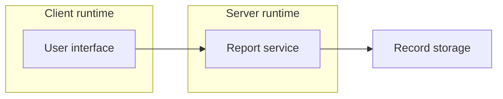

> Starter document. `bkit install` does not write this file and does not overwrite a copy. Copy it to `docs/architecture.md`, fill it in, then delete this introduction.
>
> **Fill these first:** `docs/technology.md`.
>
> **Finish against:** none.
>
> **Where the facts come from:** the repository's top-level folders and package manifests, the build and deploy configuration, the CI configuration and the infrastructure files.
>
> **Fill in:**
>
> 1. Copy this starter to `docs/architecture.md`.
> 2. List the top-level source folders and the package manifests, and group them into runtimes: parts that run in one process or one place.
> 3. Draw `## System context` as one chart with a `subgraph` per runtime, and name each runtime and external system as the tables below name them.
> 4. Fill `## Containers` with one row per runtime and what it owns.
> 5. Fill `## Package boundaries` with who may call whom, and name the check that enforces each boundary.
> 6. Fill `## File placement` with one row per kind of file the repository holds. Agents place every new file by this table.
> 7. Fill `## Environments` with where each part runs. Leave each environment's branch, URL and release trigger to `docs/deployments.md`.
> 8. Record unresolved facts under `## Open questions`.
> 9. Add this row to the `## Project Documents` table in `.agents/docs.md`: | `docs/architecture.md` | ● | ● | ● | ○ | ○ | How the system is built and where it runs: runtimes, package boundaries, file placement and environments. |
> 10. Check the document against each completion check, then delete this introduction.
>
> **If it does not apply:** every project has a structure. Write `Not applicable: {reason}` under a section that does not apply, such as `## Package boundaries` for a single-package repository.
>
> **Completion checks:**
>
> - Exactly one Mermaid chart, and it renders in a Mermaid-capable viewer.
> - Every runtime in the chart has a row in `## Containers`.
> - Every top-level source folder appears in a row of `## File placement`.
> - Every environment names where it runs, with no branch, URL or release trigger.
> - No example row remains.

# Architecture

> [!CAUTION]
> **Purpose:** How the system is built and where it runs: runtimes, package boundaries, file placement and environments.
>
> **Rules:**
>
> - Follow `.bkit/authoring.md` § Docs when you edit this file.
> - Hold topology and boundaries only. Library lists and operational rules go in the domain docs.
> - Cite the repository evidence for each fact: a path, a configuration file or a CI job.
>
> **Not here:** The chosen libraries go in `docs/technology.md`. Each environment's branch, URL and release trigger go in `docs/deployments.md` § Environments. Purpose-based responsibilities go in `docs/components.md`.
>
> **Update when:** A package, runtime or kind of file is added or removed, a boundary shifts, or an environment is added or removed.

## System context

[The runtimes of the system and the external systems each one talks to. The arrows show which part calls which.]

## Containers

<!-- prettier-ignore -->
| Runtime | Owns | Talks to |
| --- | --- | --- |
| [Runtime name] | [What it is responsible for.] | [Other runtimes and external systems.] |
| [e.g., Report service] | Report preparation and saving. | The user interface and record storage. |

## Package boundaries

<!-- prettier-ignore -->
| Package or folder | May call | Must not call | Enforced by |
| --- | --- | --- | --- |
| [Package or folder] | [What it may depend on.] | [What it must not depend on.] | [Check or review step.] |
| [e.g., Report service] | The shared library. | The user interface. | The import-boundary lint rule. |

## File placement

<!-- prettier-ignore -->
| Kind of file | Goes in | Naming |
| --- | --- | --- |
| [Kind of file] | [Folder.] | [Name pattern.] |
| [e.g., Unit test] | Next to the file it tests. | The source file's name with a test suffix. |

## Environments

<!-- prettier-ignore -->
| Environment | Hosting | Data store | Who uses it |
| --- | --- | --- | --- |
| [Environment] | [Where the parts run.] | [Which store it uses.] | [Who uses it.] |
| [e.g., Production] | A managed hosting platform. | The production database. | End users. |

## Open questions

[Each unresolved fact, who can answer it and which section it affects.]
