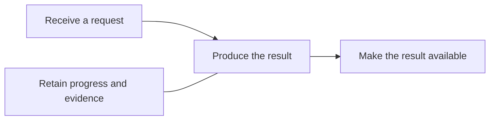

> Example document. Copy it to `docs/components.md` and own it. `bkit install` does not write this file and does not overwrite a copy. Remove this introduction after copying.

# Components

> [!CAUTION]
> **Purpose:** A purpose-based view of what the repository does, its major responsibilities and how they work together, readable without inspecting the code.
>
> **Rules:**
>
> - Group components by the purpose they serve, independently of files, packages and deployment units.
> - Describe each component's responsibility and its relationships in plain language.
> - Keep implementation boundaries and deployment topology in `docs/architecture.md`.
> - Reference `docs/capabilities.md` when present for implementation ownership and drift. Components and capabilities may have different names, counts and boundaries.
> - Distinguish current behavior from agreed scope, proposals and later candidates.
> - Update this document when the repository's purpose, responsibilities or main journeys change.

## Repository purpose

[Who uses the repository, what problem it solves and what outcome it produces. State what kind of system it is and its main limits.]

## Component map

[Show the main relationships between purpose groups. Arrows show collaboration or handoffs, not every call or a required execution order. Replace this example with the repository's responsibilities.]

## Component breakdown

<!-- prettier-ignore -->
| Purpose | Component | Responsibility | Works with |
| --- | --- | --- | --- |
| [Outcome served] | [Plain-language name] | [What it does and produces, without requiring code knowledge.] | [Other components or external actors, and what they exchange.] |

## Main journeys

### [User goal]

1. [Who starts the journey and what they provide.]
2. [Which responsibilities collaborate to produce the result.]
3. [What the user receives, including any review or recovery path.]

## Shared foundations

[Cross-cutting responsibilities such as permissions, persistence, configuration and operational evidence. Link to their canonical docs for implementation details.]

## Scope

[State whether the map describes the current system or an agreed target. For a planned system, distinguish agreed initial scope, proposals and later candidates. Keep issue state and delivery plans in their existing homes.]

## Related views

<!-- prettier-ignore -->
| View | Question it answers |
| --- | --- |
| `docs/architecture.md` | How is the system implemented and deployed? |
| `docs/capabilities.md`, when present | Where is a capability implemented, and do callers use its owner? |
| `floorplan/`, when present | How can I explore the code's files, connections and guided flows? |

[Turn references into links for the views the repository has. Keep missing views explicitly optional. The component map is maintained independently of generated views; one component may span several capabilities, and a capability may serve several components.]
