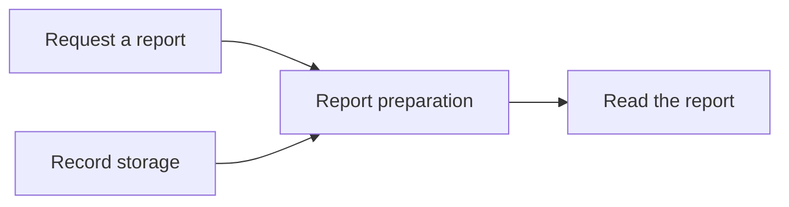

> Starter document. `bkit install` does not write this file and does not overwrite a copy. Copy it to `docs/components.md`, fill it in, then delete this introduction.
>
> **Fill these first:** `docs/idea.md`.
>
> **Finish against:** none.
>
> **Where the facts come from:** `docs/idea.md`, the repository's README, any approved specification and, once code exists, its main entry points.
>
> **Fill in:**
>
> 1. Copy this starter to `docs/components.md`.
> 2. Read `docs/idea.md`, the README and any approved specification.
> 3. **If** an implementation exists → check its main entry points and representative behavior against those sources before describing anything as current.
> 4. **If** no implementation exists → use the approved specification as the source for a planned view.
> 5. **If** neither source establishes the purpose, intended users or main journey → ask the owner for that missing context before filling the affected sections.
> 6. Select components by distinct responsibilities or outcomes, including supporting work the main journeys depend on. Code that serves one purpose can share a component; separate a responsibility when it has its own outcome or a meaningful handoff.
> 7. Replace the bracketed fields and example rows with the project's facts, keeping the rules box.
> 8. Fill `## Constraints` from `docs/idea.md`, and name the source of each row.
> 9. Record unresolved facts under `## Open questions`, separate from current behavior and approved plans.
> 10. Add this row to the `## Project Documents` table in `.agents/docs.md`: | `docs/components.md` | ○ | ● | ○ | ○ | ○ | A purpose-based view of what the repository does, its major responsibilities and how they work together, readable without inspecting the code. |
> 11. Check the document against each completion check, then delete this introduction.
>
> **If it does not apply:** every repository has components. Write `Not applicable: {reason}` under a section that does not apply, such as Delivery and ownership for a repository without distinct distributed content. Core, Shared and Templates are examples, not required categories.
>
> **Completion checks:**
>
> - The opening identifies the users, problem, result and main limits without requiring code knowledge.
> - Each component has a purpose, a responsibility and a named collaborator or external actor.
> - Each main journey leads from an input to an outcome, with a failure or review path where relevant.
> - Exactly one Mermaid chart uses names consistent with the tables and explains what its arrows mean.
> - The chart renders in a Mermaid-capable viewer.
> - Every claimed current responsibility is supported by the implementation or project evidence; planned responsibilities and unknowns are labelled separately.
> - Every constraint names its source in `docs/idea.md`.
> - References link to existing documents; missing optional views are marked as unavailable rather than linked to nonexistent files.
> - Implementation detail stays in its canonical document rather than being copied into this overview.
> - No instructional placeholders or unrelated example content remain.

# Components

> [!CAUTION]
> **Purpose:** A purpose-based view of what the repository does, its major responsibilities and how they work together, readable without inspecting the code.
>
> **Rules:**
>
> - Follow `.bkit/authoring.md` § Docs when you edit this file.
> - Group components by the purpose they serve, independently of files, packages and deployment units.
> - Describe each component's responsibility and its relationships in plain language.
> - Distinguish current behavior from agreed scope, proposals and later candidates.
> - Components and capabilities may have different names, counts and boundaries.
>
> **Not here:** Implementation boundaries and deployment topology go in `docs/architecture.md`. Implementation ownership and drift go in `docs/capabilities.md` when present. Issue state and delivery plans stay in the tracker.
>
> **Update when:** The repository's purpose, responsibilities, constraints or main journeys change.

## Repository purpose

[The intended users, problem, result and main limits of the repository.]

[The core concepts expressed as responsibilities, with links to the existing product guide or specification for detail.]

## Constraints

[The platforms, offline behavior, live-update needs, scale and hard external requirements the repository must meet.]

<!-- prettier-ignore -->
| Constraint | What it requires | Source in `docs/idea.md` |
| --- | --- | --- |
| [Constraint] | [What it requires of the repository.] | [The `docs/idea.md` passage that states it.] |
| [e.g., Works offline] | Reports open and save without a network connection. | The "Field use" notes. |

## Open questions

[Each unresolved fact, who can answer it and which section it affects.]

## Primary workflows

[The main workflows, including any optional stages, direct entry points and recovery paths.]

<!-- prettier-ignore -->
| Workflow | Purpose | Starts with | Produces |
| --- | --- | --- | --- |
| [User-recognizable workflow] | [Outcome it is responsible for.] | [Input or trigger.] | [Result or handoff.] |
| [e.g., Produce a report] | Turn selected records into a readable summary. | A user's request and selected records. | A saved report ready to read. |

## Delivery and ownership

[The distinct kinds of content the repository distributes, their purposes and who maintains the installed or adopted result.]

<!-- prettier-ignore -->
| Part | Purpose | What it supplies | Maintained by |
| --- | --- | --- | --- |
| [Project-specific part] | [Outcome served.] | [Responsibilities grouped by purpose.] | [Owner of the delivered result.] |
| [e.g., Optional report layouts] | Adapt reports to an organization's needs. | Layout examples copied into the project. | The adopting project maintains its copies. |

## Component map

[One chart of the main responsibilities, workflows and supporting relationships, including delivery roles or supported hosts and providers where central to the product.]

[What the arrows mean and whether they show a sequence, collaboration or dependency.]

## Component breakdown

<!-- prettier-ignore -->
| Purpose | Component | Responsibility | Works with |
| --- | --- | --- | --- |
| [Outcome served] | [Plain-language name] | [What it does and produces, without requiring code knowledge.] | [Other components or external actors, and what they exchange.] |
| [e.g., Produce a report] | Report preparation | Validate selected records and turn them into a saved summary. | Record storage supplies the inputs; the reader receives the report. |

## Main journeys

### [User goal]

1. [Who starts the journey and what they provide.]
2. [Which responsibilities collaborate to produce the result.]
3. [What the user receives, including any review or recovery path.]

## Shared foundations

[Responsibilities used across the main components, such as permissions, persistence, configuration and operational evidence, with links to their canonical documents.]

## Scope

[Whether this is a current or planned view, with agreed scope, proposals, later candidates and open questions distinguished. Links to the existing homes of delivery plans and issue state.]

## Related views

<!-- prettier-ignore -->
| View | Question it answers |
| --- | --- |
| `docs/architecture.md`, when present | How is the system implemented and deployed? |
| `docs/capabilities.md`, when present | Where is a capability implemented, and do callers use its owner? |
| `floorplan/`, when present | How can I explore the code's files, connections and guided flows? |
| [e.g., Product guide] | What does the product do, for whom? |

[Links to the available views above and the repository's product guide or specification. Missing views identified as unavailable.]
