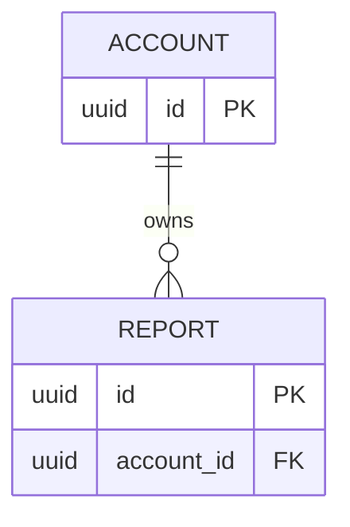

> Starter document. `bkit install` does not write this file and does not overwrite a copy. Copy it to `docs/data-schema.md`, fill it in, then delete this introduction.
>
> **Fill these first:** `docs/security.md`.
>
> **Finish against:** none.
>
> **Where the facts come from:** the migration files, the schema definition or model files, the access-policy definitions, and a generated schema export when the database tool can produce one.
>
> **Fill in:**
>
> 1. Copy this starter to `docs/data-schema.md`.
> 2. Fill `## Overview` with the stores the project uses, and draw each table's keys and relationships in the chart.
> 3. Copy the `## [Table name]` section once per table, and fill its fields, indices, access policies and `Pending` list. Read the personal-data fields from `docs/security.md` § PII, and add each one's table and field to the "Where stored" column there.
> 4. Fill `## Functions` with each stored function and trigger.
> 5. Record unresolved facts under `## Open questions`.
> 6. Add this row to the `## Project Documents` table in `.agents/docs.md`: | `docs/data-schema.md` | ○ | ○ | ● | ○ | ○ | The active production schema: tables, fields, access policies, indices, functions and triggers. |
> 7. Check the document against each completion check, then delete this introduction.
>
> **If it does not apply:** write `Not applicable: no persistent store` under `## Overview` and remove the other sections except `## Open questions`.
>
> **Completion checks:**
>
> - Every table in the migration files has a section.
> - Every key and relationship in the chart matches a field in a table section.
> - Every personal-data field in `docs/security.md` § PII appears in a table section.
> - No example row remains.

# Data Schema

> [!CAUTION]
> **Purpose:** The active production schema: tables, fields, access policies, indices, functions and triggers.
>
> **Rules:**
>
> - Follow `.bkit/authoring.md` § Docs when you edit this file.
> - Give each table one section, holding a `Field | Type | Unique | Notes` table, `Indices` and `Pending`.
> - `Pending` means a change a migration on an open branch will make and the production schema does not yet have. Move it into the table when the migration deploys.
> - When the database tool generates a schema export, link it instead of copying it here.
> - For a field whose existence is a decision, link its ADR in `decisions.jsonl`, and do not restate the rationale.
>
> **Not here:** How personal data is protected goes in `docs/security.md` § PII. Migration order and deploy steps go in `docs/deployments.md` § Applying migrations at deploy time. Test fixtures go in `docs/testing.md` § Test data.
>
> **Update when:** A table, field, index, access policy, function or trigger is added, changed or removed in production.

## Overview

[The stores the project uses, and how its tables relate.]

## [Table name]

[What the table holds.]

<!-- prettier-ignore -->
| Field | Type | Unique | Notes |
| --- | --- | --- | --- |
| [Field name] | [Type.] | [Yes or no.] | [Default, constraint or link to a decision.] |
| [e.g., id] | uuid | Yes | Primary key. |

**Indices:** [Each index and the query it serves.]

**Access policies:** [Who may read and write each row.]

**Pending:** [Changes a migration on an open branch will make, or none.]

## Functions

<!-- prettier-ignore -->
| Function or trigger | Fires on | Does |
| --- | --- | --- |
| [Name] | [Call or event.] | [What it does.] |
| [e.g., set_updated_at] | Update of a report row. | Sets the update time. |

## Open questions

[Each unresolved fact, who can answer it and which section it affects.]
