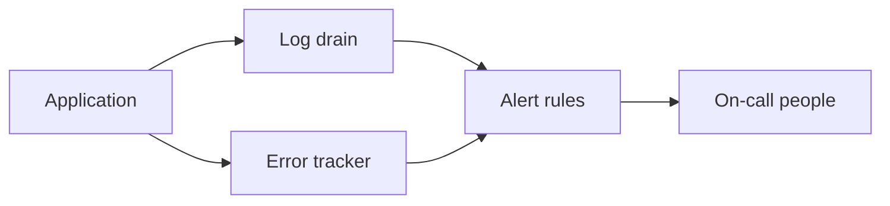

> Starter document. `bkit install` does not write this file and does not overwrite a copy. Copy it to `docs/observability.md`, fill it in, then delete this introduction.
>
> **Fill these first:** `docs/architecture.md`.
>
> **Finish against:** `docs/security.md` for `## Log format`, which is checked against the personal data that doc lists, so none of it gets logged.
>
> **Where the facts come from:** the logger module and its configuration, the code that emits named log events, spans and metrics, the error-tracker and log-drain configuration, and the alert rules.
>
> **Fill in:**
>
> 1. Copy this starter to `docs/observability.md`.
> 2. Redraw `## Signal pipeline` as the path a signal takes from the application to the people who act on it.
> 3. Fill `## Log format` by naming the logger module and the call every log line goes through, then the fields each line carries.
> 4. Fill `## Signals` with one row per named log event, span, metric or audit record that an alert, a test, a `docs/noise.md` row or another doc relies on. Leave out ordinary log lines.
> 5. Fill `## Correlation` with the identifier that ties one request together across runtimes, and where it is set.
> 6. Fill `## Error tracking` with the tool that collects errors and how an error reaches it.
> 7. Fill `## Alerts` with one row per alert: what fires it, the threshold and who is told.
> 8. Fill `## Where to look` with where to read each kind of signal when something fails.
> 9. Record unresolved facts under `## Open questions`.
> 10. Add this row to the `## Project Documents` table in `.agents/docs.md`: | `docs/observability.md` | ○ | ○ | ● | ● | ○ | Logging architecture, correlation tracing, telemetry pipelines, error tracking and alerts. |
> 11. Check the document against each completion check, then delete this introduction.
>
> **If it does not apply:** write `Not applicable: {reason}` under a section that does not apply, such as `## Alerts` for a project with none.
>
> **Completion checks:**
>
> - The chart names every place a signal is sent to.
> - `## Log format` names a logger module that exists in the code.
> - Every signal an alert reads has a row in `## Signals`.
> - `## Log format` lists no field that `docs/security.md` marks as personal data.
> - No example row remains.

# Observability

> [!CAUTION]
> **Purpose:** Logging architecture, correlation tracing, telemetry pipelines, error tracking and alerts.
>
> **Rules:**
>
> - Follow `.bkit/authoring.md` § Docs when you edit this file.
> - NEVER log PII. Scrub sensitive fields at the source.
> - Observability never blocks business logic.
>
> **Not here:** Smoke checks that probe a deployed release go in `docs/testing.md`. Downgraded signals go in `docs/noise.md`. Failure-evidence fetching for `/bkit-debug` is configured in `.agents/context.md`.
>
> **Update when:** A logger, signal, correlation identifier, error tracker, alert or log drain is added, changed or removed.

## Signal pipeline

[The path a signal takes from the application to the people who act on it.]

## Log format

[The logger module, the call every log line goes through, and the fields each line carries.]

## Signals

<!-- prettier-ignore -->
| Signal | Kind | Emitted from | Lands in |
| --- | --- | --- | --- |
| [Signal name] | [Log event, span, metric or audit record.] | [Module that emits it.] | [Where it is stored or shown.] |
| [e.g., report.saved] | Log event | The report service. | The log drain. |

## Correlation

[The identifier that ties one request together across runtimes, and where it is set.]

## Error tracking

[The tool that collects errors and how an error reaches it.]

## Alerts

<!-- prettier-ignore -->
| Alert | Fires when | Threshold | Notifies |
| --- | --- | --- | --- |
| [Alert name] | [Signal or condition.] | [Limit and window.] | [Who is told.] |
| [e.g., Report failures] | The report service logs errors. | 5 in 10 minutes. | The on-call channel. |

## Where to look

<!-- prettier-ignore -->
| Question | Look in |
| --- | --- |
| [Question a person asks.] | [Tool and view.] |
| [e.g., Why did a report fail?] | The error tracker, then the log drain filtered by request identifier. |

## Open questions

[Each unresolved fact, who can answer it and which section it affects.]
