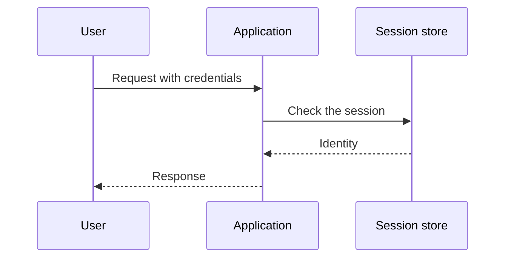

> Starter document. `bkit install` does not write this file and does not overwrite a copy. Copy it to `docs/security.md`, fill it in, then delete this introduction.
>
> **Fill these first:** `docs/architecture.md`.
>
> **Finish against:** `docs/data-schema.md` for the "Where stored" column of the `## PII` table.
>
> **Where the facts come from:** the authentication and session code, the route and permission definitions, the input-validation schemas, the secret stores and the CI secret configuration, and the data models that hold personal data.
>
> **Fill in:**
>
> 1. Copy this starter to `docs/security.md`.
> 2. Fill `## Trust boundaries` with where untrusted input enters the system. Read the runtimes from `docs/architecture.md`.
> 3. Fill `## Authentication` with how a user or service proves who it is. Redraw the sequence chart for one authenticated request.
> 4. Fill `## Authorization` with one row per role or service account and what it may do.
> 5. Fill `## Input validation` with where each kind of input is checked, on the server.
> 6. Fill `## Rate limiting` with each limited route or action and its limit.
> 7. Fill `## Secrets` with one row per secret: its name, the store that holds it, who can read it and how it rotates. Write names, never values.
> 8. Fill `## PII` with each kind of personal data and how it is protected. Leave "Where stored" to be finished once `docs/data-schema.md` exists.
> 9. Fill the `### This project` slot under `## Supply-Chain (GitHub Actions)` with the project's own dependency and CI rules. Keep the rest of that section.
> 10. Record unresolved facts under `## Open questions`.
> 11. Add this row to the `## Project Documents` table in `.agents/docs.md`: | `docs/security.md` | ● | ● | ● | ○ | ○ | Authentication, authorization, input validation, rate limiting, secrets management and PII handling. |
> 12. Check the document against each completion check, then delete this introduction.
>
> **If it does not apply:** write `Not applicable: {reason}` under a section that does not apply, such as `## Authentication` for a tool with no users.
>
> **Completion checks:**
>
> - The sequence chart matches the authentication code path.
> - Every secret the CI configuration or the code reads has a row in `## Secrets`.
> - Every service account has a row in `## Authorization`.
> - Every kind of personal data in `docs/data-schema.md` has a row in `## PII`.
> - No secret value appears in the document.
> - No example row remains.

# Security

> [!CAUTION]
> **Purpose:** Authentication, authorization, input validation, rate limiting, secrets management and PII handling.
>
> **Rules:**
>
> - Follow `.bkit/authoring.md` § Docs when you edit this file.
> - Auth standards live only here. Other docs link to this file and do not restate them.
> - Never write a secret value. Write its name and the store that holds it.
>
> **bkit practice:** `## Supply-Chain (GitHub Actions)` is bkit's own practice. Keep it and its heading, and put the project's own rules in its `### This project` slot. Sections marked **bkit practice** keep their heading text and stay separate sections. Do not rename, merge or compress them, because bkit's CI template, advisories and audits cite them by name.
>
> **Not here:** The variables a developer sets locally go in `docs/setup.md` § Environment variables. How each environment's config is synced goes in `docs/deployments.md` § Secrets and env config. The tables and fields that hold personal data go in `docs/data-schema.md`.
>
> **Update when:** A role, service account, secret, validation point, limit or kind of personal data is added, changed or removed.

## Trust boundaries

[Where untrusted input enters the system, and which runtime checks it.]

## Authentication

[How a user or service proves who it is, and how a session or token is kept.]

## Authorization

<!-- prettier-ignore -->
| Role or service account | Kind | May | Granted by |
| --- | --- | --- | --- |
| [Role or service account] | [User role or service account.] | [What it may do.] | [Where the grant is defined.] |
| [e.g., Reviewer] | User role | Read and comment on reports. | The role table in the application. |

## Input validation

<!-- prettier-ignore -->
| Input | Checked in | How |
| --- | --- | --- |
| [Kind of input] | [Handler or layer.] | [Schema or rule.] |
| [e.g., Report form] | The report service handler. | A schema parsed on the server. |

## Rate limiting

<!-- prettier-ignore -->
| Route or action | Limit | Keyed by |
| --- | --- | --- |
| [Route or action] | [Requests per window.] | [User, address or token.] |
| [e.g., Sign-in] | 5 requests per minute. | Network address. |

## Secrets

<!-- prettier-ignore -->
| Secret name | Store | Who can read it | Rotation |
| --- | --- | --- | --- |
| [Secret name] | [Store that holds it.] | [Roles and service accounts.] | [How and how often it rotates.] |
| [e.g., SESSION_KEY] | The hosting platform's secret store. | The report service. | Every 90 days. |

## PII

<!-- prettier-ignore -->
| Personal data | Why it is held | Protection | Where stored |
| --- | --- | --- | --- |
| [Kind of personal data] | [Why the project holds it.] | [Encryption, masking or retention.] | [Table and field, from `docs/data-schema.md`.] |
| [e.g., Email address] | Account sign-in. | Never logged. | Users table, email field. |

## Supply-Chain (GitHub Actions)

> **bkit practice:** keep this section; bkit's audits and advisories cite its heading by name, so leave the heading text unchanged.

Action SHA-pinning and the dependency-update pipeline (Renovate / Dependabot, Trivy scan, CVE handling) are described in `deployments.md` § Dependency updaters. This section holds the security invariants only.

**Token isolation:**

- Renovate PRs get a restricted `GITHUB_TOKEN`.
- They have no access to the cloud lane's model-auth secrets (`secrets.BKIT_ANTHROPIC_API_KEY` / the provider `BKIT_` keys / `secrets.BKIT_OPENAI_API_KEY`).
- They have no access to federated Claude tokens either. Only a `bkit-cloud.yml` job that matches the federation rule mints those.
- `bkit-cloud.yml` does not dispatch on Renovate PRs.
- As a result, a compromised dependency PR cannot reach agent API credentials.

**Scanner isolation:** The CI vulnerability scanner (e.g. `bkit-trivy.yml`) runs with `contents: read`, `persist-credentials: false` and no secret. Its image or action is pinned by digest, never by a floating tag. Setup is in `.bkit/templates.md` § Trivy.

The untrusted-content rules bkit applies to every workflow are in `.bkit/prompts.md` § Untrusted Content & Prompt Injection.

### This project

> **Project slot:** the project's own dependency and CI rules, such as which updater it runs and who reviews its pull requests.

[The project's dependency and CI supply-chain rules.]

## Open questions

[Each unresolved fact, who can answer it and which section it affects.]
