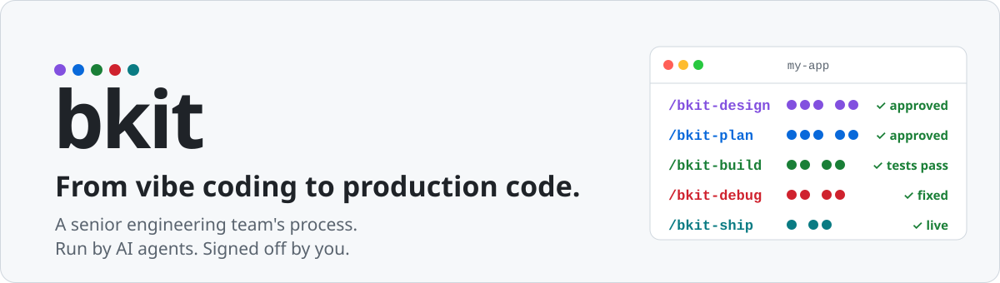
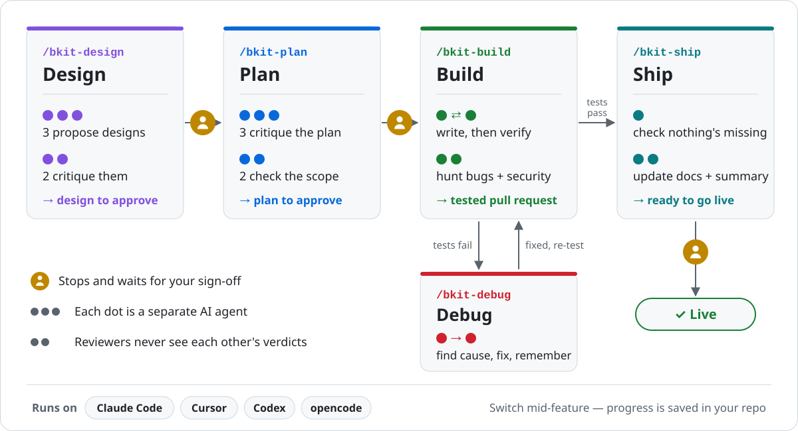

<p align="center">
  <picture>
    <source media="(prefers-color-scheme: dark)" srcset=".github/assets/bkit-hero-dark.svg">
    
  </picture>
</p>

<p align="center">
  <a href="https://github.com/cbartens/bkit/actions/workflows/bkit-ci.yml"></a>
  <a href="https://www.npmjs.com/package/@cbartens/bkit"></a>
  <a href="#license"></a>
  
  
</p>

<p align="center">
  <a href="#quick-start">Quick start</a> ·
  <a href="#a-ready-made-workflow-for-every-job">Workflows</a> ·
  <a href="#agents-and-ci-built-to-work-together">Agents and CI</a> ·
  <a href="#right-context-at-the-right-step">Context</a> ·
  <a href="#faq">FAQ</a> ·
  <a href=".bkit/comparison.md#part-3--compared-with-other-ai-development-frameworks">Comparison</a> ·
  <a href=".bkit/install.md">Install guide</a>
</p>

AI coding agents are fast, but on their own they skip the parts that make software safe to ship: a design someone challenged, a plan someone checked, a second pair of eyes on every change, tests that actually ran. Vibe coding gets you a demo. Getting that demo to production takes a process.

**bkit is that process, ready-made.** You describe a feature in a GitHub or Linear issue. AI agents design it, plan it, build it, review it with agents that didn't write it, fix what breaks, and ship it, with project docs and memory kept up to date along the way.

- **For solo founders and makers** who have outgrown vibe coding: you get the habits of a senior engineering team without hiring one. You need to be able to read a plan and make a call, not write the code.
- **For engineers** who want a proven agentic process instead of building their own: rules, prompts, workflows, guardrails, audits and a CI pipeline that already work together.

**Researched and battle-tested, not a weekend prompt pack.** bkit is built with bkit. Its rules, prompts and workflows come from months of research into how agentic engineering works best, refined over >1,000 commits, >500 issues and >100 merged pull requests run through its own pipeline. That history is recorded in >200 lessons and >300 decisions agents read before they start. How it compares with other AI development frameworks, feature by feature: [`.bkit/comparison.md`](.bkit/comparison.md#part-3--compared-with-other-ai-development-frameworks).

<p align="center">
  <picture>
    <source media="(prefers-color-scheme: dark)" srcset=".github/assets/bkit-features-dark.svg">
    
  </picture>
</p>

## >200 files of best practice, ready to use

Everything a senior team would otherwise write down over years, in files you can read:

<!-- prettier-ignore -->
| What | How many | What it does for you |
| --- | --- | --- |
| Agents | >40 | Single-job specialists, each with its own model, thinking depth and tool list. A reviewer can read code but can't change it. |
| Workflows | 6 | The five phases plus a cloud router. Every step ends in a checklist and a mechanical check before the next one starts. |
| Agent rules | >70 | One shared rulebook every agent follows: read before editing, never defer silently, report honestly, never rewrite history. |
| Guardrails | >10 hook files | Block dangerous commands and make agents investigate before they edit, on all five AI tools. |
| Audits | >30 | Security, privacy, accessibility, performance, reliability, database, LLM usage, cost and more. Findings feed straight into a plan. |
| Project docs | 10 + index | Architecture, data schema, deployments, testing, security, monitoring, design system, tech stack, setup, and an index telling each agent what to read at each step. |
| Templates | >60 | A full CI pipeline, cloud agents, git hooks, linters, dependency updates, secrets sync, code search, and >10 ready-made connectors for your platforms. |

## A ready-made workflow for every job

One command per job. Each one runs a team of specialised agents, so you don't have to write prompts or remember steps.

<!-- prettier-ignore -->
| Job | Command | What happens |
| --- | --- | --- |
| Work out how to build it | `/bkit-design` | Reads related issues and past decisions, has three agents propose different approaches and two critique them, and writes throwaway code to test any risky unknowns the reviewers flag. You get one design to approve. |
| Plan the work | `/bkit-plan` | A step-by-step plan, stress-tested by five reviewers who also see past bugs and postponed work. Too big for one build? It's split into pieces. You approve it. |
| Build it | `/bkit-build` | Checks the plan still matches the code, writes each task's tests before its code, verifies every task, hunts for bugs and security holes, adds edge-case tests, and opens a pull request. |
| Fix what broke | `/bkit-debug` | Pulls evidence from CI and your platforms, finds the root cause, fixes it, re-tests and records the lesson. Hard runtime bugs get their own mode; if it can't fix something, it stops and writes you a clear handover. |
| Ship it | `/bkit-ship` | Checks nothing planned was quietly dropped, waits for every test lane to pass, merges into `dev`, and updates the docs. |
| Health check | >30 audits | One specialist checklist per area. Findings feed straight into `/bkit-plan`. |
| Housekeeping | 7 utility agents | Keep docs, decisions, lessons and known bugs current, and rank what to work on next. |

## How it works

<p align="center">
  <picture>
    <source media="(prefers-color-scheme: dark)" srcset=".github/assets/bkit-pipeline-dark.svg">
    
  </picture>
</p>

## Why it's different

<p align="center">
  <picture>
    <source media="(prefers-color-scheme: dark)" srcset=".github/assets/bkit-fences-dark.svg">
    
  </picture>
</p>

Most AI development frameworks are prompts: they describe good work and trust the agent to deliver it. But an agent can be talked into calling something done, and a prompt can't stop it. bkit builds fences instead. Reviewer agents that didn't write the work fence in the design and the plan. From the first line of code, automated checks join them, and those can't be argued with.

## Agents and CI, built to work together

<p align="center">
  <picture>
    <source media="(prefers-color-scheme: dark)" srcset=".github/assets/bkit-fences-details-dark.svg">
    
  </picture>
</p>

The strongest fence is CI (continuous integration): the robot that runs every check on every change, on GitHub's servers, before anything merges. Most AI development frameworks stop at a pull request and leave CI to you. bkit's workflows are built around it, and around the checks that run before it. Every change has to get past the same fences, from the nearest and lightest out to CI:

- **Every agent**, in every workflow, looks code up before changing it, is nudged by the agent hooks on each edit, can't finish a step until the step gates (scripts, not prompts) find its verdict and files, and has its code formatted on each commit.
- **`/bkit-plan`** decides which tests each feature needs and where each one runs: unit, integration or end-to-end.
- **`/bkit-build`** writes each test before its code and runs it to prove it fails, so a test that can't fail is never added. It runs the quick checks on your machine, where the pre-push hook sends back anything that fails, then opens a pull request, which starts CI.
- **`/bkit-debug`** uses what was sent back as context: the logs of the lanes that failed, the diff since the last green run, end-to-end reports. It fixes the root cause and pushes, and CI runs again.
- **`/bkit-ship`** checks nothing planned was quietly dropped, then merges into `dev` only when CI's final check is green on the exact commit being merged.
- **On autopilot**, nobody has to press go: for issues labelled `bkit:auto`, CI's result starts ship (green) or debug (red) in a cloud session, with no laptop open.

What that gets you:

- **The fences grow with every feature.** Each build adds tests that every later change has to pass. A prompt-only framework is as strict on your fiftieth feature as on your first; bkit gets stricter.
- **What's sent back is evidence, not a verdict.** A red lane hands debug the failing logs and what changed since the last green run, so the fix starts from the actual error instead of a guess.
- **Agents look before they change anything.** Code search ([Serena](https://github.com/oraios/serena)) shows an agent every definition and caller of the code it's about to change, not just lines with matching words, and [graphify](https://github.com/Graphify-Labs/graphify)'s code map shows what already exists before it writes more. Fewer bad changes reach the fences at all.
- **Problems are caught at the nearest fence.** Agent hooks nudge on every edit: read a file before changing it, and fix the code rather than loosen a check. The pre-commit hook formats in seconds. The pre-push hook runs type checks, unit tests, the prose checker and the junk-code scanner before anything leaves your laptop. CI is left with what genuinely can't run there: integration, end-to-end and live-site tests. Your hooks and the agents call the same `bkit:gate:*` scripts, and CI's quick-checks lane runs the same commands, so most failures show up on your machine first.

The agent hooks come with install. Serena, graphify and the git hooks are [templates](#templates-ready-to-adopt) you adopt. How this compares with other frameworks: [agents and CI](.bkit/comparison.md#agents-and-ci).

### The CI pipeline

None of the AI development frameworks in our [comparison](.bkit/comparison.md#part-3--compared-with-other-ai-development-frameworks) ships a full test pipeline for your project. bkit ships one ready to adopt:

<p align="center">
  <picture>
    <source media="(prefers-color-scheme: dark)" srcset=".github/assets/bkit-ci-dark.svg">
    
  </picture>
</p>

- **Ready on day one.** Two lanes run side by side: quick checks (type checking, formatting, a prose checker, a scanner for junk code AI tends to write, a workflow-file checker, and `bkit check`) and unit tests.
- **A green tick means every test ran.** One final check joins all lanes and is the only one branch protection needs. It fails if any lane failed, was skipped or cancelled, or ran zero tests, so a half-finished run can't pass as tested. The gates audit flags any check that can never fail.
- **Grows with your project.** >20 ready-to-enable building blocks: integration tests, end-to-end tests for web, iOS and Android, database migrations (locked once merged, with security-policy checks), coverage reports, waiting for preview deploys, live checks against the deployed site, smoke and health checks, and a planner that runs only what a change affects. `bkit check` reminds you of each one until you enable or delete it.
- **Safe by default.** Every third-party action is pinned to an exact commit, the downloaded prose checker is checksum-verified, and pull-request titles never reach a script unescaped.
- **Doesn't waste minutes.** A commit that already passed isn't re-tested, and a newer push cancels the older run, except on your production branch, where a deploy must never be cut off halfway.

## Audits find what green tests miss

<p align="center">
  <picture>
    <source media="(prefers-color-scheme: dark)" srcset=".github/assets/bkit-audits-dark.svg">
    
  </picture>
</p>

A green tick proves the tests passed, not that they test the right things. Every finding on this map sat in an app whose tests were passing, and only two of bkit's audit templates found them all.

- **A specialist's checklist for each area.** >30 templates cover security, privacy, accessibility, testing, duplication, dead code, database, reliability, LLM usage, cost and more. Each one says what to check, how, and what counts as a problem.
- **Run one whenever you want.** Name a template to `@bkit-audit-generate` and it writes a report to `docs/audits/{YYYYMM}/`. It reads your code and, where you've connected them, your live platforms, and lists anything it couldn't check rather than calling it clean.
- **Findings turn into work.** Hand the report to `/bkit-plan` and the fixes are planned, built, tested and shipped like any other feature.

## Right context at the right step

<p align="center">
  <picture>
    <source media="(prefers-color-scheme: dark)" srcset=".github/assets/bkit-context-dark.svg">
    
  </picture>
</p>

Most AI tools forget everything when the chat ends. bkit keeps what it knows in plain files in your repo, and each step reads what it needs and writes back what it learned:

- **Documentation that keeps itself current.** Install sets up the docs a professional project keeps: architecture, data schema, deployments, testing, security, monitoring, design system, tech stack and local setup. Agents fill them in as they work, `/bkit-ship` brings them up to date after every feature, and an index tells each agent which docs to read at each step. The docs stay current because the agents depend on them.
- **Project memory agents actually read.** Four ledgers record lessons from every fix (`docs/knowledge.jsonl`), decisions and the reasons behind them (`docs/decisions.jsonl`), work consciously postponed (`docs/deferrals.jsonl`) and known bugs (`docs/failures.jsonl`). Planning reviewers see the past bugs and postponed work closest to the new feature, debug reads the lessons first, and `/bkit-ship` checks nothing postponed was quietly dropped.
- **Evidence from outside, when it's needed.** Design searches your backlog for related issues and checks the web for feasibility. Debug pulls failed CI logs, the diff since the last green run, end-to-end reports and runtime errors. >10 ready-made connectors cover GitHub, Sentry, Vercel, Supabase, Stripe, Expo, Playwright, Maestro, Inngest, Resend, Cloud Run, Tavily web search and Serena, each easy to customise, extend or leave out. A connector that isn't set up is reported as such, never read as "all clear".
- **Progress lives in your repo, not a chat window.** Run state is saved after every step, so a crashed run resumes where it stopped, on any tool.

## What else you get

### The quality is real

- **Everything is checked by an agent that didn't write it.** An AI checking its own work tends to approve it. bkit gives every design, plan and code change to separate reviewers, each with one job (one hunts bugs, another security holes). They never see each other's verdicts, and several review groups mix models on purpose, so one model's blind spot is less likely to get past all of them.
- **"Done" is checked by code, not taken on trust.** Every step's output is verified before the next step starts, a task is ticked only when its result really exists, each task's tests must be seen failing before its code is written, and a silent TODO or skipped test blocks the merge.
- **Broken builds fix themselves, and stay fixed.** `/bkit-debug` finds the root cause before it changes anything, fixes it, re-runs the tests and records the lesson. Bugs that only show up at runtime get a dedicated mode that adds logging, fixes on evidence and removes the logging again.
- **It knows when to stop.** If a failure can't be fixed, bkit writes a clear handover and stops, instead of guessing over and over.

### Engineering know-how, built in

- **Best model for each job, on every tool.** Each agent has its own model and thinking depth, chosen per tool and provider. Deep reasoning models do architecture and security review; quick ones write summaries. Starting a session on a cheaper model never quietly downgrades the reviewers.
- **It tests ideas before you commit to them.** When reviewers flag an unknown a design depends on, design writes throwaway probe code to settle it before you approve, and a design reviewer checks failure modes and monitoring, not just whether it can be built.
- **Big features are split up.** A plan too big for one build becomes a sequence of smaller plans, and each is re-checked against the current code right before it's built.
- **Numbers on your own work.** Every run records its time, size of change and retries in `.bkit/stats.jsonl`, and posts them to the issue next to the median of your last five runs.
- **Health checks on demand.** >30 audit checklists act like hiring a specialist for a day.

### It fits how you work

- **Never blocked by usage limits.** Out of Claude for the week? Carry on in Cursor, Codex or Antigravity, or point opencode at your own key — OpenRouter, Ollama or the opencode gateways. Same feature, same checks, nothing to set up again.
- **Start on your laptop, check in from your phone.** A feature started at your desk can continue in a cloud session (Claude Code on the web or the Claude app, Cursor cloud agents, or opencode on GitHub Actions), or start by itself when CI finishes: ship on green, debug on red. The cloud setup ships ready to adopt.
- **Run several features at once.** Each one works in its own copy of the repo (a git worktree), so they never trip over each other.
- **Your issue tracker is the control panel.** bkit reads the GitHub or Linear issue, posts progress as it goes, moves the issue along and links the pull request.
- **The right expertise for each feature.** When a plan needs, say, Stripe or Supabase, bkit installs a matching skill for the build and removes it when the feature ships.

### You stay in control

- **Decide in plain English, not code.** Before any code is written you approve two short documents: a design ("three ways to build this; we recommend this one, because…") and a plan ("these twelve steps, and how we'll know each is done").
- **Three sign-offs, and production stays yours.** bkit stops after the design, after the plan and before merging. It merges into your `dev` branch and never touches `main`: promoting to production is always your call. Cloud mode can ship on green without you, but only for issues you've labelled `bkit:auto`, and removing the label stops it.
- **Guardrails on the AI itself.** Dangerous commands like force-pushing or rewriting history are blocked. Each agent only gets the tools its job needs.

## Templates ready to adopt

bkit installs only what its workflows run. Everything else, the things you or another tool run, ships as a template: install puts the latest set in your `.bkit/templates/`, and every upgrade lists which ones changed. Copy in what you want and own it; bkit never writes over your copy. The install prompt asks your AI to adopt what fits, and each workflow ends with a tip on the next one worth adding.

The ones that matter most, in the order to adopt them:

<!-- prettier-ignore -->
| Template | What it's for |
| --- | --- |
| **CI pipeline** | Runs every check on GitHub on every change, and `/bkit-ship` waits for it before merging. Without it, "shipped" only means merged, not checked. Two lanes ready to go and >20 building blocks for the rest ([above](#the-ci-pipeline)). |
| **Quality checks** | Catches problems on your own machine in seconds, before they reach GitHub: type checking, formatting, a prose checker and a scanner for junk code AI tends to write, wired into git hooks and CI. Your `bkit:gate:*` scripts in `package.json` define what "the checks" are. |
| **Serena** | Lets agents look up code the way your editor does ("where is this defined, and what uses it?") instead of searching for words and reading whole files. Fewer accidental changes, and lower running costs because agents read less. Read-only. |
| **Context connectors** | Let `/bkit-debug` read the real errors instead of guessing from the code: >10 ready-made connectors for CI, error trackers, hosting, databases, payments, email, queues and the web. |
| **Cloud agents** | When CI finishes, a cloud agent picks up: ship on green, debug on red. No laptop needed. |
| **Secrets sync** | Keeps every password and key the same everywhere: one local file, one command to push it to Vercel, GitHub Actions, Google Cloud, Supabase and Expo, another to prove every copy matches without printing a value. Prevents "works for me, broken in production". |
| **graphify** | Keeps a map of how your code fits together (`docs/capabilities.md`), so agents check what already exists before building it again. |
| **Dependency updates** | Small, grouped update pull requests from Renovate or Dependabot instead of one big risky upgrade later. GitHub Actions stay pinned, and security fixes skip the queue. |

All templates, what each is for, and how to install them: [`.bkit/templates.md`](.bkit/templates.md).

## Quick start

You need a GitHub repo, Node 20+, pnpm, and at least one of Claude Code, Cursor, Codex, Google Antigravity or opencode.

**Easiest:** copy the [install prompt](.bkit/install.md#install--first-time) into your AI coding tool and let it do the setup.

**By hand:** no token or registry setup — bkit is public on npmjs and installs like any other package.

```bash
pnpm add -D @cbartens/bkit
pnpm bkit install --claude    # pick your tools: --claude --cursor --codex --antigravity --opencode=<provider>
# opencode provider: openrouter | ollama | opencode-zen | opencode-go
```

Adopt the templates you want from `.bkit/templates/`, then open an issue and run the first step from your AI tool:

```text
/bkit-design ISSUE-123
```

Full install, upgrade and CI setup: [`.bkit/install.md`](.bkit/install.md).

## FAQ

**Do I need to know how to code?**
No, but you do need to read a design and a plan and decide whether they're right. Setup takes a few terminal commands, or one pasted prompt.

**Who is it not for?**
bkit is heavier than a single prompt. For a one-off script or a quick experiment, just ask your AI. bkit pays off on a project you'll keep changing and want to trust.

**What does it cost?**
bkit is free and open source under the MIT licence, for anyone, commercial use included ([License](#license)). It runs on AI subscriptions you already have (Claude, Cursor, ChatGPT for Codex, Google Antigravity), on Antigravity's free tier, or with your own key on pay-as-you-go providers through opencode (OpenRouter, Ollama or the opencode gateways). Several agents reviewing in parallel uses more of your quota than a single chat; that's the price of the second opinions.

**Can it break my live site?**
Not without your sign-off. Work happens in a separate copy of the repo, goes through a pull request, must pass every test, and merges into `dev`, never `main`.

**Which issue tracker?**
GitHub Issues or Linear.

**Is this the bkit Vibecoding Kit?**
No. [bkit Vibecoding Kit](https://github.com/popup-studio-ai/bkit-claude-code) is a separate project that happens to share the name. This bkit is `@cbartens/bkit` on npm and lives at [github.com/cbartens/bkit](https://github.com/cbartens/bkit).

**How does it compare with other tools?**
Feature by feature against the main AI development frameworks, from spec toolkits to autonomous agents: [`.bkit/comparison.md`](.bkit/comparison.md#part-3--compared-with-other-ai-development-frameworks).

**Why doesn't bkit ship a compression proxy like caveman or Headroom?**
We measured both on 456 real Claude Code transcripts. They saved about 1–3% of token cost. Both protect Claude's prompt cache, so they only shrink tool output as it arrives, and that output was 27% of the cost. Headroom's text model also rewrote code along the way. bkit cuts reading instead, which loses nothing: agents find the definition first and read only those lines, and a hook flags re-reads of files that haven't changed. Method, results and scripts to measure your own sessions: [the comparison](tests/compression/bkit-caveman-headroom-compression-proxy-comparison.md).

<details>
<summary><strong>For engineers: what's under the hood</strong></summary>

- **Isolation.** Every run gets its own git worktree; a per-feature lock blocks duplicate runs of the same feature, and a short repo-wide lock serialises only the moments that write to `dev`.
- **Resume from state, not session.** Run state lives in `status.jsonl` and `docs/plans/`. A crashed or interrupted run resumes from its last completed step, on any host.
- **Mechanical step gates.** `bkit steps finish` checks each step's verdict and artifacts before the workflow moves on; build ticks a task only on a confirmed artifact; ship's deferred sweep fails the merge on an unplanned gap.
- **Engine.** The `bkit` CLI is TypeScript in [`.bkit/core/engine/`](.bkit/core/engine/), built to `dist/`, covered by >3,000 tests. `commands/` holds what you type; `install/`, `render/`, `checks/`, `ledgers/` and `shared/` hold the code underneath; `audits/` holds the tests that read shipped text.
- **One source, every host.** `.bkit/` renders `.claude/`, `.cursor/`, `.codex/`, `.agents/` (Antigravity) and `.opencode/`. `bkit check` is the CI drift gate.
- **Reviewer independence.** Parallel reviewers can't read sibling output. Design brainstorm, design review and plan scope-check groups also cross models (Opus + Sonnet on Claude; Grok + Composer on Cursor); depth-sensitive lenses (plan review, build challenge) stay on the top tier.
- **Per-agent pins.** Model and effort per agent, per provider ([`.bkit/prompts.md`](.bkit/prompts.md) § Models), immune to the session default.
- **Against the literature.** bkit fully implements 13 of the 22 patterns in Antonio Gulli's _Agentic Design Patterns_, partly implements 7 (scoped to shipping code), leaves 2 out by design, and goes beyond the book in 8 places. Full mapping and every agent in execution order: [`.bkit/comparison.md`](.bkit/comparison.md).

</details>

## Documentation

<!-- prettier-ignore -->
| Read | For |
| --- | --- |
| [`.bkit/install.md`](.bkit/install.md) | Install, upgrade, CI auth, uninstall, recovery |
| [`.bkit/README.md`](.bkit/README.md) | Day-to-day use: running workflows, environment, tracker setup, CLI |
| [`.bkit/workflows.md`](.bkit/workflows.md) | Every workflow step, verdict and contract |
| [`.bkit/providers.md`](.bkit/providers.md) | Tool and provider differences, model pins |
| [`.bkit/cloud.md`](.bkit/cloud.md) | Cloud agents: Claude Code on the web, Cursor, opencode |
| [`.bkit/templates.md`](.bkit/templates.md) | Templates ready to adopt |
| [`.bkit/comparison.md`](.bkit/comparison.md) | Full pipeline reference, agentic-patterns mapping, comparison with other AI development frameworks |
| [`CHANGELOG.md`](CHANGELOG.md) | What changed in each release |

## Credits

bkit's process was worked out over months of building real products with it. These projects sharpened specific ideas along the way:

<!-- prettier-ignore -->
| Project | Idea bkit took |
| --- | --- |
| [everything-claude-code](https://github.com/affaan-m/ECC) (affaan-m) | GateGuard, the hook that makes an agent investigate before it edits, name included; the warning when an agent edits lint or type-check settings; confidence and scope on recorded lessons; the untrusted-input notice on agents that read outside content. |
| [gstack](https://github.com/garrytan/gstack) (Garry Tan) | Writing the setup once and generating every AI tool's copy from it, with a check that the copies match; the completeness and search-before-building principles in the shared rules; resuming a run from saved state. |
| _Agentic Design Patterns_ (Antonio Gulli) | A "done when" line on every plan task, and testing hypotheses before fixing in debug. The book is also the yardstick in the [patterns comparison](.bkit/comparison.md#part-2--comparison-to-agentic-design-patterns). |
| [skills](https://github.com/mattpocock/skills) (Matt Pocock) | The interview that opens `/bkit-design`, adapted from `grill-me`: open questions are settled with you before any design work starts. |

**Built on.** The templates set up these tools; thanks to their maintainers: [Serena](https://github.com/oraios/serena), [graphify](https://github.com/Graphify-Labs/graphify), [slop-scan](https://github.com/modem-dev/slop-scan), [Vale](https://github.com/vale-cli/vale) with [write-good](https://github.com/vale-cli/write-good), [Renovate](https://github.com/renovatebot/renovate), [Dependabot](https://docs.github.com/en/code-security/dependabot), [Husky](https://github.com/typicode/husky), [lint-staged](https://github.com/lint-staged/lint-staged), [Prettier](https://github.com/prettier/prettier), [actionlint](https://github.com/rhysd/actionlint) and [direnv](https://github.com/direnv/direnv).

## License

bkit is [MIT](LICENSE.md): use it, change it and share it for any purpose, commercial included, as long as the copyright and licence notice stay with it.

**The code bkit's agents write for you is yours.** The licence covers bkit itself, not what its agents produce in your repo.

The full text travels in your repo at [`.bkit/LICENSE.md`](.bkit/LICENSE.md) after install.
