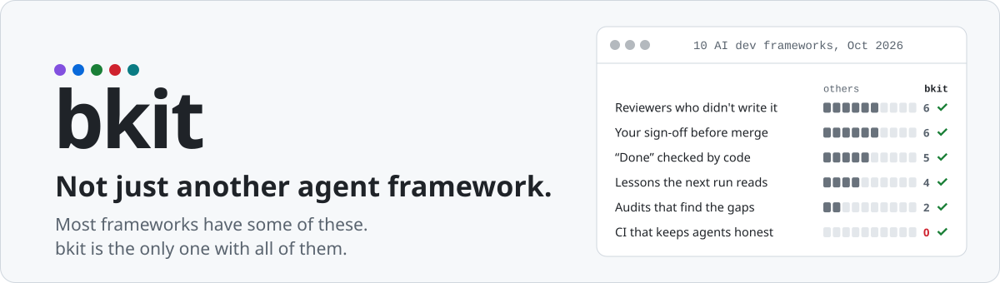
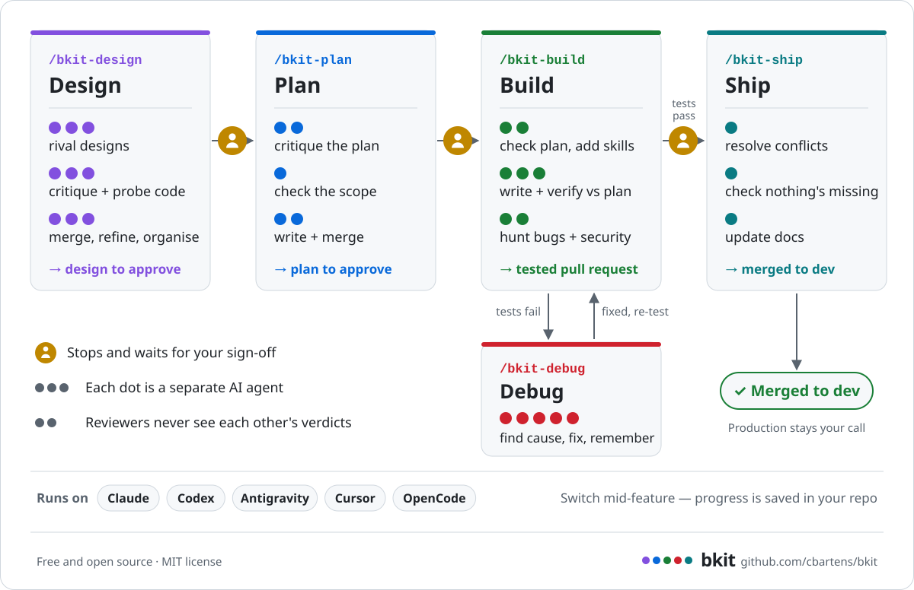
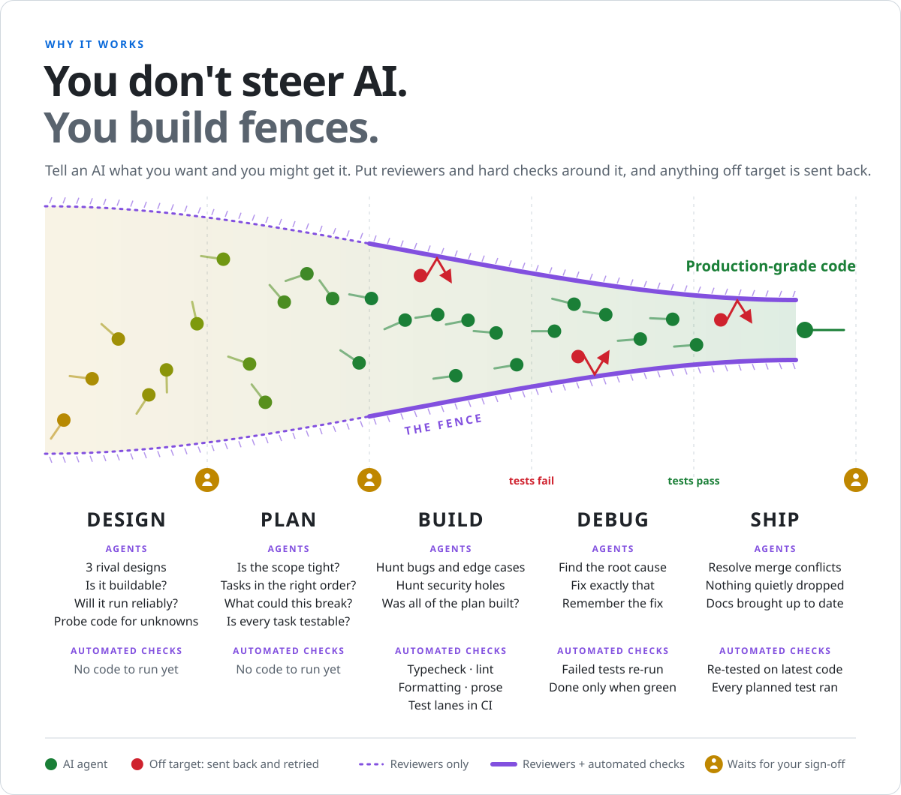

<picture>
  <source media="(prefers-color-scheme: dark)" srcset=".github/assets/bkit-hero-dark.svg">
  
</picture>

<p align="center">
  <a href="https://github.com/cbartens/bkit/actions/workflows/bkit-ci.yml"></a>
  <a href="https://www.npmjs.com/package/@cbartens/bkit"></a>
  <a href="#license"></a>
  
  
</p>

<p align="center">
  <a href=".bkit/install.md">Install guide ↗</a> ·
  <a href=".bkit/README.md">User guide ↗</a> ·
  <a href=".bkit/comparison.md#frameworks">Comparison ↗</a>
</p>

**Short README** · [Explore bkit in detail →](DETAILS.md)

[What's included](DETAILS.md#whats-inside) · [How it works](DETAILS.md#how-it-works) · [Models](DETAILS.md#models) · [Reviews and checks](DETAILS.md#why-its-different) · [Agents and CI](DETAILS.md#agents-and-ci) · [Engine](DETAILS.md#engine) · [Project knowledge](DETAILS.md#knowledge) · [Audits](DETAILS.md#audits) · [Templates and code map](DETAILS.md#templates) · [Other capabilities](DETAILS.md#what-else-you-get) · [Token costs](DETAILS.md#token-costs) · [Measurements](DETAILS.md#measurements) · [FAQ](DETAILS.md#faq) · [Documentation](DETAILS.md#documentation) · [Quick start](DETAILS.md#quick-start) · [Credits](DETAILS.md#credits) · [Licence](DETAILS.md#license)

---

**A repeatable process for shipping software with AI coding agents.**

Describe a feature in an issue. bkit brings agents together to design, plan, build, review and ship it—with your approval at key stages. Independent reviewers challenge the work, automated checks verify completion, and project files carry decisions and lessons into the next feature.

Works with **Claude, Codex, Antigravity, Cursor and OpenCode**. Uses **GitHub, Linear or Jira** for issues, with code and pull requests on **GitHub**. Free and open source.

## Quick start

You need a GitHub repository, **Node 24+**, **pnpm**, and one of the supported AI coding tools.

**Let your agent set it up:** paste the [install prompt](.bkit/install.md#install--first-time) into your coding tool. It walks through installation and the optional templates that fit your project.

Or install by hand:

```bash
pnpm add -D @cbartens/bkit
pnpm bkit install --claude
pnpm bkit check
pnpm bkit tips
```

Replace `--claude` with `--codex`, `--antigravity`, `--cursor` or `--opencode=<provider>`. You can install for more than one tool. See the [installation guide](.bkit/install.md) for providers and setup options.

OpenCode providers: `openrouter`, `ollama`, `opencode-zen` or `opencode-go`.

`pnpm bkit check` verifies installed files against the pinned version. `pnpm bkit tips` lists setup recommendations, most useful first.

Adopt the [optional templates](.bkit/templates.md) that fit your project, open an issue describing what you want, then run this in your AI coding tool:

```text
/bkit-design issue #123
```

Already know what to build? Start with `/bkit-plan`. Fixing something broken? Use `/bkit-debug`; add `[repro]` if nothing fails yet, and it writes the failing test first.

**Any language, existing or new projects.** bkit installs through npm, but your application does not have to use JavaScript. Installation adds a `package.json` if needed. Connect the `bkit:gate:*` scripts to your own lint, build and test commands, such as `ruff check && pytest` or `go test ./...`. [Setup requirements →](.bkit/README.md#required-tools)

[Full installation and upgrades →](.bkit/install.md) · [Tracker and environment setup →](.bkit/README.md#prerequisites)

## How it works

<picture>
  <source media="(prefers-color-scheme: dark)" srcset=".github/assets/bkit-pipeline-dark.svg">
  
</picture>

<!-- prettier-ignore -->
| Command | What it does |
| --- | --- |
| `/bkit-design` | Explores approaches, challenges the design and tests risky unknowns. You approve the direction. |
| `/bkit-plan` | Turns the design into tasks with clear completion checks. Independent reviewers check the plan before you approve it. |
| `/bkit-build` | Builds in small groups, writes tests first, checks the result and opens a pull request. |
| `/bkit-debug` | Investigates failures, fixes the root cause, re-tests and records the lesson. |
| `/bkit-ship` | Checks for missing work, verifies the required checks, merges into `dev` and updates the docs. |

Each phase has its own command. Start where your work needs it. [Full workflow, local-only builds and batch options →](DETAILS.md#how-it-works)

## Why use bkit?

<picture>
  <source media="(prefers-color-scheme: dark)" srcset=".github/assets/bkit-fences-dark.svg">
  
</picture>

- **A second opinion on the work.** Agents that did not write the design, plan or code review it. Separate reviewers assess correctness and security. [Review process →](DETAILS.md#why-its-different)
- **Completion checked by code.** The engine checks required files, verdicts and test-first evidence before a step can finish. It records progress so interrupted runs can resume. [How the engine works →](DETAILS.md#engine)
- **Checks that work together.** Workflows connect local checks with continuous integration (CI): automated checks run on GitHub. Adopt the CI and git-hook templates to build the checking pipeline for your project. [Agents and CI →](DETAILS.md#agents-and-ci)
- **Knowledge that stays with the project.** Decisions, lessons, known bugs and postponed work live in readable files. Agents consult and update them as work progresses. [Project knowledge →](DETAILS.md#knowledge)
- **Audits beyond passing tests.** Specialist checklists examine security, reliability, privacy, accessibility, cost and more. Their findings can become the next plan. [Audits and examples →](DETAILS.md#audits)
- **Your control over the work.** You review designs and plans, and production promotion remains your decision. Features use separate working copies of the repository. Optional cloud automation can continue after CI. [Controls and automation →](DETAILS.md#you-stay-in-control)

## What comes with it?

Installation provides the agents, workflows, rules, guardrails and audit checklists, plus starter templates for ten project documents that you copy, fill in and own. bkit warns, without blocking, when a document your agents need is missing or still the starter. It also supplies [optional templates](DETAILS.md#templates) for CI, code search, quality checks, cloud agents, service connectors and dependency updates. Copy the templates you want and adapt them to your project.

See [other capabilities](DETAILS.md#what-else-you-get) for switching tools, running features in parallel and keeping your tracker organised.

[Everything included →](DETAILS.md#whats-inside) · [Template catalogue →](.bkit/templates.md)

## Before you start

**Who is it for?** People maintaining a project across many changes: solo makers who want a defined engineering process and engineers who want one ready to adopt. A quick script or disposable experiment may need only a single chat.

**What does it cost?** bkit is free. Your AI subscription or provider pays for the agents; multiple reviewers use more quota than one chat. See [model choices](DETAILS.md#models), [how bkit reduces token costs](DETAILS.md#token-costs) and [our measurements and their limits](DETAILS.md#measurements).

**Can I remove it?** Yes. `bkit uninstall` removes bkit's managed files and blocks while preserving your own edits and copied templates. Review [what install writes](.bkit/README.md#what-install-writes) and the [uninstall guide](.bkit/install.md#uninstall).

[More questions? Read the full FAQ →](DETAILS.md#faq)

## Read more

<!-- prettier-ignore -->
| Guide | What you will find |
| --- | --- |
| [Details](DETAILS.md) | The full explanation, diagrams, examples, measurements and FAQ. |
| [Install guide](.bkit/install.md) | Installation, upgrades, CI authentication and removal. |
| [User guide](.bkit/README.md) | Everyday commands, tracker setup and configuration. |
| [Comparison](.bkit/comparison.md#frameworks) | How bkit compares with other development frameworks. |
| [Changelog](CHANGELOG.md) | Changes in each release. |

<a id="license"></a>

## Licence and credits

bkit is [MIT licensed](LICENSE.md), including commercial use. The code its agents write for your project is yours.

[Credits and acknowledgements →](DETAILS.md#credits)
