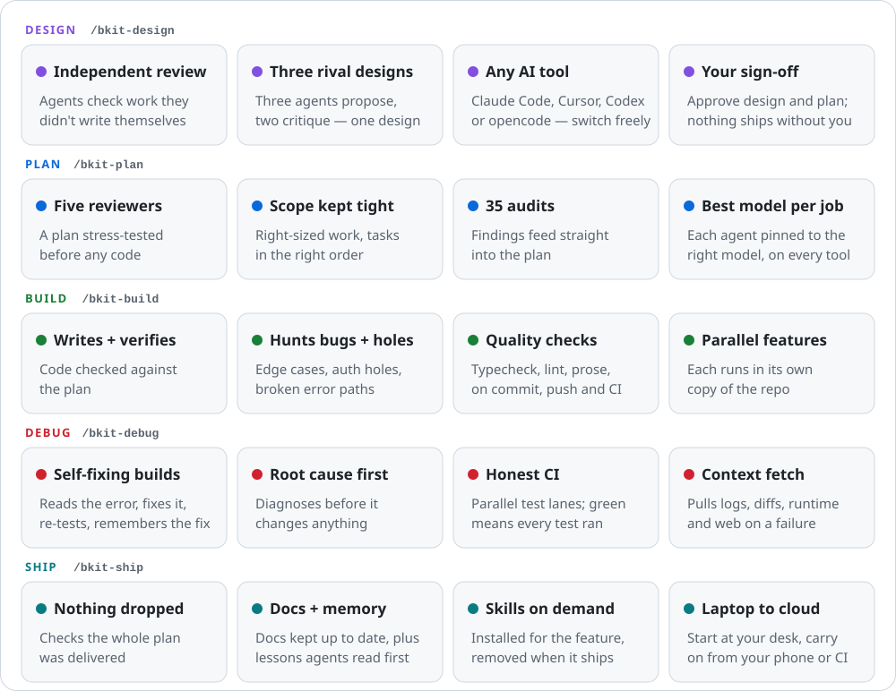

<p align="center">
  <picture>
    <source media="(prefers-color-scheme: dark)" srcset=".github/assets/bkit-hero-dark.svg">
    
  </picture>
</p>

<p align="center">
  <a href="#license"></a>
  
  
</p>

<p align="center">
  <a href="#quick-start">Quick start</a> ·
  <a href="#a-ready-made-workflow-for-every-job">Workflows</a> ·
  <a href="#how-it-works">How it works</a> ·
  <a href="#faq">FAQ</a> ·
  <a href=".bkit/install.md">Install guide</a>
</p>

AI coding agents are fast, but on their own they skip the parts that make software safe to ship: a design someone challenged, a plan someone checked, a second pair of eyes on every change, tests that actually ran. You end up checking everything yourself, or shipping and hoping.

**bkit puts the professional process back, automatically.** You describe what you want in an issue. bkit takes it through design, planning, building, testing and shipping, with separate AI agents checking each step. It stops and waits for your sign-off before anything important happens. You don't need an engineering degree to use it; you need to be able to read a plan and make a call.

<p align="center">
  <picture>
    <source media="(prefers-color-scheme: dark)" srcset=".github/assets/bkit-features-dark.svg">
    
  </picture>
</p>

## A ready-made workflow for every job

One command per job. Each one runs a team of specialised agents, 48 in total, so you don't have to write prompts or remember steps.

| Job                      | Command        | What happens                                                                                                              |
| ------------------------ | -------------- | ------------------------------------------------------------------------------------------------------------------------- |
| Work out how to build it | `/bkit-design` | Three agents propose different approaches, two more critique them, and you get one design to approve.                     |
| Plan the work            | `/bkit-plan`   | A step-by-step plan, stress-tested by five reviewers before any code is written. You approve it.                          |
| Build it                 | `/bkit-build`  | Writes the code, checks it against the plan, hunts for bugs and security holes, runs the tests, and opens a pull request. |
| Fix what broke           | `/bkit-debug`  | Reads the failure logs, finds the cause, fixes it, re-tests, and writes down the lesson.                                  |
| Ship it                  | `/bkit-ship`   | Checks nothing was missed, waits for every test to pass, updates the docs, and merges once you say so.                    |
| Health check             | 35 audits      | Security, privacy, accessibility, performance, reliability, cost and more. Findings feed straight into `/bkit-plan`.      |
| Housekeeping             | utility agents | Keep docs, decisions, known issues and the roadmap current.                                                               |

## How it works

<p align="center">
  <picture>
    <source media="(prefers-color-scheme: dark)" srcset=".github/assets/bkit-pipeline-dark.svg">
    
  </picture>
</p>

## Why it's different

### You stay in control

- **Decide in plain English, not code.** Before any code is written you approve two short documents: a design ("three ways to build this; we recommend this one, because…") and a plan ("these twelve steps, and how we'll know each is done").
- **Nothing goes live without your OK.** The pipeline hard-stops after the design, after the plan, and before merging. bkit recommends; you decide.
- **Guardrails on the AI itself.** Dangerous commands like force-pushing or rewriting history are blocked. Each agent only gets the tools its job needs, so a reviewer can read code but can't change it.

### The quality is real

- **Everything is checked by an agent that didn't write it.** An AI checking its own work tends to approve it. bkit gives every design, plan and code change to separate reviewers, each with one job (one hunts bugs, another security holes). They never see each other's verdicts, and several review groups mix models on purpose, so one model's blind spot is less likely to get past all of them.
- **Broken builds fix themselves, and stay fixed.** When tests fail you don't get a wall of red text. `/bkit-debug` finds the cause, fixes it and re-runs the tests, then records the lesson so the next debug session reads it first.
- **A green tick means every test ran.** The CI template runs test lanes side by side and fails the build if any planned lane was skipped, so a half-finished run can't pass as tested.

### It fits how you work

- **Never blocked by usage limits.** Out of Claude for the week? Carry on in Cursor, Codex or opencode, or on free models on your own machine through Ollama. Same feature, same checks, nothing to set up again, because progress is saved in your repo, not in a chat window.
- **Start on your laptop, check in from your phone.** A feature started at your desk can continue in a cloud session (Claude Code on the web or the Claude app, Cursor cloud agents), or start by itself when CI finishes: ship on green, debug on red. The cloud setup ships ready to adopt.
- **Run several features at once.** Each one works in its own copy of the repo (a git worktree), so they never trip over each other.
- **Your issue tracker is the control panel.** bkit reads the GitHub or Linear issue, posts progress as it goes, moves the issue along and links the pull request.
- **The right expertise for each feature.** When a plan needs, say, Stripe or Supabase, bkit installs a matching skill for the build and removes it when the feature ships.

### Engineering know-how, built in

- **Best model for each job, on every tool.** Each agent has its own model and thinking depth, chosen per tool and provider. Deep reasoning models do architecture and security review; quick ones write summaries. Starting a session on a cheaper model never quietly downgrades the reviewers.
- **Documentation that keeps itself current.** bkit sets up the docs a professional project keeps: architecture, data schema, deployments, testing, security, monitoring, design system, tech stack and local setup, each with a clear purpose. Agents fill them in as they work, `/bkit-ship` updates them after every feature, and an index tells each agent which docs to read at each step. The docs stay current because the agents depend on them.
- **Project memory agents actually read.** Plain-text ledgers in your repo record lessons from every fix (`docs/knowledge.jsonl`), decisions and the reasons behind them (`docs/decisions.jsonl`), work consciously postponed (`docs/deferrals.jsonl`) and known bugs (`docs/failures.jsonl`). Agents read them before they start, and `/bkit-ship` checks nothing postponed was quietly dropped.
- **Numbers on your own work.** Every run records its time, size of change and retries in `.bkit/stats.jsonl`, and posts them to the issue next to the median of your last five runs.
- **Health checks on demand.** 35 audit checklists act like hiring a specialist for a day: security, privacy, accessibility, architecture, performance, database, LLM usage, cost and more.

## Templates ready to adopt

bkit installs only what its workflows run. Everything else, the things you or another tool run, ships as a template: install puts the latest set in your `.bkit/templates/`, and every upgrade lists which ones changed. Copy in what you want and own it; bkit never writes over your copy. The install prompt asks your AI to adopt what fits. Catalogue, install steps and known traps: [`.bkit/templates.md`](.bkit/templates.md).

| Template               | What it gives you                                                                                                                                                                                                                                                                    |
| ---------------------- | ------------------------------------------------------------------------------------------------------------------------------------------------------------------------------------------------------------------------------------------------------------------------------------ |
| **CI pipeline**        | Parallel test lanes (quick checks, unit, build, integration, database migrations, end-to-end), so a run takes as long as the slowest lane, not all of them added up. One final check is the only one branch protection needs.                                                        |
| **Quality checks**     | Type checking, formatting, a prose checker, a scanner for junk code AI tends to write, and a workflow-file checker, wired into git hooks and CI. Your `bkit:gate:*` scripts in `package.json` define what "the checks" are, and the gates audit flags any check that can never fail. |
| **Cloud agents**       | When CI finishes, a cloud agent picks up: ship on green, debug on red. No laptop needed.                                                                                                                                                                                             |
| **Dependency updates** | Ready-made Renovate or Dependabot setups: grouped minor updates, pinned GitHub Actions, and security fixes that skip the weekly queue.                                                                                                                                               |
| **Secrets sync**       | One local file holds every key. One command pushes them to Vercel, GitHub Actions, Google Cloud, Supabase and Expo; another proves every copy matches without printing a value.                                                                                                      |
| **Serena**             | Lets agents look up code the way your editor does ("where is this used?") instead of guessing from text search. Read-only.                                                                                                                                                           |
| **graphify**           | Draws a map of how your codebase fits together (`docs/capabilities.md`), so agents check what already exists before building it again.                                                                                                                                               |

## Quick start

You need a GitHub repo, Node 20+, pnpm, and at least one of Claude Code, Cursor, Codex or opencode.

**Easiest:** copy the [install prompt](.bkit/install.md#install--first-time) into your AI coding tool and let it do the setup.

**By hand:** bkit is currently published to GitHub Packages, so you need a classic GitHub token with `read:packages` scope ([create one](https://github.com/settings/tokens)).

```bash
echo "@cbartens:registry=https://npm.pkg.github.com" >> .npmrc
pnpm config set "//npm.pkg.github.com/:_authToken=<your-token>"
pnpm add -D @cbartens/bkit
pnpm bkit install --claude    # pick your tools: --claude --cursor --codex --opencode=<provider>
```

Adopt the templates you want from `.bkit/templates/`, then open an issue and run the first step from your AI tool:

```text
/bkit-design ISSUE-123
```

Full install, upgrade and CI/Vercel token setup: [`.bkit/install.md`](.bkit/install.md).

## FAQ

**Do I need to know how to code?**
No, but you do need to read a design and a plan and decide whether they're right. Setup takes a few terminal commands, or one pasted prompt.

**What does it cost?**
bkit is free and open source. It runs on AI subscriptions you already have (Claude, Cursor, ChatGPT for Codex), on pay-as-you-go providers through opencode, or on free local models. Several agents reviewing in parallel uses more of your quota than a single chat; that's the price of the second opinions.

**Can it break my live site?**
Not without your sign-off. Work happens in a separate copy of the repo, goes through a pull request, must pass every test, and merges only when you approve.

**Which issue tracker?**
GitHub Issues or Linear.

<details>
<summary><strong>For engineers: what's under the hood</strong></summary>

- **Isolation.** Every run gets its own git worktree; a per-feature lock blocks duplicate runs of the same feature, and a short repo-wide lock serialises only the moments that write to `dev`.
- **Resume from state, not session.** Run state lives in `status.jsonl` and `docs/plans/`. A crashed or interrupted run resumes from its last completed step, on any host.
- **One source, every host.** `.bkit/` renders `.claude/`, `.cursor/`, `.codex/` and `.opencode/`. `bkit check` is the CI drift gate.
- **Reviewer independence.** Parallel reviewers can't read sibling output. Design brainstorm, design review and plan scope-check groups also cross models (Opus + Sonnet on Claude; Grok + Composer on Cursor); depth-sensitive lenses (plan review, build challenge) stay on the top tier.
- **Per-agent pins.** Model and effort per agent, per provider ([`.bkit/prompts.md`](.bkit/prompts.md) § Models), immune to the session default.
- **Against the literature.** bkit fully implements 12 of the 22 patterns in Antonio Gulli's _Agentic Design Patterns_, partly implements 8 (scoped to shipping code), leaves 2 out by design, and goes beyond the book in 7 places. Full mapping and every agent in execution order: [`.bkit/comparison.md`](.bkit/comparison.md).

</details>

## Documentation

| Read                                         | For                                                                |
| -------------------------------------------- | ------------------------------------------------------------------ |
| [`.bkit/install.md`](.bkit/install.md)       | Install, upgrade, token and CI auth, uninstall, recovery           |
| [`.bkit/README.md`](.bkit/README.md)         | Day-to-day use: running workflows, environment, tracker setup, CLI |
| [`.bkit/workflows.md`](.bkit/workflows.md)   | Every workflow step, verdict and contract                          |
| [`.bkit/providers.md`](.bkit/providers.md)   | Tool and provider differences, model pins                          |
| [`.bkit/cloud.md`](.bkit/cloud.md)           | Cloud agents: Claude Code on the web, Cursor, opencode             |
| [`.bkit/templates.md`](.bkit/templates.md)   | Templates ready to adopt                                           |
| [`.bkit/comparison.md`](.bkit/comparison.md) | Full pipeline reference and agentic-patterns comparison            |
| [`CHANGELOG.md`](CHANGELOG.md)               | What changed in each release                                       |

## License

MIT
