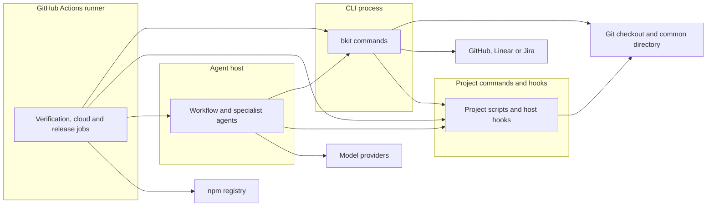

# Architecture

> [!CAUTION]
> **Purpose:** Where bkit runs, which parts own each operation and where contributors place new files.
>
> **Rules:**
>
> - Follow `.bkit/authoring.md` § All Agent-Read Files and § Docs.
> - Ground each boundary in a repository path, configuration file or check.
>
> **Not here:** Technologies belong in `docs/technology.md`, responsibilities in `docs/components.md` and release triggers in `docs/deployments.md`.
>
> **Update when:** A package, runtime, file placement rule, integration boundary or environment changes.

## System context

The arrows show which runtime invokes another process, accesses a service or reads and writes checkout files. The installed command is the `bkit` bin declared in `package.json`.

## Containers

<!-- prettier-ignore -->
| Runtime | Owns | Talks to |
| --- | --- | --- |
| Agent host | Runs the workflows and specialist roles rendered from `.bkit/core/workflows/` and `.bkit/core/prompts/`. | CLI process, Project commands and hooks, and model providers selected in `.bkit/prompts.md`. |
| CLI process | Installs files, selects host transforms, validates run state, coordinates Git and tracker operations and writes project records. The entry point is `.bkit/core/engine/cli.ts`. | Git checkout and common directory, GitHub, Linear or Jira through the configured adapter, and Project commands and hooks. |
| Project commands and hooks | Runs stack-specific checks from `package.json` and handles host events with code derived from `.bkit/core/hooks/`. | Git checkout and common directory. The named scripts define any project-specific external dependencies. |
| GitHub Actions runner | Executes the verification, maintenance, cloud continuation and release jobs defined in `.github/workflows/`. | CLI process, Project commands and hooks, Agent host for cloud jobs, and npm registry for distribution. |

## Package boundaries

bkit publishes a single npm package. The directories below have distinct callers and ownership within that package or its producer checkout.

<!-- prettier-ignore -->
| Package or folder | May call | Must not call | Enforced by |
| --- | --- | --- | --- |
| `.bkit/core/engine/commands/` | Dispatches CLI verbs to install, render, check, ledger and shared helpers. Consumer checks run through declared package scripts. | A consumer's application internals. | `.agents/rules.md` § Repo Authoring and command integration tests. |
| `.bkit/core/engine/install/` and `render/` | Read package-relative core, shared and template inputs, then render the selected modules into a checkout. | A producer-only source path in a consumer install. | `.bkit/core/engine/install/payload-links.integration.test.ts` and install integration tests. |
| `.bkit/core/engine/ledgers/journal.ts` | Imports Node, shared JSON and ledger primitives. The command dispatcher passes the operation result in. | The commands layer, which calls the journal. | Import review against the dependency contract in `.bkit/core/engine/ledgers/journal.ts`. |
| Host mirrors | Agent hosts read the generated instructions and call the CLI. Edits start in `.bkit/core/` or `.bkit/shared/`. | Another host's generated mirror as canonical input. | `bkit check`, `.bkit/core/engine/commands/comply.ts` and render snapshot tests. |
| `.bkit/templates/` | Supplies starter files that a project explicitly adopts. | A project-owned copy as an upgrade target. | `.bkit/core/engine/install/template-copies.integration.test.ts` and `project-docs.test.ts`. |
| Producer tooling | Scripts under `scripts/`, tests and the architecture viewer can consume package sources and built output. | A runtime dependency from the installed CLI back into producer-only tooling. | The `files` allowlist in `package.json` and the consumer-runtime checks in `docs/testing.md`. |

### Consumer Integration Model

The installer reads the payload relative to the installed package. It exposes core and shared source through relative symlinks in a consumer checkout. The package manifest selects the published contents. `dist/cli.js` is the executable. [Install contract](../.bkit/install.md)

<!-- prettier-ignore -->
| Host | Installed location |
| --- | --- |
| Claude Code | `.claude/` and `CLAUDE.md` |
| Cursor | `.cursor/` |
| Codex | `.codex/` and workflow skills in `.agents/skills/` |
| Antigravity | `.agents/plugins/bkit/` and `GEMINI.md` |
| OpenCode | `.opencode/` |

### Install Lifecycle (Three Phases)

1. Preflight checks inspect the checkout before writing. Blocking findings stop dispatch. The checks live in `.bkit/core/engine/checks/before/`.
2. The installer dispatches the selected modules. It replaces wholly managed files, merges marked regions or owned configuration keys and refreshes template sources. A later module failure can leave earlier writes on disk. Rerunning install reconciles them. See `.bkit/core/engine/install/modules/` and `.bkit/core/engine/install/write.ts`.
3. Post-install checks inspect the result and report blockers and advisories. On success the installer records the version and managed hashes in `.bkit/version`. See `.bkit/core/engine/commands/install/install.ts` and `.bkit/core/engine/checks/after/`.

### Project documents boundary

Adopted project documents and their index rows below the managed block remain project-owned. The installer can recognize and index adopted documents and remove legacy ownership wrappers. The shared detector reports missing or stale starters. The catalog and migration rules live in `.bkit/core/engine/install/project-docs.ts`. See [Project document starters](../.bkit/templates.md).

### Tracker reporting boundary

The command layer supplies the run or session identity, the adapter delivers the tracker comment and a private outbox in Git's common directory retains delivery state across linked worktrees. A run's authoritative progress lives in its checkout records. See `.bkit/core/engine/commands/workflow/tracker.ts` and [Data schema](data-schema.md).

### Knowledge / Decisions JSONL Ledgers

The ledger layer owns row encoding, mutation and replay receipts. The checkout holds the shared records, while the Git-common outbox holds private invocation and operation receipts. See `.bkit/core/engine/ledgers/` and [Ledger contracts](../.bkit/jsonl.md).

### Roadmap Ledger & Board

`bkit roadmap fold` in `.bkit/core/engine/commands/workflow/roadmap.ts` projects feature rows from `.bkit/issues.jsonl` into the status section of `docs/roadmap.md`. The fold preserves the owner's notes and the analysis maintained by the roadmap utility. Phase close can refresh the board without discarding either.

### Compliance Grader Subsystem

Each phase runs `bkit comply` at close. The grader in `.bkit/core/engine/commands/comply.ts` checks the run's diff and head commit for direct edits to managed mirrors and CI-suppression markers. Its output feeds the stats ledger. A grader failure produces a diagnostic and leaves the workflow's delivery verdict intact. See [grader signals](observability.md#bkit-comply-prefix).

### Distribution

The npm package contains the built CLI and its install payload. A consumer installs from the registry. The [release path](deployments.md#release-path) identifies the job responsible for publication, provenance and the matching GitHub Release.

## File placement

<!-- prettier-ignore -->
| Kind of file | Goes in | Naming |
| --- | --- | --- |
| CLI entry point, commands and engine helpers | `.bkit/core/engine/` | `cli.ts`, `commands/` by noun or verb, `install/`, `render/`, `checks/`, `ledgers/`, `shared/` and authoring `tools/` by responsibility. |
| Workflow and specialist prompt sources | `.bkit/core/workflows/` and `.bkit/core/prompts/` | `bkit-*.md` |
| Agent rules, authoring guides and managed audit or plan templates | `.bkit/core/.agents/`, `.bkit/core/.bkit/` and `.bkit/core/docs/templates/` | Match the installed name. |
| Shared hook source and host-specific hook drivers | `.bkit/core/hooks/` and the host directories under `.bkit/core/` | Name a shared part for its function and a rendered driver for its host event. |
| Cross-host configuration and shared scaffolding | `.bkit/shared/` | Mirror the consumer path or its installer-defined dotfile mapping. |
| Copy-and-own starters | `.bkit/templates/` | Preserve the intended project layout, including `docs/` for project-document starters. |
| Installed agent instructions and configuration | `.agents/`, `.claude/`, `.cursor/`, `.codex/`, `.opencode/` and root agent entry files | Installer-selected names. The project owns its local block below `bkit:end`. |
| Installed catalogs, install state and shared workflow telemetry | `.bkit/` | Catalog name, `version` or named JSONL ledger. |
| Compiler output | `dist/` | Generated JavaScript mirrors the engine source paths. |
| Project knowledge, design and verification evidence | `docs/` | Topic documents and ledgers, dated `plans/` and `audits/`, and `templates/` for rendered managed templates. |
| Engine tests and fixtures | Beside the engine code, under `.bkit/core/engine/audits/`, or under `tests/` | Vitest suffixes, `tests/shell/*.bats`, reusable `tests/fixtures/` and manual `tests/experiments/`. See `docs/testing.md`. |
| Operational, authoring and maintenance scripts | `scripts/` | Group under the existing function, such as `ci/`, `gate/`, `graphify/`, `harvest/`, `readme/` or `secrets/`. |
| Workflow automation, issue forms and dependency configuration | `.github/` | `workflows/*.yml`, issue templates and `renovate.json5`. |
| Git hooks, dependency patches and local tool rules | `.husky/`, `patches/`, `.vale/`, `.serena/` and repository root | Use the tool's native name. Root configs include `vitest.*.ts`, TypeScript configs, the package manifest and lockfile. |
| Published guides and local architecture viewer | Repository root and `floorplan/` | Root README, full guide, changelog and license. The viewer, graph and editable descriptions follow `floorplan/README.md`. |
| Maintainer-local cross-repository reports and scratch work | `harvest/` and `tmp/` | Report names from `scripts/harvest/` and per-task scratch directories. |

## Environments

<!-- prettier-ignore -->
| Environment | Hosting | Data store | Who uses it |
| --- | --- | --- | --- |
| Producer checkout | Maintainer workstation with the repository and its installed host configuration. | Source tree, built `dist/`, local Git worktrees and optional private harvest data. | Package maintainers running the scripts in `package.json`. |
| Consumer checkout | A developer's machine running the installed package and selected agent hosts. | The project's Git checkout, project-owned docs and Git-common private state. | Teams using `bkit` through the package's bin entry. |
| Cloud agent workspace | A provisioned host workspace running the selected coding assistant. | Its checkout and configured external tracker. | Authorized cloud continuations described in `.bkit/cloud.md`. |
| GitHub Actions | Hosted runners for the jobs in `.github/workflows/`. | Ephemeral checkout, job artifacts and GitHub records. | Verification, upkeep and release jobs. |
| npm registry | Public registry named by `package.json` under `publishConfig`. | Published package tarballs and provenance. | Package consumers and the release workflow. |

## Open questions

None.
