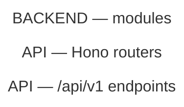
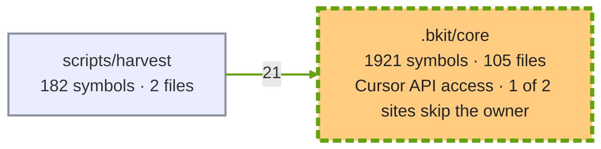

# Capabilities

> [!CAUTION]
> **Purpose:** One row per app capability — owner module, the literal marker that finds
> every use of it, whether anything bypasses the owner. The drift register.
>
> **Rules:**
>
> - Generated — do not edit. `pnpm graph:refresh` rewrites this file.
> - Source of truth: `scripts/graphify/bkit-graph-drift-rules.json`. Every status derived from live source, never typed.
> - Add a capability = add a rule there: capability · lane · owner module · one literal marker.
> - Markers literal, never regex, because `new Ratelimit(` as a regex is an unclosed group matching nothing.
> - Match the mechanism, not the name, because `createClient(` misses an owner that aliases its import.
> - Optional `scope` narrows the tree scanned when a marker means different things per package.
> - Optional `surface`: `product` (default) · `tests` (any `e2e/` dir + every `.test.` / `.spec.` file) · `all`. The two surfaces partition the tree.
> - Optional `budgets`: the exact non-owner site count allowed per scope prefix. Measured == declared everywhere ⇒ `budgeted`, which is not a warning.
> - A budget is not a shrug, because `owned-query-shape-guard.test.ts` reds CI when the count moves either way, and a site landing outside every declared prefix reads as over budget.
> - Test code is in `graph.json` on purpose (`.graphifyignore`) and out of every diagram here by rule (`is_test_code` in `bkit-graphify-rollup.py`): test folders, `.test.` / `.spec.` files, test-runner config. `hide_nodes` below is diagram-only too, for whatever else a picture should not draw.
> - Status computed: no owner → `split`; owner absent → `gap`; owner present, others use marker → `bypassed`; else `one`. A `split|bypassed` at budget → `budgeted`.
> - Externals: `scripts/graphify/bkit-graph-external-rules.json` — `sdk` · `hosts` · `env`. SDK and url = `split`.
> - Import-time scan: `scripts/graphify/bkit-graph-eager-rules.json` lists only what is pure. Unclassified = reported.
> - That scan reads source, not the graph, because module-level initialiser calls are the one construct graphify drops.
> - Nothing discovers an SDK itself; find gaps by listing non-workspace deps.
> - Only the Overrides block is hand-maintained. It round-trips; malformed aborts the run.
> - Colour = called capability, shared by its inbound edges. Grey = never called.
> - Drift = dashed border + one amber box for all four. No ranking: each scan proves a shape, never an intent.
> - `budgeted` = solid border + blue box. Still drawn, because a declared bypass is still a bypass, but it is settled, not an open question.
> - Which status is which: `split` fine dash · `bypassed` long dash · `dead` even dash · `gap` dotted · `budgeted` no dash.
> - A fetched URL is a STRING, never an edge, because `assert-routes-reachable.mjs` is the only check that sees it.
> - Table rescanned every run, never stale. Diagrams from `graph.json` @ `f561e7705`; when that differs from HEAD ⇒ run `pnpm graph:update` first.
> - Detail-level module graph → `pnpm graph`. This doc is the altitude above that: capabilities, not files.

## Status Vocabulary

The first four are warnings, not verdicts, and they share one amber in the diagrams. Any
of them can turn out to be deliberate, because the scans prove a shape, never an intent.

`budgeted` is what one of those four becomes once somebody has decided. The rule declares
the exact number of non-owner sites allowed per scope prefix, its `note` says why that
number is not zero, and `tooling/eslint/tests/owned-query-shape-guard.test.ts` reds CI the
moment the count moves in either direction — too many (a copy appeared) or too few (the
budget is stale). That guard is why the status can be quieter without being a place to
hide work, and it is the half the register itself cannot do: `graphify` is a per-developer
install, absent in CI, so nothing here can turn a build red.

It still gets a box in the diagrams, drawn solid and blue rather than dashed and amber. A
budgeted bypass is still a bypass; the different drawing stops the picture asking the
same question of it every sweep. Drawn identically, an unbounded marker (18 of 19) and a
marker that is exactly at its declared count — whose note says the copies are probes and
the budget is not meant to reach zero — would make each pass rediscover the settled rows
and re-read the notes to dismiss them.

<!-- prettier-ignore -->
| Status | Meaning | Action |
| --- | --- | --- |
| `split` | Two or more competing implementations, no single owner | Centralise; file an issue. Or budget it, with the reason in `note` |
| `bypassed` | Owner exists, some callers skip it | Repoint the bypasses. Or budget them, with the reason in `note` |
| `dead` | A client fetches a path nothing serves. A WARNING, though some are deliberate | Check the call site, then delete the call or serve the path |
| `gap` | Designed, not built. No owner yet | Name the owner BEFORE the first caller |
| `budgeted` | A `split` or `bypassed` whose site count is declared, guarded and currently met | None — the CI guard owns it. Lower the budget when a site goes |
| `one` | One implementation, every caller routes through it | None — keep it that way |

## Register

3 capabilities: 1 `bypassed` · 2 `one`.

<!-- prettier-ignore -->
| Lane | Capability | Owner | Marker | Surface | Status | Bypasses | Budget | Issue |
| --- | --- | --- | --- | --- | --- | --- | --- | --- |
| Providers | Cursor API access | `.bkit/core/engine/shared/egress.ts` | `api.cursor.com` | `product` | `bypassed` | 1 of 2 | — |  |
| Install | Managed-version marker | `.bkit/core/engine/install/version-file.ts` | `do not edit; run` | `product` | `one` | 0 of 1 | — |  |
| Install | Tracker block substitution | `.bkit/core/engine/render/trackers.ts` | `bkit:tracker` | `product` | `one` | 0 of 1 | — |  |

## Unreachable API calls

Not scanned; run the rollup with `--reachability`.

## Import-time side effects

13 module-scope side effects in 4 of 96 source files. A call here runs on **import**, not on first use, so every file downstream pays for it, because under Jest that is a mandatory stub in tests that never touch the thing. Sorted by reach.

<!-- prettier-ignore -->
| File | Evaluates at import | Downstream files | of which tests |
| --- | --- | --- | --- |
| `.bkit/core/engine/checks/tips/index.ts` | `STAR_TIP.replace` | 141 | 86 |
| `.bkit/core/engine/commands/workflow/branches.ts` | `LEDGERS.map` | 141 | 86 |
| `.bkit/core/engine/commands/workflow/workflows.ts` | `Error` | 141 | 86 |

1 further file nothing imports, though an entrypoint is supposed to do work when it loads. In the JSON report only.

## Overrides

The one hand-maintained region of this file. Everything else is rewritten on each run;
this block is read back first and re-emitted verbatim. Rename a node, hide a node or an
edge, pin a note, or force nodes into a named group. A malformed block aborts the run
rather than being silently dropped. Every `hide_nodes` entry needs a one-line reason in
`hide_nodes_why`; `tooling/eslint/tests/hide-nodes-registry.test.ts` fails CI otherwise.

<!-- overrides:start -->

```json
{
  "rename": {},
  "note": {},
  "hide_nodes": [],
  "hide_nodes_why": {},
  "hide_edges": [],
  "group": {
    "Install engine": [
      ".bkit/core/engine/cli",
      ".bkit/core/engine/commands/install/install",
      ".bkit/core/engine/install/modules/index",
      ".bkit/core/engine/install/write",
      ".bkit/core/engine/commands/install/upgrade",
      ".bkit/core/engine/commands/install/uninstall",
      ".bkit/core/engine/install/manifest",
      ".bkit/core/engine/install/version-file",
      ".bkit/core/engine/shared/package-roots",
      ".bkit/core/engine/render/trackers",
      ".bkit/core/engine/install/cloud-env"
    ],
    "Health checks": [
      ".bkit/core/engine/checks/after/index",
      ".bkit/core/engine/checks/before/index"
    ],
    "Telemetry": [
      ".bkit/core/engine/ledgers/telemetry",
      ".bkit/core/engine/commands/stats",
      ".bkit/core/engine/commands/analysis",
      ".bkit/core/engine/commands/comply",
      ".bkit/core/engine/install/placeholders"
    ]
  }
}
```

<!-- overrides:end -->

## User-facing routes → backend capabilities

0 routes across web and native, each linked to the service domains it reaches. The static import graph does not cross the HTTP boundary — a page imports `ui` and `validators`, never `services` — so the link is the endpoint literal at the calling symbol, followed through `v1.ts` to the router file and its service imports. Attribution is per symbol, not per file, so a domain named only in a shared helper's comment is not credited to every page that imports the helper.

To view online, paste only the lines inside the block below — not the fence lines — into [mermaid.live](https://mermaid.live/).



## Architecture — packages

Grouped by the folder tree, not by a clustering algorithm. Edge labels are the number of
underlying symbol edges. Drift status is painted onto the owning module.

To view online, paste only the lines inside the block below — not the fence lines — into [mermaid.live](https://mermaid.live/).



## Architecture — modules

The same graph one level down: `apps/web` is a box, its subfolders are the nodes inside it.
Cross-group edges lighter than 6 are dropped — see `MMD_MIN_WEIGHT` in
`scripts/graphify/bkit-graphify.sh`.

To view online, paste only the lines inside the block below — not the fence lines — into [mermaid.live](https://mermaid.live/).

```mermaid
---
config:
  layout: elk
  flowchart:
    useMaxWidth: false
---
flowchart LR
  %% Generated by bkit-graphify-rollup.py from f561e7705df88f13f3f36fd891c6de9cf44e03be — do not edit
  subgraph gncustom_health_checks["Health checks"]
    n_bkit_core_engine_checks_after_index[".bkit/core/engine/checks/after/index<br/>11 symbols · 1 files"]
    n_bkit_core_engine_checks_before_index[".bkit/core/engine/checks/before/index<br/>4 symbols · 1 files"]
  end
  subgraph gncustom_install_engine["Install engine"]
    n_bkit_core_engine_cli[".bkit/core/engine/cli<br/>30 symbols · 1 files"]
    n_bkit_core_engine_commands_install_install[".bkit/core/engine/commands/install/install<br/>11 symbols · 1 files"]
    n_bkit_core_engine_commands_install_uninstall[".bkit/core/engine/commands/install/uninstall<br/>29 symbols · 1 files"]
    n_bkit_core_engine_commands_install_upgrade[".bkit/core/engine/commands/install/upgrade<br/>17 symbols · 1 files"]
    n_bkit_core_engine_install_cloud_env[".bkit/core/engine/install/cloud-env<br/>47 symbols · 1 files"]
    n_bkit_core_engine_install_manifest[".bkit/core/engine/install/manifest<br/>31 symbols · 1 files"]
    n_bkit_core_engine_install_modules_index[".bkit/core/engine/install/modules/index<br/>10 symbols · 1 files"]
    n_bkit_core_engine_install_version_file[".bkit/core/engine/install/version-file<br/>17 symbols · 1 files"]
    n_bkit_core_engine_install_write[".bkit/core/engine/install/write<br/>23 symbols · 1 files"]
    n_bkit_core_engine_shared_package_roots[".bkit/core/engine/shared/package-roots<br/>14 symbols · 1 files"]
  end
  subgraph gncustom_telemetry["Telemetry"]
    n_bkit_core_engine_commands_analysis[".bkit/core/engine/commands/analysis<br/>24 symbols · 1 files"]
    n_bkit_core_engine_commands_comply[".bkit/core/engine/commands/comply<br/>20 symbols · 1 files"]
    n_bkit_core_engine_install_placeholders[".bkit/core/engine/install/placeholders<br/>6 symbols · 1 files"]
    n_bkit_core_engine_ledgers_telemetry[".bkit/core/engine/ledgers/telemetry<br/>105 symbols · 1 files"]
  end
  subgraph gn_bkit_core_engine[".bkit/core/engine"]
    subgraph gn_bkit_core_engine_checks[".bkit/core/engine/checks"]
      subgraph gn_bkit_core_engine_checks_after[".bkit/core/engine/checks/after"]
        n_bkit_core_engine_checks_after_auth["auth<br/>10 symbols · 1 files"]
        n_bkit_core_engine_checks_after_ci_yml["ci-yml<br/>15 symbols · 1 files"]
        n_bkit_core_engine_checks_after_github["github<br/>8 symbols · 1 files"]
        n_bkit_core_engine_checks_after_managed["managed<br/>11 symbols · 1 files"]
        n_bkit_core_engine_checks_after_suppression["suppression<br/>5 symbols · 1 files"]
        n_bkit_core_engine_checks_after_tools["tools<br/>10 symbols · 1 files"]
      end
      subgraph gn_bkit_core_engine_checks_before[".bkit/core/engine/checks/before"]
        n_bkit_core_engine_checks_before_context_fetch["context-fetch<br/>14 symbols · 1 files"]
        n_bkit_core_engine_checks_before_env["env<br/>8 symbols · 1 files"]
        n_bkit_core_engine_checks_before_files["files<br/>8 symbols · 1 files"]
        n_bkit_core_engine_checks_before_repo["repo<br/>5 symbols · 1 files"]
      end
      subgraph gn_bkit_core_engine_checks_tips[".bkit/core/engine/checks/tips"]
        n_bkit_core_engine_checks_tips_catalogue["catalogue<br/>6 symbols · 1 files"]
        n_bkit_core_engine_checks_tips_detect["detect<br/>19 symbols · 1 files"]
        n_bkit_core_engine_checks_tips_index["index<br/>26 symbols · 1 files"]
      end
    end
    subgraph gn_bkit_core_engine_commands[".bkit/core/engine/commands"]
      n_bkit_core_engine_commands_ci_ci[".bkit/core/engine/commands/ci/ci<br/>34 symbols · 1 files"]
      n_bkit_core_engine_commands_install_doctor[".bkit/core/engine/commands/install/doctor<br/>6 symbols · 1 files"]
      n_bkit_core_engine_commands_land["land<br/>10 symbols · 1 files"]
      n_bkit_core_engine_commands_lib["lib<br/>45 symbols · 1 files"]
      n_bkit_core_engine_commands_setup_setup[".bkit/core/engine/commands/setup/setup<br/>11 symbols · 1 files"]
      subgraph gn_bkit_core_engine_commands_workflow[".bkit/core/engine/commands/workflow"]
        n_bkit_core_engine_commands_workflow_branches["branches<br/>72 symbols · 1 files"]
        n_bkit_core_engine_commands_workflow_context["context<br/>53 symbols · 1 files"]
        n_bkit_core_engine_commands_workflow_counters["counters<br/>7 symbols · 1 files"]
        n_bkit_core_engine_commands_workflow_disk["disk<br/>48 symbols · 1 files"]
        n_bkit_core_engine_commands_workflow_fids["fids<br/>26 symbols · 1 files"]
        n_bkit_core_engine_commands_workflow_issues["issues<br/>36 symbols · 1 files"]
        n_bkit_core_engine_commands_workflow_ledgers["ledgers<br/>75 symbols · 1 files"]
        n_bkit_core_engine_commands_workflow_locks["locks<br/>31 symbols · 1 files"]
        n_bkit_core_engine_commands_workflow_prs["prs<br/>52 symbols · 1 files"]
        n_bkit_core_engine_commands_workflow_repo["repo<br/>9 symbols · 1 files"]
        n_bkit_core_engine_commands_workflow_roadmap["roadmap<br/>37 symbols · 1 files"]
        n_bkit_core_engine_commands_workflow_run_facts["run-facts<br/>21 symbols · 1 files"]
        n_bkit_core_engine_commands_workflow_runs["runs<br/>73 symbols · 1 files"]
        n_bkit_core_engine_commands_workflow_runtime["runtime<br/>17 symbols · 1 files"]
        n_bkit_core_engine_commands_workflow_status["status<br/>33 symbols · 1 files"]
        n_bkit_core_engine_commands_workflow_steps["steps<br/>46 symbols · 1 files"]
        n_bkit_core_engine_commands_workflow_tests["tests<br/>53 symbols · 1 files"]
        n_bkit_core_engine_commands_workflow_workflows["workflows<br/>59 symbols · 1 files"]
        n_bkit_core_engine_commands_workflow_workstreams["workstreams<br/>9 symbols · 1 files"]
        n_bkit_core_engine_commands_workflow_worktrees["worktrees<br/>35 symbols · 1 files"]
      end
    end
    subgraph gn_bkit_core_engine_install[".bkit/core/engine/install"]
      n_bkit_core_engine_install_managed_block["managed-block<br/>16 symbols · 1 files"]
      subgraph gn_bkit_core_engine_install_modules[".bkit/core/engine/install/modules"]
        n_bkit_core_engine_install_modules_antigravity["antigravity<br/>7 symbols · 1 files"]
        n_bkit_core_engine_install_modules_claude["claude<br/>6 symbols · 1 files"]
        n_bkit_core_engine_install_modules_codex["codex<br/>5 symbols · 1 files"]
        n_bkit_core_engine_install_modules_core["core<br/>33 symbols · 1 files"]
        n_bkit_core_engine_install_modules_cursor["cursor<br/>3 symbols · 1 files"]
        n_bkit_core_engine_install_modules_opencode["opencode<br/>9 symbols · 1 files"]
      end
      n_bkit_core_engine_install_template_copies["template-copies<br/>10 symbols · 1 files"]
    end
    n_bkit_core_engine_ledgers_status[".bkit/core/engine/ledgers/status<br/>20 symbols · 1 files"]
    subgraph gn_bkit_core_engine_render[".bkit/core/engine/render"]
      n_bkit_core_engine_render_hosts["hosts<br/>24 symbols · 1 files"]
      n_bkit_core_engine_render_models["models<br/>18 symbols · 1 files"]
    end
    subgraph gn_bkit_core_engine_shared[".bkit/core/engine/shared"]
      n_bkit_core_engine_shared_json["json<br/>4 symbols · 1 files"]
      n_bkit_core_engine_shared_package_json["package-json<br/>6 symbols · 1 files"]
      n_bkit_core_engine_shared_settings["settings<br/>14 symbols · 1 files"]
    end
  end
  nscripts_harvest["scripts/harvest<br/>182 symbols · 2 files"]
  n_bkit_core_engine_commands_workflow_branches -->|80| n_bkit_core_engine_commands_lib
  n_bkit_core_engine_commands_workflow_workflows -->|62| n_bkit_core_engine_commands_lib
  n_bkit_core_engine_commands_workflow_runs -->|54| n_bkit_core_engine_commands_lib
  n_bkit_core_engine_commands_workflow_prs -->|52| n_bkit_core_engine_commands_lib
  n_bkit_core_engine_commands_ci_ci -->|28| n_bkit_core_engine_commands_lib
  n_bkit_core_engine_commands_workflow_ledgers -->|27| n_bkit_core_engine_commands_lib
  n_bkit_core_engine_commands_workflow_steps -->|24| n_bkit_core_engine_commands_lib
  n_bkit_core_engine_commands_workflow_worktrees -->|24| n_bkit_core_engine_commands_lib
  n_bkit_core_engine_commands_workflow_steps -->|22| n_bkit_core_engine_commands_workflow_status
  n_bkit_core_engine_commands_workflow_issues -->|21| n_bkit_core_engine_commands_lib
  n_bkit_core_engine_commands_workflow_workflows -->|21| n_bkit_core_engine_commands_workflow_ledgers
  n_bkit_core_engine_commands_workflow_workflows -->|20| n_bkit_core_engine_commands_workflow_locks
  n_bkit_core_engine_checks_after_index -->|19| n_bkit_core_engine_checks_after_ci_yml
  n_bkit_core_engine_commands_workflow_status -->|19| n_bkit_core_engine_ledgers_status
  n_bkit_core_engine_commands_workflow_ledgers -->|18| n_bkit_core_engine_ledgers_telemetry
  n_bkit_core_engine_commands_workflow_roadmap -->|18| n_bkit_core_engine_commands_lib
  n_bkit_core_engine_commands_workflow_status -->|17| n_bkit_core_engine_commands_lib
  n_bkit_core_engine_commands_workflow_workflows -->|17| n_bkit_core_engine_commands_workflow_status
  n_bkit_core_engine_install_modules_claude -->|16| n_bkit_core_engine_install_write
  n_bkit_core_engine_install_write -->|16| n_bkit_core_engine_install_managed_block
  n_bkit_core_engine_commands_install_uninstall -->|15| n_bkit_core_engine_install_version_file
  n_bkit_core_engine_commands_workflow_counters -->|15| n_bkit_core_engine_commands_workflow_status
  n_bkit_core_engine_commands_workflow_locks -->|15| n_bkit_core_engine_commands_lib
  n_bkit_core_engine_commands_workflow_workflows -->|15| n_bkit_core_engine_commands_workflow_run_facts
  n_bkit_core_engine_install_modules_opencode -->|15| n_bkit_core_engine_install_write
  n_bkit_core_engine_checks_after_managed -->|14| n_bkit_core_engine_install_managed_block
  n_bkit_core_engine_commands_install_upgrade -->|14| n_bkit_core_engine_install_version_file
  n_bkit_core_engine_commands_workflow_branches -->|14| n_bkit_core_engine_commands_workflow_prs
  n_bkit_core_engine_commands_workflow_context -->|14| n_bkit_core_engine_commands_lib
  n_bkit_core_engine_commands_workflow_workflows -->|14| n_bkit_core_engine_ledgers_telemetry
  nscripts_harvest -->|14| n_bkit_core_engine_ledgers_telemetry
  n_bkit_core_engine_commands_workflow_branches -->|13| n_bkit_core_engine_commands_workflow_status
  n_bkit_core_engine_commands_workflow_prs -->|13| n_bkit_core_engine_commands_workflow_status
  n_bkit_core_engine_commands_workflow_runs -->|13| n_bkit_core_engine_commands_workflow_prs
  n_bkit_core_engine_commands_workflow_workflows -->|13| n_bkit_core_engine_ledgers_status
  n_bkit_core_engine_commands_workflow_worktrees -->|13| n_bkit_core_engine_commands_workflow_ledgers
  n_bkit_core_engine_render_hosts -->|13| n_bkit_core_engine_render_models
  n_bkit_core_engine_commands_install_install -->|12| n_bkit_core_engine_render_models
  n_bkit_core_engine_commands_install_upgrade -->|12| n_bkit_core_engine_render_models
  n_bkit_core_engine_commands_setup_setup -->|12| n_bkit_core_engine_commands_lib
  n_bkit_core_engine_commands_workflow_roadmap -->|12| n_bkit_core_engine_ledgers_telemetry
  n_bkit_core_engine_checks_after_index -->|11| n_bkit_core_engine_checks_after_github
  n_bkit_core_engine_commands_install_uninstall -->|11| n_bkit_core_engine_shared_package_roots
  n_bkit_core_engine_commands_workflow_branches -->|11| n_bkit_core_engine_commands_workflow_ledgers
  n_bkit_core_engine_commands_workflow_branches -->|11| n_bkit_core_engine_commands_land
  n_bkit_core_engine_commands_workflow_context -->|11| n_bkit_core_engine_commands_workflow_status
  n_bkit_core_engine_commands_workflow_fids -->|11| n_bkit_core_engine_commands_lib
  n_bkit_core_engine_commands_workflow_repo -->|11| n_bkit_core_engine_commands_lib
  n_bkit_core_engine_commands_workflow_run_facts -->|11| n_bkit_core_engine_ledgers_telemetry
  n_bkit_core_engine_commands_workflow_steps -->|11| n_bkit_core_engine_ledgers_status
  n_bkit_core_engine_commands_workflow_workflows -->|11| n_bkit_core_engine_commands_workflow_issues
  n_bkit_core_engine_shared_settings -->|11| n_bkit_core_engine_install_manifest
  n_bkit_core_engine_commands_analysis -->|10| n_bkit_core_engine_ledgers_telemetry
  n_bkit_core_engine_commands_install_uninstall -->|10| n_bkit_core_engine_install_write
  n_bkit_core_engine_commands_install_upgrade -->|10| n_bkit_core_engine_install_manifest
  n_bkit_core_engine_commands_workflow_runs -->|10| n_bkit_core_engine_commands_workflow_fids
  n_bkit_core_engine_commands_workflow_runs -->|10| n_bkit_core_engine_commands_workflow_status
  n_bkit_core_engine_commands_workflow_runtime -->|10| n_bkit_core_engine_commands_lib
  n_bkit_core_engine_commands_workflow_steps -->|10| n_bkit_core_engine_commands_workflow_ledgers
  n_bkit_core_engine_commands_workflow_tests -->|10| n_bkit_core_engine_commands_lib
  n_bkit_core_engine_commands_workflow_tests -->|10| n_bkit_core_engine_commands_workflow_status
  n_bkit_core_engine_commands_workflow_workflows -->|10| n_bkit_core_engine_commands_workflow_branches
  n_bkit_core_engine_install_modules_antigravity -->|10| n_bkit_core_engine_install_modules_core
  n_bkit_core_engine_install_modules_claude -->|10| n_bkit_core_engine_install_modules_core
  n_bkit_core_engine_install_modules_codex -->|10| n_bkit_core_engine_install_modules_core
  n_bkit_core_engine_install_modules_core -->|10| n_bkit_core_engine_install_write
  n_bkit_core_engine_install_modules_cursor -->|10| n_bkit_core_engine_install_modules_core
  n_bkit_core_engine_install_modules_index -->|10| n_bkit_core_engine_install_modules_core
  n_bkit_core_engine_install_modules_opencode -->|10| n_bkit_core_engine_install_modules_core
  n_bkit_core_engine_checks_tips_catalogue -->|10| n_bkit_core_engine_checks_tips_detect
  n_bkit_core_engine_checks_after_index -->|9| n_bkit_core_engine_checks_after_tools
  n_bkit_core_engine_checks_after_index -->|9| n_bkit_core_engine_checks_before_env
  n_bkit_core_engine_checks_before_index -->|9| n_bkit_core_engine_checks_before_repo
  n_bkit_core_engine_checks_before_index -->|9| n_bkit_core_engine_checks_before_files
  n_bkit_core_engine_commands_install_install -->|9| n_bkit_core_engine_checks_after_index
  n_bkit_core_engine_commands_install_upgrade -->|9| n_bkit_core_engine_install_cloud_env
  n_bkit_core_engine_commands_land -->|9| n_bkit_core_engine_commands_lib
  n_bkit_core_engine_commands_workflow_counters -->|9| n_bkit_core_engine_commands_lib
  n_bkit_core_engine_commands_workflow_locks -->|9| n_bkit_core_engine_ledgers_status
  n_bkit_core_engine_install_modules_antigravity -->|9| n_bkit_core_engine_shared_package_roots
  n_bkit_core_engine_install_modules_claude -->|9| n_bkit_core_engine_shared_package_roots
  n_bkit_core_engine_install_modules_codex -->|9| n_bkit_core_engine_shared_package_roots
  n_bkit_core_engine_install_modules_core -->|9| n_bkit_core_engine_install_version_file
  n_bkit_core_engine_install_modules_cursor -->|9| n_bkit_core_engine_shared_package_roots
  n_bkit_core_engine_install_modules_opencode -->|9| n_bkit_core_engine_render_models
  n_bkit_core_engine_install_modules_opencode -->|9| n_bkit_core_engine_shared_package_roots
  n_bkit_core_engine_checks_before_index -->|8| n_bkit_core_engine_checks_before_context_fetch
  n_bkit_core_engine_commands_install_upgrade -->|8| n_bkit_core_engine_shared_package_roots
  n_bkit_core_engine_commands_workflow_prs -->|8| n_bkit_core_engine_ledgers_status
  n_bkit_core_engine_commands_workflow_run_facts -->|8| n_bkit_core_engine_commands_workflow_tests
  n_bkit_core_engine_commands_workflow_workflows -->|8| n_bkit_core_engine_commands_land
  n_bkit_core_engine_install_modules_antigravity -->|8| n_bkit_core_engine_install_write
  n_bkit_core_engine_install_modules_codex -->|8| n_bkit_core_engine_install_write
  n_bkit_core_engine_install_modules_core -->|8| n_bkit_core_engine_shared_package_roots
  n_bkit_core_engine_checks_after_index -->|7| n_bkit_core_engine_checks_tips_index
  n_bkit_core_engine_checks_after_index -->|7| n_bkit_core_engine_checks_after_auth
  n_bkit_core_engine_checks_tips_detect -->|7| n_bkit_core_engine_shared_package_json
  n_bkit_core_engine_checks_tips_index -->|7| n_bkit_core_engine_checks_after_suppression
  n_bkit_core_engine_cli -->|7| n_bkit_core_engine_install_manifest
  n_bkit_core_engine_commands_comply -->|7| n_bkit_core_engine_ledgers_telemetry
  n_bkit_core_engine_commands_install_doctor -->|7| n_bkit_core_engine_shared_package_roots
  n_bkit_core_engine_commands_install_doctor -->|7| n_bkit_core_engine_checks_after_index
  n_bkit_core_engine_commands_install_doctor -->|7| n_bkit_core_engine_commands_install_install
  n_bkit_core_engine_commands_install_uninstall -->|7| n_bkit_core_engine_install_manifest
  n_bkit_core_engine_commands_install_uninstall -->|7| n_bkit_core_engine_install_modules_opencode
  n_bkit_core_engine_commands_install_uninstall -->|7| n_bkit_core_engine_render_models
  n_bkit_core_engine_commands_install_upgrade -->|7| n_bkit_core_engine_install_placeholders
  n_bkit_core_engine_commands_install_upgrade -->|7| n_bkit_core_engine_commands_install_install
  n_bkit_core_engine_commands_install_upgrade -->|7| n_bkit_core_engine_install_template_copies
  n_bkit_core_engine_commands_workflow_branches -->|7| n_bkit_core_engine_commands_workflow_locks
  n_bkit_core_engine_commands_workflow_disk -->|7| n_bkit_core_engine_commands_lib
  n_bkit_core_engine_commands_workflow_runs -->|7| n_bkit_core_engine_shared_settings
  n_bkit_core_engine_commands_workflow_runs -->|7| n_bkit_core_engine_commands_workflow_ledgers
  n_bkit_core_engine_commands_workflow_runs -->|7| n_bkit_core_engine_commands_workflow_repo
  n_bkit_core_engine_commands_workflow_steps -->|7| n_bkit_core_engine_commands_workflow_fids
  n_bkit_core_engine_commands_workflow_steps -->|7| n_bkit_core_engine_commands_workflow_locks
  n_bkit_core_engine_commands_workflow_workstreams -->|7| n_bkit_core_engine_commands_lib
  n_bkit_core_engine_install_modules_core -->|7| n_bkit_core_engine_shared_json
  n_bkit_core_engine_install_modules_core -->|7| n_bkit_core_engine_install_manifest
  n_bkit_core_engine_install_modules_cursor -->|7| n_bkit_core_engine_install_write
  n_bkit_core_engine_install_modules_cursor -->|7| n_bkit_core_engine_render_hosts
  n_bkit_core_engine_install_modules_opencode -->|7| n_bkit_core_engine_install_cloud_env
  n_bkit_core_engine_install_template_copies -->|7| n_bkit_core_engine_shared_package_roots
  n_bkit_core_engine_commands_workflow_runtime -->|7| n_bkit_core_engine_commands_workflow_status
  n_bkit_core_engine_checks_after_github -->|6| n_bkit_core_engine_shared_settings
  n_bkit_core_engine_checks_before_files -->|6| n_bkit_core_engine_shared_package_roots
  n_bkit_core_engine_commands_install_install -->|6| n_bkit_core_engine_commands_install_uninstall
  n_bkit_core_engine_commands_install_uninstall -->|6| n_bkit_core_engine_install_managed_block
  n_bkit_core_engine_commands_install_uninstall -->|6| n_bkit_core_engine_shared_json
  n_bkit_core_engine_commands_install_upgrade -->|6| n_bkit_core_engine_shared_package_json
  n_bkit_core_engine_commands_install_upgrade -->|6| n_bkit_core_engine_install_write
  n_bkit_core_engine_commands_workflow_branches -->|6| n_bkit_core_engine_ledgers_telemetry
  n_bkit_core_engine_commands_workflow_issues -->|6| n_bkit_core_engine_commands_workflow_status
  n_bkit_core_engine_commands_workflow_ledgers -->|6| n_bkit_core_engine_commands_workflow_status
  n_bkit_core_engine_commands_workflow_workflows -->|6| n_bkit_core_engine_commands_workflow_prs
  n_bkit_core_engine_commands_workflow_workflows -->|6| n_bkit_core_engine_commands_workflow_steps
  n_bkit_core_engine_install_modules_antigravity -->|6| n_bkit_core_engine_render_hosts
  n_bkit_core_engine_install_modules_opencode -->|6| n_bkit_core_engine_shared_json
  n_bkit_core_engine_checks_tips_catalogue -->|6| n_bkit_core_engine_checks_before_env
  style n_bkit_core_engine_checks_after_index stroke:#0f766e,stroke-width:2px
  style n_bkit_core_engine_checks_before_index stroke:#8b949e,stroke-width:2px
  style n_bkit_core_engine_cli stroke:#8b949e,stroke-width:2px
  style n_bkit_core_engine_commands_install_install stroke:#c026d3,stroke-width:2px
  style n_bkit_core_engine_commands_install_uninstall stroke:#d73a4a,stroke-width:2px
  style n_bkit_core_engine_commands_install_upgrade stroke:#8b949e,stroke-width:2px
  style n_bkit_core_engine_install_cloud_env stroke:#bf3989,stroke-width:2px
  style n_bkit_core_engine_install_manifest stroke:#b45309,stroke-width:2px
  style n_bkit_core_engine_install_modules_index stroke:#8b949e,stroke-width:2px
  style n_bkit_core_engine_install_version_file stroke:#bf3989,stroke-width:2px
  style n_bkit_core_engine_install_write stroke:#1a7f37,stroke-width:2px
  style n_bkit_core_engine_shared_package_roots stroke:#5b8c00,stroke-width:2px
  style n_bkit_core_engine_commands_analysis stroke:#8b949e,stroke-width:2px
  style n_bkit_core_engine_commands_comply stroke:#8b949e,stroke-width:2px
  style n_bkit_core_engine_install_placeholders stroke:#5b8c00,stroke-width:2px
  style n_bkit_core_engine_ledgers_telemetry stroke:#65a30d,stroke-width:2px
  style n_bkit_core_engine_checks_after_auth stroke:#0891b2,stroke-width:2px
  style n_bkit_core_engine_checks_after_ci_yml stroke:#9a6700,stroke-width:2px
  style n_bkit_core_engine_checks_after_github stroke:#4d7c0f,stroke-width:2px
  style n_bkit_core_engine_checks_after_managed stroke:#8b949e,stroke-width:2px
  style n_bkit_core_engine_checks_after_suppression stroke:#0891b2,stroke-width:2px
  style n_bkit_core_engine_checks_after_tools stroke:#c026d3,stroke-width:2px
  style n_bkit_core_engine_checks_before_context_fetch stroke:#a21caf,stroke-width:2px
  style n_bkit_core_engine_checks_before_env stroke:#c026d3,stroke-width:2px
  style n_bkit_core_engine_checks_before_files stroke:#c2410c,stroke-width:2px
  style n_bkit_core_engine_checks_before_repo stroke:#0969da,stroke-width:2px
  style n_bkit_core_engine_checks_tips_catalogue stroke:#8b949e,stroke-width:2px
  style n_bkit_core_engine_checks_tips_detect stroke:#0891b2,stroke-width:2px
  style n_bkit_core_engine_checks_tips_index stroke:#a21caf,stroke-width:2px
  style n_bkit_core_engine_commands_ci_ci stroke:#8b949e,stroke-width:2px
  style n_bkit_core_engine_commands_install_doctor stroke:#8b949e,stroke-width:2px
  style n_bkit_core_engine_commands_land stroke:#b91c1c,stroke-width:2px
  style n_bkit_core_engine_commands_lib stroke:#be123c,stroke-width:2px
  style n_bkit_core_engine_commands_setup_setup stroke:#8b949e,stroke-width:2px
  style n_bkit_core_engine_commands_workflow_branches stroke:#d73a4a,stroke-width:2px
  style n_bkit_core_engine_commands_workflow_context stroke:#8b949e,stroke-width:2px
  style n_bkit_core_engine_commands_workflow_counters stroke:#8b949e,stroke-width:2px
  style n_bkit_core_engine_commands_workflow_disk stroke:#8b949e,stroke-width:2px
  style n_bkit_core_engine_commands_workflow_fids stroke:#9a6700,stroke-width:2px
  style n_bkit_core_engine_commands_workflow_issues stroke:#4d7c0f,stroke-width:2px
  style n_bkit_core_engine_commands_workflow_ledgers stroke:#b45309,stroke-width:2px
  style n_bkit_core_engine_commands_workflow_locks stroke:#0e7490,stroke-width:2px
  style n_bkit_core_engine_commands_workflow_prs stroke:#9a6700,stroke-width:2px
  style n_bkit_core_engine_commands_workflow_repo stroke:#5b8c00,stroke-width:2px
  style n_bkit_core_engine_commands_workflow_roadmap stroke:#8b949e,stroke-width:2px
  style n_bkit_core_engine_commands_workflow_run_facts stroke:#c026d3,stroke-width:2px
  style n_bkit_core_engine_commands_workflow_runs stroke:#8b949e,stroke-width:2px
  style n_bkit_core_engine_commands_workflow_runtime stroke:#8b949e,stroke-width:2px
  style n_bkit_core_engine_commands_workflow_status stroke:#0891b2,stroke-width:2px
  style n_bkit_core_engine_commands_workflow_steps stroke:#1d4ed8,stroke-width:2px
  style n_bkit_core_engine_commands_workflow_tests stroke:#8250df,stroke-width:2px
  style n_bkit_core_engine_commands_workflow_workflows stroke:#8b949e,stroke-width:2px
  style n_bkit_core_engine_commands_workflow_workstreams stroke:#8b949e,stroke-width:2px
  style n_bkit_core_engine_commands_workflow_worktrees stroke:#8b949e,stroke-width:2px
  style n_bkit_core_engine_install_managed_block stroke:#be123c,stroke-width:2px
  style n_bkit_core_engine_install_modules_antigravity stroke:#8b949e,stroke-width:2px
  style n_bkit_core_engine_install_modules_claude stroke:#8b949e,stroke-width:2px
  style n_bkit_core_engine_install_modules_codex stroke:#8b949e,stroke-width:2px
  style n_bkit_core_engine_install_modules_core stroke:#c026d3,stroke-width:2px
  style n_bkit_core_engine_install_modules_cursor stroke:#8b949e,stroke-width:2px
  style n_bkit_core_engine_install_modules_opencode stroke:#b45309,stroke-width:2px
  style n_bkit_core_engine_install_template_copies stroke:#bf3989,stroke-width:2px
  style n_bkit_core_engine_ledgers_status stroke:#2563eb,stroke-width:2px
  style n_bkit_core_engine_render_hosts stroke:#d73a4a,stroke-width:2px
  style n_bkit_core_engine_render_models stroke:#be123c,stroke-width:2px
  style n_bkit_core_engine_shared_json stroke:#d73a4a,stroke-width:2px
  style n_bkit_core_engine_shared_package_json stroke:#4d7c0f,stroke-width:2px
  style n_bkit_core_engine_shared_settings stroke:#9a6700,stroke-width:2px
  style nscripts_harvest stroke:#8b949e,stroke-width:2px
  linkStyle 0 stroke:#be123c,stroke-width:2px
  linkStyle 1 stroke:#be123c,stroke-width:2px
  linkStyle 2 stroke:#be123c,stroke-width:2px
  linkStyle 3 stroke:#be123c,stroke-width:2px
  linkStyle 4 stroke:#be123c,stroke-width:2px
  linkStyle 5 stroke:#be123c,stroke-width:2px
  linkStyle 6 stroke:#be123c,stroke-width:2px
  linkStyle 7 stroke:#be123c,stroke-width:2px
  linkStyle 8 stroke:#0891b2,stroke-width:2px
  linkStyle 9 stroke:#be123c,stroke-width:2px
  linkStyle 10 stroke:#b45309,stroke-width:2px
  linkStyle 11 stroke:#0e7490,stroke-width:2px
  linkStyle 12 stroke:#9a6700,stroke-width:2px
  linkStyle 13 stroke:#2563eb,stroke-width:2px
  linkStyle 14 stroke:#65a30d,stroke-width:2px
  linkStyle 15 stroke:#be123c,stroke-width:2px
  linkStyle 16 stroke:#be123c,stroke-width:2px
  linkStyle 17 stroke:#0891b2,stroke-width:2px
  linkStyle 18 stroke:#1a7f37,stroke-width:2px
  linkStyle 19 stroke:#be123c,stroke-width:2px
  linkStyle 20 stroke:#bf3989,stroke-width:2px
  linkStyle 21 stroke:#0891b2,stroke-width:2px
  linkStyle 22 stroke:#be123c,stroke-width:2px
  linkStyle 23 stroke:#c026d3,stroke-width:2px
  linkStyle 24 stroke:#1a7f37,stroke-width:2px
  linkStyle 25 stroke:#be123c,stroke-width:2px
  linkStyle 26 stroke:#bf3989,stroke-width:2px
  linkStyle 27 stroke:#9a6700,stroke-width:2px
  linkStyle 28 stroke:#be123c,stroke-width:2px
  linkStyle 29 stroke:#65a30d,stroke-width:2px
  linkStyle 30 stroke:#65a30d,stroke-width:2px
  linkStyle 31 stroke:#0891b2,stroke-width:2px
  linkStyle 32 stroke:#0891b2,stroke-width:2px
  linkStyle 33 stroke:#9a6700,stroke-width:2px
  linkStyle 34 stroke:#2563eb,stroke-width:2px
  linkStyle 35 stroke:#b45309,stroke-width:2px
  linkStyle 36 stroke:#be123c,stroke-width:2px
  linkStyle 37 stroke:#be123c,stroke-width:2px
  linkStyle 38 stroke:#be123c,stroke-width:2px
  linkStyle 39 stroke:#be123c,stroke-width:2px
  linkStyle 40 stroke:#65a30d,stroke-width:2px
  linkStyle 41 stroke:#4d7c0f,stroke-width:2px
  linkStyle 42 stroke:#5b8c00,stroke-width:2px
  linkStyle 43 stroke:#b45309,stroke-width:2px
  linkStyle 44 stroke:#b91c1c,stroke-width:2px
  linkStyle 45 stroke:#0891b2,stroke-width:2px
  linkStyle 46 stroke:#be123c,stroke-width:2px
  linkStyle 47 stroke:#be123c,stroke-width:2px
  linkStyle 48 stroke:#65a30d,stroke-width:2px
  linkStyle 49 stroke:#2563eb,stroke-width:2px
  linkStyle 50 stroke:#4d7c0f,stroke-width:2px
  linkStyle 51 stroke:#b45309,stroke-width:2px
  linkStyle 52 stroke:#65a30d,stroke-width:2px
  linkStyle 53 stroke:#1a7f37,stroke-width:2px
  linkStyle 54 stroke:#b45309,stroke-width:2px
  linkStyle 55 stroke:#9a6700,stroke-width:2px
  linkStyle 56 stroke:#0891b2,stroke-width:2px
  linkStyle 57 stroke:#be123c,stroke-width:2px
  linkStyle 58 stroke:#b45309,stroke-width:2px
  linkStyle 59 stroke:#be123c,stroke-width:2px
  linkStyle 60 stroke:#0891b2,stroke-width:2px
  linkStyle 61 stroke:#d73a4a,stroke-width:2px
  linkStyle 62 stroke:#c026d3,stroke-width:2px
  linkStyle 63 stroke:#c026d3,stroke-width:2px
  linkStyle 64 stroke:#c026d3,stroke-width:2px
  linkStyle 65 stroke:#1a7f37,stroke-width:2px
  linkStyle 66 stroke:#c026d3,stroke-width:2px
  linkStyle 67 stroke:#c026d3,stroke-width:2px
  linkStyle 68 stroke:#c026d3,stroke-width:2px
  linkStyle 69 stroke:#0891b2,stroke-width:2px
  linkStyle 70 stroke:#c026d3,stroke-width:2px
  linkStyle 71 stroke:#c026d3,stroke-width:2px
  linkStyle 72 stroke:#0969da,stroke-width:2px
  linkStyle 73 stroke:#c2410c,stroke-width:2px
  linkStyle 74 stroke:#0f766e,stroke-width:2px
  linkStyle 75 stroke:#bf3989,stroke-width:2px
  linkStyle 76 stroke:#be123c,stroke-width:2px
  linkStyle 77 stroke:#be123c,stroke-width:2px
  linkStyle 78 stroke:#2563eb,stroke-width:2px
  linkStyle 79 stroke:#5b8c00,stroke-width:2px
  linkStyle 80 stroke:#5b8c00,stroke-width:2px
  linkStyle 81 stroke:#5b8c00,stroke-width:2px
  linkStyle 82 stroke:#bf3989,stroke-width:2px
  linkStyle 83 stroke:#5b8c00,stroke-width:2px
  linkStyle 84 stroke:#be123c,stroke-width:2px
  linkStyle 85 stroke:#5b8c00,stroke-width:2px
  linkStyle 86 stroke:#a21caf,stroke-width:2px
  linkStyle 87 stroke:#5b8c00,stroke-width:2px
  linkStyle 88 stroke:#2563eb,stroke-width:2px
  linkStyle 89 stroke:#8250df,stroke-width:2px
  linkStyle 90 stroke:#b91c1c,stroke-width:2px
  linkStyle 91 stroke:#1a7f37,stroke-width:2px
  linkStyle 92 stroke:#1a7f37,stroke-width:2px
  linkStyle 93 stroke:#5b8c00,stroke-width:2px
  linkStyle 94 stroke:#a21caf,stroke-width:2px
  linkStyle 95 stroke:#0891b2,stroke-width:2px
  linkStyle 96 stroke:#4d7c0f,stroke-width:2px
  linkStyle 97 stroke:#0891b2,stroke-width:2px
  linkStyle 98 stroke:#b45309,stroke-width:2px
  linkStyle 99 stroke:#65a30d,stroke-width:2px
  linkStyle 100 stroke:#5b8c00,stroke-width:2px
  linkStyle 101 stroke:#0f766e,stroke-width:2px
  linkStyle 102 stroke:#c026d3,stroke-width:2px
  linkStyle 103 stroke:#b45309,stroke-width:2px
  linkStyle 104 stroke:#b45309,stroke-width:2px
  linkStyle 105 stroke:#be123c,stroke-width:2px
  linkStyle 106 stroke:#5b8c00,stroke-width:2px
  linkStyle 107 stroke:#c026d3,stroke-width:2px
  linkStyle 108 stroke:#bf3989,stroke-width:2px
  linkStyle 109 stroke:#0e7490,stroke-width:2px
  linkStyle 110 stroke:#be123c,stroke-width:2px
  linkStyle 111 stroke:#9a6700,stroke-width:2px
  linkStyle 112 stroke:#b45309,stroke-width:2px
  linkStyle 113 stroke:#5b8c00,stroke-width:2px
  linkStyle 114 stroke:#9a6700,stroke-width:2px
  linkStyle 115 stroke:#0e7490,stroke-width:2px
  linkStyle 116 stroke:#be123c,stroke-width:2px
  linkStyle 117 stroke:#d73a4a,stroke-width:2px
  linkStyle 118 stroke:#b45309,stroke-width:2px
  linkStyle 119 stroke:#1a7f37,stroke-width:2px
  linkStyle 120 stroke:#d73a4a,stroke-width:2px
  linkStyle 121 stroke:#bf3989,stroke-width:2px
  linkStyle 122 stroke:#5b8c00,stroke-width:2px
  linkStyle 123 stroke:#0891b2,stroke-width:2px
  linkStyle 124 stroke:#9a6700,stroke-width:2px
  linkStyle 125 stroke:#5b8c00,stroke-width:2px
  linkStyle 126 stroke:#d73a4a,stroke-width:2px
  linkStyle 127 stroke:#be123c,stroke-width:2px
  linkStyle 128 stroke:#d73a4a,stroke-width:2px
  linkStyle 129 stroke:#4d7c0f,stroke-width:2px
  linkStyle 130 stroke:#1a7f37,stroke-width:2px
  linkStyle 131 stroke:#65a30d,stroke-width:2px
  linkStyle 132 stroke:#0891b2,stroke-width:2px
  linkStyle 133 stroke:#0891b2,stroke-width:2px
  linkStyle 134 stroke:#9a6700,stroke-width:2px
  linkStyle 135 stroke:#1d4ed8,stroke-width:2px
  linkStyle 136 stroke:#d73a4a,stroke-width:2px
  linkStyle 137 stroke:#d73a4a,stroke-width:2px
  linkStyle 138 stroke:#c026d3,stroke-width:2px
```
