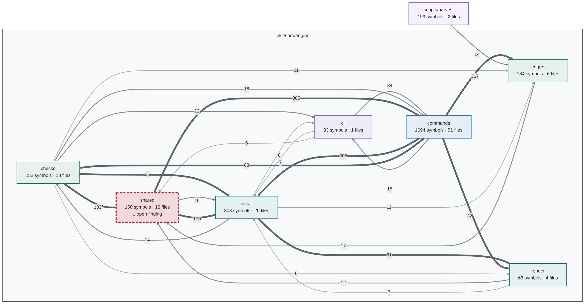

# Capabilities

> [!CAUTION]
> **Purpose:** One row per app capability — owner module, the literal marker that finds
> every use of it, whether anything bypasses the owner. The drift register.
>
> **Rules:**
>
> - Generated — do not edit. `pnpm bkit:graph:refresh` rewrites this file.
> - Source of truth: `scripts/graphify/bkit-graph-drift-rules.json`. Every status derived from live source, never typed.
> - Add a capability = add a rule there: capability · lane · owner module · one literal marker.
> - Markers literal, never regex, because `new Client(` as a regex is an unclosed group matching nothing.
> - Match the mechanism, not the name, because `createClient(` misses an owner that aliases its import.
> - Optional `scope` narrows the tree scanned when a marker means different things per package.
> - Optional `surface`: `product` (default) · `tests` (any `e2e/` dir + every `.test.` / `.spec.` file) · `all`. The two surfaces partition the tree.
> - Optional `budgets`: the exact non-owner site count allowed per scope prefix. Measured == declared everywhere ⇒ `budgeted`, which is not a warning.
> - A budget is not a shrug, because the row leaves `budgeted` and its Budget cell reads `over` or `stale` when the count moves either way, and a site landing outside every declared prefix reads as over budget.
> - Test code is in `graph.json` on purpose (`.graphifyignore`) and out of every diagram here by rule (`is_test_code` in `bkit-graphify-rollup.py`): test folders, `.test.` / `.spec.` files, test-runner config. `hide_nodes` below is diagram-only too, for whatever else a picture should not draw.
> - Status computed: no owner → `split`; owner absent → `gap`; owner present, others use marker → `bypassed`; else `one`. A `split|bypassed` at budget → `budgeted`.
> - Externals: `scripts/graphify/bkit-graph-external-rules.json` — `sdk` · `hosts` · `env`. SDK and url = `split`.
> - Import-time scan: `scripts/graphify/bkit-graph-eager-rules.json` lists only what is pure. Unclassified = reported.
> - That scan reads source, not the graph, because module-level initialiser calls are the one construct graphify drops.
> - Nothing discovers an SDK itself; find gaps by listing non-workspace deps.
> - Only the Overrides block is hand-maintained. It round-trips; malformed aborts the run.
> - Box colour = the top-level group it sits in; a box in no group is grey. With one top-level group, that group is grey and each box has its own colour.
> - Arrows are grey; a thicker arrow carries more links.
> - A flagged box counts its open and budgeted findings; the Register table names them.
> - A part that calls nothing in the chart and that at least a quarter of the other boxes call (four at least) has its arrows left out and counts its callers.
> - Drift = thick dashed red border + a faint red box for all four. No ranking: each scan proves a shape, never an intent.
> - `budgeted` = solid amber border + a faint amber box. Still drawn, because a declared bypass is still a bypass, but it is settled, not an open question.
> - Which status is which: `split` fine dash · `bypassed` long dash · `dead` even dash · `gap` dotted · `budgeted` no dash.
> - A fetched URL is a STRING, never an edge, because the reachability scan (§ Unreachable API calls) is the only check that sees it.
> - Table rescanned every run, never stale.
> - Detail-level module graph → `pnpm bkit:graph`. This doc is the altitude above that: capabilities, not files.

## Status Vocabulary

The first four are warnings, not verdicts, and they share one red in the diagrams. Any
of them can turn out to be deliberate, because the scans prove a shape, never an intent.

`budgeted` is what one of those four becomes once somebody has decided. The rule declares
the exact number of non-owner sites allowed per scope prefix, and its `note` says why that
number is not zero. The moment the count moves in either direction — too many (a copy
appeared) or too few (the budget is stale) — the row leaves `budgeted`, its Budget cell
reads `over` or `stale`, and `pnpm bkit:graph:check` fails until the register is refreshed.
That is why the status can be quieter without being a place to hide work.

It still gets a box in the diagrams, drawn solid and amber rather than dashed and red. A
budgeted bypass is still a bypass; the different drawing stops the picture asking the
same question of it every sweep. Drawn identically, an unbounded marker (18 of 19) and a
marker that is exactly at its declared count — whose note says the copies are probes and
the budget is not meant to reach zero — would make each pass rediscover the settled rows
and re-read the notes to dismiss them.

<!-- prettier-ignore -->
| Status | Meaning | Action |
| --- | --- | --- |
| `split` | Two or more competing implementations, no single owner | Centralise; file an issue. Or budget it, with the reason in `note` |
| `bypassed` | Owner exists, some callers skip it | Repoint the bypasses. Or budget them, with the reason in `note` |
| `dead` | A client fetches a path nothing serves. A WARNING, though some are deliberate | Check the call site, then delete the call or serve the path |
| `gap` | Designed, not built. No owner yet | Name the owner BEFORE the first caller |
| `budgeted` | A `split` or `bypassed` whose site count is declared, guarded and currently met | None — the CI guard owns it. Lower the budget when a site goes |
| `one` | One implementation, every caller routes through it | None — keep it that way |

## Register

3 capabilities: 1 `bypassed` · 2 `one`.

<!-- prettier-ignore -->
| Lane | Capability | Owner | Marker | Surface | Status | Bypasses | Budget | Issue |
| --- | --- | --- | --- | --- | --- | --- | --- | --- |
| Providers | Cursor API access | `.bkit/core/engine/shared/egress.ts` | `api.cursor.com` | `product` | `bypassed` | 1 of 2 | — |  |
| Install | Managed-version marker | `.bkit/core/engine/install/version-file.ts` | `do not edit; run` | `product` | `one` | 0 of 1 | — |  |
| Install | Tracker block substitution | `.bkit/core/engine/render/trackers.ts` | `bkit:tracker` | `product` | `one` | 0 of 1 | — |  |

## Unreachable API calls

Not scanned; run the rollup with `--reachability`.

## Import-time side effects

15 module-scope side effects in 6 of 119 source files. A call here runs on **import**, not on first use, so every file downstream pays for it, and a test that never touches the thing still has to stub it. Sorted by reach.

<!-- prettier-ignore -->
| File | Evaluates at import | Downstream files | of which tests |
| --- | --- | --- | --- |
| `.bkit/core/engine/shared/text.ts` | `Symbol` | 198 | 118 |
| `.bkit/core/engine/checks/after/ci-yml.ts` | `CI_SCRIPT_UNITS.flat` | 186 | 111 |
| `.bkit/core/engine/checks/tips/index.ts` | `STAR_TIP.replace` | 186 | 111 |
| `.bkit/core/engine/commands/workflow/branches.ts` | `LEDGERS.map` | 186 | 111 |
| `.bkit/core/engine/commands/workflow/workflows.ts` | `Error` | 186 | 111 |

1 further file nothing imports, though an entrypoint is supposed to do work when it loads. In the JSON report only.

## Overrides

The one hand-maintained region of this file. Everything else is rewritten on each run;
this block is read back first and re-emitted verbatim. Rename a node, hide a node or an
edge, pin a note, or force nodes into a named group. A malformed block aborts the run
rather than being silently dropped. Every `hide_nodes` entry needs a one-line reason in
`hide_nodes_why`.

<!-- overrides:start -->

```json
{
  "rename": {},
  "note": {},
  "hide_nodes": [],
  "hide_nodes_why": {},
  "hide_edges": [],
  "group": {
    "Install engine": [
      ".bkit/core/engine/cli",
      ".bkit/core/engine/commands/install/install",
      ".bkit/core/engine/install/modules/index",
      ".bkit/core/engine/install/write",
      ".bkit/core/engine/commands/install/upgrade",
      ".bkit/core/engine/commands/install/uninstall",
      ".bkit/core/engine/install/manifest",
      ".bkit/core/engine/install/version-file",
      ".bkit/core/engine/shared/package-roots",
      ".bkit/core/engine/render/trackers",
      ".bkit/core/engine/install/cloud-env"
    ],
    "Health checks": [
      ".bkit/core/engine/checks/after/index",
      ".bkit/core/engine/checks/before/index"
    ],
    "Telemetry": [
      ".bkit/core/engine/ledgers/telemetry",
      ".bkit/core/engine/commands/stats",
      ".bkit/core/engine/commands/analysis",
      ".bkit/core/engine/commands/comply",
      ".bkit/core/engine/install/placeholders"
    ]
  }
}
```

<!-- overrides:end -->

## User-facing routes → backend capabilities

No route layer: the surface scan found nothing to draw.

## Architecture — packages

Grouped by the folder tree, not by a clustering algorithm. Edge labels are the number of
underlying symbol edges. Drift status is painted onto the owning module.

To view online, paste only the lines inside the block below — not the fence lines — into [mermaid.live](https://mermaid.live/).



## Architecture — modules

The same graph one level down: each package is a box, its subfolders are the nodes inside it.
Cross-group edges lighter than 6 are dropped — see `MMD_MIN_WEIGHT` in
`scripts/graphify/bkit-graphify.sh`.

To view online, paste only the lines inside the block below — not the fence lines — into [mermaid.live](https://mermaid.live/).

```mermaid
---
config:
  layout: dagre
  themeCSS: "marker { overflow: visible; } marker path { transform: scale(1.8); transform-origin: 5px 5px; }"
  flowchart:
    useMaxWidth: false
    nodeSpacing: 80
    rankSpacing: 100
    subGraphTitleMargin:
      top: 12
      bottom: 24
---
flowchart LR
  %% Generated by bkit-graphify-rollup.py — do not edit
  subgraph gncustom_health_checks["Health checks"]
    n_bkit_core_engine_checks_after_index[".bkit/core/engine/checks/after/index<br/>11 symbols · 1 files"]
    n_bkit_core_engine_checks_before_index[".bkit/core/engine/checks/before/index<br/>4 symbols · 1 files"]
  end
  subgraph gncustom_install_engine["Install engine"]
    n_bkit_core_engine_cli[".bkit/core/engine/cli<br/>33 symbols · 1 files"]
    n_bkit_core_engine_commands_install_install[".bkit/core/engine/commands/install/install<br/>12 symbols · 1 files"]
    n_bkit_core_engine_commands_install_uninstall[".bkit/core/engine/commands/install/uninstall<br/>31 symbols · 1 files"]
    n_bkit_core_engine_commands_install_upgrade[".bkit/core/engine/commands/install/upgrade<br/>17 symbols · 1 files"]
    n_bkit_core_engine_install_cloud_env[".bkit/core/engine/install/cloud-env<br/>51 symbols · 1 files"]
    n_bkit_core_engine_install_manifest[".bkit/core/engine/install/manifest<br/>34 symbols · 1 files"]
    n_bkit_core_engine_install_modules_index[".bkit/core/engine/install/modules/index<br/>10 symbols · 1 files"]
    n_bkit_core_engine_install_version_file[".bkit/core/engine/install/version-file<br/>17 symbols · 1 files"]
    n_bkit_core_engine_install_write[".bkit/core/engine/install/write<br/>23 symbols · 1 files"]
    n_bkit_core_engine_shared_package_roots[".bkit/core/engine/shared/package-roots<br/>14 symbols · 1 files"]
  end
  subgraph gncustom_telemetry["Telemetry"]
    n_bkit_core_engine_commands_analysis[".bkit/core/engine/commands/analysis<br/>35 symbols · 1 files"]
    n_bkit_core_engine_commands_comply[".bkit/core/engine/commands/comply<br/>20 symbols · 1 files"]
    n_bkit_core_engine_commands_stats[".bkit/core/engine/commands/stats<br/>13 symbols · 1 files"]
    n_bkit_core_engine_install_placeholders[".bkit/core/engine/install/placeholders<br/>6 symbols · 1 files"]
    n_bkit_core_engine_ledgers_telemetry[".bkit/core/engine/ledgers/telemetry<br/>115 symbols · 1 files"]
  end
  subgraph gn_bkit_core_engine[".bkit/core/engine"]
    subgraph gn_bkit_core_engine_checks[".bkit/core/engine/checks"]
      subgraph gn_bkit_core_engine_checks_after[".bkit/core/engine/checks/after"]
        n_bkit_core_engine_checks_after_auth["auth<br/>10 symbols · 1 files"]
        n_bkit_core_engine_checks_after_ci_yml["ci-yml<br/>19 symbols · 1 files"]
        n_bkit_core_engine_checks_after_github["github<br/>12 symbols · 1 files"]
        n_bkit_core_engine_checks_after_managed["managed<br/>11 symbols · 1 files"]
        n_bkit_core_engine_checks_after_suppression["suppression<br/>5 symbols · 1 files"]
        n_bkit_core_engine_checks_after_tools["tools<br/>11 symbols · 1 files"]
      end
      subgraph gn_bkit_core_engine_checks_before[".bkit/core/engine/checks/before"]
        n_bkit_core_engine_checks_before_context_fetch["context-fetch<br/>20 symbols · 1 files"]
        n_bkit_core_engine_checks_before_env["env<br/>8 symbols · 1 files"]
        n_bkit_core_engine_checks_before_files["files<br/>8 symbols · 1 files"]
        n_bkit_core_engine_checks_before_repo["repo<br/>13 symbols · 1 files"]
      end
      n_bkit_core_engine_checks_status_holes["status-holes<br/>47 symbols · 1 files"]
      subgraph gn_bkit_core_engine_checks_tips[".bkit/core/engine/checks/tips"]
        n_bkit_core_engine_checks_tips_catalogue["catalogue<br/>6 symbols · 1 files"]
        n_bkit_core_engine_checks_tips_detect["detect<br/>25 symbols · 1 files"]
        n_bkit_core_engine_checks_tips_index["index<br/>28 symbols · 1 files"]
      end
    end
    subgraph gn_bkit_core_engine_commands[".bkit/core/engine/commands"]
      subgraph gn_bkit_core_engine_commands_ci[".bkit/core/engine/commands/ci"]
        n_bkit_core_engine_commands_ci_ci["ci<br/>43 symbols · 1 files"]
        n_bkit_core_engine_commands_ci_pins["pins<br/>10 symbols · 1 files"]
        n_bkit_core_engine_commands_ci_push_gate["push-gate<br/>11 symbols · 1 files"]
      end
      n_bkit_core_engine_commands_install_doctor[".bkit/core/engine/commands/install/doctor<br/>6 symbols · 1 files"]
      n_bkit_core_engine_commands_land["land<br/>16 symbols · 1 files"]
      n_bkit_core_engine_commands_lib["lib<br/>67 symbols · 1 files"]
      n_bkit_core_engine_commands_setup_setup[".bkit/core/engine/commands/setup/setup<br/>11 symbols · 1 files"]
      subgraph gn_bkit_core_engine_commands_workflow[".bkit/core/engine/commands/workflow"]
        n_bkit_core_engine_commands_workflow_branches["branches<br/>130 symbols · 1 files"]
        n_bkit_core_engine_commands_workflow_challenge["challenge<br/>35 symbols · 1 files"]
        n_bkit_core_engine_commands_workflow_completeness["completeness<br/>4 symbols · 1 files"]
        n_bkit_core_engine_commands_workflow_context["context<br/>91 symbols · 1 files"]
        n_bkit_core_engine_commands_workflow_counters["counters<br/>23 symbols · 1 files"]
        n_bkit_core_engine_commands_workflow_decisions["decisions<br/>27 symbols · 1 files"]
        n_bkit_core_engine_commands_workflow_disk["disk<br/>55 symbols · 1 files"]
        n_bkit_core_engine_commands_workflow_fids["fids<br/>57 symbols · 1 files"]
        n_bkit_core_engine_commands_workflow_issues["issues<br/>45 symbols · 1 files"]
        n_bkit_core_engine_commands_workflow_ledgers["ledgers<br/>102 symbols · 1 files"]
        n_bkit_core_engine_commands_workflow_locks["locks<br/>31 symbols · 1 files"]
        n_bkit_core_engine_commands_workflow_plan_blocks["plan-blocks<br/>32 symbols · 1 files"]
        n_bkit_core_engine_commands_workflow_plans["plans<br/>15 symbols · 1 files"]
        n_bkit_core_engine_commands_workflow_prs["prs<br/>53 symbols · 1 files"]
        n_bkit_core_engine_commands_workflow_repo["repo<br/>12 symbols · 1 files"]
        n_bkit_core_engine_commands_workflow_roadmap["roadmap<br/>39 symbols · 1 files"]
        n_bkit_core_engine_commands_workflow_run_facts["run-facts<br/>28 symbols · 1 files"]
        n_bkit_core_engine_commands_workflow_runs["runs<br/>79 symbols · 1 files"]
        n_bkit_core_engine_commands_workflow_runtime["runtime<br/>19 symbols · 1 files"]
        n_bkit_core_engine_commands_workflow_status["status<br/>39 symbols · 1 files"]
        n_bkit_core_engine_commands_workflow_step_table["step-table<br/>14 symbols · 1 files"]
        n_bkit_core_engine_commands_workflow_steps["steps<br/>64 symbols · 1 files"]
        n_bkit_core_engine_commands_workflow_summary["summary<br/>21 symbols · 1 files"]
        n_bkit_core_engine_commands_workflow_summary_findings["summary-findings<br/>6 symbols · 1 files"]
        n_bkit_core_engine_commands_workflow_tasks["tasks<br/>11 symbols · 1 files"]
        n_bkit_core_engine_commands_workflow_tests["tests<br/>108 symbols · 1 files"]
        n_bkit_core_engine_commands_workflow_tests_changed["tests-changed<br/>5 symbols · 1 files"]
        n_bkit_core_engine_commands_workflow_tracker["tracker<br/>72 symbols · 1 files"]
        n_bkit_core_engine_commands_workflow_workflows["workflows<br/>86 symbols · 1 files"]
        n_bkit_core_engine_commands_workflow_worktrees["worktrees<br/>55 symbols · 1 files"]
      end
    end
    subgraph gn_bkit_core_engine_install[".bkit/core/engine/install"]
      n_bkit_core_engine_install_managed_block["managed-block<br/>16 symbols · 1 files"]
      subgraph gn_bkit_core_engine_install_modules[".bkit/core/engine/install/modules"]
        n_bkit_core_engine_install_modules_antigravity["antigravity<br/>7 symbols · 1 files"]
        n_bkit_core_engine_install_modules_claude["claude<br/>6 symbols · 1 files"]
        n_bkit_core_engine_install_modules_codex["codex<br/>5 symbols · 1 files"]
        n_bkit_core_engine_install_modules_core["core<br/>77 symbols · 1 files"]
        n_bkit_core_engine_install_modules_cursor["cursor<br/>3 symbols · 1 files"]
        n_bkit_core_engine_install_modules_opencode["opencode<br/>10 symbols · 1 files"]
      end
      n_bkit_core_engine_install_template_copies["template-copies<br/>10 symbols · 1 files"]
    end
    subgraph gn_bkit_core_engine_ledgers[".bkit/core/engine/ledgers"]
      n_bkit_core_engine_ledgers_compact["compact<br/>8 symbols · 1 files"]
      n_bkit_core_engine_ledgers_journal["journal<br/>17 symbols · 1 files"]
      n_bkit_core_engine_ledgers_status["status<br/>35 symbols · 1 files"]
    end
    subgraph gn_bkit_core_engine_render[".bkit/core/engine/render"]
      n_bkit_core_engine_render_hosts["hosts<br/>29 symbols · 1 files"]
      n_bkit_core_engine_render_models["models<br/>19 symbols · 1 files"]
    end
    subgraph gn_bkit_core_engine_shared[".bkit/core/engine/shared"]
      n_bkit_core_engine_shared_branches["branches<br/>4 symbols · 1 files"]
      n_bkit_core_engine_shared_json["json<br/>8 symbols · 1 files"]
      n_bkit_core_engine_shared_package_json["package-json<br/>6 symbols · 1 files"]
      n_bkit_core_engine_shared_package_manager["package-manager<br/>7 symbols · 1 files"]
      n_bkit_core_engine_shared_settings["settings<br/>31 symbols · 1 files"]
    end
    subgraph gn_bkit_core_engine_tools[".bkit/core/engine/tools"]
      n_bkit_core_engine_tools_instructions["instructions<br/>92 symbols · 1 files"]
      n_bkit_core_engine_tools_instructions_sources["instructions-sources<br/>48 symbols · 1 files"]
    end
  end
  nscripts_harvest["scripts/harvest<br/>199 symbols · 2 files"]
  n_bkit_core_engine_commands_workflow_branches -->|132| n_bkit_core_engine_commands_lib
  n_bkit_core_engine_commands_workflow_workflows -->|79| n_bkit_core_engine_commands_lib
  n_bkit_core_engine_commands_workflow_runs -->|69| n_bkit_core_engine_commands_lib
  n_bkit_core_engine_commands_workflow_prs -->|53| n_bkit_core_engine_commands_lib
  n_bkit_core_engine_commands_ci_ci -->|38| n_bkit_core_engine_commands_lib
  n_bkit_core_engine_commands_workflow_ledgers -->|38| n_bkit_core_engine_commands_lib
  n_bkit_core_engine_commands_workflow_worktrees -->|38| n_bkit_core_engine_commands_lib
  n_bkit_core_engine_commands_workflow_issues -->|37| n_bkit_core_engine_commands_workflow_tracker
  n_bkit_core_engine_commands_workflow_steps -->|34| n_bkit_core_engine_commands_lib
  n_bkit_core_engine_commands_workflow_issues -->|31| n_bkit_core_engine_commands_lib
  n_bkit_core_engine_commands_workflow_workflows -->|30| n_bkit_core_engine_commands_workflow_status
  n_bkit_core_engine_commands_workflow_workflows -->|30| n_bkit_core_engine_commands_workflow_run_facts
  n_bkit_core_engine_commands_workflow_workflows -->|28| n_bkit_core_engine_commands_workflow_tracker
  n_bkit_core_engine_commands_workflow_status -->|27| n_bkit_core_engine_ledgers_status
  n_bkit_core_engine_commands_workflow_steps -->|25| n_bkit_core_engine_commands_workflow_status
  n_bkit_core_engine_commands_workflow_context -->|24| n_bkit_core_engine_commands_lib
  n_bkit_core_engine_commands_workflow_status -->|23| n_bkit_core_engine_commands_lib
  n_bkit_core_engine_commands_workflow_ledgers -->|22| n_bkit_core_engine_ledgers_telemetry
  n_bkit_core_engine_checks_after_index -->|21| n_bkit_core_engine_checks_after_ci_yml
  n_bkit_core_engine_commands_workflow_counters -->|21| n_bkit_core_engine_commands_workflow_status
  n_bkit_core_engine_commands_workflow_workflows -->|21| n_bkit_core_engine_commands_workflow_ledgers
  n_bkit_core_engine_commands_workflow_workflows -->|21| n_bkit_core_engine_commands_workflow_locks
  n_bkit_core_engine_tools_instructions -->|21| n_bkit_core_engine_tools_instructions_sources
  n_bkit_core_engine_commands_workflow_branches -->|20| n_bkit_core_engine_commands_land
  n_bkit_core_engine_commands_workflow_workflows -->|20| n_bkit_core_engine_ledgers_status
  n_bkit_core_engine_checks_before_index -->|19| n_bkit_core_engine_checks_before_repo
  n_bkit_core_engine_commands_workflow_steps -->|19| n_bkit_core_engine_ledgers_status
  n_bkit_core_engine_commands_workflow_workflows -->|19| n_bkit_core_engine_commands_workflow_issues
  n_bkit_core_engine_commands_workflow_branches -->|18| n_bkit_core_engine_commands_workflow_status
  n_bkit_core_engine_commands_workflow_prs -->|18| n_bkit_core_engine_ledgers_status
  n_bkit_core_engine_commands_workflow_roadmap -->|18| n_bkit_core_engine_commands_lib
  n_bkit_core_engine_commands_workflow_workflows -->|18| n_bkit_core_engine_ledgers_telemetry
  n_bkit_core_engine_commands_lib -->|17| n_bkit_core_engine_ledgers_journal
  n_bkit_core_engine_ledgers_journal -->|17| n_bkit_core_engine_ledgers_telemetry
  n_bkit_core_engine_commands_land -->|16| n_bkit_core_engine_commands_lib
  n_bkit_core_engine_commands_workflow_tests -->|16| n_bkit_core_engine_commands_workflow_plan_blocks
  n_bkit_core_engine_install_modules_claude -->|16| n_bkit_core_engine_install_write
  n_bkit_core_engine_install_write -->|16| n_bkit_core_engine_install_managed_block
  n_bkit_core_engine_checks_after_index -->|15| n_bkit_core_engine_checks_after_github
  n_bkit_core_engine_commands_install_uninstall -->|15| n_bkit_core_engine_install_version_file
  n_bkit_core_engine_commands_workflow_branches -->|15| n_bkit_core_engine_commands_workflow_worktrees
  n_bkit_core_engine_commands_workflow_branches -->|15| n_bkit_core_engine_ledgers_status
  n_bkit_core_engine_commands_workflow_counters -->|15| n_bkit_core_engine_commands_lib
  n_bkit_core_engine_commands_workflow_fids -->|15| n_bkit_core_engine_commands_lib
  n_bkit_core_engine_commands_workflow_locks -->|15| n_bkit_core_engine_commands_lib
  n_bkit_core_engine_commands_workflow_prs -->|15| n_bkit_core_engine_commands_workflow_status
  n_bkit_core_engine_commands_workflow_roadmap -->|15| n_bkit_core_engine_ledgers_telemetry
  n_bkit_core_engine_commands_workflow_runs -->|15| n_bkit_core_engine_commands_workflow_tracker
  n_bkit_core_engine_install_modules_opencode -->|15| n_bkit_core_engine_install_write
  n_bkit_core_engine_ledgers_compact -->|15| n_bkit_core_engine_ledgers_telemetry
  n_bkit_core_engine_checks_after_managed -->|14| n_bkit_core_engine_install_managed_block
  n_bkit_core_engine_checks_before_repo -->|14| n_bkit_core_engine_shared_settings
  n_bkit_core_engine_commands_install_install -->|14| n_bkit_core_engine_render_models
  n_bkit_core_engine_commands_install_upgrade -->|14| n_bkit_core_engine_install_version_file
  n_bkit_core_engine_commands_workflow_branches -->|14| n_bkit_core_engine_commands_workflow_prs
  n_bkit_core_engine_commands_workflow_tests -->|14| n_bkit_core_engine_commands_lib
  n_bkit_core_engine_commands_workflow_tracker -->|14| n_bkit_core_engine_ledgers_status
  nscripts_harvest -->|14| n_bkit_core_engine_ledgers_telemetry
  n_bkit_core_engine_commands_ci_push_gate -->|13| n_bkit_core_engine_commands_lib
  n_bkit_core_engine_commands_workflow_context -->|13| n_bkit_core_engine_commands_workflow_status
  n_bkit_core_engine_commands_workflow_run_facts -->|13| n_bkit_core_engine_ledgers_telemetry
  n_bkit_core_engine_commands_workflow_runs -->|13| n_bkit_core_engine_commands_workflow_prs
  n_bkit_core_engine_commands_workflow_tests -->|13| n_bkit_core_engine_commands_workflow_status
  n_bkit_core_engine_commands_workflow_worktrees -->|13| n_bkit_core_engine_commands_workflow_ledgers
  n_bkit_core_engine_install_modules_core -->|13| n_bkit_core_engine_install_version_file
  n_bkit_core_engine_render_hosts -->|13| n_bkit_core_engine_render_models
  n_bkit_core_engine_checks_tips_catalogue -->|13| n_bkit_core_engine_checks_tips_detect
  n_bkit_core_engine_commands_install_upgrade -->|12| n_bkit_core_engine_render_models
  n_bkit_core_engine_commands_install_upgrade -->|12| n_bkit_core_engine_install_cloud_env
  n_bkit_core_engine_commands_setup_setup -->|12| n_bkit_core_engine_commands_lib
  n_bkit_core_engine_commands_workflow_counters -->|12| n_bkit_core_engine_ledgers_status
  n_bkit_core_engine_commands_workflow_repo -->|12| n_bkit_core_engine_commands_lib
  n_bkit_core_engine_commands_workflow_runs -->|12| n_bkit_core_engine_ledgers_status
  n_bkit_core_engine_commands_workflow_runs -->|12| n_bkit_core_engine_commands_workflow_status
  n_bkit_core_engine_commands_workflow_runtime -->|12| n_bkit_core_engine_commands_lib
  n_bkit_core_engine_install_modules_core -->|12| n_bkit_core_engine_shared_json
  n_bkit_core_engine_checks_after_index -->|11| n_bkit_core_engine_checks_after_tools
  n_bkit_core_engine_commands_analysis -->|11| n_bkit_core_engine_ledgers_telemetry
  n_bkit_core_engine_commands_install_uninstall -->|11| n_bkit_core_engine_shared_package_roots
  n_bkit_core_engine_commands_install_uninstall -->|11| n_bkit_core_engine_install_write
  n_bkit_core_engine_commands_workflow_branches -->|11| n_bkit_core_engine_commands_workflow_ledgers
  n_bkit_core_engine_commands_workflow_steps -->|11| n_bkit_core_engine_commands_workflow_ledgers
  n_bkit_core_engine_commands_workflow_tracker -->|11| n_bkit_core_engine_commands_lib
  n_bkit_core_engine_install_modules_core -->|11| n_bkit_core_engine_shared_package_roots
  n_bkit_core_engine_install_modules_opencode -->|11| n_bkit_core_engine_render_models
  n_bkit_core_engine_install_modules_opencode -->|11| n_bkit_core_engine_shared_package_roots
  n_bkit_core_engine_shared_settings -->|11| n_bkit_core_engine_install_manifest
  n_bkit_core_engine_checks_before_index -->|10| n_bkit_core_engine_checks_before_context_fetch
  n_bkit_core_engine_commands_ci_ci -->|10| n_bkit_core_engine_commands_workflow_ledgers
  n_bkit_core_engine_commands_install_upgrade -->|10| n_bkit_core_engine_install_manifest
  n_bkit_core_engine_commands_workflow_context -->|10| n_bkit_core_engine_commands_workflow_plan_blocks
  n_bkit_core_engine_commands_workflow_issues -->|10| n_bkit_core_engine_commands_workflow_status
  n_bkit_core_engine_commands_workflow_runs -->|10| n_bkit_core_engine_commands_workflow_fids
  n_bkit_core_engine_commands_workflow_summary_findings -->|10| n_bkit_core_engine_commands_workflow_challenge
  n_bkit_core_engine_commands_workflow_tests_changed -->|10| n_bkit_core_engine_commands_lib
  n_bkit_core_engine_commands_workflow_tracker -->|10| n_bkit_core_engine_shared_json
  n_bkit_core_engine_commands_workflow_workflows -->|10| n_bkit_core_engine_commands_workflow_branches
  n_bkit_core_engine_commands_workflow_workflows -->|10| n_bkit_core_engine_checks_status_holes
  n_bkit_core_engine_commands_workflow_workflows -->|10| n_bkit_core_engine_commands_land
  n_bkit_core_engine_install_modules_antigravity -->|10| n_bkit_core_engine_install_modules_core
  n_bkit_core_engine_install_modules_claude -->|10| n_bkit_core_engine_install_modules_core
  n_bkit_core_engine_install_modules_codex -->|10| n_bkit_core_engine_install_modules_core
  n_bkit_core_engine_install_modules_core -->|10| n_bkit_core_engine_install_write
  n_bkit_core_engine_install_modules_cursor -->|10| n_bkit_core_engine_install_modules_core
  n_bkit_core_engine_install_modules_index -->|10| n_bkit_core_engine_install_modules_core
  n_bkit_core_engine_install_modules_opencode -->|10| n_bkit_core_engine_install_modules_core
  n_bkit_core_engine_checks_after_ci_yml -->|9| n_bkit_core_engine_shared_settings
  n_bkit_core_engine_checks_after_index -->|9| n_bkit_core_engine_checks_before_env
  n_bkit_core_engine_checks_before_index -->|9| n_bkit_core_engine_checks_before_files
  n_bkit_core_engine_commands_install_install -->|9| n_bkit_core_engine_checks_after_index
  n_bkit_core_engine_commands_workflow_branches -->|9| n_bkit_core_engine_shared_branches
  n_bkit_core_engine_commands_workflow_decisions -->|9| n_bkit_core_engine_commands_lib
  n_bkit_core_engine_commands_workflow_ledgers -->|9| n_bkit_core_engine_commands_workflow_plan_blocks
  n_bkit_core_engine_commands_workflow_locks -->|9| n_bkit_core_engine_ledgers_status
  n_bkit_core_engine_commands_workflow_run_facts -->|9| n_bkit_core_engine_shared_json
  n_bkit_core_engine_commands_workflow_runs -->|9| n_bkit_core_engine_shared_settings
  n_bkit_core_engine_commands_workflow_steps -->|9| n_bkit_core_engine_commands_workflow_tracker
  n_bkit_core_engine_commands_workflow_tasks -->|9| n_bkit_core_engine_commands_lib
  n_bkit_core_engine_commands_workflow_tasks -->|9| n_bkit_core_engine_commands_workflow_plan_blocks
  n_bkit_core_engine_commands_workflow_tests -->|9| n_bkit_core_engine_ledgers_status
  n_bkit_core_engine_commands_workflow_worktrees -->|9| n_bkit_core_engine_ledgers_status
  n_bkit_core_engine_install_modules_antigravity -->|9| n_bkit_core_engine_shared_package_roots
  n_bkit_core_engine_install_modules_claude -->|9| n_bkit_core_engine_shared_package_roots
  n_bkit_core_engine_install_modules_codex -->|9| n_bkit_core_engine_shared_package_roots
  n_bkit_core_engine_install_modules_core -->|9| n_bkit_core_engine_shared_settings
  n_bkit_core_engine_install_modules_core -->|9| n_bkit_core_engine_install_managed_block
  n_bkit_core_engine_install_modules_core -->|9| n_bkit_core_engine_install_manifest
  n_bkit_core_engine_install_modules_cursor -->|9| n_bkit_core_engine_shared_package_roots
  n_bkit_core_engine_checks_tips_detect -->|8| n_bkit_core_engine_shared_package_json
  n_bkit_core_engine_commands_install_upgrade -->|8| n_bkit_core_engine_shared_package_roots
  n_bkit_core_engine_commands_workflow_challenge -->|8| n_bkit_core_engine_commands_workflow_plan_blocks
  n_bkit_core_engine_commands_workflow_context -->|8| n_bkit_core_engine_commands_workflow_tests
  n_bkit_core_engine_commands_workflow_summary -->|8| n_bkit_core_engine_commands_workflow_plans
  n_bkit_core_engine_commands_workflow_workflows -->|8| n_bkit_core_engine_commands_workflow_worktrees
  n_bkit_core_engine_install_modules_antigravity -->|8| n_bkit_core_engine_install_write
  n_bkit_core_engine_install_modules_codex -->|8| n_bkit_core_engine_install_write
  n_bkit_core_engine_checks_after_github -->|7| n_bkit_core_engine_shared_settings
  n_bkit_core_engine_checks_after_github -->|7| n_bkit_core_engine_shared_json
  n_bkit_core_engine_checks_after_index -->|7| n_bkit_core_engine_checks_tips_index
  n_bkit_core_engine_checks_after_index -->|7| n_bkit_core_engine_checks_after_auth
  n_bkit_core_engine_checks_tips_index -->|7| n_bkit_core_engine_checks_after_suppression
  n_bkit_core_engine_cli -->|7| n_bkit_core_engine_install_manifest
  n_bkit_core_engine_commands_ci_pins -->|7| n_bkit_core_engine_commands_lib
  n_bkit_core_engine_commands_comply -->|7| n_bkit_core_engine_ledgers_telemetry
  n_bkit_core_engine_commands_install_doctor -->|7| n_bkit_core_engine_shared_package_roots
  n_bkit_core_engine_commands_install_doctor -->|7| n_bkit_core_engine_checks_after_index
  n_bkit_core_engine_commands_install_doctor -->|7| n_bkit_core_engine_commands_install_install
  n_bkit_core_engine_commands_install_install -->|7| n_bkit_core_engine_install_modules_core
  n_bkit_core_engine_commands_install_uninstall -->|7| n_bkit_core_engine_install_manifest
  n_bkit_core_engine_commands_install_uninstall -->|7| n_bkit_core_engine_install_modules_opencode
  n_bkit_core_engine_commands_install_uninstall -->|7| n_bkit_core_engine_render_models
  n_bkit_core_engine_commands_install_upgrade -->|7| n_bkit_core_engine_install_placeholders
  n_bkit_core_engine_commands_install_upgrade -->|7| n_bkit_core_engine_commands_install_install
  n_bkit_core_engine_commands_install_upgrade -->|7| n_bkit_core_engine_install_template_copies
  n_bkit_core_engine_commands_stats -->|7| n_bkit_core_engine_commands_analysis
  n_bkit_core_engine_commands_workflow_branches -->|7| n_bkit_core_engine_ledgers_telemetry
  n_bkit_core_engine_commands_workflow_branches -->|7| n_bkit_core_engine_shared_package_manager
  n_bkit_core_engine_commands_workflow_branches -->|7| n_bkit_core_engine_commands_workflow_locks
  n_bkit_core_engine_commands_workflow_challenge -->|7| n_bkit_core_engine_commands_lib
  n_bkit_core_engine_commands_workflow_disk -->|7| n_bkit_core_engine_commands_lib
  n_bkit_core_engine_commands_workflow_ledgers -->|7| n_bkit_core_engine_commands_workflow_status
  n_bkit_core_engine_commands_workflow_plans -->|7| n_bkit_core_engine_commands_lib
  n_bkit_core_engine_commands_workflow_runs -->|7| n_bkit_core_engine_commands_workflow_ledgers
  n_bkit_core_engine_commands_workflow_runs -->|7| n_bkit_core_engine_commands_workflow_repo
  n_bkit_core_engine_commands_workflow_status -->|7| n_bkit_core_engine_ledgers_journal
  n_bkit_core_engine_commands_workflow_steps -->|7| n_bkit_core_engine_commands_workflow_fids
  n_bkit_core_engine_commands_workflow_steps -->|7| n_bkit_core_engine_commands_workflow_locks
  n_bkit_core_engine_commands_workflow_steps -->|7| n_bkit_core_engine_ledgers_journal
  n_bkit_core_engine_commands_workflow_tests -->|7| n_bkit_core_engine_shared_package_manager
  n_bkit_core_engine_commands_workflow_workflows -->|7| n_bkit_core_engine_commands_workflow_summary
  n_bkit_core_engine_install_modules_cursor -->|7| n_bkit_core_engine_install_write
  n_bkit_core_engine_install_modules_cursor -->|7| n_bkit_core_engine_render_hosts
  n_bkit_core_engine_install_modules_opencode -->|7| n_bkit_core_engine_install_cloud_env
  n_bkit_core_engine_install_template_copies -->|7| n_bkit_core_engine_shared_package_roots
  n_bkit_core_engine_commands_workflow_completeness -->|7| n_bkit_core_engine_checks_status_holes
  n_bkit_core_engine_commands_workflow_runtime -->|7| n_bkit_core_engine_commands_workflow_status
  n_bkit_core_engine_checks_before_files -->|6| n_bkit_core_engine_shared_package_roots
  n_bkit_core_engine_checks_before_repo -->|6| n_bkit_core_engine_shared_json
  n_bkit_core_engine_checks_tips_index -->|6| n_bkit_core_engine_commands_lib
  n_bkit_core_engine_commands_install_install -->|6| n_bkit_core_engine_commands_install_uninstall
  n_bkit_core_engine_commands_install_uninstall -->|6| n_bkit_core_engine_install_managed_block
  n_bkit_core_engine_commands_install_uninstall -->|6| n_bkit_core_engine_shared_json
  n_bkit_core_engine_commands_install_uninstall -->|6| n_bkit_core_engine_install_cloud_env
  n_bkit_core_engine_commands_install_upgrade -->|6| n_bkit_core_engine_shared_package_json
  n_bkit_core_engine_commands_install_upgrade -->|6| n_bkit_core_engine_install_write
  n_bkit_core_engine_commands_lib -->|6| n_bkit_core_engine_ledgers_telemetry
  n_bkit_core_engine_commands_workflow_branches -->|6| n_bkit_core_engine_install_version_file
  n_bkit_core_engine_commands_workflow_challenge -->|6| n_bkit_core_engine_commands_workflow_tests
  n_bkit_core_engine_commands_workflow_context -->|6| n_bkit_core_engine_ledgers_status
  n_bkit_core_engine_commands_workflow_counters -->|6| n_bkit_core_engine_shared_settings
  n_bkit_core_engine_commands_workflow_issues -->|6| n_bkit_core_engine_shared_settings
  n_bkit_core_engine_commands_workflow_plans -->|6| n_bkit_core_engine_commands_workflow_tracker
  n_bkit_core_engine_commands_workflow_steps -->|6| n_bkit_core_engine_commands_workflow_tests
  n_bkit_core_engine_commands_workflow_steps -->|6| n_bkit_core_engine_commands_workflow_step_table
  n_bkit_core_engine_commands_workflow_workflows -->|6| n_bkit_core_engine_commands_workflow_prs
  n_bkit_core_engine_commands_workflow_workflows -->|6| n_bkit_core_engine_commands_workflow_steps
  n_bkit_core_engine_commands_workflow_workflows -->|6| n_bkit_core_engine_commands_workflow_plans
  n_bkit_core_engine_install_cloud_env -->|6| n_bkit_core_engine_shared_package_roots
  n_bkit_core_engine_install_cloud_env -->|6| n_bkit_core_engine_install_placeholders
  n_bkit_core_engine_install_modules_antigravity -->|6| n_bkit_core_engine_render_hosts
  n_bkit_core_engine_install_modules_opencode -->|6| n_bkit_core_engine_shared_json
  n_bkit_core_engine_checks_tips_catalogue -->|6| n_bkit_core_engine_checks_before_env
  style gncustom_health_checks fill:#8250df0a,stroke:#8250df,stroke-width:2px
  style gncustom_install_engine fill:#0a7b830a,stroke:#0a7b83,stroke-width:2px
  style gncustom_telemetry fill:#0969da0a,stroke:#0969da,stroke-width:2px
  style gn_bkit_core_engine fill:#1a7f370a,stroke:#1a7f37,stroke-width:2px
  style gn_bkit_core_engine_checks fill:transparent,stroke:#1a7f37,stroke-width:1px
  style gn_bkit_core_engine_checks_after fill:transparent,stroke:#1a7f37,stroke-width:1px
  style gn_bkit_core_engine_checks_before fill:transparent,stroke:#1a7f37,stroke-width:1px
  style gn_bkit_core_engine_checks_tips fill:transparent,stroke:#1a7f37,stroke-width:1px
  style gn_bkit_core_engine_commands fill:transparent,stroke:#1a7f37,stroke-width:1px
  style gn_bkit_core_engine_commands_ci fill:transparent,stroke:#1a7f37,stroke-width:1px
  style gn_bkit_core_engine_commands_workflow fill:transparent,stroke:#1a7f37,stroke-width:1px
  style gn_bkit_core_engine_install fill:transparent,stroke:#1a7f37,stroke-width:1px
  style gn_bkit_core_engine_install_modules fill:transparent,stroke:#1a7f37,stroke-width:1px
  style gn_bkit_core_engine_ledgers fill:transparent,stroke:#1a7f37,stroke-width:1px
  style gn_bkit_core_engine_render fill:transparent,stroke:#1a7f37,stroke-width:1px
  style gn_bkit_core_engine_shared fill:transparent,stroke:#1a7f37,stroke-width:1px
  style gn_bkit_core_engine_tools fill:transparent,stroke:#1a7f37,stroke-width:1px
  style n_bkit_core_engine_checks_after_index stroke:#8250df,stroke-width:2px,fill:#8250df14
  style n_bkit_core_engine_checks_before_index stroke:#8250df,stroke-width:2px,fill:#8250df14
  style n_bkit_core_engine_cli stroke:#0a7b83,stroke-width:2px,fill:#0a7b8314
  style n_bkit_core_engine_commands_install_install stroke:#0a7b83,stroke-width:2px,fill:#0a7b8314
  style n_bkit_core_engine_commands_install_uninstall stroke:#0a7b83,stroke-width:2px,fill:#0a7b8314
  style n_bkit_core_engine_commands_install_upgrade stroke:#0a7b83,stroke-width:2px,fill:#0a7b8314
  style n_bkit_core_engine_install_cloud_env stroke:#0a7b83,stroke-width:2px,fill:#0a7b8314
  style n_bkit_core_engine_install_manifest stroke:#0a7b83,stroke-width:2px,fill:#0a7b8314
  style n_bkit_core_engine_install_modules_index stroke:#0a7b83,stroke-width:2px,fill:#0a7b8314
  style n_bkit_core_engine_install_version_file stroke:#0a7b83,stroke-width:2px,fill:#0a7b8314
  style n_bkit_core_engine_install_write stroke:#0a7b83,stroke-width:2px,fill:#0a7b8314
  style n_bkit_core_engine_shared_package_roots stroke:#0a7b83,stroke-width:2px,fill:#0a7b8314
  style n_bkit_core_engine_commands_analysis stroke:#0969da,stroke-width:2px,fill:#0969da14
  style n_bkit_core_engine_commands_comply stroke:#0969da,stroke-width:2px,fill:#0969da14
  style n_bkit_core_engine_commands_stats stroke:#0969da,stroke-width:2px,fill:#0969da14
  style n_bkit_core_engine_install_placeholders stroke:#0969da,stroke-width:2px,fill:#0969da14
  style n_bkit_core_engine_ledgers_telemetry stroke:#0969da,stroke-width:2px,fill:#0969da14
  style n_bkit_core_engine_checks_after_auth stroke:#1a7f37,stroke-width:2px,fill:#1a7f3714
  style n_bkit_core_engine_checks_after_ci_yml stroke:#1a7f37,stroke-width:2px,fill:#1a7f3714
  style n_bkit_core_engine_checks_after_github stroke:#1a7f37,stroke-width:2px,fill:#1a7f3714
  style n_bkit_core_engine_checks_after_managed stroke:#1a7f37,stroke-width:2px,fill:#1a7f3714
  style n_bkit_core_engine_checks_after_suppression stroke:#1a7f37,stroke-width:2px,fill:#1a7f3714
  style n_bkit_core_engine_checks_after_tools stroke:#1a7f37,stroke-width:2px,fill:#1a7f3714
  style n_bkit_core_engine_checks_before_context_fetch stroke:#1a7f37,stroke-width:2px,fill:#1a7f3714
  style n_bkit_core_engine_checks_before_env stroke:#1a7f37,stroke-width:2px,fill:#1a7f3714
  style n_bkit_core_engine_checks_before_files stroke:#1a7f37,stroke-width:2px,fill:#1a7f3714
  style n_bkit_core_engine_checks_before_repo stroke:#1a7f37,stroke-width:2px,fill:#1a7f3714
  style n_bkit_core_engine_checks_status_holes stroke:#1a7f37,stroke-width:2px,fill:#1a7f3714
  style n_bkit_core_engine_checks_tips_catalogue stroke:#1a7f37,stroke-width:2px,fill:#1a7f3714
  style n_bkit_core_engine_checks_tips_detect stroke:#1a7f37,stroke-width:2px,fill:#1a7f3714
  style n_bkit_core_engine_checks_tips_index stroke:#1a7f37,stroke-width:2px,fill:#1a7f3714
  style n_bkit_core_engine_commands_ci_ci stroke:#1a7f37,stroke-width:2px,fill:#1a7f3714
  style n_bkit_core_engine_commands_ci_pins stroke:#1a7f37,stroke-width:2px,fill:#1a7f3714
  style n_bkit_core_engine_commands_ci_push_gate stroke:#1a7f37,stroke-width:2px,fill:#1a7f3714
  style n_bkit_core_engine_commands_install_doctor stroke:#1a7f37,stroke-width:2px,fill:#1a7f3714
  style n_bkit_core_engine_commands_land stroke:#1a7f37,stroke-width:2px,fill:#1a7f3714
  style n_bkit_core_engine_commands_lib stroke:#1a7f37,stroke-width:2px,fill:#1a7f3714
  style n_bkit_core_engine_commands_setup_setup stroke:#1a7f37,stroke-width:2px,fill:#1a7f3714
  style n_bkit_core_engine_commands_workflow_branches stroke:#1a7f37,stroke-width:2px,fill:#1a7f3714
  style n_bkit_core_engine_commands_workflow_challenge stroke:#1a7f37,stroke-width:2px,fill:#1a7f3714
  style n_bkit_core_engine_commands_workflow_completeness stroke:#1a7f37,stroke-width:2px,fill:#1a7f3714
  style n_bkit_core_engine_commands_workflow_context stroke:#1a7f37,stroke-width:2px,fill:#1a7f3714
  style n_bkit_core_engine_commands_workflow_counters stroke:#1a7f37,stroke-width:2px,fill:#1a7f3714
  style n_bkit_core_engine_commands_workflow_decisions stroke:#1a7f37,stroke-width:2px,fill:#1a7f3714
  style n_bkit_core_engine_commands_workflow_disk stroke:#1a7f37,stroke-width:2px,fill:#1a7f3714
  style n_bkit_core_engine_commands_workflow_fids stroke:#1a7f37,stroke-width:2px,fill:#1a7f3714
  style n_bkit_core_engine_commands_workflow_issues stroke:#1a7f37,stroke-width:2px,fill:#1a7f3714
  style n_bkit_core_engine_commands_workflow_ledgers stroke:#1a7f37,stroke-width:2px,fill:#1a7f3714
  style n_bkit_core_engine_commands_workflow_locks stroke:#1a7f37,stroke-width:2px,fill:#1a7f3714
  style n_bkit_core_engine_commands_workflow_plan_blocks stroke:#1a7f37,stroke-width:2px,fill:#1a7f3714
  style n_bkit_core_engine_commands_workflow_plans stroke:#1a7f37,stroke-width:2px,fill:#1a7f3714
  style n_bkit_core_engine_commands_workflow_prs stroke:#1a7f37,stroke-width:2px,fill:#1a7f3714
  style n_bkit_core_engine_commands_workflow_repo stroke:#1a7f37,stroke-width:2px,fill:#1a7f3714
  style n_bkit_core_engine_commands_workflow_roadmap stroke:#1a7f37,stroke-width:2px,fill:#1a7f3714
  style n_bkit_core_engine_commands_workflow_run_facts stroke:#1a7f37,stroke-width:2px,fill:#1a7f3714
  style n_bkit_core_engine_commands_workflow_runs stroke:#1a7f37,stroke-width:2px,fill:#1a7f3714
  style n_bkit_core_engine_commands_workflow_runtime stroke:#1a7f37,stroke-width:2px,fill:#1a7f3714
  style n_bkit_core_engine_commands_workflow_status stroke:#1a7f37,stroke-width:2px,fill:#1a7f3714
  style n_bkit_core_engine_commands_workflow_step_table stroke:#1a7f37,stroke-width:2px,fill:#1a7f3714
  style n_bkit_core_engine_commands_workflow_steps stroke:#1a7f37,stroke-width:2px,fill:#1a7f3714
  style n_bkit_core_engine_commands_workflow_summary stroke:#1a7f37,stroke-width:2px,fill:#1a7f3714
  style n_bkit_core_engine_commands_workflow_summary_findings stroke:#1a7f37,stroke-width:2px,fill:#1a7f3714
  style n_bkit_core_engine_commands_workflow_tasks stroke:#1a7f37,stroke-width:2px,fill:#1a7f3714
  style n_bkit_core_engine_commands_workflow_tests stroke:#1a7f37,stroke-width:2px,fill:#1a7f3714
  style n_bkit_core_engine_commands_workflow_tests_changed stroke:#1a7f37,stroke-width:2px,fill:#1a7f3714
  style n_bkit_core_engine_commands_workflow_tracker stroke:#1a7f37,stroke-width:2px,fill:#1a7f3714
  style n_bkit_core_engine_commands_workflow_workflows stroke:#1a7f37,stroke-width:2px,fill:#1a7f3714
  style n_bkit_core_engine_commands_workflow_worktrees stroke:#1a7f37,stroke-width:2px,fill:#1a7f3714
  style n_bkit_core_engine_install_managed_block stroke:#1a7f37,stroke-width:2px,fill:#1a7f3714
  style n_bkit_core_engine_install_modules_antigravity stroke:#1a7f37,stroke-width:2px,fill:#1a7f3714
  style n_bkit_core_engine_install_modules_claude stroke:#1a7f37,stroke-width:2px,fill:#1a7f3714
  style n_bkit_core_engine_install_modules_codex stroke:#1a7f37,stroke-width:2px,fill:#1a7f3714
  style n_bkit_core_engine_install_modules_core stroke:#1a7f37,stroke-width:2px,fill:#1a7f3714
  style n_bkit_core_engine_install_modules_cursor stroke:#1a7f37,stroke-width:2px,fill:#1a7f3714
  style n_bkit_core_engine_install_modules_opencode stroke:#1a7f37,stroke-width:2px,fill:#1a7f3714
  style n_bkit_core_engine_install_template_copies stroke:#1a7f37,stroke-width:2px,fill:#1a7f3714
  style n_bkit_core_engine_ledgers_compact stroke:#1a7f37,stroke-width:2px,fill:#1a7f3714
  style n_bkit_core_engine_ledgers_journal stroke:#1a7f37,stroke-width:2px,fill:#1a7f3714
  style n_bkit_core_engine_ledgers_status stroke:#1a7f37,stroke-width:2px,fill:#1a7f3714
  style n_bkit_core_engine_render_hosts stroke:#1a7f37,stroke-width:2px,fill:#1a7f3714
  style n_bkit_core_engine_render_models stroke:#1a7f37,stroke-width:2px,fill:#1a7f3714
  style n_bkit_core_engine_shared_branches stroke:#1a7f37,stroke-width:2px,fill:#1a7f3714
  style n_bkit_core_engine_shared_json stroke:#1a7f37,stroke-width:2px,fill:#1a7f3714
  style n_bkit_core_engine_shared_package_json stroke:#1a7f37,stroke-width:2px,fill:#1a7f3714
  style n_bkit_core_engine_shared_package_manager stroke:#1a7f37,stroke-width:2px,fill:#1a7f3714
  style n_bkit_core_engine_shared_settings stroke:#1a7f37,stroke-width:2px,fill:#1a7f3714
  style n_bkit_core_engine_tools_instructions stroke:#1a7f37,stroke-width:2px,fill:#1a7f3714
  style n_bkit_core_engine_tools_instructions_sources stroke:#1a7f37,stroke-width:2px,fill:#1a7f3714
  style nscripts_harvest stroke:#59636e,stroke-width:2px,fill:#59636e14
  linkStyle 0 stroke:#59636e,stroke-width:6px
  linkStyle 1 stroke:#59636e,stroke-width:6px
  linkStyle 2 stroke:#59636e,stroke-width:6px
  linkStyle 3 stroke:#59636e,stroke-width:6px
  linkStyle 4 stroke:#59636e,stroke-width:6px
  linkStyle 5 stroke:#59636e,stroke-width:6px
  linkStyle 6 stroke:#59636e,stroke-width:6px
  linkStyle 7 stroke:#59636e,stroke-width:6px
  linkStyle 8 stroke:#59636e,stroke-width:6px
  linkStyle 9 stroke:#59636e,stroke-width:6px
  linkStyle 10 stroke:#59636e,stroke-width:6px
  linkStyle 11 stroke:#59636e,stroke-width:6px
  linkStyle 12 stroke:#59636e,stroke-width:6px
  linkStyle 13 stroke:#59636e,stroke-width:6px
  linkStyle 14 stroke:#59636e,stroke-width:6px
  linkStyle 15 stroke:#59636e,stroke-width:6px
  linkStyle 16 stroke:#59636e,stroke-width:6px
  linkStyle 17 stroke:#59636e,stroke-width:6px
  linkStyle 18 stroke:#59636e,stroke-width:6px
  linkStyle 19 stroke:#59636e,stroke-width:6px
  linkStyle 20 stroke:#59636e,stroke-width:6px
  linkStyle 21 stroke:#59636e,stroke-width:6px
  linkStyle 22 stroke:#59636e,stroke-width:6px
  linkStyle 23 stroke:#59636e,stroke-width:6px
  linkStyle 24 stroke:#59636e,stroke-width:6px
  linkStyle 25 stroke:#59636e,stroke-width:6px
  linkStyle 26 stroke:#59636e,stroke-width:6px
  linkStyle 27 stroke:#59636e,stroke-width:6px
  linkStyle 28 stroke:#59636e,stroke-width:6px
  linkStyle 29 stroke:#59636e,stroke-width:6px
  linkStyle 30 stroke:#59636e,stroke-width:6px
  linkStyle 31 stroke:#59636e,stroke-width:6px
  linkStyle 32 stroke:#59636e,stroke-width:6px
  linkStyle 33 stroke:#59636e,stroke-width:6px
  linkStyle 34 stroke:#59636e,stroke-width:6px
  linkStyle 35 stroke:#59636e,stroke-width:6px
  linkStyle 36 stroke:#59636e,stroke-width:6px
  linkStyle 37 stroke:#59636e,stroke-width:6px
  linkStyle 38 stroke:#59636e,stroke-width:6px
  linkStyle 39 stroke:#59636e,stroke-width:6px
  linkStyle 40 stroke:#59636e,stroke-width:6px
  linkStyle 41 stroke:#59636e,stroke-width:6px
  linkStyle 42 stroke:#59636e,stroke-width:6px
  linkStyle 43 stroke:#59636e,stroke-width:6px
  linkStyle 44 stroke:#59636e,stroke-width:6px
  linkStyle 45 stroke:#59636e,stroke-width:6px
  linkStyle 46 stroke:#59636e,stroke-width:6px
  linkStyle 47 stroke:#59636e,stroke-width:6px
  linkStyle 48 stroke:#59636e,stroke-width:6px
  linkStyle 49 stroke:#59636e,stroke-width:6px
  linkStyle 50 stroke:#59636e,stroke-width:6px
  linkStyle 51 stroke:#59636e,stroke-width:6px
  linkStyle 52 stroke:#59636e,stroke-width:6px
  linkStyle 53 stroke:#59636e,stroke-width:6px
  linkStyle 54 stroke:#59636e,stroke-width:6px
  linkStyle 55 stroke:#59636e,stroke-width:6px
  linkStyle 56 stroke:#59636e,stroke-width:6px
  linkStyle 57 stroke:#59636e,stroke-width:6px
  linkStyle 58 stroke:#59636e,stroke-width:6px
  linkStyle 59 stroke:#59636e,stroke-width:6px
  linkStyle 60 stroke:#59636e,stroke-width:6px
  linkStyle 61 stroke:#59636e,stroke-width:6px
  linkStyle 62 stroke:#59636e,stroke-width:6px
  linkStyle 63 stroke:#59636e,stroke-width:6px
  linkStyle 64 stroke:#59636e,stroke-width:6px
  linkStyle 65 stroke:#59636e,stroke-width:6px
  linkStyle 66 stroke:#59636e,stroke-width:6px
  linkStyle 67 stroke:#59636e,stroke-width:6px
  linkStyle 68 stroke:#59636e,stroke-width:6px
  linkStyle 69 stroke:#59636e,stroke-width:6px
  linkStyle 70 stroke:#59636e,stroke-width:6px
  linkStyle 71 stroke:#59636e,stroke-width:6px
  linkStyle 72 stroke:#59636e,stroke-width:6px
  linkStyle 73 stroke:#59636e,stroke-width:6px
  linkStyle 74 stroke:#59636e,stroke-width:6px
  linkStyle 75 stroke:#59636e,stroke-width:6px
  linkStyle 76 stroke:#59636eb3,stroke-width:3px
  linkStyle 77 stroke:#59636eb3,stroke-width:3px
  linkStyle 78 stroke:#59636eb3,stroke-width:3px
  linkStyle 79 stroke:#59636eb3,stroke-width:3px
  linkStyle 80 stroke:#59636eb3,stroke-width:3px
  linkStyle 81 stroke:#59636eb3,stroke-width:3px
  linkStyle 82 stroke:#59636eb3,stroke-width:3px
  linkStyle 83 stroke:#59636eb3,stroke-width:3px
  linkStyle 84 stroke:#59636eb3,stroke-width:3px
  linkStyle 85 stroke:#59636eb3,stroke-width:3px
  linkStyle 86 stroke:#59636eb3,stroke-width:3px
  linkStyle 87 stroke:#59636eb3,stroke-width:3px
  linkStyle 88 stroke:#59636eb3,stroke-width:3px
  linkStyle 89 stroke:#59636eb3,stroke-width:3px
  linkStyle 90 stroke:#59636eb3,stroke-width:3px
  linkStyle 91 stroke:#59636eb3,stroke-width:3px
  linkStyle 92 stroke:#59636eb3,stroke-width:3px
  linkStyle 93 stroke:#59636eb3,stroke-width:3px
  linkStyle 94 stroke:#59636eb3,stroke-width:3px
  linkStyle 95 stroke:#59636eb3,stroke-width:3px
  linkStyle 96 stroke:#59636eb3,stroke-width:3px
  linkStyle 97 stroke:#59636eb3,stroke-width:3px
  linkStyle 98 stroke:#59636eb3,stroke-width:3px
  linkStyle 99 stroke:#59636eb3,stroke-width:3px
  linkStyle 100 stroke:#59636eb3,stroke-width:3px
  linkStyle 101 stroke:#59636eb3,stroke-width:3px
  linkStyle 102 stroke:#59636eb3,stroke-width:3px
  linkStyle 103 stroke:#59636eb3,stroke-width:3px
  linkStyle 104 stroke:#59636eb3,stroke-width:3px
  linkStyle 105 stroke:#59636eb3,stroke-width:3px
  linkStyle 106 stroke:#59636eb3,stroke-width:3px
  linkStyle 107 stroke:#59636eb3,stroke-width:3px
  linkStyle 108 stroke:#59636eb3,stroke-width:3px
  linkStyle 109 stroke:#59636eb3,stroke-width:3px
  linkStyle 110 stroke:#59636eb3,stroke-width:3px
  linkStyle 111 stroke:#59636eb3,stroke-width:3px
  linkStyle 112 stroke:#59636eb3,stroke-width:3px
  linkStyle 113 stroke:#59636eb3,stroke-width:3px
  linkStyle 114 stroke:#59636eb3,stroke-width:3px
  linkStyle 115 stroke:#59636eb3,stroke-width:3px
  linkStyle 116 stroke:#59636eb3,stroke-width:3px
  linkStyle 117 stroke:#59636eb3,stroke-width:3px
  linkStyle 118 stroke:#59636eb3,stroke-width:3px
  linkStyle 119 stroke:#59636eb3,stroke-width:3px
  linkStyle 120 stroke:#59636eb3,stroke-width:3px
  linkStyle 121 stroke:#59636eb3,stroke-width:3px
  linkStyle 122 stroke:#59636eb3,stroke-width:3px
  linkStyle 123 stroke:#59636eb3,stroke-width:3px
  linkStyle 124 stroke:#59636eb3,stroke-width:3px
  linkStyle 125 stroke:#59636eb3,stroke-width:3px
  linkStyle 126 stroke:#59636eb3,stroke-width:3px
  linkStyle 127 stroke:#59636eb3,stroke-width:3px
  linkStyle 128 stroke:#59636eb3,stroke-width:3px
  linkStyle 129 stroke:#59636eb3,stroke-width:3px
  linkStyle 130 stroke:#59636eb3,stroke-width:3px
  linkStyle 131 stroke:#59636eb3,stroke-width:3px
  linkStyle 132 stroke:#59636eb3,stroke-width:3px
  linkStyle 133 stroke:#59636eb3,stroke-width:3px
  linkStyle 134 stroke:#59636eb3,stroke-width:3px
  linkStyle 135 stroke:#59636eb3,stroke-width:3px
  linkStyle 136 stroke:#59636e80,stroke-width:2px
  linkStyle 137 stroke:#59636e80,stroke-width:2px
  linkStyle 138 stroke:#59636e80,stroke-width:2px
  linkStyle 139 stroke:#59636e80,stroke-width:2px
  linkStyle 140 stroke:#59636e80,stroke-width:2px
  linkStyle 141 stroke:#59636e80,stroke-width:2px
  linkStyle 142 stroke:#59636e80,stroke-width:2px
  linkStyle 143 stroke:#59636e80,stroke-width:2px
  linkStyle 144 stroke:#59636e80,stroke-width:2px
  linkStyle 145 stroke:#59636e80,stroke-width:2px
  linkStyle 146 stroke:#59636e80,stroke-width:2px
  linkStyle 147 stroke:#59636e80,stroke-width:2px
  linkStyle 148 stroke:#59636e80,stroke-width:2px
  linkStyle 149 stroke:#59636e80,stroke-width:2px
  linkStyle 150 stroke:#59636e80,stroke-width:2px
  linkStyle 151 stroke:#59636e80,stroke-width:2px
  linkStyle 152 stroke:#59636e80,stroke-width:2px
  linkStyle 153 stroke:#59636e80,stroke-width:2px
  linkStyle 154 stroke:#59636e80,stroke-width:2px
  linkStyle 155 stroke:#59636e80,stroke-width:2px
  linkStyle 156 stroke:#59636e80,stroke-width:2px
  linkStyle 157 stroke:#59636e80,stroke-width:2px
  linkStyle 158 stroke:#59636e80,stroke-width:2px
  linkStyle 159 stroke:#59636e80,stroke-width:2px
  linkStyle 160 stroke:#59636e80,stroke-width:2px
  linkStyle 161 stroke:#59636e80,stroke-width:2px
  linkStyle 162 stroke:#59636e80,stroke-width:2px
  linkStyle 163 stroke:#59636e80,stroke-width:2px
  linkStyle 164 stroke:#59636e80,stroke-width:2px
  linkStyle 165 stroke:#59636e80,stroke-width:2px
  linkStyle 166 stroke:#59636e80,stroke-width:2px
  linkStyle 167 stroke:#59636e80,stroke-width:2px
  linkStyle 168 stroke:#59636e80,stroke-width:2px
  linkStyle 169 stroke:#59636e80,stroke-width:2px
  linkStyle 170 stroke:#59636e80,stroke-width:2px
  linkStyle 171 stroke:#59636e80,stroke-width:2px
  linkStyle 172 stroke:#59636e80,stroke-width:2px
  linkStyle 173 stroke:#59636e80,stroke-width:2px
  linkStyle 174 stroke:#59636e80,stroke-width:2px
  linkStyle 175 stroke:#59636e80,stroke-width:2px
  linkStyle 176 stroke:#59636e80,stroke-width:2px
  linkStyle 177 stroke:#59636e80,stroke-width:2px
  linkStyle 178 stroke:#59636e80,stroke-width:2px
  linkStyle 179 stroke:#59636e80,stroke-width:2px
  linkStyle 180 stroke:#59636e80,stroke-width:2px
  linkStyle 181 stroke:#59636e80,stroke-width:2px
  linkStyle 182 stroke:#59636e80,stroke-width:2px
  linkStyle 183 stroke:#59636e80,stroke-width:2px
  linkStyle 184 stroke:#59636e80,stroke-width:2px
  linkStyle 185 stroke:#59636e80,stroke-width:2px
  linkStyle 186 stroke:#59636e80,stroke-width:2px
  linkStyle 187 stroke:#59636e80,stroke-width:2px
  linkStyle 188 stroke:#59636e80,stroke-width:2px
  linkStyle 189 stroke:#59636e80,stroke-width:2px
  linkStyle 190 stroke:#59636e80,stroke-width:2px
  linkStyle 191 stroke:#59636e80,stroke-width:2px
  linkStyle 192 stroke:#59636e80,stroke-width:2px
  linkStyle 193 stroke:#59636e80,stroke-width:2px
  linkStyle 194 stroke:#59636e80,stroke-width:2px
  linkStyle 195 stroke:#59636e80,stroke-width:2px
  linkStyle 196 stroke:#59636e80,stroke-width:2px
  linkStyle 197 stroke:#59636e80,stroke-width:2px
  linkStyle 198 stroke:#59636e80,stroke-width:2px
  linkStyle 199 stroke:#59636e80,stroke-width:2px
  linkStyle 200 stroke:#59636e80,stroke-width:2px
  linkStyle 201 stroke:#59636e80,stroke-width:2px
```
