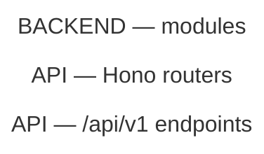

```mermaid
---
config:
  layout: elk
  flowchart:
    useMaxWidth: false
---
flowchart LR
  %% GENERATED by bkit-graphify-rollup.py from 8d5cc16dbf6aab05a1fee6873860240cad8945b7 — do not edit
  subgraph gncustom_health_checks["Health checks"]
    n_bkit_src_bkit_postinstall[".bkit/src/bkit-postinstall<br/>68 symbols · 1 files"]
    n_bkit_src_bkit_preflight[".bkit/src/bkit-preflight<br/>47 symbols · 1 files"]
  end
  subgraph gncustom_install_engine["Install engine"]
    n_bkit_src_bkit_cli[".bkit/src/bkit-cli<br/>30 symbols · 1 files"]
    n_bkit_src_bkit_cloud_env[".bkit/src/bkit-cloud-env<br/>49 symbols · 1 files"]
    n_bkit_src_bkit_install[".bkit/src/bkit-install<br/>60 symbols · 1 files"]
    n_bkit_src_bkit_manifest[".bkit/src/bkit-manifest<br/>37 symbols · 1 files"]
    n_bkit_src_bkit_modules[".bkit/src/bkit-modules<br/>66 symbols · 1 files"]
    n_bkit_src_bkit_paths[".bkit/src/bkit-paths<br/>9 symbols · 1 files"]
    n_bkit_src_bkit_tiers[".bkit/src/bkit-tiers<br/>15 symbols · 1 files"]
    n_bkit_src_bkit_trackers[".bkit/src/bkit-trackers<br/>11 symbols · 1 files"]
    n_bkit_src_bkit_uninstall[".bkit/src/bkit-uninstall<br/>18 symbols · 1 files"]
    n_bkit_src_bkit_upgrade[".bkit/src/bkit-upgrade<br/>15 symbols · 1 files"]
    n_bkit_src_bkit_version[".bkit/src/bkit-version<br/>15 symbols · 1 files"]
  end
  subgraph gncustom_telemetry["Telemetry"]
    n_bkit_src_bkit_analysis[".bkit/src/bkit-analysis<br/>25 symbols · 1 files"]
    n_bkit_src_bkit_comply[".bkit/src/bkit-comply<br/>17 symbols · 1 files"]
    n_bkit_src_bkit_harvest[".bkit/src/bkit-harvest<br/>22 symbols · 1 files"]
    n_bkit_src_bkit_telemetry[".bkit/src/bkit-telemetry<br/>56 symbols · 1 files"]
    n_bkit_src_bkit_telemetry_lint[".bkit/src/bkit-telemetry-lint<br/>16 symbols · 1 files"]
    n_bkit_src_bkit_telemetry_normalise[".bkit/src/bkit-telemetry-normalise<br/>10 symbols · 1 files"]
  end
  subgraph gn_bkit_src[".bkit/src"]
    n_bkit_src_bkit_markers["bkit-markers<br/>14 symbols · 1 files"]
    n_bkit_src_bkit_retire["bkit-retire<br/>12 symbols · 1 files"]
    n_bkit_src_bkit_status["bkit-status<br/>22 symbols · 1 files"]
    subgraph gn_bkit_src_commands[".bkit/src/commands"]
      n_bkit_src_commands_ci_ci[".bkit/src/commands/ci/ci<br/>18 symbols · 1 files"]
      n_bkit_src_commands_lib["lib<br/>44 symbols · 1 files"]
      n_bkit_src_commands_setup_setup[".bkit/src/commands/setup/setup<br/>11 symbols · 1 files"]
      n_bkit_src_commands_shared_config[".bkit/src/commands/shared/config<br/>5 symbols · 1 files"]
      subgraph gn_bkit_src_commands_workflow[".bkit/src/commands/workflow"]
        n_bkit_src_commands_workflow_branches["branches<br/>49 symbols · 1 files"]
        n_bkit_src_commands_workflow_context["context<br/>45 symbols · 1 files"]
        n_bkit_src_commands_workflow_counters["counters<br/>6 symbols · 1 files"]
        n_bkit_src_commands_workflow_fids["fids<br/>14 symbols · 1 files"]
        n_bkit_src_commands_workflow_issues["issues<br/>31 symbols · 1 files"]
        n_bkit_src_commands_workflow_ledgers["ledgers<br/>31 symbols · 1 files"]
        n_bkit_src_commands_workflow_locks["locks<br/>37 symbols · 1 files"]
        n_bkit_src_commands_workflow_prs["prs<br/>38 symbols · 1 files"]
        n_bkit_src_commands_workflow_repo["repo<br/>7 symbols · 1 files"]
        n_bkit_src_commands_workflow_roadmap["roadmap<br/>33 symbols · 1 files"]
        n_bkit_src_commands_workflow_runs["runs<br/>59 symbols · 1 files"]
        n_bkit_src_commands_workflow_runtime["runtime<br/>16 symbols · 1 files"]
        n_bkit_src_commands_workflow_skills["skills<br/>10 symbols · 1 files"]
        n_bkit_src_commands_workflow_status["status<br/>29 symbols · 1 files"]
        n_bkit_src_commands_workflow_steps["steps<br/>19 symbols · 1 files"]
        n_bkit_src_commands_workflow_workflows["workflows<br/>28 symbols · 1 files"]
        n_bkit_src_commands_workflow_workstreams["workstreams<br/>9 symbols · 1 files"]
        n_bkit_src_commands_workflow_worktrees["worktrees<br/>27 symbols · 1 files"]
      end
    end
  end
  n_bkit_src_commands_workflow_branches -->|43| n_bkit_src_commands_lib
  n_bkit_src_bkit_modules -->|36| n_bkit_src_bkit_tiers
  n_bkit_src_commands_workflow_prs -->|36| n_bkit_src_commands_lib
  n_bkit_src_commands_workflow_runs -->|35| n_bkit_src_commands_lib
  n_bkit_src_bkit_modules -->|29| n_bkit_src_bkit_paths
  n_bkit_src_bkit_modules -->|27| n_bkit_src_bkit_install
  n_bkit_src_bkit_install -->|26| n_bkit_src_bkit_modules
  n_bkit_src_commands_workflow_workflows -->|23| n_bkit_src_commands_lib
  n_bkit_src_bkit_modules -->|19| n_bkit_src_bkit_version
  n_bkit_src_commands_workflow_locks -->|18| n_bkit_src_commands_lib
  n_bkit_src_commands_workflow_status -->|18| n_bkit_src_bkit_status
  n_bkit_src_bkit_modules -->|17| n_bkit_src_bkit_cloud_env
  n_bkit_src_bkit_upgrade -->|16| n_bkit_src_bkit_version
  n_bkit_src_bkit_install -->|15| n_bkit_src_bkit_cli
  n_bkit_src_bkit_install -->|15| n_bkit_src_bkit_postinstall
  n_bkit_src_bkit_modules -->|15| n_bkit_src_bkit_manifest
  n_bkit_src_commands_workflow_prs -->|14| n_bkit_src_commands_workflow_status
  n_bkit_src_commands_workflow_workflows -->|14| n_bkit_src_commands_workflow_locks
  n_bkit_src_commands_workflow_worktrees -->|14| n_bkit_src_commands_lib
  n_bkit_src_bkit_harvest -->|13| n_bkit_src_bkit_telemetry
  n_bkit_src_bkit_install -->|13| n_bkit_src_bkit_cloud_env
  n_bkit_src_commands_setup_setup -->|13| n_bkit_src_commands_lib
  n_bkit_src_commands_workflow_context -->|13| n_bkit_src_commands_lib
  n_bkit_src_commands_workflow_issues -->|13| n_bkit_src_commands_lib
  n_bkit_src_bkit_install -->|12| n_bkit_src_bkit_upgrade
  n_bkit_src_bkit_install -->|12| n_bkit_src_bkit_manifest
  n_bkit_src_bkit_postinstall -->|12| n_bkit_src_bkit_manifest
  n_bkit_src_bkit_postinstall -->|12| n_bkit_src_bkit_preflight
  n_bkit_src_commands_ci_ci -->|12| n_bkit_src_commands_lib
  n_bkit_src_commands_workflow_context -->|12| n_bkit_src_commands_workflow_status
  n_bkit_src_commands_workflow_ledgers -->|12| n_bkit_src_commands_lib
  n_bkit_src_bkit_install -->|11| n_bkit_src_bkit_comply
  n_bkit_src_bkit_telemetry_normalise -->|11| n_bkit_src_bkit_telemetry_lint
  n_bkit_src_bkit_tiers -->|11| n_bkit_src_bkit_markers
  n_bkit_src_commands_workflow_roadmap -->|11| n_bkit_src_commands_lib
  n_bkit_src_commands_workflow_status -->|11| n_bkit_src_commands_lib
  n_bkit_src_commands_workflow_counters -->|11| n_bkit_src_commands_workflow_status
  n_bkit_src_commands_workflow_steps -->|11| n_bkit_src_commands_workflow_status
  n_bkit_src_bkit_analysis -->|10| n_bkit_src_bkit_telemetry
  n_bkit_src_bkit_install -->|10| n_bkit_src_bkit_paths
  n_bkit_src_commands_workflow_runtime -->|10| n_bkit_src_commands_lib
  n_bkit_src_bkit_retire -->|9| n_bkit_src_bkit_version
  n_bkit_src_commands_workflow_locks -->|9| n_bkit_src_bkit_status
  n_bkit_src_commands_workflow_repo -->|9| n_bkit_src_commands_lib
  n_bkit_src_commands_workflow_roadmap -->|9| n_bkit_src_bkit_telemetry
  n_bkit_src_commands_workflow_workflows -->|9| n_bkit_src_bkit_telemetry
  n_bkit_src_bkit_install -->|8| n_bkit_src_bkit_markers
  n_bkit_src_commands_workflow_branches -->|8| n_bkit_src_commands_workflow_status
  n_bkit_src_commands_workflow_skills -->|8| n_bkit_src_commands_lib
  n_bkit_src_bkit_modules -->|7| n_bkit_src_bkit_trackers
  n_bkit_src_bkit_modules -->|7| n_bkit_src_bkit_retire
  n_bkit_src_bkit_postinstall -->|7| n_bkit_src_bkit_markers
  n_bkit_src_bkit_preflight -->|7| n_bkit_src_bkit_paths
  n_bkit_src_commands_workflow_fids -->|7| n_bkit_src_commands_lib
  n_bkit_src_commands_workflow_issues -->|7| n_bkit_src_commands_workflow_status
  n_bkit_src_commands_workflow_workflows -->|7| n_bkit_src_commands_workflow_status
  n_bkit_src_commands_workflow_runtime -->|7| n_bkit_src_commands_workflow_status
  n_bkit_src_commands_workflow_steps -->|7| n_bkit_src_commands_lib
  n_bkit_src_commands_workflow_workflows -->|7| n_bkit_src_bkit_status
  n_bkit_src_bkit_cli -->|6| n_bkit_src_bkit_manifest
  n_bkit_src_bkit_install -->|6| n_bkit_src_bkit_telemetry
  n_bkit_src_bkit_install -->|6| n_bkit_src_bkit_uninstall
  n_bkit_src_bkit_postinstall -->|6| n_bkit_src_bkit_version
  n_bkit_src_bkit_postinstall -->|6| n_bkit_src_bkit_modules
  n_bkit_src_bkit_preflight -->|6| n_bkit_src_bkit_manifest
  n_bkit_src_bkit_uninstall -->|6| n_bkit_src_bkit_manifest
  n_bkit_src_bkit_uninstall -->|6| n_bkit_src_bkit_markers
  n_bkit_src_bkit_uninstall -->|6| n_bkit_src_bkit_paths
  n_bkit_src_commands_shared_config -->|6| n_bkit_src_bkit_manifest
  n_bkit_src_commands_workflow_branches -->|6| n_bkit_src_bkit_telemetry
  n_bkit_src_commands_workflow_prs -->|6| n_bkit_src_bkit_status
  n_bkit_src_commands_workflow_runs -->|6| n_bkit_src_commands_shared_config
  n_bkit_src_commands_workflow_runs -->|6| n_bkit_src_commands_workflow_status
  n_bkit_src_commands_workflow_workstreams -->|6| n_bkit_src_commands_lib
  style n_bkit_src_bkit_postinstall stroke:#9a6700,stroke-width:2px
  style n_bkit_src_bkit_preflight stroke:#c026d3,stroke-width:2px
  style n_bkit_src_bkit_cli stroke:#0f766e,stroke-width:2px
  style n_bkit_src_bkit_cloud_env stroke:#0969da,stroke-width:2px
  style n_bkit_src_bkit_install stroke:#c026d3,stroke-width:2px
  style n_bkit_src_bkit_manifest stroke:#0891b2,stroke-width:2px
  style n_bkit_src_bkit_modules stroke:#7c3aed,stroke-width:2px
  style n_bkit_src_bkit_paths stroke:#0f766e,stroke-width:2px
  style n_bkit_src_bkit_tiers stroke:#0891b2,stroke-width:2px
  style n_bkit_src_bkit_trackers stroke:#a0522d,stroke-width:2px
  style n_bkit_src_bkit_uninstall stroke:#15803d,stroke-width:2px
  style n_bkit_src_bkit_upgrade stroke:#0f766e,stroke-width:2px
  style n_bkit_src_bkit_version stroke:#1a7f37,stroke-width:2px
  style n_bkit_src_bkit_analysis stroke:#8b949e,stroke-width:2px
  style n_bkit_src_bkit_comply stroke:#65a30d,stroke-width:2px
  style n_bkit_src_bkit_harvest stroke:#8b949e,stroke-width:2px
  style n_bkit_src_bkit_telemetry stroke:#1a7f37,stroke-width:2px
  style n_bkit_src_bkit_telemetry_lint stroke:#0891b2,stroke-width:2px
  style n_bkit_src_bkit_telemetry_normalise stroke:#8b949e,stroke-width:2px
  style n_bkit_src_bkit_markers stroke:#c026d3,stroke-width:2px
  style n_bkit_src_bkit_retire stroke:#b91c1c,stroke-width:2px
  style n_bkit_src_bkit_status stroke:#1d4ed8,stroke-width:2px
  style n_bkit_src_commands_ci_ci stroke:#8b949e,stroke-width:2px
  style n_bkit_src_commands_lib stroke:#a21caf,stroke-width:2px
  style n_bkit_src_commands_setup_setup stroke:#8b949e,stroke-width:2px
  style n_bkit_src_commands_shared_config stroke:#bf3989,stroke-width:2px
  style n_bkit_src_commands_workflow_branches stroke:#8b949e,stroke-width:2px
  style n_bkit_src_commands_workflow_context stroke:#8b949e,stroke-width:2px
  style n_bkit_src_commands_workflow_counters stroke:#8b949e,stroke-width:2px
  style n_bkit_src_commands_workflow_fids stroke:#8b949e,stroke-width:2px
  style n_bkit_src_commands_workflow_issues stroke:#8b949e,stroke-width:2px
  style n_bkit_src_commands_workflow_ledgers stroke:#8b949e,stroke-width:2px
  style n_bkit_src_commands_workflow_locks stroke:#9a6700,stroke-width:2px
  style n_bkit_src_commands_workflow_prs stroke:#8b949e,stroke-width:2px
  style n_bkit_src_commands_workflow_repo stroke:#8b949e,stroke-width:2px
  style n_bkit_src_commands_workflow_roadmap stroke:#8b949e,stroke-width:2px
  style n_bkit_src_commands_workflow_runs stroke:#8b949e,stroke-width:2px
  style n_bkit_src_commands_workflow_runtime stroke:#8b949e,stroke-width:2px
  style n_bkit_src_commands_workflow_skills stroke:#8b949e,stroke-width:2px
  style n_bkit_src_commands_workflow_status stroke:#c2410c,stroke-width:2px
  style n_bkit_src_commands_workflow_steps stroke:#8b949e,stroke-width:2px
  style n_bkit_src_commands_workflow_workflows stroke:#8b949e,stroke-width:2px
  style n_bkit_src_commands_workflow_workstreams stroke:#8b949e,stroke-width:2px
  style n_bkit_src_commands_workflow_worktrees stroke:#8b949e,stroke-width:2px
  linkStyle 0 stroke:#a21caf,stroke-width:2px
  linkStyle 1 stroke:#0891b2,stroke-width:2px
  linkStyle 2 stroke:#a21caf,stroke-width:2px
  linkStyle 3 stroke:#a21caf,stroke-width:2px
  linkStyle 4 stroke:#0f766e,stroke-width:2px
  linkStyle 5 stroke:#c026d3,stroke-width:2px
  linkStyle 6 stroke:#7c3aed,stroke-width:2px
  linkStyle 7 stroke:#a21caf,stroke-width:2px
  linkStyle 8 stroke:#1a7f37,stroke-width:2px
  linkStyle 9 stroke:#a21caf,stroke-width:2px
  linkStyle 10 stroke:#1d4ed8,stroke-width:2px
  linkStyle 11 stroke:#0969da,stroke-width:2px
  linkStyle 12 stroke:#1a7f37,stroke-width:2px
  linkStyle 13 stroke:#0f766e,stroke-width:2px
  linkStyle 14 stroke:#9a6700,stroke-width:2px
  linkStyle 15 stroke:#0891b2,stroke-width:2px
  linkStyle 16 stroke:#c2410c,stroke-width:2px
  linkStyle 17 stroke:#9a6700,stroke-width:2px
  linkStyle 18 stroke:#a21caf,stroke-width:2px
  linkStyle 19 stroke:#1a7f37,stroke-width:2px
  linkStyle 20 stroke:#0969da,stroke-width:2px
  linkStyle 21 stroke:#a21caf,stroke-width:2px
  linkStyle 22 stroke:#a21caf,stroke-width:2px
  linkStyle 23 stroke:#a21caf,stroke-width:2px
  linkStyle 24 stroke:#0f766e,stroke-width:2px
  linkStyle 25 stroke:#0891b2,stroke-width:2px
  linkStyle 26 stroke:#0891b2,stroke-width:2px
  linkStyle 27 stroke:#c026d3,stroke-width:2px
  linkStyle 28 stroke:#a21caf,stroke-width:2px
  linkStyle 29 stroke:#c2410c,stroke-width:2px
  linkStyle 30 stroke:#a21caf,stroke-width:2px
  linkStyle 31 stroke:#65a30d,stroke-width:2px
  linkStyle 32 stroke:#0891b2,stroke-width:2px
  linkStyle 33 stroke:#c026d3,stroke-width:2px
  linkStyle 34 stroke:#a21caf,stroke-width:2px
  linkStyle 35 stroke:#a21caf,stroke-width:2px
  linkStyle 36 stroke:#c2410c,stroke-width:2px
  linkStyle 37 stroke:#c2410c,stroke-width:2px
  linkStyle 38 stroke:#1a7f37,stroke-width:2px
  linkStyle 39 stroke:#0f766e,stroke-width:2px
  linkStyle 40 stroke:#a21caf,stroke-width:2px
  linkStyle 41 stroke:#1a7f37,stroke-width:2px
  linkStyle 42 stroke:#1d4ed8,stroke-width:2px
  linkStyle 43 stroke:#a21caf,stroke-width:2px
  linkStyle 44 stroke:#1a7f37,stroke-width:2px
  linkStyle 45 stroke:#1a7f37,stroke-width:2px
  linkStyle 46 stroke:#c026d3,stroke-width:2px
  linkStyle 47 stroke:#c2410c,stroke-width:2px
  linkStyle 48 stroke:#a21caf,stroke-width:2px
  linkStyle 49 stroke:#a0522d,stroke-width:2px
  linkStyle 50 stroke:#b91c1c,stroke-width:2px
  linkStyle 51 stroke:#c026d3,stroke-width:2px
  linkStyle 52 stroke:#0f766e,stroke-width:2px
  linkStyle 53 stroke:#a21caf,stroke-width:2px
  linkStyle 54 stroke:#c2410c,stroke-width:2px
  linkStyle 55 stroke:#c2410c,stroke-width:2px
  linkStyle 56 stroke:#c2410c,stroke-width:2px
  linkStyle 57 stroke:#a21caf,stroke-width:2px
  linkStyle 58 stroke:#1d4ed8,stroke-width:2px
  linkStyle 59 stroke:#0891b2,stroke-width:2px
  linkStyle 60 stroke:#1a7f37,stroke-width:2px
  linkStyle 61 stroke:#15803d,stroke-width:2px
  linkStyle 62 stroke:#1a7f37,stroke-width:2px
  linkStyle 63 stroke:#7c3aed,stroke-width:2px
  linkStyle 64 stroke:#0891b2,stroke-width:2px
  linkStyle 65 stroke:#0891b2,stroke-width:2px
  linkStyle 66 stroke:#c026d3,stroke-width:2px
  linkStyle 67 stroke:#0f766e,stroke-width:2px
  linkStyle 68 stroke:#0891b2,stroke-width:2px
  linkStyle 69 stroke:#1a7f37,stroke-width:2px
  linkStyle 70 stroke:#1d4ed8,stroke-width:2px
  linkStyle 71 stroke:#bf3989,stroke-width:2px
  linkStyle 72 stroke:#c2410c,stroke-width:2px
  linkStyle 73 stroke:#a21caf,stroke-width:2px
```

# Capabilities

> [!CAUTION]
> **Purpose:** One row per app capability — owner module, the literal marker that finds
> every use of it, whether anything bypasses the owner. The drift register.
>
> **Rules:**
>
> - GENERATED — do NOT edit. `pnpm graph:update && pnpm graph:rollup` rewrites this file.
> - Source of truth: `scripts/graphify/bkit-graph-drift-rules.json`. Every status derived from live source, never typed.
> - Add a capability = add a rule there: capability · lane · owner module · one LITERAL marker.
> - Markers LITERAL, never regex — `new Ratelimit(` as a regex is an unclosed group matching NOTHING.
> - Match the mechanism, not the name — `createClient(` misses an owner that aliases its import.
> - Optional `scope` narrows the tree scanned when a marker means different things per package.
> - Optional `surface`: `product` (default) · `tests` (any `e2e/` dir + every `.test.`/`.spec.` file) · `all`. The two surfaces PARTITION the tree.
> - Optional `budgets`: the EXACT non-owner site count allowed per scope prefix. Measured == declared everywhere ⇒ `budgeted`, which is NOT a warning.
> - A budget is not a shrug — `owned-query-shape-guard.test.ts` reds CI when the count moves EITHER way, and a site landing outside every declared prefix reads as over budget.
> - Test code is in `graph.json` on purpose (`.graphifyignore`) and out of every diagram here by rule (`is_test_code` in `bkit-graphify-rollup.py`): test folders, `.test.`/`.spec.` files, test-runner config. `hide_nodes` below is DIAGRAM-ONLY too, for whatever else a picture should not draw.
> - Status computed: no owner → `split`; owner absent → `gap`; owner present, others use marker → `bypassed`; else `one`. A `split`/`bypassed` at budget → `budgeted`.
> - Externals: `scripts/graphify/bkit-graph-external-rules.json` — `sdk` · `hosts` · `env`. SDK AND url = `split`.
> - Import-time scan: `scripts/graphify/bkit-graph-eager-rules.json` lists only what is PURE. Unclassified = reported.
> - That scan reads SOURCE, not the graph — module-level initialiser calls are the one construct graphify drops.
> - Nothing discovers an SDK itself; find gaps by listing non-workspace deps.
> - Only the Overrides block is hand-maintained. It round-trips; malformed ABORTS the run.
> - Colour = called capability, shared by its inbound edges. Grey = never called.
> - Drift = dashed border + ONE amber box for all four. No ranking: each scan proves a shape, never an intent.
> - `budgeted` = SOLID border + blue box. Still drawn — a declared bypass is still a bypass — but it is settled, not an open question.
> - Which status is which: `split` fine dash · `bypassed` long dash · `dead` even dash · `gap` dotted · `budgeted` NO dash.
> - A fetched URL is a STRING, never an edge — `assert-routes-reachable.mjs` is the only check that sees it.
> - Table rescanned every run, never stale. Diagrams from `graph.json` @ `8d5cc16db` — differs from HEAD ⇒ run `pnpm graph:update` FIRST.
> - Detail-level module graph → `pnpm graph`. This doc is the altitude ABOVE that: capabilities, not files.

## Status Vocabulary

The first four are warnings, not verdicts, and they share one amber in the diagrams. Any
of them can turn out to be deliberate — the scans prove a shape, never an intent.

`budgeted` is what one of those four becomes once somebody has decided. The rule declares
the EXACT number of non-owner sites allowed per scope prefix, its `note` says why that
number is not zero, and `tooling/eslint/tests/owned-query-shape-guard.test.ts` reds CI the
moment the count moves in either direction — too many (a copy appeared) or too few (the
budget is stale). That guard is why the status can be quieter without being a place to
hide work, and it is the half the register itself cannot do: `graphify` is a per-developer
install, absent in CI, so nothing here can turn a build red.

It still gets a box in the diagrams, drawn solid and blue rather than dashed and amber. A
budgeted bypass is still a bypass; the different drawing stops the picture asking the
same question of it every sweep. Drawn identically, an unbounded marker (18 of 19) and a
marker that is exactly at its declared count — whose note says the copies are probes and
the budget is not meant to reach zero — would make each pass rediscover the settled rows
and re-read the notes to dismiss them.

<!-- prettier-ignore -->
| Status | Meaning | Action |
| --- | --- | --- |
| `split` | Two or more competing implementations, no single owner | Centralise — file an issue. Or budget it, with the reason in `note` |
| `bypassed` | Owner exists, some callers skip it | Repoint the bypasses. Or budget them, with the reason in `note` |
| `dead` | A client fetches a path nothing serves. A WARNING — some are deliberate | Check the call site, then delete the call or serve the path |
| `gap` | Designed, not built. No owner yet | Name the owner BEFORE the first caller |
| `budgeted` | A `split` or `bypassed` whose site count is declared, guarded and currently met | None — the CI guard owns it. Lower the budget when a site goes |
| `one` | One implementation, every caller routes through it | None — keep it that way |

## Register

3 capabilities: 1 `bypassed` · 2 `one`.

<!-- prettier-ignore -->
| Lane | Capability | Owner | Marker | Surface | Status | Bypasses | Budget | Issue |
| --- | --- | --- | --- | --- | --- | --- | --- | --- |
| Install | Managed-version marker | `.bkit/src/bkit-version.ts` | `do NOT edit; run` | `product` | `bypassed` | 1 of 2 | — |  |
| Install | Tracker block substitution | `.bkit/src/bkit-trackers.ts` | `bkit:tracker` | `product` | `one` | 0 of 1 | — |  |
| Providers | Cursor API access | `.bkit/src/bkit-registry.ts` | `api.cursor.com` | `product` | `one` | 0 of 1 | — |  |

## Unreachable API calls

Not scanned — run the rollup with `--reachability`.

## Import-time side effects

12 module-scope side effects in 3 of 59 source files. A call here runs on **import**, not on first use, so every file downstream pays for it — under Jest that is a mandatory stub in tests that never touch the thing. Sorted by reach.

<!-- prettier-ignore -->
| File | Evaluates at import | Downstream files | of which tests |
| --- | --- | --- | --- |
| `.bkit/src/commands/workflow/branches.ts` | `LEDGERS.map` | 46 | 36 |
| `.bkit/src/bkit-paths-policy.ts` | `TEMPLATE_COPIES_DIR.split` | 42 | 33 |

1 further file nothing imports — an entrypoint is supposed to do work when it loads. In the JSON report only.

## Overrides

The one hand-maintained region of this file. Everything else is rewritten on each run;
this block is read back first and re-emitted verbatim. Rename a node, hide a node or an
edge, pin a note, or force nodes into a named group. A malformed block aborts the run
rather than being silently dropped. Every `hide_nodes` entry needs a one-line reason in
`hide_nodes_why`; `tooling/eslint/tests/hide-nodes-registry.test.ts` fails CI otherwise.

<!-- overrides:start -->

```json
{
  "rename": {},
  "note": {},
  "hide_nodes": [],
  "hide_nodes_why": {},
  "hide_edges": [],
  "group": {
    "Install engine": [
      ".bkit/src/bkit-cli",
      ".bkit/src/bkit-install",
      ".bkit/src/bkit-modules",
      ".bkit/src/bkit-tiers",
      ".bkit/src/bkit-upgrade",
      ".bkit/src/bkit-uninstall",
      ".bkit/src/bkit-manifest",
      ".bkit/src/bkit-version",
      ".bkit/src/bkit-paths",
      ".bkit/src/bkit-package-json",
      ".bkit/src/bkit-trackers",
      ".bkit/src/bkit-cloud-env"
    ],
    "Health checks": [".bkit/src/bkit-postinstall", ".bkit/src/bkit-preflight"],
    "Telemetry": [
      ".bkit/src/bkit-telemetry",
      ".bkit/src/bkit-telemetry-lint",
      ".bkit/src/bkit-telemetry-normalise",
      ".bkit/src/bkit-harvest",
      ".bkit/src/bkit-analysis",
      ".bkit/src/bkit-comply",
      ".bkit/src/bkit-tokens"
    ]
  }
}
```

<!-- overrides:end -->

## User-facing routes → backend capabilities

0 routes across web and native, each linked to the service domains it reaches. The static import graph does NOT cross the HTTP boundary — a page imports `ui` and `validators`, never `services` — so the link is the endpoint literal at the calling symbol, followed through `v1.ts` to the router file and its service imports. Attribution is per symbol, not per file, so a domain named only in a shared helper's comment is not credited to every page that imports the helper.

To view online, paste only the lines inside the block below — not the fence lines — into [mermaid.live](https://mermaid.live/).



## Architecture — packages

Grouped by the folder tree, not by a clustering algorithm. Edge labels are the number of
underlying symbol edges. Drift status is painted onto the owning module.

To view online, paste only the lines inside the block below — not the fence lines — into [mermaid.live](https://mermaid.live/).

```mermaid
---
config:
  layout: elk
  flowchart:
    useMaxWidth: false
---
flowchart LR
  %% GENERATED by bkit-graphify-rollup.py from 8d5cc16dbf6aab05a1fee6873860240cad8945b7 — do not edit
```

## Architecture — modules

The same graph one level down: `apps/web` is a box, its subfolders are the nodes inside it.
Cross-group edges lighter than 6 are dropped — see `MMD_MIN_WEIGHT` in
`scripts/graphify/bkit-graphify.sh`.

To view online, paste only the lines inside the block below — not the fence lines — into [mermaid.live](https://mermaid.live/).


