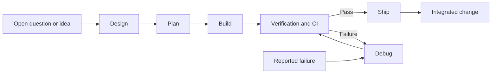
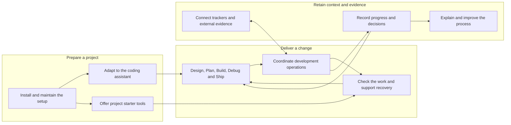

# Components

> [!CAUTION]
> **Purpose:** A purpose-based view of what the repository does, its major responsibilities and how they work together, readable without inspecting the code.
>
> **Rules:**
>
> - Group components by the purpose they serve, independently of files, packages and deployment units.
> - Describe each component's responsibility and its relationships in plain language.
> - Keep implementation boundaries and deployment topology in `docs/architecture.md`.
> - Reference `docs/capabilities.md` when present for implementation ownership and drift. Components and capabilities may have different names, counts and boundaries.
> - Distinguish current behavior from agreed scope, proposals and later candidates.
> - Update this document when the repository's purpose, responsibilities or main journeys change.

## Repository purpose

bkit gives developers and coding assistants a shared process for designing, planning, building, debugging and shipping software changes. It installs instructions and supporting tools into a project's repository, then supplies commands that track work, run checks and support delivery.

The npm package combines a command-line tool with instructions, hooks and templates. The coding assistant supplies reasoning and edits; the project's own scripts supply stack-specific builds and tests. bkit has no application server or database.

## The development lifecycle

Design, Plan, Build, Debug and Ship are bkit's five primary workflows. Together they turn an idea into an integrated change, with review, verification and recorded progress along the way. Each workflow has a distinct responsibility and delegates focused work to specialist agents.

<!-- prettier-ignore -->
| Workflow | Purpose | Starts with | Produces |
| --- | --- | --- | --- |
| Design | Decide what to build and how it should work by exploring alternatives, resolving questions and reviewing the approach. | A request whose approach is still open. | A reviewed design with scope, decisions and remaining questions. |
| Plan | Turn the agreed approach into ordered, executable tasks with verification criteria. | A settled design, issue or audit findings. | An implementation plan with dependencies, tests and completion criteria. |
| Build | Implement the planned change, prove it with tests and review it before delivery. | A plan, or a clear issue or prompt that Build converts into a plan. | A verified change on a branch, normally published as a pull request; local-only builds stay local. |
| Debug | Reproduce and diagnose a failure, apply a supported fix and verify recovery. | A failing test, CI run or reported behavior to reproduce. | A remediated change and verification evidence, or an explicit unresolved blocker. |
| Ship | Check that finished work is ready, integrate it and complete the handover and cleanup. | A completed change on a branch. | An integrated change, updated records and a handover for human acceptance. |

This is the typical relationship, not a requirement to run every phase for every change. Start where the work stands: a settled task can enter Plan or Build, and a failure can enter Debug directly. Debug is a recovery workflow, so a successful build does not need a debugging phase before shipping. Auto routes supported events to the appropriate workflow; it is not a sixth development phase. The [workflow catalog](../.bkit/workflows.md) defines the commands, entry conditions and handoffs.

## Core, shared and templates

These three parts explain how bkit delivers the process to a project. They describe ownership and delivery roles; the [architecture](architecture.md) gives the detailed file layout.

<!-- prettier-ignore -->
| Part | Purpose | What it supplies | Who maintains the installed result? |
| --- | --- | --- | --- |
| Core (`.bkit/core/`) | Define and operate bkit's engineering process. | The command-line engine, the five workflows and Auto routing, specialist-agent prompts, rules, hooks and reference instructions. | bkit maintains the installed or rendered content it owns. Package-only engine and source material stay in the package rather than being copied wholesale into the project. |
| Shared (`.bkit/shared/`) | Supply common project scaffolding and configuration alongside the core process. | Agent entry instructions, connection settings, environment examples, host configuration and standard documentation headers. | bkit maintains its declared files or marked sections; project-owned content outside those sections remains the project's. |
| Templates (`.bkit/templates/`) | Offer optional starting points a project can adapt to its own stack and practices. | CI workflows, testing and maintenance helpers, secrets tooling and document examples, including this component map. | bkit refreshes the template sources. Once copied into use, an adopted file belongs to the project and is maintained there. |

For example, Core defines how Build requests verification, Shared supplies common project context, and an adopted CI template helps the project run its own checks. These roles support the same lifecycle, but adopting a template is a separate action from installing managed content. The source directory alone does not determine whether an entire destination file is owned by bkit; the install contract also supports managed sections and merged configuration.

## Component map

The groups describe responsibilities, independently of where their code lives. Arrows show the main handoffs and supporting relationships, not a complete execution sequence.

## Component breakdown

<!-- prettier-ignore -->
| Purpose | Component | Responsibility | Works with |
| --- | --- | --- | --- |
| Prepare a project | Installation and upgrades | Establish the selected assistant setup, refresh managed content, preserve project-owned content and report setup drift. | Assistant adaptation supplies the rendered instructions; starter tools are offered for adoption. |
| Prepare a project | Assistant adaptation | Express shared workflows, agent roles, model choices and configuration in each supported assistant's format. | Installation writes the result; coding assistants read and run it. |
| Prepare a project | Project starter tools | Supply templates a project can copy and own for checks, cloud setup, secrets, code maps and repository maintenance. | Developers adapt them to the project; verification calls the project's declared scripts. |
| Deliver a change | Design, Plan, Build, Debug and Ship | Own the development lifecycle described above, from exploring an idea through implementation, failure recovery and integration. | The owner settles required decisions; specialist agents perform assigned work; coordination commands perform repeatable operations. |
| Deliver a change | Development coordination | Manage feature identities, branches, worktrees, task progress, reviews and pull requests so work can proceed and resume coherently. | Guidance selects the next operation; records retain its state; connectors reach external services. |
| Deliver a change | Verification and recovery | Check prerequisites, test evidence, review findings and delivery conditions. Hooks guard supported assistant actions; diagnosis and remediation steps address failures. | Project scripts run tests and builds; guidance handles failed checks and review decisions. |
| Retain context and evidence | Progress and project memory | Record plans, decisions, findings, deferrals, step outcomes and measurements, and derive the current workflow state. | Guidance reads prior context; coordination writes progress; reports summarize the evidence. |
| Retain context and evidence | Tracker and evidence connections | Read work items, update workflow status, post work records and obtain selected CI or runtime evidence through the configured integrations. | Trackers hold external work items; context-fetch blocks obtain project-specific evidence for diagnosis. |
| Retain context and evidence | Documentation, audits and measurements | Explain the system, inspect engineering practices and report workflow outcomes and friction. This repository also collects maintainer-local measurements across consumer projects. | Project memory supplies records; capability maps and the floorplan provide implementation views. |

## Main journeys

### Set up a project

1. A developer selects the assistants and integrations the project needs.
2. Installation checks prerequisites and uses assistant adaptation to write the setup while preserving project-owned content.
3. The developer adopts and adapts the starter tools the project needs. Checks report missing prerequisites or drift; later upgrades refresh managed content and template sources.

### Deliver a change

1. The owner supplies a request, issue, design or plan and starts the appropriate workflow.
2. Development guidance selects the work and agent roles. Coordination manages the checkout, tasks and evidence, while records preserve decisions and progress.
3. Verification evaluates the implementation through project checks and review. Findings lead to remediation or an explicit decision point.
4. Shipping checks delivery conditions and coordinates the pull request and integration. Records and tracker updates describe the resulting state.

### Diagnose a failure

1. A reported failure or failed check starts the debugging workflow.
2. Evidence connections collect the selected logs and context. Reproduction and diagnosis identify a testable cause before remediation.
3. Verification checks the fix, and project memory retains the outcome and relevant lessons. An unresolved blocker remains explicit for the owner.

## Shared foundations

- Project settings select assistants, integrations and workflow behavior. [Technology](technology.md) records the implementation stack; [architecture](architecture.md) records package boundaries and installation behavior.
- Project-owned scripts define stack-specific verification. [Testing](testing.md) and [deployments](deployments.md) describe test tiers and delivery checks.
- Rules, permissions and hooks constrain agent actions. [Security](security.md) describes the trust boundaries; [observability](observability.md) describes operational evidence.
- Structured ledgers preserve workflow state and evidence without a database service. [Ledger contracts](../.bkit/jsonl.md) define their formats and interpretation.

## Scope

This map describes bkit's current responsibilities, including the tooling used to maintain bkit itself. Templates become a project's responsibility after adoption. External assistants, issue trackers, repository hosting and project-specific services retain their own responsibilities.

Feature proposals and delivery state belong in the tracker and [roadmap](roadmap.md). This document changes when responsibilities or journeys change, rather than whenever files move.

## Related views

<!-- prettier-ignore -->
| View | Question it answers |
| --- | --- |
| [Architecture](architecture.md) | How is bkit implemented, packaged and installed? |
| [Capabilities](capabilities.md) | Where are registered implementation capabilities owned, and do callers bypass their owners? |
| [Repository floorplan](../floorplan/README.md) | How can I explore the files, connections and guided flows interactively? |
| [Workflow catalog](../.bkit/workflows.md) | Which workflow should I run, and what does it do? |
| [Template catalog](../.bkit/templates.md) | Which starter tools can a project adopt, and how? |

The capability register and floorplan describe implementation evidence at their own level of detail. For example, installation uses both managed-version markers and tracker-block substitution from the capability register, while development guidance spans responsibilities outside that register. Components need no matching capability row, and a capability may support several components. This document is maintained independently of both generated views.
