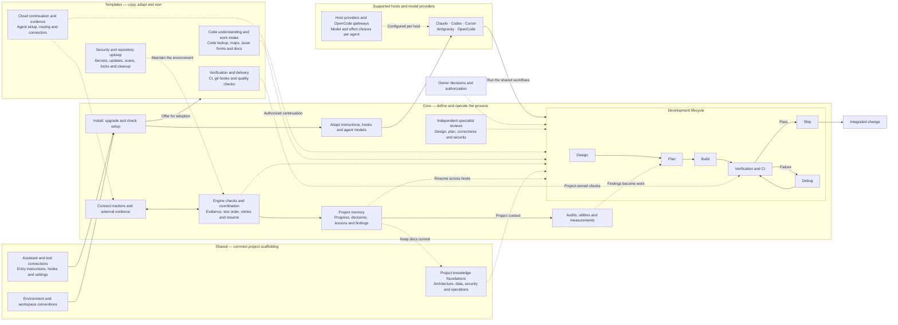

# Components

> [!CAUTION]
> **Purpose:** A purpose-based view of what the repository does, its major responsibilities and how they work together, readable without inspecting the code.
>
> **Rules:**
>
> - Group components by the purpose they serve, independently of files, packages and deployment units.
> - Describe each component's responsibility and its relationships in plain language.
> - Keep implementation boundaries and deployment topology in `docs/architecture.md`.
> - Reference `docs/capabilities.md` when present for implementation ownership and drift. Components and capabilities may have different names, counts and boundaries.
> - Distinguish current behavior from agreed scope, proposals and later candidates.
> - Update this document when the repository's purpose, responsibilities or main journeys change.

## Repository purpose

bkit gives developers and coding assistants a shared process for designing, planning, building, debugging and shipping software changes. It installs instructions and supporting tools into a project's repository, then supplies commands that track work, run checks and support delivery.

The npm package combines a command-line tool with instructions, hooks and templates. The coding assistant supplies reasoning and edits; the project's own scripts supply stack-specific builds and tests. bkit has no application server or database.

The central idea is a repeatable engineering process: specialist agents do the work, independent reviewers challenge it, code checks the evidence, and the owner controls the required decisions. Project knowledge accumulates across features instead of disappearing with each chat.

<!-- prettier-ignore -->
| Core concept | Responsibility in the system |
| --- | --- |
| Independent judgment | Separate agents explore, implement and review. Reviewers assess the work independently, with different models used where the configured review group calls for them. |
| Completion checked by code | The engine verifies step outputs, test-first evidence, retry limits and resume state. Local checks and continuous integration (CI) verify the resulting software. |
| Human control | Decision points surface unresolved choices and unsuccessful repair attempts. Production promotion stays with the owner; optional cloud continuation follows the configured authorization. |
| Persistent project knowledge | Plain documents, append-only records and tracker history retain decisions, lessons, known bugs and postponed work. Utilities reconcile those records as the project changes. |
| Focused, resumable work | Separate working copies isolate features. Fresh agents receive focused briefs, and saved state lets another session or host continue the work. Model choices match each role's reasoning needs. |
| Improvement beyond passing tests | Audits inspect risks and gaps the test suite may miss. Findings become planned work; measurements and maintenance utilities help improve the process. |

## The development lifecycle

Design, Plan, Build, Debug and Ship are bkit's five primary workflows. Together they turn an idea into an integrated change, with review, verification and recorded progress along the way. Each workflow has a distinct responsibility and delegates focused work to specialist agents.

<!-- prettier-ignore -->
| Workflow | Purpose | Starts with | Produces |
| --- | --- | --- | --- |
| Design | Decide what to build and how it should work by exploring alternatives, resolving questions and reviewing the approach. | A request whose approach is still open. | A reviewed design with scope, decisions and remaining questions. |
| Plan | Turn the agreed approach into ordered, executable tasks with verification criteria. | A settled design, issue or audit findings. | An implementation plan with dependencies, tests and completion criteria. |
| Build | Implement the planned change, prove it with tests and review it before delivery. | A plan, or a clear issue or prompt that Build converts into a plan. | A verified change on a branch, normally published as a pull request; local-only builds stay local. |
| Debug | Reproduce and diagnose a failure, apply a supported fix and verify recovery. | A failing test, CI run or reported behavior to reproduce. | A remediated change and verification evidence, or an explicit unresolved blocker. |
| Ship | Check that finished work is ready, integrate it and complete the handover and cleanup. | A completed change on a branch. | An integrated change, updated records and a handover for human acceptance. |

Start where the work stands: a settled task can enter Plan or Build, and a failure can enter Debug directly. Debug is a recovery workflow, so a successful build does not need a debugging phase before shipping. Auto routes supported events to the appropriate workflow; it is not a sixth development phase. The [workflow catalog](../.bkit/workflows.md) defines the commands, entry conditions and handoffs.

## Core, shared and templates

These three parts explain how bkit delivers the process to a project. They describe ownership and delivery roles; the [architecture](architecture.md) gives the detailed file layout.

<!-- prettier-ignore -->
| Part | Purpose | What it supplies | Who maintains the installed result? |
| --- | --- | --- | --- |
| Core (`.bkit/core/`) | Define and operate bkit's engineering process. | The command-line engine, the five workflows and Auto routing, specialist-agent prompts, rules, hooks and reference instructions. | bkit maintains the installed or rendered content it owns. Package-only engine and source material stay in the package rather than being copied wholesale into the project. |
| Shared (`.bkit/shared/`) | Supply common project scaffolding and configuration alongside the core process. | Agent entry instructions, connection settings, environment examples, host configuration and standard documentation headers. | bkit maintains its declared files or marked sections; project-owned content outside those sections remains the project's. |
| Templates (`.bkit/templates/`) | Offer optional starting points a project can adapt to its own stack and practices. | CI workflows, testing and maintenance helpers, secrets tooling and document examples, including this component map. | bkit refreshes the template sources. Once copied into use, an adopted file belongs to the project and is maintained there. |

For example, Core defines how Build requests verification, Shared supplies common project context, and an adopted CI template helps the project run its own checks. These roles support the same lifecycle, but adopting a template is a separate action from installing managed content. The source directory alone does not determine whether an entire destination file is owned by bkit; the install contract also supports managed sections and merged configuration.

### Shared — give every agent the same project context

Shared supplies the common foundations that connect bkit's process to the project. It establishes places for project knowledge and the configuration that makes instructions, hooks and connected tools available.

<!-- prettier-ignore -->
| Responsibility | What it provides |
| --- | --- |
| Project knowledge | Standard document headers for architecture, technology, data, security, testing, deployments, observability, design and setup. Agents fill in the project's facts and keep them current as work ships. Decisions and lessons remain in their dedicated records. |
| Assistant and tool connections | Entry instructions that point assistants to the rulebook, host settings and hook registrations, and connection configuration for external tools. These make the shared process available in each selected host. |
| Environment and workspace conventions | Credential examples, cloud-session setup material and git conventions. These establish how the project supplies its environment while keeping actual credentials outside committed documentation. |

The document index directs each agent to relevant knowledge. Shared provides the maintained foundation; the project owns its facts and custom content. [Architecture](architecture.md) explains which destinations use managed sections or merged settings.

### Templates — equip the project's development environment

Templates turn the process into checks and tools that fit the project's stack. They are optional starting points: a project adopts the groups it needs and owns their configuration and operation.

<!-- prettier-ignore -->
| Responsibility | What a project can adopt | How it supports the process |
| --- | --- | --- |
| Verification and delivery | A CI pipeline, git hooks, formatting and quality checks, with additional test and deployment lanes as the project needs them. | Catch problems locally, then require the expected CI lanes to complete successfully before shipping. The project's own scripts define the checks. |
| Cloud continuation and evidence | Cloud-agent setup, CI-driven routing and connectors for logs, errors, hosting, databases and other services. | Continue authorized work after CI and give Debug actual failure evidence. Unavailable evidence stays explicitly unchecked. |
| Code understanding and work intake | Serena code lookup, graphify capability maps, issue forms and document examples such as this component map. | Find existing behavior before changing it, expose ownership drift and turn requests into useful workflow inputs. |
| Security and repository upkeep | Secrets synchronization, dependency updates, vulnerability scans, environment helpers, machine locks and cleanup tools. | Keep credentials and dependencies consistent, detect risks and maintain a usable development environment. |

Audit checklists belong to Core even though their installed directory is named `docs/templates/`: bkit's audit agent uses them directly. The copy-and-own tools described here live in `.bkit/templates/`. [The template catalog](../.bkit/templates.md) owns the inventory and adoption instructions.

## Multiple hosts and model providers

bkit carries the same engineering process across coding assistants. A host is the application that runs the workflow; a provider is the service or gateway supplying its models. Host adaptation translates commands, skills, agent roles, hooks and model settings into the selected host's format.

<!-- prettier-ignore -->
| Host | Configured provider choices |
| --- | --- |
| Claude | Anthropic |
| Codex | OpenAI |
| Cursor | Cursor |
| Antigravity | Google |
| OpenCode | OpenRouter, Ollama, OpenCode Zen or OpenCode Go |

Several hosts can be installed in one project. OpenCode can retain several provider configurations with one active default. bkit supplies model and reasoning-effort choices for agent roles, adapted to each host's supported settings. Plans, progress records and tracker state let work continue on another configured host or provider without depending on the previous chat's memory. Provider switching is configured explicitly; this is not automatic request failover.

The [host and provider catalog](../.bkit/providers.md) owns the detailed support matrix and host-specific limits. The [agent catalog](../.bkit/prompts.md) owns model selections. These limits matter: a shared workflow does not mean every host exposes identical tools or permission enforcement.

## Component map

This single chart combines the lifecycle, supporting responsibilities, delivery roles and support for hosts and providers. Solid arrows show the main handoffs; dotted arrows show supporting relationships. The lifecycle allows direct entry at the appropriate phase.

## Component breakdown

<!-- prettier-ignore -->
| Purpose | Component | Responsibility | Works with |
| --- | --- | --- | --- |
| Prepare a project | Installation and upgrades | Establish the selected assistant setup, refresh managed content, preserve project-owned content and report setup drift. | Assistant adaptation supplies the rendered instructions; starter tools are offered for adoption. |
| Prepare a project | Host and provider adaptation | Carry one process across Claude, Codex, Cursor, Antigravity and OpenCode, with provider-specific model choices and host-specific configuration. | Installation writes the result; the configured host and provider run agent roles; progress records support continuation elsewhere. |
| Prepare a project | Project starter tools | Supply templates a project can copy and own for checks, cloud setup, secrets, code maps and repository maintenance. | Developers adapt them to the project; verification calls the project's declared scripts. |
| Deliver a change | Design, Plan, Build, Debug and Ship | Own the development lifecycle described above, from exploring an idea through implementation, failure recovery and integration. | The owner settles required decisions; specialist agents perform assigned work; coordination commands perform repeatable operations. |
| Deliver a change | Development coordination | Manage feature identities, isolated working copies, tasks and pull requests. Check step evidence, test-first order, retry limits and resume state in code. | Agents make judgment calls; the engine performs repeatable operations; records retain their results. |
| Deliver a change | Independent review, verification and recovery | Challenge designs, plans and implementations, check the resulting software, and diagnose failures. Supported hooks constrain agent actions; required decisions return to the owner. | Reviewers work independently; project scripts and CI run checks; bounded remediation addresses findings. |
| Retain context and evidence | Progress and project memory | Record plans, decisions, findings, deferrals, step outcomes and measurements, and derive the current workflow state. | Guidance reads prior context; coordination writes progress; reports summarize the evidence. |
| Retain context and evidence | Tracker and evidence connections | Read work items, update workflow status, post work records and obtain selected CI or runtime evidence through the configured integrations. | Trackers hold external work items; context-fetch blocks obtain project-specific evidence for diagnosis. |
| Retain context and evidence | Documentation, audits and measurements | Keep project knowledge current, inspect risks beyond existing tests and report workflow outcomes and friction. This repository also collects maintainer-local measurements across consumer projects. | Audit findings feed Plan; utilities reconcile docs, records and tracker state; measurements inform process improvements. |

## Main journeys

### Set up a project

1. A developer selects the assistants and integrations the project needs.
2. Installation checks prerequisites and uses assistant adaptation to write the setup while preserving project-owned content.
3. The developer adopts and adapts the starter tools the project needs. Checks report missing prerequisites or drift; later upgrades refresh managed content and template sources.

### Deliver a change

1. The owner supplies a request, issue, design or plan and starts the appropriate workflow.
2. Development guidance selects the work and agent roles. Coordination manages the checkout, tasks and evidence, while records preserve decisions and progress.
3. Verification evaluates the implementation through project checks and review. Findings lead to remediation or an explicit decision point.
4. Shipping checks delivery conditions and coordinates the pull request and integration. Records and tracker updates describe the resulting state.

### Diagnose a failure

1. A reported failure or failed check starts the debugging workflow.
2. Evidence connections collect the selected logs and context. Reproduction and diagnosis identify a testable cause before remediation.
3. Verification checks the fix, and project memory retains the outcome and relevant lessons. An unresolved blocker remains explicit for the owner.

## Shared foundations

- Project settings select assistants, integrations and workflow behavior. [Technology](technology.md) records the implementation stack; [architecture](architecture.md) records package boundaries and installation behavior.
- Project-owned scripts define stack-specific verification. [Testing](testing.md) and [deployments](deployments.md) describe test tiers and delivery checks.
- Rules, permissions and hooks constrain agent actions. [Security](security.md) describes the trust boundaries; [observability](observability.md) describes operational evidence.
- Structured ledgers preserve workflow state and evidence without a database service. [Ledger contracts](../.bkit/jsonl.md) define their formats and interpretation.

## Scope

This map describes bkit's current responsibilities, including the tooling used to maintain bkit itself. Templates become a project's responsibility after adoption. External assistants, issue trackers, repository hosting and project-specific services retain their own responsibilities.

Feature proposals and delivery state belong in the tracker and [roadmap](roadmap.md). This document changes when responsibilities or journeys change, rather than whenever files move.

## Related views

<!-- prettier-ignore -->
| View | Question it answers |
| --- | --- |
| [Architecture](architecture.md) | How is bkit implemented, packaged and installed? |
| [Capabilities](capabilities.md) | Where are registered implementation capabilities owned, and do callers bypass their owners? |
| [Repository floorplan](../floorplan/README.md) | How can I explore the files, connections and guided flows interactively? |
| [Workflow catalog](../.bkit/workflows.md) | Which workflow should I run, and what does it do? |
| [Host and provider catalog](../.bkit/providers.md) | Which assistants and model gateways can run the process, and how do their integrations differ? |
| [Template catalog](../.bkit/templates.md) | Which starter tools can a project adopt, and how? |
| [Product guide](../DETAILS.md) | What are bkit's core ideas, user benefits and detailed capabilities? |

The capability register and floorplan describe implementation evidence at their own level of detail. For example, installation uses both managed-version markers and tracker-block substitution from the capability register, while development guidance spans responsibilities outside that register. Components need no matching capability row, and a capability may support several components. This document is maintained independently of both generated views.
