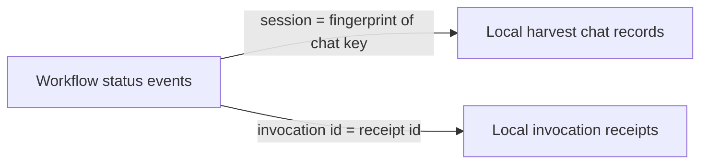

# Data Schema

> [!CAUTION]
> **Purpose:** The files that persist bkit state, the records they contain, and how those records relate to host and tracker data.
>
> **Rules:**
>
> - Follow `.bkit/authoring.md` § All Agent-Read Files and § Docs when you edit this file.
> - Give each database table its own field, index, access policy and pending-migration inventory if bkit adds one.
> - For a field whose existence is a decision, link its ADR in `decisions.jsonl`, and do not restate the rationale.
> - Keep the complete JSONL field contract in `.bkit/jsonl.md`.
>
> **Not here:** Personal-data handling belongs in `docs/security.md` § PII, file upgrade migrations in `docs/migrations.md` and fixtures in `docs/testing.md`.
>
> **Update when:** A persistent store, record key, relationship or personal-data field changes.

## Overview

bkit owns no production database or database migrations. The installed CLI persists workflow state in the checkout and Git common directory. The maintainer's harvest writes local files and reads agent-host databases in read-only mode. Upgrade migrations rewrite files. [File migration register](migrations.md)

Two joins connect committed workflow records to local evidence. Each arrow names the fields used. Neither join is a database foreign key.

## Checkout records

<!-- prettier-ignore -->
| Field | Type | Unique | Notes |
| --- | --- | --- | --- |
| Ledger `kind`, `ts`, `key` | String, number, optional string | A keyed entity can have several revisions. | `docs/{decisions,knowledge,failures,deferrals}.jsonl`, `.bkit/{friction,stats,issues}.jsonl`. The reader folds rows using the identity and order for that kind. |
| Ledger `repo`, `references` | String, optional string array | No | Repository slug and references to features, issues, PRs, commits or paths. |
| Status event `session` | String | No | The `session` event stores a fingerprint of the host and chat ID. Status logs live under `docs/plans/{YYYYMM}/logs/{FID}/status.jsonl`. |
| Status invocation event `id`, `worktree`, `bookRoot`, `statusPath` | Strings | The engine generates an ID per invocation. | The event stores a worktree fingerprint and checkout-relative paths. Its ID names a private receipt. |
| `.bkit/version` | JSON object | One per checkout | Records the installed version and managed file hashes. The install configuration lives under `package.json` → `bkit`. |

**Indices and access.** The CLI reads and folds ledger files. The writer holds a file lock for append, compact and union. Filesystem permissions and repository access control who can read a checkout. Each ledger kind has designated writers. [Ledger types, fields and writers](../.bkit/jsonl.md)

## Private outbox records

The engine places the outbox under Git's common directory. Linked worktrees share it.

<!-- prettier-ignore -->
| Field | Type | Unique | Notes |
| --- | --- | --- | --- |
| Invocation `id`, `worktree`, `bookRoot`, `statusPath` | Strings, with nullable book root and status path | `id` names the receipt file. | `bkit-outbox/invocation-context/` holds the issuing checkout and its absolute paths. A standalone invocation has no run status log. |
| Progress `comment.evidence.authorId`, `source` | Strings | No | `bkit-outbox/progress/` caches the provider identity and locally assembled report text used to recognize and revise an owned comment. |
| Ledger append intent and receipt | JSONL records | An operation ID identifies the request within its ledger scope. | `bkit-outbox/ledger-operations/` records intent and byte-range evidence so a retried append can verify its earlier write. |

**Indices and access.** The CLI locates receipts by invocation ID and progress records by a hash of the target and invocation. These files sit outside the tracked worktree. Progress and receipt files are created with owner-only permissions. [Tracker ownership and access](security.md#workflow-comment-ownership)

## Maintainer harvest records

<!-- prettier-ignore -->
| Field | Type | Unique | Notes |
| --- | --- | --- | --- |
| Chat `key`, `session.id` | Strings | One logical chat per platform and ID. | `harvest/stats.jsonl` holds successive summaries under the same key. The raw host ID is local. |
| Chat `time`, `usage` and run `owner` | Objects | No | Session timestamps and usage counts, and owner wait times and reasons. |
| Scanned `repo`, chat `issue`, run `run.fid` / `run.issue` | String, object with fingerprint fields, string / nullable string | No | Scanned chat and run rows fingerprint repository, issue and feature identities. Copied ledger rows can retain the original `repo` slug. |
| Consumer path list and report | Markdown | One file of each per checkout | `harvest/consumers.md` supplies checkout paths. `harvest/stats.md` resolves project and issue names for the local report. Copied friction goes to `harvest/friction.jsonl`. |

**Indices and access.** The scanner and report read local files in the gitignored `harvest/` directory. The source transcript and SQLite schemas belong to the agent hosts. [Harvest readers and retention](observability.md#harvest--every-repo-every-chat-bkit-repo-only)

## Git and tracker records

<!-- prettier-ignore -->
| Field | Type | Unique | Notes |
| --- | --- | --- | --- |
| Commit author / committer name and email | Strings in Git headers | No | Git owns the commit schema. Public repositories expose committed identities. |
| Issue body and comment body | Text managed by the tracker | No | Posted reports live in the configured tracker. The optional maintainer importer copies Linear issue descriptions and comment text into GitHub. |
| Linear CSV `Assignee`, `Creator` and comment `user.displayName`, `user.name`, `user.email` | Text, optional author fields | No | The importer writes the CSV attribution into the GitHub issue body. It takes the first available comment author field in the listed order for the posted comment body. |

**Indices and access.** Git identifies commits by object ID. Issues and comments use provider IDs. Source CSVs use filesystem permissions, and the destination repository and tracker control access to published records. [Personal-data handling](security.md#pii)

## Functions

Not applicable: bkit has no database tables, stored functions, triggers, row-level policies, database indices or pending database migrations.

## Open questions

The checkout owner sets local retention for the private outbox and harvest. The repository does not specify an expiry period for those records.
