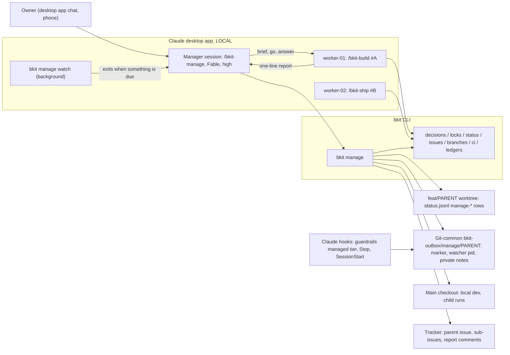

# Design: `/bkit-manage <issue>` — a manager session that drives a parent issue and its sub-issues to closed

## Related Issues

- #938 — Ship and debug in local mode (open)
- #905 — Model-independent orchestrators (open)
- #1001 — Build: the engine routes the Decision Pause answer (open)
- #1038 — Build: Try again on a red-gate pause re-runs the gate before another fix round (open)
- #958 — Agents and the orchestrator write their own .md files; the engine checks and counts (open)
- #910 — Bookkeeping: the engine keeps what the orchestrator remembers (open)
- #1052 — Builds under machine load: helper timers and gates fail on the load, not on the code (open)
- #324 — Automation triggers: self-healing loop, gates, scoped audits (open)
- #639 — Land parallel workflow closes on dev without colliding (closed)
- #753 — Managed agents (open)

`related-issues.md` recorded `Search unavailable.` (the GitHub MCP returned 401). The list above comes from `gh search issues` and `gh issue view` run on 2026-11-19.

## Acceptance Scenario

Built from the input's `Draft Acceptance Scenario` (accepted by the owner as Q15 / Q18). Each change is a `Decisions` row (D19-D22).

### Narrative

The owner starts a Claude desktop session on Fable at `high` effort (`claude --model claude-fable-5-2 --effort high`, or the app's model picker) and types `/bkit-manage #N`. Within the first hour they answer one batched round of real questions, while issues that need nothing from them are already building. The run then works through every sub-issue while the owner is away: it prefers `/bkit-*` commands in clean worker sessions and decides for itself when to deviate, recording why on the issue; it answers what it safely can as its own recorded assumption, lands reviewed work one issue at a time, and pushes in batches it sizes itself to save test runs. The owner comes back to a closed #N, or to a short list of decisions only they can make, with every judgement call written down on the issues.

### Success Criteria

1. The opening round asks only questions that `docs/decisions.jsonl`, the issue comments and `.agents/rules.md` § Project Goals do not already answer, ranked by how many builds each blocks; issues with nothing to ask start before the owner replies.
2. After any context reset, the manager carries on from its run records alone (`bkit manage state`); no issue is lost or started twice.
3. Every step with one right answer is a `bkit manage <verb>` or an extended existing command; every deviation (a free-form worker, a worker not cleared or replaced between commands) has an issue comment saying why.
4. No landing reaches `dev` without the review checklist, and the engine refuses to record an assumed accept of a HIGH finding or an unfixable MEDIUM one; every answer a worker receives is recorded as the owner's or the manager's, never confused.
5. Pushes carry as many landed issues as the manager judges safe; each report shows one progress line counted over issues, plus a finish range that narrows as issues land.

### Key Edge Cases

- A worker's question needs the owner while they are away: it is parked with its options and the step each option leads to, and other issues keep moving.
- A worker receives the manager's answer to a pause: the answer is already recorded in the decision file as `assumed, by the manager` before the worker resumes, so the worker can never write it down as the owner's acceptance.
- Another session commits or edits in the main checkout during a landing or push: the landing or push stops, lists the foreign paths and commits, and leaves them untouched; a push never publishes a commit the run did not land without the owner's yes.
- A landing changes files that running builds depend on: the landing's diff is compared with each running build's changed files and step before its next go message.
- A gate is red only on tests already recorded as flaky (`docs/failures.jsonl`, `category: testing`): it is re-run once, and an engine-gap failure does not count toward "two failed runs, then park".
- Clearing or archiving a worker fails, or no clean workers are left: the manager carries on in the same worker, records why, and asks the owner for workers at the fixed points.
- The repo lands locally or through PRs: one landing model is chosen at kickoff and used for the whole run; PR landing is used whenever `/bkit-ship` offers no local mode.
- The manager's turn would end with work in flight and no live watcher: the turn is refused until a watcher runs.

### Process Sketch

- WHEN `/bkit-manage #N` starts outside the Claude desktop app or off a local machine → THEN the preflight refuses with the reason; on an effort below `high` it only warns.
- WHEN the opening round has read the sub-issues → THEN it shows the "settled without asking" table and asks the open questions in one batch, while issues with nothing to ask start.
- WHEN a slot frees up → THEN the next issue with no file overlap starts in a worker with a `/bkit-*` brief, or with a free-form brief whose reason is commented on the issue.
- WHEN a worker sends a question → THEN the manager records its own answer as an assumption and tells the worker to go on, or parks the question for the owner while other issues keep moving.
- WHEN a worker finishes a `/bkit-*` command and the issue needs the next one → THEN the manager clears or replaces the worker if it can, and otherwise comments why it did not.
- WHEN every sub-issue is landed or parked → THEN the closing tasks run, the final report is posted, and #N closes only if nothing is parked.

## Reuse & Prior Art

<!-- prettier-ignore -->
| Capability | Prior art | Verdict | Why |
| --- | --- | --- | --- |
| Manager instructions (judgement only) | None. Searched `.bkit/core/workflows/` (five phase workflows and `/bkit-auto`). `/bkit-auto` routes one FID to one phase and is rendered for every host. | `NEW` | No workflow drives other sessions. Extending `/bkit-auto` would break its one-FID, every-host contract. New file `.bkit/core/workflows/bkit-manage.md`. |
| One-right-answer chores (`bkit manage <verb>`) | None. Searched `.bkit/core/engine/commands/registry.ts` and `commands/workflow/`. | `NEW` | No noun covers a run over many FIDs. New `.bkit/core/engine/commands/workflow/manage.ts`; every verb composes the existing commands below, so it adds no parallel mechanism. |
| Run records | `status.jsonl` and its fold (`.bkit/core/engine/ledgers/status.ts`); branch placement in `.bkit/core/.bkit/workflows.md` § `status.jsonl`; decision `958-engine-facts-go-to-status-jsonl-md-is-prose-only`. | `EXTEND` | New `manage-*` row types in the parent FID's log, in the manager's own `feat/{PARENT_FID}` worktree, the same placement design and plan use. |
| Private run files | Git-common outbox, `outboxRoot()` in `.bkit/core/engine/commands/lib.ts`; `docs/architecture.md` § Tracker reporting boundary. | `EXTEND` | A `manage/{PARENT_FID}/` folder for the run-active marker, watcher pid and notes that must never be committed. |
| One manager per parent | `bkit locks acquire --kind=workflow` (§ Concurrency lock). | `EXTEND` | Workflow name `manage`; a second `/bkit-manage #N` is refused with exit 8 while the first is live. |
| Sub-issue list | None in `.bkit/core/engine/commands/workflow/tracker.ts` or `issues.ts` (searched `sub_issue`, `subissue`, `sub-issue`). | `EXTEND` | A children read in the existing adapter: GitHub sub-issues, Linear children, Jira parent links. Same adapter, same error classes. |
| Size and priority | GitHub Project fields `Size`, `Priority`, `Estimate` on board 1 (`gh project field-list`); the engine reads only `Status` (`issues board`). | `EXTEND` | The board adapter reads the two fields; a tracker without them falls back to the manager's recorded size. |
| Blocked-by links | `bkit issues blocked-by`. | `EXTEND` | Used as is by `manage next`. |
| Third answerer | `bkit decisions apply --by=headless\|owner\|rerun` (`decisions.ts`). | `EXTEND` | `--by=manager` records `Accept (assumed, by the manager)` the same way `--by=headless` records its assumption, with the HIGH / unfixable MEDIUM refusal. |
| Where each pause option leads | `DECISION_ROUTES` in `.bkit/core/engine/commands/workflow/step-table.ts`; the `decisions route` command proposed in #1001. | `EXTEND` | One lookup function over `DECISION_ROUTES`, shared by #1001's command and `manage`. No second route table. |
| "Please confirm" list | `bkit decisions pending`. | `EXTEND` | Run over every child FID. |
| Test slots | Machine `tests` lock and `BKIT_TEST_SLOTS` (§ Tests lock). | `EXTEND` | The lock stays the only slot authority; `manage` reads its holders. |
| Landing one issue | `/bkit-ship` (PR mode today; local mode is #938). | `EXTEND` | `manage land-check` runs only the checks ship does not do; the landing itself is ship. |
| Batch push | `bkit branches push` (plain push for `dev`), `bkit ci min-push`, the pre-push hook. | `EXTEND` | `manage push` adds the foreign-commit check and the bookkeeping flush around them. |
| Bookkeeping commits | `bkit ledgers append`, `bkit ledgers commit`. | `EXTEND` | The manager's rows land as one bookkeeping commit per push batch. |
| Hard limits | `.bkit/core/hooks/guardrails-deny.js` (force push denied), `guardrails-tiers.js` (`--no-verify`, `reset --hard`, secret reads asked), `gateguard-engine.js` (edit hook), `.bkit/shared/.claude/settings.json` deny / ask lists. | `EXTEND` | A managed-run tier that turns the named ask rules into denies and adds `main` / release refs, forced worktree or branch removal and hand edits of ledger files, active only while the run-active marker is fresh. |
| Never idle, re-read after a reset | `.bkit/shared/.claude/settings.json` `SessionStart` and `PreCompact` hooks; no `Stop` hook today. | `EXTEND` | A `Stop` entry and a `SessionStart` compact / resume entry, both inert unless the session is the registered manager. |
| Progress line | `progressLine` renderer (§ Progress Lines). | `EXTEND` | Same bar and rounding, counted over issues, with a finish range. |
| Finish estimate | None. Searched the engine for `estimate`; the nearest data is `outcome.time.totalMinutes` in `.bkit/stats.jsonl`. | `NEW` | A function inside `manage.ts` (part of the `NEW` noun above), not a new component. |
| Report comments | `bkit issues comment` (§ Comment Lifecycle). | `EXTEND` | A report is always a new comment, never an edit of a progress comment (owner decision). |
| Issue mentions | `bkit issues fetch`. | `EXTEND` | `manage mention` prints `#N — title (URL)` from the tracker. |
| Flaky re-run | `failures.jsonl` rows with `category: testing` (§ Categories); #1052. | `EXTEND` | One check, "every red test is a recorded flaky test", shared with #1052's scope. |
| Claude-only install | `renderClaudeAgentsCommands` in `.bkit/core/engine/install/modules/claude.ts`; the per-host renderers in `opencode.ts`, `codex.ts`. No per-workflow host filter exists. | `EXTEND` | A host allow-list on the workflow source that every renderer honours, plus a test that other hosts get no file. |
| Desktop-app and local check | `bkit runtime` classify (`runtime.ts`, `CLAUDE_CODE_REMOTE`). | `EXTEND` | Adds `CLAUDE_CODE_ENTRYPOINT`; seen as `claude-desktop` in this session (see Risks). |
| Closing tasks | `bkit-audit-deferrals.md`, `bkit-audit-testing.md`, `@bkit-utility-update-deferrals`, `@bkit-utility-update-roadmap`, `/bkit-debug`. | `EXTEND` | Each closing task runs an existing template, agent or workflow. |

## Architecture

Two `NEW` components, everything else an extension. The manager owns the loop and every judgement; the engine owns every count, slot, chore, check and rendered fact. The engine never decides what to do next and never writes the manager's words (decision `958-orchestrator-writes-decision-and-error-md-no-error-ledger-row`).



Components and boundaries:

- **`/bkit-manage` workflow** (`NEW`, `.bkit/core/workflows/bkit-manage.md`). Holds only judgement: lane choice per issue, whether to answer a worker or park the question, the review read of a diff, push timing, when to deviate and how to say why, and the shape of every owner question (what it is, why it is the owner's call, options with cost, a recommendation). It is not a numbered step pipeline: it states the loop once ("run `bkit manage state`, act on each due item, keep a watcher running") and one decision rule per kind of due item. Rendered for Claude only.
- **`bkit manage` noun** (`NEW`, `.bkit/core/engine/commands/workflow/manage.ts`, registered in `commands/registry.ts`). Verbs listed in Components / Flows. Each one composes existing commands; the only new logic is the `manage-*` fold, the due list, the file-overlap proposal, the estimate and the report text.
- **Run records** (`EXTEND`). The parent FID gets a normal log, `docs/plans/{YYYYMM}/logs/{PARENT_FID}/status.jsonl`, in the manager's own `feat/{PARENT_FID}` worktree, exactly where design and plan keep theirs. The manager writes no code there; the worktree holds only its records. This keeps every write out of the main checkout's `docs/` tree, where the push hook's tests run and where other sessions commit. Each child keeps its own log; the manager never copies a child's step.
- **Private run files** (`EXTEND`, `<git-common>/bkit-outbox/manage/{PARENT_FID}/`, owner-only `0700`). `active` (manager session id, heartbeat, rules version), `watch.pid`, and `private.jsonl` for notes that must never reach a commit or a comment (a possible weakness waiting to be told to the owner, an owner answer that quotes one).
- **Landing** (`EXTEND`). `/bkit-ship` runs in a worker. In local mode (the #938 contract below) it squashes onto local `dev` and never pushes; in PR mode it behaves as today. `manage land-check` runs before it and `manage push` after a batch.
- **Hooks** (`EXTEND`, Claude hook drivers under `.bkit/core/hooks/` and `.bkit/shared/.claude/settings.json`). The guardrails managed tier reads `active` and applies to every agent tool call in the clone while the heartbeat is fresh. The `Stop` and `SessionStart` entries act only when the hook's `session_id` equals the one in `active`. A stale heartbeat (older than a fixed limit) turns all three off with a warning, so a crashed run cannot lock the clone.
- **Tracker adapter** (`EXTEND`). Children read, `Size` / `Priority` field read, new-comment reports, mentions. Reads stay authoritative; writes stay best-effort (§ Tracker Writes Are Best-Effort).
- **Install** (`EXTEND`). A `hosts:` allow-list on the workflow source; OpenCode, Codex, Cursor and Antigravity render no `/bkit-manage` file. `.bkit/providers.md` records the exception and each host's gap with its source (Q3).

The `/bkit-ship` local-mode contract this design depends on (Q10), stated so #938 can meet it:

- Input: one FID whose build is done, and `--landing=local`.
- It trial-merges onto current local `dev`, runs the declared gate on the post-squash tree, squashes onto local `dev` in the main checkout and never pushes.
- It stops at the first red chore and names it; it writes nothing to `dev` on a red chore.
- It refuses when the main checkout has uncommitted edits in paths the squash touches, and lists them.
- It prints the landed sha and the checks it ran as engine output, and writes them as status rows in the child's log.
- PR mode is unchanged. Until local mode exists, kickoff chooses PR landing for the whole run (D9).

How this fits model-independent orchestrators (#905, issue open question 3): #905 moves judgement out of the five phase orchestrators into the engine, so they can run on any model. `/bkit-manage` is the one orchestrator whose job is judgement across issues, so it runs on the strongest model by design. The two depend on each other in one direction only: every chore #905 moves into the engine (#1001's route command, #910's bookkeeping) is one less thing the manager has to watch a worker do. `.bkit/core/.bkit/prompts.md` § Orchestrators gets one row for `/bkit-manage` (Fable at `high`, set at launch), and its "Fable, by hand" row is corrected to name `/bkit-manage` as the one workflow that runs on Fable.

## Data Model

**Stored: `manage-*` rows** in the parent's `status.jsonl` (append-only, `merge=union`, written only by `bkit manage` verbs and `bkit decisions apply --by=manager`). Only facts no other source holds are stored. A later row with the same identity supersedes an earlier one in the fold; nothing is edited.

<!-- prettier-ignore -->
| Row `type` | Identity | Fields | Written by |
| --- | --- | --- | --- |
| `manage-run` | parent | `parent`, `children[]` (FIDs), `landing` (`local` \| `pr`), `rulesVersion`, `appVersion`, `session` (fingerprint), `at` | `manage kickoff` |
| `manage-permission` | `what` | `what` (`file-sub-issues`), `ownerWords` (verbatim), `askedIn` (question id), `at` | `manage record --permission` |
| `manage-child` | `fid` | `fid`, `issue`, `lane` (`direct` \| `design` \| `plan` \| `build` \| `debug`), `size`, `sizeSource` (`tracker` \| `manager`), `priority`, `blockedBy[]`, `at` | `manage kickoff`, `manage record --lane` |
| `manage-question` | `id` | `id`, `blocks[]` (FIDs), `title`, `options[]` (each with its cost), `recommended`, `status` (`open` \| `answered` \| `parked`), `at` | `manage record --question` |
| `manage-settled` | `question` | `question`, `answer`, `source` (decision key, comment URL or Project Goals bullet), `at` | `manage record --settled` |
| `manage-answer` | `question` | `question`, `by` (`owner` \| `manager`), `words` (owner: verbatim; manager: reason), `at` | `manage record --answer` |
| `manage-worker` | `name` + `fid` | `name` (`worker-NN`, never reused), `fid`, `command` (a `/bkit-*` command or `free-form`), `event` (`bound` \| `released` \| `cleared` \| `kept`), `rulesVersion`, `session?`, `reason?`, `comment?` (URL) | `manage worker` |
| `manage-heard` | `at` | `worker`, `fid`, `kind` (`question` \| `stop` \| `failure` \| `group-done` \| `done`), `accepted`, `raw?` (only when rejected) | `manage hear` |
| `manage-assumption` | `fid` + `item` | `fid`, `decisionFile`, `item`, `answer`, `leadsTo` (step), `reason` | `decisions apply --by=manager` |
| `manage-deviation` | `at` | `fid`, `what`, `why`, `comment` (URL) | `manage record --deviation` |
| `manage-go` | `at` | `worker`, `fid`, `slot` (tests-lock holder name), `after` (landing sha it was checked against) | `manage go` |
| `manage-landed` | `fid` | `fid`, `sha`, `size`, `startedAt`, `landedAt` | `manage record --landed` (from ship's output) |
| `manage-pushed` | range | `from`, `to`, `fids[]`, `result` | `manage push` |
| `manage-parked` | `fid` | `fid`, `reason`, `ownerDecision`, `failedRuns` | `manage record --parked` |
| `manage-report` | `url` | `url`, `reason` (`push` \| `questions` \| `parked` \| `end`) | `manage report --posted` |
| `manage-rules` | `version` | `version`, `change` | `manage record --rules` |
| `manage-filed` | `issue` | `issue`, `parent`, `fromDesign` | `manage file` |
| `manage-closing` | `task` | `task` (`deferrals` \| `mock-tests` \| `roadmap`), `status`, `result` | `manage close` |

The `manage` fold fails closed: an unknown `manage-*` type or a malformed row exits non-zero and names the line. The shared `status.jsonl` fold keeps ignoring unknown types, so child logs and other readers are unaffected.

**Derived on every read, never stored:** each child's phase and step (`bkit status resume` on the child's log), open pauses (`openDecision`), each running build's changed files (`git diff --name-only` against its base), slots in use (tests-lock holders), the clean-worker count, the queue order, items owed before a landing, the progress line and the estimate. A stored copy of any of these is the drift that leaves an issue queued after it closed (`One home per fact`).

**Static tracker facts** (titles, URLs, sizes, priorities, blocked-by) are read once at kickoff and re-read only by `manage next --refresh` or when a landing closes an issue, so a wake-up does not fan out one tracker call per child.

**Private files** (`<git-common>/bkit-outbox/manage/{PARENT_FID}/`, `0700`, files `0600`): `active` = `{session, heartbeatAt, rulesVersion, parent}`; `watch.pid`; `private.jsonl` = `{at, kind: "weakness" | "owner-quote", fid, text}`. Never committed, never posted.

**Estimate inputs:** a seed table of hour ranges per size in one engine constant (from the v6.3 run: size S about 2 hours; about two builds an hour at three slots; the largest build over 21 hours across two runs), replaced per size by measured durations from `manage-landed` rows of this run and earlier manager runs as soon as a size has any.

## Components / Flows

### Verbs against the 14 steps

Verb names are indicative; the plan fixes them, named for what each does (decision `958-agent-writes-engine-counts-verbs-named-for-what-they-do`).

<!-- prettier-ignore -->
| # | Step | Engine | Manager judgement |
| --- | --- | --- | --- |
| 1 | Check the run may start | `manage preflight`: refuses off the desktop app (`CLAUDE_CODE_ENTRYPOINT`), off `LOCAL` (`runtime classify`, with the cloud reason from Q11), with a tracker of `none`, without tracker access, with the parent lock held, or with an earlier run of the same parent still open; lists open advisories and assumed accepts that expire during the run; warns when `CLAUDE_EFFORT` is below `high` and prints the launch line. No model check (Q8). | None. |
| 2 | Opening round | `manage kickoff`: reads the parent and its children, writes `manage-run` and `manage-child` rows, lists for each candidate question the matching `docs/decisions.jsonl` keys and issue comments; renders the "settled without asking" table and the open questions ranked by builds blocked. Asks the sub-issue permission question (Q5) in the same batch. | Which questions are real; lane per issue; which issues start now. |
| 3 | Memory in files | `manage state`: a fixed-size briefing (live workers, open questions, current batch, last landings, counts for the rest) followed by the due list. | Acts on each due item. |
| 4 | Order and lane | `manage next`: bugs, then blockers, then smaller before larger; drops candidates blocked by an open issue or whose planned files overlap a running build's changed files (an unplanned candidate shows `overlap: unknown`). | Lane, and whether to override the proposal (recorded as a deviation). |
| 5 | Start and feed workers | `manage brief` renders the fact block of a brief (commit to cut from, files it may and may not change, report points, rules version, the `manage say` lines); `manage worker` binds, releases and counts clean workers. | The brief's prose; asking the owner for workers when the due list says so. |
| 6 | Never go idle | `manage watch` (background) exits with a reason code (`worker-line`, `slot-free`, `status-change`, `timeout`) and writes the heartbeat; `manage say` prints a worker's one-line report; `manage hear` records it. Stop hook refuses an idle turn. | None. |
| 7 | Answer workers | `decisions apply --by=manager`; `decisions pending` over every child for the "please confirm" list; each option printed with the step it leads to. | Take the recommendation, the smallest safe assumption, or park. |
| 8 | Review before landing | `manage review`: the checklist with paths filled in (summary, review reports, new ledger rows, the diff); says when the manager's own read is the only bug review (a build whose challenge was skipped as small). | The read itself. |
| 9 | Land one at a time | `manage land-check` (foreign edits and commits, the landing diff against each running build's changed files and step, checklist done, word ceiling), then `/bkit-ship` in a worker. | Whether a running build may go on after a landing touched its inputs. |
| 10 | Push in batches | `manage push`: foreign-commit check, `ci min-push`, bookkeeping commit, `branches push` under a tests slot, flaky re-run once. | When to push (Q12). |
| 11 | Tracker true | `manage mention`, `manage file` (refuses without `manage-permission`; never adds `bkit:auto`), `issues comment`. | Wording of comments. |
| 12 | Word ceiling | `land-check` runs the ceiling check when the repo declares the script; `pnpm bkit:text:ceiling raise` stays the owner's alone, and the guard tier refuses it in every agent session during a run. | None. |
| 13 | Talk to the owner | `manage report`: report text from the records; `manage progress`: progress line and estimate. | The plain-English framing of each question. |
| 14 | Close | `manage close`: closing tasks, the final report, parent close only when every child is closed; refuses a green close while an open fix task is owed. | Which deferrals were unjustified. |

### Due list (`manage state`)

One line per due item, facts only, never a decision. Examples:

```text
Run: ████░░░░░░ 40% · 8/19 landed · 2 parked · est. finish 18:30-22:10 (measured: S n=6)
ASK-WORKERS clean=1 slots=3
START candidates=#812,#790 overlap=none
ANSWER worker-03 #801 Q2 options=[A Fix now -> step 7, B Accept -> step 11, C Stop -> parks]
GO worker-02 #790 slot=free after=a1b2c3d
REVIEW #777 missing=summary,ledger-rows
LANDED-UNPUSHED 5 needs-origin-dev=no
REPORT reason=questions(3)
STALE-BRIEF worker-01 rules=v2 current=v3
HEARD-REJECTED worker-04 "raw line"
```

`LANDED-UNPUSHED` is a fact; the push decision stays the manager's (Q12). `ANSWER` prints each option's target from the shared `DECISION_ROUTES` lookup.

### Flow: a worker asks

1. The worker reaches an ask point (a Decision Pause, a grill question, any owner question) in a FID the run has bound.
2. The engine command that composed the question prints the `manage say --kind=question` line; the worker sends that line to the manager and ends its turn, waiting.
3. The watcher wakes the manager; `manage hear` records the line; the due list shows `ANSWER` with each option's target step.
4. The manager either runs `decisions apply --by=manager --q= --answer=` (writes `Accept (assumed, by the manager)` or the chosen route, plus a `manage-assumption` row) and messages the worker "go", or records `manage-question` with `status: parked` and tells the worker to wait.
5. The worker re-reads the decision file on "go" and resumes at the step the route names (the existing "resume after the answers" path). A message alone never answers a pause.
6. `--by=manager` refuses `Accept` on a HIGH item or a MEDIUM item marked not fixable; `Fix now` stays allowed, because its fix task keeps the run from closing green until done (the one exception in the limits).

### Flow: land and push

1. A build finishes; the due list shows `REVIEW`; the manager reads what `manage review` lists, then the diff.
2. `manage land-check` passes → the manager briefs a worker with `/bkit-ship --landing=local` (or PR mode); ship prints the landed sha; `manage record --landed`.
3. After each landing, the due list shows every running build whose changed files or step the landing touched; the manager judges each before its next `GO`.
4. At a push: `manage push` lists commits on local `dev` missing from `origin/dev`; any commit not named by a `manage-landed` row or the run's bookkeeping stops the push and is listed (see Risks); otherwise it runs `ci min-push`, writes the bookkeeping commit from the manager's worktree, takes a tests slot and runs `branches push`. A red hook made only of recorded flaky tests is re-run once; any other red stops, is reported, and local `dev` is never rewritten.
5. `manage-pushed` and a report comment follow (Q7).

### Flow: context reset

1. The `SessionStart` hook (sources `compact` and `resume`) sees the manager's session id and injects `manage state`.
2. Fallback when the hook does not fire in the desktop app: the workflow's loop starts every turn with `manage state`, and the watcher's exit output begins with the same briefing, so the turn that a wake-up starts has it in front of the manager.
3. Live workers briefed on an older rules version show as `STALE-BRIEF`; the manager messages each.

### Estimate and progress (issue open question 8)

- Before any landing: for each open child, the low and high hours of its size; sum, divide by the slot count, floor at the longest blocked-by chain; shown as a range labelled `seed`.
- After landings: each size's range is replaced by the measured spread of `manage-landed` durations for that size (this run first, then earlier manager runs), so the range narrows as issues land; the label names the source and count.
- A child with no tracker size gets the manager's size from `manage-child`, labelled `manager-sized`.
- The progress line counts issues (`landed + parked` over `children`), uses the same ten-cell bar and rounding as § Progress Lines, and caps at 99% until the close.

### Reports (Q7, issue open question 9)

A new comment on the parent at each push batch, whenever a batch of questions waits for the owner, when an issue is parked, and at run end; the link goes in chat. Each report: the progress line, landed, parked and why, open questions in the owner-question shape, issues filed, every assumption and deviation with its comment link. A possible weakness appears only as "told to the owner privately"; its text lives in `private.jsonl` and in chat. `manage report` never reads `private.jsonl`, so no report can carry its text.

### Closing tasks (Q6, Q17)

Run once, when every child is landed or parked, before the last push: `bkit-audit-deferrals.md` over the run's deferrals (unjustified ones become work or a parked item); `bkit-audit-testing.md` over each landed child (a child whose tests are all mocks is routed to `/bkit-debug`); `@bkit-utility-update-roadmap` so `docs/roadmap.md` names the best next issue. Their commits ride the final push.

## Decisions

<!-- prettier-ignore -->
| Decided | Alternatives | Why |
| --- | --- | --- |
| D1. Run state = `manage-*` rows in the parent FID's `status.jsonl`, in the manager's own `feat/{PARENT_FID}` worktree; child state read live from each child's log. | A private journal in Git-common (ideate-2 A, ideate-3 A); one mutable JSON snapshot (ideate-1 B, ideate-3 B); the tracker as state (ideate-1 C, ideate-3 C); rows in the main checkout's `docs/` (ideate-2 B). | Decision `958-engine-facts-go-to-status-jsonl-md-is-prose-only` puts engine facts in `status.jsonl`. The worktree placement is the one design and plan already use, and it removes the reason ideate-2 and ideate-3 gave for leaving `status.jsonl`: no write touches the main checkout's `docs/` while the push hook's tests run there or while other sessions commit there. Append-only with `merge=union` keeps every earlier fact when a later write fails. A snapshot loses updates and needs migrations; the tracker is best-effort and public. |
| D2. Only notes that must never be published (a possible weakness, an owner answer quoting one) go to `<git-common>/bkit-outbox/manage/{PARENT_FID}/private.jsonl`, owner-only. | Everything private (ideate-3 A); everything committed. | `docs/security.md` § Public repo content forbids committing exploitable details; `docs/architecture.md` § Tracker reporting boundary already splits authoritative checkout records from private outbox state. The split follows that boundary, so it is not a second home for the same fact. |
| D3. Store only facts no other source holds; derive steps, pauses, slots, changed files, queue, progress and estimate on every read. | Store them for speed. | A stored copy goes stale across a context reset and starts an issue twice or never lands it (`One home per fact`). Static tracker facts are read once at kickoff to keep wake-ups cheap. |
| D4. `bkit manage state` prints a fixed-size briefing and a due list of facts; it never decides. | Toolbox verbs with the loop's rules in the prompt (ideate-1 A, ideate-2 B); an engine-owned loop. | `Checks over instructions` and `Engine over agents`: the rules that did not hold as brief text in the v6.3 run become computed due items. The owner rejected an engine that owns the loop, so push timing and lane stay as facts for the manager to judge. Bounded output keeps the briefing cheap across about 14 resets a day. |
| D5. Third answerer = `bkit decisions apply --by=manager`, recorded the way `--by=headless` records an assumption (`Accept (assumed, by the manager)`), with a `manage-assumption` row; it refuses `Accept` on a HIGH item or a MEDIUM item marked not fixable; `Fix now` stays allowed. | A manager-only decision format; the manager writes `Decision:` lines by hand. | Extends the existing switch, so `pending` and ship's Confirm Assumed Items list the manager's answers with no new reader. The refusal turns the limit into an exit code. `Fix now` is the one exception the limits allow, because its fix task keeps the run from closing green. If #958 moves decision lines into status rows first, `--by=manager` writes wherever `--by=headless` writes. |
| D6. Each pause option prints the step it leads to, from one lookup over `DECISION_ROUTES`, shared with #1001's `decisions route`. | The manager reads the workflow text; a second route table in `manage`. | The v6.3 run overrode a Stop with Try again and looped; #1001 already names `DECISION_ROUTES` as the only route table. |
| D7. Worker reports are engine-printed (`manage say`) and engine-recorded (`manage hear`); a malformed line is recorded as rejected and shown first in the due list. | Free text read by the manager. | A question lost to a typo stalls an issue silently; the fixed one-line form is the input's step 6. |
| D8. The machine `tests` lock is the only slot authority; `manage go` hands out go messages against its holders. | A manager-side slot counter. | Two schedulers disagree under load; the lock already spans builds, resumes and the push hook across repositories. |
| D9. Landing = `/bkit-ship` in a worker, against the local-mode contract stated in Architecture; kickoff picks one landing model for the run: local when ship offers it, else PR. | A `manage land` adapter that holds the chores until #938 (ideate-2 A); wait for #938. | Q10 settles building against ship and blocking nothing. An adapter would be a second landing implementation (`Improve over duplicate`). PR mode works today, so nothing waits. |
| D10. The batch push is `bkit branches push` of local `dev` (a plain push), preceded by a check that every commit on local `dev` missing from `origin/dev` is the run's own landing or bookkeeping; any other commit stops the push and is listed. | Replay the run's commits through `land.ts` (ideate-2 open friction); push whatever local `dev` holds. | `land.ts` states that local `dev` commits missing from `origin/dev` are never pushed as they stand. Replaying would leave local `dev` diverged from `origin/dev`; pushing everything would publish other sessions' work. The check keeps the `land.ts` rule without a second push path. |
| D11. The manager's rows and ledger appends live in its worktree and land as one bookkeeping commit per push batch (`bkit ledgers commit`), plus the final close. | Queue rows in the outbox and append them in the main checkout after the push. | Nothing is ever written into the main checkout's `docs/` during a push, so the v6.3 queue-and-flush rule needs no code. |
| D12. Hard limits = a managed-run tier in the shared guardrails hooks, active for every agent tool call in the clone while `active` has a fresh heartbeat: deny pushes or ref updates naming `main` or a release tag, any force (`--force`, `--force-with-lease`, `+refspec`), `--no-verify` and `commit -n`, `git worktree remove --force`, `git branch -D`, edits to `*.jsonl` ledgers outside `bkit ledgers append`, `bkit:text:ceiling raise`, and the credential reads the ask tier already names. Argv-parsed, as `guardrails-deny.js` already does. | Rules scoped to registered session ids (ideate-2 A); global settings deny; brief text. | Clone-wide covers every worker with no registration step. Hooks bind agent tool calls only, so the owner's own terminal is unaffected. A global deny would bind every session outside a run, and `--no-verify` needs a hook anyway. A stale heartbeat turns the tier off with a warning. |
| D13. A `Stop` hook refuses to end the manager's turn while work is in flight and no live `manage watch` exists; a `SessionStart` hook for `compact` and `resume` injects `manage state`. Both act only on the session id in `active`. | Sentences in the workflow. | "Never go idle" and "re-read after a reset" are the two failures the v6.3 run hit most. The fallback is the first-call rule plus the watcher printing the briefing (Components / Flows). |
| D14. Estimate = a range from a seed table of hours per size, divided by slots and floored at the longest blocked-by chain, replaced per size by measured durations as issues land; labelled with its source. | A single date; a model guess; none before the first landing. | Gives the owner a range from the start that firms up, as asked. The 21-hour outlier is why it is a range. Constants alone go stale, so measured rows take over. |
| D15. Claude-only: a `hosts:` allow-list on the workflow source, honoured by every host renderer, with a test that the other four hosts render no `/bkit-manage` file. `.bkit/providers.md` records the exception and each host's gap with the sources from Q3. | Render a refusal stub on every host. | Q3 and Q9 settle Claude desktop only. A stub adds agent-read text for nothing; the test stops a later parity sweep from "fixing" the exception. |
| D16. The preflight refuses unless `CLAUDE_CODE_ENTRYPOINT` is `claude-desktop` and the runtime is `LOCAL`; it warns when `CLAUDE_EFFORT` is below `high`. | Refuse on model too; warn only on surface. | Q9 and Q11 require refusal. Both variables are set in this design run's own desktop session (names checked 2026-11-19). A command cannot see the model (Q2), so only the effort can be checked, and Q8 limits that to a warning. |
| D17. `/bkit-manage` takes the per-FID lock, writes status rows and posts reports, but is not a numbered step pipeline; its progress line is counted over issues. | A sixth numbered workflow (ideate-2 C). | The 14 duties run at the same time, not in sequence; `bkit status resume` assumes a linear position and § Progress Lines cannot express "8 of 19 landed". |
| D18. The manager's brief has an engine-rendered fact block and manager-written prose. | The engine renders the whole brief; the manager writes it all. | Decision `958-orchestrator-writes-decision-and-error-md-no-error-ledger-row`: the engine never writes the orchestrator's words. The facts (cut commit, allowed files, rules version) have one right answer. |
| D19. Acceptance: added the edge case that a worker never records the manager's answer as the owner's. | Draft without it. | The limit "a worker, watcher or app message is never the owner's approval" needs a visible outcome; ideate-3 named provenance as a cross-approach risk. |
| D20. Acceptance: the foreign-commit edge case now also stops a push that would publish another session's commit. | Draft covered only landings. | D10: a batch push of local `dev` is where another session's commit would be published. |
| D21. Acceptance: "the run-state file" became "its run records (`bkit manage state`)"; criterion 1 adds ranking by builds blocked; criterion 4 adds the engine refusal and answer provenance. | Draft wording. | D1 and D3 make the state a fold of rows plus live reads, not one file; ranking and the refusal are input requirements the draft criteria left implicit. |
| D22. Acceptance: the preflight warns on effort only, not model; added the edge cases "PR landing when ship has no local mode" and "an idle turn with no watcher is refused", and a process line for a worker's question. | Draft "on the wrong model or effort it only warns". | D16: no command can read the model. D9 and D13 add outcomes the owner will see. |
| D23. The sub-issue permission is one `manage-permission` row with the owner's words; `manage file` refuses without it and never adds `bkit:auto`; each filed issue is listed in the next report. | Ask per issue; standing permission. | Q5 as settled, made an engine check. |
| D24. Children, size and priority come from the tracker adapter; a child with no size gets the manager's recorded size, labelled `manager-sized`. | Size labels only; no estimate without sizes. | The GitHub board has `Size` and `Priority` fields, Linear and Jira have their own; none is read today. |
| D25. The landing check compares the landing's diff with each running build's changed files and with a configurable list of shared inputs (default: the package manifest and lockfile; bkit's own repo adds `.bkit/core/engine/**` and `dist/**`). | Compare engine files only (the v6.3 lesson as stated). | In a consumer repo the installed engine does not change under a running build; its shared inputs do. `Stack-agnostic` keeps the default free of stack names. |

## Approaches Considered

<!-- prettier-ignore -->
| Approach | Verdict | Why |
| --- | --- | --- |
| Ideate-1 A: parent `status.jsonl` rows plus a fold over the child runs, thin verbs over existing commands. | `MERGED` | The backbone of the design (D1, D5, D8, D9). Its row placement moved from the main checkout to the manager's worktree, which answers the push-window risk it mitigated with an outbox queue. |
| Ideate-1 B / Ideate-3 B: one mutable run-state snapshot. | `REJECTED` | Copies child facts that go stale, loses updates under concurrent writers, and needs migrations; ideate-3's own mitigations turn it back into an append-only log. |
| Ideate-1 C / Ideate-3 C: the tracker (and git) as the run state. | `REJECTED` | Best-effort writes lose state, every wake-up fans out tracker calls, and private items cannot live in public comments. Kept from it: static tracker facts cached once at kickoff. |
| Ideate-2 A: private event ledger in Git-common plus a `tick` that lists what is due. | `MERGED` | Kept: the due list (D4), the resume hook (D13), the run-scoped guard (D12), the issue-counted progress line. Not kept: the private location for the whole state (D1), `manage land` holding the chores until #938 (D9), and rebuilding state from a report digest (deferred). |
| Ideate-2 B: tracked per-run ledger, chore verbs, the loop's rules in the prompt. | `REJECTED` | The rules that must hold would be sentences again, which the v6.3 run showed failing; its tracked ledger survives through ideate-1 A in a worktree that avoids its `docs/` churn. |
| Ideate-2 C: `/bkit-manage` as a sixth numbered workflow. | `REJECTED` | The duties are concurrent; linear resume and the step progress line do not fit (D17). Kept from it: the lock, status rows and comment posting. |
| Ideate-3 A: crash-only manager, append-only journal, views derived on read, limits held by hooks. | `MERGED` | Kept as the risk layer: derive-on-read (D3), fail-closed `manage` fold, bounded briefing, `say` / `hear` (D7), Stop hook and stale-heartbeat fallback (D12, D13), private notes (D2), argv-parsed limits with a fixture per command. Its journal location gave way to D1. |

## Trade-offs Accepted

- **Run records in the manager's worktree (D1).** Gain: one home for engine facts as the owner's doctrine requires, committed history for the wave report, no writes in the main checkout during pushes. Sacrifice: one more worktree per run, and the manager's records reach `dev` only with each push batch, so a clone lost between batches loses the unpushed rows (the report comments remain).
- **A due list of facts, not decisions (D4).** Gain: the manager cannot silently skip a rule that fires, and the prompt stays short. Sacrifice: the due-list rules are a second place where policy can sit; each one must stay a fact (a count, a free slot), never a "do this now".
- **Clone-wide limits while a run is live (D12).** Gain: workers are covered with no registration, and the limits hold even when a brief forgets them. Sacrifice: the owner's own agent sessions in the same clone are bound too for the length of the run (see Risks).
- **Landing through `/bkit-ship` only (D9).** Gain: one landing implementation. Sacrifice: until #938 lands, a run lands through PRs, so pushes cannot be batched and each landing costs a CI run.
- **Stopping a push on any foreign commit (D10).** Gain: nothing the run did not land is published without the owner. Sacrifice: a push waits whenever another session committed to local `dev`, until the owner answers.
- **Claude desktop only (D15, D16).** Gain: it runs where the owner measured it works. Sacrifice: the first single-host workflow in bkit, held in place by a test instead of the `Provider parity` rule.
- **A range, not a date (D14).** Gain: honest from the first minute. Sacrifice: wide early ranges because of the 21-hour outlier.

## Risks & Open Questions

Open questions (the four the input left `Open` come first):

- **Where the run keeps its memory (input Open item: run state).** The manager needs a record it can re-read after every context reset. This design keeps it as rows in the parent's own status log, inside a worktree that holds only the manager's records (D1).
  A) Rows in the parent's `status.jsonl` in the manager's `feat/{PARENT_FID}` worktree — follows the owner's "engine facts go in status.jsonl" rule; costs one extra worktree per run.
  B) A private journal in Git's common directory — never touches the checkout; a second home for structured facts, which the owner's rule turns down.
  C) The tracker — visible on the phone; best-effort writes can lose state, and private notes cannot live there.
  Recommended: A — it is the placement design and plan already use, and it keeps every write out of the main checkout during pushes.
  Default if unanswered: A.
- **How the manager answers a worker's pause (input Open item: the third answerer).** The manager must be able to answer a build's pause without its answer ever being mistaken for the owner's (D5, D6).
  A) A third answerer on the existing decision command, `--by=manager`, which refuses an assumed accept of a HIGH or unfixable MEDIUM finding, and prints the step each option leads to — one mechanism, enforced limit.
  B) The manager messages the answer and the worker writes it — no engine change; the worker cannot tell the manager from the owner.
  C) A separate decision file kind for the manager — clean separation; a second reader in every place that reads decision files.
  Recommended: A — it extends what `--by=headless` already does and makes the limit an exit code.
  Default if unanswered: A.
- **How the finish time is estimated (input Open item: the estimate).** The owner wants a finish time that firms up as work lands (D14).
  A) A range from hours per size, divided by free slots and floored at the longest chain of blocked issues, replaced by measured hours as issues land — honest early, narrows over the run.
  B) A single time — easy to read; wrong by hours early on.
  C) Nothing until the first landing — never wrong; no answer in the first two hours.
  Recommended: A — it is the only option that answers from the start and gets firmer.
  Default if unanswered: A.
- **What this design needs from local landing in `/bkit-ship` (input Open item: the ship contract).** Landing goes through ship (Q10), and local mode is not built yet (#938). The contract is in Architecture.
  A) Build against the stated contract, and land through PRs for any run that starts before local mode exists — nothing waits; early runs cost a CI run per landing.
  B) Make #260 wait for #938 — no PR-mode period; contradicts Q10's "nothing is blocked".
  C) Give `/bkit-manage` its own landing command — no dependency; a second landing implementation.
  Recommended: A — it follows Q10 and avoids duplicate landing code.
  Default if unanswered: A.
- **What to do when another session's commit sits on local `dev` at push time.** A batch push publishes everything on local `dev`, including commits the run did not make (D10).
  A) Stop the push, list the commits, and ask the owner in the next report — nothing is published without him; the push waits for his answer.
  B) Push only the run's own commits by replaying them — no wait; local `dev` and `origin/dev` then split, which the v6.3 run showed is painful.
  C) Push everything — no wait; publishes work nobody reviewed.
  Recommended: A — publishing is the owner's call, and the wait costs only the push, not the builds.
  Default if unanswered: A.
- **Whether the limits should also bind the owner's own agent sessions in the same clone during a run.** The guard is clone-wide while a run is live (D12), so an agent session the owner runs beside the manager is refused `--no-verify` too.
  A) Clone-wide — workers are covered with no registration; the owner's side agents are bound for the run (his own terminal is not).
  B) Only sessions the run registered — the owner's side agents stay free; a worker the manager forgot to register is unguarded.
  Recommended: A — an unguarded worker is the failure the v6.3 run hit; the owner keeps his terminal.
  Default if unanswered: A.
- **How to run a whole milestone, which has no issue to comment on.** The input says a milestone can be run as the parent, but reports are comments on the parent issue and FIDs come from issues.
  A) The parent must be an issue; `--milestone=<name>` adds that milestone's open issues to its children — reports have a home; the owner names an umbrella issue.
  B) Allow a bare milestone; reports go to chat only — no umbrella needed; loses the phone-readable record.
  C) The manager files an umbrella issue — automatic; needs an extra owner yes, because issue creation needs one.
  Recommended: A — bkit's tracker already keeps umbrella issues per theme, and it keeps the report record.
  Default if unanswered: A.
- **What the preflight does if the desktop-app signal is missing.** The refusal rests on `CLAUDE_CODE_ENTRYPOINT=claude-desktop`, seen in this session but not documented; an app release could rename it (D16).
  A) Refuse, naming the missing variable — matches Q9; a rename blocks every run until bkit is updated.
  B) Warn and go on — never blocks; a run could start where workers cannot be started.
  Recommended: A — Q9 asks for a refusal, and the message tells the owner exactly what changed.
  Default if unanswered: A.
- **When to ask for the word-ceiling raise this feature needs.** A new workflow and about a dozen verbs add agent-read text; the owner's rule exempts new features from shrinking, but the ceiling gate will still fail, and `pnpm bkit:text:ceiling raise` is his alone.
  A) Ask once, as a single owner question when the build's text is final — one interruption, at a known point.
  B) Shrink other text to fit — no question; breaks the owner's rule that new features are not shrunk.
  Recommended: A — it follows the owner's rule.
  Default if unanswered: A.

Risks and assumptions:

- **An owner answer cannot be proven by the engine.** Owner answers reach workers only through the manager, and tracker comments post under the owner's token. The engine can make a forged answer auditable (`manage-answer` carries the verbatim words and must follow a recorded question), not impossible. The limit "a message is never the owner's approval" rests partly on the manager's judgement.
- **Hook behaviour in the desktop app is unverified.** Whether `Stop` and `SessionStart` (`compact`, `resume`) fire in the desktop app's Code tab must be checked live in the plan's first task; the fallbacks in Components / Flows apply if they do not.
- **The desktop-app facts are measured, not documented.** Starting a session only on an owner-typed turn, refusal under Remote Control, unreliable archive, the wake rule and the shared-checkout requirement come from one run, plus the environment variable names from this session. `manage-run` records the app version (`CLAUDE_CODE_DESKTOP_APP_VERSION`), and `DETAILS.md` lists each fact with its date.
- **Three open issues change the shapes this design extends.** #958 may move decision lines into status rows, #1001 adds the route command, #938 adds local landing. The plan must re-read each at build time and extend whatever shape is on `dev` then.
- **A batch of local landings widens the damage of one bad landing.** A defect the push hook finds sits under every later landing in the batch. `manage push` stops at the first red, reports it and never rewrites local `dev`; batch size stays the manager's judgement (Q12).
- **Machine load.** About three builds at once is the measured limit; the flaky re-run must take only recorded flaky tests as input, or it becomes a way to retry real failures (#1052).
- **Step 14 has no evidence yet.** No wave ended in the v6.3 run; the closing tasks are restartable from `manage-closing` rows, and the first real run's end is their test.
- **Workers waiting on a question count as working for ever.** The app then never wakes the manager on its own; the watcher is the only wake-up, which is why D13 makes it a check.

## Documentation Warnings

Every indexed document this design needed is present and filled in (`.agents/docs.md`, `docs/architecture.md`, `docs/technology.md`, `docs/security.md`, `docs/data-schema.md`, `docs/capabilities.md`). One stale fact:

```jsonl
{"topic":"model registry","gap":".bkit/core/.bkit/prompts.md § Orchestrators 'Fable, by hand' row names claude-fable-5-1 and says no orchestrator pins Fable; the input names claude-fable-5-2 as the newest Fable and this design makes /bkit-manage run on it","recommendedPath":".bkit/core/.bkit/prompts.md","alternativeEvidence":"design-input-1.md § Decided by the owner (Who runs the loop) and Q2; the model id was not probed against the live model list in this run","action":"In the build, probe the live model list, then update the row and add a /bkit-manage orchestrator row with the launch line"}
```
