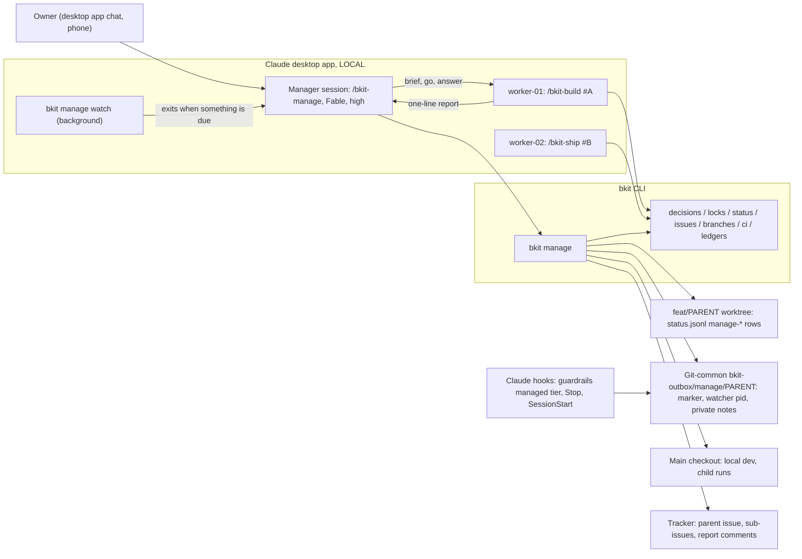

Verdict: PASS
<!-- verdict:end -->

# Design: `/bkit-manage <issue>` — a manager session that drives a parent issue and its sub-issues to closed

## Related Issues

- #924 — Let every workflow land on local dev without pushing (open); design `docs/plans/202611/924-every-workflow-land-design.md`
- #849 — Keep local dev synchronized after workflow close (open)
- #936 — Publish mode and local start base (open)
- #937 — Local landing target with design / plan local close (open)
- #938 — Ship and debug in local mode (open)
- #905 — Model-independent orchestrators (open)
- #1001 — Build: the engine routes the Decision Pause answer (open)
- #1038 — Build: Try again on a red-gate pause re-runs the gate before another fix round (open)
- #958 — Agents and the orchestrator write their own .md files; the engine checks and counts (open)
- #910 — Bookkeeping: the engine keeps what the orchestrator remembers (open)
- #1052 — Builds under machine load: helper timers and gates fail on the load, not on the code (open)
- #324 — Automation triggers: self-healing loop, gates, scoped audits (open)
- #639 — Land parallel workflow closes on dev without colliding (closed)
- #753 — Managed agents (open)

`related-issues.md` recorded `Search unavailable.` (the GitHub MCP returned 401). The list above comes from `gh search issues` and `gh issue view` run on 2026-11-19. The #924 chain (#849, #936, #937) and its titles come from the design spike's `gh issue view` read on 2026-11-19 (`design-spike.md` § Evidence C2).

## Acceptance Scenario

Built from the input's `Draft Acceptance Scenario` (accepted by the owner as Q15 / Q18). Each change is a `Decisions` row (D19-D22, D37, D38).

### Narrative

The owner starts a Claude desktop session on Fable at `high` effort (`claude --model claude-fable-5-2 --effort high`, or the app's model picker) and types `/bkit-manage #N`. Within the first hour they answer one batched round of real questions, while issues that need nothing from them are already building. The run then works through every sub-issue while the owner is away: it prefers `/bkit-*` commands in clean worker sessions and decides for itself when to deviate, recording why on the issue; it answers what it safely can as its own recorded assumption, lands reviewed work one issue at a time, and pushes in batches it sizes itself to save test runs. The owner comes back to a closed #N, or to a short list of decisions only they can make, with every judgement call written down on the issues.

### Success Criteria

1. The opening round asks only questions that `docs/decisions.jsonl`, the issue comments and `.agents/rules.md` § Project Goals do not already answer, ranked by how many builds each blocks; issues with nothing to ask start before the owner replies.
2. After any context reset, the manager carries on from its run records alone (`bkit manage state`); no issue is lost or started twice.
3. Every step with one right answer is a `bkit manage <verb>` or an extended existing command; every deviation (a free-form worker, a worker not cleared or replaced between commands) has an issue comment saying why.
4. No landing reaches `dev` without the review checklist, and the engine refuses to record an assumed accept of a HIGH finding or an unfixable MEDIUM one; every answer a worker receives is recorded as the owner's or the manager's, never confused.
5. Pushes carry as many landed issues as the manager judges safe; each report shows one progress line counted over issues, plus a finish range that narrows as issues land.

### Key Edge Cases

- A worker's question needs the owner while they are away: it is parked with its options and the step each option leads to, and other issues keep moving.
- A worker receives the manager's answer to a pause: the answer is already recorded in the decision file as `Accept (assumed) — by the manager: {reason}` before the worker resumes, so the worker can never write it down as the owner's acceptance; in a managed run no agent session can record an answer as the owner's.
- The manager session dies, is cleared or is replaced: the latest report's "last alive" and "next report by" times show it to the owner, and a new manager session takes the run over with `bkit manage kickoff --resume` without starting any issue twice.
- Another session commits or edits in the main checkout during a landing or push: the landing or push stops, lists the foreign paths and commits, and leaves them untouched; a push never publishes a commit the run did not land without the owner's yes.
- A landing changes files that running builds depend on: the landing's diff is compared with each running build's changed files and step before its next go message.
- A gate is red only on tests already recorded as flaky (`docs/failures.jsonl`, `category: testing`): it is re-run once, and an engine-gap failure does not count toward "two failed runs, then park".
- Clearing or archiving a worker fails, or no clean workers are left: the manager carries on in the same worker, records why, and asks the owner for workers at the fixed points.
- The repo lands locally or through PRs: one landing model is chosen at kickoff and used for the whole run; PR landing is used until the whole local-landing chain (#849, #936, #937, #938) and #924 P4's `bkit fids parse --range` are on `dev`.
- The manager's turn would end with work in flight and no live watcher: the turn is refused until a watcher runs.

### Process Sketch

- WHEN `/bkit-manage #N` starts outside the Claude desktop app or off a local machine → THEN the preflight refuses with the reason; on an effort below `high` it only warns.
- WHEN the opening round has read the sub-issues → THEN it shows the "settled without asking" table and asks the open questions in one batch, while issues with nothing to ask start.
- WHEN a slot frees up → THEN the next issue with no file overlap starts in a worker with a `/bkit-*` brief, or with a free-form brief whose reason is commented on the issue.
- WHEN a worker sends a question → THEN the manager records its own answer as an assumption and tells the worker to go on, or parks the question for the owner while other issues keep moving.
- WHEN a worker finishes a `/bkit-*` command and the issue needs the next one → THEN the manager clears or replaces the worker if it can, and otherwise comments why it did not.
- WHEN every sub-issue is landed or parked → THEN the closing tasks run, the final report is posted, and #N closes only if nothing is parked.

## Reuse & Prior Art

<!-- prettier-ignore -->
| Capability | Prior art | Verdict | Why |
| --- | --- | --- | --- |
| Manager instructions (judgement only) | None. Searched `.bkit/core/workflows/` (five phase workflows and `/bkit-auto`). `/bkit-auto` routes one FID to one phase and is rendered for every host. | `NEW` | No workflow drives other sessions. `/bkit-auto` takes the phase as input and never chooses it (`bkit-auto.md:109`), and it never starts, messages or answers another session, so it lacks the capability rather than merely a contract. New file `.bkit/core/workflows/bkit-manage.md`. |
| One-right-answer chores (`bkit manage <verb>`) | None. Searched `.bkit/core/engine/commands/registry.ts` and `commands/workflow/`. | `NEW` | No noun covers a run over many FIDs. New `.bkit/core/engine/commands/workflow/manage.ts`; every verb composes the existing commands below, so it adds no parallel mechanism. |
| Run records | `status.jsonl` and its fold (`.bkit/core/engine/ledgers/status.ts`); branch placement in `.bkit/core/.bkit/workflows.md` § `status.jsonl`; decision `958-engine-facts-go-to-status-jsonl-md-is-prose-only`. | `EXTEND` | New `manage-*` row types in the parent FID's log, in the manager's own `feat/{PARENT_FID}` worktree, the same placement design and plan use. |
| Private run files | Git-common outbox, `outboxRoot()` in `.bkit/core/engine/commands/lib.ts`; `docs/architecture.md` § Tracker reporting boundary. | `EXTEND` | A `manage/{PARENT_FID}/` folder for the run-active marker, watcher pid and notes that must never be committed. |
| One manager per parent | `bkit locks acquire --kind=workflow` (§ Concurrency lock); liveness in `liveReason` (`locks.ts:251-279`). The spike showed a second `acquire --workflow=manage` against fresh `manage-*` rows exits 0 and reclaims the lock as `orphaned` (`design-spike.md` C10). | `EXTEND` (engine change) | `liveReason` gains a `manage` rule that reads the `active` heartbeat (D17), so a second `/bkit-manage #N` exits 8 with `route: stop` while the first is live. `manage` is added to the `locks acquire` help and to the workflow enums (`worktrees.ts:66`, `tracker.ts:1600`, `summary.ts:23`). |
| Sub-issue list | None in `.bkit/core/engine/commands/workflow/tracker.ts` or `issues.ts` (searched `sub_issue`, `subissue`, `sub-issue`). gh 2.102 has `gh issue view --json subIssues`; Linear `Issue.children` is an `IssueConnection` (`design-spike.md` C11); Jira is unverified (C12). | `EXTEND` | A children read in the existing adapter: GitHub through `gh issue view --json subIssues` (one gh call shape), Linear `children(first: 50)` with paging, Jira JQL `parent = KEY`. Same adapter, same error classes. |
| Size and priority | GitHub Project fields `Size`, `Priority`, `Estimate` on board 1 (`gh project field-list`); the engine reads only `Status` (`issues board`). | `EXTEND` | The board adapter reads the two fields; a tracker without them falls back to the manager's recorded size. |
| Blocked-by links | `bkit issues blocked-by`. | `EXTEND` | Used as is by `manage next`. |
| Third answerer | `bkit decisions apply --by=headless\|owner\|rerun` (`decisions.ts:523-548`), which reads only `build-decision-*.md` (`decisions.ts:87-90`, `:324`); readers key on `^Accept \(assumed\)` (`open-decision.ts:104`, `:150`). | `EXTEND` | `--by=manager` writes `Accept (assumed) — by the manager: {reason}`, which today's readers list unchanged (`design-spike.md` C1: `count: 1`), with the refusal rule in D5. Other workflows' ask points are recorded as in D34. |
| Where each pause option leads | `DECISION_ROUTES` in `.bkit/core/engine/commands/workflow/step-table.ts`; the `decisions route` command proposed in #1001. | `EXTEND` | One lookup function over `DECISION_ROUTES`, shared by #1001's command and `manage`. No second route table. |
| "Please confirm" list | `bkit decisions pending`. | `EXTEND` | Run over every child FID. |
| Test slots | Machine `tests` lock template `scripts/ci/bkit-machine-lock.sh` (copy-and-own, `local_stack_lock_holder` as a sourced function) and `BKIT_TEST_SLOTS` (§ Tests lock). The engine reads only the give-up status file (`lib.ts:170-173`); an unwired repository takes no lock. | `EXTEND` | The lock stays the slot authority. The template gains a `holders` subcommand whose I/O contract is recorded in `.bkit/templates.md`; `manage` reads holders through it. An unwired repository or a copy without the subcommand falls back to `BKIT_TEST_SLOTS` (D8). |
| Landing one issue | `/bkit-ship` in PR mode today. Local landing is the #924 design (`docs/plans/202611/924-every-workflow-land-design.md`), split into #936 (publish mode and start base), #937 (local landing target, `landDirect` on the local target, `advanceLocalDev` stops `edited-files` / `occupied`), #938 (ship and debug local) and P4 (batch-push support), with #849 first. | `EXTEND` | The #924 design is the landing contract. `manage land-check` runs only the checks ship does not do; the landing itself is ship. |
| Batch push | `bkit branches push --mode=dev` (`branches.ts:922-990`), `bkit ci min-push`, the pre-push hook, #924 P4 (`bkit fids parse --range`, absent today: exit 2). | `EXTEND` | `manage push` adds the foreign-commit check, the bookkeeping landing and the child-issue closes around them. It supersedes the #924 design's non-goal of a batch-push command for managed runs only (D35). |
| Bookkeeping commits | `bkit ledgers append`, `bkit ledgers commit`. | `EXTEND` | The manager's rows land as one bookkeeping commit per push batch. |
| Hard limits | `.bkit/core/hooks/guardrails-deny.js` (force push denied), `guardrails-tiers.js` (`--no-verify`, `reset --hard`, secret reads asked), `gateguard-engine.js` (edit hook), `.bkit/shared/.claude/settings.json` deny / ask lists. | `EXTEND` | A managed-run tier that turns the named ask rules into denies and adds `main` / release refs, forced worktree or branch removal and hand edits of ledger files, active while the run-active marker exists, whatever the heartbeat age (D12). |
| Never idle, re-read after a reset | `.bkit/shared/.claude/settings.json` `SessionStart` and `PreCompact` hooks; no `Stop` hook today. Every entry is wrapped `test -f … && node … \|\| true`, so a hook blocks only through JSON on stdout. The spike showed a wrapped `Stop` hook blocks through `{"decision":"block"}` once per stop (`stop_hook_active`), and a `SessionStart` hook on `compact` / `resume` injects context with `CLAUDE_CODE_SESSION_ID` equal to the stdin `session_id`, on the Code tab's `2.1.325` binary run headless (`design-spike.md` C4, C6). | `EXTEND` | A `Stop` entry, a `SessionStart` compact / resume entry and a `SessionEnd` entry, all inert unless the session is the registered manager. |
| Wake-up sources | Background `manage watch`; Claude Code `SendMessage` `notify_when_idle` (v2.1.236+, 12-hour expiry). | `EXTEND` | The watcher stays the wake-up. `notify_when_idle` is a second wake source for idle workers; it cannot see a stalled worker, so it never replaces the watcher. |
| Progress line | `progressLine` renderer (§ Progress Lines). | `EXTEND` | Same bar and rounding, counted over issues, with a finish range. |
| Finish estimate | No estimate function (searched the engine for `estimate`). `.bkit/stats.jsonl` holds measured `outcome` rows: 150 in this repo, 75 for build, each with `time.totalMinutes` and `plan.total.tasks`. | `EXTEND` | The estimate reads the build `outcome` rows from day one (D14); the function lives inside `manage.ts`. |
| Run counters | `counter` rows in `.bkit/stats.jsonl` (`.bkit/jsonl.md`), written by `bkit workflows close`. | `EXTEND` | `manage close` and `manage end` write the run's counters as `counter` rows (D30). |
| Flaky identities | The push gate's JUnit report (`BKIT_TEST_REPORT`, `junit.ts`); `failures.jsonl` testing rows carry no test identity field today; #1052 owns that scope. | `EXTEND` | The re-run takes test identities from the JUnit report and matches them against #1052's test identity field (D40). |
| Report comments | `bkit issues comment` (§ Comment Lifecycle). | `EXTEND` | A report is always a new comment, never an edit of a progress comment (owner decision). |
| Issue mentions | `bkit issues fetch`. | `EXTEND` | `manage mention` prints `#N — title (URL)` from the tracker. |
| Flaky re-run | `failures.jsonl` rows with `category: testing` (§ Categories); #1052. | `EXTEND` | One check, "every red test is a recorded flaky test", shared with #1052's scope. |
| Claude-only install | `renderClaudeAgentsCommands` in `.bkit/core/engine/install/modules/claude.ts`; the per-host renderers in `opencode.ts`, `codex.ts`. No per-workflow host filter exists. | `EXTEND` | A host allow-list on the workflow source that every renderer honours, plus a test that other hosts get no file. |
| Desktop-app and local check | `bkit runtime` classify (`runtime.ts`, `CLAUDE_CODE_REMOTE`). | `EXTEND` | Adds `CLAUDE_CODE_ENTRYPOINT`; seen as `claude-desktop` in this session (see Risks). |
| Closing tasks | `bkit-audit-deferrals.md`, `bkit-audit-testing.md`, `@bkit-utility-update-deferrals`, `@bkit-utility-update-roadmap`, `/bkit-debug`. | `EXTEND` | Each closing task runs an existing template, agent or workflow. |

## Architecture

Two `NEW` components, everything else an extension. The manager owns the loop and every judgement; the engine owns every count, slot, chore, check and rendered fact. The engine never decides what to do next and never writes the manager's words (decision `958-orchestrator-writes-decision-and-error-md-no-error-ledger-row`).



Components and boundaries:

- **`/bkit-manage` workflow** (`NEW`, `.bkit/core/workflows/bkit-manage.md`). Holds only judgement: lane choice per issue, whether to answer a worker or park the question, the review read of a diff, push timing, when to deviate and how to say why, and the shape of every owner question (what it is, why it is the owner's call, options with cost, a recommendation). It is not a numbered step pipeline: it states the loop once ("run `bkit manage state`, act on each due item, keep a watcher running") and one decision rule per kind of due item. Rendered for Claude only.
- **`bkit manage` noun** (`NEW`, `.bkit/core/engine/commands/workflow/manage.ts`, registered in `commands/registry.ts`). Verbs listed in Components / Flows. Each one composes existing commands; the only new logic is the `manage-*` fold, the due list, the file-overlap proposal, the estimate and the report text.
- **Run records** (`EXTEND`). The parent FID gets a normal log, `docs/plans/{YYYYMM}/logs/{PARENT_FID}/status.jsonl`, in the manager's own `feat/{PARENT_FID}` worktree, exactly where design and plan keep theirs. The manager writes no code there; the worktree holds only its records. This keeps every write out of the main checkout's `docs/` tree, where the push hook's tests run and where other sessions commit. Each child keeps its own log; the manager never copies a child's step.
- **Private run files** (`EXTEND`, `<git-common>/bkit-outbox/manage/{PARENT_FID}/`, owner-only `0700`). `active` (manager session id, run token, heartbeat, rules version), `watch.pid`, `inbox.jsonl` (worker lines appended by `manage say`, so the watcher sees a line even when the message itself is held or dropped) and `private.jsonl` for notes that must never reach a commit or a comment (a possible weakness waiting to be told to the owner, an owner answer that quotes one).
- **Landing** (`EXTEND`). `/bkit-ship` runs in a worker. The landing contract is the #924 design (`docs/plans/202611/924-every-workflow-land-design.md`), not a contract restated here. In local mode every child run is briefed with `publish=false`, so design and plan closes land through #937's local landing target instead of pushing, and ship squashes onto local `dev` and never pushes; in PR mode every workflow behaves as today. `manage land-check` runs before ship and `manage push` after a batch.
- **Hooks** (`EXTEND`, Claude hook drivers under `.bkit/core/hooks/` and `.bkit/shared/.claude/settings.json`).
  - The guardrails managed tier applies to every agent tool call in the clone while `active` exists, whatever its heartbeat age. Only `manage close` or `manage end` removes `active` (D12, D26).
  - An unreadable or malformed `active` keeps the tier on (fail closed), and the refusal names the parse error.
  - The `Stop`, `SessionStart` (`compact`, `resume`) and `SessionEnd` entries act only when the hook's `session_id` equals the one in `active`.
  - A manager-session hook event refreshes the heartbeat, as every `manage` verb does (D17).
  - Each refusal line carries the `[bkit-guardrails]` prefix, the parent FID and issue, the manager's last-alive time and the command that ends the run (`bkit manage end`).
- **Logging and counters** (`EXTEND`). `bkit manage` logs on stderr as `[bkit-manage]`; the hook tier logs as `[bkit-guardrails]` (D30).
- **Docs changed with the build.** `docs/observability.md` (§ Signals, § Alerts, § Log Format with a `[bkit-manage]` section and its grep patterns), `.bkit/workflows.md` § Concurrency lock (manage liveness) and § Tests lock (holders), `.bkit/templates.md` (the machine-lock `holders` subcommand), `.bkit/providers.md`, `.bkit/prompts.md` § Orchestrators, `.bkit/cli.md`, and a recovery section in `DETAILS.md` (take over a run, end or abandon a run, supersede a bad row, orphaned workers and the manager's worktree, comments not posting).
- **Tracker adapter** (`EXTEND`). Children read, `Size` / `Priority` field read, new-comment reports, mentions. Reads stay authoritative; writes stay best-effort (§ Tracker Writes Are Best-Effort).
- **Install** (`EXTEND`). A `hosts:` allow-list on the workflow source; OpenCode, Codex, Cursor and Antigravity render no `/bkit-manage` file. `.bkit/providers.md` records the exception and each host's gap with its source (Q3).

Local landing depends on the whole #924 chain, not on ship alone (`design-spike.md` C2): #938 is blocked by #936 and #937, #937 by #936 and #849, and #936 by #849; all five issues are open. What this design takes from the #924 design:

- The frozen publish mode per run (`publish=false` token or `bkit.workflows.{workflow}.publish.local`), so every child workflow lands on local `dev`.
- `landDirect` on the local target for design and plan closes and for the manager's bookkeeping, with `advanceLocalDev`'s `blocked` outcomes (`occupied`, `edited-files`) that leave foreign edits untouched.
- A local ship that leaves its issue open with `bkit:merged` and prints the landed sha as engine output and as a status row in the child's log.
- P4's `bkit fids parse --range`, so a batch push maps CI to each FID.
- Kickoff picks local landing only when all of these are on `dev`; otherwise it picks PR landing for the whole run (D9).

How this fits model-independent orchestrators (#905, issue open question 3): #905 moves judgement out of the five phase orchestrators into the engine, so they can run on any model. `/bkit-manage` is the one orchestrator whose job is judgement across issues, so it runs on the strongest model by design. The two depend on each other in one direction only: every chore #905 moves into the engine (#1001's route command, #910's bookkeeping) is one less thing the manager has to watch a worker do. `.bkit/core/.bkit/prompts.md` § Orchestrators gets one row for `/bkit-manage` (Fable at `high`, set at launch), and its "Fable, by hand" row is corrected to name `/bkit-manage` as the one workflow that runs on Fable.

## Data Model

**Stored: `manage-*` rows** in the parent's `status.jsonl` (append-only, `merge=union`, written only by `bkit manage` verbs and `bkit decisions apply --by=manager`). Only facts no other source holds are stored. A later row with the same identity supersedes an earlier one in the fold; nothing is edited.

<!-- prettier-ignore -->
| Row `type` | Identity | Fields | Written by |
| --- | --- | --- | --- |
| `manage-run` | parent + `event` | `parent`, `event` (`started` \| `adopted` \| `closed` \| `abandoned`), `children[]` (FIDs), `landing` (`local` \| `pr`), `rulesVersion`, `appVersion`, `session` (fingerprint), `reason?`, `at` | `manage kickoff` (`started`), `manage kickoff --resume` (`adopted`), `manage close` (`closed`), `manage end` (`abandoned`) |
| `manage-permission` | `what` | `what` (`file-sub-issues`), `ownerWords` (verbatim), `askedIn` (question id), `at` | `manage record --permission` |
| `manage-child` | `fid` | `fid`, `issue`, `lane` (`direct` \| `design` \| `plan` \| `build` \| `debug`), `size`, `sizeSource` (`tracker` \| `manager`), `priority`, `blockedBy[]`, `at` | `manage kickoff`, `manage record --lane` |
| `manage-question` | `id` | `id`, `blocks[]` (FIDs), `title`, `options[]` (each with its cost), `recommended`, `status` (`open` \| `answered` \| `parked`), `at` | `manage record --question` |
| `manage-settled` | `question` | `question`, `answer`, `source` (decision key, comment URL or Project Goals bullet), `at` | `manage record --settled` |
| `manage-answer` | `question` | `question`, `by` (`owner` \| `manager`), `words` (owner: verbatim; manager: reason), `at` | `manage record --answer` |
| `manage-worker` | `name` + `fid` | `name` (`worker-NN`, never reused), `fid`, `command` (a `/bkit-*` command or `free-form`), `event` (`bound` \| `released` \| `cleared` \| `kept`), `rulesVersion`, `session?`, `reason?`, `comment?` (URL, or `null` while unposted) | `manage worker`; `bound` is written before the manager first messages the worker |
| `manage-heard` | `at` | `worker`, `fid`, `kind` (`question` \| `stop` \| `failure` \| `group-done` \| `done`), `accepted`, `raw?` (only when rejected) | `manage hear` |
| `manage-assumption` | `fid` + `item` | `fid`, `askPoint` (`build-decision` \| `grill` \| `plan` \| `debug` \| `action-needed`), `decisionFile?`, `item`, `answer`, `leadsTo` (step), `reason` | `decisions apply --by=manager`; `manage record --answer --by=manager` for the other ask points (D34) |
| `manage-deviation` | `at` | `fid`, `what`, `why`, `comment` (URL, or `null` while unposted) | `manage record --deviation` |
| `manage-go` | `at` | `worker`, `fid`, `slot` (tests-lock holder name, or `estimated` in an unwired repo), `after` (landing sha it was checked against) | `manage go`, written before the manager sends the go message |
| `manage-landed` | `fid` | `fid`, `sha`, `size`, `startedAt`, `landedAt` | `manage record --landed`, which reads the sha from the child's own log, never from the manager's copy |
| `manage-pushed` | range | `from`, `to`, `fids[]`, `result` | `manage push` |
| `manage-issue-closed` | `fid` | `fid`, `issue`, `result` (`closed` \| `failed`) | `manage push`, after a green push |
| `manage-parked` | `fid` | `fid`, `reason`, `ownerDecision`, `failedRuns` | `manage record --parked` |
| `manage-report` | `id` | `id`, `url` (or `null` while unposted), `reason` (`push` \| `questions` \| `parked` \| `stopped` \| `end`), `lastAlive`, `nextReportBy` | `manage report` (intent, `url: null`), then `manage report --posted` |
| `manage-flaky-rerun` | `at` | `push` (range), `tests[]` (identities), `first`, `second` (results) | `manage push` |
| `manage-stop-overridden` | `at` | `refusals` (count), `inFlight` (what was in flight) | the `Stop` hook, through `bkit manage record` |
| `manage-void` | `line` | `line` (number), `hash` (of the voided line), `reason`, `by` (`manager` \| `owner`) | `manage record --void`; the fold skips the named line |
| `manage-rules` | `version` | `version`, `change` | `manage record --rules` |
| `manage-filed` | `issue` | `issue`, `parent`, `fromDesign` | `manage file` |
| `manage-closing` | `task` | `task` (`deferrals` \| `mock-tests` \| `roadmap`), `status`, `result` | `manage close` |

Validation fails closed on write: a `manage` verb refuses to append a row of unknown type or with missing fields, and exits non-zero naming the field. Reads are lenient (D29):

- `manage state` skips a malformed or unknown line and prints `DEGRADED row {n} skipped: {reason}` as the first line of the briefing.
- The repair is a superseding row, never an edit: `manage record --void --line={n} --reason=…` appends a `manage-void` row carrying the line's hash, and a corrected row follows if one is needed.
- `manage record --void` refuses a line whose hash no longer matches, so a void cannot hit the wrong row after a merge.

The shared `status.jsonl` fold keeps ignoring unknown types, so child logs and other readers are unaffected.

**Derived on every read, never stored:** each child's phase and step (`bkit status resume` on the child's log), open pauses (`openDecision`), each running build's changed files (`git diff --name-only` against its base), slots in use (tests-lock holders; in an unwired repo, `BKIT_TEST_SLOTS` minus `manage-go` rows whose child has not finished, labelled `estimated`), the clean-worker count, the queue order, items owed before a landing, the progress line and the estimate. A stored copy of any of these is the drift that leaves an issue queued after it closed (`One home per fact`).

**Static tracker facts** (titles, URLs, sizes, priorities, blocked-by) are read once at kickoff and re-read only by `manage next --refresh` or when a landing closes an issue, so a wake-up does not fan out one tracker call per child.

**Private files** (`<git-common>/bkit-outbox/manage/{PARENT_FID}/`, `0700`, files `0600`): `active` = `{session, runToken, heartbeatAt, rulesVersion, parent}`; `watch.pid` = `{pid, runToken, startedAt}`; `inbox.jsonl` = `{at, worker, fid, line}`; `private.jsonl` = `{at, kind: "weakness" | "owner-quote", fid, text}`. Never committed, never posted. Cleanup is in Components / Flows § Run lifecycle.

**Estimate inputs** (D14), in order of preference:

1. Measured durations from `manage-landed` rows of this run and earlier manager runs, per size.
2. Build `outcome` rows in `.bkit/stats.jsonl` (`time.totalMinutes`), bucketed by `plan.total.tasks`, for a child that has a plan.
3. A seed table of hour ranges per size in one engine constant (from the v6.3 run: size S about 2 hours; about two builds an hour at three slots; the largest build over 21 hours across two runs), only for a child with no plan and a size with no `manage-landed` rows. `outcome` rows carry no size, so they cannot stand in here.

## Components / Flows

### Verbs against the 14 steps

Verb names are indicative; the plan fixes them, named for what each does (decision `958-agent-writes-engine-counts-verbs-named-for-what-they-do`).

<!-- prettier-ignore -->
| # | Step | Engine | Manager judgement |
| --- | --- | --- | --- |
| 1 | Check the run may start | `manage preflight`: refuses off the desktop app (`CLAUDE_CODE_ENTRYPOINT`), off `LOCAL` (`runtime classify`, with the cloud reason from Q11), with a tracker of `none`, without tracker access, with cross-session inbound messaging off, with the parent lock live, or with an earlier run of the same parent still open (it then names `manage kickoff --resume` and `manage end`); warns when the permission mode is not the class bkit ships (`acceptEdits`), because held messages between sessions of different classes are dropped after 5 minutes; lists open advisories and assumed accepts that expire during the run; picks the landing model (local only when the #924 chain and `fids parse --range` are present); warns when `CLAUDE_EFFORT` is below `high` in the order `low < medium < high < xhigh < max`, or unset (shown as unknown), and prints the launch line. No model check (Q8). | None. |
| 2 | Opening round | `manage kickoff`: reads the parent and its children, writes `manage-run` (`started`) and `manage-child` rows; `manage kickoff --resume` adopts an open run instead (§ Run lifecycle); lists for each candidate question the matching `docs/decisions.jsonl` keys and issue comments; renders the "settled without asking" table and the open questions ranked by builds blocked. Asks the sub-issue permission question (Q5) in the same batch. | Which questions are real; lane per issue; which issues start now. |
| 3 | Memory in files | `manage state`: a fixed-size briefing (live workers, open questions, current batch, last landings, counts for the rest) followed by the due list. | Acts on each due item. |
| 4 | Order and lane | `manage next`: bugs, then blockers, then smaller before larger; drops candidates blocked by an open issue or whose planned files overlap a running build's changed files (an unplanned candidate shows `overlap: unknown`). | Lane, and whether to override the proposal (recorded as a deviation). |
| 5 | Start and feed workers | `manage brief` renders the fact block of a brief (commit to cut from, the `publish=false` token in a local-landing run, files it may and may not change, report points, rules version, the `manage say` lines); `manage worker` binds, releases and counts clean workers, and `manage worker --reconcile --sessions={ids}` compares the sessions the manager can see with the `manage-worker` rows. | The brief's prose; asking the owner for workers when the due list says so. |
| 6 | Never go idle | `manage watch` (background) exits with a reason code (`worker-line`, `slot-free`, `status-change`, `timeout` after 600 s, `watcher-error`) and writes the heartbeat on each wake; it refuses to start while `watch.pid` names a live process with this run's token. `manage say` prints a worker's one-line report and appends it to `inbox.jsonl`; `manage hear` records it. Workers send the line with `SendMessage`; the manager may also pass `notify_when_idle`. Stop hook refuses an idle turn (D13). | None. |
| 7 | Answer workers | `decisions apply --by=manager` for build pauses; `manage record --answer --by=manager` for every other ask point (D34); `decisions pending` over every child for the "please confirm" list; each option printed with the step it leads to. | Take the recommendation, the smallest safe assumption, or park. |
| 8 | Review before landing | `manage review`: the checklist with paths filled in (summary, review reports, new ledger rows, the diff); says when the manager's own read is the only bug review (a build whose challenge was skipped as small). | The read itself. |
| 9 | Land one at a time | `manage land-check` (foreign edits and commits, the landing diff against each running build's changed files and step, checklist done, word ceiling), then `/bkit-ship` in a worker. | Whether a running build may go on after a landing touched its inputs. |
| 10 | Push in batches | `manage push`: foreign-commit check, `ci min-push`, the bookkeeping landing, `branches push` under a tests slot, flaky re-run once (D40), then the close of each child issue in the batch. | When to push (Q12). |
| 11 | Tracker true | `manage mention`, `manage file` (refuses without `manage-permission`; never adds `bkit:auto`), `issues comment`. | Wording of comments. |
| 12 | Word ceiling | `land-check` runs the ceiling check when the repo declares the script; `pnpm bkit:text:ceiling raise` stays the owner's alone, and the guard tier refuses it in every agent session during a run. | None. |
| 13 | Talk to the owner | `manage report`: report text from the records, with the health line; `manage progress`: progress line and estimate. | The plain-English framing of each question. |
| 14 | Close | `manage close`: closing tasks, the final report, parent close only when every child is closed, counters, cleanup (§ Run lifecycle); refuses a green close while an open fix task is owed. `manage end`: ends or abandons an open run (§ Run lifecycle). | Which deferrals were unjustified. |

### Due list (`manage state`)

One line per due item, facts only, never a decision. Examples:

```text
DEGRADED row 412 skipped: unexpected end of JSON
Run: ████░░░░░░ 40% · 8/19 landed · 2 parked · est. finish 18:30-22:10 (measured: S n=6) · alive 14:02 · next report by 15:30
GUARD-OFF since 13:40 manage-run open, active missing
HEARD-REJECTED worker-04 "raw line"
STALLED worker-05 #833 idle=41m step=build:6
GO-UNACKED worker-02 #790 go=13:20 silent=22m
LANDED-UNRECORDED #771 sha=9f8e7d6
WORKER-UNBOUND session=4c1f… brief=#812
UNPOSTED 2 (report r7, deviation #790)
UNCLOSED #765 landed+pushed, issue open
STOP-OVERRIDDEN 13:55 refusals=3
NEEDS-TYPED-PROMPT messaging paused: "keeps answering other sessions"
ASK-WORKERS clean=1 slots=3
START candidates=#812,#790 overlap=none
ANSWER worker-03 #801 Q2 options=[A Fix now -> step 7, B Accept -> step 11, C Stop -> parks]
GO worker-02 #790 slot=free after=a1b2c3d
REVIEW #777 missing=summary,ledger-rows
LANDED-UNPUSHED 5 needs-origin-dev=no
REPORT reason=questions(3)
STALE-BRIEF worker-01 rules=v2 current=v3
```

- `LANDED-UNPUSHED` is a fact; the push decision stays the manager's (Q12).
- `ANSWER` prints each option's target from the shared `DECISION_ROUTES` lookup.
- `STALLED` fires when a bound child's last status row is older than `WORKFLOW_LOCK_IDLE_S` (1800 s, `locks.ts:42`), the same constant the lock uses, so one definition of "stuck" serves both.
- `GO-UNACKED` fires when a `manage-go` row has no later heard line and no new child status row within 10 minutes.
- `LANDED-UNRECORDED` fires when a child's log shows a landed sha and no `manage-landed` row exists; `manage record --landed` reads that sha from the child's log.
- `WORKER-UNBOUND` and `WORKER-GONE` come from `manage worker --reconcile`.
- `UNPOSTED` lists `manage-report` and `manage-deviation` rows with a `null` URL; the manager retries each on every wake through `bkit issues comment --post`, whose posted-once dedupe stops a second post.
- `UNCLOSED` lists pushed children whose issue close failed; it is retried the same way.
- `GUARD-OFF` fires when a `manage-run` is open but `active` is missing or the hook tier reports it cannot load.
- `NEEDS-TYPED-PROMPT` fires when a send returns `Not delivered: this session keeps answering other sessions`; the manager posts a report asking the owner to type one line.

Every reconciliation item outranks the work items, so a crash between an effect and its row is repaired before anything new starts.

### Flow: a worker asks

1. The worker reaches an ask point (a Decision Pause, a grill question, any owner question) in a FID the run has bound.
2. The engine command that composed the question prints the `manage say --kind=question` line and appends it to `inbox.jsonl`; the worker sends that line to the manager with `SendMessage` and ends its turn, waiting.
3. The watcher sees the new `inbox.jsonl` line and exits `worker-line` (or the message itself starts the manager's turn); `manage hear` records the line; the due list shows `ANSWER` with each option's target step.
4. The manager either records its answer as an assumption (D34: `decisions apply --by=manager --q= --answer=` for a build pause, which writes `Accept (assumed) — by the manager: {reason}` or the chosen route, plus a `manage-assumption` row) and messages the worker "go", or records `manage-question` with `status: parked` and tells the worker to wait.
5. The worker re-reads the decision file or the recorded answer on "go" and resumes at the step the route names (the existing "resume after the answers" path). A message alone never answers a pause.
6. `--by=manager` refuses `Accept` (D5) on:
   - every hard blocker (an item composed with `Recommended: none`);
   - every challenge item whose plan task meta line says `Severity: HIGH` or `CRITICAL`, or `Fixable: false`;
   - every verify gap, because verify gaps carry no severity and the refusal fails closed.
7. `Fix now` stays allowed on all of them, because its fix task keeps the run from closing green until done (the one exception in the limits).

### Ask points by workflow (D34)

Every answer the manager gives is recorded as assumed, by the manager, before the worker resumes:

<!-- prettier-ignore -->
| Ask point | Where the manager's answer is recorded |
| --- | --- |
| Build Decision Pause | The decision file, through `decisions apply --by=manager` (`Accept (assumed) — by the manager: {reason}` or the chosen route). |
| Design grill question | The grill's `Assumed` section, with the text `by the manager: {reason}`, written by the worker from the recorded `manage-answer`. |
| Plan, debug and "Action needed" stops | A `manage-answer` row (`by: manager`) and a `manage-assumption` row naming the ask point; the worker cites the row in its artefact. |
| Ship's Confirm Assumed Items | Never answered by the manager. In a managed run the step defers every item to the owner: it lists them in the next report's "please confirm" list and ship goes on with them still assumed. |

- While `active` exists, the engine refuses `decisions apply --by=owner` in every agent session, so no agent can write an owner acceptance during a run.
- The owner confirms deferred items, and accepts any item the manager may not accept, by running the line the report prints (`bkit decisions apply --by=owner …`) in his own terminal.
- `decisions pending` and the report tell a manager assumption from a headless one by the `by the manager:` text after the dash and by the `manage-assumption` row; `open-decision.ts` gains a `by` field parsed from that text, with no change to the prefix match.

### Parent issue with its own work

The manager holds the workflow lock on `PARENT_FID`, so a worker's `/bkit-*` run on the parent's own FID is refused with exit 8. Work the parent itself needs is listed in the opening round and, with the Q5 permission, filed as a sub-issue.

### Observability (D30)

- **Log prefixes.** `bkit manage` writes diagnostics on stderr as `[bkit-manage]`; the managed hook tier as `[bkit-guardrails]`. Every line carries the parent FID.
- **Grep patterns** recorded in `docs/observability.md` § Log Format:
  - `[bkit-manage] guard off` (a `manage-run` is open and `active` is missing or unreadable);
  - `[bkit-manage] heartbeat stale` (over 1800 s);
  - `[bkit-manage] degraded row` (a skipped line in the run records);
  - `[bkit-manage] push stopped: foreign commit`;
  - `[bkit-manage] report unposted`;
  - `[bkit-manage] watch exit {reason}` (`worker-line`, `slot-free`, `status-change`, `timeout`, `watcher-error`);
  - `[bkit-guardrails] managed run {PARENT_FID} refused`.
- **Counters.** `manage close` and `manage end` write `counter` rows to `.bkit/stats.jsonl`: context resets survived, rejected worker lines, assumptions, deviations, flaky re-runs, push reds, parked issues, takeovers and stop overrides.
- **Command journal.** The read-only and high-frequency verbs (`state`, `watch`, `say`, `hear`, `progress`) write no `engine-call` rows, so the parent log does not grow by hundreds of rows a day. The plan reads the journal seam in `.bkit/core/engine/ledgers/journal.ts` before building this.
- **Completeness.** `bkit completeness check` and the CI status-hole sweep skip `manage` runs, which have no numbered steps; the write validation and the lenient fold in Data Model check them instead.
- **Docs.** `docs/observability.md` § Signals gains the `manage-*` rows, the due list, the heartbeat, the guard state, the report comments, `private.jsonl` and `HEARD-REJECTED`; § Alerts gains the report triggers, `GUARD-OFF` and a stale "next report by".

### Flow: land and push

1. A build finishes; the due list shows `REVIEW`; the manager reads what `manage review` lists, then the diff.
2. `manage land-check` passes → the manager briefs a worker with `/bkit-ship` in the run's landing model (`publish=false` for local, or PR mode); ship prints the landed sha and writes it in the child's log; `manage record --landed` copies it from there.
3. After each landing, the due list shows every running build whose changed files or step the landing touched; the manager judges each before its next `GO`.
4. At a push: `manage push` lists commits on local `dev` missing from `origin/dev`; any commit not named by a `manage-landed` row or the run's bookkeeping stops the push and is listed (see Risks); otherwise it runs `ci min-push`, lands the bookkeeping commit from the manager's worktree through the local landing target (`landDirect`), takes a tests slot and runs `branches push`. A red hook made only of recorded flaky tests is re-run once and audited (D40); any other red stops, is reported, and local `dev` is never rewritten.
5. After a green push, `manage push` closes each child issue in the batch through the tracker adapter (a local ship leaves it open with `bkit:merged`), writes a `manage-issue-closed` row per child and lists any failure as `UNCLOSED`.
6. `manage-pushed` and a report comment follow (Q7).
7. In PR mode each landing is its own PR merge, ship closes its issue as today, and the manager's bookkeeping lands with `bkit branches land` at each report point.

### Flow: context reset

1. The `SessionStart` hook (sources `compact` and `resume`) sees the manager's session id and injects `manage state`.
2. Fallback when the hook does not fire in the desktop app: the workflow's loop starts every turn with `manage state`, and the watcher's exit output begins with the same briefing, so the turn that a wake-up starts has it in front of the manager.
3. Live workers briefed on an older rules version show as `STALE-BRIEF`; the manager messages each.
4. An owner `/clear` changes `CLAUDE_CODE_SESSION_ID`, so the manager-only hooks go inert until the session re-registers with `manage kickoff --resume` (`DETAILS.md` records this).

### Run lifecycle (takeover, end, cleanup)

- **Liveness (D17).** The one liveness source is `active.heartbeatAt`. Every `manage` verb, every watcher wake (at most every 600 s) and every manager-session hook event refreshes it. `liveReason` reads it for workflow `manage`: under 1800 s (`WORKFLOW_LOCK_IDLE_S`) the lock is live and a second `acquire` exits 8 with `route: stop`.
- **Session check.** A `manage` verb run from a session other than `active.session` refuses with exit 8 and names `manage kickoff --resume`, so an old manager that wakes after a takeover cannot act.
- **`manage kickoff --resume` (adopt).** Allowed when the heartbeat is older than 1800 s, or when `active.session` matches the caller (a resumed or cleared session re-registering). It rewrites `active.session` and the run token, writes `manage-run` `adopted` with the old and new session, re-reads state, and runs `manage worker --reconcile`. Whether the owner may take over at once, before the 1800 s pass, is an open question.
- **`manage end` (end or abandon).** Writes `manage-run` `abandoned` with a reason, posts a final report, writes the counters, removes `active` and `watch.pid`, and releases the lock. The guard tier refuses it in every agent session except the registered manager, and the manager runs it only on an owner answer recorded as a `manage-answer` row; the owner can always run it from his own terminal.
- **`manage close`.** After the final report: writes `manage-run` `closed`, writes the counters, removes `active` and `watch.pid`, releases the lock.
- **`private.jsonl`.** Kept after close or end until the owner confirms he has read it (`manage end --private-read`), then deleted.
- **The manager's worktree.** `feat/{PARENT_FID}` and its branch are removed through the existing guarded worktree cleanup once the last bookkeeping commit is on `origin/dev`.

### Talking to the owner when the manager may be dead

- Every report and the progress line carry "last alive" (the heartbeat) and "next report by" (the latest time a Q7 trigger is expected: the high end of the earliest running build's estimate). It adds no report trigger beyond Q7. A latest comment past its "next report by" time is the alarm.
- The `SessionEnd` hook and a `Stop` hook that lets a turn end with work in flight (D13) each post one best-effort "manager stopped at {time}, reason {reason}" report (`reason: stopped`).
- A crash, a sleep or a hang fires no hook; the stale "next report by" time is then the only signal.
- When a report or deviation comment fails to post, the manager prints its text in chat, keeps the row with `url: null` and retries at each wake (`UNPOSTED`).

### Estimate and progress (issue open question 8)

- Before any landing: for each open child, the low and high hours from the best source in Data Model § Estimate inputs (`outcome` rows by plan task count for a planned child, else the seed table by size); sum, divide by the slot count, floor at the longest blocked-by chain; the label names the source (`stats n=…` or `seed`).
- After landings: each size's range is replaced by the measured spread of `manage-landed` durations for that size (this run first, then earlier manager runs), so the range narrows as issues land; the label names the source and count.
- A child with no tracker size gets the manager's size from `manage-child`, labelled `manager-sized`.
- The progress line counts issues (`landed + parked` over `children`), uses the same ten-cell bar and rounding as § Progress Lines, and caps at 99% until the close.

### Reports (Q7, issue open question 9)

A new comment on the parent at each push batch, whenever a batch of questions waits for the owner, when an issue is parked, and at run end; the link goes in chat. Each report: the progress line (with "last alive" and "next report by"), one health line, landed, parked and why, open questions in the owner-question shape, issues filed, every assumption (with who made it: manager or headless) and deviation with its comment link, and the count of flaky re-runs. A possible weakness appears only as "told to the owner privately"; its text lives in `private.jsonl` and in chat. `manage report` never reads `private.jsonl`, so no report can carry its text.

Triggers that fire in the same manager turn fold into one comment. The health line is derived on read:

```text
Health: heartbeat 3m · guard on · watcher live (pid 4411) · tests lock: worker-02, worker-05 · landed-unpushed 4 · oldest open question 52m
```

A failed post is printed in chat and retried (`UNPOSTED`).

### Closing tasks (Q6, Q17)

Run once, when every child is landed or parked, before the last push: `bkit-audit-deferrals.md` over the run's deferrals (unjustified ones become work or a parked item); `bkit-audit-testing.md` over each landed child (a child whose tests are all mocks is routed to `/bkit-debug`); `@bkit-utility-update-roadmap` so `docs/roadmap.md` names the best next issue. Their commits ride the final push.

## Decisions

<!-- prettier-ignore -->
| Decided | Alternatives | Why |
| --- | --- | --- |
| D1. Run state = `manage-*` rows in the parent FID's `status.jsonl`, in the manager's own `feat/{PARENT_FID}` worktree; child state read live from each child's log. | A private journal in Git-common (ideate-2 A, ideate-3 A); one mutable JSON snapshot (ideate-1 B, ideate-3 B); the tracker as state (ideate-1 C, ideate-3 C); rows in the main checkout's `docs/` (ideate-2 B). | Decision `958-engine-facts-go-to-status-jsonl-md-is-prose-only` puts engine facts in `status.jsonl`. The worktree placement is the one design and plan already use, and it removes the reason ideate-2 and ideate-3 gave for leaving `status.jsonl`: no write touches the main checkout's `docs/` while the push hook's tests run there or while other sessions commit there. Append-only with `merge=union` keeps every earlier fact when a later write fails. A snapshot loses updates and needs migrations; the tracker is best-effort and public. |
| D2. Only notes that must never be published (a possible weakness, an owner answer quoting one) go to `<git-common>/bkit-outbox/manage/{PARENT_FID}/private.jsonl`, owner-only. | Everything private (ideate-3 A); everything committed. | `docs/security.md` § Public repo content forbids committing exploitable details; `docs/architecture.md` § Tracker reporting boundary already splits authoritative checkout records from private outbox state. The split follows that boundary, so it is not a second home for the same fact. |
| D3. Store only facts no other source holds; derive steps, pauses, slots, changed files, queue, progress and estimate on every read. | Store them for speed. | A stored copy goes stale across a context reset and starts an issue twice or never lands it (`One home per fact`). Static tracker facts are read once at kickoff to keep wake-ups cheap. |
| D4. `bkit manage state` prints a fixed-size briefing and a due list of facts; it never decides. | Toolbox verbs with the loop's rules in the prompt (ideate-1 A, ideate-2 B); an engine-owned loop. | `Checks over instructions` and `Engine over agents`: the rules that did not hold as brief text in the v6.3 run become computed due items. The owner rejected an engine that owns the loop, so push timing and lane stay as facts for the manager to judge. Bounded output keeps the briefing cheap across about 14 resets a day. |
| D5. Third answerer = `bkit decisions apply --by=manager`, recorded the way `--by=headless` records an assumption, as `Accept (assumed) — by the manager: {reason}`, with a `manage-assumption` row. It refuses `Accept` on every hard blocker, on every challenge item whose plan meta line says `Severity: HIGH` or `CRITICAL` or `Fixable: false`, and on every verify gap; `Fix now` stays allowed. | The literal `Accept (assumed, by the manager)`; adding `severity` and `fixable` fields to `decisions compose` items; a manager-only decision format; the manager writes `Decision:` lines by hand. | The spike showed `decisions pending` lists 0 items for `Accept (assumed, by the manager) — …` and 1 for `Accept (assumed) — by the manager: …` (`design-spike.md` C1), so the kept prefix needs no reader change for pending, the build summary or ship's confirm list. The refusal reads markers that exist today (`Recommended: none` for hard blockers, the challenge meta line parsed in `challenge.ts:95-180`); verify gaps have no severity, so the refusal fails closed on them. `Fix now` is the one exception the limits allow, because its fix task keeps the run from closing green. If #958 moves decision lines into status rows first, `--by=manager` writes wherever `--by=headless` writes. |
| D6. Each pause option prints the step it leads to, from one lookup over `DECISION_ROUTES`, shared with #1001's `decisions route`. | The manager reads the workflow text; a second route table in `manage`. | The v6.3 run overrode a Stop with Try again and looped; #1001 already names `DECISION_ROUTES` as the only route table. |
| D7. Worker reports are engine-printed (`manage say`) and engine-recorded (`manage hear`); a malformed line is recorded as rejected and shown first in the due list. | Free text read by the manager. | A question lost to a typo stalls an issue silently; the fixed one-line form is the input's step 6. |
| D8. The machine `tests` lock is the slot authority; `manage go` hands out go messages against its holders, read through a `holders` subcommand of the copy-and-own `scripts/ci/bkit-machine-lock.sh` (one holder per line: name and since), whose I/O contract is recorded in `.bkit/templates.md`. An unwired repository, or a copy without the subcommand, counts `BKIT_TEST_SLOTS` minus unfinished `manage-go` rows, labelled `estimated`, with an advisory. | A manager-side slot counter as the authority; the engine reading the lock directory's layout. | Two schedulers disagree under load; the lock already spans builds, resumes and the push hook across repositories. The engine reads only the give-up status file today (`lib.ts:170-173`); a script subcommand is the `Stack-agnostic` way to expose a copy-and-own tool, and the layout belongs to the consumer's copy. |
| D9. Landing = `/bkit-ship` in a worker, against the #924 design as the landing contract; kickoff picks one landing model for the run: local only when #849, #936, #937, #938 and #924 P4's `bkit fids parse --range` are all on `dev`, else PR. | A `manage land` adapter that holds the chores until #938 (ideate-2 A); wait for #938; a contract restated here for #938 alone. | The spike showed #938 is blocked by #936 and #937, which depend on #849, all open (`design-spike.md` C2); before #937, `branches land` publishes design and plan closes to `origin/dev`, so a local run would split local `dev` from `origin/dev`. Without P4's range read (`fids parse --range` exits 2 today) a batch push has no per-FID CI mapping. Q10 settles building against ship and blocking nothing: PR mode works today, so nothing waits. An adapter would be a second landing implementation (`Improve over duplicate`). |
| D10. The batch push is `bkit branches push` of local `dev` (a plain push), preceded by a check that every commit on local `dev` missing from `origin/dev` is the run's own landing or bookkeeping; any other commit stops the push and is listed. | Replay the run's commits through `land.ts` (ideate-2 open friction); push whatever local `dev` holds. | `land.ts` states that local `dev` commits missing from `origin/dev` are never pushed as they stand. Replaying would leave local `dev` diverged from `origin/dev`; pushing everything would publish other sessions' work. The check keeps the `land.ts` rule without a second push path. D9's local-only-after-the-chain rule keeps every child landing local, so the plain push stays a fast-forward. |
| D11. The manager's rows and ledger appends live in its worktree and land as one bookkeeping commit per push batch through the local landing target (`landDirect`), plus the final close; in PR mode they land with `bkit branches land` at each report point. | Queue rows in the outbox and append them in the main checkout after the push. | Nothing is ever written into the main checkout's `docs/` during a push, so the v6.3 queue-and-flush rule needs no code. The local target is the #924 design's named route onto local `dev`. |
| D12. Hard limits = a managed-run tier in the shared guardrails hooks, active for every agent tool call in the clone while `active` exists, whatever the heartbeat age: deny pushes or ref updates naming `main` or a release tag, any force (`--force`, `--force-with-lease`, `+refspec`), `--no-verify` and `commit -n`, `git worktree remove --force`, `git branch -D`, edits to `*.jsonl` ledgers outside `bkit ledgers append`, `bkit:text:ceiling raise`, `bkit decisions apply --by=owner`, `bkit manage end` outside the registered manager, and the credential reads the ask tier already names. Argv-parsed, as `guardrails-deny.js` already does. An unreadable `active` keeps the tier on. Only `manage close` or `manage end` removes `active`. | Rules scoped to registered session ids (ideate-2 A); global settings deny; brief text; turning the tier off on a stale heartbeat. | Clone-wide covers every worker with no registration step. Hooks bind agent tool calls only, so the owner's own terminal is unaffected. A global deny would bind every session outside a run, and `--no-verify` needs a hook anyway. A heartbeat goes stale exactly when the manager has died while workers still run, so a tier keyed on it would fail open then, against Q19 ("Hard limits stay hard"); the owner's `manage end` is the release instead. |
| D13. A `Stop` hook refuses to end the manager's turn while work is in flight and no live `manage watch` exists, through `{"decision":"block","reason":…}` on stdout; it blocks only when `stop_hook_active` is false and for at most 3 consecutive turns, then allows the stop, writes `manage-stop-overridden`, shows `STOP-OVERRIDDEN` and posts the stopped report. A `SessionStart` hook for `compact` and `resume` injects `manage state`. A `SessionEnd` hook posts the stopped report. All act only on the session id in `active`. | Sentences in the workflow; an unbounded refusal. | "Never go idle" and "re-read after a reset" are the two failures the v6.3 run hit most. The spike settled the block and the injection on the Code tab's `2.1.325` binary run headless (`design-spike.md` C4, C6); firing inside the Code tab is still open. An unbounded refusal loops and burns tokens when "in flight" is miscounted. The fallback for SessionStart is the first-call rule plus the watcher printing the briefing (Components / Flows). |
| D14. Estimate = a range from measured `manage-landed` durations per size, else build `outcome` rows in `.bkit/stats.jsonl` bucketed by plan task count, else a seed table of hours per size; divided by slots and floored at the longest blocked-by chain; labelled with its source. | A seed table alone; a single date; a model guess; none before the first landing. | Gives the owner a range from the start that firms up, as asked. Measured `outcome` rows exist from day one (75 build rows here); they carry no size, so a child with no plan falls back to the seed table. The 21-hour outlier is why it is a range. |
| D15. Claude-only: a `hosts:` allow-list on the workflow source, honoured by every host renderer, with a test that the other four hosts render no `/bkit-manage` file. `.bkit/providers.md` records the exception and each host's gap with the sources from Q3. | Render a refusal stub on every host. | Q3 and Q9 settle Claude desktop only. A stub adds agent-read text for nothing; the test stops a later parity sweep from "fixing" the exception. |
| D16. The preflight refuses unless `CLAUDE_CODE_ENTRYPOINT` is `claude-desktop`, the runtime is `LOCAL` and cross-session inbound messaging is on; it warns when the permission mode is not `acceptEdits`, and when `CLAUDE_EFFORT` is below `high` in the order `low < medium < high < xhigh < max` or unset (unknown). | Refuse on model too; warn only on surface; a plain string compare on effort. | Q9 and Q11 require refusal. Both variables are set in this design run's own desktop session (names checked 2026-11-19), and the spike's headless runs read `sdk-cli`, which the preflight refuses as intended. A command cannot see the model (Q2), so only the effort can be checked, and Q8 limits that to a warning; `xhigh` and `max` never warn. Inbound off means no worker can ask; mixed permission classes drop held messages after 5 minutes. |
| D17. `/bkit-manage` takes the per-FID lock, writes status rows and posts reports, but is not a numbered step pipeline; its progress line is counted over issues. The lock's one liveness source is `active.heartbeatAt`, read by a `manage` rule in `liveReason` (`locks.ts`): live under 1800 s (`WORKFLOW_LOCK_IDLE_S`); refreshed by every `manage` verb, every watcher wake (timeout 600 s) and every manager-session hook event. | A sixth numbered workflow (ideate-2 C); a step row on every event; the existing liveness rule unchanged. | The 14 duties run at the same time, not in sequence; `bkit status resume` assumes a linear position and § Progress Lines cannot express "8 of 19 landed". The spike showed the existing rule reclaims a fresh manage-only run as `orphaned` (`design-spike.md` C10), so two managers could run one parent. A 600 s watcher timeout keeps the heartbeat well inside 1800 s during quiet hours of building, and one source means the lock and the takeover rule cannot disagree. |
| D18. The manager's brief has an engine-rendered fact block and manager-written prose. | The engine renders the whole brief; the manager writes it all. | Decision `958-orchestrator-writes-decision-and-error-md-no-error-ledger-row`: the engine never writes the orchestrator's words. The facts (cut commit, allowed files, rules version) have one right answer. |
| D19. Acceptance: added the edge case that a worker never records the manager's answer as the owner's. | Draft without it. | The limit "a worker, watcher or app message is never the owner's approval" needs a visible outcome; ideate-3 named provenance as a cross-approach risk. |
| D20. Acceptance: the foreign-commit edge case now also stops a push that would publish another session's commit. | Draft covered only landings. | D10: a batch push of local `dev` is where another session's commit would be published. |
| D21. Acceptance: "the run-state file" became "its run records (`bkit manage state`)"; criterion 1 adds ranking by builds blocked; criterion 4 adds the engine refusal and answer provenance. | Draft wording. | D1 and D3 make the state a fold of rows plus live reads, not one file; ranking and the refusal are input requirements the draft criteria left implicit. |
| D22. Acceptance: the preflight warns on effort only, not model; added the edge cases "PR landing when ship has no local mode" and "an idle turn with no watcher is refused", and a process line for a worker's question. | Draft "on the wrong model or effort it only warns". | D16: no command can read the model. D9 and D13 add outcomes the owner will see. |
| D23. The sub-issue permission is one `manage-permission` row with the owner's words; `manage file` refuses without it and never adds `bkit:auto`; each filed issue is listed in the next report. | Ask per issue; standing permission. | Q5 as settled, made an engine check. |
| D24. Children, size and priority come from the tracker adapter (GitHub children through `gh issue view --json subIssues`); a child with no size gets the manager's recorded size, labelled `manager-sized`. | Size labels only; no estimate without sizes; raw REST `sub_issues` for GitHub. | The GitHub board has `Size` and `Priority` fields, Linear and Jira have their own; none is read today. One gh call shape keeps the adapter uniform; Linear `children` is a paged `IssueConnection` (`design-spike.md` C11). |
| D25. The landing check compares the landing's diff with each running build's changed files and with a configurable list of shared inputs (default: the package manifest and lockfile; bkit's own repo adds `.bkit/core/engine/**` and `dist/**`). | Compare engine files only (the v6.3 lesson as stated). | In a consumer repo the installed engine does not change under a running build; its shared inputs do. `Stack-agnostic` keeps the default free of stack names. |
| D26. A run can be adopted and ended: `manage kickoff --resume` (when the heartbeat is older than 1800 s, or the caller is the session in `active`) writes `manage-run` `adopted` and reconciles workers; `manage end` writes `manage-run` `abandoned`, writes counters, removes `active` and `watch.pid` and releases the lock. The preflight names both instead of only refusing an open run. | Refuse an open run with no way out; let any new kickoff reclaim the run. | A crash, an app update, an owner `/clear` or a new chat otherwise strands the run, orphans the workers and leaves the clone-wide guard on. Tying takeover to the same 1800 s heartbeat limit as the lock keeps one definition of a dead manager. |
| D27. Workers reach the manager with `SendMessage`; `manage say` also appends each line to `<outbox>/manage/{PARENT_FID}/inbox.jsonl`, and `manage watch` exits `worker-line` on a new line there. `notify_when_idle` is an extra wake source, never a replacement. | Rely on the message alone to start the manager's turn; replace the watcher with `notify_when_idle`. | Nothing else gives the watcher a line to see. The documented limits (held messages dropped at 5 minutes across permission classes, the 30-send burst refusal, the 50-message queue) can lose a message; the outbox copy survives them. `notify_when_idle` cannot see a stalled worker. |
| D28. Every report and the progress line carry "last alive" and "next report by"; the `SessionEnd` hook and a bounded `Stop` override post a best-effort "manager stopped" report. | Rely on the manager's own reports; a cloud watcher (excluded by the input). | Every owner signal comes from the manager, so a dead manager is otherwise silent. A latest comment past its "next report by" time is an alarm the owner can read on the phone without any new trigger beyond Q7. |
| D29. Writes are validated fail-closed; `manage state` reads leniently with a `DEGRADED row {n} skipped` banner; a bad line is superseded by a `manage-void` row carrying its hash, never edited. | Fail the whole fold on one bad line; allow hand repair. | `manage state` is the one recovery call after every reset, and hand edits of ledgers are a hard limit. The repo's other read paths already skip malformed lines with a named diagnostic (`[bkit-roadmap]`, `readRunsLenient`). |
| D30. Observability: `[bkit-manage]` and `[bkit-guardrails]` prefixes with grep patterns per failure mode, the parent FID on every hook refusal line, run counters as `counter` rows in `.bkit/stats.jsonl` at close or end, no `engine-call` journal rows from `state`, `watch`, `say`, `hear` and `progress`, manage runs skipped by the completeness check and the status-hole sweep, and `docs/observability.md` § Signals, § Alerts and § Log Format in the change list. | No named prefix; counters as report prose only. | `docs/observability.md` § Log Format requires one bracketed prefix per command noun, because consumer grep alerting keys on it. Counters in `stats.jsonl` reach `bkit stats`. High-frequency journaling would add hundreds of rows a day to every bookkeeping commit; a run without numbered steps would show holes on every sweep. |
| D31. Each side effect has a stated order: `manage-worker` `bound` and `manage-go` are written before the message they record; `manage-report` is written with `url: null` before the post; `manage-landed` is read from the child's log after ship. `manage state` shows `WORKER-UNBOUND`, `WORKER-GONE`, `GO-UNACKED` and `LANDED-UNRECORDED`, ranked above work items. | Write rows after the effect with no reconciliation. | A crash between an effect and its row otherwise starts or ships an issue twice, breaking criterion 2. An intent row plus a reconciliation item turns every crash window into a visible due item. |
| D32. The due list shows `STALLED worker-NN #N idle={min} step={step}` when a bound child's last status row is older than `WORKFLOW_LOCK_IDLE_S` (1800 s). | React only to worker lines and status changes. | A dead session, a refused permission or a gate killed at the tests-lock hold limit sends no line. One constant for "stuck" serves the lock and the due list. |
| D33. `manage-report` and `manage-deviation` allow `url` / `comment` `null`; `UNPOSTED` retries on each wake through `bkit issues comment --post`; the text is also printed in chat. | Treat a failed post as posted; drop the row. | Tracker writes are best-effort, and the GitHub MCP returned 401 in this design run. Criterion 3 needs every deviation on the issue; the posted-once dedupe makes the retry safe. |
| D34. Every ask point records the manager's answer as assumed: build pauses in the decision file, grill questions in the grill's `Assumed` section, plan, debug and "Action needed" stops as `manage-answer` plus `manage-assumption` rows. Ship's Confirm Assumed Items is never answered by the manager: it defers every item to the owner, and while `active` exists the engine refuses `decisions apply --by=owner` in every agent session. | Extend `decisions apply` to every workflow; let the manager answer ship's confirm step. | `decisions apply` reads only `build-decision-*.md`. Ship's confirm step writes `--by=owner --confirm`, so a manager reply there would become the owner's acceptance in `docs/decisions.jsonl`, against Q19 ("a worker/watcher/app message is never the owner's approval"). The refusal makes that impossible; the owner confirms from his own terminal with the line the report prints. |
| D35. `manage push` is a batch-push command for managed runs only, superseding the #924 design's non-goal "a bkit batch-push command" (`715-no-batch-publish-verb`) for that scope; the build appends a `docs/decisions.jsonl` row that records the narrower scope. | Leave every push to the owner, as the #924 design does. | The owner's newer answers settle it: Q12 makes a wave a push batch sized by the manager, and the input requires "the manager doing every push". Outside a managed run the earlier decision stands. |
| D36. `manage watch` exits `watcher-error` on a crash, refuses to start while `watch.pid` names a live process carrying this run's token, and times out after 600 s. | Four exit reasons; a bare pid file. | A crashed watcher must wake the manager so it is restarted; pids are reused, so the run token tells a live watcher from an unrelated process; 600 s keeps the heartbeat inside the 1800 s liveness limit. |
| D37. Acceptance: the manager-answer edge case now names the marker `Accept (assumed) — by the manager: {reason}` and states that no agent session can record an owner answer during a run. | Draft wording `assumed, by the manager`. | D5 (the spike showed the draft literal is invisible to `decisions pending`) and D34. |
| D38. Acceptance: added the edge case "the manager session dies and a new session takes over"; the landing edge case now uses PR landing until the whole #924 chain and P4's range read are on `dev`. | Draft without a takeover outcome; PR landing "whenever ship offers no local mode". | D26 and D28 give the owner a visible outcome for a dead manager; D9 follows the spike's chain evidence. |
| D39. Cleanup: `manage close` and `manage end` remove `active` and `watch.pid`; `private.jsonl` stays until the owner confirms he read it; the `feat/{PARENT_FID}` worktree and branch go through the existing guarded worktree cleanup once the last bookkeeping commit is on `origin/dev`. | Leave the files and worktree for the owner. | A finished run would otherwise leave a clone-wide guard marker and a stale worktree. |
| D40. The flaky re-run takes failing test identities from the push gate's JUnit report (`BKIT_TEST_REPORT`), re-runs only when every one matches a `failures.jsonl` testing row by #1052's test identity field, and writes a `manage-flaky-rerun` row with both results; the report lists the count. | Re-run on any red; re-run without a record. | Without identities the re-run becomes a way to retry real failures (#1052); the row makes each re-run auditable. |
| D41. The parent issue's own work is filed as a sub-issue (with the Q5 permission), because the manager's lock on `PARENT_FID` refuses a worker's `/bkit-*` run on that FID. | Run the parent's work under its own FID. | One lock per FID; the refusal is the existing exit 8. |

## Approaches Considered

<!-- prettier-ignore -->
| Approach | Verdict | Why |
| --- | --- | --- |
| Ideate-1 A: parent `status.jsonl` rows plus a fold over the child runs, thin verbs over existing commands. | `MERGED` | The backbone of the design (D1, D5, D8, D9). Its row placement moved from the main checkout to the manager's worktree, which answers the push-window risk it mitigated with an outbox queue. |
| Ideate-1 B / Ideate-3 B: one mutable run-state snapshot. | `REJECTED` | Copies child facts that go stale, loses updates under concurrent writers, and needs migrations; ideate-3's own mitigations turn it back into an append-only log. |
| Ideate-1 C / Ideate-3 C: the tracker (and git) as the run state. | `REJECTED` | Best-effort writes lose state, every wake-up fans out tracker calls, and private items cannot live in public comments. Kept from it: static tracker facts cached once at kickoff. |
| Ideate-2 A: private event ledger in Git-common plus a `tick` that lists what is due. | `MERGED` | Kept: the due list (D4), the resume hook (D13), the run-scoped guard (D12), the issue-counted progress line. Not kept: the private location for the whole state (D1), `manage land` holding the chores until #938 (D9), and rebuilding state from a report digest (deferred). |
| Ideate-2 B: tracked per-run ledger, chore verbs, the loop's rules in the prompt. | `REJECTED` | The rules that must hold would be sentences again, which the v6.3 run showed failing; its tracked ledger survives through ideate-1 A in a worktree that avoids its `docs/` churn. |
| Ideate-2 C: `/bkit-manage` as a sixth numbered workflow. | `REJECTED` | The duties are concurrent; linear resume and the step progress line do not fit (D17). Kept from it: the lock, status rows and comment posting. |
| Ideate-3 A: crash-only manager, append-only journal, views derived on read, limits held by hooks. | `MERGED` | Kept as the risk layer: derive-on-read (D3), fail-closed write validation (with a lenient read, D29), bounded briefing, `say` / `hear` (D7), the Stop hook (D13), private notes (D2), argv-parsed limits with a fixture per command. Its journal location gave way to D1, and its stale-heartbeat fallback gave way to a guard that stays on until the run is closed or ended (D12). |

## Trade-offs Accepted

- **Run records in the manager's worktree (D1).** Gain: one home for engine facts as the owner's doctrine requires, committed history for the wave report, no writes in the main checkout during pushes. Sacrifice: one more worktree per run, and the manager's records reach `dev` only with each push batch, so a clone lost between batches loses the unpushed rows (the report comments remain).
- **A due list of facts, not decisions (D4).** Gain: the manager cannot silently skip a rule that fires, and the prompt stays short. Sacrifice: the due-list rules are a second place where policy can sit; each one must stay a fact (a count, a free slot), never a "do this now".
- **Clone-wide limits while a run is open (D12).** Gain: workers are covered with no registration, and the limits hold even when a brief forgets them or the manager dies. Sacrifice: the owner's own agent sessions in the same clone are bound too until the run is closed or the owner runs `manage end` (see Risks).
- **Landing through `/bkit-ship` only (D9).** Gain: one landing implementation. Sacrifice: until #849, #936, #937, #938 and #924 P4's range read all land, a run lands through PRs, so pushes cannot be batched and each landing costs a CI run.
- **Owner-only confirmation during a run (D34).** Gain: no agent can write an owner acceptance. Sacrifice: ship's assumed items and any item the manager may not accept wait for the owner to run one printed line in his own terminal.
- **Verify gaps refused for assumed accept (D5).** Gain: the refusal fails closed where severity is unknown. Sacrifice: more items park or go to `Fix now` than a severity-aware rule would send there.
- **Stopping a push on any foreign commit (D10).** Gain: nothing the run did not land is published without the owner. Sacrifice: a push waits whenever another session committed to local `dev`, until the owner answers.
- **Claude desktop only (D15, D16).** Gain: it runs where the owner measured it works. Sacrifice: the first single-host workflow in bkit, held in place by a test instead of the `Provider parity` rule.
- **A range, not a date (D14).** Gain: honest from the first minute. Sacrifice: wide early ranges because of the 21-hour outlier.

## Risks & Open Questions

Open questions (the four the input left `Open` come first):

- **Where the run keeps its memory (input Open item: run state).** The manager needs a record it can re-read after every context reset. This design keeps it as rows in the parent's own status log, inside a worktree that holds only the manager's records (D1).
  A) Rows in the parent's `status.jsonl` in the manager's `feat/{PARENT_FID}` worktree — follows the owner's "engine facts go in status.jsonl" rule; costs one extra worktree per run.
  B) A private journal in Git's common directory — never touches the checkout; a second home for structured facts, which the owner's rule turns down.
  C) The tracker — visible on the phone; best-effort writes can lose state, and private notes cannot live there.
  Recommended: A — it is the placement design and plan already use, and it keeps every write out of the main checkout during pushes.
  Default if unanswered: A.
- **How the manager answers a worker's pause (input Open item: the third answerer).** The manager must be able to answer a build's pause without its answer ever being mistaken for the owner's (D5, D6).
  A) A third answerer on the existing decision command, `--by=manager`, which writes `Accept (assumed) — by the manager: {reason}` (listed by today's readers), refuses an assumed accept of a hard blocker, a HIGH or unfixable finding or a verify gap, and prints the step each option leads to — one mechanism, enforced limit.
  B) The manager messages the answer and the worker writes it — no engine change; the worker cannot tell the manager from the owner.
  C) A separate decision file kind for the manager — clean separation; a second reader in every place that reads decision files.
  Recommended: A — it extends what `--by=headless` already does and makes the limit an exit code.
  Default if unanswered: A.
- **How the finish time is estimated (input Open item: the estimate).** The owner wants a finish time that firms up as work lands (D14).
  A) A range from hours per size, divided by free slots and floored at the longest chain of blocked issues, replaced by measured hours as issues land — honest early, narrows over the run.
  B) A single time — easy to read; wrong by hours early on.
  C) Nothing until the first landing — never wrong; no answer in the first two hours.
  Recommended: A — it is the only option that answers from the start and gets firmer.
  Default if unanswered: A.
- **What this design needs from local landing (input Open item: the ship contract).** Landing goes through ship (Q10). Local landing for every workflow is the #924 design, and it needs four open issues in order: #849, then #936, then #937, then #938, plus #924 P4's range read for batch pushes. None of them is built yet.
  A) Build against the #924 design, and land through PRs for any run that starts before the whole chain and P4 are on `dev` — nothing waits; early runs cost a CI run per landing.
  B) Make #260 wait for the whole chain — no PR-mode period; contradicts Q10's "nothing is blocked".
  C) Give `/bkit-manage` its own landing command — no dependency; a second landing implementation.
  Recommended: A — it follows Q10 and avoids duplicate landing code.
  Default if unanswered: A.
- **What to do when another session's commit sits on local `dev` at push time.** A batch push publishes everything on local `dev`, including commits the run did not make (D10).
  A) Stop the push, list the commits, and ask the owner in the next report — nothing is published without him; the push waits for his answer.
  B) Push only the run's own commits by replaying them — no wait; local `dev` and `origin/dev` then split, which the v6.3 run showed is painful.
  C) Push everything — no wait; publishes work nobody reviewed.
  Recommended: A — publishing is the owner's call, and the wait costs only the push, not the builds.
  Default if unanswered: A.
- **Whether the limits should also bind the owner's own agent sessions in the same clone during a run.** The guard is clone-wide while a run is live (D12), so an agent session the owner runs beside the manager is refused `--no-verify` too.
  A) Clone-wide — workers are covered with no registration; the owner's side agents are bound for the run (his own terminal is not).
  B) Only sessions the run registered — the owner's side agents stay free; a worker the manager forgot to register is unguarded.
  Recommended: A — an unguarded worker is the failure the v6.3 run hit; the owner keeps his terminal.
  Default if unanswered: A.
- **How to run a whole milestone, which has no issue to comment on.** The input says a milestone can be run as the parent, but reports are comments on the parent issue and FIDs come from issues.
  A) The parent must be an issue; `--milestone=<name>` adds that milestone's open issues to its children — reports have a home; the owner names an umbrella issue.
  B) Allow a bare milestone; reports go to chat only — no umbrella needed; loses the phone-readable record.
  C) The manager files an umbrella issue — automatic; needs an extra owner yes, because issue creation needs one.
  Recommended: A — bkit's tracker already keeps umbrella issues per theme, and it keeps the report record.
  Default if unanswered: A.
- **What the preflight does if the desktop-app signal is missing.** The refusal rests on `CLAUDE_CODE_ENTRYPOINT=claude-desktop`, seen in this session but not documented; an app release could rename it (D16).
  A) Refuse, naming the missing variable — matches Q9; a rename blocks every run until bkit is updated.
  B) Warn and go on — never blocks; a run could start where workers cannot be started.
  Recommended: A — Q9 asks for a refusal, and the message tells the owner exactly what changed.
  Default if unanswered: A.
- **When to ask for the word-ceiling raise this feature needs.** A new workflow and about a dozen verbs add agent-read text; the owner's rule exempts new features from shrinking, but the ceiling gate will still fail, and `pnpm bkit:text:ceiling raise` is his alone.
  A) Ask once, as a single owner question when the build's text is final — one interruption, at a known point.
  B) Shrink other text to fit — no question; breaks the owner's rule that new features are not shrunk.
  Recommended: A — it follows the owner's rule.
  Default if unanswered: A.
- **When a new session may take over a run whose manager stopped.** If the manager crashes or the app restarts, a new session has to adopt the run. The design lets it do so once the old manager has been silent for 30 minutes, so two managers can never act at once (D26).
  A) Only after 30 minutes of silence — two managers can never overlap; after a crash the owner waits up to 30 minutes.
  B) At once when the owner's typed launch line says `resume` — no wait; the engine cannot prove the owner typed it, and a still-live old manager would be locked out only by the session check.
  C) At once, with the old manager's workers paused until the new one reconciles them — no wait, little overlap risk; more engine work.
  Recommended: A — the wait is rare and short next to a day-long run, and it keeps one rule for "dead manager" in the lock and the takeover.
  Default if unanswered: A.
- **What should alert the owner when a decision is waiting.** Reports are posted under the owner's own token, and GitHub usually does not notify people of their own comments (not checked in this run), so his phone may not buzz.
  A) The manager's chat message plus the report link — uses what exists; relies on the desktop app notifying him.
  B) Also `@`-mention the owner's login in the report — may notify; may do nothing under his own token.
  C) A separate bot token for reports — notifies reliably; adds a credential, which `docs/security.md` limits.
  Recommended: A, with the plan's first live task checking whether the app or the tracker notifies; move to C only if neither does.
  Default if unanswered: A.
- **What happens if a worker's message does not wake an idle manager** (`design-spike.md` C3, not yet tested). The design expects a worker's message to start a turn on a manager that is idle apart from its background watcher. Only owner-started Code-tab sessions can test this.
  A) Rely on the outbox copy: `manage say` writes every line to `inbox.jsonl` and the watcher exits on it — works whether or not the message wakes the manager; adds a file write per report.
  B) Rely on the message alone — simpler; a held or dropped message stalls the issue until the 600 s timeout.
  Recommended: A — it is already in the design (D27) and covers both outcomes.
  Default if unanswered: A.
- **What happens if the Stop hook does not fire in the Code tab** (`design-spike.md` C5, not yet tested). The hook blocks correctly on the Code tab's own binary run headless, but firing inside the Code tab is unproven. If it does not fire, nothing stops the manager going idle with work in flight.
  A) Keep the hook and add a backstop: the watcher's `timeout` exit and the workflow's first-call rule restart the loop on the next wake — partial cover; an idle manager with no live watcher still sleeps until the owner types.
  B) Make the plan's first live task a gate: if Stop does not fire, stop the build and ask the owner — no silent gap; delays the build.
  Recommended: B — it is the most common v6.3 failure, so the design should not proceed on an unproven guard.
  Default if unanswered: B.
- **What happens if SessionStart does not fire on compact or resume in the Code tab** (`design-spike.md` C7, not yet tested). The injection and the session-id match work on the Code tab's binary run headless; the Code tab itself is unproven.
  A) Keep the fallback: every turn starts with `manage state`, and the watcher's exit prints the briefing — covers a miss at the cost of one extra call per turn.
  B) Gate the build on a live check, as for Stop — certainty; a delay for a risk the fallback already covers.
  Recommended: A — the fallback is in the design already.
  Default if unanswered: A.
- **What happens if a background task's completion does not wake the manager while a worker is working** (`design-spike.md` C8, measured once in v6.3, not documented). The watcher is then not a wake-up at all, and only a worker's message or the owner can wake the manager.
  A) Gate the build on a live check in the plan's first task — certainty; delays the build.
  B) Add worker messages as the only wake-up when the check fails: every worker sends a line at each report point — no new mechanism; long builds leave the manager asleep for hours.
  Recommended: A — the whole unattended loop rests on this wake-up.
  Default if unanswered: A.
- **What happens if messaging pauses with "keeps answering other sessions"** (`design-spike.md` C9, not yet tested). The app may stop delivering messages until the owner types a prompt, which breaks the "away all day" promise.
  A) Detect it, show `NEEDS-TYPED-PROMPT`, and post a report asking the owner to type one line — honest; the run waits for him.
  B) Also budget exchanges per typed prompt and slow the manager down as the budget runs out — fewer pauses; slower runs, and the threshold is unknown.
  Recommended: A, and measure the threshold in the plan's first live task before adding B.
  Default if unanswered: A.
- **How the Jira children read is verified** (`design-spike.md` C12). The Jira key answered `401 invalid_token`, so listing a Jira parent's children with `parent = KEY` is unproven.
  A) Ship the Jira arm behind a live test that runs once a valid key exists — no delay for GitHub and Linear; Jira children stay unverified until then.
  B) Leave Jira out of the children read until verified; the preflight refuses a Jira parent — no unverified code; Jira users cannot run it.
  Recommended: A — the risk is confined to one adapter arm, and the read is a standard JQL query.
  Default if unanswered: A.

Risks and assumptions:

- **An owner answer cannot be proven by the engine.** Owner answers reach workers only through the manager, and tracker comments post under the owner's token. The engine can make a forged answer auditable (`manage-answer` carries the verbatim words and must follow a recorded question), not impossible. The limit "a message is never the owner's approval" rests partly on the manager's judgement.
- **Hook behaviour in the desktop app is partly verified.** The spike showed, on the Code tab's own `2.1.325` binary run headless, that a wrapped `Stop` hook blocks once per stop and that `SessionStart` injects context on `compact` and `resume` with a matching session id (`design-spike.md` C4, C6). Whether `Stop`, `SessionStart` and `SessionEnd` fire inside the Code tab must be checked live in the plan's first task (open questions above).
- **Documented messaging limits** (Claude Code cross-session and desktop docs), each with its fallback:
  - `Not delivered: this session keeps answering other sessions` needs a typed prompt → `NEEDS-TYPED-PROMPT` and a report asking the owner to type one line.
  - Held messages are dropped at the 5-minute `dialogExpiry` when two sessions' permission classes differ → the preflight warns off `acceptEdits`, and the `inbox.jsonl` copy keeps worker lines.
  - Sends are refused after a burst of 30 → the manager sends one message per due item, and a refused send is retried at the next wake.
  - At most 50 messages are queued → workers send one line per report point, and the outbox copy is the record.
  - The desktop listing shows only the 20 most recently active sessions → the manager addresses workers by the session id in `manage-worker`, not by the listing.
  - Archiving shows an approval card in `acceptEdits` → archiving a worker needs the owner, asked at the fixed points (Key Edge Cases).
- **The desktop-app facts are measured, not documented.** Starting a session only on an owner-typed turn, refusal under Remote Control, unreliable archive, the wake rule and the shared-checkout requirement come from one run, plus the environment variable names from this session. `manage-run` records the app version (`CLAUDE_CODE_DESKTOP_APP_VERSION`), and `DETAILS.md` lists each fact with its date.
- **Open issues change the shapes this design extends.** #958 may move decision lines into status rows, #1001 adds the route command, and #849, #936, #937, #938 add local landing. The plan must re-read each at build time and extend whatever shape is on `dev` then.
- **D35 narrows an earlier owner decision.** The #924 design keeps a batch-push command out of scope (`715-no-batch-publish-verb`); this design adds one for managed runs only, on the owner's newer Q12 answer. The build records the narrower scope in `docs/decisions.jsonl`.
- **An owner `/clear` changes the session id.** The manager-only hooks then go inert until `manage kickoff --resume` re-registers the session; `DETAILS.md` records this.
- **A batch of local landings widens the damage of one bad landing.** A defect the push hook finds sits under every later landing in the batch. `manage push` stops at the first red, reports it and never rewrites local `dev`; batch size stays the manager's judgement (Q12).
- **Machine load.** About three builds at once is the measured limit; the flaky re-run must take only recorded flaky tests as input, or it becomes a way to retry real failures (#1052). It depends on #1052's test identity field on `failures.jsonl` testing rows; until that exists, no red counts as flaky and every red stops the push (D40).
- **Step 14 has no evidence yet.** No wave ended in the v6.3 run; the closing tasks are restartable from `manage-closing` rows, and the first real run's end is their test.
- **Workers waiting on a question count as working for ever.** The app then never wakes the manager on its own; the watcher is the only wake-up, which is why D13 makes it a check.

## Documentation Warnings

Every indexed document this design needed is present and filled in (`.agents/docs.md`, `docs/architecture.md`, `docs/technology.md`, `docs/security.md`, `docs/data-schema.md`, `docs/capabilities.md`). One stale fact:

```jsonl
{"topic":"model registry","gap":".bkit/core/.bkit/prompts.md § Orchestrators 'Fable, by hand' row names claude-fable-5-1 and says no orchestrator pins Fable; the input names claude-fable-5-2 as the newest Fable and this design makes /bkit-manage run on it","recommendedPath":".bkit/core/.bkit/prompts.md","alternativeEvidence":"design-input-1.md § Decided by the owner (Who runs the loop) and Q2; the model id was not probed against the live model list in this run","action":"In the build, probe the live model list, then update the row and add a /bkit-manage orchestrator row with the launch line"}
```
