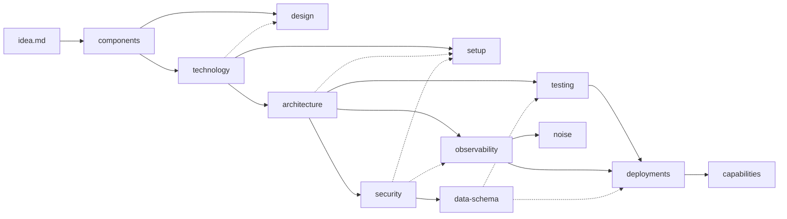

## Session Prompt — this run's, newer than everything below

this has been fixed on dev, bring fix into worktree and then resume workflow

## Issue description — oldest

### Narrative

bkit ships twelve project-doc starters in `.bkit/templates/docs/`: architecture, technology, security, data-schema, testing, deployments, observability, design, noise, setup (moved there by [#864 — Move project docs to templates with adoption warnings](https://github.com/cbartens/bkit/issues/864)), plus components and capabilities. Only `components.md` tells the person or agent adopting it how to fill it in: where to look, numbered steps, completion checks, and "remove this introduction when done". The rest stop at a Purpose line and a few rules. `architecture.md`, `technology.md`, `data-schema.md` and `noise.md` have no body at all. `testing.md` (512 lines) and `deployments.md` (435 lines) are mostly bkit's own best practice, with a short "Project facts to record" list on top.

After this change every starter tells its adopter what to read, what to fill in, in which order, and how to tell it is done. Writing rules that apply to every doc are written once in `.bkit/authoring.md` § Docs, and every starter links to them. One adoption order, starting from the owner's `docs/idea.md`, lives in `.bkit/templates.md`. bkit's best practice stays inside the testing and deployments starters, clearly marked apart from the blanks the project fills. bkit also points adopters at the order: a new `bkit tips` entry, reworded project-doc advisories, and a marker in the upgrade report when a doc starter the project has adopted changes.

The per-starter detail (rules box wording, skeleton headings, sources, completion checks, chart type, wave) is in the doc review comment linked under References, § 3. Where that comment and this body disagree, this body wins.

Decisions settled with the owner on 2026-11-13:

- bkit's best practice stays in the starters. One file holds both the fill-in steps and bkit's advice where it applies, mainly testing and deployments, because bkit's CI depends on them. When an important part of that advice changes, the template changes and bkit can add an advisory or migration then.
- `docs/idea.md` holds the owner's free-form notes on the problem, the users and what the app must and must not do. It stays after `components.md` exists, is not indexed in `.agents/docs.md`, and has no template.
- Each starter's "register this doc" step gives the exact `.agents/docs.md` row, with its Scope cell copied from the starter's Purpose line. A unit test in bkit keeps the two identical.
- Shared writing rules live in `.bkit/authoring.md` § Docs. The adoption order lives in a new `.bkit/templates.md` section. The Mermaid rule covers every file § Docs covers, and applies whenever a doc has a chart; no doc is required to have one.
- #887 includes the `bkit tips` entry, the advisory rewording and the upgrade-report marker.

### Success Criteria

- Every starter in `.bkit/templates/docs/` opens with the same introduction: an opener line, **Fill these first**, **Finish against**, **Where the facts come from**, numbered fill steps, **If it does not apply**, **Completion checks**, and a step giving the exact `.agents/docs.md` row. `capabilities.md` instead names the command that builds it and when to run each. Every hand-written starter has a rules box with **Purpose**, **Not here** and **Update when**, a `##` skeleton with bracketed fields and one `[e.g., …]` row per table, and `## Open questions`. A unit test fails when any starter lacks a part, or when its given row's Scope differs from its Purpose line.
- `.bkit/authoring.md` § Docs holds the shared writing rules, including the Mermaid rule. § Doc Templates says fill-in instructions sit in the template and rules for acting on it live in the prompts, and that project-doc starters carry their own fill-in steps. bkit's own `docs/` copies follow the new rules: the ASCII lane graph in `docs/testing.md` § CI test tiers (the bkit scaffold) is Mermaid.
- `.bkit/templates.md` has one project-docs adoption-order section with the waves table and a Mermaid chart, and names `docs/idea.md`. Each starter's **Fill these first** line matches it. Line 16 no longer says the `bkit tips` order covers project docs.
- In `testing.md` and `deployments.md`, every `##` section is marked either as a project slot to fill or as bkit practice to keep, so an adopter can tell which is which.
- A `project-docs` tip fires exactly when a `project-docs-missing`, `project-docs-empty` or `project-docs-unpopulated` advisory does. Those advisories point at the adoption-order section. The `bkit upgrade` "Templates updated" report marks each changed doc starter whose project copy exists as adopted, to review.

### Edge Cases

<!-- prettier-ignore -->
| Scenario | Expected Behavior |
| --- | --- |
| A project has no database and writes `Not applicable: no persistent store` in `docs/data-schema.md` | `detectProjectDocs` reads it as a candidate, so no `project-docs-unpopulated` advisory and no tip |
| `docs/noise.md` adopted with only the introduction removed (empty table, rules box kept) | Read as a candidate; no advisory, no tip |
| A starter copied to `docs/` unchanged | `project-docs-unpopulated` fires and the `project-docs` tip fires |
| A project still holds a 6.1.x legacy starter | Still flagged through `LEGACY_STARTER_DIGEST_HISTORY`, unchanged by this issue |
| `bkit.advisories.ignore` lists `project-docs-missing` | The `project-docs` tip stays silent for that cause, per the catalogue's advisory-id rule |
| A doc starter changes on upgrade and the project keeps the doc under another path, indexed as `Equivalent to docs/{topic}.md` | The upgrade report marks it as adopted, using the same equivalence `detectProjectDocs` uses |
| A doc starter changes on upgrade and the project has no copy | Listed as `changed:` with no adopted marker |
| A non-doc template changes on upgrade | Listed as today, no adopted marker |
| A chart would need more than about 15 nodes | Split by `subgraph` or into a second chart, per the § Docs rule |

### Derived Test Matrix

<!-- prettier-ignore -->
| Test description | Type | Target file |
| --- | --- | --- |
| starter shape: components | Unit | `.bkit/core/engine/install/project-docs.test.ts` |
| components register row Scope equals its Purpose line | Unit | `.bkit/core/engine/install/project-docs.test.ts` |
| components Fill these first matches the adoption order | Unit | `.bkit/core/engine/install/project-docs.test.ts` |
| starter shape: technology | Unit | `.bkit/core/engine/install/project-docs.test.ts` |
| starter shape: design | Unit | `.bkit/core/engine/install/project-docs.test.ts` |
| starter shape: architecture | Unit | `.bkit/core/engine/install/project-docs.test.ts` |
| starter shape: setup | Unit | `.bkit/core/engine/install/project-docs.test.ts` |
| starter shape: security | Unit | `.bkit/core/engine/install/project-docs.test.ts` |
| starter shape: observability | Unit | `.bkit/core/engine/install/project-docs.test.ts` |
| starter shape: testing | Unit | `.bkit/core/engine/install/project-docs.test.ts` |
| testing marks every section slot or practice and has no box-drawing diagram | Unit | `.bkit/core/engine/install/project-docs.test.ts` |
| starter shape: data-schema | Unit | `.bkit/core/engine/install/project-docs.test.ts` |
| starter shape: deployments | Unit | `.bkit/core/engine/install/project-docs.test.ts` |
| deployments marks every section slot or practice | Unit | `.bkit/core/engine/install/project-docs.test.ts` |
| starter shape: noise | Unit | `.bkit/core/engine/install/project-docs.test.ts` |
| capabilities names rollup and refresh and when to run each | Unit | `.bkit/core/engine/install/project-docs.test.ts` |
| project-docs tip fires when a project doc is missing | Unit | `.bkit/core/engine/checks/tips/catalogue.test.ts` |
| project-docs tip stays silent when every project doc is populated and indexed | Unit | `.bkit/core/engine/checks/tips/catalogue.test.ts` |
| project-docs tip names the three project-docs advisory ids | Unit | `.bkit/core/engine/checks/tips/catalogue.test.ts` |
| missing, empty and unpopulated advisories name the adoption-order section | Unit | `.bkit/core/engine/checks/after/tools.test.ts` |
| changed doc starter with a project copy is marked adopted | Integration | `.bkit/core/engine/install/template-copies.integration.test.ts` |
| changed doc starter indexed under another path is marked adopted | Integration | `.bkit/core/engine/install/template-copies.integration.test.ts` |
| changed doc starter with no copy and changed non-doc template are not marked | Integration | `.bkit/core/engine/install/template-copies.integration.test.ts` |

### Tasks

<!-- bkit:group 1 start -->
### TASK GROUP 1: Shared rules and adoption order
<!-- bkit:task 1 start -->
- [ ] **TASK 1:** Write the shared project-doc writing rules and reword § Doc Templates
  - **UPDATE:** `.bkit/core/.bkit/authoring.md`: § Docs gains the shared rules: diagrams of flow, order, dependency or relationship are Mermaid, while directory trees and command output stay plain text; each chart says in one sentence what its arrows mean, uses node names from the doc's tables, keeps to about 15 nodes, uses only `flowchart`, `sequenceDiagram`, `erDiagram` or `stateDiagram-v2`, quotes every label and sets no colours or `style` / `classDef`; content is current state with no history; facts come from code, config or an approved spec, never from template example text; unknowns go under `## Open questions`; each topic is written once and linked from elsewhere; tables over prose for facts; name the file that holds a value instead of typing the value; `Not applicable: {reason}` is the empty state for a doc that does not apply
  - **UPDATE:** `.bkit/core/.bkit/authoring.md`: § Doc Templates headline "Template is shape, prompt owns rules" reworded to say fill-in instructions sit in the template and rules for acting on it live in the prompts; adds that project-doc starters carry their own fill-in steps because no prompt fills them
  - **UPDATE:** `.bkit/instructions.md`: line 27, the `## Template Instructions` row no longer calls the plan and audit templates "shape-only"
  - **READ:** `.bkit/templates/docs/components.md`: its general writing rules, which move to § Docs in Task 3
  - **DONE WHEN:** § Docs holds every rule listed above; § Doc Templates no longer reads as "no instructions in a template"; `pnpm bkit:lint:prose` passes on both files
  - **TEST FIRST:** n/a — docs
<!-- bkit:task 1 end -->
<!-- bkit:task 2 start -->
- [ ] **TASK 2:** Add the project-docs adoption order to `.bkit/templates.md`
  - **UPDATE:** `.bkit/core/.bkit/templates.md`: new `## Project docs — adoption order` section with the waves table (1 `docs/idea.md`; 2 components; 3 technology, design; 4 architecture, setup; 5 security, testing, observability; 6 data-schema, deployments, noise; 7 capabilities), the Mermaid chart with solid "must exist first" and dotted "finished against" arrows from the doc review comment § 2.2, and the `docs/idea.md` rule (free-form, kept, not indexed, no template)
  - **UPDATE:** `.bkit/core/.bkit/templates.md`: line 16 says the `bkit tips` order covers the tool templates and points to the new section for project docs; § Project documents — starters and the index links to the new section
  - **DONE WHEN:** the section exists with table, chart and `docs/idea.md` rule; line 16 no longer claims the tips order for project docs
  - **TEST FIRST:** n/a — docs
<!-- bkit:task 2 end -->
<!-- bkit:group 1 end -->

<!-- bkit:group 2 start -->
### TASK GROUP 2: Hand-written starters, waves 2 to 4
<!-- bkit:task 3 start -->
- [ ] **TASK 3:** Rewrite `components.md` as the model introduction and add the starter-shape tests
  - **UPDATE:** `.bkit/templates/docs/components.md`: opener line unified for hand-written starters; **Fill these first:** `docs/idea.md`; step 2 reads `docs/idea.md`, the README and any approved spec instead of the other docs; new `## Constraints` section (platforms, offline, live updates, scale, hard external requirements, each naming its source in `docs/idea.md`); open questions under `## Open questions`; general writing rules replaced by a link to `.bkit/authoring.md` § Docs; register step gives the exact `.agents/docs.md` row with Scope = Purpose
  - **UPDATE:** `.bkit/core/engine/install/project-docs.test.ts`: a shared starter-shape check that reads `.bkit/templates/docs/{topic}.md` and asserts every introduction part (opener line, Fill these first, Finish against, Where the facts come from, numbered steps, If it does not apply, Completion checks, register row), the rules box lines (Purpose, Not here, Update when), `## Open questions`, at least one `[e.g.,` row (`noise`: a header-only table instead), the register row's Scope equal to the Purpose line, and Fill these first equal to the topic's prerequisites in `.bkit/templates.md` § Project docs — adoption order. Each later starter task adds its own `starter shape: {topic}` case
  - **DEPENDS ON:** 1, 2
  - **DONE WHEN:** the three components tests pass
  - **TEST FIRST:**
    - `.bkit/core/engine/install/project-docs.test.ts` `starter shape: components` fails on today's starter, which has no Fill these first, Not here or `## Open questions`
    - `.bkit/core/engine/install/project-docs.test.ts` `components register row Scope equals its Purpose line` fails because today's register step gives no row text
    - `.bkit/core/engine/install/project-docs.test.ts` `components Fill these first matches the adoption order` fails because the starter names no prerequisites
<!-- bkit:task 3 end -->
<!-- bkit:task 4 start -->
- [ ] **TASK 4:** Rewrite `technology.md` and `design.md` (wave 3)
  - **UPDATE:** `.bkit/templates/docs/technology.md`: introduction, rules box (never type a version number) and skeleton `## Stack` (Layer, Technology, Version from, Chosen for), `## Conventions`, `## Not used`, `## Open questions`; no chart
  - **UPDATE:** `.bkit/templates/docs/design.md`: introduction; the four hard rules become bracketed defaults the project confirms; the machine-checked token guidance split into fill steps and the two rules that survive adoption; skeleton `## Tokens`, `## Typography`, `## Spacing and layout`, `## Components`, `## Accessibility`, `## Open questions`; Not applicable: no user interface
  - **DEPENDS ON:** 1, 2, 3
  - **DONE WHEN:** `starter shape: technology` and `starter shape: design` pass
  - **TEST FIRST:**
    - `.bkit/core/engine/install/project-docs.test.ts` `starter shape: technology` fails on today's starter, which has no fill-in introduction
    - `.bkit/core/engine/install/project-docs.test.ts` `starter shape: design` fails on today's starter, which has no fill-in introduction
<!-- bkit:task 4 end -->
<!-- bkit:task 5 start -->
- [ ] **TASK 5:** Rewrite `architecture.md` and `setup.md` (wave 4)
  - **UPDATE:** `.bkit/templates/docs/architecture.md`: introduction, rules box, skeleton `## System context`, `## Containers`, `## Package boundaries`, `## Environments`, `## Open questions`; one `flowchart LR` with a `subgraph` per runtime, the same shape the architecture audit draws
  - **UPDATE:** `.bkit/templates/docs/setup.md`: introduction, rules box (never write a secret value), skeleton `## Prerequisites`, `## First-time setup`, `## Environment variables`, `## Local services`, `## Everyday commands`, `## Troubleshooting`, `## Open questions`; no chart
  - **DEPENDS ON:** 1, 2, 3
  - **DONE WHEN:** `starter shape: architecture` and `starter shape: setup` pass
  - **TEST FIRST:**
    - `.bkit/core/engine/install/project-docs.test.ts` `starter shape: architecture` fails on today's starter, which has no fill-in introduction
    - `.bkit/core/engine/install/project-docs.test.ts` `starter shape: setup` fails on today's starter, which has no fill-in introduction
<!-- bkit:task 5 end -->
<!-- bkit:group 2 end -->

<!-- bkit:group 3 start -->
### TASK GROUP 3: Hand-written starters, waves 5 and 6, and capabilities
<!-- bkit:task 6 start -->
- [ ] **TASK 6:** Rewrite `security.md` and `observability.md` (wave 5)
  - **UPDATE:** `.bkit/templates/docs/security.md`: introduction, rules box, skeleton `## Trust boundaries`, `## Authentication`, `## Authorization`, `## Input validation`, `## Rate limiting`, `## Secrets`, `## PII`, `## Supply chain`, `## Open questions`; a `sequenceDiagram` of one authenticated request; § Supply-Chain (GitHub Actions) kept and marked as bkit practice
  - **UPDATE:** `.bkit/templates/docs/observability.md`: introduction, rules box, skeleton `## Signal pipeline`, `## Log format`, `## Correlation`, `## Error tracking`, `## Alerts`, `## Where to look`, `## Open questions`; a `flowchart LR` from app to people
  - **DEPENDS ON:** 3
  - **DONE WHEN:** `starter shape: security` and `starter shape: observability` pass
  - **TEST FIRST:**
    - `.bkit/core/engine/install/project-docs.test.ts` `starter shape: security` fails on today's starter, which has no fill-in introduction
    - `.bkit/core/engine/install/project-docs.test.ts` `starter shape: observability` fails on today's starter, which has no fill-in introduction
<!-- bkit:task 6 end -->
<!-- bkit:task 7 start -->
- [ ] **TASK 7:** Rewrite `testing.md` (wave 5), keeping bkit's practice in place
  - **UPDATE:** `.bkit/templates/docs/testing.md`: introduction; rules box keeps "keep the tiers separate" and adds Not here and Update when; project slots `## Stack`, `## Tiers this project has`, `## Where tests live`, `## Test data`, `## CI lanes`, `## Test reports`, `## Running locally`, `## Open questions`; every existing practice section kept and marked as bkit practice; the ASCII lane graph replaced by a `flowchart LR`, its `needs:` / `if:` notes moved to the lanes table
  - **DEPENDS ON:** 3
  - **DONE WHEN:** both testing tests pass
  - **TEST FIRST:**
    - `.bkit/core/engine/install/project-docs.test.ts` `starter shape: testing` fails on today's starter, which has no fill-in introduction
    - `.bkit/core/engine/install/project-docs.test.ts` `testing marks every section slot or practice and has no box-drawing diagram` fails on today's unmarked sections and the ASCII lane graph
<!-- bkit:task 7 end -->
<!-- bkit:task 8 start -->
- [ ] **TASK 8:** Rewrite `data-schema.md`, `deployments.md` and `noise.md` (wave 6)
  - **UPDATE:** `.bkit/templates/docs/data-schema.md`: introduction, rules box (Pending defined; link a generated schema instead of copying it), skeleton `## Overview`, one `## {table}` section shape, `## Functions`, `## Open questions`; an `erDiagram` of keys and relationships; Not applicable: no persistent store
  - **UPDATE:** `.bkit/templates/docs/deployments.md`: introduction, rules box (dangling "Pre-push checklist" reference at line 11 removed; `--no-verify` line dropped as `.agents/rules.md` owns it), project slots `## Environments`, `## Release path`, `## Secrets and env config`, `## Branch protection`, `## Migrations at deploy time`, `## Rollback`, `## Open questions`; the rollback runbooks kept as bkit practice; every section marked slot or practice; a `flowchart LR` release path
  - **UPDATE:** `.bkit/templates/docs/noise.md`: introduction (Fill these first: observability), one table header `| Date | Signal | Where | Change | Trigger | Why it is safe | Recheck when |` and no rows
  - **DEPENDS ON:** 3
  - **DONE WHEN:** the four tests above pass
  - **TEST FIRST:**
    - `.bkit/core/engine/install/project-docs.test.ts` `starter shape: data-schema` fails on today's starter, which has no fill-in introduction
    - `.bkit/core/engine/install/project-docs.test.ts` `starter shape: deployments` fails on today's starter, which has no fill-in introduction
    - `.bkit/core/engine/install/project-docs.test.ts` `starter shape: noise` fails on today's starter, which has no fill-in introduction
    - `.bkit/core/engine/install/project-docs.test.ts` `deployments marks every section slot or practice` fails on today's unmarked sections
<!-- bkit:task 8 end -->
<!-- bkit:task 9 start -->
- [ ] **TASK 9:** Rewrite the `capabilities.md` introduction (wave 7, generated)
  - **UPDATE:** `.bkit/templates/docs/capabilities.md`: opener line unified for generated starters; prerequisites (code exists, the graphify templates adopted per `.bkit/templates.md`); `pnpm bkit:graph:rollup` builds from the working tree and `pnpm bkit:graph:refresh` from the staged files, and when to run each; what stays hand-maintained (the Overrides block, `scripts/graphify/bkit-graph-drift-rules.json`); the register row; completion checks including the comparison with `docs/components.md`
  - **DEPENDS ON:** 3
  - **DONE WHEN:** the capabilities test passes
  - **TEST FIRST:**
    - `.bkit/core/engine/install/project-docs.test.ts` `capabilities names rollup and refresh and when to run each` fails while the starter names the two commands without saying when to run each
<!-- bkit:task 9 end -->
<!-- bkit:group 3 end -->

<!-- bkit:group 4 start -->
### TASK GROUP 4: Point adopters at the order
<!-- bkit:task 10 start -->
- [ ] **TASK 10:** Add the `project-docs` setup tip
  - **UPDATE:** `SETUP_TIPS` in `.bkit/core/engine/checks/tips/catalogue.ts`: new `project-docs` entry whose `fires` calls `detectProjectDocs` and is true when it returns `project-docs-missing`, `project-docs-empty` or `project-docs-unpopulated`; `advisories` names those three ids; `ask` and `steps` point at `.bkit/templates.md` § Project docs — adoption order
  - **UPDATE:** `DETAILS.md`: the templates row for project docs reads the same benefit as the tip and the `.bkit/templates.md` section opener, per the catalogue's text rule
  - **DEPENDS ON:** 2
  - **DONE WHEN:** the three tip tests and the existing catalogue tests pass
  - **TEST FIRST:**
    - `.bkit/core/engine/checks/tips/catalogue.test.ts` `project-docs tip fires when a project doc is missing` fails because no such tip exists
    - `.bkit/core/engine/checks/tips/catalogue.test.ts` `project-docs tip stays silent when every project doc is populated and indexed` fails because no such tip exists
    - `.bkit/core/engine/checks/tips/catalogue.test.ts` `project-docs tip names the project-docs advisory ids` fails because no such tip exists
<!-- bkit:task 10 end -->
<!-- bkit:task 11 start -->
- [ ] **TASK 11:** Point the project-doc advisories at the adoption order
  - **UPDATE:** `detectProjectDocs` in `.bkit/core/engine/checks/after/tools.ts`: the `action` text of `project-docs-missing`, `project-docs-empty` and `project-docs-unpopulated` names `.bkit/templates.md` § Project docs — adoption order
  - **DEPENDS ON:** 2
  - **DONE WHEN:** the advisory test passes
  - **TEST FIRST:**
    - `.bkit/core/engine/checks/after/tools.test.ts` `missing, empty and unpopulated advisories name the adoption-order section` fails on today's action text
<!-- bkit:task 11 end -->
<!-- bkit:task 12 start -->
- [ ] **TASK 12:** Mark adopted doc starters in the upgrade report
  - **UPDATE:** `formatTemplateChanges` in `.bkit/core/engine/install/template-copies.ts`: a changed `docs/{topic}.md` starter whose project copy exists (at `docs/{topic}.md` or an index row `Equivalent to docs/{topic}.md`) gets an "adopted — review your copy" note on its `changed:` line
  - **UPDATE:** `.bkit/core/engine/commands/install/upgrade.ts`: the `formatTemplateChanges` call at line 819 passes the project root so the project copy can be found
  - **READ:** `.bkit/core/engine/install/project-docs.ts`: the topic catalog and `projectDocPath`
  - **READ:** `.bkit/core/engine/checks/after/tools.ts`: how `detectProjectDocs` resolves an indexed equivalent
  - **DONE WHEN:** the three upgrade-report tests pass
  - **TEST FIRST:**
    - `.bkit/core/engine/install/template-copies.integration.test.ts` `changed doc starter with a project copy is marked adopted` fails because no marker exists
    - `.bkit/core/engine/install/template-copies.integration.test.ts` `changed doc starter indexed under another path is marked adopted` fails because no marker exists
    - `.bkit/core/engine/install/template-copies.integration.test.ts` `changed doc starter with no copy and changed non-doc template are not marked` fails if the marker is put on every changed line
<!-- bkit:task 12 end -->
<!-- bkit:task 13 start -->
- [ ] **TASK 13:** Bring bkit's own docs and mirrors in line
  - **UPDATE:** `docs/testing.md`: the ASCII lane graph in § CI test tiers (the bkit scaffold) becomes a Mermaid `flowchart LR`, with a sentence saying what the arrows mean
  - **UPDATE:** `.agents/docs.md`: the `docs/deployments.md` row no longer says "promote after the capstone"; the `docs/data-schema.md`, `docs/testing.md` and `docs/security.md` rows match their docs' Purpose lines
  - **UPDATE:** `.bkit/authoring.md`: refreshed from `.bkit/core/.bkit/authoring.md` with `bkit install`
  - **UPDATE:** `.bkit/templates.md`: refreshed from `.bkit/core/.bkit/templates.md` with `bkit install`
  - **DEPENDS ON:** 1, 2
  - **DONE WHEN:** `bkit check` reports no drift and no ASCII flow diagram remains in `docs/*.md`
  - **TEST FIRST:** n/a — docs and mirror refresh
<!-- bkit:task 13 end -->
<!-- bkit:group 4 end -->

### Open Questions & Assumptions

- **Assumed:** this issue ships in the same release as #864 (v6.2). The post-#864 starter text has never been released (latest tag `v6.1.1`), so it needs no entry in `LEGACY_STARTER_DIGEST_HISTORY` (`.bkit/core/engine/install/project-docs.ts`). If v6.2 is released without #887, add that text's digests before #887 ships, so an untouched v6.2 copy still reads as unpopulated.
- **Assumed:** `components.md` from [#863 — Ship a purpose-based components document template](https://github.com/cbartens/bkit/issues/863) is on `origin/dev`, so Task 3 edits it in place.
- **Assumed:** the opener line becomes "Starter document." for hand-written starters and "Generated document." for `capabilities.md`. No engine code keys on today's "Example document." / "Example output." wording.

### Breaking Changes & Naming

- `formatTemplateChanges` takes an extra input to find project copies; its one caller, `.bkit/core/engine/commands/install/upgrade.ts`, changes in Task 12.
- New tip id `project-docs`. It differs from the advisory ids `project-docs-missing`, `project-docs-empty` and `project-docs-unpopulated`, which the existing "ids are unique and never collide with an advisory id" test checks.
- Starters' opener lines change wording. Projects that already copied a starter keep their copy; the upgrade report marks the change (Task 12).

### Out of Scope

- Moving files between folders, ownership changes and the adoption warnings themselves (done by #864).
- Plan and audit templates in `.bkit/core/docs/templates/`, other than the § Doc Templates headline and `.bkit/instructions.md:27`.
- A template for `docs/idea.md`, and a `docs/idea.md` for bkit itself.
- An advisory that persists until a changed starter is reviewed (needs stored per-copy state).
- Migrations for already-adopted copies. If a later change to bkit's practice in testing or deployments is important enough, it gets its own advisory or migration then.
- Starters stay independent of any app stack; vendor names stay marked as examples.

### References

- [#864 — Move project docs to templates with adoption warnings](https://github.com/cbartens/bkit/issues/864)
- [#863 — Ship a purpose-based components document template](https://github.com/cbartens/bkit/issues/863)
- Doc review comment with per-starter detail: https://github.com/cbartens/bkit/issues/887#issuecomment-6759577165 (§ 3 per-doc review, § 2 adoption order, § 5 defects). Its § 4 recommendation (a managed practice guide per topic) and § 7 decision list are superseded by this body.
- `.bkit/core/.bkit/authoring.md` § Docs and § Doc Templates
- `.bkit/core/.bkit/templates.md` § Project documents — starters and the index
- `.bkit/templates/docs/components.md` (the model introduction)
- `.bkit/core/engine/checks/after/tools.ts` `detectProjectDocs`
- `.bkit/core/engine/checks/tips/catalogue.ts` `SETUP_TIPS`
- `.bkit/core/engine/install/template-copies.ts` `formatTemplateChanges`
- `docs/plans/202611/864-move-project-docs-plan.md`

Priority: High. It shapes how every adopter fills in their project docs, and v6.2 ships #864's move with these starters. Size: L. A full pattern sweep over twelve starters plus three engine changes with tests and bkit's own docs, roughly a week.

## Issue comment — posted 2026-11-09T07:55:38.000Z

### Blocker moved

Following the order agreed in this issue's design interview on 2026-11-09, this issue's body now has a `bkit:blocked-by` block naming [#864 — Move project docs to templates with adoption warnings](https://github.com/cbartens/bkit/issues/864). That block has been removed from #864. `bkit issues blocked-by --issue=887` reports #864 as open, so a build of this issue stops until #864 has landed.

Only that block was added. The body's prose still says this issue comes before #864 ("Why this comes before #864", and the #864 line under References). The design comment above already lists those passages for removal when the design rewrites the body.

## Issue comment — posted 2026-11-10T05:10:33.000Z

# #887 doc review: headers, fill-in instructions and Mermaid

Review of the twelve shipped doc starters (`.bkit/shared/docs/*.md` and `.bkit/templates/docs/*.md`) as they are on `dev` at `2039ba39c`. Nothing was changed. #864 is still open (`bkit:build`), so every file is reviewed where it sits today.

## The short version

1. **Only `components.md` tells an agent how to fill it in.** The other eleven give a purpose line and a few rules. Four of them (`architecture`, `technology`, `data-schema`, `noise`) have no body at all, so an agent has no section headings to fill, no list of where to look and no way to tell when it is done.
2. **Five starters describe bkit, not the project.** `testing`, `deployments`, `observability`, `security` and `setup` have a Purpose line about the project, then a body that is almost entirely bkit's own machinery. An agent filling them has no slot for the project's facts.
3. **#864's plan only rehomes part of that bkit content.** It names destinations for 14 sections. About 30 more sections (listed in § The bkit content #864 does not yet rehome) are bkit's recommended practice, which is neither bkit machinery nor project facts. They need a decision before #887 can turn those starters into fill-in skeletons.
4. **Four concrete defects turned up along the way:** a dangling reference in `deployments.md`, two regenerate commands named in `capabilities.md` with no word on which to run, a stale `.agents/docs.md` row for deployments, and index rows that describe different content from the starters' own Purpose lines. Details in § Defects found.
5. **Mermaid fits six of the twelve docs well.** It suits architecture, data-schema, security, testing, deployments and observability. It adds little to technology, design, setup or noise, where a table carries the content better. Forcing a chart into every doc would produce filler.
6. **Adoption starts from the idea and runs in waves.** The owner writes a free-form `idea.md` with no template. It becomes `components.md`, the high-level map of the whole app. Technology is picked from the map, architecture is agreed with that technology, and the rest follow in waves, so that docs which don't read each other can be filled at the same time. The order lives in one new section of `.bkit/templates.md` (§ 2).

---

## 1. Changes that apply to every starter

### 1.1 One fill-in introduction, the same shape everywhere

`components.md` set the pattern. Make every hand-written starter open with the same blockquote, so an agent always knows where to look:

```markdown
> Starter document. Copy it to `docs/{name}.md` and own it. `bkit install` does not write this file and does not overwrite a copy.
>
> **Fill these first:** {docs that must exist before this one starts, e.g. `docs/components.md`, `docs/technology.md`}. Full order: `.bkit/templates.md` § Project docs — adoption order.
>
> **Finish against:** {docs that one section of this doc waits for or is checked against, once they exist}
>
> **Where the facts come from:** {named files, folders and commands for this doc}
>
> **Populate this document:**
>
> 1. Read the docs under **Fill these first** and the sources above.
> 2. {doc-specific steps, each one action}
> 3. Replace every bracketed field and every `[e.g., …]` row with the project's facts, keeping the rules box.
> 4. Record anything you could not confirm under `## Open questions`. Do not guess.
> 5. Check the document against the completion checks below.
> 6. Remove this introduction and its completion checks.
>
> **If it does not apply:** {e.g., the project has no database} → keep the title and rules box, replace the body with `Not applicable: {reason}`, and keep the doc indexed.
>
> **Completion checks:**
>
> - {doc-specific, each one checkable by reading the doc and the code}
```

What each part buys an agent:

- **Fill these first** makes the adoption order local. An agent opening one doc sees what must exist before it starts, without having to find a central list. It lists only that doc's direct prerequisites (the solid arrows in § 2), and links to the full order.
- **Finish against** names the docs that one section waits for (the dotted arrows in § 2). The agent starts now and knows which section to come back to, instead of waiting for the whole chain or guessing that section.
- **Where the facts come from** is the single biggest improvement. Today an agent filling `data-schema.md` has to guess that the migrations folder is the source. Naming the source also stops agents copying the starter's example text in as fact.
- **If it does not apply** gives a deliberate empty state. Without it, an agent asked to fill `design.md` for a CLI project either invents a design system or leaves the starter untouched. #864's warning cannot tell those two cases apart. With a fixed `Not applicable:` line it can.
- **Completion checks** are what makes "done" testable. The `components.md` checks are good because each one can be checked by reading. "Each table has a row for every migration-created table" is checkable. "The doc is complete" is not.

Unify the first line too. `components.md` opens "Example document.", `capabilities.md` opens "Example output." Pick one wording per kind (hand-written vs generated). An agent, and #864's text comparison, can then key on it.

### 1.2 A rules box that says what belongs and what does not

Every rules box opens with `Follow .bkit/authoring.md …` and then varies. Make three lines standard:

- **Purpose:** the question the doc answers, in one sentence, plus who reads it and when. For example: "Which tables, fields and access policies exist in production. Read before any change that touches stored data." Today's Purpose lines list topics ("palette, typography, components…") but do not say what question they answer.
- **Not here:** where the neighbouring topics live. For example, `data-schema.md`: "Why a field exists → `decisions.jsonl`. Who may read it → `security.md`." `architecture.md` already does this ("Operational rules and library lists go in the domain docs"). It is what stops two docs holding one topic, and agents use it constantly when deciding where to write.
- **Update when:** the code change that makes the doc stale. Only `architecture.md` and `components.md` have it. It is what `@bkit-ship-update-docs` and `@bkit-utility-update-documentation` need in order to decide whether a shipped change touches the doc.

Keep the doc-specific invariants after those three (for example, `noise.md`'s "append-only").

**Make the Purpose line and the `.agents/docs.md` Scope cell say the same thing.** They have drifted (see § Defects found). Agents choose which docs to load from the index cell, then judge relevance from the Purpose line. When the two disagree, an agent loads a doc for the wrong reason or skips the right one.

### 1.3 A skeleton with bracketed fields

Follow `components.md`: real `##` headings, tables with their real column headers, one `[bracketed field]` per cell, and one `[e.g., …]` row per table showing a filled example. Three conventions worth writing into the shared rules:

- **Tables over prose for facts.** Agents read and update table rows far more reliably than paragraphs. A paragraph gets rewritten. A row gets edited.
- **Name the file that holds a value; don't type the value in.** Versions, env var lists and table columns all already live in a file. "Next.js, version from `apps/web/package.json`" never goes stale. "Next.js 15.2" does. This rule matters most for `technology.md`, `data-schema.md` and `setup.md`.
- **Same section names across docs for the same job.** Use `## Open questions` in every skeleton (components puts them inside `## Scope`). Use `## Not applicable` as the empty-state convention. One name makes them easy for agents to find and for #864 to count.

A note for #864's "unfilled" check: plain `[` is not a safe marker, because markdown links use brackets. `[e.g.,` and a line that is nothing but a bracketed field are safe.

### 1.4 The Mermaid rule

The issue already settled that diagrams are Mermaid and that the rule lives in `.bkit/authoring.md` § Docs. Suggested wording for the rule, tuned for GitHub rendering and agent use:

- **Use a ```` ```mermaid ```` fence for any diagram of flow, order, dependency or relationship.** Directory trees, command output and file layouts stay plain text blocks.
- **Say what the arrows mean**, in one sentence above the chart, naming which end comes first ("An arrow goes from a lane to the lane that waits for it").
- **Use the same names as the doc's tables and headings.** The table holds the facts and the chart is a view of them. An agent can then check the two against each other. Completion check: every node appears in a table row.
- **Keep it readable: about 15 nodes.** Past that, split by `subgraph` or draw a second chart. A 40-node chart renders on GitHub but nobody can read it.
- **Stick to diagram types GitHub renders reliably:** `flowchart`, `sequenceDiagram`, `erDiagram`, `stateDiagram-v2`. GitHub's Mermaid version lags the latest release, so the experimental ones (`C4Context`, `architecture-beta`, `block-beta`) may show as raw text. For C4-style views, use a `flowchart` with one `subgraph` per boundary.
- **No colours or `style` / `classDef` lines.** GitHub themes Mermaid for light and dark mode itself. Hand-picked colours break one of the two.
- **Quote every label** (`A["Label (with brackets)"]`). Brackets, colons and slashes in an unquoted label are the most common reason a chart fails to render.
- **Check it renders.** The existing documentation audit (`docs/templates/bkit-audit-documentation.md:97`) already renders charts. For a local check, `.bkit/templates.md:750` already shows the `@mermaid-js/mermaid-cli` command.

Per-doc chart suggestions are in § 3. The rule should not require a chart in every doc. It should require Mermaid when there is a chart.

---

## 2. Adoption order

### 2.1 The rule

A doc starts as soon as every doc it reads exists. If it needs another doc only to finish one section, it starts anyway and finishes that section once the other doc exists. Docs in the same wave don't read each other, so separate agents can fill them at the same time.

<!-- prettier-ignore -->
| Wave | Docs | What lets them start here |
| --- | --- | --- |
| 1 | `idea.md` | Needs nothing. The owner's own notes on the problem, who the app is for, and what it should and should not do. No template. |
| 2 | components | Reads the idea. The high-level map of the whole app, including the constraints that drive technology (§ 3.12). |
| 3 | technology, design | Both read only components. Technology is researched and picked from the map's constraints. Design's look, accessibility bar and main screens come from the map's users and journeys. |
| 4 | architecture, setup | Both read technology. Architecture is how the chosen tools fit together. Setup starts from the tools a developer must install. |
| 5 | security, testing, observability | All read architecture, not each other. |
| 6 | data-schema, deployments, noise | Data-schema reads security: the tables and access rules enforce security's roles and personal-data rules. Deployments reads testing (the checks a release must pass) and observability (when to roll back and how to tell it worked). Noise reads observability: every row it holds is a downgraded observability signal (a log level, an error-tracker mute, an alert threshold). It starts as an empty table. |
| 7 | capabilities | Comes after deployments. It is generated from the code, so it can only be built once code exists. |

### 2.2 The chart

A solid arrow means *must exist before this one starts*. A dotted arrow means *this one starts without it, but one section is finished or checked against it*.



The dotted arrows:

- **technology → design:** the colour and spacing variables table waits for technology to pick the styling tool. The rest of design doesn't.
- **architecture → setup:** the local services section (database, queues) is filled once architecture names them.
- **security → setup:** the environment variables table grows as security names secrets.
- **security → observability:** the log format section is checked against security's list of personal data, so none of it gets logged.
- **data-schema → testing:** the test data section (fixtures, seed, a fresh store per tier) is finished against the schema.
- **data-schema → deployments:** the migrations-at-deploy-time section waits for the schema.

Setup's clean-machine completion check ("a person following `## First-time setup` reaches a running app") can only pass once code exists. The rest of setup does not have to wait for it.

### 2.3 Notes

- **The map is checked from both sides.** Each later doc is checked against `components.md` as it is filled. For example, a part of the system that serves no responsibility on the map is a finding (see the checks in § 3.1, § 3.2, § 3.4, § 3.5 and § 3.11). When a later doc finds something the map lacks, the map is updated rather than the other doc bent to fit. `components.md`'s existing "Update when" rule covers that.
- **Some links are not arrows.** Testing and observability are in the same wave and neither needs the other to start, but both check the live app: smoke tests (testing) check it once, right after a release, and alerts (observability) check it all the time. Each doc's **Not here** line points at the other (§ 3.5, § 3.7), so the job is claimed once.
- **`decisions.jsonl` is not in the chart.** It is appended whenever a choice is made, from technology in wave 3 onwards, and technology's **Chosen for** cells point at its entries (§ 3.2). The other ledgers (`knowledge.jsonl`, `failures.jsonl`, `deferrals.jsonl`) fill during work, not adoption.
- **In an existing app**, every wave is read from the code rather than designed, and technology is read from the package manifests rather than chosen. The order still holds, because each doc still reads the ones before it. A map written from the idea and the README can describe what the app was meant to do rather than what it does. `components.md` step 3 (check the main entry points against those sources) is the guard, so it stays.

### 2.4 Where the order is written down

**In a new section of `.bkit/templates.md`**, for example `## Project docs — adoption order`, holding the waves table and the chart above.

- After #864, every starter lives under `.bkit/templates/`, and `.bkit/templates.md` is the file an adopter reads. `components.md` already has a row in § Contract (`.bkit/templates.md:71`) and its own section (§ Component map, line 655).
- `bkit upgrade` refreshes `.bkit/templates.md`, so a change to the order reaches every consumer. An adopted doc is never refreshed, which is why each starter carries only its own **Fill these first** and **Finish against** lines and links to the section instead of copying the full order.

Not in `.bkit/authoring.md` § Docs, which is about how to write a doc, not in what order. Not in `.agents/docs.md`, which is the index agents load docs from while working, not while adopting.

**Related issues this creates:**

- **`.bkit/templates.md:16` says "The adoption order is the `bkit tips` order."** The tips list (`.bkit/core/engine/checks/tips/catalogue.ts`, 32 entries) has no project docs in it, so a separate doc order would contradict that sentence. Reword it to say the `bkit tips` order covers the tool templates, and point to the new section for project docs.
- **#864 has to land first.** Until it does, ten of the starters live in `.bkit/shared/docs/` and are not templates, so a project-docs section in `.bkit/templates.md` would describe files that aren't there yet. #887 is already blocked by #864, so this needs no new dependency.
- **`idea.md` has no template.** The new section is the only place bkit would name it. See decision 2 in § 7.
- **`components.md` needs a constraints section** for technology to be picked from (§ 3.12). Without it, wave 3 has nothing to read.
- **The docs index treats the starters two different ways.** The managed block of the shipped index (`.bkit/core/.agents/docs.md`) has a row for ten starters, whether or not the project has adopted them. It has no row for `components.md` or `capabilities.md`. `components.md` step 10 tells the agent to register it by hand under `Project Documents`, and `capabilities.md` has no registration step at all (§ 3.11). Once all twelve are templates, one rule should cover them. See decision 7 in § 7.
- **Whether `bkit tips` should point at the next doc to fill** is open. See decision 6 in § 7.

---

## 3. Per-doc review

Each entry gives the starter as it is today, what an agent lacks, a proposed rules-box change, the skeleton, the sources and checks, and the chart. The wave from § 2 is in each heading.

### 3.1 `architecture.md` (16 lines), wave 4

**Today:** rules box only. The Purpose line says "integration sketch", which an agent cannot act on.

**Rules box:**

- Purpose: "What the system is made of, where each part runs and how the parts talk to each other. Read before any design or plan."
- Not here: libraries and conventions → `technology.md`. Tables → `data-schema.md`. Release steps → `deployments.md`. What the system is for, in plain words → `components.md`.
- Keep the existing "Update when a package is added or removed, or a boundary shifts."

**Fill these first:** `docs/components.md`, `docs/technology.md`.

**Skeleton:** `## System context` (users and external systems) · `## Containers` (table: Part | Runs on | Responsibility | Talks to | Code location) · `## Package boundaries` (what may import what, and what enforces it) · `## Environments` (table: Environment | Hosting | Data store | Who uses it) · `## Open questions`.

**Sources:** `docs/components.md` (what the parts are for) and `docs/technology.md` (which tools they are built from), then the workspace manifest (for example `pnpm-workspace.yaml`), each package's manifest, the deploy config (for example `vercel.json`, `Dockerfile`), env schema files, the latest architecture audit in `docs/audits/` if one exists.

**Checks:** every deployable unit in the repo appears in `## Containers`. Every container serves at least one responsibility in `docs/components.md`, and one that serves none is listed under open questions. Every container is built from technology listed in `docs/technology.md`. Every external service in the env schema appears in the chart. Each boundary rule names what enforces it, or is listed under open questions as unenforced.

**Chart:** one `flowchart LR` with a `subgraph` per runtime (browser, server, database, third parties). An arrow goes from the caller to what it calls or sends data to, labelled with the protocol. The architecture audit already draws a C4 Context and Container view in Mermaid (`.bkit/instructions.md:12613`). Make the starter's chart the same shape, so the audit can diff the doc against the code instead of redrawing from scratch.

### 3.2 `technology.md` (15 lines), wave 3

**Today:** rules box only.

**Rules box:**

- Purpose: "Which frameworks, libraries and conventions the project uses, and why each was picked. Read before choosing a library or writing new code."
- Add the rule: "Name the file that pins each version. Never type a version number."
- Not here: the full reasoning behind a choice → `decisions.jsonl` (already there). How the chosen tools fit together → `architecture.md`.

**Fill these first:** `docs/components.md`.

**Skeleton:** `## Stack` (table: Layer | Technology | Version from | Chosen for) · `## Conventions` (naming, file layout, error handling, imports; each with a link to the lint rule that enforces it, if one exists) · `## Not used` (libraries deliberately avoided, each with its `decisions.jsonl` link). That last section stops an agent adding a second date library or HTTP client. · `## Open questions`.

**Sources:** for a new project, `docs/components.md` § Constraints, which is what the choices are researched against. For an existing app, every package manifest, lint and format config, `tsconfig` or equivalent, and `decisions.jsonl`.

**Checks:** for a new project, each Stack row's **Chosen for** cell names the constraint in `docs/components.md` or the `decisions.jsonl` entry it was picked for. For an existing app, every direct runtime dependency in the manifests maps to a row or is deliberately left out as minor. No version number is typed into the doc.

**Chart:** none. A table carries this better.

### 3.3 `data-schema.md` (16 lines), wave 6

**Today:** rules box only. The table shape is given as a rule ("`Field | Type | Unique | Notes` table, `Indices` and `Pending`") but not shown. "Pending" is undefined: it could mean unapplied migrations or planned fields. `.agents/docs.md` says the doc covers "functions" too, but the starter does not mention them.

**Rules box:**

- Purpose: "Which tables, fields, access policies, indexes, functions and triggers exist in production. Read before any change that touches stored data."
- Define Pending: "Fields or tables in an approved plan that are not yet migrated, each linking its plan." Or drop it.
- Add the rule: "If a generated schema or type file exists, link it and describe only what it does not show (policies, intent)." This stops a 600-line copy of the generated types that goes stale on the next migration.
- Not here: which roles exist and which data counts as personal → `security.md`. This doc records how the database enforces them.

**Fill these first:** `docs/security.md` (and through it, `docs/architecture.md`).

**Skeleton:** `## Overview` (the chart) · one `## {table}` per table with the field table, `Access policies`, `Indexes`, `Triggers` · `## Functions` · `## Open questions`.

**Sources:** `docs/security.md` (the roles and personal-data rules the access policies enforce), `docs/architecture.md` § Environments (which data stores exist), the migrations folder (for example `supabase/migrations/`), the ORM schema (for example `schema.prisma`), generated types.

**Checks:** every table that a migration creates has a section. Every table has its access policy stated, or says it has none. Every access policy names a role from `docs/security.md`. Every field holding personal data per `docs/security.md` is marked. Nothing describes a column that no migration creates.

**Chart:** one `erDiagram` showing tables and relationships with cardinality, keys only. Field lists stay in the tables so they live in one place. Past about 15 tables, draw one chart per area.

**If it does not apply:** no database → `Not applicable: no persistent store`.

### 3.4 `security.md` (62 lines), wave 5

**Today:** the Purpose line lists the project's auth, validation, secrets and PII. The body is bkit's own: `bkit-cloud.yml` token isolation and the agent prompt-injection threat model. An agent filling it finds no slot for the project's auth design.

**Rules box:** keep "Auth standards live only here". Add "Update when an auth flow, role, secret or trust boundary changes."

**Fill these first:** `docs/architecture.md`. **Finish against:** `docs/data-schema.md` (the PII table's "Where stored" column).

**Skeleton:** `## Trust boundaries` (the chart) · `## Authentication` (how users prove who they are) · `## Authorization` (table: Role | Can | Cannot | Enforced at) · `## Input validation` · `## Rate limiting` · `## Secrets` (table: Secret | Stored in | Used by | Rotation; names only, never values) · `## PII` (table: Data | Where stored | Who can read | Retention) · `## Supply chain` (the project's own CI and dependency rules) · `## Open questions`.

**Sources:** `docs/components.md` (who the users are), `docs/architecture.md` (the trust boundaries between parts), `docs/technology.md` (the auth provider), then in an existing app the auth middleware or provider config, the env schema and CI workflow permissions blocks.

**Checks:** every user type in `docs/components.md` maps to a role. Every role in the code appears in the authorization table, and each row names where it is enforced (route, policy, service). Every secret in the env schema appears in the secrets table, and no value appears anywhere. Once `docs/data-schema.md` exists, every PII row's "Where stored" names a real table.

**Chart:** a `sequenceDiagram` of one authenticated request, from sign-in → token → API → database policy check. Each arrow goes from the sender to the receiver. Sequence suits security better than a flowchart because order matters: the doc has to show where in the sequence each check happens.

**bkit content to move out:** § Untrusted Content & Prompt Injection (#864 maps it to `.bkit/core/.bkit/prompts.md`). § Supply-Chain token isolation is about `bkit-cloud.yml` and is not in #864's map.

### 3.5 `testing.md` (551 lines), wave 5

**Today:** the Purpose line promises "framework choices, naming conventions". The body has neither. It is the bkit CI scaffold, bkit's test-first contract and about 25 sections of testing practice. The rules box itself is mostly bkit's pre-push gate selection. bkit's own `docs/testing.md` already has the project slots this starter lacks (`## Stack`, `## Tiers`, and `## Key test files` from line 553 on). That is the evidence for what the skeleton should be.

**Rules box:**

- Keep "keep the tiers separate".
- Move the pre-push gate order out (it is bkit's mechanism and is in #864's move).
- Not here: ongoing health checks of the live app → `observability.md` § Alerts. Smoke tests here check it once, right after a release.
- Add "Update when a tier, runner, CI lane or test location changes."

**Fill these first:** `docs/architecture.md`. **Finish against:** `docs/data-schema.md` (`## Test data`).

**Skeleton:** `## Stack` (table: Tier | Runner | Config file | Script) · `## Tiers this project has` (which of Static, Unit, Integration, E2E, @live and Smoke exist, each with its gate script, or "not adopted" with the reason) · `## Where tests live` (naming and folder per tier) · `## Test data` (fixtures, seed, how each tier gets a fresh store) · `## CI lanes` (the chart plus a table: Lane | Needs | Runs when) · `## Test reports` (where each lane's results land) · `## Running locally` (commands) · `## Open questions`.

**Sources:** `docs/components.md` § Main journeys, `docs/technology.md` (the runners), `docs/architecture.md` (the parts that need integration tests), then the `bkit:gate:*` and `test:*` scripts in `package.json`, runner configs, the CI workflow (`bkit.testing.ciWorkflow`) and test folders.

**Checks:** every main journey in `docs/components.md` has an E2E test, or is listed under open questions as uncovered. Every `test:*` and `bkit:gate:*` script maps to a tier row. Every CI lane in the workflow is in the lanes table, and the table and the workflow agree on `needs:`. Each tier marked as present has at least one test file in its stated location.

**Chart:** the CI lane graph as a `flowchart LR`. An arrow goes from a lane to the lane that waits for it (`needs:`). It replaces the ASCII box drawing at `.bkit/shared/docs/testing.md:38-68`. The `needs:`/`if:` conditions at the bottom of that block become the lanes table, not chart labels. This is the most useful chart in the whole set, because the ASCII version is unreadable without a monospace font and agents misread its alignment.

**bkit content to move out:** see § 4.

### 3.6 `deployments.md` (541 lines), wave 6

**Today:** same pattern as testing. The rules box points to a "Pre-push checklist" below, and there is none (defect 1). The Purpose line mentions "secrets sync, branch protection", which the body never covers for the project.

**Rules box:** drop "Never use `--no-verify`". It duplicates `testing.md` and `.agents/rules.md` already owns it. Add "Update when an environment, host, release step or rollback step changes."

**Fill these first:** `docs/testing.md`, `docs/observability.md` (and through them, `docs/architecture.md`). **Finish against:** `docs/data-schema.md` (`## Migrations at deploy time`).

**Skeleton:** `## Environments` (table: Environment | Branch | Host | URL | Database) · `## Release path` (the chart) · `## Secrets and env config` (where each environment's config lives and how it is synced; names only) · `## Branch protection` (required checks per branch) · `## Migrations at deploy time` (what applies them and when) · `## Rollback` (a fill-in runbook: when to roll back, preconditions, steps, how to tell it worked; the current Vercel/Supabase runbooks become the `[e.g., …]` content) · `## Open questions`.

**Sources:** `docs/architecture.md` § Environments, `docs/testing.md` § CI lanes (what a release must pass), `docs/observability.md` § Alerts and § Where to look (what is watched after a release and what triggers a rollback), the CI workflows, host config (for example `vercel.json`), `gh api repos/{owner}/{repo}/branches/{branch}/protection`, the env schema.

**Checks:** every environment that receives a deploy is a row. Every required status check that GitHub reports appears under branch protection. The rollback steps name real commands for this project's host, not the example host. The rollback's "when" and "how to tell it worked" each name a real alert or query from `docs/observability.md`, not "check the logs". Any watch-after-release step in the release path names the alerts it watches.

**Chart:** a `flowchart LR` from branch → CI → preview → production. An arrow goes from a stage to the stage it promotes to, and each step is labelled with what gates it. A `stateDiagram-v2` is an alternative if the project has formal release states.

**bkit content to move out:** see § 4.

### 3.7 `observability.md` (22 lines), wave 5

**Today:** two rules about the project (no PII in logs, never block business logic), then a body that is entirely bkit's `/bkit-debug` context-fetch mechanism. The body itself says it is configured in `.agents/context.md`.

**Rules box:**

- Keep both rules.
- Not here: post-release smoke tests → `testing.md`. Signals deliberately turned down (lower log level, muted error-tracker issue, raised alert threshold) → `noise.md`, one row each.
- Add "Update when a log field, signal, drain or alert changes."

**Fill these first:** `docs/architecture.md`. It does not wait for deployments: where each part runs is already in architecture's environments table, and the logging and error tools are in technology. **Finish against:** `docs/security.md` (`## Log format`, checked against the list of personal data).

**Skeleton:** `## Signal pipeline` (the chart) · `## Log format` (fields, levels and when to use each level) · `## Correlation` (how a request id travels) · `## Error tracking` · `## Alerts` (table: Alert | Fires when | Goes to) · `## Where to look` (table: Symptom | Where | Command or query) · `## Open questions`.

`## Where to look` is the section to add even if nothing else changes. `.agents/docs.md` marks observability as always-read in Debug, and `@bkit-debug-failure-diagnose` currently has to rediscover, in every run, where a given failure shows up. A symptom → location → query table answers that directly. Include a row for a failed CI run that points at `docs/testing.md` § Test reports.

**Sources:** `docs/technology.md` (logger and error tracker), `docs/architecture.md` (parts and environments), `docs/security.md` § PII, then the logger setup, error-tracker config (for example `sentry.*.config.ts`), drain config in the host, alert definitions.

**Checks:** every drain and alert destination named in config appears. Each `## Where to look` row has a runnable command or a named dashboard. No field in `## Log format` is on security's personal-data list. Every muted error-tracker issue and every raised alert threshold in config has a row in `docs/noise.md`.

**Chart:** a `flowchart LR`: app → logger → drain → store → alert → people. Each arrow goes from where the data is to where it flows next.

**bkit content to move out:** § Context Fetch belongs in `.agents/context.md` or the managed debug docs. It is not in #864's map.

### 3.8 `design.md` (38 lines), wave 3

**Today:** the rules box sets bkit's own design opinions as hard rules (44×44px targets, WCAG 2.1 AA, Dark Mode for all colours). The body explains how to keep the token table machine-checkable, which is good fill-in guidance written as permanent doc text.

**Rules box:** turn the four hard rules into bracketed defaults the project confirms ("[e.g., contrast meets WCAG 2.1 AA]"). A project without dark mode currently inherits a rule it breaks. Keep "theme tokens only" and the header-row contract.

**Fill these first:** `docs/components.md`. **Finish against:** `docs/technology.md` (`## Tokens`, whose format depends on the styling tool).

**Skeleton:** `## Tokens` (the machine-checked table) · `## Typography` · `## Spacing and layout` · `## Components` (table: Component | Where | Variants) · `## Accessibility` (the project's chosen bar) · `## Open questions`.

**Where today's text goes:** the "keep the gate honest" bullets (select the table by header row, assert each implementation separately, no silent gap, transcribed is not ratified) are instructions for filling and maintaining the table. Split them: the fill steps go in the introduction, and the two that must survive adoption (header row is the contract; mark transcribed rows) go in the rules box.

**Sources:** `docs/components.md` (users, platforms and main journeys), then in an existing app the stylesheet or theme object.

**Checks:** every token in the stylesheet or theme object is a row, or is listed as intentionally undocumented with a reason. Every transcribed row is marked until a person confirms it.

**Chart:** none needed. Optional: a `flowchart TD` of token layers (primitive → semantic → component), only if the project uses layered tokens.

**If it does not apply:** no UI → `Not applicable: no user interface`.

### 3.9 `setup.md` (52 lines), wave 4

**Today:** the Purpose line is right ("for humans"), but the body is bkit's advice on terminals, Ghostty, Tailscale and OpenCode remote access. A consumer's new developer learns nothing about the project.

**Rules box:** keep "seed never runs against remote". Add "Never write a secret value. Name the secret and where to get it."

**Fill these first:** `docs/technology.md`. **Finish against:** `docs/architecture.md` (`## Local services`), `docs/security.md` (`## Environment variables`).

**Skeleton:** `## Prerequisites` (table: Tool | Version from | Install) · `## First-time setup` (numbered steps from clone to a running app) · `## Environment variables` (table: Name | Needed for | Get it from) · `## Local services` (database, queues; start and reset commands) · `## Everyday commands` · `## Troubleshooting` (table: Symptom | Fix) · `## Open questions`.

**Sources:** `docs/technology.md` (the tools to install), then `.env.example`, package scripts, `docker-compose.yml` or local-stack config, the README.

**Checks:** every variable in `.env.example` is a row. Once code exists, a person following `## First-time setup` on a clean machine reaches a running app.

**Chart:** none. Numbered steps read better than a chart for setup.

**bkit content to move out:** all three sections (#864 maps them to `.bkit/core/.bkit/install.md` and `.bkit/core/.bkit/templates.md`).

### 3.10 `noise.md` (20 lines), wave 6

**Today:** good rules, but no entry format, and the file is append-only. Every agent will invent its own entry shape, and append-only means bad shapes are never fixed. Every signal it lists (log levels, error-tracker archives and mutes, alert thresholds) is an observability signal, so it reads observability and nothing else.

**Fill these first:** `docs/observability.md`.

**Skeleton:** keep the rules box. Add one table with its header and no rows: `| Date | Signal | Where | Change | Trigger | Why it is safe | Recheck when |`. The introduction says to keep the header and add rows only when a signal is downgraded.

**Checks:** each row names the exact file and line, issue id or alert. Each row's signal is a log line, error-tracker issue or alert described in `docs/observability.md`, or in the code that `docs/observability.md` points to. Each row states the trigger, not just "noisy".

**Chart:** none.

**Note for #864:** an empty table is this doc's correct adopted state. The "unfilled" check must not warn on a `noise.md` whose only change is the removed introduction.

### 3.11 `capabilities.md` (73 lines, generated), wave 7

**Today:** the introduction says `pnpm bkit:graph:rollup` rewrites the file. The rules box says `pnpm bkit:graph:refresh` does. Both are true, but nothing says which to run when (defect 2). It does not say what must be adopted first (the graphify scripts), and it does not say to register the doc in `.agents/docs.md`, which `components.md` does.

**Introduction:** state the prerequisites (code exists; copy the graphify templates per `.bkit/templates.md`), the one command the adopter runs, what is hand-maintained (the Overrides block, plus capability rules in `scripts/graphify/bkit-graph-drift-rules.json`) and the registration step.

**Checks:** the register is built (not "Not built"). Every `split` and `bypassed` row is budgeted with a note or has an open issue. The register is compared with `docs/components.md`: a capability that serves no component, or a component with no capability behind it, is a finding for one doc or the other.

**Chart:** already generated as Mermaid (packages and modules views). Apply the same about-15-nodes rule to the generator. `MMD_MIN_WEIGHT` (`.bkit/templates.md:734`) is already the knob.

### 3.12 `components.md` (116 lines), wave 2

This is the model for every other starter's introduction, and it is the first doc filled, straight after `idea.md`. Five changes:

- **Step 2 reads the idea, not the other docs.** Today it says "Read the relevant documents listed in `.agents/docs.md`". Make it read `idea.md`, the README and any product guide or approved specification. The other docs are links it adds once they exist. § Related views already marks a missing view as unavailable, so filling it first breaks nothing.
- **Add a `## Constraints` section.** Technology is picked from the map, so the map has to record what drives the choice: which platforms the app runs on (web, iOS, Android), whether it must work offline, whether it needs live updates, roughly how many users and how much data, and any hard external requirement that rules a tool in or out. Completion check: each constraint names where it came from in `idea.md`, or is listed under open questions.
- **Keep step 3** (check the main entry points against those sources). In an existing app, it is what stops the map describing intent instead of behaviour.
- **Add Fill these first: `idea.md`** to match the shared shape. It needs no "If it does not apply" line, because every repository has a purpose.
- **Move its writing rules that apply to every doc** (Mermaid rule, current vs planned labelling, link instead of copy) to `.bkit/authoring.md` § Docs once that section has them, and keep only the components-specific checks here.

---

## 4. The bkit content #864 does not yet rehome

#864's plan (`docs/plans/202611/864-move-project-docs-plan.md:242-248`) names destinations for these sections:

- **security:** § Untrusted Content & Prompt Injection.
- **testing:** § Local test sleep prevention, § CI test tiers, § Test first, § Tests lock, § JUnit reports for bkit.
- **deployments:** § Commit-message force tags, § Autonomous phase-close prerequisites, § Post-merge dev CI auto-routing, § Ship gate + bookkeeping.
- **setup:** § Templates, § Agent hosts, § Remote access.

Everything else is left in the starters, and most of it is not project fact either. It is a third kind of content: **bkit's recommended practice**. It is stack-independent advice on how to build CI and tests well, and it applies to every consumer, but no bkit command depends on it.

<!-- prettier-ignore -->
| Starter | Sections with no destination |
| --- | --- |
| `testing.md` | § Which tier does a behaviour need? · § What each tier must do (8 subsections) · § Design assertions are a dimension, not a lane · § Schema-invariant DB checks · § Provision backing services fresh · § Optional hardening · § Coverage on PRs · § CI verbosity |
| `deployments.md` | § Production rollback runbook · § Dev rollback runbook · § Run-level decision matrix · § One run per branch or pull request (+ 4 subsections) · § Workflow-file limits · § Smoke trigger plumbing · § Applying migrations at deploy time · § Build-vs-migration race · § Promote before the lanes · § Disable GitHub Code Quality billing · § GitHub Actions pinning (+ 2 subsections) |
| `security.md` | § Supply-Chain (GitHub Actions) token and scanner isolation |
| `observability.md` | § Context Fetch |
| `design.md` | § Machine-checked reference, the guidance part (see § 3.8) |

Not written down anywhere: the 864 plan says "The starter asks for the project's choices" and "Project-specific rollback and deploy decisions stay with the project". Neither says where the general advice goes. Three options:

1. **A managed practice guide per topic** (for example `.bkit/testing-practice.md`, `.bkit/ci-practice.md`). bkit keeps it current, `bkit install` rewrites it, and each starter's rules box links to it ("How to choose tiers → `.bkit/testing-practice.md`"). The consumer's doc stays short and factual. bkit's advice keeps getting fixes. This is my recommendation.
2. **Keep it in the starter as `[e.g., …]` guidance.** Once adopted, the project owns it, so bkit's later fixes never reach it, and the adopter has to delete about 900 lines to get a clean doc.
3. **Fold it into `.bkit/core/.bkit/workflows.md`** with the mechanics #864 already moves there. That makes the workflow catalog, which every phase always reads, much longer. That cost lands on every run.

This needs your call before the testing and deployments skeletons can be written. Most of #887's size sits in those two files.

---

## 5. Defects found

1. **Dangling reference.** `.bkit/shared/docs/deployments.md:13` says "see 'Pre-push checklist' below". The starter has no such section. It exists only in bkit's own project section (`docs/deployments.md:545`), so every consumer gets a broken pointer.
2. **Two regenerate commands, no guidance on which.** `.bkit/templates/docs/capabilities.md:3` says `pnpm bkit:graph:rollup` rewrites the file, and line 12 says `pnpm bkit:graph:refresh` does. Both are true: per `.bkit/templates.md:722-725`, rollup builds from the working tree and refresh builds from the staged files. But the starter doesn't say that, so an adopter cannot tell which one to run.
3. **Stale index row.** `.agents/docs.md` describes deployments as "…promote after the capstone". The starter's § Promote before the lanes says the release promotes *before* the E2E and `@live` lanes, and the capstone `needs:` the deploy job. An agent choosing docs from the index gets the old order.
4. **Index and Purpose lines drifted.** `.agents/docs.md` says data-schema covers "functions", but the starter doesn't mention them. The index says testing covers the "CI lane graph" and the starter's Purpose doesn't. The index says security covers the "untrusted-content threat model", which #864 is moving out. These should be one wording, or one generated from the other.

Each is a one-line fix, but this review made no changes, so they are only listed here.

---

## 6. Mermaid candidates in bkit's own `docs/`

The issue requires bkit's own adopted copies to follow the new rule in the same change. Only one ASCII flow diagram exists today (`docs/testing.md`, the lane graph, 4 `▼` arrows). The `├──` drawings in `docs/architecture.md` are directory trees and stay as text. Where a chart would add the most:

<!-- prettier-ignore -->
| Doc and section | Chart | Arrows |
| --- | --- | --- |
| `docs/testing.md` § CI test tiers | `flowchart LR` replacing the ASCII lane graph (required by #887) | from a lane to the lane that waits for it (`needs:`) |
| `docs/architecture.md` § Install Lifecycle (Three Phases) | `flowchart TD` of the three phases. It is a flow drawn as a tree today. | from a step to the step that runs next, or to its failure exit |
| `docs/deployments.md` § Run-level decision matrix | `flowchart TD` deciding `none` / `partial` / `full` from the event and markers | from a question to the answer it leads to |
| `docs/deployments.md` § Ship gate + bookkeeping | `flowchart TD` of Path A vs Path B into the shared gate | from a step to the next step |
| `docs/deployments.md` § One CI run per dev commit | `sequenceDiagram`: PR check waits on the `dev` push run | from the sender to the receiver |
| `docs/deployments.md` § Smoke trigger plumbing | `flowchart TD`: deploy inside CI vs external host → which trigger | from a question to the trigger it picks |
| `docs/security.md` § Untrusted Content & Prompt Injection | `flowchart LR` of the three layers between payload and agent | from the payload through each layer to the agent |

Several of these sections are moving under #864, so each chart belongs wherever its text ends up.

---

## 7. Decisions needed

1. **Where does bkit's recommended practice go** (§ 4)? This blocks the testing and deployments skeletons.
2. **`idea.md`:** where it lives (for example `docs/idea.md`), whether it is kept once `components.md` exists, and whether `.agents/docs.md` indexes it. bkit ships no template for it, so the new project-docs section in `.bkit/templates.md` (§ 2.4) is the only place bkit would name it.
3. **The deliberate empty state:** is `Not applicable: {reason}` the agreed marker, so #864's check can tell it from an untouched starter?
4. **Is an empty-table `noise.md` a valid filled state** for #864's warning?
5. **Should Purpose and the `.agents/docs.md` Scope cell be one wording** that a test keeps identical, or is matching them by hand enough?
6. **Should `bkit tips` point at the next doc to fill?** It has no project-doc entries today, so the adopter has to open `.bkit/templates.md` to see which wave comes next. A tip could read which docs exist and name the next one. That is new code, not a doc change, so it may belong in its own issue.
7. **How should the docs index cover the twelve starters?** Either all twelve get a row in the managed block of `.bkit/core/.agents/docs.md` (with #864's adoption warning covering the ones not yet adopted), or none do and each starter's introduction ends with a step that registers it under `Project Documents`, the way `components.md` does today.

## Issue comment — posted 2026-11-13T07:25:41.000Z

### Issue rewritten as a change issue, ready for `/bkit-plan`

The body is now in the change shape from `.bkit/trackers.md` § Issue shapes: narrative, success criteria, edge cases, test matrix and 13 tasks in four groups. `/bkit-plan` can take it directly, with no design run. Labels: `next:design` → `next:plan`. Board size: M → L, because the work now includes three engine changes (a setup tip, advisory wording, and an upgrade-report marker) on top of the twelve starters. The task blocks pass `bkit tests plan-check` with every named file and symbol found. The only finding is the expected three-column test matrix, which is the issue format; the plan adds the `Task` column.

**Decisions settled with the owner on 2026-11-13, replacing the open items in the earlier comments:**

1. **bkit's general advice** (about 30 sections, mostly in testing and deployments) stays in the starters. One file holds both the fill-in steps and bkit's best practice, with each section marked as a project slot or as bkit practice. This replaces the review comment's § 4 recommendation of a managed guide per topic. When an important part of that advice changes, the template is updated and an advisory or migration can follow.
2. **`docs/idea.md`**: kept after `components.md` exists, not indexed, no template.
3. **Purpose line vs index row**: each starter's register step gives the exact `.agents/docs.md` row, with Scope copied from Purpose, and a unit test in bkit keeps them identical.
4. **Homes**: shared writing rules in `.bkit/authoring.md` § Docs; adoption order in a new `.bkit/templates.md` section; the Mermaid rule covers every file § Docs covers, and only when a doc has a chart.
5. **Pointing adopters at the order** is in this issue: a `project-docs` tip built on the existing `detectProjectDocs` advisories, those advisories reworded to point at the order, and a marker in the `bkit upgrade` "Templates updated" report on changed doc starters the project has adopted.

**Settled by #864's code, not by a decision:** `detectProjectDocs` (`.bkit/core/engine/checks/after/tools.ts`) calls a doc unfilled only when it matches a shipped starter exactly or holds only headings and comments. So `Not applicable: …` docs and an empty `noise.md` table raise no warning, and no shared "unfilled" marker is needed. The index question from the review comment's § 7 is settled too: since #864, the adopter adds every row.

**Still to do before planning:** the design run paused on 2026-11-09 still holds `.worktrees/887-review-doc-starters` and its lock, with uncommitted edits to `.bkit/friction.jsonl` and `status.jsonl`. Close it before `/bkit-plan` runs.

## Issue comment — posted 2026-11-13T07:32:39.000Z

Closed the design run that paused on 2026-11-09:

- Released its lock, `docs/plans/202611/logs/887-review-doc-starters/.lock`.
- Removed its worktree, `.worktrees/887-review-doc-starters`. This discarded the run log and the issue snapshot. Both were superseded by the rewritten body.
- Deleted the branch `feat/887-review-doc-starters`. It existed only locally and was never pushed. Its one commit was the worktree setup.

The issue keeps `next:plan`, and nothing is left that would block `/bkit-plan`.

## Issue comment — posted 2026-11-13T22:21:58.000Z

Note from #917 (Node test file reporting docs): #917 adds a `## Test first` section to the starter `.bkit/templates/docs/testing.md`, after `## What each tier must do`. It holds the `bkit:test:file` setup for Vitest, pytest, jest and Node, plus the Node case-name rules. The workflow doc (`.bkit/workflows.md` § Test-first) points consumers at that section, so it has to exist in their copy.

For Task 7 here (the `testing.md` starter rewrite):
- Keep `## Test first` and its Node content. Mark it as bkit practice, not a project slot.
- The section order, the intro and the "marks every section slot or practice" test must account for it.
- If this task lands before #917, add the section as part of Task 7 and #917's Task 3 becomes a no-op.

## Issue comment — posted 2026-11-14T02:06:31.000Z

## Reader review of the plan (2026-11-14)

The plan was checked from the side of the files that read project docs: `.agents/docs.md` (the index 39 of 40 prompts load), `.agents/rules.md`, the plan template, the build prompts, the CI templates and the engine advisories. The question was: once the plan is built, does each starter hold what those readers are sent there to find, in one place?

**Outcome:** mostly yes, with gaps. `docs/plans/202611/887-review-doc-starters-plan.md` is edited in the working tree on `dev` to close them. Nothing is committed, and the plan's `Verdict: PASS` predates these edits, so the plan review should run again before a build.

**Gaps closed in the plan**

- `docs/architecture.md` had no section that says where a new file goes, although the **New files** rule sends every agent there. Task 5 adds `## File placement`.
- `docs/observability.md` had no home for the logger to call, or for named log events, spans and audit records, although the **Explicit logging** rule and the plan template ask it for them. Task 6 adds the logger entry point to `## Log format` and a `## Signals` table.
- `docs/testing.md`: the tier slot now lists the seven tier names exactly as plans copy them, `## Where tests live` is the home for new test files, and `## Test data` names the shared login setup and typed factories the build prompts point at (Task 7).
- The pointers to `.bkit/workflows.md` § Test and release mechanics that today's `## Project facts to record` carries would have vanished with that section. They move to the **Not here** lines of testing and deployments (Tasks 7, 8).
- The agents that update docs at ship time reorganise and compress each doc within its rules box. The testing, deployments, security and design starters now carry a rules-box line that keeps bkit-practice sections and their headings intact (Tasks 3, 4, 6, 7, 8).
- The note inside `.agents/docs.md` now names the adoption-order section (Task 2).
- A scan of the shipped files found 126 citations of the form `docs/{topic}.md § {heading}`. No test checks them outside the audit templates, and four name a section no starter holds: `.bkit/core/.bkit/workflows.md:1298`, `.bkit/templates/.husky/pre-push:58`, `.bkit/templates/scripts/graphify/bkit-graphify-graphml.py:14`, `.bkit/templates/.github/ISSUE_TEMPLATE/bkit-idea.yml:55`. New Task 15 adds the test and repoints the four.

**Four decisions for the owner** (in the plan under Open Questions, each with a recommendation and a default)

1. One home per fact: drop the `## Supply chain`, `## Rollback` and `## Migrations at deploy time` slots where a kept section already covers the topic, and stop the deployments environments table repeating host and database from architecture.
2. Purpose lines say what a doc holds, not when to read it, because the phase columns already say when.
3. Keep Task 15 in this plan, or move it to a follow-up issue.
4. `docs/setup.md` is marked irrelevant in every phase, yet after Task 5 it holds the local-service commands integration tests need. Recommended: Build and Debug `○`. Default: unchanged.

**Left for follow-up** (two new rows under Suggested Scope Expansion): the documentation audit could use each starter's completion checks as its yardstick, and the **CI** rule in `.agents/rules.md` still sends agents to `docs/deployments.md` for the tag taxonomy that lives in `.bkit/workflows.md`.

## Issue comment — posted 2026-11-14T02:14:32.000Z

**Owner accepted all four reader-review recommendations (2026-11-14) — plan updated**

Follow-up to the reader review above. The four open questions are now answered and written into the plan, `docs/plans/202611/887-review-doc-starters-plan.md`. The plan has no open questions left.

**What was decided**

1. **Each fact has one home.** The starters do not get a second section for environments, supply chain, rollback or deploy-time migrations. The project's part goes inside the section bkit already keeps (Tasks 5, 6 and 8).
2. **A Purpose line does not say when to read the doc.** The phase columns of `.agents/docs.md` are the only place that says when a workflow reads a doc (Task 1; the starter-shape test in Task 3 checks it).
3. **Task 15 stays in this plan.** One test fails when a shipped file cites a project-doc section no starter holds, and the four citations that do so today are repointed.
4. **`docs/setup.md` is read by agents.** Its index row becomes Build `○` and Debug `○` (read when the task touches local setup), and it is no longer marked "Humans only". This was the one answer no task covered yet, so Task 5 now changes `TOPIC_INFO.setup.phases` in `.bkit/core/engine/install/project-docs.ts` and adds one test, `setup index row marks Build and Debug as read when relevant`.

**Where it is recorded**

- Plan: the four answers under Open Questions & Assumptions, a new Breaking Changes bullet for the `docs/setup.md` phase change, and three rejected options under Alternative Approaches.
- `docs/decisions.jsonl`: four new rows, `887-starter-one-home-per-fact`, `887-starter-purpose-no-read-when`, `887-section-citation-guard` and `887-setup-doc-phases`.
- Commit `ca043dd57` on `dev`, not pushed.

**Still open**

- The plan's `Verdict: PASS` line predates the reader-review edits. The plan review has not been run again.
- The three owner confirmation boxes in the plan are unticked.
- bkit's own `docs/setup.md` row in `.agents/docs.md` still reads `—` in every phase and "Humans only". The plan leaves it, because bkit's own rows follow bkit's own docs. Noted as a finding, not changed.

## Issue comment — posted 2026-11-14T02:29:13.000Z

**Owner confirmation boxes ticked (2026-11-14)**

On the owner's instruction, the three owner confirmation boxes in `docs/plans/202611/887-review-doc-starters-plan.md` are now ticked: Acceptance Scenario, Breaking Changes, and Open Questions & Assumptions.

- Commit `f9a6ce427` on `dev`, not pushed yet.
- The three Gate 1 items further down the plan stay unticked; the build checks those itself.
- Still open: the plan's `Verdict: PASS` line predates the reader-review edits, and the plan review has not been run again.

## Issue comment — posted 2026-11-14T03:20:50.000Z

**Plan changes pushed to `dev` (2026-11-14)**

The reader-review plan edits, the four owner answers and the ticked owner confirmation boxes are now on `origin/dev`.

- Commits: `ca043dd57` (plan and the four `docs/decisions.jsonl` rows), `f9a6ce427` (boxes ticked), `c681a3247` (empty commit so CI runs on the push).
- The full local pre-push gate passed before the push: 59 test files, 2080 tests.
- CI on the pushed head `dd8b4390c`: [bkit-ci run](https://github.com/cbartens/bkit/actions/runs/43551122837), in progress when this was posted.

Still open: the plan's `Verdict: PASS` line predates the reader-review edits.

## Issue comment — posted 2026-11-14T03:30:57.000Z

**Plan fixed so the build can start**

The build's start gate refused `docs/plans/202611/887-review-doc-starters-plan.md`. I made three format fixes. None of them changes what any task does:

- The owner-answer note about the citation guard was worded so the plan parser read it as a stray task heading. It is reworded.
- Task 15 had one `UPDATE` line and one `READ` line that each named several files. Each is now split into one file or section per line.
- Group 4 held six tasks, over the cap of five. Task 15 moved to a new group 5. It depends on Task 14, so it still runs after group 4.

`bkit tests plan-check` now reports 0 problems across 5 groups.

Commit: 7b6a5e636 on `dev`, not pushed yet.

Next step: re-run `/bkit-build #887`. Starting the build phase again clears the `bkit:failed` label.

## Plan — docs/plans/202611/887-review-doc-starters-plan.md — last committed 2026-11-14T21:30:59.000Z

<!-- bkit:anchor
baseSha: 2d510c666901ca890d9166face8b676187a08496
baseRef: origin/dev
bkitVersion: 6.1.1
bkitLatest: 6.1.1
-->

Verdict: PASS
<!-- verdict:end -->

# Review Doc Starters Implementation Plan

> [!CAUTION]
> **Purpose:** The implementation plan: pre-flight checks, gates, the runbook, verification and rollback.

## Context & Goals

bkit ships twelve project-doc starters in `.bkit/templates/docs/`, and only `components.md` tells its adopter how to fill it in. This plan gives every starter one fill-in introduction, one rules-box shape and a bracketed skeleton. It writes the shared writing rules (the Mermaid rule among them) once in `.bkit/authoring.md` § Docs, adds one adoption order to `.bkit/templates.md`, and points adopters at that order from a new `bkit tips` entry, the reworded project-doc advisories and the `bkit upgrade` "Templates updated" report.

Goals beyond the issue's task list, found while reading the code or settled by the owner:

- Keep the three places that hold a doc's index row identical: the starter's register step, `TOPIC_INFO[topic].scope` in `.bkit/core/engine/install/project-docs.ts` (which `syncProjectDocs` inserts into `.agents/docs.md`) and the starter's Purpose line. The starter-shape test asserts the given row equals `projectDocRow(topic)`.
- Keep the template audits green: `.bkit/core/engine/audits/templates/templates.test.ts` (`unresolvedBkitDocAnchors`, `uncoveredBkitDocSections`, `UNAUDITED_DOC_SECTIONS`) and `.bkit/core/engine/audits/repo/dogfood-templates.test.ts` (the `docs/*.md` entries, including the components anchor `"> Example document."`).
- Make the index equivalence match accept only an affirmative `Equivalent to docs/{topic}.md` with an end boundary (owner answer 2, 2026-11-14), so the new upgrade marker, `detectProjectDocs` and `syncProjectDocs` never treat "Not equivalent to `docs/security.md`" or `docs/security.mdx` as an adopted copy.
- Keep the `## Test first` section that #917 adds to the testing starter, marked as bkit practice (issue comment, 2026-11-13).
- Merge `project-docs-empty` into `project-docs-unpopulated`, so an empty project doc is reported as unpopulated and `project-docs-missing` keeps its own id (owner answer 3, 2026-11-14).
- Give every reader of a project doc a named home for what it is sent there to find. `.agents/rules.md`, the plan template and the build prompts name facts they expect in `docs/{topic}.md`, and each skeleton holds a section for them (reader review, 2026-11-14; the table under `Architecture & Component Changes` § Starters).
- Keep every section name a shipped file cites. A unit test resolves each `docs/{topic}.md § {heading}` citation in the shipped files against the starter's headings (Task 15).

**Related Issues:**

- #887 — Review doc starters: population steps, order and shared rules (open)
- #864 — Move project docs to templates with adoption warnings (closed)
- #863 — Ship a purpose-based components document template (open)
- #917 — Docs: how a Node test file reports test names to bkit:test:file (closed)

---

## 👤 ⚠️ Acceptance Scenario

> [!CAUTION]
> 🛑 The owner reads and confirms this section.
> This is the feature's testable contract. The implementation, the tests and the verification all follow from what you confirm here, so a mistake here carries into every later step.
>
> **You only need 👤-marked sections** (Acceptance Scenario, Breaking Changes, Open Questions & Assumptions). The agent handles the rest.

### Narrative

bkit ships twelve project-doc starters in `.bkit/templates/docs/`: architecture, technology, security, data-schema, testing, deployments, observability, design, noise, setup (moved there by [#864 — Move project docs to templates with adoption warnings](https://github.com/cbartens/bkit/issues/864)), plus components and capabilities. Only `components.md` tells the person or agent adopting it how to fill it in: where to look, numbered steps, completion checks, and "remove this introduction when done". The rest stop at a Purpose line and a few rules. `architecture.md`, `technology.md`, `data-schema.md` and `noise.md` have no body at all. `testing.md` (512 lines) and `deployments.md` (435 lines) are mostly bkit's own best practice, with a short "Project facts to record" list on top.

After this change every starter tells its adopter what to read, what to fill in, in which order, and how to tell it is done. Writing rules that apply to every doc are written once in `.bkit/authoring.md` § Docs, and every starter links to them. One adoption order, starting from the owner's `docs/idea.md`, lives in `.bkit/templates.md`. bkit's best practice stays inside the testing and deployments starters, clearly marked apart from the blanks the project fills. bkit also points adopters at the order: a new `bkit tips` entry, reworded project-doc advisories, and a marker in the upgrade report when a doc starter the project has adopted changes.

The per-starter detail (rules box wording, skeleton headings, sources, completion checks, chart type, wave) is in the doc review comment linked under References, § 3. Where that comment and this body disagree, this body wins. Where that comment and a runbook task's `UPDATE` line disagree, the task wins: the reader review of 2026-11-14 changed five skeletons, and the table under `Architecture & Component Changes` § Starters names the reader each change serves.

Decisions settled with the owner on 2026-11-13:

- bkit's best practice stays in the starters. One file holds both the fill-in steps and bkit's advice where it applies, mainly testing and deployments, because bkit's CI depends on them. When an important part of that advice changes, the template changes and bkit can add an advisory or migration then.
- `docs/idea.md` holds the owner's free-form notes on the problem, the users and what the app must and must not do. It stays after `components.md` exists, is not indexed in `.agents/docs.md`, and has no template.
- Each starter's "register this doc" step gives the exact `.agents/docs.md` row, with its Scope cell copied from the starter's Purpose line. A unit test in bkit keeps the two identical.
- Shared writing rules live in `.bkit/authoring.md` § Docs. The adoption order lives in a new `.bkit/templates.md` section. The Mermaid rule covers every file § Docs covers, and applies whenever a doc has a chart; no doc is required to have one.
- #887 includes the `bkit tips` entry, the advisory rewording and the upgrade-report marker.

### Success Criteria

- Every starter in `.bkit/templates/docs/` opens with the same introduction: an opener line, **Fill these first**, **Finish against**, **Where the facts come from**, numbered fill steps, **If it does not apply**, **Completion checks**, and a step giving the exact `.agents/docs.md` row. `capabilities.md` instead names the command that builds it and when to run each. Every hand-written starter has a rules box with **Purpose**, **Not here** and **Update when**, a `##` skeleton with bracketed fields and one `[e.g., …]` row per table, and `## Open questions`. A unit test fails when any starter lacks a part, or when its given row's Scope differs from its Purpose line.
- `.bkit/authoring.md` § Docs holds the shared writing rules, including the Mermaid rule. § Doc Templates says fill-in instructions sit in the template and rules for acting on it live in the prompts, and that project-doc starters carry their own fill-in steps. bkit's own `docs/` copies follow the new rules: the ASCII lane graph in `docs/testing.md` § CI test tiers (the bkit scaffold) is Mermaid.
- `.bkit/templates.md` has one project-docs adoption-order section with the waves table and a Mermaid chart, and names `docs/idea.md`. Each starter's **Fill these first** line matches it. Line 16 no longer says the `bkit tips` order covers project docs.
- In `testing.md` and `deployments.md`, every `##` section is marked either as a project slot to fill or as bkit practice to keep, so an adopter can tell which is which. Every section a shipped file cites as `docs/{topic}.md § {heading}` exists in that topic's starter, and a unit test fails when one does not.
- A `project-docs` tip fires exactly when a `project-docs-missing` or `project-docs-unpopulated` advisory does; an empty project doc is reported as `project-docs-unpopulated`, and no `project-docs-empty` advisory exists. Those advisories point at the adoption-order section. The `bkit upgrade` "Templates updated" report marks each changed doc starter whose project copy exists as adopted, to review.

### Process Sketch

- **WHEN** an adopter opens any hand-written starter **→ THEN** it reads an introduction above `# {Title}` naming what to fill first, what to finish against, where the facts come from, numbered steps, the empty state, completion checks and the exact `.agents/docs.md` row, then a rules box with Purpose, Not here and Update when.
- **WHEN** the adopter opens `.bkit/templates.md` § Project docs — adoption order **→ THEN** the waves table and Mermaid chart give the same prerequisites as each starter's **Fill these first** line.
- **WHEN** `bkit check` or `bkit tips` runs in a project with a missing, empty or untouched project doc **→ THEN** `project-docs-missing` (for a missing doc) or `project-docs-unpopulated` (for an empty or untouched doc) names the adoption-order section and the `project-docs` tip fires.
- **IF** a doc says `Not applicable: {reason}`, `docs/noise.md` holds only its rules box and table header, or `bkit.advisories.ignore` lists `project-docs-missing` **→ THEN** no tip for that cause.
- **WHEN** `bkit upgrade` changes a doc starter the project has a copy of, at the recommended path or an affirmatively indexed equivalent **→ THEN** its `changed:` line ends `— adopted at {path}, review your copy`.
- **IF** the starter has no copy, the copy is a symlink, a directory or out of the repo, the index row says "Not equivalent to", or the template is not a doc starter **→ THEN** the line has no adopted marker and the report never fails.

### Concrete Example

**Setup:** A developer adopts bkit in a new app. `docs/idea.md` holds the owner's notes; `docs/components.md` and `docs/technology.md` exist; no other project doc exists. bkit was upgraded from the release before this change.

**Steps:**

1. Developer runs `bkit check` → System reports `project-docs-missing` for `docs/architecture.md` (and the other absent topics), whose action text says to copy the starter from `.bkit/templates/docs/`, add its `.agents/docs.md` row, and follow `.bkit/templates.md` § Project docs — adoption order.
2. Developer runs `bkit tips` → System lists the `project-docs` tip pointing at the same section.
3. Developer opens the adoption-order section → System shows architecture and setup in wave 4, both needing technology first.
4. Developer copies `.bkit/templates/docs/architecture.md` to `docs/architecture.md` → The introduction says **Fill these first:** `docs/technology.md`, lists the steps, and gives the exact row ``| `docs/architecture.md` | {phases} | {Purpose text} |``.
5. Developer fills the skeleton, removes the introduction and adds the row → `bkit check` no longer reports a project-docs advisory for architecture.
6. A later `bkit upgrade` changes `.bkit/templates/docs/architecture.md` → The "Templates updated" report reads `changed: .bkit/templates/docs/architecture.md — adopted at docs/architecture.md, review your copy`.

**Outcome:** The developer filled the doc in the documented order, the advisory and tip cleared, and the upgrade report told them which adopted doc to compare with its new starter.

### Edge Cases

<!-- prettier-ignore -->
| Scenario | Expected Behavior |
| --- | --- |
| A project has no database and writes `Not applicable: no persistent store` in `docs/data-schema.md` | `detectProjectDocs` reads it as a candidate, so no `project-docs-unpopulated` advisory and no tip |
| `docs/noise.md` adopted with only the introduction removed (empty table, rules box kept) | Read as a candidate; no advisory, no tip |
| A starter copied to `docs/` unchanged | `project-docs-unpopulated` fires and the `project-docs` tip fires |
| A project still holds a 6.1.x legacy starter | Still flagged through `LEGACY_STARTER_DIGEST_HISTORY`, unchanged by this issue |
| `bkit.advisories.ignore` lists `project-docs-missing` | The `project-docs` tip stays silent for that cause, per the catalogue's advisory-id rule |
| A doc starter changes on upgrade and the project keeps the doc under another path, indexed as `Equivalent to docs/{topic}.md` | The upgrade report marks it as adopted, using the same equivalence `detectProjectDocs` uses |
| A doc starter changes on upgrade and the project has no copy | Listed as `changed:` with no adopted marker |
| The components starter changes on upgrade and `docs/components.md` is a regular file in the repo | Marked `— adopted at docs/components.md, review your copy` by a same-path check; no index equivalence is read for components |
| An index row says "Not equivalent to `docs/{topic}.md`" or names `docs/{topic}.mdx`, and `docs/{topic}.md` is absent | `detectProjectDocs` still reports `project-docs-missing` for the topic |
| An index row says "Not equivalent to `docs/{topic}.md`" and `docs/{topic}.md` is present but unindexed | `syncProjectDocs` registers `docs/{topic}.md` in `.agents/docs.md` |
| A non-doc template changes on upgrade | Listed as today, no adopted marker |
| A chart would need more than about 15 nodes | Split by `subgraph` or into a second chart, per the § Docs rule |
| `bkit.advisories.ignore` lists `project-docs-missing` and a doc is empty or an unchanged starter | `dropTipSilencedAdvisories` also drops `project-docs-unpopulated`, because the silenced tip names both ids; `project-docs-index-missing` survives |
| A project doc is empty or holds only whitespace | `detectProjectDocs` reports it under `project-docs-unpopulated`; no `project-docs-empty` finding is raised |
| A starter's introduction uses a `##` heading | Not allowed: the introduction uses bold labels only, so `uncoveredBkitDocSections` and the slot/practice check see only skeleton and practice sections; the starter-shape test fails |
| The recommended path `docs/{topic}.md` is a symlink or a directory | Not marked adopted: `adoptedProjectDocPath` accepts only a regular file, through `inspectRepoFile` |
| The indexed equivalent path is a symlink, a directory or outside the repo | Not marked adopted: the upgrade report uses `inspectRepoFile` / `isInTreePath`, the same safety checks `detectProjectDocs` uses |
| An index row's Scope says "Not equivalent to `docs/{topic}.md`" or names a longer path such as `docs/{topic}.mdx` or `docs/{topic}.md.bak` | Names no equivalent: no adopted marker, `detectProjectDocs` still reports the topic missing, and `syncProjectDocs` still registers a present `docs/{topic}.md` |
| `.agents/docs.md` is missing or unreadable during `bkit upgrade` | Only the recommended-path check runs; the report never fails because of the index |
| A practice heading kept in `testing.md` or `deployments.md` is renamed | `templates.test.ts` `unresolvedBkitDocAnchors` fails for a heading an audit template anchors on, and `shipped-docs-refs.test.ts` `every shipped docs/{topic}.md § citation resolves to a starter heading` fails for a heading any other shipped file cites, so practice headings keep their exact text |
| `@bkit-ship-update-docs` or `@bkit-utility-update-documentation` reorganises, dedupes or compresses an adopted `docs/testing.md`, `docs/deployments.md`, `docs/security.md` or `docs/design.md` | Both agents follow the doc's rules box, whose bkit-practice line says those sections keep their heading text and stay separate, so the citations in the CI template, the advisories and the audits still resolve |
| A shipped file cites a section that holds bkit's own facts, not the project's (for example the `bkit runs gate` exit codes) | The citation is repointed at the `.bkit/*.md` section a consumer has; no bkit-only section is added to a starter |
| The testing starter already holds `## Test first` from #917 when Task 7 runs | Task 7 keeps its text and adds only the bkit-practice marker; with no such section, Task 7 adds it from `docs/testing.md` § Test first |

### Derived Test Matrix

`Type` is a tier from `docs/testing.md` § Which tier does a behaviour need? (Static, Unit, Integration, @live (golden), E2E, fresh-DB replay, Smoke). `Task` is the one runbook task that lands the row's test. The first 23 rows are the issue's, word for word, except the tip-id row and the advisory-pointer row, which the owner renamed when `project-docs-empty` merged into `project-docs-unpopulated` (owner answer 3, 2026-11-14). The tip-id test uses the matrix wording "two" everywhere, so the test has one name.

<!-- prettier-ignore -->
| Test description | Type | Target file | Task |
| --- | --- | --- | --- |
| starter shape: components | Unit | `.bkit/core/engine/install/project-docs.test.ts` | 3 |
| components register row Scope equals its Purpose line | Unit | `.bkit/core/engine/install/project-docs.test.ts` | 3 |
| components Fill these first matches the adoption order | Unit | `.bkit/core/engine/install/project-docs.test.ts` | 3 |
| starter shape: technology | Unit | `.bkit/core/engine/install/project-docs.test.ts` | 4 |
| starter shape: design | Unit | `.bkit/core/engine/install/project-docs.test.ts` | 4 |
| starter shape: architecture | Unit | `.bkit/core/engine/install/project-docs.test.ts` | 5 |
| starter shape: setup | Unit | `.bkit/core/engine/install/project-docs.test.ts` | 5 |
| starter shape: security | Unit | `.bkit/core/engine/install/project-docs.test.ts` | 6 |
| starter shape: observability | Unit | `.bkit/core/engine/install/project-docs.test.ts` | 6 |
| starter shape: testing | Unit | `.bkit/core/engine/install/project-docs.test.ts` | 7 |
| testing marks every section slot or practice and has no box-drawing diagram | Unit | `.bkit/core/engine/install/project-docs.test.ts` | 7 |
| starter shape: data-schema | Unit | `.bkit/core/engine/install/project-docs.test.ts` | 8 |
| starter shape: deployments | Unit | `.bkit/core/engine/install/project-docs.test.ts` | 8 |
| deployments marks every section slot or practice | Unit | `.bkit/core/engine/install/project-docs.test.ts` | 8 |
| starter shape: noise | Unit | `.bkit/core/engine/install/project-docs.test.ts` | 8 |
| capabilities names rollup and refresh and when to run each | Unit | `.bkit/core/engine/install/project-docs.test.ts` | 9 |
| project-docs tip fires when a project doc is missing | Unit | `.bkit/core/engine/checks/tips/catalogue.test.ts` | 10 |
| project-docs tip stays silent when every project doc is populated and indexed | Unit | `.bkit/core/engine/checks/tips/catalogue.test.ts` | 10 |
| project-docs tip names the two project-docs advisory ids | Unit | `.bkit/core/engine/checks/tips/catalogue.test.ts` | 10 |
| missing and unpopulated advisories name the adoption-order section | Unit | `.bkit/core/engine/checks/after/tools.test.ts` | 11 |
| changed doc starter with a project copy is marked adopted | Integration | `.bkit/core/engine/install/template-copies.integration.test.ts` | 13 |
| changed doc starter indexed under another path is marked adopted | Integration | `.bkit/core/engine/install/template-copies.integration.test.ts` | 13 |
| changed doc starter with no copy and changed non-doc template are not marked | Integration | `.bkit/core/engine/install/template-copies.integration.test.ts` | 13 |
| project-docs tip stays silent for a Not applicable data-schema and a header-only noise | Unit | `.bkit/core/engine/checks/tips/catalogue.test.ts` | 10 |
| project-docs tip fires when a project doc is empty | Unit | `.bkit/core/engine/checks/tips/catalogue.test.ts` | 11 |
| project-docs tip fires when a project doc is an unchanged starter copy | Unit | `.bkit/core/engine/checks/tips/catalogue.test.ts` | 10 |
| project-docs tip stays silent when project-docs-missing is ignored | Unit | `.bkit/core/engine/checks/tips/catalogue.test.ts` | 10 |
| ignoring project-docs-missing drops the unpopulated advisory and keeps project-docs-index-missing | Unit | `.bkit/core/engine/checks/tips/catalogue.test.ts` | 10 |
| changed doc starter whose recommended path is a symlink is not marked adopted | Integration | `.bkit/core/engine/install/template-copies.integration.test.ts` | 13 |
| changed doc starter whose recommended path is a directory is not marked adopted | Integration | `.bkit/core/engine/install/template-copies.integration.test.ts` | 13 |
| changed doc starter whose indexed equivalent is a symlink or outside the repo is not marked adopted | Integration | `.bkit/core/engine/install/template-copies.integration.test.ts` | 13 |
| changed doc starter indexed as Not equivalent to docs/{topic}.md is not marked adopted | Integration | `.bkit/core/engine/install/template-copies.integration.test.ts` | 13 |
| missing or unreadable .agents/docs.md falls back to the recommended-path check without failing the report | Integration | `.bkit/core/engine/install/template-copies.integration.test.ts` | 13 |
| bkit upgrade prints the adopted marker for a changed starter with a project copy | Integration | `.bkit/core/engine/commands/install/upgrade.integration.test.ts` | 13 |
| adoptedProjectDocPath returns the recommended path, an indexed equivalent or null | Unit | `.bkit/core/engine/install/project-docs.test.ts` | 13 |
| capabilities starter has the Generated document opener, Fill these first, register row and completion checks | Unit | `.bkit/core/engine/install/project-docs.test.ts` | 9 |
| a Not equivalent to docs/{topic}.md or docs/{topic}.mdx row does not silence project-docs-missing | Unit | `.bkit/core/engine/checks/after/tools.test.ts` | 12 |
| syncProjectDocs registers a present docs/{topic}.md beside a Not equivalent row | Unit | `.bkit/core/engine/install/project-docs.test.ts` | 12 |
| an empty project doc is reported as project-docs-unpopulated | Unit | `.bkit/core/engine/checks/after/tools.test.ts` | 11 |
| every shipped docs/{topic}.md § citation resolves to a starter heading | Unit | `.bkit/core/engine/audits/repo/shipped-docs-refs.test.ts` | 15 |
| setup index row marks Build and Debug as read when relevant | Unit | `.bkit/core/engine/install/project-docs.test.ts` | 5 |
| adoptionArrows reads labelled, chained and grouped edges | Unit | `.bkit/core/engine/install/project-docs.test.ts` | 16 |
| docPaths ignores template paths and longer suffixes | Unit | `.bkit/core/engine/install/project-docs.test.ts` | 16 |

### 👤 ✅ Human Confirmation

- [x] **Acceptance Scenario confirmed:** I have reviewed the Narrative, Success Criteria, Process Sketch, Concrete Example, Edge Cases, and Derived Test Matrix above. They correctly describe what "done" looks like.

---

## 👤 ⚠️ Breaking Changes & Naming Review

> [!CAUTION]
> 🛑 The owner reads and confirms this section.

- **`formatTemplateChanges(changes, cwd)`** in `.bkit/core/engine/install/template-copies.ts` gains a required second parameter, the project root, so no untested no-root path remains. Its one production caller, `.bkit/core/engine/commands/install/upgrade.ts` (lines 818-819), passes `process.cwd()`. The four existing calls in `template-copies.integration.test.ts` `describe("formatTemplateChanges")` pass a temp root that holds no adopted copy, and their expected output stays byte-for-byte today's. A changed doc starter whose project copy exists prints `  changed: .bkit/templates/docs/{topic}.md — adopted at {path}, review your copy`, where `{path}` is the copy `adoptedProjectDocPath` returns. A changed `.bkit/templates/docs/components.md` is marked the same way when `docs/components.md` is a regular file in the repo (a same-path check; no index equivalence). No doc starter has a `TEMPLATE_CHANGE_CONSEQUENCES` entry today; if both notes apply to one line, they read `— {consequence}; adopted at {path}, review your copy`.
- **New exported helper `adoptedProjectDocPath(root, topic)`** in `.bkit/core/engine/install/project-docs.ts`: returns `docs/{topic}.md` when it is a safe regular file, else the first usable affirmative `Equivalent to docs/{topic}.md` path from `readProjectIndex(root)` via `findIndexedEquivalent`, else `null`.
- **Stricter equivalence match in `listIndexedEquivalents`** (owner answer 2). It changes behaviour beyond the upgrade report, because every caller reads it:
  - `detectProjectDocs` (`tools.ts:500-501`, `541`): an index row whose Scope says "Not equivalent to `docs/{topic}.md`", or names `docs/{topic}.mdx` or `docs/{topic}.md.bak`, no longer silences `project-docs-missing` for that topic and no longer counts as a candidate for `project-docs-ambiguous`.
  - `syncProjectDocs` (line 553): such a row no longer stops `bkit upgrade` from registering a present `docs/{topic}.md` in `.agents/docs.md`.
  - Same-basename rows and affirmative rows that end at a backtick, whitespace, punctuation or the cell end match as today; every existing test row is of that kind.
  - Task 12's tests `a Not equivalent to docs/{topic}.md or docs/{topic}.mdx row does not silence project-docs-missing` and `syncProjectDocs registers a present docs/{topic}.md beside a Not equivalent row` pin both caller changes.
- **Scope of the new § Docs rules in `.bkit/core/.bkit/authoring.md`:** the Mermaid rule covers every file § Docs covers (`.agents/**`, `.bkit/*.md`, `docs/*.md`), as the issue decides. The other new rules, including the **Not here** and **Update when** box lines, apply to the project-doc starters in `.bkit/templates/docs/*.md`, and a doc a project fills from a starter carries them in the rules box it copies. The existing § Docs **Rules header** rule keeps requiring only **Purpose** and **Rules**, so bkit's own `.agents/**`, `.bkit/*.md` and `docs/*.md` files do not break a rule the day Task 1 lands; of the new rules, bkit's own `docs/*.md` copies are held to the Mermaid rule (Success Criterion 2's lane graph).
- **Removed advisory id `project-docs-empty`** (owner answer 3, 2026-11-14). `detectProjectDocs` reports an empty or whitespace-only project doc as `project-docs-unpopulated`, and the `project-docs-empty` finding and its `action` text are removed. `project-docs-missing` stays its own id, because an absent doc needs a different fix. The `project-docs-empty` row of the `docs/observability.md` advisory table is removed. No migration: `git show v6.1.1:.bkit/core/engine/checks/after/tools.ts` holds no `project-docs-` id, so no released project's `bkit.advisories.ignore` names `project-docs-empty`.
- **New tip id `project-docs`** in `SETUP_TIPS`. It differs from the advisory ids `project-docs-missing` and `project-docs-unpopulated`, which the existing "ids are unique and never collide with an advisory id" test checks. Placed after `graphify`, workflows `design`, `plan` and `build`, so the "X leads with Y" and "audit tips are …" tests keep their exact lists.
- **Wider `bkit.advisories.ignore` effect** (accepted by the owner, answer 1, 2026-11-14): because the tip's `advisories` names both ids, one ignore entry for either of them silences the tip, and `dropTipSilencedAdvisories` then drops both advisories. Today `ignore: ["project-docs-missing"]` drops only the missing advisory; after this change it also drops every `project-docs-unpopulated` finding, empty docs included. The tip's `caution` text states this effect. `project-docs-index-missing`, `project-docs-unindexed` and `project-docs-ambiguous` are not named, so they still survive.
- **New `.bkit/templates.md` heading `## Project docs — adoption order`.** The tip's `steps` pointer and the advisory action texts name it, and the catalogue test "every docs pointer in steps resolves to a heading" checks it.
- **Starter opener wording:** "Example document." becomes "Starter document." (hand-written) and "Example output." becomes "Generated document." (`capabilities.md`). The introduction moves above `# {Title}` in every starter, as in `components.md` today. Projects that already copied a starter keep their copy; the upgrade report marks the change.
- **Starter section headings:** `## Project facts to record` is removed from the eight starters that have it (architecture, technology, setup, security, observability, testing, data-schema, deployments) and replaced by named skeleton slots (listed per task). Every kept bkit-practice heading keeps its exact text, because the audit templates, the CI template and the advisories cite it. Beyond the doc review comment § 3, the skeletons gain `## File placement` (architecture) and `## Signals` (observability). They drop three slots that would repeat a kept section: `## Supply chain` (security), `## Rollback` and `## Migrations at deploy time` (deployments). The kept section holds the project's part instead (owner answer, 2026-11-14; `887-starter-one-home-per-fact`).
- **Index wording:** `TOPIC_INFO[topic].scope` becomes each starter's new Purpose text, so a row `syncProjectDocs` inserts from now on uses the new wording. Rows already in a project's `Project Documents` table are not rewritten.
- **Index phases of `docs/setup.md`:** `TOPIC_INFO.setup.phases` changes from `—` in every column to Build `○` and Debug `○`, and the Scope no longer says "Humans only" (owner answer, 2026-11-14; `887-setup-doc-phases`). A row `syncProjectDocs` inserts from now on tells the Build and Debug workflows to read `docs/setup.md` when a task touches local setup. Rows already in a project's `Project Documents` table are not rewritten, and bkit's own `docs/setup.md` row is unchanged.
- **Slot/practice marker:** the first line under every `##` heading of `testing.md` and `deployments.md` is `> **Project slot:** …` or `> **bkit practice:** keep this section; …` (owner answer 6, 2026-11-14). The practice marker reads in full `> **bkit practice:** keep this section; bkit's CI template, advisories and audits cite its heading by name, so leave the heading text unchanged.`
- **bkit-practice rules-box line:** every starter that holds a section marked bkit practice (testing, deployments, security, design) carries one more line in its rules box: "Sections marked **bkit practice** keep their heading text and stay separate sections. Do not rename, merge or compress them, because bkit's CI template, advisories and audits cite them by name." The agents that update an adopted doc at ship time follow its rules box, and their reorganise and compress passes would otherwise rewrite those sections.
- **`.agents/docs.md` managed note:** the note under the Universal Documents table (`.bkit/core/.agents/docs.md` line 48) gains one sentence naming `.bkit/templates.md` § Project docs — adoption order. `bkit upgrade` rewrites the managed block in every project, as for any managed text.

### 👤 ✅ Human Confirmation

- [x] **Breaking Changes confirmed:** I have reviewed every breaking change and naming decision above.

---

## 👤 ⚠️ Open Questions & Assumptions

> [!CAUTION]
> 🛑 The owner reads and confirms this section.
> These are the unknowns and assumptions this plan relies on. An unresolved question is a risk, and a wrong assumption breaks what follows. **If** there are none → write `None`.

**Answered by the owner (2026-11-14), carried as decisions:**

- **Answered:** `project-docs-empty` merges into `project-docs-unpopulated`, and `project-docs-missing` stays its own id. The tip-id test is named `project-docs tip names the two project-docs advisory ids` in the matrix and in Task 10; this replaces the earlier answer that kept "three" (`887-project-docs-empty-merged-into-unpopulated`).
- **Answered:** one `bkit.advisories.ignore` entry silences the `project-docs` tip and both advisories it names, per the catalogue rule; the tip's `caution` text states this effect (`887-project-docs-tip-placement`).
- **Answered:** v6.2 is held for #887, so the release-coupling assumption below stays as written and no code enforces it.
- **Answered, option A:** the index row's Scope text stays in `TOPIC_INFO[topic].scope` in `project-docs.ts`, and the starter-shape test asserts the starter's given row equals `projectDocRow(topic)` (`887-project-doc-index-row-source`).
- **Answered, option B:** the upgrade report marks the ten `PROJECT_DOC_TOPICS` and `docs/components.md` by a same-path check; `capabilities.md` stays unmarked, because the rollup regenerates it (`887-upgrade-report-adopted-marker`).
- **Answered, option A:** a section is marked project slot or bkit practice by a blockquote first line under its heading, and each slot heading that `uncoveredBkitDocSections` reports goes in `UNAUDITED_DOC_SECTIONS` with the existing reason, replacing the six `§ Project facts to record` entries (`887-project-doc-slot-practice-marker`).
- **Answered:** #863 being open does not block, because `.bkit/templates/docs/components.md` is on `dev`.
- **Answered:** three Suggested Scope Expansion rows fold in: the `.bkit/instructions.md` § Template Instructions opener (Task 1), the ci-yml advisory's "promote after the capstone" (Task 8) and the `catalogue.ts` "README" comment (Task 10); every other row stays deferred.
- **Answered, option A:** the equivalence match in `listIndexedEquivalents` (`.bkit/core/engine/install/project-docs.ts`) is fixed in Task 12 of the runbook. It accepts only an affirmative `Equivalent to docs/{topic}.md` whose path ends at a boundary (backtick, whitespace, punctuation or end of cell), and the upgrade-report task adds the test `changed doc starter indexed as Not equivalent to docs/{topic}.md is not marked adopted`. Plan review 2 added two tests for the matcher's other callers; with them the upgrade-report work exceeds the 10-test cap of one task, so the matcher fix and its two caller tests are Task 12, and the upgrade-report marker with that test is Task 13, which depends on Task 12. This closes the open deferral `864-move-project-docs-challenge-low-bkit-core-engine-install-project-docs-ts-429` once built; Breaking Changes states the effect on `detectProjectDocs` and `syncProjectDocs`.
- **Answered, option A (reader review):** each fact has one home (`887-starter-one-home-per-fact`; Tasks 5, 6 and 8):
  - Deployments' `## Environments` table holds Environment, Branch, URL and Deploys when, and links `docs/architecture.md` § Environments for hosting and data store.
  - Security has no `## Supply chain` slot; the kept `## Supply-Chain (GitHub Actions)` holds a `### This project` slot.
  - Deployments has no `## Rollback` slot; `## Production rollback runbook` and `## Dev rollback runbook` are project slots with their headings kept and their host-specific steps as `[e.g., …]` text.
  - Deployments has no `## Migrations at deploy time` slot; the kept `## Applying migrations at deploy time` holds a `### This project` slot.
- **Answered, option A (reader review):** a starter's Purpose line says what the doc holds and the question it answers, with no "Read before …" clause. The phase columns of `.agents/docs.md` alone say when to read a doc (`887-starter-purpose-no-read-when`; Tasks 1 and 3).
- **Answered, option A (reader review):** the section-citation guard stays in this plan as Task 15: one citation test in `shipped-docs-refs.test.ts` and the four pointer fixes (`887-section-citation-guard`).
- **Answered, option A (reader review):** `docs/setup.md` is marked Build `○` and Debug `○`, and its Purpose line and Scope name no "humans only" audience, because `## Local services` holds the start and reset commands an integration test run needs (`887-setup-doc-phases`; Task 5). bkit's own `docs/setup.md` row is unchanged, because it follows bkit's own doc (`887-project-doc-index-row-source`).

**Assumptions:**

- **Assumption:** this issue ships in the same release as #864 (v6.2). Verified: the latest tag is `v6.1.1`, and `.bkit/templates/docs/` is not in it. → If v6.2 is released without #887, the post-#864 starter text needs digests in `LEGACY_STARTER_DIGEST_HISTORY` (`.bkit/core/engine/install/project-docs.ts`) before #887 ships, or an untouched v6.2 copy stops reading as unpopulated.
- **Assumption:** `components.md` from #863 is on this branch. Verified (116 lines). → If not, Task 3 has nothing to edit.
- **Assumption (corrected):** the issue says no engine code keys on "Example document." / "Example output.". No runtime code does, but `.bkit/core/engine/audits/repo/dogfood-templates.test.ts` anchors the components entry on `"> Example document."`. → Task 3 changes that anchor; without it the dogfood test fails.
- **Assumption:** #917 is closed, and its commit `959a7a6e9` (which adds `## Test first` to `.bkit/templates/docs/testing.md` after `## What each tier must do`) is on the local `dev` branch but not on this branch or `origin/dev`. Task 7 keeps and marks that section when the branch has it, and otherwise adds the same text from `docs/testing.md` § Test first. → If the branch is not brought up to `dev` and Task 7 adds its own copy, the later merge conflicts in `.bkit/templates/docs/testing.md`; the Pre-Flight rebase item avoids that.
- **Assumption:** a starter's introduction uses bold labels, never `##` / `###` headings. → Otherwise `uncoveredBkitDocSections` in `templates.test.ts` and the slot/practice check would treat introduction headings as doc sections.
- **Assumption:** with two same-basename indexed rows, `findIndexedEquivalent` takes the first one (open deferral `864-move-project-docs-challenge-low-bkit-core-engine-install-project-docs-ts-303`), and `adoptedProjectDocPath` inherits that. → If a project indexes two such rows, the marker may name the wrong copy; the line is still marked, so no adopted copy goes unreported.
- **Assumption:** the tip's `fires` reads the main checkout through `tipsBase`, while `bkit check` advisories read `cwd`. → In a worktree whose `docs/` differs from the main checkout, the tip and the advisories can disagree until the branch merges; the "fires exactly when" criterion holds in the main checkout.
- **Assumption:** agents need a file-placement table in `docs/architecture.md` and a signal register plus the logger entry point in `docs/observability.md`. `.agents/rules.md` **New files** says "Put each new file where `docs/architecture.md` places its kind", **Explicit logging** names "the project's structured logger, per `docs/observability.md`", and the plan template asks that doc for "logs, audit tables and traces" and "new log names or spans". → If the owner wants neither section, Tasks 5 and 6 drop `## File placement` and `## Signals`, and those rules keep pointing at a doc with no section for them.

**Open questions:**

None

### 👤 ✅ Human Confirmation

- [x] **Open Questions & Assumptions confirmed:** I have resolved or explicitly accepted every open question and assumption above.

---

## Alternative Approaches & Recommendations

- **A managed practice guide per topic** (the doc review comment's § 4) — rejected by the owner on 2026-11-13: bkit's practice stays in the starters, marked apart from the project slots.
- **A shared "unfilled" marker in every starter** — rejected: `detectProjectDocs` already calls a doc unfilled only when it matches a shipped starter exactly or holds only headings and comments, so `Not applicable: …` docs and a header-only noise table already read as candidates.
- **Index rows for all twelve starters in the managed block of `.bkit/core/.agents/docs.md`** — rejected: since #864 the adopter adds every row, and each starter's register step gives it.
- **Keeping the introduction below `# {Title}`** — would avoid the dogfood region edits, but `components.md`, the model, puts it above, and an introduction above the title is the one block an adopter deletes whole. Rejected for consistency.
- **A tip that names the next doc to fill** (the review's § 7 item 6) — new code beyond the two advisories; recommended for a future phase once the order has been used.
- **Generating the Purpose line from `TOPIC_INFO`** — recommended against for now; the owner kept `TOPIC_INFO[topic].scope` locked to the starter by test (answer 4, 2026-11-14).
- **Keeping `project-docs-empty` as its own advisory** — rejected by the owner (answer 3, 2026-11-14): an empty doc is the extreme case of an unpopulated one, and both action texts gave the same fix.
- **The doc review's skeletons as written, with two homes for environments, supply chain, rollback and deploy-time migrations** — rejected by the owner (2026-11-14): a fill-in `## Rollback` beside two example runbooks marked "keep this section" lets a Debug or Ship agent follow a runbook for a host the project does not use.
- **A "Read before …" clause in each Purpose line** (the doc review comment § 1.2) — rejected by the owner (2026-11-14): the clause is copied into the Scope cell beside the phase columns and can contradict them.
- **`docs/setup.md` staying `—` in every phase** — rejected by the owner (2026-11-14): every workflow would keep skipping the doc that holds the local-service commands.
- **A second, stricter equivalence matcher only for the upgrade report** — rejected: the report and `detectProjectDocs` would then disagree on which copy is adopted. The owner chose to fix the one matcher both use (answer 2, 2026-11-14).

## Out of Scope

<!-- prettier-ignore -->
| Excluded item | Why `Exempt` | Where it belongs |
| --- | --- | --- |
| Moving files between folders, ownership changes and the adoption warnings themselves | Done by #864 (closed); no success criterion here needs it | #864 |
| Plan and audit templates in `.bkit/core/docs/templates/`, other than the § Doc Templates headline and `.bkit/instructions.md:27` | The criteria cover the project-doc starters only | Issue Out of Scope; a follow-up issue |
| A template for `docs/idea.md`, and a `docs/idea.md` for bkit itself | Settled with the owner: free-form, no template | Issue Out of Scope (owner decision 2026-11-13) |
| An advisory that persists until a changed starter is reviewed | Needs stored per-copy state; the upgrade-report marker meets the criterion | A follow-up issue |
| Migrations for already-adopted copies | No criterion asks to rewrite adopted docs | A future advisory or migration when bkit's practice changes |
| Vendor-specific starter content | Starters stay stack-agnostic; vendor names stay marked as examples | `.agents/rules.md` stack-agnostic rule |
| **Not here** / **Update when** box lines and the other starter-scoped § Docs rules in bkit's own `.agents/**`, `.bkit/*.md` and `docs/*.md` files | Those rules apply to the starters in `.bkit/templates/docs/*.md` (Breaking Changes, scope of the new § Docs rules); the one new rule that covers bkit's own copies is the Mermaid rule, and Task 14 meets it for Success Criterion 2 | A follow-up issue that brings bkit's own docs in line, with tests |

## Suggested Scope Expansion

<!-- prettier-ignore -->
| Candidate | Source | Overlaps | Recommendation |
| --- | --- | --- | --- |
| `docs/templates/bkit-audit-prompts.md` (source in `.bkit/core/docs/templates/`) says the supplied templates "hold shape only", which contradicts the reworded § Doc Templates | Plan review run 1 (tightness) | Task 1 | Follow-up issue; audit templates are out of scope |
| Mermaid charts for other bkit docs (`docs/architecture.md` § Install Lifecycle, `docs/deployments.md` § Run-level decision matrix, § One run per branch or pull request, § Smoke trigger plumbing) | #887 doc review comment § 6 | Task 14 | Keep deferred; only the lane graph is required |
| A node cap check for generated Mermaid (tier and graph output) | #887 doc review comment § 3.11 | Task 9 | Needs a design decision |
| Tip that names the next project doc to fill | #887 doc review comment § 7 item 6 | Task 10 | Keep deferred; own issue |
| With two same-basename indexed rows, `findIndexedEquivalent` takes the first | `docs/deferrals.jsonl` `864-move-project-docs-challenge-low-bkit-core-engine-install-project-docs-ts-303` (OPEN) | Tasks 12 and 13 | Keep deferred; named under Open Questions & Assumptions |
| `ROW_RE` misses a Project Documents row without backticks | `docs/deferrals.jsonl` `864-move-project-docs-challenge-low-bkit-core-engine-install-project-docs-ts-230` (OPEN) | Task 13 (`readProjectIndex`) | Keep deferred |
| `readStarterText` reads a consumer starter with no symlink or containment check | `docs/deferrals.jsonl` `864-move-project-docs-challenge-low-bkit-core-engine-checks-after-tools-ts-440` / `-441` (OPEN) | Tasks 10 and 11 (`detectProjectDocs`) | Keep deferred (owner, 2026-11-14) |
| The `project-docs-ambiguous` advisory echoes an untrusted index path raw | `docs/deferrals.jsonl` `864-move-project-docs-challenge-low-bkit-core-engine-checks-after-tools-ts-506` / `-507` (OPEN) | Task 11 (advisory text) | Keep deferred; a different advisory id |
| The out-of-tree fixture in `tools.test.ts` cannot fail | `docs/deferrals.jsonl` `864-move-project-docs-challenge-low-bkit-core-engine-checks-after-tools-test-ts-621` (OPEN) | Task 11 (same test file) | Keep deferred (owner, 2026-11-14) |
| The `doc-indexed-equivalent` clause never defines "valid" | `docs/deferrals.jsonl` `864-move-project-docs-challenge-low-bkit-instructions-md-3393` (OPEN) | Tasks 1 and 12 | Keep deferred; Task 12's affirmative match is a natural definition to cite when it is picked up |
| `uninstall.ts` and `summary.ts` project-docs follow-ups | `docs/deferrals.jsonl` `864-move-project-docs-challenge-low-bkit-core-engine-commands-install-uninstall-ts-406`, `864-move-project-docs-challenge-low-bkit-core-engine-commands-workflow-summary-ts-611` / `-620` (OPEN) | None of this plan's tasks edit those files | Keep deferred |
| The security, logs and accessibility audits read "every rule and section" of their doc, so project slots and a header-only noise table read as bkit rules | `bkit-audit-security.md`, `bkit-audit-logs.md`, `bkit-audit-accessibility.md` anchors | Tasks 4, 6 and 8 | Follow-up issue; audit templates are out of scope |
| The graphify rollup writes "Box colour..." guidance into `docs/capabilities.md`, which the new no-colour Mermaid rule forbids | `.bkit/templates/scripts/graphify/bkit-graphify-rollup.py` | Tasks 1 and 9 | Follow-up issue on the generator |
| A starter's sources and **Completion checks** sit in the introduction the adopter deletes, so nothing re-runs them on an adopted doc. The documentation audit already compares an adopted doc with `.bkit/templates/docs/{topic}.md` | Reader review, 2026-11-14; `bkit-audit-documentation.md` Step 3 | Tasks 3-9 | Follow-up issue: the audit reads the starter's **Completion checks** as its yardstick; audit templates are out of scope |
| `.agents/rules.md` **CI** says "See `docs/deployments.md` for the enforcement contract and the full tag taxonomy", and both live in `.bkit/workflows.md` § Test and release mechanics | Reader review, 2026-11-14; `.bkit/core/.agents/rules.md` | Task 8, whose deployments **Not here** line carries the redirect | Follow-up issue: a rule edit re-syncs every prompt that copies the rule |

## Security & Privacy

None — no new routes, DB writes, secrets, credentials or user input (`docs/security.md` § Scope: no DB, server or auth surface). The upgrade-report helper reads the project's own `docs/` files and `.agents/docs.md` through the existing `inspectRepoFile` / `isInTreePath` checks, so a symlink, a directory or an out-of-tree index path is never followed; the integration tests in Task 13 assert each case. The equivalence fix narrows what an index row can claim, so it removes a way to silence the missing-doc advisory by accident.

## Pre-Flight / Dependencies

### Core

- [ ] **Package Management:** no new packages; `package.json` and `pnpm-lock.yaml` unchanged.
- [ ] **Dependency Versions:** `pnpm bkit:deps:outdated` (2026-11-14) lists dev-only updates: `vitest` and `@vitest/coverage-v8` 5.0.5 → 5.1.0, `oxlint` 1.89.0 → 1.92.0, `oxlint-tsgolint` 7.0.2004 → 7.0.2006, `@types/node` 24.19.2 → 26.6.6, `vite` 6.4.5 → 8.3.6. None blocks this plan: no task needs a newer Vitest API, and the vite and `@types/node` majors are not used by any planned test. Toolchain: Node v24.16.0, pnpm 10.34.7; Vitest `5.x` per `docs/technology.md` § Testing. No upgrade is part of this plan.
- [ ] **Existing-Solution Search (reuse over duplicate):** recorded in `Reuse Inventory`.
- [ ] **User Context:** every file named in the runbook was opened in this session; no user information is missing.
- [ ] **Project Context:** `docs/decisions.jsonl` rows `864-project-doc-adoption-index` and `864-project-doc-warning-aggregation` read; the plan keeps their copy-and-own adoption, consumer index and `Equivalent to docs/{topic}.md` mapping. `docs/knowledge.jsonl` rows `kn-7-dist-staleness-pnpm-build-must-run-before-push-for-bk` and `dogfood-template-mirrors-need-install-after-a-core-template-or-core-bkit-doc-edit` apply and are reflected in the engine-task builds and the Task 14 mirror refresh.
- [ ] **#864 prerequisite done:** #864 is closed and its starters are in `.bkit/templates/docs/` on this branch; no `bkit:blocked-by` block naming #864 remains in the #887 body.
- [ ] **Bring the branch up to `dev` before Task 7:** the local `dev` branch holds five commits this branch lacks, among them `959a7a6e9` (#917), which adds `## Test first` to `.bkit/templates/docs/testing.md` and edits `.bkit/core/.bkit/templates.md` (min-push lines 307-317, outside the sections this plan edits). Rebase or merge onto `dev` once it is pushed, so Task 7 marks #917's section instead of adding a second copy.
- [ ] **Expected drift:** `bkit check` reports mirror drift for `.bkit/authoring.md` and `.bkit/templates.md` from Task 1 until Task 14 refreshes them; no unit test reads those root mirrors, so no group gate goes red.
- [ ] **Project Documents:** `docs/architecture.md`, `docs/technology.md`, `docs/security.md` and `docs/testing.md` assessed through `.agents/docs.md`; see `Documentation Consultation`.
- [ ] **Prerequisite Plans:** #864 (`docs/plans/202611/864-move-project-docs-plan.md`), built and closed. No other plan must land first.

### Conditional

- [ ] **Secrets & Env Vars:** not applicable — no secrets or service-account roles.
- [ ] **Schema State:** not applicable — no database.
- [ ] **Architecture & UI:** checked against `docs/architecture.md` § Project documents boundary; no UI.
- [ ] **Observability:** no new logs, audit tables or traces; advisory text changes, and the `project-docs-empty` advisory id is removed from `detectProjectDocs` and from the `docs/observability.md` advisory table (Task 11).
- [ ] **Deployments & Setup:** engine `.ts` edits rebuild `dist/` (`pnpm build && git add dist/`); `.bkit/core/.bkit/*` edits refresh mirrors (`pnpm tsx .bkit/core/engine/cli.ts upgrade`), per `.agents/rules.md`.
- [ ] **Notifications:** not applicable — no alerts or toasts.

### 🔒 Gate 1: Prerequisites Check

- [ ] **Acceptance Scenario confirmed:** the `👤 ⚠️ Acceptance Scenario` checkbox is `[x]`, ticked by a human.
- [ ] **Breaking Changes confirmed:** the `👤 ⚠️ Breaking Changes & Naming Review` checkbox is `[x]`, ticked by a human.
- [ ] **Open Questions confirmed:** the `👤 ⚠️ Open Questions & Assumptions` checkbox is `[x]`, ticked by a human.
- [ ] **Security & Privacy checked:** every applicable row is verified, or `None` is justified.
- [ ] **Reuse Inventory complete:** every capability has a row with `Search performed` and `Decision` filled in.
- [ ] **Reuse reasons:** every `NEW` row cites its reason.
- [ ] **Gate 1 — Verified:** every item above, every Core item and every applicable Conditional item is checked.

## Documentation Consultation

<!-- prettier-ignore -->
| Topic | Recommended path | Applies | Source used (path and section) | Coverage | Gap and action |
| --- | --- | --- | --- | --- | --- |
| index | `.agents/docs.md` | yes | `.agents/docs.md` managed block and `## Project Documents` (rows 80-89) | covered | Rows for deployments, data-schema, testing and security drift from bkit's own docs' Purpose lines (doc review § 5). Task 14 sets each to its doc's Purpose text. The other six rows already name the same items as their docs' Purpose lines. |
| architecture | `docs/architecture.md` | yes | § Project documents boundary (line 29), § Package Boundaries | covered | § Project documents boundary gains one sentence on the upgrade-report marker (Task 13). |
| technology | `docs/technology.md` | yes | § Testing (Vitest `5.x`, `*.test.ts` / `*.integration.test.ts`) | covered | None |
| security | `docs/security.md` | yes — confirms no new surface | § Scope (line 66) | covered | None |
| testing | `docs/testing.md` | yes | § CI test tiers (the bkit scaffold) (line 29), § Which tier does a behaviour need? (line 279), § Test first (line 298), § Project documentation lifecycle coverage (line 715), § Key test files (line 722) | covered | Its lane graph is ASCII; Task 14 converts it. § Project documentation lifecycle coverage needs the new tests (Task 14). |
| deployments | `docs/deployments.md` | yes — its starter changes | Rules box (lines 3-10), section headings | partial | The rules box carries the dangling "Pre-push checklist" pointer that the starter also has; the starter fix is Task 8, and bkit's copy keeps its own `## Project` section. |
| data-schema | `docs/data-schema.md` | no — no database change | none | none | None |
| design | `docs/design.md` | no — no UI | none | none | None |
| observability | `docs/observability.md` | yes — advisory ids | Project-docs advisory table (lines 214-222), re-read 2026-11-14 after owner answer 3 | covered | The table lists ids and when each is raised, not action text. Task 11 removes the `project-docs-empty` row (line 218) and rewords the `project-docs-unpopulated` row to "A covering document is empty, still a current or legacy starter, or only headings". |
| noise | `docs/noise.md` | no — no signal change | none | none | None |
| setup | `docs/setup.md` | no — no local-setup change | none | none | None |

Carry each required read and each doc update into the runbook task that needs it (`READ:` and `UPDATE:` lines).

## Documentation Warnings

```jsonl
{"topic": "index", "gap": "Project Documents rows for deployments, data-schema, testing and security differ from the Purpose lines of bkit's own docs/deployments.md, docs/data-schema.md, docs/testing.md and docs/security.md", "recommendedPath": ".agents/docs.md", "alternativeEvidence": "The Purpose line at line 4 of each of the four bkit docs", "action": "Task 14 sets each of the four rows' Scope to the Purpose text of the matching bkit doc; bkit's own Purpose lines are not rewritten."}
{"topic": "testing", "gap": "docs/testing.md § CI test tiers (the bkit scaffold) draws the lane graph in ASCII", "recommendedPath": "docs/testing.md", "alternativeEvidence": "The needs: edges in .github/workflows and the lane table in the same section", "action": "Task 14 replaces it with a Mermaid flowchart LR and a sentence saying what the arrows mean."}
```

## Data Schema Integration

No database. The plan changes Markdown starters, two `.bkit/core/.bkit/*` docs and four engine modules.

### Data Schema Usage

None

### Data Schema Changes

None

## Reuse Inventory

<!-- prettier-ignore -->
| Capability | File | Search performed | Existing candidates | Decision | Justification |
| --- | --- | --- | --- | --- | --- |
| Shared project-doc writing rules and Mermaid rule | `.bkit/core/.bkit/authoring.md` | Read § Which Sections Apply (line 14), § Docs (line 226) and § Doc Templates (line 472); `grep -n mermaid` over `.bkit/core/.bkit` | § Docs — has the rules header, one-home and index rules; missing Mermaid and fill rules | EXTEND | Add the rules to § Docs; reword § Doc Templates |
| Adoption order | `.bkit/core/.bkit/templates.md` | Read line 16, § Project documents — starters and the index (line 658), § Component map (line 662), § graphify — map (line 668) | § Project documents — names the starters, no order | EXTEND | New `## Project docs — adoption order` section; link from line 16 and § Project documents |
| Fill-in introduction shape | `.bkit/templates/docs/components.md` | Read all twelve starters | `components.md` intro — has steps and checks; missing Fill these first, Finish against, Not here, `## Open questions` | EXTEND | It becomes the model; the other eleven copy its shape |
| Starter-shape test | `.bkit/core/engine/install/project-docs.test.ts` | Read the file (193 lines); `grep -rln 'templates/docs'` over `*.test.ts`; for the adoption-order chart's arrows, `grep -rl -i mermaid` over `.bkit/core/engine` and `.bkit/templates/scripts`, and `grep -rln -e '-\.->'` over the same paths | `project-docs.test.ts` — tests `stripManagedWrapper`, legacy digests, `syncProjectDocs`; `shipped-docs-refs.test.ts` checks refs only. No Mermaid edge parser exists: `templates-content.test.ts` checks generated capabilities output, `dogfood-templates.test.ts` names Mermaid in an edit note, and the graphify scripts write Mermaid without parsing arrows; the `-.->` search has no hits | EXTEND | Add a `describe("starter shape")` block here, next to `projectDocRow`, with a small solid / dotted arrow reader for the one chart |
| Index row source | `.bkit/core/engine/install/project-docs.ts` | Read `TOPIC_INFO` (line 44), `projectDocRow` (line 433), `syncProjectDocs` (line 504) | `TOPIC_INFO[topic].scope` feeds `projectDocRow` | EXTEND | Each starter task sets `scope` to its new Purpose text |
| Affirmative equivalence match | `.bkit/core/engine/install/project-docs.ts` | Read `listIndexedEquivalents` (line 451) and its callers (`findIndexedEquivalent`, `detectProjectDocs` at `tools.ts:500-501` and `541`, `syncProjectDocs` at line 553); `grep -n 'quivalent to'` over the engine tests | `listIndexedEquivalents` — the one matcher every caller uses; every existing test row is affirmative and ends at the cell end | EXTEND | Tighten its regex in place, so the detector, the sync and the upgrade report share one rule |
| Find a project's adopted copy of a topic | `.bkit/core/engine/install/project-docs.ts` | Read `readProjectIndex` (line 361), `findIndexedEquivalent` (line 442), `inspectRepoFile` (line 281), `isInTreePath` (line 306); `detectProjectDocs` in `tools.ts` (line 478) | Those helpers — cover the parts; no single "where is the adopted copy" function | EXTEND | Add `adoptedProjectDocPath(root, topic)` composed from them in the same module |
| `project-docs` setup tip | `.bkit/core/engine/checks/tips/catalogue.ts` | Read `SetupTip` (its optional `caution` field at line 72), the `SETUP_TIPS` order (`graphify` at line 389, `dependabot-renovate` at line 399); `catalogue.test.ts` constraints (lines 102, 115, 136, 143, 152, 276) | `SETUP_TIPS` — the catalogue; `isTipSilenced` and `dropTipSilencedAdvisories` in `checks/tips/index.ts` handle `advisories` | EXTEND | One new entry; no new silencing code |
| Advisory pointer text | `.bkit/core/engine/checks/after/tools.ts` | Read `detectProjectDocs` and its three `action` strings; `tools.test.ts` `describe("detectProjectDocs")` assertions | The `project-docs-missing` and `project-docs-unpopulated` `action` strings | EXTEND | Append the section pointer; keep `.bkit/templates/docs/`, `.agents/docs.md` and "equivalent", which existing tests assert |
| Empty doc reported as unpopulated | `.bkit/core/engine/checks/after/tools.ts` | Read `detectProjectDocs` (the `assessed === "empty"` branch at line 538 and the `project-docs-empty` finding at lines 577-584); `grep -rl project-docs-empty` over `*.ts` and `*.md` (hits: `tools.ts`, `tools.test.ts` line 507, `docs/observability.md` line 218, plan logs); `git show v6.1.1:.bkit/core/engine/checks/after/tools.ts` (no `project-docs-` id) | The existing `unpopulated` list and its finding | EXTEND | Push an empty doc onto the `unpopulated` list and remove the `empty` list's finding; no migration, because no release has the id |
| Adopted marker in upgrade report | `.bkit/core/engine/install/template-copies.ts` | Read `formatTemplateChanges` (line 127), `formatChangedLine` (line 117), `TEMPLATE_CHANGE_CONSEQUENCES` (line 111); its one caller `upgrade.ts:818-819` | `formatChangedLine` — builds each `changed:` line | EXTEND | Required `cwd`; note appended in `formatChangedLine` |
| Upgrade passes the project root | `.bkit/core/engine/commands/install/upgrade.ts` | Read `runUpgradeCommand` around line 818 and `upgrade.integration.test.ts` lines 257-269 (spawned-CLI pattern) | The existing call and the spawned-CLI test pattern | EXTEND | Pass `process.cwd()`; one spawned-CLI case in the existing file |
| Slot/practice marker check | `.bkit/core/engine/install/project-docs.test.ts` | `grep -rn 'bkit practice\|Project slot'` (no hits) | None — no marker exists | EXTEND | A helper in the same test file as the shape check; no new file |
| Template audit coverage of new headings | `.bkit/core/engine/audits/templates/templates.test.ts` | Read `UNAUDITED_DOC_SECTIONS` (line ~111), `uncoveredBkitDocSections`, `unresolvedBkitDocAnchors` | `UNAUDITED_DOC_SECTIONS` | EXTEND | New slot headings added, `§ Project facts to record` entries removed |
| Dogfood comparison of bkit's own copies | `.bkit/core/engine/audits/repo/dogfood-templates.test.ts` | Read lines 483-600 | The `docs/*.md` entries | EXTEND | Each entry gains a region edit removing the starter's introduction; the components anchor becomes `"> Starter document."` |
| Section-citation guard | `.bkit/core/engine/audits/repo/shipped-docs-refs.test.ts` | Read its checks (tracker numbers, ledger keys, history prose) and `unresolvedBkitDocAnchors` in `templates.test.ts`, which matches only ``- bkit block of `docs/{doc}` (…): …`` lines in audit templates; scanned `.bkit/core` and `.bkit/templates` for `{topic}.md § {heading}` (126 citations; 4 resolve to no starter heading, 2 more sit in a `__fixtures__` file) | `shipped-docs-refs.test.ts` — walks the shipped files; no case resolves a section citation | EXTEND | One new case in the file that already walks the shipped surfaces |
| Templates list row for project docs | `DETAILS.md` | Read § Templates ready to adopt (line 309); the catalogue's text-rule comment | The adopt-order table | EXTEND | One new row with the tip's benefit text |

## Architecture & Component Changes

Decisions (the options and the owner's answers are in each `docs/decisions.jsonl` row):

- The introduction sits above `# {Title}` and uses bold labels only (`887-project-doc-intro-placement`).
- A starter's index row is locked by test to `projectDocRow(topic)`; bkit's own `.agents/docs.md` rows follow bkit's own docs' Purpose lines, as the issue's Task 13 says (`887-project-doc-index-row-source`).
- **Fill these first** = the sources of solid arrows and **Finish against** = the sources of dotted arrows into the topic's node in the adoption-order chart, or `none`. The chart gains a dotted `DATA -.-> SEC` arrow, because security's PII table "Where stored" column is finished against data-schema (doc review § 3.4) (`887-adoption-order-finish-against`).
- Slot/practice is marked by a blockquote first line; new headings `uncoveredBkitDocSections` reports go in `UNAUDITED_DOC_SECTIONS` (`887-project-doc-slot-practice-marker`).
- The `project-docs` tip names the two advisory ids `project-docs-missing` and `project-docs-unpopulated`; the widening of `bkit.advisories.ignore` is stated under Breaking Changes and in the tip's `caution` text (`887-project-docs-tip-placement`).
- An empty project doc is reported as `project-docs-unpopulated`, and the `project-docs-empty` id is removed (`887-project-docs-empty-merged-into-unpopulated`).
- The upgrade marker is exactly `— adopted at {path}, review your copy`; it covers the ten topics and `components.md` (same-path check), and `formatTemplateChanges` takes the project root as a required argument (`887-upgrade-report-adopted-marker`).
- The index equivalence match accepts only an affirmative `Equivalent to docs/{topic}.md` with an end boundary (`887-equivalence-match-affirmative`).
- The Mermaid rule covers every file § Docs covers; the other new § Docs rules, including **Not here** and **Update when**, apply to the starters in `.bkit/templates/docs/*.md`; the § Docs **Rules header** rule and § Which Sections Apply stay unchanged (`887-starter-writing-rules-scope`).
- Each fact has one home across the starters: one environments table per doc with separate columns, and no project slot that repeats a kept bkit-practice section (`887-starter-one-home-per-fact`).
- A starter's Purpose line holds no "Read before …" clause; the phase columns alone say when to read a doc (`887-starter-purpose-no-read-when`).
- One test resolves every `docs/{topic}.md § {heading}` citation in the shipped files against the starters (`887-section-citation-guard`).
- `docs/setup.md` is indexed Build `○` and Debug `○` (`887-setup-doc-phases`).

**Ledger rows:** `887-project-doc-intro-placement`, `887-project-doc-index-row-source`, `887-project-doc-slot-practice-marker`, `887-project-docs-tip-placement`, `887-upgrade-report-adopted-marker`, `887-adoption-order-finish-against`, `887-equivalence-match-affirmative`, `887-starter-writing-rules-scope`, `887-project-docs-empty-merged-into-unpopulated`, `887-starter-one-home-per-fact`, `887-starter-purpose-no-read-when`, `887-section-citation-guard`, `887-setup-doc-phases`, `887-project-docs-move-864`, `887-plan-audit-template-instructions`, `887-idea-md-template`, `887-persistent-starter-review-advisory`, `887-adopted-copy-migrations`, `887-starter-vendor-content`, `887-bkit-own-docs-starter-rules`

### Database Migrations

None

### Removals

Every `Supersession Inventory` `DELETE` row removes a section or a regex inside a file that stays, so it is listed here instead of as a file-level `[DELETE]`; each removal lands in the task that edits its file:

- `## Project facts to record` in eight starters — Tasks 4-8.
- The ASCII lane graph in `.bkit/templates/docs/testing.md` — Task 7; in `docs/testing.md` — Task 14.
- The `§ Project facts to record` entries in `UNAUDITED_DOC_SECTIONS` — Tasks 4, 5, 7 and 8.
- The loose regex in `listIndexedEquivalents` — Task 12.
- The `project-docs-empty` finding and its `action` text in `detectProjectDocs`, and the `project-docs-empty` row of the `docs/observability.md` advisory table — Task 11.
- The general writing rules in the `components.md` introduction — Task 3.

### Shared rules and adoption order (docs)

#### [MODIFY] `.bkit/core/.bkit/authoring.md`

- **Existence Check:** exists; § Which Sections Apply at line 14, § Docs at line 226, § Doc Templates at line 472.
- § Docs gains the shared rules from the issue's Task 1 (Mermaid for flow, order, dependency or relationship; plain text for trees and command output; one sentence on what arrows mean; node names from the doc's tables; about 15 nodes, else `subgraph` or a second chart; only `flowchart`, `sequenceDiagram`, `erDiagram`, `stateDiagram-v2`; quoted labels; no colours, `style` or `classDef`; current state only; facts from code, config or an approved spec; unknowns under `## Open questions`; one home per topic; tables over prose; name the file that holds a value; `Not applicable: {reason}` as the empty state).
- Scope of the new rules: the Mermaid rule covers every file § Docs covers. The other new rules sit under one lead whose scope is the project-doc starters in `.bkit/templates/docs/*.md`, and one of them names the box a starter carries (**Purpose**, the rules, **Not here**, **Update when**). The existing **Rules header** rule keeps requiring only **Purpose** and **Rules**, so bkit's own `.agents/**`, `.bkit/*.md` and `docs/*.md` files stay compliant.
- The § Docs scope line also names `.bkit/templates/docs/*.md`. § Which Sections Apply stays unchanged: its `docs/*.md` row already matches `.bkit/templates/docs/*.md`, because "A path matches at any depth" (line 14).
- Each new rule is one `- **Lead:** text` bullet with its `Why` / `Example` sub-bullets, kept short, because `.bkit/core/engine/audits/hooks/gateguard-dogfood.integration.test.ts` parses those bullets at hook time and every Docs-route advisory repeats them.
- § Doc Templates: "Template is shape, prompt owns rules" reworded; adds that project-doc starters carry their own fill-in steps.

#### [MODIFY] `.bkit/instructions.md`

- **Existence Check:** exists; line 27 row for `## Template Instructions`; § Template Instructions opener at line 9879 ("The plan template holds shape only").
- Drops "shape-only" from the line 27 row, and rewords the § Template Instructions opener to match the reworded § Doc Templates (owner answer 8, 2026-11-14). Kept in sync with `pnpm instructions:sync`; checked by `.bkit/core/engine/tools/instructions.test.ts`.

#### [MODIFY] `.bkit/core/.bkit/templates.md`

- **Existence Check:** exists; line 16, § Project documents — starters and the index (line 658).
- New `## Project docs — adoption order`: waves table, the Mermaid chart from the review's § 2.2 plus a dotted `DATA -.-> SEC` arrow, its dotted-arrow notes (including "data-schema → security: the PII table's Where stored column is finished against the schema"), and the `docs/idea.md` rule. Line 16 limits the `bkit tips` order to tool templates and links the new section. `.bkit/templates.md` is the templates index, so this also meets the "Index updates" rule.

#### [MODIFY] `.bkit/core/.agents/docs.md`

- **Existence Check:** exists; the note under the Universal Documents table at line 48.
- The note gains one last sentence: "Fill them in the order in `.bkit/templates.md` § Project docs — adoption order." A project's index has no row for `.bkit/templates.md`, so this note is the one place the index names the order (Task 2).

### Starters

#### [MODIFY] `.bkit/templates/docs/{components,technology,design,architecture,setup,security,observability,testing,data-schema,deployments,noise,capabilities}.md`

- **Existence Check:** all twelve exist.
- Introduction above `# {Title}` with the parts the Success Criteria list; rules box with **Purpose**, **Not here**, **Update when** and a link to `.bkit/authoring.md` § Docs; `##` skeleton per the issue's tasks; `## Open questions`. No `#NN` issue refs (`shipped-docs-refs.test.ts`), no consumer names, stack-agnostic examples.
- `testing.md` keeps #917's `## Test first` (or gains it from `docs/testing.md` § Test first), marked bkit practice.
- Each skeleton holds a section for what its readers are sent to the doc to find (reader review, 2026-11-14):

<!-- prettier-ignore -->
| Reader | Doc | What the reader looks for | Home in the starter | Task |
| --- | --- | --- | --- | --- |
| `.agents/rules.md` **New files**, copied into five plan and build prompts | architecture | Where a new file of a given kind goes | `## File placement` | 5 |
| `.agents/rules.md` **Explicit logging**; plan template Pre-Flight "Observability" and Documentation Updates | observability | The project's structured logger; logs, audit tables and traces; new log names or spans | `## Log format` (the logger entry point), `## Signals` | 6 |
| `.agents/rules.md` security pointer; plan template Pre-Flight "Secrets & Env Vars" | security | The secret store and the service-account roles | `## Secrets`, `## Authorization` (service accounts as rows) | 6 |
| `.agents/rules.md` testing pointer ("Tier rules / framework boundaries / file inventory"); plan template `Derived Test Matrix`; the **Testing strategy** clause of the build prompts | testing | The tier names as the doc spells them; where a new test file goes; the shared login setup and the typed factories | `## Which tier does a behaviour need?` (kept), `## Tiers this project has`, `## Where tests live`, `## Test data` | 7 |
| `.agents/rules.md` **CI**; plan template `Rollback Strategy` | deployments | The run-level matrix; the commit-message tags; the rollback runbook | `## Run-level decision matrix` (kept), the **Not here** redirect to `.bkit/workflows.md` § Test and release mechanics, `## Dev rollback runbook` (heading kept) | 8 |
| `bkit-ci.yml`, `bkit-health.yml`, `renovate.json5`, `dependabot.yml`, the `tools.ts` and `ci-yml.ts` advisories, `.bkit/templates.md`, `.bkit/workflows.md`, `.bkit/install.md` | testing, deployments, security, design | About 120 sections cited by heading | Every cited heading kept, guarded by the citation test | 15 |
| `@bkit-ship-update-docs`, `@bkit-utility-update-documentation` | every adopted doc | The rules box: **Update when** decides whether a shipped change touches the doc, and the rules bound the reorganise and compress passes | **Update when**; the bkit-practice line in testing, deployments, security and design | 4, 6, 7, 8 |
| `.agents/docs.md`, which 39 prompts load to pick docs | every doc | The Scope cell: what the doc holds | The Purpose line, with no "read when" clause | 1 |
| `.agents/docs.md` managed note | every doc | The order to fill the docs in | `.bkit/templates.md` § Project docs — adoption order | 2 |
| The Build and Debug workflows, through the phase columns of `.agents/docs.md` | setup | The start and reset command of each local service an integration test run needs | `## Local services`, `## Everyday commands` | 5 |

#### [MODIFY] `.bkit/core/engine/install/project-docs.ts`

- **Existence Check:** exists.
- `TOPIC_INFO[topic].scope` set to each starter's Purpose text (Tasks 4-8, one topic per starter).
- `TOPIC_INFO.setup.phases` set to `—`, `—`, `○`, `○`, `—` (Task 5).
- `listIndexedEquivalents`: the Scope regex matches only an affirmative `Equivalent to` (no `not` / `non` directly before it) and requires the recommended path to end at a backtick, whitespace, punctuation or the end of the cell (Task 12). `findIndexedEquivalent`, `detectProjectDocs` and `syncProjectDocs` inherit it.
- New exported `adoptedProjectDocPath(root, topic): string | null` (Task 13), built from `inspectRepoFile`, `readProjectIndex` and `findIndexedEquivalent` with an `isInTreePath` + regular-file `usable` check.

### Engine — tips, advisories, upgrade report

#### [MODIFY] `.bkit/core/engine/checks/tips/catalogue.ts`

- **Existence Check:** exists; `graphify` entry at line 389.
- New `project-docs` entry after `graphify`: `workflows: ["design", "plan", "build"]`; `advisories: ["project-docs-missing", "project-docs-unpopulated"]`; `caution` says in plain English that ignoring either advisory also silences this tip and the other advisory; `steps` "`.bkit/templates.md` § Project docs — adoption order."; `fires` true when `detectProjectDocs` returns either id not suppressed.
- The header comment's text rule names `DETAILS.md` § Templates ready to adopt where it says "README" (owner answer 8, 2026-11-14).

#### [MODIFY] `.bkit/core/engine/checks/after/tools.ts`

- **Existence Check:** exists; `detectProjectDocs` at line 478.
- An empty or whitespace-only doc goes on the `unpopulated` list; the `project-docs-empty` finding and its `action` text are removed, and the `project-docs-unpopulated` `detect` text names empty docs too (Task 11).
- The `project-docs-missing` and `project-docs-unpopulated` `action` strings gain "Fill in the order in `.bkit/templates.md` § Project docs — adoption order." The inline fix stays, so each advisory is self-contained.
- The ci-yml advisory `action` text (line 304) drops "promote after the capstone", the same stale fact Task 8 removes from `TOPIC_INFO.deployments` (owner answer 8, 2026-11-14).

#### [MODIFY] `docs/observability.md`

- **Existence Check:** exists; project-docs advisory table at lines 214-222.
- The `project-docs-empty` row is removed, and the `project-docs-unpopulated` row reads "A covering document is empty, still a current or legacy starter, or only headings" (Task 11).

#### [MODIFY] `.bkit/core/engine/install/template-copies.ts`

- **Existence Check:** exists.
- `formatTemplateChanges(changes, cwd)`, with `cwd` required; for each changed rel `docs/{topic}.md` (posix-normalised) where `topicOfPath(rel)` is a topic and `adoptedProjectDocPath(cwd, topic)` is non-null, or the rel is `docs/components.md` and `inspectRepoFile` finds `docs/components.md` a regular file in the repo, the `changed:` line ends `— adopted at {path}, review your copy`, for example `  changed: .bkit/templates/docs/architecture.md — adopted at docs/architecture.md, review your copy`. A line that also has a `TEMPLATE_CHANGE_CONSEQUENCES` note reads `— {consequence}; adopted at {path}, review your copy`.

#### [MODIFY] `.bkit/core/engine/commands/install/upgrade.ts`

- **Existence Check:** exists; `formatTemplateChanges` call at lines 818-819 in `runUpgradeCommand`.
- Passes `process.cwd()` as the second argument.

#### [MODIFY] `DETAILS.md`

- **Existence Check:** exists; § Templates ready to adopt (line 309) has no project-docs row.
- New row with the same benefit text as the tip and the section opener.

### Tests and bkit's own docs

#### [MODIFY] `.bkit/core/engine/audits/templates/templates.test.ts`, `.bkit/core/engine/audits/repo/dogfood-templates.test.ts`

- **Existence Check:** both exist.
- See `Reuse Inventory`; updated by each starter task for its own topics.

#### [MODIFY] `.bkit/core/engine/install/project-docs.test.ts`, `.bkit/core/engine/checks/tips/catalogue.test.ts`, `.bkit/core/engine/checks/after/tools.test.ts`, `.bkit/core/engine/install/template-copies.integration.test.ts`, `.bkit/core/engine/commands/install/upgrade.integration.test.ts`

- **Existence Check:** all exist.
- New cases from the `Derived Test Matrix`, each in the task its `Task` cell names.

#### [MODIFY] `docs/components.md`

- **Existence Check:** exists; rules box at lines 1-13.
- Its rules box equals the new starter rules box byte for byte, because the dogfood entry keeps the span from `# Components` to `## Repository purpose` unadapted (Task 3).

#### [MODIFY] `docs/architecture.md`

- **Existence Check:** exists; § Project documents boundary at line 29.
- One sentence: `bkit upgrade` marks a changed doc starter whose project copy exists, found by `adoptedProjectDocPath` through the same affirmative equivalence `detectProjectDocs` uses (Task 13).

#### [MODIFY] `docs/testing.md`, `.agents/docs.md`, `.bkit/authoring.md`, `.bkit/templates.md`

- **Existence Check:** all exist.
- Lane graph to Mermaid; four index rows set to bkit's own docs' Purpose text; mirrors refreshed by `pnpm tsx .bkit/core/engine/cli.ts upgrade`, the managed note of `.agents/docs.md` among them (Task 14).

#### [MODIFY] `.bkit/core/engine/audits/repo/shipped-docs-refs.test.ts`

- **Existence Check:** exists; it walks the shipped docs, the execution surfaces and the seeded config.
- One new case resolves every `{topic}.md § {heading}` citation in `.bkit/core/` and `.bkit/templates/` against the headings of `.bkit/templates/docs/{topic}.md` (Task 15).

#### [MODIFY] `.bkit/core/.bkit/workflows.md`, `.bkit/templates/.husky/pre-push`, `.bkit/templates/scripts/graphify/bkit-graphify-graphml.py`, `.bkit/templates/.github/ISSUE_TEMPLATE/bkit-idea.yml`

- **Existence Check:** all exist; the citations are at `workflows.md:1298`, `pre-push:58`, `bkit-graphify-graphml.py:14` and `bkit-idea.yml:55`.
- Each cites a `docs/{topic}.md` section that only bkit's own doc has. Each is repointed at a section a consumer has. bkit's own copies (`.bkit/workflows.md`, `.husky/pre-push`, `scripts/graphify/bkit-graphify-graphml.py`, `.github/ISSUE_TEMPLATE/bkit-idea.yml`) take the same edit (Task 15).

### Cron Jobs & Scheduled Tasks

None

## Supersession Inventory

<!-- prettier-ignore -->
| Existing artifact | Replaced by | Decision | Justification |
| --- | --- | --- | --- |
| `## Project facts to record` in eight starters (architecture, technology, setup, security, observability, testing, data-schema, deployments) | Named skeleton slot sections | DELETE | The skeleton slots hold the same prompts with bracketed fields |
| ASCII lane graph in `docs/testing.md` § CI test tiers (the bkit scaffold) | Mermaid `flowchart LR` | DELETE | The new § Docs Mermaid rule |
| ASCII lane graph in `.bkit/templates/docs/testing.md` | Mermaid `flowchart LR`, `needs:` / `if:` notes moved to the lanes table | DELETE | Same rule; the testing shape test fails on box-drawing characters |
| `UNAUDITED_DOC_SECTIONS` entries for `§ Project facts to record` | Entries for the new slot headings | DELETE | The heading no longer exists |
| The loose equivalence regex in `listIndexedEquivalents` | The affirmative, end-bounded regex in the same function | DELETE | Replaced in place; no caller keeps the old match |
| The `project-docs-empty` advisory (finding, `action` text and `docs/observability.md` row) | `project-docs-unpopulated`, which now covers an empty doc | DELETE | Owner answer 3; no released version has the id, so no ignore list or caller needs it |
| General writing rules in the `components.md` introduction | A link to `.bkit/authoring.md` § Docs | DELETE | One home per topic |

## Documentation Updates

<!-- prettier-ignore -->
| Doc | Change required |
| --- | --- |
| `docs/knowledge.jsonl` | None expected; add a row if the dogfood region edits surface a gotcha |
| `docs/decisions.jsonl` | The thirteen `887-*` decision rows listed under `Ledger rows` |
| `docs/deferrals.jsonl` | The seven `887-*` deferral rows, one per `Out of Scope` row; open deferral `864-move-project-docs-challenge-low-bkit-core-engine-install-project-docs-ts-429` is fixed by Task 12 |
| `docs/components.md` | Rules box equals the new starter rules box (Task 3) |
| `docs/architecture.md` | § Project documents boundary: one sentence on the upgrade-report marker and the affirmative equivalence (Task 13) |
| `docs/technology.md` | None |
| `docs/data-schema.md` | None |
| `docs/design.md` | None |
| `docs/testing.md` | Lane graph to Mermaid; § Project documentation lifecycle coverage names the starter-shape, tip and upgrade-report tests (Task 14) |
| `docs/observability.md` | Advisory table: the `project-docs-empty` row removed and the `project-docs-unpopulated` row reworded to cover empty docs (Task 11) |
| `.agents/docs.md` | deployments, data-schema, testing and security rows' Scope equals the Purpose text of bkit's own matching doc; the managed note refreshed from its source (Task 14) |
| `.bkit/core/.agents/docs.md` | The note under the Universal Documents table names the adoption-order section (Task 2) |
| `.bkit/core/.bkit/workflows.md` | The `bkit runs gate` exit-code citation at line 1298 repointed at a section a consumer has (Task 15) |
| `.bkit/core/.bkit/authoring.md` | § Docs rules and scope line; § Doc Templates headline (Task 1) |
| `.bkit/version` | Re-pinned by the Task 14 mirror refresh |
| `.bkit/core/.bkit/templates.md` | Adoption-order section; line 16 (Task 2) |
| `.bkit/instructions.md` | Line 27 and the § Template Instructions opener (Task 1) |
| `DETAILS.md` | § Templates ready to adopt project-docs row (Task 10) |
| Cron / scheduled-jobs doc | None — no scheduled task |

## Rollback Strategy

Code-only — `git revert` sufficient. No data, no migration, and no adopted project copy is rewritten.

## Agent Execution Runbook

Integration shape (advice only): one PR for all fifteen tasks is fine; Group 1 and Group 2 can land as separate commits so the starter rewrites review against the finished rules and order.

<!-- bkit:group 1 start -->

### TASK GROUP 1: Shared rules and adoption order

<!-- bkit:task 1 start -->

- [x] **TASK 1:** Write the shared project-doc writing rules and reword § Doc Templates
  - **UPDATE:** `.bkit/core/.bkit/authoring.md`: § Docs gains the Mermaid rule for every file § Docs covers: diagrams of flow, order, dependency or relationship are Mermaid, while directory trees and command output stay plain text; each chart says in one sentence what its arrows mean, uses node names from the doc's tables, keeps to about 15 nodes (else `subgraph` or a second chart), uses only `flowchart`, `sequenceDiagram`, `erDiagram` or `stateDiagram-v2`, quotes every label and sets no colours or `style` / `classDef`
  - **UPDATE:** `.bkit/core/.bkit/authoring.md`: § Docs gains the starter rules under one lead scoped to the project-doc starters in `.bkit/templates/docs/*.md`: the rules box carries **Purpose**, the rules, **Not here** and **Update when**; **Purpose** says what the doc holds and the question it answers, with no "Read before …" clause, because the phase columns of `.agents/docs.md` say when to read it; a section marked `> **bkit practice:**` keeps its heading text and stays a separate section; content is current state with no history; facts come from code, config or an approved spec, never from template example text; unknowns go under `## Open questions`; each topic is written once and linked from elsewhere; tables over prose for facts; name the file that holds a value instead of typing the value; `Not applicable: {reason}` is the empty state for a doc that does not apply
  - **UPDATE:** `.bkit/core/.bkit/authoring.md`: each new rule is one `- **Lead:** text` bullet with `Why` / `Example` sub-bullets, kept short, because `gateguard-dogfood.integration.test.ts` parses § Docs bullets and every Docs-route advisory repeats them
  - **UPDATE:** `.bkit/core/.bkit/authoring.md`: § Doc Templates headline "Template is shape, prompt owns rules" reworded to say fill-in instructions sit in the template and rules for acting on it live in the prompts; adds that project-doc starters carry their own fill-in steps because no prompt fills them
  - **UPDATE:** `.bkit/core/.bkit/authoring.md`: the § Docs scope line also names `.bkit/templates/docs/*.md`
  - **UPDATE:** `.bkit/instructions.md`: line 27, the `## Template Instructions` row no longer calls the plan and audit templates "shape-only"; run `pnpm instructions:sync`
  - **UPDATE:** `.bkit/instructions.md`: the § Template Instructions opener (line 9879, "The plan template holds shape only") is reworded to match the reworded § Doc Templates, with the same claim the line 27 row makes
  - **READ:** `.bkit/templates/docs/components.md`: its general writing rules, which move to § Docs in Task 3
  - **READ:** `§ Which Sections Apply` in `.bkit/core/.bkit/authoring.md`: its `docs/*.md` row already matches `.bkit/templates/docs/*.md` ("A path matches at any depth"), so the table stays unchanged
  - **READ:** `.bkit/core/engine/audits/hooks/gateguard-dogfood.integration.test.ts`: how it parses § Docs `- **Lead:**` bullets (lines 119-136) and compares § Which Sections Apply rows with the hook's routes (lines 281-286)
  - **DONE WHEN:** § Docs holds every rule listed; the Mermaid rule names no narrower scope than § Docs; the starter rules' lead names `.bkit/templates/docs/*.md` as their scope, and the starter-box rule names **Not here** and **Update when**; the existing § Docs **Rules header** rule still requires only **Purpose** and **Rules**; § Which Sections Apply is unchanged; the headline "Template is shape, prompt owns rules" no longer appears in `.bkit/core/.bkit/authoring.md`, and § Doc Templates says project-doc starters carry their own fill-in steps; the § Docs scope line names `.bkit/templates/docs/*.md`; the phrase "holds shape only" no longer appears in `.bkit/instructions.md` § Template Instructions; `pnpm bkit:lint:prose` passes on both files; `.bkit/core/engine/tools/instructions.test.ts`, `.bkit/core/engine/tools/instructions-coverage.test.ts`, `.bkit/core/engine/tools/instructions-sources.test.ts` and `.bkit/core/engine/audits/hooks/gateguard-dogfood.integration.test.ts` pass
  - **TEST FIRST:** n/a — docs

<!-- bkit:task 1 end -->

<!-- bkit:task 2 start -->

- [x] **TASK 2:** Add the project-docs adoption order to `.bkit/templates.md` and point the document index at it
  - **UPDATE:** `.bkit/core/.bkit/templates.md`: new `## Project docs — adoption order` section with the waves table (1 `docs/idea.md`; 2 components; 3 technology, design; 4 architecture, setup; 5 security, testing, observability; 6 data-schema, deployments, noise; 7 capabilities), the Mermaid chart with solid "must exist first" and dotted "finished against" arrows from the doc review comment § 2.2 plus a dotted `DATA -.-> SEC` arrow (security's PII table "Where stored" column is finished against data-schema, per doc review § 3.4) and a sentence saying what each arrow means, the dotted-arrow notes with a "data-schema → security" note, and the `docs/idea.md` rule (free-form, kept, not indexed, no template)
  - **UPDATE:** `.bkit/core/.bkit/templates.md`: line 16 says the `bkit tips` order covers the tool templates and points to the new section for project docs; § Project documents — starters and the index links to the new section
  - **UPDATE:** `.bkit/core/.agents/docs.md`: the note under the Universal Documents table (line 48) gains one last sentence, "Fill them in the order in `.bkit/templates.md` § Project docs — adoption order."; the rest of the note stays as it is, because a project's index has no row for `.bkit/templates.md` and this note is where the 39 prompts that load the index meet the order
  - **DONE WHEN:** the section exists with table, chart (node ids and labels as in § 2.2, so the Task 3 test can parse them, and the `DATA -.-> SEC` arrow) and `docs/idea.md` rule; line 16 no longer claims the tips order for project docs; the note in `.bkit/core/.agents/docs.md` names `.bkit/templates.md` § Project docs — adoption order; `pnpm bkit:lint:prose` passes; `shipped-docs-refs.test.ts` passes (the file ships, so it holds no `#NN` reference); `.bkit/core/engine/tools/instructions.test.ts` passes (`.bkit/core/.bkit/templates.md` is a doc surface for its near-copy clause check)
  - **TEST FIRST:** n/a — docs

<!-- bkit:task 2 end -->

<!-- bkit:group 1 end -->

<!-- bkit:group 2 start -->

### TASK GROUP 2: Hand-written starters, waves 2 to 4

<!-- bkit:task 3 start -->

- [x] **TASK 3:** Rewrite `components.md` as the model introduction and add the starter-shape tests
  - **UPDATE:** `.bkit/templates/docs/components.md`: opener line "Starter document."; **Fill these first:** `docs/idea.md`; step 2 reads `docs/idea.md`, the README and any approved spec instead of the other docs; new `## Constraints` section (platforms, offline, live updates, scale, hard external requirements, each naming its source in `docs/idea.md`); open questions under `## Open questions`; both new sections sit after `## Repository purpose`, so the dogfood span from `# Components` to `## Repository purpose` stays byte-equal; general writing rules replaced by a link to `.bkit/authoring.md` § Docs; register step gives the exact `.agents/docs.md` row with Scope = Purpose; introduction uses bold labels, no `##` headings
  - **UPDATE:** `.bkit/templates/docs/components.md`: the introduction carries an **If it does not apply** line, because Success Criterion 1 requires one in every starter; the issue body wins over doc review § 3.12, which says components needs none
  - **UPDATE:** `.bkit/core/engine/install/project-docs.test.ts`: a shared `starterShape(topic, headings)` check that reads `.bkit/templates/docs/{topic}.md` and asserts every introduction part (opener line, Fill these first, Finish against, Where the facts come from, numbered steps, If it does not apply, Completion checks, register row), the rules box lines (Purpose, Not here, Update when), a Purpose line that holds no "Read before" or "Read when", the bkit-practice rules-box line in every starter that holds a `> **bkit practice:**` marker and in no other, `## Open questions`, every skeleton heading in `headings`, bracketed fields in the skeleton, one `[e.g.,` row in every table of a section not marked `> **bkit practice:**` (`noise`: a header-only table instead), the register row equal to `projectDocRow(topic)` for the ten topics and its Scope equal to the Purpose line, Fill these first / Finish against equal to the solid / dotted arrow sources into the topic's node in `.bkit/core/.bkit/templates.md` § Project docs — adoption order (`none` when the chart has no such arrow), no `##` or `###` heading above `# {Title}`, and no `## Project facts to record` heading. The arrow reader takes only arrows of the matching kind into the topic's node, so the `SEC --> DATA` / `DATA -.-> SEC` pair gives security Fill these first `docs/architecture.md` and Finish against `docs/data-schema.md`, and data-schema Fill these first `docs/security.md` and Finish against `none`. Each later starter task adds its own `starter shape: {topic}` case, passing the skeleton headings its UPDATE line lists
  - **UPDATE:** `docs/components.md`: its rules box (lines 1-13) equals the new starter rules box byte for byte, keeping bkit's own body, because the dogfood entry keeps the span from `# Components` to `## Repository purpose` unadapted
  - **UPDATE:** `.bkit/core/engine/audits/repo/dogfood-templates.test.ts`: the `docs/components.md` region anchor `"> Example document."` becomes `"> Starter document."`
  - **READ:** `§ Which tier does a behaviour need?` in `docs/testing.md`: shape checks are Unit
  - **DEPENDS ON:** 1, 2
  - **DONE WHEN:** the three components tests pass, with `starter shape: components` passing the headings `## Repository purpose`, `## Constraints` and `## Open questions`; `docs/components.md` lines 1-13 equal the starter's rules box; `dogfood-templates.test.ts` and `shipped-docs-refs.test.ts` pass
  - **TEST FIRST:**
    - `.bkit/core/engine/install/project-docs.test.ts` `starter shape: components` fails on today's starter, which has no Fill these first, Not here, `## Constraints` or `## Open questions`
    - `.bkit/core/engine/install/project-docs.test.ts` `components register row Scope equals its Purpose line` fails because today's register step gives no row text
    - `.bkit/core/engine/install/project-docs.test.ts` `components Fill these first matches the adoption order` fails because the starter names no prerequisites

<!-- bkit:task 3 end -->

<!-- bkit:task 4 start -->

- [x] **TASK 4:** Rewrite `technology.md` and `design.md` (wave 3)
  - **UPDATE:** `.bkit/templates/docs/technology.md`: introduction above `# Technology`, rules box (never type a version number) and skeleton `## Stack` (Layer, Technology, Version from, Chosen for), `## Conventions`, `## Not used`, `## Open questions`; no chart; `## Project facts to record` removed
  - **UPDATE:** `.bkit/templates/docs/design.md`: introduction; the four hard rules become bracketed defaults the project confirms; the machine-checked token guidance split into fill steps and the two rules that survive adoption, keeping the heading `## Machine-checked reference` verbatim (the gates audit anchors on it and `bkit-ci.yml` cites it) and marking it `> **bkit practice:** …`, with the bkit-practice line in the rules box; skeleton `## Tokens`, `## Typography`, `## Spacing and layout`, `## Components`, `## Accessibility`, `## Open questions`; Not applicable: no user interface
  - **UPDATE:** `TOPIC_INFO.technology.scope` in `.bkit/core/engine/install/project-docs.ts`: equals the new technology Purpose line
  - **UPDATE:** `TOPIC_INFO.design.scope` in `.bkit/core/engine/install/project-docs.ts`: equals the new design Purpose line
  - **UPDATE:** `UNAUDITED_DOC_SECTIONS` in `.bkit/core/engine/audits/templates/templates.test.ts`: every new technology heading that `uncoveredBkitDocSections` reports added with the existing reason, `technology.md § Project facts to record` removed; design's sections stay covered by the accessibility audit's every-rule-and-section anchor
  - **UPDATE:** `.bkit/core/engine/audits/repo/dogfood-templates.test.ts`: `docs/technology.md` and `docs/design.md` entries gain a region edit removing the starter's introduction
  - **DEPENDS ON:** 1, 2, 3
  - **DONE WHEN:** `starter shape: technology` and `starter shape: design` pass, each passing the skeleton headings its UPDATE line lists; `UNAUDITED_DOC_SECTIONS` holds no `technology.md § Project facts to record` key; `templates.test.ts`, `dogfood-templates.test.ts` and `shipped-docs-refs.test.ts` pass; `pnpm build` ran and `dist/` is staged
  - **TEST FIRST:**
    - `.bkit/core/engine/install/project-docs.test.ts` `starter shape: technology` fails on today's starter, which has no fill-in introduction
    - `.bkit/core/engine/install/project-docs.test.ts` `starter shape: design` fails on today's starter, which has no fill-in introduction

<!-- bkit:task 4 end -->

<!-- bkit:task 5 start -->

- [x] **TASK 5:** Rewrite `architecture.md` and `setup.md` (wave 4)
  - **UPDATE:** `.bkit/templates/docs/architecture.md`: introduction, rules box, skeleton `## System context`, `## Containers`, `## Package boundaries`, `## File placement`, `## Environments`, `## Open questions`; one `flowchart LR` with a `subgraph` per runtime, the same shape the architecture audit draws; `## Project facts to record` removed
  - **UPDATE:** `.bkit/templates/docs/architecture.md`: `## File placement` is a table (Kind of file, Goes in, Naming) with one row per kind of file the repo holds, because `.agents/rules.md` **New files** places every new file by this doc; a completion check says every top-level source folder appears in a row
  - **UPDATE:** `.bkit/templates/docs/architecture.md`: `## Environments` is the one table of where each part runs (Environment, Hosting, Data store, Who uses it); **Not here** sends each environment's branch, URL and release trigger to `deployments.md` § Environments
  - **UPDATE:** `.bkit/templates/docs/setup.md`: introduction, rules box (never write a secret value), skeleton `## Prerequisites`, `## First-time setup`, `## Environment variables`, `## Local services`, `## Everyday commands`, `## Troubleshooting`, `## Open questions`; no chart; `## Project facts to record` removed
  - **UPDATE:** `.bkit/templates/docs/setup.md`: **Not here** sends secret names, stores and rotation to `security.md` § Secrets, and how a deployed environment gets its config to `deployments.md` § Secrets and env config; `## Environment variables` lists what a developer sets on their own machine
  - **UPDATE:** `TOPIC_INFO.architecture.scope` in `.bkit/core/engine/install/project-docs.ts`: equals the new architecture Purpose line
  - **UPDATE:** `.bkit/templates/docs/setup.md`: the Purpose line names no "humans" audience, and `## Local services` holds the start and reset command of each local service, which an integration test run needs
  - **UPDATE:** `TOPIC_INFO.setup.scope` in `.bkit/core/engine/install/project-docs.ts`: equals the new setup Purpose line, so it no longer says "Humans only"
  - **UPDATE:** `TOPIC_INFO.setup.phases` in `.bkit/core/engine/install/project-docs.ts`: `["—", "—", "○", "○", "—"]` (Build and Debug read the doc when a task touches local setup)
  - **UPDATE:** `.bkit/core/engine/install/project-docs.test.ts`: new case asserting `projectDocRow("setup")` holds `| — | — | ○ | ○ | — |` and no "Humans only"
  - **UPDATE:** `UNAUDITED_DOC_SECTIONS` in `.bkit/core/engine/audits/templates/templates.test.ts`: every new architecture and setup heading that `uncoveredBkitDocSections` reports added with the existing reason, the two `§ Project facts to record` entries removed
  - **UPDATE:** `.bkit/core/engine/audits/repo/dogfood-templates.test.ts`: `docs/architecture.md` and `docs/setup.md` entries gain a region edit removing the starter's introduction
  - **DEPENDS ON:** 1, 2, 3
  - **DONE WHEN:** `starter shape: architecture` and `starter shape: setup` pass, each passing the skeleton headings its UPDATE line lists; `setup index row marks Build and Debug as read when relevant` passes; `UNAUDITED_DOC_SECTIONS` holds no `architecture.md § Project facts to record` or `setup.md § Project facts to record` key; `templates.test.ts`, `dogfood-templates.test.ts` and `shipped-docs-refs.test.ts` pass; `pnpm build` ran and `dist/` is staged
  - **TEST FIRST:**
    - `.bkit/core/engine/install/project-docs.test.ts` `starter shape: architecture` fails on today's starter, which has no fill-in introduction
    - `.bkit/core/engine/install/project-docs.test.ts` `starter shape: setup` fails on today's starter, which has no fill-in introduction
    - `.bkit/core/engine/install/project-docs.test.ts` `setup index row marks Build and Debug as read when relevant` fails on today's `TOPIC_INFO.setup`, which holds `—` in every phase and "Humans only"

<!-- bkit:task 5 end -->

<!-- bkit:group 2 end -->

<!-- bkit:group 3 start -->

### TASK GROUP 3: Hand-written starters, waves 5 and 6, and capabilities

<!-- bkit:task 6 start -->

- [x] **TASK 6:** Rewrite `security.md` and `observability.md` (wave 5)
  - **UPDATE:** `.bkit/templates/docs/security.md`: introduction, rules box, skeleton `## Trust boundaries`, `## Authentication`, `## Authorization`, `## Input validation`, `## Rate limiting`, `## Secrets`, `## PII`, `## Open questions`; a `sequenceDiagram` of one authenticated request; § Supply-Chain (GitHub Actions) kept with its exact heading and marked as bkit practice, with the bkit-practice line in the rules box; no separate `## Supply chain` slot, because the project's own dependency and CI rules go in a `### This project` slot under the kept section, opened by `> **Project slot:** …`; `## Project facts to record` removed; **Fill these first:** `docs/architecture.md`; **Finish against:** `docs/data-schema.md` (the PII table's "Where stored" column)
  - **UPDATE:** `.bkit/templates/docs/security.md`: `## Authorization` lists service accounts as rows beside user roles, and `## Secrets` is the one register of secret names and stores, because the plan template's Pre-Flight reads "the secret store and the service-account roles" from this doc; **Not here** sends the variables a developer sets locally to `setup.md` § Environment variables and per-environment config sync to `deployments.md` § Secrets and env config
  - **UPDATE:** `.bkit/templates/docs/observability.md`: introduction, rules box (Not here points at testing for smoke checks), skeleton `## Signal pipeline`, `## Log format`, `## Signals`, `## Correlation`, `## Error tracking`, `## Alerts`, `## Where to look`, `## Open questions`; a `flowchart LR` from app to people; `## Project facts to record` removed
  - **UPDATE:** `.bkit/templates/docs/observability.md`: `## Log format` opens by naming the logger module and the call every log line goes through, because `.agents/rules.md` **Explicit logging** sends agents here for "the project's structured logger"
  - **UPDATE:** `.bkit/templates/docs/observability.md`: `## Signals` is a table (Signal, Kind, Emitted from, Lands in) of the named log events, spans, metrics and audit records that an alert, a test, a `docs/noise.md` row or another doc relies on, not every log line; the plan template sends a plan's "new log names or spans" and its "logs, audit tables and traces" check here
  - **UPDATE:** `TOPIC_INFO.security.scope` in `.bkit/core/engine/install/project-docs.ts`: equals the new security Purpose line
  - **UPDATE:** `TOPIC_INFO.observability.scope` in `.bkit/core/engine/install/project-docs.ts`: equals the new observability Purpose line
  - **READ:** `uncoveredBkitDocSections` in `.bkit/core/engine/audits/templates/templates.test.ts`: security and observability are covered by the security and logs audits' every-rule-and-section anchors, so no `UNAUDITED_DOC_SECTIONS` entry
  - **UPDATE:** `.bkit/core/engine/audits/repo/dogfood-templates.test.ts`: `docs/security.md` and `docs/observability.md` entries gain a region edit removing the starter's introduction
  - **DEPENDS ON:** 3
  - **DONE WHEN:** `starter shape: security` and `starter shape: observability` pass, each passing the skeleton headings its UPDATE line lists; `shipped-docs-refs.test.ts` passes; neither `.bkit/templates/docs/security.md` nor `.bkit/templates/docs/observability.md` has a `## Project facts to record` heading; `templates.test.ts` and `dogfood-templates.test.ts` pass; `pnpm build` ran and `dist/` is staged
  - **TEST FIRST:**
    - `.bkit/core/engine/install/project-docs.test.ts` `starter shape: security` fails on today's starter, which has no fill-in introduction
    - `.bkit/core/engine/install/project-docs.test.ts` `starter shape: observability` fails on today's starter, which has no fill-in introduction

<!-- bkit:task 6 end -->

<!-- bkit:task 7 start -->

- [x] **TASK 7:** Rewrite `testing.md` (wave 5), keeping bkit's practice in place
  - **UPDATE:** `.bkit/templates/docs/testing.md`: introduction; rules box keeps "keep the tiers separate" and adds Not here (points at observability for live alerts) and Update when; project slots `## Stack`, `## Tiers this project has`, `## Where tests live`, `## Test data`, `## CI lanes`, `## Test reports`, `## Running locally`, `## Open questions`; every existing practice section kept with its exact heading and marked `> **bkit practice:** …`; each slot marked `> **Project slot:** …`; the ASCII lane graph replaced by a `flowchart LR`, its `needs:` / `if:` notes moved to the lanes table; `## Project facts to record` removed
  - **UPDATE:** `.bkit/templates/docs/testing.md`: `## Tiers this project has` has one row per tier name in § Which tier does a behaviour need? (Static, Unit, Integration, @live (golden), E2E, fresh-DB replay, Smoke), spelled the same, because a plan's `Derived Test Matrix` copies the tier name from this doc
  - **UPDATE:** `.bkit/templates/docs/testing.md`: `## Where tests live` is a table (Tier, Folder, File naming, Shared helpers) and is where a new test file or pattern is recorded; `## Test data` names the shared login setup whose auth state UI tests reuse and the typed factories that build test data, which the **Testing strategy** clause of the build prompts reads "per `docs/testing.md`"
  - **UPDATE:** `.bkit/templates/docs/testing.md`: **Not here** also sends the runner, gate, lock and JUnit requirements bkit adds to `.bkit/workflows.md` § Test and release mechanics, the pointer today's `## Project facts to record` carries; the rules box carries the bkit-practice line; each practice marker reads `> **bkit practice:** keep this section; bkit's CI template, advisories and audits cite its heading by name, so leave the heading text unchanged.`
  - **UPDATE:** `.bkit/templates/docs/testing.md`: `## Test first` after `## What each tier must do` is marked bkit practice — when the branch holds #917's section (commit `959a7a6e9`), its text is kept unchanged; otherwise the section is added with the same content as `docs/testing.md` § Test first
  - **UPDATE:** `.bkit/core/engine/install/project-docs.test.ts`: a `sectionMarks(text)` helper used by this test and Task 8's; the box-drawing check looks only inside fenced code blocks for `▼`, `▲`, `┌` or `┐` (the same set Task 14 checks), so the "(▲▼ vs the default branch)" prose does not trip it; `└` stays out of the set, because the plain-text directory tree in `docs/architecture.md` uses it
  - **UPDATE:** `TOPIC_INFO.testing.scope` in `.bkit/core/engine/install/project-docs.ts`: equals the new Purpose line
  - **UPDATE:** `UNAUDITED_DOC_SECTIONS` in `.bkit/core/engine/audits/templates/templates.test.ts`: every new testing heading that `uncoveredBkitDocSections` reports added with the existing reason (`## Open questions` among them), `testing.md § Project facts to record` removed; `## CI lanes` gets no entry, because the adoption audit already names it and an entry makes `templates.test.ts` fail; `## Test first` gets no entry when the testing audit template names it (#917 adds `§ Test first` to `bkit-audit-testing.md`)
  - **UPDATE:** `.bkit/core/engine/audits/repo/dogfood-templates.test.ts`: `docs/testing.md` entry gains a region edit removing the starter's introduction
  - **READ:** `§ Test first` in `docs/testing.md`: the section the starter's `## Test first` matches (line 298)
  - **DEPENDS ON:** 3
  - **DONE WHEN:** both testing tests pass, `starter shape: testing` passing the project-slot headings its UPDATE line lists; `UNAUDITED_DOC_SECTIONS` holds no `testing.md § Project facts to record` key; `shipped-docs-refs.test.ts` passes; `.bkit/templates/docs/testing.md` has exactly one `## Test first` heading, after `## What each tier must do`, marked bkit practice; `templates.test.ts` (anchors from the flakes, gates, ci-performance and testing audits) and `dogfood-templates.test.ts` pass; `pnpm build` ran and `dist/` is staged
  - **TEST FIRST:**
    - `.bkit/core/engine/install/project-docs.test.ts` `starter shape: testing` fails on today's starter, which has no fill-in introduction
    - `.bkit/core/engine/install/project-docs.test.ts` `testing marks every section slot or practice and has no box-drawing diagram` fails on today's unmarked sections and the ASCII lane graph

<!-- bkit:task 7 end -->

<!-- bkit:task 8 start -->

- [x] **TASK 8:** Rewrite `data-schema.md`, `deployments.md` and `noise.md` (wave 6)
  - **UPDATE:** `.bkit/templates/docs/data-schema.md`: introduction, rules box (Pending defined; link a generated schema instead of copying it), skeleton `## Overview`, one `## {table}` section shape, `## Functions`, `## Open questions`; an `erDiagram` of keys and relationships; Not applicable: no persistent store; **Fill these first:** `docs/security.md`; **Finish against:** none; `## Project facts to record` removed
  - **UPDATE:** `.bkit/templates/docs/deployments.md`: introduction, rules box (dangling "Pre-push checklist" reference removed; `--no-verify` line dropped as `.agents/rules.md` owns it), project slots `## Environments`, `## Release path`, `## Secrets and env config`, `## Branch protection`, `## Open questions`; every practice section kept with its exact heading as bkit practice, with the bkit-practice line in the rules box and the marker text Task 7 gives; every section marked slot or practice; a `flowchart LR` release path; `## Project facts to record` removed
  - **UPDATE:** `.bkit/templates/docs/deployments.md`: no `## Rollback` slot; `## Production rollback runbook` and `## Dev rollback runbook` keep their headings, because the plan template's `Rollback Strategy` cites § Dev rollback runbook, and each is marked `> **Project slot:** replace the example steps with this project's own; keep the heading, because plans cite it.`, with its host-specific steps turned into `[e.g., …]` text
  - **UPDATE:** `.bkit/templates/docs/deployments.md`: no `## Migrations at deploy time` slot; the kept `## Applying migrations at deploy time` gains a `### This project` slot (what applies migrations, and when), opened by `> **Project slot:** …`
  - **UPDATE:** `.bkit/templates/docs/deployments.md`: the `## Environments` table is Environment, Branch, URL, Deploys when, and links `docs/architecture.md` § Environments for hosting and data store; `## Secrets and env config` says how each environment's config is synced and links `docs/security.md` § Secrets for the names
  - **UPDATE:** `.bkit/templates/docs/deployments.md`: **Not here** sends commit-message tags, phase-close prerequisites, post-merge routing and the ship gate to `.bkit/workflows.md` § Test and release mechanics, the pointer today's `## Project facts to record` carries
  - **UPDATE:** `.bkit/templates/docs/noise.md`: introduction (Fill these first: observability), one table header `| Date | Signal | Where | Change | Trigger | Why it is safe | Recheck when |` and no rows
  - **UPDATE:** `TOPIC_INFO["data-schema"].scope` in `.bkit/core/engine/install/project-docs.ts`: equals the new data-schema Purpose line
  - **UPDATE:** `TOPIC_INFO.deployments.scope` in `.bkit/core/engine/install/project-docs.ts`: equals the new deployments Purpose line, which drops "promote after the capstone"
  - **UPDATE:** `.bkit/core/engine/checks/after/tools.ts`: in the ci-yml stub advisory `action` text (line 304), the `docs/deployments.md` pointer drops "promote after the capstone", the same stale fact as `TOPIC_INFO.deployments`
  - **UPDATE:** `TOPIC_INFO.noise.scope` in `.bkit/core/engine/install/project-docs.ts`: equals the new noise Purpose line
  - **UPDATE:** `UNAUDITED_DOC_SECTIONS` in `.bkit/core/engine/audits/templates/templates.test.ts`: every new data-schema and deployments heading that `uncoveredBkitDocSections` reports added with the existing reason, their `§ Project facts to record` entries removed
  - **UPDATE:** `.bkit/core/engine/audits/repo/dogfood-templates.test.ts`: the three entries gain a region edit removing the starter's introduction
  - **DEPENDS ON:** 3, 7
  - **DONE WHEN:** the four tests below pass, each `starter shape` case passing the skeleton headings its UPDATE line lists; `UNAUDITED_DOC_SECTIONS` holds no `§ Project facts to record` key; `shipped-docs-refs.test.ts` passes; no starter in `.bkit/templates/docs/` has a `## Project facts to record` heading; "promote after the capstone" appears in neither `.bkit/core/engine/install/project-docs.ts` nor `.bkit/core/engine/checks/after/tools.ts`, and `tools.test.ts` passes; `templates.test.ts` (anchors from the config, cost, dependencies, reliability, security, gates and ci-performance audits) and `dogfood-templates.test.ts` pass; `pnpm build` ran and `dist/` is staged
  - **TEST FIRST:**
    - `.bkit/core/engine/install/project-docs.test.ts` `starter shape: data-schema` fails on today's starter, which has no fill-in introduction
    - `.bkit/core/engine/install/project-docs.test.ts` `starter shape: deployments` fails on today's starter, which has no fill-in introduction
    - `.bkit/core/engine/install/project-docs.test.ts` `starter shape: noise` fails on today's starter, which has no fill-in introduction
    - `.bkit/core/engine/install/project-docs.test.ts` `deployments marks every section slot or practice` fails on today's unmarked sections

<!-- bkit:task 8 end -->

<!-- bkit:task 9 start -->

- [x] **TASK 9:** Rewrite the `capabilities.md` introduction (wave 7, generated)
  - **UPDATE:** `.bkit/templates/docs/capabilities.md`: opener line "Generated document."; **Fill these first:** `docs/deployments.md`, the solid-arrow source into `CAP` in `.bkit/core/.bkit/templates.md` § Project docs — adoption order; prerequisites (code exists, the graphify templates adopted per `.bkit/templates.md` § graphify — map); `pnpm bkit:graph:rollup` builds from the working tree and `pnpm bkit:graph:refresh` from the staged files in a throwaway checkout, and when to run each; what stays hand-maintained (the Overrides block, `scripts/graphify/bkit-graph-drift-rules.json`); the register row, whose Scope equals the capabilities Purpose line; completion checks including the comparison with `docs/components.md`
  - **UPDATE:** `.bkit/core/engine/install/project-docs.test.ts`: a capabilities case that asserts the `Generated document.` opener, the Fill these first line equal to the solid-arrow sources into `CAP`, the register row with its Scope equal to the Purpose line, and the **Completion checks** line
  - **READ:** `§ graphify — map` in `.bkit/core/.bkit/templates.md`: the adoption steps the prerequisites point at (line 668)
  - **DEPENDS ON:** 3
  - **DONE WHEN:** both capabilities tests pass; `dogfood-templates.test.ts` (capabilities is `generated`) and `shipped-docs-refs.test.ts` pass
  - **TEST FIRST:**
    - `.bkit/core/engine/install/project-docs.test.ts` `capabilities names rollup and refresh and when to run each` fails while the starter names the two commands without saying when to run each
    - `.bkit/core/engine/install/project-docs.test.ts` `capabilities starter has the Generated document opener, Fill these first, register row and completion checks` fails on today's "Example output." opener and the missing Fill these first line, register row and completion checks

<!-- bkit:task 9 end -->

<!-- bkit:group 3 end -->

<!-- bkit:group 4 start -->

### TASK GROUP 4: Point adopters at the order

<!-- bkit:task 10 start -->

- [x] **TASK 10:** Add the `project-docs` setup tip
  - **UPDATE:** `SETUP_TIPS` in `.bkit/core/engine/checks/tips/catalogue.ts`: new `project-docs` entry after `graphify`, `workflows: ["design", "plan", "build"]`, whose `fires` calls `detectProjectDocs` and is true when it returns `project-docs-missing` or `project-docs-unpopulated`; `advisories` names those two ids; `ask` and `steps` point at `.bkit/templates.md` § Project docs — adoption order
  - **UPDATE:** `SETUP_TIPS` in `.bkit/core/engine/checks/tips/catalogue.ts`: the `project-docs` entry's `caution` says in plain English that ignoring either the missing-doc or the unfilled-doc advisory also silences this tip and the other advisory (owner answer 1, 2026-11-14)
  - **UPDATE:** `.bkit/core/engine/checks/tips/catalogue.ts`: the header comment's text rule names `DETAILS.md` § Templates ready to adopt where it says "README"
  - **UPDATE:** `DETAILS.md`: § Templates ready to adopt gains a project-docs row whose benefit reads the same as the tip and the `.bkit/templates.md` section opener, per the catalogue's text rule
  - **READ:** `isTipSilenced` in `.bkit/core/engine/checks/tips/index.ts`: an ignored advisory id silences the tip
  - **READ:** `dropTipSilencedAdvisories` in `.bkit/core/engine/checks/tips/index.ts`: a silenced tip drops every advisory its `advisories` names, applied to all after-phase findings at `.bkit/core/engine/checks/after/index.ts:531`
  - **READ:** `§ Which tier does a behaviour need?` in `docs/testing.md`: the tip cases run on temp directories, so they are Unit
  - **READ:** `readStarterText` in `.bkit/core/engine/checks/after/tools.ts`: it compares a project copy with the package starter first (lines 443-446), so the "unchanged starter copy" fixture copies the real `.bkit/templates/docs/{topic}.md`, not hand-written starter text
  - **UPDATE:** `.bkit/core/engine/checks/tips/catalogue.test.ts`: the two "stays silent" cases for populated docs and for a Not applicable data-schema with a header-only noise look the tip up by id and assert it is defined before reading `fires`
  - **UPDATE:** `.bkit/core/engine/checks/tips/catalogue.test.ts`: the `ignoring project-docs-missing drops the unpopulated advisory and keeps project-docs-index-missing` fixture uses an unchanged starter copy, not an empty doc, because an empty doc reads as unpopulated only after Task 11
  - **DEPENDS ON:** 2
  - **DONE WHEN:** the seven tip tests below and the existing catalogue tests ("every docs pointer in steps resolves to a heading", "ids are unique and never collide with an advisory id", "%s leads with %s", "audit tips are …") pass; the existing `.bkit/core/engine/checks/after/index.test.ts` case `reports and suppresses project documentation advisories without a blocker` (lines 1022-1058) passes; `DETAILS.md` § Templates ready to adopt has a project-docs row whose benefit text equals the tip's `line` and the opener of `.bkit/core/.bkit/templates.md` § Project docs — adoption order; the `project-docs` tip's `advisories` is exactly `["project-docs-missing", "project-docs-unpopulated"]` and its `caution` is set; the `catalogue.ts` header comment names `DETAILS.md` and not "README"; `pnpm build` ran and `dist/` is staged
  - **TEST FIRST:**
    - `.bkit/core/engine/checks/tips/catalogue.test.ts` `project-docs tip fires when a project doc is missing` fails because no such tip exists
    - `.bkit/core/engine/checks/tips/catalogue.test.ts` `project-docs tip stays silent when every project doc is populated and indexed` fails because the lookup by id finds no `project-docs` tip, which the test asserts is defined before it reads `fires`
    - `.bkit/core/engine/checks/tips/catalogue.test.ts` `project-docs tip names the two project-docs advisory ids` fails because no such tip exists; the test asserts `advisories` equals `["project-docs-missing", "project-docs-unpopulated"]` and that `caution` is set
    - `.bkit/core/engine/checks/tips/catalogue.test.ts` `project-docs tip stays silent for a Not applicable data-schema and a header-only noise` fails because the lookup by id finds no `project-docs` tip, which the test asserts is defined before it reads `fires`
    - `.bkit/core/engine/checks/tips/catalogue.test.ts` `project-docs tip fires when a project doc is an unchanged starter copy` fails because no such tip exists; its fixture copies the real `.bkit/templates/docs/{topic}.md`
    - `.bkit/core/engine/checks/tips/catalogue.test.ts` `project-docs tip stays silent when project-docs-missing is ignored` fails because no `project-docs` tip is reported as suppressed
    - `.bkit/core/engine/checks/tips/catalogue.test.ts` `ignoring project-docs-missing drops the unpopulated advisory and keeps project-docs-index-missing` fails because today the `project-docs-unpopulated` finding survives the ignore entry

<!-- bkit:task 10 end -->

<!-- bkit:task 11 start -->

- [x] **TASK 11:** Merge the empty-doc advisory into `project-docs-unpopulated` and point the project-doc advisories at the adoption order
  - **UPDATE:** `detectProjectDocs` in `.bkit/core/engine/checks/after/tools.ts`: a doc assessed as empty (the `assessed === "empty"` branch, line 538) goes on the `unpopulated` list; the `project-docs-empty` finding and its `action` text (lines 577-584) are removed; the `project-docs-unpopulated` `detect` text names empty docs as well as untouched starters
  - **UPDATE:** `detectProjectDocs` in `.bkit/core/engine/checks/after/tools.ts`: the `action` text of `project-docs-missing` and `project-docs-unpopulated` names `.bkit/templates.md` § Project docs — adoption order, keeping the inline fix and the `.bkit/templates/docs/`, `.agents/docs.md` and "equivalent" wording existing tests assert
  - **UPDATE:** `.bkit/core/engine/checks/after/tools.test.ts`: in `distinguishes missing and empty project documentation from populated candidates`, the `project-docs-empty` assertion (line 507) moves to the `project-docs-unpopulated` id, keeping its `docs/testing.md`, `docs/setup.md` and not-`docs/security.md` checks
  - **UPDATE:** `.bkit/core/engine/checks/tips/catalogue.test.ts`: the `project-docs tip fires when a project doc is empty` case, which lands here because the tip fires on an empty doc only once it reads as `project-docs-unpopulated`
  - **UPDATE:** `docs/observability.md`: the `project-docs-empty` row of the project-docs advisory table (line 218) is removed, and the `project-docs-unpopulated` row reads "A covering document is empty, still a current or legacy starter, or only headings"
  - **DEPENDS ON:** 2, 10
  - **DONE WHEN:** the three tests below, the existing `tools.test.ts` `describe("detectProjectDocs")` tests and the existing `.bkit/core/engine/checks/after/index.test.ts` case `reports and suppresses project documentation advisories without a blocker` pass; the string `project-docs-empty` appears in none of `.bkit/core/engine/checks/after/tools.ts`, `.bkit/core/engine/checks/after/tools.test.ts`, `.bkit/core/engine/checks/tips/catalogue.ts` or `docs/observability.md`; `pnpm build` ran and `dist/` is staged
  - **TEST FIRST:**
    - `.bkit/core/engine/checks/after/tools.test.ts` `missing and unpopulated advisories name the adoption-order section` fails on today's action text, which has no "Project docs — adoption order"
    - `.bkit/core/engine/checks/after/tools.test.ts` `an empty project doc is reported as project-docs-unpopulated` fails because today an empty doc is reported under `project-docs-empty` and no `project-docs-unpopulated` finding names it
    - `.bkit/core/engine/checks/tips/catalogue.test.ts` `project-docs tip fires when a project doc is empty` fails because an empty doc still raises only `project-docs-empty`, which the tip does not read, so `fires` returns false

<!-- bkit:task 11 end -->

<!-- bkit:task 12 start -->

- [x] **TASK 12:** Make the index equivalence match affirmative and end-bounded
  - **UPDATE:** `listIndexedEquivalents` in `.bkit/core/engine/install/project-docs.ts`: the Scope regex matches only an affirmative `Equivalent to docs/{topic}.md` (no `not` / `non` directly before `equivalent`) whose path ends at a backtick, whitespace, punctuation or the end of the cell, so "Not equivalent to `docs/{topic}.md`", `docs/{topic}.mdx` and `docs/{topic}.md.bak` name no equivalent; same-basename rows match as today
  - **UPDATE:** `.bkit/core/engine/checks/after/tools.test.ts`: one `describe("detectProjectDocs")` case with no `docs/{topic}.md` and index rows whose Scope reads "Not equivalent to `docs/{topic}.md`" and names `docs/{topic}.mdx`, asserting `project-docs-missing` for the topic
  - **UPDATE:** `.bkit/core/engine/install/project-docs.test.ts`: one `describe("syncProjectDocs")` case with a present, unindexed `docs/{topic}.md` beside a "Not equivalent to `docs/{topic}.md`" row, asserting the topic's row is inserted into `.agents/docs.md`
  - **READ:** `detectProjectDocs` in `.bkit/core/engine/checks/after/tools.ts`: how it resolves an indexed equivalent (lines 500-501 and 541), which the stricter match changes
  - **READ:** `syncProjectDocs` in `.bkit/core/engine/install/project-docs.ts`: how an indexed equivalent stops it registering the recommended path (line 553)
  - **DONE WHEN:** the two tests below and the existing `project-docs.test.ts` `describe("syncProjectDocs")` and `tools.test.ts` `describe("detectProjectDocs")` tests pass, every affirmative `Equivalent to docs/{topic}.md` fixture still matching; `pnpm build` ran and `dist/` is staged
  - **TEST FIRST:**
    - `.bkit/core/engine/checks/after/tools.test.ts` `a Not equivalent to docs/{topic}.md or docs/{topic}.mdx row does not silence project-docs-missing` fails because the loose regex reads the negated and `.mdx` rows as the topic's equivalent, so no `project-docs-missing` finding is reported
    - `.bkit/core/engine/install/project-docs.test.ts` `syncProjectDocs registers a present docs/{topic}.md beside a Not equivalent row` fails because the loose regex reads the negated row as the topic's equivalent, so `docs/{topic}.md` is not registered

<!-- bkit:task 12 end -->

<!-- bkit:task 13 start -->

- [x] **TASK 13:** Mark adopted doc starters in the upgrade report
  - **UPDATE:** `.bkit/core/engine/install/project-docs.ts`: new exported `adoptedProjectDocPath(root, topic)` (recommended path when a safe regular file through `inspectRepoFile`, else `findIndexedEquivalent(readProjectIndex(root) rows, topic, usable)` with an `isInTreePath` + regular-file `usable` check, else `null`; a missing or unreadable index yields only the recommended-path result)
  - **UPDATE:** `formatTemplateChanges` in `.bkit/core/engine/install/template-copies.ts`: required `cwd`; a changed `docs/{topic}.md` starter whose `adoptedProjectDocPath(cwd, topic)` is non-null, and a changed `docs/components.md` starter whose `docs/components.md` is a regular file in the repo (same-path check through `inspectRepoFile`), gets `— adopted at {path}, review your copy` on its `changed:` line, or `— {consequence}; adopted at {path}, review your copy` when a `TEMPLATE_CHANGE_CONSEQUENCES` note also applies; a root with no adopted copy → today's output; a missing or unreadable `.agents/docs.md` never throws
  - **UPDATE:** `.bkit/core/engine/install/template-copies.integration.test.ts`: the four existing `describe("formatTemplateChanges")` calls pass a temp root that holds no adopted copy, and keep their expected output
  - **UPDATE:** `runUpgradeCommand` in `.bkit/core/engine/commands/install/upgrade.ts`: the `formatTemplateChanges` call (lines 818-819) passes `process.cwd()`
  - **UPDATE:** `.bkit/core/engine/commands/install/upgrade.integration.test.ts`: one spawned-CLI case on a temp repo with an adopted `docs/architecture.md` and a changed architecture starter, following the `spawnSync(requireTsx(), [bkitInstallPath, "upgrade", "--auto-apply"], …)` pattern at lines 257-269, with an explicit test-level timeout `}, 180_000)` as the other spawned cases in the file use
  - **UPDATE:** `docs/architecture.md`: § Project documents boundary gains one sentence: `bkit upgrade` marks a changed doc starter whose project copy exists, found by `adoptedProjectDocPath` through the same affirmative equivalence `detectProjectDocs` uses
  - **READ:** `detectProjectDocs` in `.bkit/core/engine/checks/after/tools.ts`: how it resolves an indexed equivalent (lines 500-501 and 541), which `adoptedProjectDocPath` mirrors
  - **READ:** `docs/security.md`: § Scope — the helper reads only the project's own files through the existing symlink and containment checks
  - **DEPENDS ON:** 3, 12
  - **DONE WHEN:** the ten tests below and the existing `describe("formatTemplateChanges")`, `describe("syncProjectDocs")` and `tools.test.ts` `describe("detectProjectDocs")` tests pass; `formatTemplateChanges` has no optional parameter; the spawned `bkit upgrade` prints `changed: .bkit/templates/docs/architecture.md — adopted at docs/architecture.md, review your copy`; `docs/architecture.md` § Project documents boundary names `adoptedProjectDocPath`; `pnpm build` ran and `dist/` is staged
  - **TEST FIRST:**
    - `.bkit/core/engine/install/template-copies.integration.test.ts` `changed doc starter with a project copy is marked adopted` fails because no "review your copy" marker exists; the test asserts both a topic line and the components line `— adopted at docs/components.md, review your copy`
    - `.bkit/core/engine/install/template-copies.integration.test.ts` `changed doc starter indexed under another path is marked adopted` fails because no "review your copy" marker exists
    - `.bkit/core/engine/install/template-copies.integration.test.ts` `changed doc starter with no copy and changed non-doc template are not marked` fails because the same fixture's adopted starter line has no "review your copy" marker; the test also asserts the no-copy starter line and the non-doc template line carry none
    - `.bkit/core/engine/install/template-copies.integration.test.ts` `changed doc starter whose recommended path is a symlink is not marked adopted` fails because the same fixture's regular-file copy of another topic has no "review your copy" marker; the test also asserts the symlinked topic's line carries none
    - `.bkit/core/engine/install/template-copies.integration.test.ts` `changed doc starter whose recommended path is a directory is not marked adopted` fails because the same fixture's regular-file copy of another topic has no "review your copy" marker; the test also asserts the directory topic's line carries none
    - `.bkit/core/engine/install/template-copies.integration.test.ts` `changed doc starter whose indexed equivalent is a symlink or outside the repo is not marked adopted` fails because the same fixture's in-tree indexed equivalent has no "review your copy" marker; the test also asserts the symlinked and out-of-tree equivalents' lines carry none
    - `.bkit/core/engine/install/template-copies.integration.test.ts` `changed doc starter indexed as Not equivalent to docs/{topic}.md is not marked adopted` fails because the same fixture's affirmatively indexed equivalent has no "review your copy" marker; the test also asserts the lines for a "Not equivalent to" row and a `docs/{topic}.mdx` row carry none, which the loose regex would mark
    - `.bkit/core/engine/install/template-copies.integration.test.ts` `missing or unreadable .agents/docs.md falls back to the recommended-path check without failing the report` fails because the recommended-path copy has no "adopted at docs/" marker
    - `.bkit/core/engine/commands/install/upgrade.integration.test.ts` `bkit upgrade prints the adopted marker for a changed starter with a project copy` fails because the printed `changed:` line has no "review your copy" marker
    - `.bkit/core/engine/install/project-docs.test.ts` `adoptedProjectDocPath returns the recommended path, an indexed equivalent or null` fails because `adoptedProjectDocPath` is not exported

<!-- bkit:task 13 end -->

<!-- bkit:task 14 start -->

- [x] **TASK 14:** Bring bkit's own docs and mirrors in line
  - **UPDATE:** `docs/testing.md`: the ASCII lane graph in § CI test tiers (the bkit scaffold) becomes a Mermaid `flowchart LR`, with a sentence saying what the arrows mean; § Project documentation lifecycle coverage names the starter-shape, tip, equivalence and upgrade-report tests
  - **UPDATE:** `.agents/docs.md`: the `docs/deployments.md` row no longer says "promote after the capstone"; the Scope of the `docs/deployments.md`, `docs/data-schema.md`, `docs/testing.md` and `docs/security.md` rows equals the Purpose text of bkit's own matching doc (line 4 of each), as the issue says; bkit's own Purpose lines are not rewritten, and the other six rows already name the same items as their docs' Purpose lines
  - **UPDATE:** `.bkit/authoring.md`: refreshed from `.bkit/core/.bkit/authoring.md` with `pnpm tsx .bkit/core/engine/cli.ts upgrade`
  - **UPDATE:** `.bkit/templates.md`: refreshed from `.bkit/core/.bkit/templates.md` by the same upgrade run
  - **UPDATE:** `.agents/docs.md`: the note under the Universal Documents table refreshed from `.bkit/core/.agents/docs.md` by the same upgrade run
  - **UPDATE:** `.bkit/version`: re-pinned by the same upgrade run
  - **DEPENDS ON:** 1, 2, 3, 4, 5, 6, 7, 8, 9, 10, 11, 12, 13
  - **DONE WHEN:** `node dist/cli.js check` reports no drift; each of the four `.agents/docs.md` rows' Scope equals the Purpose text of its bkit doc; `docs/testing.md` § Project documentation lifecycle coverage names `install/project-docs.test.ts`, `checks/tips/catalogue.test.ts`, `checks/after/tools.test.ts`, `install/template-copies.integration.test.ts` and `commands/install/upgrade.integration.test.ts`; no fenced code block in `docs/*.md` holds `▼`, `▲`, `┌` or `┐` (the lane graph's arrow and corner characters, the same set Task 7 checks); `dogfood-templates.test.ts` passes; after `pnpm build`, `node dist/cli.js install` on a fresh scratch consumer then `node dist/cli.js check`, `node dist/cli.js tips` and `node dist/cli.js upgrade` there print the `project-docs-missing` pointer to `.bkit/templates.md` § Project docs — adoption order, the `project-docs` tip, and the `— adopted at docs/{topic}.md, review your copy` marker for a changed starter with a copy (`.agents/rules.md` § Verify before complete)
  - **TEST FIRST:** n/a — docs, mirror refresh and the dogfood run

<!-- bkit:task 14 end -->

<!-- bkit:group 4 end -->

<!-- bkit:group 5 start -->

### TASK GROUP 5: Guard shipped section citations

<!-- bkit:task 15 start -->

- [x] **TASK 15:** Guard the section names shipped files cite
  - **UPDATE:** `.bkit/core/engine/audits/repo/shipped-docs-refs.test.ts`: one case that walks every file under `.bkit/core/` and `.bkit/templates/` except `*.test.ts`, `__fixtures__/`, `dist/` and `node_modules/`, finds each `{topic}.md § {heading}` citation for the twelve starter topics, and fails with `file:line` for each citation that matches no `##`, `###` or `####` heading of `.bkit/templates/docs/{topic}.md`
  - **UPDATE:** `.bkit/core/engine/audits/repo/shipped-docs-refs.test.ts`: the case reads a citation with or without the `docs/` prefix, allows a backtick or a closing bracket between `.md` and `§`, and skips a citation whose heading starts with `{`
  - **UPDATE:** `.bkit/core/engine/audits/repo/shipped-docs-refs.test.ts`: a citation resolves when, with quotes and backticks removed and case ignored, a heading starts the cited text, or the cited text up to its first closing bracket, comma, semicolon, colon or full stop starts a heading, so the short forms `§ One run` and `§ Supply-Chain` resolve
  - **UPDATE:** `.bkit/core/.bkit/workflows.md`: the citation of `docs/observability.md § [bkit-runs] prefix — ship merge gate` at line 1298 names the `.bkit/cli.md` section that lists the `bkit runs gate` exit codes, or `bkit runs gate --help` when no shipped doc lists them
  - **UPDATE:** `.bkit/templates/.husky/pre-push`: the comment at line 58 cites `.bkit/templates.md` § Git hooks — Husky where it cites `docs/security.md § .bkit/.env scope`
  - **UPDATE:** `.bkit/templates/scripts/graphify/bkit-graphify-graphml.py`: the docstring at line 14 cites `.bkit/templates.md` § graphify — map where it cites `docs/setup.md § Code Graph`
  - **UPDATE:** `.bkit/templates/.github/ISSUE_TEMPLATE/bkit-idea.yml`: the placeholder example at line 55 reads `docs/architecture.md § Containers`
  - **UPDATE:** `.husky/pre-push`: the same edit as `.bkit/templates/.husky/pre-push`, so `dogfood-templates.test.ts` keeps comparing them equal; a host mirror of the hook that carries the same comment takes the edit too
  - **UPDATE:** `scripts/graphify/bkit-graphify-graphml.py`: the same edit as `.bkit/templates/scripts/graphify/bkit-graphify-graphml.py`, so `dogfood-templates.test.ts` keeps comparing them equal
  - **UPDATE:** `.github/ISSUE_TEMPLATE/bkit-idea.yml`: the same edit as `.bkit/templates/.github/ISSUE_TEMPLATE/bkit-idea.yml`, so `dogfood-templates.test.ts` keeps comparing them equal
  - **UPDATE:** `.bkit/workflows.md`: refreshed from `.bkit/core/.bkit/workflows.md` with `pnpm tsx .bkit/core/engine/cli.ts upgrade`
  - **READ:** `.bkit/core/.bkit/cli.md`: confirm it lists the `bkit runs gate` exit codes before repointing the `workflows.md` citation; when it lacks them, report the gap in the task summary and cite `bkit runs gate --help`
  - **READ:** § Git hooks — Husky in `.bkit/core/.bkit/templates.md`: confirm it holds the fact the `pre-push` comment names before repointing; when it lacks it, report the gap in the task summary and cite the nearest shipped section that holds it
  - **READ:** § graphify — map in `.bkit/core/.bkit/templates.md`: confirm it holds the fact the graphify docstring names before repointing; when it lacks it, report the gap in the task summary and cite the nearest shipped section that holds it
  - **READ:** `§ Which tier does a behaviour need?` in `docs/testing.md`: the case reads repo files with no fixture, so it is Unit
  - **DEPENDS ON:** 4, 5, 6, 7, 8, 9, 14
  - **DONE WHEN:** the test below passes with no skip list and no allowed-failure list; the other `shipped-docs-refs.test.ts` cases and `dogfood-templates.test.ts` pass; `node dist/cli.js check` reports no drift
  - **TEST FIRST:**
    - `.bkit/core/engine/audits/repo/shipped-docs-refs.test.ts` `every shipped docs/{topic}.md § citation resolves to a starter heading` fails on the four citations at `.bkit/core/.bkit/workflows.md:1298`, `.bkit/templates/.husky/pre-push:58`, `.bkit/templates/scripts/graphify/bkit-graphify-graphml.py:14` and `.bkit/templates/.github/ISSUE_TEMPLATE/bkit-idea.yml:55`, which name sections no starter holds

<!-- bkit:task 15 end -->

<!-- bkit:group 5 end -->

<!-- bkit:group 6 start -->

### TASK GROUP 6: Challenge round 1 findings

<!-- bkit:task 16 start -->

- [x] **TASK 16:** A new labelled, chained or & edge in the adoption-order chart is silently dropped by adoptionArrows, and docPaths counts .bkit/templates/docs/x.md or docs/x.mdx as a prerequisite, so the chart and a starter's Fill these first line can disagree while the starter-shape tests stay green
      **Severity:** MEDIUM · **Class:** mechanical · **Fixable:** true · **Location:** `.bkit/core/engine/install/project-docs.test.ts:281` · **Round:** 1
  - **DONE WHEN:** adoptionArrows takes the chart text as a parameter and either reads every Mermaid edge form (edge labels -->|x|, chained edges, & groups) or throws on any arrow line it cannot parse, so no edge is dropped silently; docPaths matches only a whole docs/{topic}.md path (a leading boundary that is not / or a word character, and a trailing boundary that is not a word character or .).
  - **TEST FIRST:**
    - `.bkit/core/engine/install/project-docs.test.ts` `adoptionArrows reads labelled, chained and grouped edges` fails on `DATA -->|schema| DEP`, `A --> B --> C` and `A & B --> C` yielding no docs/deployments.md source, no B -> C edge and no A -> C edge
    - `.bkit/core/engine/install/project-docs.test.ts` `docPaths ignores template paths and longer suffixes` fails on `docPaths("see .bkit/templates/docs/technology.md and docs/noise.mdx")` returning `["docs/noise.md", "docs/technology.md"]` instead of `[]`

<!-- bkit:task 16 end -->
<!-- bkit:group 6 end -->

### 🔒 Gate 2: Code Implementation Check

- [ ] **No bolt-on:** every `[NEW]` file traces to a `Reuse Inventory` `NEW` row.
- [ ] **Extensions landed:** every `EXTEND` landed in the artifact its row names.
- [ ] **No gate weakened:** no gate was weakened.
- [ ] **Red before code:** the tests step recorded every planned test of the group red, or as an `updated` existing test, before its code step ran.
- [ ] **Tests unchanged:** every planned test case matches the lines its red row recorded.
- [ ] **Unproven tests:** each planned test with no proven red is cleared only by a human-committed `TEST EXCEPTION` field.
- [ ] **Gate 2 — Verified:** every box above is checked.

**Mandatory Tasks (Testing & Documentation):**

- [ ] **Verify test coverage against Derived Test Matrix:** each row's test is in one task's `DONE WHEN`.
- [ ] **Sweep existing tests:** broken tests are fixed, and the full suite passes.
- [ ] **Sweep new tests:** every test a task's `DONE WHEN` names exists and passes.
- [ ] **Verify observability:** no new logs; the `project-docs-empty` id is gone from `detectProjectDocs` and from the `docs/observability.md` advisory table, whose `project-docs-unpopulated` row covers empty docs; no other advisory id changes.
- [ ] **Update documentation:** the affected docs are rewritten to match.

### 🔒 Gate 3: Testing & Documentation Check

- [ ] **Docs updated:** every `Documentation Updates` row is done.
- [ ] **Docs index accurate:** `.agents/docs.md` is accurate.
- [ ] **Gate 3 — Verified:** every box above is checked.

## Verification Plan

### Automated Tests

- [ ] **Full Local Gate Suite:** the deepest declared `bkit:gate:*` script and `node dist/cli.js check` pass.
- [ ] **Test Synchronization:** existing tests kept green: `templates.test.ts`, `dogfood-templates.test.ts`, `shipped-docs-refs.test.ts`, `catalogue.test.ts`, the `tools.test.ts` `describe("detectProjectDocs")` block (every affirmative `Equivalent to docs/{topic}.md` fixture still matches, and `distinguishes missing and empty project documentation from populated candidates` asserts the empty docs under `project-docs-unpopulated`), `project-docs.test.ts` `describe("syncProjectDocs")`, `template-copies.integration.test.ts` `describe("formatTemplateChanges")` (its calls now pass a root with no adopted copy), `.bkit/core/engine/tools/instructions.test.ts`, `instructions-coverage.test.ts`, `instructions-sources.test.ts`, `.bkit/core/engine/audits/hooks/gateguard-dogfood.integration.test.ts` and the `.bkit/core/engine/checks/after/index.test.ts` project documentation advisories case.
- [ ] **Build Configuration:** test files stay `*.test.ts` / `*.integration.test.ts`, excluded from `dist/` as today; `pnpm build` and a staged `dist/` after each engine task.
- [ ] **Unit (`.bkit/core/engine/install/project-docs.test.ts`):** seventeen starter-shape, register-row, adoption-order, slot/practice and capabilities cases read the shipped starters with no fixtures; one setup index-row case reads `projectDocRow("setup")`; one `adoptedProjectDocPath` case and one `syncProjectDocs` "Not equivalent" case run on temp directories.
- [ ] **Unit (`.bkit/core/engine/checks/tips/catalogue.test.ts`, `.bkit/core/engine/checks/after/tools.test.ts`):** eight tip cases (seven in Task 10, one in Task 11), two advisory cases (the adoption-order pointer and the empty-doc merge) and one "Not equivalent" detector case on temp directories built with the existing `write` / `pkg` and `writeIndex` / `writeDoc` helpers.
- [ ] **Unit (`.bkit/core/engine/audits/repo/shipped-docs-refs.test.ts`):** one citation case reads the shipped files and the twelve starters with no fixtures (Task 15).
- [ ] **Integration (`.bkit/core/engine/install/template-copies.integration.test.ts`, `.bkit/core/engine/commands/install/upgrade.integration.test.ts`):** eight upgrade-report cases on a real scratch project under `os.tmpdir()` (real symlinks, directories and index files, no filesystem mocks), and one spawned `bkit upgrade` case that reads the printed "Templates updated" block.
- [ ] **Apply local migrations:** not applicable — no database.
- [ ] **Run all tests:** `pnpm test` and `pnpm test:integration` pass.
- [ ] **Dogfood run:** after `pnpm build`, `node dist/cli.js install` on a fresh scratch consumer, then `node dist/cli.js check`, `node dist/cli.js tips` and `node dist/cli.js upgrade` there show the adoption-order pointer, the `project-docs` tip and the adopted marker (Task 14 `DONE WHEN`; `.agents/rules.md` § Verify before complete).

### 🔒 Gate 4: Automated Verification Check

- [ ] **Gate 4 — Verified:** every Automated Tests box is checked, with proof (test output, a CLI result or an API response).

### Manual Verification

> [!CAUTION]
> **Owner-run acceptance checks, advisory only.** An unticked box blocks nothing: not the merge, and not plan approval. This is not a Gate 1 human-confirmation section.

- [ ] **Step 1:** In a scratch project with only `docs/components.md` and `docs/technology.md`, run `node dist/cli.js check` and `node dist/cli.js tips`: the `project-docs-missing` action and the `project-docs` tip both name `.bkit/templates.md` § Project docs — adoption order.
- [ ] **Step 2:** Copy `.bkit/templates/docs/architecture.md` to `docs/architecture.md`, follow its introduction, and confirm its **Fill these first** line and register row match the adoption-order section and `.agents/docs.md`.
- [ ] **Step 3:** Edit a starter in the package, run `node dist/cli.js upgrade` in the scratch project, and confirm the "Templates updated" report prints `changed: .bkit/templates/docs/architecture.md — adopted at docs/architecture.md, review your copy` and leaves a non-doc template unmarked.
- [ ] **Step 4:** With no `docs/security.md`, add a `## Project Documents` row for `eng/sec.md` whose Scope reads "Not equivalent to docs/security.md", run `node dist/cli.js check`, and confirm `project-docs-missing` still reports security.
- [ ] **Step 5:** Render `.bkit/templates.md` § Project docs — adoption order and `docs/testing.md` § CI test tiers (the bkit scaffold) on GitHub and confirm both Mermaid charts draw.
