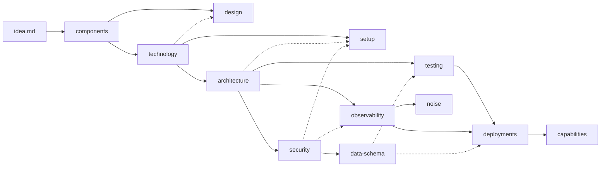

## Session Prompt — this run's, newer than everything below

/bkit-plan #887

Owner answers from plan run 1's review (2026-11-14):

1. Test name "project-docs tip names the three project-docs advisory ids": keep "three" — it matches the issue's test matrix word for word.
2. Equivalence match that accepts a negated or longer path (open deferral 864-move-project-docs-challenge-low-bkit-core-engine-install-project-docs-ts-429): A — fold the fix into Task 12. The match accepts only an affirmative `Equivalent to docs/{topic}.md` with an end boundary, and Task 12 adds the test `changed doc starter indexed as Not equivalent to docs/{topic}.md is not marked adopted`.

## Issue description — oldest

### Narrative

bkit ships twelve project-doc starters in `.bkit/templates/docs/`: architecture, technology, security, data-schema, testing, deployments, observability, design, noise, setup (moved there by [#864 — Move project docs to templates with adoption warnings](https://github.com/cbartens/bkit/issues/864)), plus components and capabilities. Only `components.md` tells the person or agent adopting it how to fill it in: where to look, numbered steps, completion checks, and "remove this introduction when done". The rest stop at a Purpose line and a few rules. `architecture.md`, `technology.md`, `data-schema.md` and `noise.md` have no body at all. `testing.md` (512 lines) and `deployments.md` (435 lines) are mostly bkit's own best practice, with a short "Project facts to record" list on top.

After this change every starter tells its adopter what to read, what to fill in, in which order, and how to tell it is done. Writing rules that apply to every doc are written once in `.bkit/authoring.md` § Docs, and every starter links to them. One adoption order, starting from the owner's `docs/idea.md`, lives in `.bkit/templates.md`. bkit's best practice stays inside the testing and deployments starters, clearly marked apart from the blanks the project fills. bkit also points adopters at the order: a new `bkit tips` entry, reworded project-doc advisories, and a marker in the upgrade report when a doc starter the project has adopted changes.

The per-starter detail (rules box wording, skeleton headings, sources, completion checks, chart type, wave) is in the doc review comment linked under References, § 3. Where that comment and this body disagree, this body wins.

Decisions settled with the owner on 2026-11-13:

- bkit's best practice stays in the starters. One file holds both the fill-in steps and bkit's advice where it applies, mainly testing and deployments, because bkit's CI depends on them. When an important part of that advice changes, the template changes and bkit can add an advisory or migration then.
- `docs/idea.md` holds the owner's free-form notes on the problem, the users and what the app must and must not do. It stays after `components.md` exists, is not indexed in `.agents/docs.md`, and has no template.
- Each starter's "register this doc" step gives the exact `.agents/docs.md` row, with its Scope cell copied from the starter's Purpose line. A unit test in bkit keeps the two identical.
- Shared writing rules live in `.bkit/authoring.md` § Docs. The adoption order lives in a new `.bkit/templates.md` section. The Mermaid rule covers every file § Docs covers, and applies whenever a doc has a chart; no doc is required to have one.
- #887 includes the `bkit tips` entry, the advisory rewording and the upgrade-report marker.

### Success Criteria

- Every starter in `.bkit/templates/docs/` opens with the same introduction: an opener line, **Fill these first**, **Finish against**, **Where the facts come from**, numbered fill steps, **If it does not apply**, **Completion checks**, and a step giving the exact `.agents/docs.md` row. `capabilities.md` instead names the command that builds it and when to run each. Every hand-written starter has a rules box with **Purpose**, **Not here** and **Update when**, a `##` skeleton with bracketed fields and one `[e.g., …]` row per table, and `## Open questions`. A unit test fails when any starter lacks a part, or when its given row's Scope differs from its Purpose line.
- `.bkit/authoring.md` § Docs holds the shared writing rules, including the Mermaid rule. § Doc Templates says fill-in instructions sit in the template and rules for acting on it live in the prompts, and that project-doc starters carry their own fill-in steps. bkit's own `docs/` copies follow the new rules: the ASCII lane graph in `docs/testing.md` § CI test tiers (the bkit scaffold) is Mermaid.
- `.bkit/templates.md` has one project-docs adoption-order section with the waves table and a Mermaid chart, and names `docs/idea.md`. Each starter's **Fill these first** line matches it. Line 16 no longer says the `bkit tips` order covers project docs.
- In `testing.md` and `deployments.md`, every `##` section is marked either as a project slot to fill or as bkit practice to keep, so an adopter can tell which is which.
- A `project-docs` tip fires exactly when a `project-docs-missing`, `project-docs-empty` or `project-docs-unpopulated` advisory does. Those advisories point at the adoption-order section. The `bkit upgrade` "Templates updated" report marks each changed doc starter whose project copy exists as adopted, to review.

### Edge Cases

<!-- prettier-ignore -->
| Scenario | Expected Behavior |
| --- | --- |
| A project has no database and writes `Not applicable: no persistent store` in `docs/data-schema.md` | `detectProjectDocs` reads it as a candidate, so no `project-docs-unpopulated` advisory and no tip |
| `docs/noise.md` adopted with only the introduction removed (empty table, rules box kept) | Read as a candidate; no advisory, no tip |
| A starter copied to `docs/` unchanged | `project-docs-unpopulated` fires and the `project-docs` tip fires |
| A project still holds a 6.1.x legacy starter | Still flagged through `LEGACY_STARTER_DIGEST_HISTORY`, unchanged by this issue |
| `bkit.advisories.ignore` lists `project-docs-missing` | The `project-docs` tip stays silent for that cause, per the catalogue's advisory-id rule |
| A doc starter changes on upgrade and the project keeps the doc under another path, indexed as `Equivalent to docs/{topic}.md` | The upgrade report marks it as adopted, using the same equivalence `detectProjectDocs` uses |
| A doc starter changes on upgrade and the project has no copy | Listed as `changed:` with no adopted marker |
| A non-doc template changes on upgrade | Listed as today, no adopted marker |
| A chart would need more than about 15 nodes | Split by `subgraph` or into a second chart, per the § Docs rule |

### Derived Test Matrix

<!-- prettier-ignore -->
| Test description | Type | Target file |
| --- | --- | --- |
| starter shape: components | Unit | `.bkit/core/engine/install/project-docs.test.ts` |
| components register row Scope equals its Purpose line | Unit | `.bkit/core/engine/install/project-docs.test.ts` |
| components Fill these first matches the adoption order | Unit | `.bkit/core/engine/install/project-docs.test.ts` |
| starter shape: technology | Unit | `.bkit/core/engine/install/project-docs.test.ts` |
| starter shape: design | Unit | `.bkit/core/engine/install/project-docs.test.ts` |
| starter shape: architecture | Unit | `.bkit/core/engine/install/project-docs.test.ts` |
| starter shape: setup | Unit | `.bkit/core/engine/install/project-docs.test.ts` |
| starter shape: security | Unit | `.bkit/core/engine/install/project-docs.test.ts` |
| starter shape: observability | Unit | `.bkit/core/engine/install/project-docs.test.ts` |
| starter shape: testing | Unit | `.bkit/core/engine/install/project-docs.test.ts` |
| testing marks every section slot or practice and has no box-drawing diagram | Unit | `.bkit/core/engine/install/project-docs.test.ts` |
| starter shape: data-schema | Unit | `.bkit/core/engine/install/project-docs.test.ts` |
| starter shape: deployments | Unit | `.bkit/core/engine/install/project-docs.test.ts` |
| deployments marks every section slot or practice | Unit | `.bkit/core/engine/install/project-docs.test.ts` |
| starter shape: noise | Unit | `.bkit/core/engine/install/project-docs.test.ts` |
| capabilities names rollup and refresh and when to run each | Unit | `.bkit/core/engine/install/project-docs.test.ts` |
| project-docs tip fires when a project doc is missing | Unit | `.bkit/core/engine/checks/tips/catalogue.test.ts` |
| project-docs tip stays silent when every project doc is populated and indexed | Unit | `.bkit/core/engine/checks/tips/catalogue.test.ts` |
| project-docs tip names the three project-docs advisory ids | Unit | `.bkit/core/engine/checks/tips/catalogue.test.ts` |
| missing, empty and unpopulated advisories name the adoption-order section | Unit | `.bkit/core/engine/checks/after/tools.test.ts` |
| changed doc starter with a project copy is marked adopted | Integration | `.bkit/core/engine/install/template-copies.integration.test.ts` |
| changed doc starter indexed under another path is marked adopted | Integration | `.bkit/core/engine/install/template-copies.integration.test.ts` |
| changed doc starter with no copy and changed non-doc template are not marked | Integration | `.bkit/core/engine/install/template-copies.integration.test.ts` |

### Tasks

<!-- bkit:group 1 start -->
### TASK GROUP 1: Shared rules and adoption order
<!-- bkit:task 1 start -->
- [ ] **TASK 1:** Write the shared project-doc writing rules and reword § Doc Templates
  - **UPDATE:** `.bkit/core/.bkit/authoring.md`: § Docs gains the shared rules: diagrams of flow, order, dependency or relationship are Mermaid, while directory trees and command output stay plain text; each chart says in one sentence what its arrows mean, uses node names from the doc's tables, keeps to about 15 nodes, uses only `flowchart`, `sequenceDiagram`, `erDiagram` or `stateDiagram-v2`, quotes every label and sets no colours or `style` / `classDef`; content is current state with no history; facts come from code, config or an approved spec, never from template example text; unknowns go under `## Open questions`; each topic is written once and linked from elsewhere; tables over prose for facts; name the file that holds a value instead of typing the value; `Not applicable: {reason}` is the empty state for a doc that does not apply
  - **UPDATE:** `.bkit/core/.bkit/authoring.md`: § Doc Templates headline "Template is shape, prompt owns rules" reworded to say fill-in instructions sit in the template and rules for acting on it live in the prompts; adds that project-doc starters carry their own fill-in steps because no prompt fills them
  - **UPDATE:** `.bkit/instructions.md`: line 27, the `## Template Instructions` row no longer calls the plan and audit templates "shape-only"
  - **READ:** `.bkit/templates/docs/components.md`: its general writing rules, which move to § Docs in Task 3
  - **DONE WHEN:** § Docs holds every rule listed above; § Doc Templates no longer reads as "no instructions in a template"; `pnpm bkit:lint:prose` passes on both files
  - **TEST FIRST:** n/a — docs
<!-- bkit:task 1 end -->
<!-- bkit:task 2 start -->
- [ ] **TASK 2:** Add the project-docs adoption order to `.bkit/templates.md`
  - **UPDATE:** `.bkit/core/.bkit/templates.md`: new `## Project docs — adoption order` section with the waves table (1 `docs/idea.md`; 2 components; 3 technology, design; 4 architecture, setup; 5 security, testing, observability; 6 data-schema, deployments, noise; 7 capabilities), the Mermaid chart with solid "must exist first" and dotted "finished against" arrows from the doc review comment § 2.2, and the `docs/idea.md` rule (free-form, kept, not indexed, no template)
  - **UPDATE:** `.bkit/core/.bkit/templates.md`: line 16 says the `bkit tips` order covers the tool templates and points to the new section for project docs; § Project documents — starters and the index links to the new section
  - **DONE WHEN:** the section exists with table, chart and `docs/idea.md` rule; line 16 no longer claims the tips order for project docs
  - **TEST FIRST:** n/a — docs
<!-- bkit:task 2 end -->
<!-- bkit:group 1 end -->

<!-- bkit:group 2 start -->
### TASK GROUP 2: Hand-written starters, waves 2 to 4
<!-- bkit:task 3 start -->
- [ ] **TASK 3:** Rewrite `components.md` as the model introduction and add the starter-shape tests
  - **UPDATE:** `.bkit/templates/docs/components.md`: opener line unified for hand-written starters; **Fill these first:** `docs/idea.md`; step 2 reads `docs/idea.md`, the README and any approved spec instead of the other docs; new `## Constraints` section (platforms, offline, live updates, scale, hard external requirements, each naming its source in `docs/idea.md`); open questions under `## Open questions`; general writing rules replaced by a link to `.bkit/authoring.md` § Docs; register step gives the exact `.agents/docs.md` row with Scope = Purpose
  - **UPDATE:** `.bkit/core/engine/install/project-docs.test.ts`: a shared starter-shape check that reads `.bkit/templates/docs/{topic}.md` and asserts every introduction part (opener line, Fill these first, Finish against, Where the facts come from, numbered steps, If it does not apply, Completion checks, register row), the rules box lines (Purpose, Not here, Update when), `## Open questions`, at least one `[e.g.,` row (`noise`: a header-only table instead), the register row's Scope equal to the Purpose line, and Fill these first equal to the topic's prerequisites in `.bkit/templates.md` § Project docs — adoption order. Each later starter task adds its own `starter shape: {topic}` case
  - **DEPENDS ON:** 1, 2
  - **DONE WHEN:** the three components tests pass
  - **TEST FIRST:**
    - `.bkit/core/engine/install/project-docs.test.ts` `starter shape: components` fails on today's starter, which has no Fill these first, Not here or `## Open questions`
    - `.bkit/core/engine/install/project-docs.test.ts` `components register row Scope equals its Purpose line` fails because today's register step gives no row text
    - `.bkit/core/engine/install/project-docs.test.ts` `components Fill these first matches the adoption order` fails because the starter names no prerequisites
<!-- bkit:task 3 end -->
<!-- bkit:task 4 start -->
- [ ] **TASK 4:** Rewrite `technology.md` and `design.md` (wave 3)
  - **UPDATE:** `.bkit/templates/docs/technology.md`: introduction, rules box (never type a version number) and skeleton `## Stack` (Layer, Technology, Version from, Chosen for), `## Conventions`, `## Not used`, `## Open questions`; no chart
  - **UPDATE:** `.bkit/templates/docs/design.md`: introduction; the four hard rules become bracketed defaults the project confirms; the machine-checked token guidance split into fill steps and the two rules that survive adoption; skeleton `## Tokens`, `## Typography`, `## Spacing and layout`, `## Components`, `## Accessibility`, `## Open questions`; Not applicable: no user interface
  - **DEPENDS ON:** 1, 2, 3
  - **DONE WHEN:** `starter shape: technology` and `starter shape: design` pass
  - **TEST FIRST:**
    - `.bkit/core/engine/install/project-docs.test.ts` `starter shape: technology` fails on today's starter, which has no fill-in introduction
    - `.bkit/core/engine/install/project-docs.test.ts` `starter shape: design` fails on today's starter, which has no fill-in introduction
<!-- bkit:task 4 end -->
<!-- bkit:task 5 start -->
- [ ] **TASK 5:** Rewrite `architecture.md` and `setup.md` (wave 4)
  - **UPDATE:** `.bkit/templates/docs/architecture.md`: introduction, rules box, skeleton `## System context`, `## Containers`, `## Package boundaries`, `## Environments`, `## Open questions`; one `flowchart LR` with a `subgraph` per runtime, the same shape the architecture audit draws
  - **UPDATE:** `.bkit/templates/docs/setup.md`: introduction, rules box (never write a secret value), skeleton `## Prerequisites`, `## First-time setup`, `## Environment variables`, `## Local services`, `## Everyday commands`, `## Troubleshooting`, `## Open questions`; no chart
  - **DEPENDS ON:** 1, 2, 3
  - **DONE WHEN:** `starter shape: architecture` and `starter shape: setup` pass
  - **TEST FIRST:**
    - `.bkit/core/engine/install/project-docs.test.ts` `starter shape: architecture` fails on today's starter, which has no fill-in introduction
    - `.bkit/core/engine/install/project-docs.test.ts` `starter shape: setup` fails on today's starter, which has no fill-in introduction
<!-- bkit:task 5 end -->
<!-- bkit:group 2 end -->

<!-- bkit:group 3 start -->
### TASK GROUP 3: Hand-written starters, waves 5 and 6, and capabilities
<!-- bkit:task 6 start -->
- [ ] **TASK 6:** Rewrite `security.md` and `observability.md` (wave 5)
  - **UPDATE:** `.bkit/templates/docs/security.md`: introduction, rules box, skeleton `## Trust boundaries`, `## Authentication`, `## Authorization`, `## Input validation`, `## Rate limiting`, `## Secrets`, `## PII`, `## Supply chain`, `## Open questions`; a `sequenceDiagram` of one authenticated request; § Supply-Chain (GitHub Actions) kept and marked as bkit practice
  - **UPDATE:** `.bkit/templates/docs/observability.md`: introduction, rules box, skeleton `## Signal pipeline`, `## Log format`, `## Correlation`, `## Error tracking`, `## Alerts`, `## Where to look`, `## Open questions`; a `flowchart LR` from app to people
  - **DEPENDS ON:** 3
  - **DONE WHEN:** `starter shape: security` and `starter shape: observability` pass
  - **TEST FIRST:**
    - `.bkit/core/engine/install/project-docs.test.ts` `starter shape: security` fails on today's starter, which has no fill-in introduction
    - `.bkit/core/engine/install/project-docs.test.ts` `starter shape: observability` fails on today's starter, which has no fill-in introduction
<!-- bkit:task 6 end -->
<!-- bkit:task 7 start -->
- [ ] **TASK 7:** Rewrite `testing.md` (wave 5), keeping bkit's practice in place
  - **UPDATE:** `.bkit/templates/docs/testing.md`: introduction; rules box keeps "keep the tiers separate" and adds Not here and Update when; project slots `## Stack`, `## Tiers this project has`, `## Where tests live`, `## Test data`, `## CI lanes`, `## Test reports`, `## Running locally`, `## Open questions`; every existing practice section kept and marked as bkit practice; the ASCII lane graph replaced by a `flowchart LR`, its `needs:` / `if:` notes moved to the lanes table
  - **DEPENDS ON:** 3
  - **DONE WHEN:** both testing tests pass
  - **TEST FIRST:**
    - `.bkit/core/engine/install/project-docs.test.ts` `starter shape: testing` fails on today's starter, which has no fill-in introduction
    - `.bkit/core/engine/install/project-docs.test.ts` `testing marks every section slot or practice and has no box-drawing diagram` fails on today's unmarked sections and the ASCII lane graph
<!-- bkit:task 7 end -->
<!-- bkit:task 8 start -->
- [ ] **TASK 8:** Rewrite `data-schema.md`, `deployments.md` and `noise.md` (wave 6)
  - **UPDATE:** `.bkit/templates/docs/data-schema.md`: introduction, rules box (Pending defined; link a generated schema instead of copying it), skeleton `## Overview`, one `## {table}` section shape, `## Functions`, `## Open questions`; an `erDiagram` of keys and relationships; Not applicable: no persistent store
  - **UPDATE:** `.bkit/templates/docs/deployments.md`: introduction, rules box (dangling "Pre-push checklist" reference at line 11 removed; `--no-verify` line dropped as `.agents/rules.md` owns it), project slots `## Environments`, `## Release path`, `## Secrets and env config`, `## Branch protection`, `## Migrations at deploy time`, `## Rollback`, `## Open questions`; the rollback runbooks kept as bkit practice; every section marked slot or practice; a `flowchart LR` release path
  - **UPDATE:** `.bkit/templates/docs/noise.md`: introduction (Fill these first: observability), one table header `| Date | Signal | Where | Change | Trigger | Why it is safe | Recheck when |` and no rows
  - **DEPENDS ON:** 3
  - **DONE WHEN:** the four tests above pass
  - **TEST FIRST:**
    - `.bkit/core/engine/install/project-docs.test.ts` `starter shape: data-schema` fails on today's starter, which has no fill-in introduction
    - `.bkit/core/engine/install/project-docs.test.ts` `starter shape: deployments` fails on today's starter, which has no fill-in introduction
    - `.bkit/core/engine/install/project-docs.test.ts` `starter shape: noise` fails on today's starter, which has no fill-in introduction
    - `.bkit/core/engine/install/project-docs.test.ts` `deployments marks every section slot or practice` fails on today's unmarked sections
<!-- bkit:task 8 end -->
<!-- bkit:task 9 start -->
- [ ] **TASK 9:** Rewrite the `capabilities.md` introduction (wave 7, generated)
  - **UPDATE:** `.bkit/templates/docs/capabilities.md`: opener line unified for generated starters; prerequisites (code exists, the graphify templates adopted per `.bkit/templates.md`); `pnpm bkit:graph:rollup` builds from the working tree and `pnpm bkit:graph:refresh` from the staged files, and when to run each; what stays hand-maintained (the Overrides block, `scripts/graphify/bkit-graph-drift-rules.json`); the register row; completion checks including the comparison with `docs/components.md`
  - **DEPENDS ON:** 3
  - **DONE WHEN:** the capabilities test passes
  - **TEST FIRST:**
    - `.bkit/core/engine/install/project-docs.test.ts` `capabilities names rollup and refresh and when to run each` fails while the starter names the two commands without saying when to run each
<!-- bkit:task 9 end -->
<!-- bkit:group 3 end -->

<!-- bkit:group 4 start -->
### TASK GROUP 4: Point adopters at the order
<!-- bkit:task 10 start -->
- [ ] **TASK 10:** Add the `project-docs` setup tip
  - **UPDATE:** `SETUP_TIPS` in `.bkit/core/engine/checks/tips/catalogue.ts`: new `project-docs` entry whose `fires` calls `detectProjectDocs` and is true when it returns `project-docs-missing`, `project-docs-empty` or `project-docs-unpopulated`; `advisories` names those three ids; `ask` and `steps` point at `.bkit/templates.md` § Project docs — adoption order
  - **UPDATE:** `DETAILS.md`: the templates row for project docs reads the same benefit as the tip and the `.bkit/templates.md` section opener, per the catalogue's text rule
  - **DEPENDS ON:** 2
  - **DONE WHEN:** the three tip tests and the existing catalogue tests pass
  - **TEST FIRST:**
    - `.bkit/core/engine/checks/tips/catalogue.test.ts` `project-docs tip fires when a project doc is missing` fails because no such tip exists
    - `.bkit/core/engine/checks/tips/catalogue.test.ts` `project-docs tip stays silent when every project doc is populated and indexed` fails because no such tip exists
    - `.bkit/core/engine/checks/tips/catalogue.test.ts` `project-docs tip names the project-docs advisory ids` fails because no such tip exists
<!-- bkit:task 10 end -->
<!-- bkit:task 11 start -->
- [ ] **TASK 11:** Point the project-doc advisories at the adoption order
  - **UPDATE:** `detectProjectDocs` in `.bkit/core/engine/checks/after/tools.ts`: the `action` text of `project-docs-missing`, `project-docs-empty` and `project-docs-unpopulated` names `.bkit/templates.md` § Project docs — adoption order
  - **DEPENDS ON:** 2
  - **DONE WHEN:** the advisory test passes
  - **TEST FIRST:**
    - `.bkit/core/engine/checks/after/tools.test.ts` `missing, empty and unpopulated advisories name the adoption-order section` fails on today's action text
<!-- bkit:task 11 end -->
<!-- bkit:task 12 start -->
- [ ] **TASK 12:** Mark adopted doc starters in the upgrade report
  - **UPDATE:** `formatTemplateChanges` in `.bkit/core/engine/install/template-copies.ts`: a changed `docs/{topic}.md` starter whose project copy exists (at `docs/{topic}.md` or an index row `Equivalent to docs/{topic}.md`) gets an "adopted — review your copy" note on its `changed:` line
  - **UPDATE:** `.bkit/core/engine/commands/install/upgrade.ts`: the `formatTemplateChanges` call at line 819 passes the project root so the project copy can be found
  - **READ:** `.bkit/core/engine/install/project-docs.ts`: the topic catalog and `projectDocPath`
  - **READ:** `.bkit/core/engine/checks/after/tools.ts`: how `detectProjectDocs` resolves an indexed equivalent
  - **DONE WHEN:** the three upgrade-report tests pass
  - **TEST FIRST:**
    - `.bkit/core/engine/install/template-copies.integration.test.ts` `changed doc starter with a project copy is marked adopted` fails because no marker exists
    - `.bkit/core/engine/install/template-copies.integration.test.ts` `changed doc starter indexed under another path is marked adopted` fails because no marker exists
    - `.bkit/core/engine/install/template-copies.integration.test.ts` `changed doc starter with no copy and changed non-doc template are not marked` fails if the marker is put on every changed line
<!-- bkit:task 12 end -->
<!-- bkit:task 13 start -->
- [ ] **TASK 13:** Bring bkit's own docs and mirrors in line
  - **UPDATE:** `docs/testing.md`: the ASCII lane graph in § CI test tiers (the bkit scaffold) becomes a Mermaid `flowchart LR`, with a sentence saying what the arrows mean
  - **UPDATE:** `.agents/docs.md`: the `docs/deployments.md` row no longer says "promote after the capstone"; the `docs/data-schema.md`, `docs/testing.md` and `docs/security.md` rows match their docs' Purpose lines
  - **UPDATE:** `.bkit/authoring.md`: refreshed from `.bkit/core/.bkit/authoring.md` with `bkit install`
  - **UPDATE:** `.bkit/templates.md`: refreshed from `.bkit/core/.bkit/templates.md` with `bkit install`
  - **DEPENDS ON:** 1, 2
  - **DONE WHEN:** `bkit check` reports no drift and no ASCII flow diagram remains in `docs/*.md`
  - **TEST FIRST:** n/a — docs and mirror refresh
<!-- bkit:task 13 end -->
<!-- bkit:group 4 end -->

### Open Questions & Assumptions

- **Assumed:** this issue ships in the same release as #864 (v6.2). The post-#864 starter text has never been released (latest tag `v6.1.1`), so it needs no entry in `LEGACY_STARTER_DIGEST_HISTORY` (`.bkit/core/engine/install/project-docs.ts`). If v6.2 is released without #887, add that text's digests before #887 ships, so an untouched v6.2 copy still reads as unpopulated.
- **Assumed:** `components.md` from [#863 — Ship a purpose-based components document template](https://github.com/cbartens/bkit/issues/863) is on `origin/dev`, so Task 3 edits it in place.
- **Assumed:** the opener line becomes "Starter document." for hand-written starters and "Generated document." for `capabilities.md`. No engine code keys on today's "Example document." / "Example output." wording.

### Breaking Changes & Naming

- `formatTemplateChanges` takes an extra input to find project copies; its one caller, `.bkit/core/engine/commands/install/upgrade.ts`, changes in Task 12.
- New tip id `project-docs`. It differs from the advisory ids `project-docs-missing`, `project-docs-empty` and `project-docs-unpopulated`, which the existing "ids are unique and never collide with an advisory id" test checks.
- Starters' opener lines change wording. Projects that already copied a starter keep their copy; the upgrade report marks the change (Task 12).

### Out of Scope

- Moving files between folders, ownership changes and the adoption warnings themselves (done by #864).
- Plan and audit templates in `.bkit/core/docs/templates/`, other than the § Doc Templates headline and `.bkit/instructions.md:27`.
- A template for `docs/idea.md`, and a `docs/idea.md` for bkit itself.
- An advisory that persists until a changed starter is reviewed (needs stored per-copy state).
- Migrations for already-adopted copies. If a later change to bkit's practice in testing or deployments is important enough, it gets its own advisory or migration then.
- Starters stay independent of any app stack; vendor names stay marked as examples.

### References

- [#864 — Move project docs to templates with adoption warnings](https://github.com/cbartens/bkit/issues/864)
- [#863 — Ship a purpose-based components document template](https://github.com/cbartens/bkit/issues/863)
- Doc review comment with per-starter detail: https://github.com/cbartens/bkit/issues/887#issuecomment-6759577165 (§ 3 per-doc review, § 2 adoption order, § 5 defects). Its § 4 recommendation (a managed practice guide per topic) and § 7 decision list are superseded by this body.
- `.bkit/core/.bkit/authoring.md` § Docs and § Doc Templates
- `.bkit/core/.bkit/templates.md` § Project documents — starters and the index
- `.bkit/templates/docs/components.md` (the model introduction)
- `.bkit/core/engine/checks/after/tools.ts` `detectProjectDocs`
- `.bkit/core/engine/checks/tips/catalogue.ts` `SETUP_TIPS`
- `.bkit/core/engine/install/template-copies.ts` `formatTemplateChanges`
- `docs/plans/202611/864-move-project-docs-plan.md`

Priority: High. It shapes how every adopter fills in their project docs, and v6.2 ships #864's move with these starters. Size: L. A full pattern sweep over twelve starters plus three engine changes with tests and bkit's own docs, roughly a week.

## Issue comment — posted 2026-11-09T07:55:38.000Z

### Blocker moved

Following the order agreed in this issue's design interview on 2026-11-09, this issue's body now has a `bkit:blocked-by` block naming [#864 — Move project docs to templates with adoption warnings](https://github.com/cbartens/bkit/issues/864). That block has been removed from #864. `bkit issues blocked-by --issue=887` reports #864 as open, so a build of this issue stops until #864 has landed.

Only that block was added. The body's prose still says this issue comes before #864 ("Why this comes before #864", and the #864 line under References). The design comment above already lists those passages for removal when the design rewrites the body.

## Issue comment — posted 2026-11-10T05:10:33.000Z

# #887 doc review: headers, fill-in instructions and Mermaid

Review of the twelve shipped doc starters (`.bkit/shared/docs/*.md` and `.bkit/templates/docs/*.md`) as they are on `dev` at `2039ba39c`. Nothing was changed. #864 is still open (`bkit:build`), so every file is reviewed where it sits today.

## The short version

1. **Only `components.md` tells an agent how to fill it in.** The other eleven give a purpose line and a few rules. Four of them (`architecture`, `technology`, `data-schema`, `noise`) have no body at all, so an agent has no section headings to fill, no list of where to look and no way to tell when it is done.
2. **Five starters describe bkit, not the project.** `testing`, `deployments`, `observability`, `security` and `setup` have a Purpose line about the project, then a body that is almost entirely bkit's own machinery. An agent filling them has no slot for the project's facts.
3. **#864's plan only rehomes part of that bkit content.** It names destinations for 14 sections. About 30 more sections (listed in § The bkit content #864 does not yet rehome) are bkit's recommended practice, which is neither bkit machinery nor project facts. They need a decision before #887 can turn those starters into fill-in skeletons.
4. **Four concrete defects turned up along the way:** a dangling reference in `deployments.md`, two regenerate commands named in `capabilities.md` with no word on which to run, a stale `.agents/docs.md` row for deployments, and index rows that describe different content from the starters' own Purpose lines. Details in § Defects found.
5. **Mermaid fits six of the twelve docs well.** It suits architecture, data-schema, security, testing, deployments and observability. It adds little to technology, design, setup or noise, where a table carries the content better. Forcing a chart into every doc would produce filler.
6. **Adoption starts from the idea and runs in waves.** The owner writes a free-form `idea.md` with no template. It becomes `components.md`, the high-level map of the whole app. Technology is picked from the map, architecture is agreed with that technology, and the rest follow in waves, so that docs which don't read each other can be filled at the same time. The order lives in one new section of `.bkit/templates.md` (§ 2).

---

## 1. Changes that apply to every starter

### 1.1 One fill-in introduction, the same shape everywhere

`components.md` set the pattern. Make every hand-written starter open with the same blockquote, so an agent always knows where to look:

```markdown
> Starter document. Copy it to `docs/{name}.md` and own it. `bkit install` does not write this file and does not overwrite a copy.
>
> **Fill these first:** {docs that must exist before this one starts, e.g. `docs/components.md`, `docs/technology.md`}. Full order: `.bkit/templates.md` § Project docs — adoption order.
>
> **Finish against:** {docs that one section of this doc waits for or is checked against, once they exist}
>
> **Where the facts come from:** {named files, folders and commands for this doc}
>
> **Populate this document:**
>
> 1. Read the docs under **Fill these first** and the sources above.
> 2. {doc-specific steps, each one action}
> 3. Replace every bracketed field and every `[e.g., …]` row with the project's facts, keeping the rules box.
> 4. Record anything you could not confirm under `## Open questions`. Do not guess.
> 5. Check the document against the completion checks below.
> 6. Remove this introduction and its completion checks.
>
> **If it does not apply:** {e.g., the project has no database} → keep the title and rules box, replace the body with `Not applicable: {reason}`, and keep the doc indexed.
>
> **Completion checks:**
>
> - {doc-specific, each one checkable by reading the doc and the code}
```

What each part buys an agent:

- **Fill these first** makes the adoption order local. An agent opening one doc sees what must exist before it starts, without having to find a central list. It lists only that doc's direct prerequisites (the solid arrows in § 2), and links to the full order.
- **Finish against** names the docs that one section waits for (the dotted arrows in § 2). The agent starts now and knows which section to come back to, instead of waiting for the whole chain or guessing that section.
- **Where the facts come from** is the single biggest improvement. Today an agent filling `data-schema.md` has to guess that the migrations folder is the source. Naming the source also stops agents copying the starter's example text in as fact.
- **If it does not apply** gives a deliberate empty state. Without it, an agent asked to fill `design.md` for a CLI project either invents a design system or leaves the starter untouched. #864's warning cannot tell those two cases apart. With a fixed `Not applicable:` line it can.
- **Completion checks** are what makes "done" testable. The `components.md` checks are good because each one can be checked by reading. "Each table has a row for every migration-created table" is checkable. "The doc is complete" is not.

Unify the first line too. `components.md` opens "Example document.", `capabilities.md` opens "Example output." Pick one wording per kind (hand-written vs generated). An agent, and #864's text comparison, can then key on it.

### 1.2 A rules box that says what belongs and what does not

Every rules box opens with `Follow .bkit/authoring.md …` and then varies. Make three lines standard:

- **Purpose:** the question the doc answers, in one sentence, plus who reads it and when. For example: "Which tables, fields and access policies exist in production. Read before any change that touches stored data." Today's Purpose lines list topics ("palette, typography, components…") but do not say what question they answer.
- **Not here:** where the neighbouring topics live. For example, `data-schema.md`: "Why a field exists → `decisions.jsonl`. Who may read it → `security.md`." `architecture.md` already does this ("Operational rules and library lists go in the domain docs"). It is what stops two docs holding one topic, and agents use it constantly when deciding where to write.
- **Update when:** the code change that makes the doc stale. Only `architecture.md` and `components.md` have it. It is what `@bkit-ship-update-docs` and `@bkit-utility-update-documentation` need in order to decide whether a shipped change touches the doc.

Keep the doc-specific invariants after those three (for example, `noise.md`'s "append-only").

**Make the Purpose line and the `.agents/docs.md` Scope cell say the same thing.** They have drifted (see § Defects found). Agents choose which docs to load from the index cell, then judge relevance from the Purpose line. When the two disagree, an agent loads a doc for the wrong reason or skips the right one.

### 1.3 A skeleton with bracketed fields

Follow `components.md`: real `##` headings, tables with their real column headers, one `[bracketed field]` per cell, and one `[e.g., …]` row per table showing a filled example. Three conventions worth writing into the shared rules:

- **Tables over prose for facts.** Agents read and update table rows far more reliably than paragraphs. A paragraph gets rewritten. A row gets edited.
- **Name the file that holds a value; don't type the value in.** Versions, env var lists and table columns all already live in a file. "Next.js, version from `apps/web/package.json`" never goes stale. "Next.js 15.2" does. This rule matters most for `technology.md`, `data-schema.md` and `setup.md`.
- **Same section names across docs for the same job.** Use `## Open questions` in every skeleton (components puts them inside `## Scope`). Use `## Not applicable` as the empty-state convention. One name makes them easy for agents to find and for #864 to count.

A note for #864's "unfilled" check: plain `[` is not a safe marker, because markdown links use brackets. `[e.g.,` and a line that is nothing but a bracketed field are safe.

### 1.4 The Mermaid rule

The issue already settled that diagrams are Mermaid and that the rule lives in `.bkit/authoring.md` § Docs. Suggested wording for the rule, tuned for GitHub rendering and agent use:

- **Use a ```` ```mermaid ```` fence for any diagram of flow, order, dependency or relationship.** Directory trees, command output and file layouts stay plain text blocks.
- **Say what the arrows mean**, in one sentence above the chart, naming which end comes first ("An arrow goes from a lane to the lane that waits for it").
- **Use the same names as the doc's tables and headings.** The table holds the facts and the chart is a view of them. An agent can then check the two against each other. Completion check: every node appears in a table row.
- **Keep it readable: about 15 nodes.** Past that, split by `subgraph` or draw a second chart. A 40-node chart renders on GitHub but nobody can read it.
- **Stick to diagram types GitHub renders reliably:** `flowchart`, `sequenceDiagram`, `erDiagram`, `stateDiagram-v2`. GitHub's Mermaid version lags the latest release, so the experimental ones (`C4Context`, `architecture-beta`, `block-beta`) may show as raw text. For C4-style views, use a `flowchart` with one `subgraph` per boundary.
- **No colours or `style` / `classDef` lines.** GitHub themes Mermaid for light and dark mode itself. Hand-picked colours break one of the two.
- **Quote every label** (`A["Label (with brackets)"]`). Brackets, colons and slashes in an unquoted label are the most common reason a chart fails to render.
- **Check it renders.** The existing documentation audit (`docs/templates/bkit-audit-documentation.md:97`) already renders charts. For a local check, `.bkit/templates.md:750` already shows the `@mermaid-js/mermaid-cli` command.

Per-doc chart suggestions are in § 3. The rule should not require a chart in every doc. It should require Mermaid when there is a chart.

---

## 2. Adoption order

### 2.1 The rule

A doc starts as soon as every doc it reads exists. If it needs another doc only to finish one section, it starts anyway and finishes that section once the other doc exists. Docs in the same wave don't read each other, so separate agents can fill them at the same time.

<!-- prettier-ignore -->
| Wave | Docs | What lets them start here |
| --- | --- | --- |
| 1 | `idea.md` | Needs nothing. The owner's own notes on the problem, who the app is for, and what it should and should not do. No template. |
| 2 | components | Reads the idea. The high-level map of the whole app, including the constraints that drive technology (§ 3.12). |
| 3 | technology, design | Both read only components. Technology is researched and picked from the map's constraints. Design's look, accessibility bar and main screens come from the map's users and journeys. |
| 4 | architecture, setup | Both read technology. Architecture is how the chosen tools fit together. Setup starts from the tools a developer must install. |
| 5 | security, testing, observability | All read architecture, not each other. |
| 6 | data-schema, deployments, noise | Data-schema reads security: the tables and access rules enforce security's roles and personal-data rules. Deployments reads testing (the checks a release must pass) and observability (when to roll back and how to tell it worked). Noise reads observability: every row it holds is a downgraded observability signal (a log level, an error-tracker mute, an alert threshold). It starts as an empty table. |
| 7 | capabilities | Comes after deployments. It is generated from the code, so it can only be built once code exists. |

### 2.2 The chart

A solid arrow means *must exist before this one starts*. A dotted arrow means *this one starts without it, but one section is finished or checked against it*.



The dotted arrows:

- **technology → design:** the colour and spacing variables table waits for technology to pick the styling tool. The rest of design doesn't.
- **architecture → setup:** the local services section (database, queues) is filled once architecture names them.
- **security → setup:** the environment variables table grows as security names secrets.
- **security → observability:** the log format section is checked against security's list of personal data, so none of it gets logged.
- **data-schema → testing:** the test data section (fixtures, seed, a fresh store per tier) is finished against the schema.
- **data-schema → deployments:** the migrations-at-deploy-time section waits for the schema.

Setup's clean-machine completion check ("a person following `## First-time setup` reaches a running app") can only pass once code exists. The rest of setup does not have to wait for it.

### 2.3 Notes

- **The map is checked from both sides.** Each later doc is checked against `components.md` as it is filled. For example, a part of the system that serves no responsibility on the map is a finding (see the checks in § 3.1, § 3.2, § 3.4, § 3.5 and § 3.11). When a later doc finds something the map lacks, the map is updated rather than the other doc bent to fit. `components.md`'s existing "Update when" rule covers that.
- **Some links are not arrows.** Testing and observability are in the same wave and neither needs the other to start, but both check the live app: smoke tests (testing) check it once, right after a release, and alerts (observability) check it all the time. Each doc's **Not here** line points at the other (§ 3.5, § 3.7), so the job is claimed once.
- **`decisions.jsonl` is not in the chart.** It is appended whenever a choice is made, from technology in wave 3 onwards, and technology's **Chosen for** cells point at its entries (§ 3.2). The other ledgers (`knowledge.jsonl`, `failures.jsonl`, `deferrals.jsonl`) fill during work, not adoption.
- **In an existing app**, every wave is read from the code rather than designed, and technology is read from the package manifests rather than chosen. The order still holds, because each doc still reads the ones before it. A map written from the idea and the README can describe what the app was meant to do rather than what it does. `components.md` step 3 (check the main entry points against those sources) is the guard, so it stays.

### 2.4 Where the order is written down

**In a new section of `.bkit/templates.md`**, for example `## Project docs — adoption order`, holding the waves table and the chart above.

- After #864, every starter lives under `.bkit/templates/`, and `.bkit/templates.md` is the file an adopter reads. `components.md` already has a row in § Contract (`.bkit/templates.md:71`) and its own section (§ Component map, line 655).
- `bkit upgrade` refreshes `.bkit/templates.md`, so a change to the order reaches every consumer. An adopted doc is never refreshed, which is why each starter carries only its own **Fill these first** and **Finish against** lines and links to the section instead of copying the full order.

Not in `.bkit/authoring.md` § Docs, which is about how to write a doc, not in what order. Not in `.agents/docs.md`, which is the index agents load docs from while working, not while adopting.

**Related issues this creates:**

- **`.bkit/templates.md:16` says "The adoption order is the `bkit tips` order."** The tips list (`.bkit/core/engine/checks/tips/catalogue.ts`, 32 entries) has no project docs in it, so a separate doc order would contradict that sentence. Reword it to say the `bkit tips` order covers the tool templates, and point to the new section for project docs.
- **#864 has to land first.** Until it does, ten of the starters live in `.bkit/shared/docs/` and are not templates, so a project-docs section in `.bkit/templates.md` would describe files that aren't there yet. #887 is already blocked by #864, so this needs no new dependency.
- **`idea.md` has no template.** The new section is the only place bkit would name it. See decision 2 in § 7.
- **`components.md` needs a constraints section** for technology to be picked from (§ 3.12). Without it, wave 3 has nothing to read.
- **The docs index treats the starters two different ways.** The managed block of the shipped index (`.bkit/core/.agents/docs.md`) has a row for ten starters, whether or not the project has adopted them. It has no row for `components.md` or `capabilities.md`. `components.md` step 10 tells the agent to register it by hand under `Project Documents`, and `capabilities.md` has no registration step at all (§ 3.11). Once all twelve are templates, one rule should cover them. See decision 7 in § 7.
- **Whether `bkit tips` should point at the next doc to fill** is open. See decision 6 in § 7.

---

## 3. Per-doc review

Each entry gives the starter as it is today, what an agent lacks, a proposed rules-box change, the skeleton, the sources and checks, and the chart. The wave from § 2 is in each heading.

### 3.1 `architecture.md` (16 lines), wave 4

**Today:** rules box only. The Purpose line says "integration sketch", which an agent cannot act on.

**Rules box:**

- Purpose: "What the system is made of, where each part runs and how the parts talk to each other. Read before any design or plan."
- Not here: libraries and conventions → `technology.md`. Tables → `data-schema.md`. Release steps → `deployments.md`. What the system is for, in plain words → `components.md`.
- Keep the existing "Update when a package is added or removed, or a boundary shifts."

**Fill these first:** `docs/components.md`, `docs/technology.md`.

**Skeleton:** `## System context` (users and external systems) · `## Containers` (table: Part | Runs on | Responsibility | Talks to | Code location) · `## Package boundaries` (what may import what, and what enforces it) · `## Environments` (table: Environment | Hosting | Data store | Who uses it) · `## Open questions`.

**Sources:** `docs/components.md` (what the parts are for) and `docs/technology.md` (which tools they are built from), then the workspace manifest (for example `pnpm-workspace.yaml`), each package's manifest, the deploy config (for example `vercel.json`, `Dockerfile`), env schema files, the latest architecture audit in `docs/audits/` if one exists.

**Checks:** every deployable unit in the repo appears in `## Containers`. Every container serves at least one responsibility in `docs/components.md`, and one that serves none is listed under open questions. Every container is built from technology listed in `docs/technology.md`. Every external service in the env schema appears in the chart. Each boundary rule names what enforces it, or is listed under open questions as unenforced.

**Chart:** one `flowchart LR` with a `subgraph` per runtime (browser, server, database, third parties). An arrow goes from the caller to what it calls or sends data to, labelled with the protocol. The architecture audit already draws a C4 Context and Container view in Mermaid (`.bkit/instructions.md:12613`). Make the starter's chart the same shape, so the audit can diff the doc against the code instead of redrawing from scratch.

### 3.2 `technology.md` (15 lines), wave 3

**Today:** rules box only.

**Rules box:**

- Purpose: "Which frameworks, libraries and conventions the project uses, and why each was picked. Read before choosing a library or writing new code."
- Add the rule: "Name the file that pins each version. Never type a version number."
- Not here: the full reasoning behind a choice → `decisions.jsonl` (already there). How the chosen tools fit together → `architecture.md`.

**Fill these first:** `docs/components.md`.

**Skeleton:** `## Stack` (table: Layer | Technology | Version from | Chosen for) · `## Conventions` (naming, file layout, error handling, imports; each with a link to the lint rule that enforces it, if one exists) · `## Not used` (libraries deliberately avoided, each with its `decisions.jsonl` link). That last section stops an agent adding a second date library or HTTP client. · `## Open questions`.

**Sources:** for a new project, `docs/components.md` § Constraints, which is what the choices are researched against. For an existing app, every package manifest, lint and format config, `tsconfig` or equivalent, and `decisions.jsonl`.

**Checks:** for a new project, each Stack row's **Chosen for** cell names the constraint in `docs/components.md` or the `decisions.jsonl` entry it was picked for. For an existing app, every direct runtime dependency in the manifests maps to a row or is deliberately left out as minor. No version number is typed into the doc.

**Chart:** none. A table carries this better.

### 3.3 `data-schema.md` (16 lines), wave 6

**Today:** rules box only. The table shape is given as a rule ("`Field | Type | Unique | Notes` table, `Indices` and `Pending`") but not shown. "Pending" is undefined: it could mean unapplied migrations or planned fields. `.agents/docs.md` says the doc covers "functions" too, but the starter does not mention them.

**Rules box:**

- Purpose: "Which tables, fields, access policies, indexes, functions and triggers exist in production. Read before any change that touches stored data."
- Define Pending: "Fields or tables in an approved plan that are not yet migrated, each linking its plan." Or drop it.
- Add the rule: "If a generated schema or type file exists, link it and describe only what it does not show (policies, intent)." This stops a 600-line copy of the generated types that goes stale on the next migration.
- Not here: which roles exist and which data counts as personal → `security.md`. This doc records how the database enforces them.

**Fill these first:** `docs/security.md` (and through it, `docs/architecture.md`).

**Skeleton:** `## Overview` (the chart) · one `## {table}` per table with the field table, `Access policies`, `Indexes`, `Triggers` · `## Functions` · `## Open questions`.

**Sources:** `docs/security.md` (the roles and personal-data rules the access policies enforce), `docs/architecture.md` § Environments (which data stores exist), the migrations folder (for example `supabase/migrations/`), the ORM schema (for example `schema.prisma`), generated types.

**Checks:** every table that a migration creates has a section. Every table has its access policy stated, or says it has none. Every access policy names a role from `docs/security.md`. Every field holding personal data per `docs/security.md` is marked. Nothing describes a column that no migration creates.

**Chart:** one `erDiagram` showing tables and relationships with cardinality, keys only. Field lists stay in the tables so they live in one place. Past about 15 tables, draw one chart per area.

**If it does not apply:** no database → `Not applicable: no persistent store`.

### 3.4 `security.md` (62 lines), wave 5

**Today:** the Purpose line lists the project's auth, validation, secrets and PII. The body is bkit's own: `bkit-cloud.yml` token isolation and the agent prompt-injection threat model. An agent filling it finds no slot for the project's auth design.

**Rules box:** keep "Auth standards live only here". Add "Update when an auth flow, role, secret or trust boundary changes."

**Fill these first:** `docs/architecture.md`. **Finish against:** `docs/data-schema.md` (the PII table's "Where stored" column).

**Skeleton:** `## Trust boundaries` (the chart) · `## Authentication` (how users prove who they are) · `## Authorization` (table: Role | Can | Cannot | Enforced at) · `## Input validation` · `## Rate limiting` · `## Secrets` (table: Secret | Stored in | Used by | Rotation; names only, never values) · `## PII` (table: Data | Where stored | Who can read | Retention) · `## Supply chain` (the project's own CI and dependency rules) · `## Open questions`.

**Sources:** `docs/components.md` (who the users are), `docs/architecture.md` (the trust boundaries between parts), `docs/technology.md` (the auth provider), then in an existing app the auth middleware or provider config, the env schema and CI workflow permissions blocks.

**Checks:** every user type in `docs/components.md` maps to a role. Every role in the code appears in the authorization table, and each row names where it is enforced (route, policy, service). Every secret in the env schema appears in the secrets table, and no value appears anywhere. Once `docs/data-schema.md` exists, every PII row's "Where stored" names a real table.

**Chart:** a `sequenceDiagram` of one authenticated request, from sign-in → token → API → database policy check. Each arrow goes from the sender to the receiver. Sequence suits security better than a flowchart because order matters: the doc has to show where in the sequence each check happens.

**bkit content to move out:** § Untrusted Content & Prompt Injection (#864 maps it to `.bkit/core/.bkit/prompts.md`). § Supply-Chain token isolation is about `bkit-cloud.yml` and is not in #864's map.

### 3.5 `testing.md` (551 lines), wave 5

**Today:** the Purpose line promises "framework choices, naming conventions". The body has neither. It is the bkit CI scaffold, bkit's test-first contract and about 25 sections of testing practice. The rules box itself is mostly bkit's pre-push gate selection. bkit's own `docs/testing.md` already has the project slots this starter lacks (`## Stack`, `## Tiers`, and `## Key test files` from line 553 on). That is the evidence for what the skeleton should be.

**Rules box:**

- Keep "keep the tiers separate".
- Move the pre-push gate order out (it is bkit's mechanism and is in #864's move).
- Not here: ongoing health checks of the live app → `observability.md` § Alerts. Smoke tests here check it once, right after a release.
- Add "Update when a tier, runner, CI lane or test location changes."

**Fill these first:** `docs/architecture.md`. **Finish against:** `docs/data-schema.md` (`## Test data`).

**Skeleton:** `## Stack` (table: Tier | Runner | Config file | Script) · `## Tiers this project has` (which of Static, Unit, Integration, E2E, @live and Smoke exist, each with its gate script, or "not adopted" with the reason) · `## Where tests live` (naming and folder per tier) · `## Test data` (fixtures, seed, how each tier gets a fresh store) · `## CI lanes` (the chart plus a table: Lane | Needs | Runs when) · `## Test reports` (where each lane's results land) · `## Running locally` (commands) · `## Open questions`.

**Sources:** `docs/components.md` § Main journeys, `docs/technology.md` (the runners), `docs/architecture.md` (the parts that need integration tests), then the `bkit:gate:*` and `test:*` scripts in `package.json`, runner configs, the CI workflow (`bkit.testing.ciWorkflow`) and test folders.

**Checks:** every main journey in `docs/components.md` has an E2E test, or is listed under open questions as uncovered. Every `test:*` and `bkit:gate:*` script maps to a tier row. Every CI lane in the workflow is in the lanes table, and the table and the workflow agree on `needs:`. Each tier marked as present has at least one test file in its stated location.

**Chart:** the CI lane graph as a `flowchart LR`. An arrow goes from a lane to the lane that waits for it (`needs:`). It replaces the ASCII box drawing at `.bkit/shared/docs/testing.md:38-68`. The `needs:`/`if:` conditions at the bottom of that block become the lanes table, not chart labels. This is the most useful chart in the whole set, because the ASCII version is unreadable without a monospace font and agents misread its alignment.

**bkit content to move out:** see § 4.

### 3.6 `deployments.md` (541 lines), wave 6

**Today:** same pattern as testing. The rules box points to a "Pre-push checklist" below, and there is none (defect 1). The Purpose line mentions "secrets sync, branch protection", which the body never covers for the project.

**Rules box:** drop "Never use `--no-verify`". It duplicates `testing.md` and `.agents/rules.md` already owns it. Add "Update when an environment, host, release step or rollback step changes."

**Fill these first:** `docs/testing.md`, `docs/observability.md` (and through them, `docs/architecture.md`). **Finish against:** `docs/data-schema.md` (`## Migrations at deploy time`).

**Skeleton:** `## Environments` (table: Environment | Branch | Host | URL | Database) · `## Release path` (the chart) · `## Secrets and env config` (where each environment's config lives and how it is synced; names only) · `## Branch protection` (required checks per branch) · `## Migrations at deploy time` (what applies them and when) · `## Rollback` (a fill-in runbook: when to roll back, preconditions, steps, how to tell it worked; the current Vercel/Supabase runbooks become the `[e.g., …]` content) · `## Open questions`.

**Sources:** `docs/architecture.md` § Environments, `docs/testing.md` § CI lanes (what a release must pass), `docs/observability.md` § Alerts and § Where to look (what is watched after a release and what triggers a rollback), the CI workflows, host config (for example `vercel.json`), `gh api repos/{owner}/{repo}/branches/{branch}/protection`, the env schema.

**Checks:** every environment that receives a deploy is a row. Every required status check that GitHub reports appears under branch protection. The rollback steps name real commands for this project's host, not the example host. The rollback's "when" and "how to tell it worked" each name a real alert or query from `docs/observability.md`, not "check the logs". Any watch-after-release step in the release path names the alerts it watches.

**Chart:** a `flowchart LR` from branch → CI → preview → production. An arrow goes from a stage to the stage it promotes to, and each step is labelled with what gates it. A `stateDiagram-v2` is an alternative if the project has formal release states.

**bkit content to move out:** see § 4.

### 3.7 `observability.md` (22 lines), wave 5

**Today:** two rules about the project (no PII in logs, never block business logic), then a body that is entirely bkit's `/bkit-debug` context-fetch mechanism. The body itself says it is configured in `.agents/context.md`.

**Rules box:**

- Keep both rules.
- Not here: post-release smoke tests → `testing.md`. Signals deliberately turned down (lower log level, muted error-tracker issue, raised alert threshold) → `noise.md`, one row each.
- Add "Update when a log field, signal, drain or alert changes."

**Fill these first:** `docs/architecture.md`. It does not wait for deployments: where each part runs is already in architecture's environments table, and the logging and error tools are in technology. **Finish against:** `docs/security.md` (`## Log format`, checked against the list of personal data).

**Skeleton:** `## Signal pipeline` (the chart) · `## Log format` (fields, levels and when to use each level) · `## Correlation` (how a request id travels) · `## Error tracking` · `## Alerts` (table: Alert | Fires when | Goes to) · `## Where to look` (table: Symptom | Where | Command or query) · `## Open questions`.

`## Where to look` is the section to add even if nothing else changes. `.agents/docs.md` marks observability as always-read in Debug, and `@bkit-debug-failure-diagnose` currently has to rediscover, in every run, where a given failure shows up. A symptom → location → query table answers that directly. Include a row for a failed CI run that points at `docs/testing.md` § Test reports.

**Sources:** `docs/technology.md` (logger and error tracker), `docs/architecture.md` (parts and environments), `docs/security.md` § PII, then the logger setup, error-tracker config (for example `sentry.*.config.ts`), drain config in the host, alert definitions.

**Checks:** every drain and alert destination named in config appears. Each `## Where to look` row has a runnable command or a named dashboard. No field in `## Log format` is on security's personal-data list. Every muted error-tracker issue and every raised alert threshold in config has a row in `docs/noise.md`.

**Chart:** a `flowchart LR`: app → logger → drain → store → alert → people. Each arrow goes from where the data is to where it flows next.

**bkit content to move out:** § Context Fetch belongs in `.agents/context.md` or the managed debug docs. It is not in #864's map.

### 3.8 `design.md` (38 lines), wave 3

**Today:** the rules box sets bkit's own design opinions as hard rules (44×44px targets, WCAG 2.1 AA, Dark Mode for all colours). The body explains how to keep the token table machine-checkable, which is good fill-in guidance written as permanent doc text.

**Rules box:** turn the four hard rules into bracketed defaults the project confirms ("[e.g., contrast meets WCAG 2.1 AA]"). A project without dark mode currently inherits a rule it breaks. Keep "theme tokens only" and the header-row contract.

**Fill these first:** `docs/components.md`. **Finish against:** `docs/technology.md` (`## Tokens`, whose format depends on the styling tool).

**Skeleton:** `## Tokens` (the machine-checked table) · `## Typography` · `## Spacing and layout` · `## Components` (table: Component | Where | Variants) · `## Accessibility` (the project's chosen bar) · `## Open questions`.

**Where today's text goes:** the "keep the gate honest" bullets (select the table by header row, assert each implementation separately, no silent gap, transcribed is not ratified) are instructions for filling and maintaining the table. Split them: the fill steps go in the introduction, and the two that must survive adoption (header row is the contract; mark transcribed rows) go in the rules box.

**Sources:** `docs/components.md` (users, platforms and main journeys), then in an existing app the stylesheet or theme object.

**Checks:** every token in the stylesheet or theme object is a row, or is listed as intentionally undocumented with a reason. Every transcribed row is marked until a person confirms it.

**Chart:** none needed. Optional: a `flowchart TD` of token layers (primitive → semantic → component), only if the project uses layered tokens.

**If it does not apply:** no UI → `Not applicable: no user interface`.

### 3.9 `setup.md` (52 lines), wave 4

**Today:** the Purpose line is right ("for humans"), but the body is bkit's advice on terminals, Ghostty, Tailscale and OpenCode remote access. A consumer's new developer learns nothing about the project.

**Rules box:** keep "seed never runs against remote". Add "Never write a secret value. Name the secret and where to get it."

**Fill these first:** `docs/technology.md`. **Finish against:** `docs/architecture.md` (`## Local services`), `docs/security.md` (`## Environment variables`).

**Skeleton:** `## Prerequisites` (table: Tool | Version from | Install) · `## First-time setup` (numbered steps from clone to a running app) · `## Environment variables` (table: Name | Needed for | Get it from) · `## Local services` (database, queues; start and reset commands) · `## Everyday commands` · `## Troubleshooting` (table: Symptom | Fix) · `## Open questions`.

**Sources:** `docs/technology.md` (the tools to install), then `.env.example`, package scripts, `docker-compose.yml` or local-stack config, the README.

**Checks:** every variable in `.env.example` is a row. Once code exists, a person following `## First-time setup` on a clean machine reaches a running app.

**Chart:** none. Numbered steps read better than a chart for setup.

**bkit content to move out:** all three sections (#864 maps them to `.bkit/core/.bkit/install.md` and `.bkit/core/.bkit/templates.md`).

### 3.10 `noise.md` (20 lines), wave 6

**Today:** good rules, but no entry format, and the file is append-only. Every agent will invent its own entry shape, and append-only means bad shapes are never fixed. Every signal it lists (log levels, error-tracker archives and mutes, alert thresholds) is an observability signal, so it reads observability and nothing else.

**Fill these first:** `docs/observability.md`.

**Skeleton:** keep the rules box. Add one table with its header and no rows: `| Date | Signal | Where | Change | Trigger | Why it is safe | Recheck when |`. The introduction says to keep the header and add rows only when a signal is downgraded.

**Checks:** each row names the exact file and line, issue id or alert. Each row's signal is a log line, error-tracker issue or alert described in `docs/observability.md`, or in the code that `docs/observability.md` points to. Each row states the trigger, not just "noisy".

**Chart:** none.

**Note for #864:** an empty table is this doc's correct adopted state. The "unfilled" check must not warn on a `noise.md` whose only change is the removed introduction.

### 3.11 `capabilities.md` (73 lines, generated), wave 7

**Today:** the introduction says `pnpm bkit:graph:rollup` rewrites the file. The rules box says `pnpm bkit:graph:refresh` does. Both are true, but nothing says which to run when (defect 2). It does not say what must be adopted first (the graphify scripts), and it does not say to register the doc in `.agents/docs.md`, which `components.md` does.

**Introduction:** state the prerequisites (code exists; copy the graphify templates per `.bkit/templates.md`), the one command the adopter runs, what is hand-maintained (the Overrides block, plus capability rules in `scripts/graphify/bkit-graph-drift-rules.json`) and the registration step.

**Checks:** the register is built (not "Not built"). Every `split` and `bypassed` row is budgeted with a note or has an open issue. The register is compared with `docs/components.md`: a capability that serves no component, or a component with no capability behind it, is a finding for one doc or the other.

**Chart:** already generated as Mermaid (packages and modules views). Apply the same about-15-nodes rule to the generator. `MMD_MIN_WEIGHT` (`.bkit/templates.md:734`) is already the knob.

### 3.12 `components.md` (116 lines), wave 2

This is the model for every other starter's introduction, and it is the first doc filled, straight after `idea.md`. Five changes:

- **Step 2 reads the idea, not the other docs.** Today it says "Read the relevant documents listed in `.agents/docs.md`". Make it read `idea.md`, the README and any product guide or approved specification. The other docs are links it adds once they exist. § Related views already marks a missing view as unavailable, so filling it first breaks nothing.
- **Add a `## Constraints` section.** Technology is picked from the map, so the map has to record what drives the choice: which platforms the app runs on (web, iOS, Android), whether it must work offline, whether it needs live updates, roughly how many users and how much data, and any hard external requirement that rules a tool in or out. Completion check: each constraint names where it came from in `idea.md`, or is listed under open questions.
- **Keep step 3** (check the main entry points against those sources). In an existing app, it is what stops the map describing intent instead of behaviour.
- **Add Fill these first: `idea.md`** to match the shared shape. It needs no "If it does not apply" line, because every repository has a purpose.
- **Move its writing rules that apply to every doc** (Mermaid rule, current vs planned labelling, link instead of copy) to `.bkit/authoring.md` § Docs once that section has them, and keep only the components-specific checks here.

---

## 4. The bkit content #864 does not yet rehome

#864's plan (`docs/plans/202611/864-move-project-docs-plan.md:242-248`) names destinations for these sections:

- **security:** § Untrusted Content & Prompt Injection.
- **testing:** § Local test sleep prevention, § CI test tiers, § Test first, § Tests lock, § JUnit reports for bkit.
- **deployments:** § Commit-message force tags, § Autonomous phase-close prerequisites, § Post-merge dev CI auto-routing, § Ship gate + bookkeeping.
- **setup:** § Templates, § Agent hosts, § Remote access.

Everything else is left in the starters, and most of it is not project fact either. It is a third kind of content: **bkit's recommended practice**. It is stack-independent advice on how to build CI and tests well, and it applies to every consumer, but no bkit command depends on it.

<!-- prettier-ignore -->
| Starter | Sections with no destination |
| --- | --- |
| `testing.md` | § Which tier does a behaviour need? · § What each tier must do (8 subsections) · § Design assertions are a dimension, not a lane · § Schema-invariant DB checks · § Provision backing services fresh · § Optional hardening · § Coverage on PRs · § CI verbosity |
| `deployments.md` | § Production rollback runbook · § Dev rollback runbook · § Run-level decision matrix · § One run per branch or pull request (+ 4 subsections) · § Workflow-file limits · § Smoke trigger plumbing · § Applying migrations at deploy time · § Build-vs-migration race · § Promote before the lanes · § Disable GitHub Code Quality billing · § GitHub Actions pinning (+ 2 subsections) |
| `security.md` | § Supply-Chain (GitHub Actions) token and scanner isolation |
| `observability.md` | § Context Fetch |
| `design.md` | § Machine-checked reference, the guidance part (see § 3.8) |

Not written down anywhere: the 864 plan says "The starter asks for the project's choices" and "Project-specific rollback and deploy decisions stay with the project". Neither says where the general advice goes. Three options:

1. **A managed practice guide per topic** (for example `.bkit/testing-practice.md`, `.bkit/ci-practice.md`). bkit keeps it current, `bkit install` rewrites it, and each starter's rules box links to it ("How to choose tiers → `.bkit/testing-practice.md`"). The consumer's doc stays short and factual. bkit's advice keeps getting fixes. This is my recommendation.
2. **Keep it in the starter as `[e.g., …]` guidance.** Once adopted, the project owns it, so bkit's later fixes never reach it, and the adopter has to delete about 900 lines to get a clean doc.
3. **Fold it into `.bkit/core/.bkit/workflows.md`** with the mechanics #864 already moves there. That makes the workflow catalog, which every phase always reads, much longer. That cost lands on every run.

This needs your call before the testing and deployments skeletons can be written. Most of #887's size sits in those two files.

---

## 5. Defects found

1. **Dangling reference.** `.bkit/shared/docs/deployments.md:13` says "see 'Pre-push checklist' below". The starter has no such section. It exists only in bkit's own project section (`docs/deployments.md:545`), so every consumer gets a broken pointer.
2. **Two regenerate commands, no guidance on which.** `.bkit/templates/docs/capabilities.md:3` says `pnpm bkit:graph:rollup` rewrites the file, and line 12 says `pnpm bkit:graph:refresh` does. Both are true: per `.bkit/templates.md:722-725`, rollup builds from the working tree and refresh builds from the staged files. But the starter doesn't say that, so an adopter cannot tell which one to run.
3. **Stale index row.** `.agents/docs.md` describes deployments as "…promote after the capstone". The starter's § Promote before the lanes says the release promotes *before* the E2E and `@live` lanes, and the capstone `needs:` the deploy job. An agent choosing docs from the index gets the old order.
4. **Index and Purpose lines drifted.** `.agents/docs.md` says data-schema covers "functions", but the starter doesn't mention them. The index says testing covers the "CI lane graph" and the starter's Purpose doesn't. The index says security covers the "untrusted-content threat model", which #864 is moving out. These should be one wording, or one generated from the other.

Each is a one-line fix, but this review made no changes, so they are only listed here.

---

## 6. Mermaid candidates in bkit's own `docs/`

The issue requires bkit's own adopted copies to follow the new rule in the same change. Only one ASCII flow diagram exists today (`docs/testing.md`, the lane graph, 4 `▼` arrows). The `├──` drawings in `docs/architecture.md` are directory trees and stay as text. Where a chart would add the most:

<!-- prettier-ignore -->
| Doc and section | Chart | Arrows |
| --- | --- | --- |
| `docs/testing.md` § CI test tiers | `flowchart LR` replacing the ASCII lane graph (required by #887) | from a lane to the lane that waits for it (`needs:`) |
| `docs/architecture.md` § Install Lifecycle (Three Phases) | `flowchart TD` of the three phases. It is a flow drawn as a tree today. | from a step to the step that runs next, or to its failure exit |
| `docs/deployments.md` § Run-level decision matrix | `flowchart TD` deciding `none` / `partial` / `full` from the event and markers | from a question to the answer it leads to |
| `docs/deployments.md` § Ship gate + bookkeeping | `flowchart TD` of Path A vs Path B into the shared gate | from a step to the next step |
| `docs/deployments.md` § One CI run per dev commit | `sequenceDiagram`: PR check waits on the `dev` push run | from the sender to the receiver |
| `docs/deployments.md` § Smoke trigger plumbing | `flowchart TD`: deploy inside CI vs external host → which trigger | from a question to the trigger it picks |
| `docs/security.md` § Untrusted Content & Prompt Injection | `flowchart LR` of the three layers between payload and agent | from the payload through each layer to the agent |

Several of these sections are moving under #864, so each chart belongs wherever its text ends up.

---

## 7. Decisions needed

1. **Where does bkit's recommended practice go** (§ 4)? This blocks the testing and deployments skeletons.
2. **`idea.md`:** where it lives (for example `docs/idea.md`), whether it is kept once `components.md` exists, and whether `.agents/docs.md` indexes it. bkit ships no template for it, so the new project-docs section in `.bkit/templates.md` (§ 2.4) is the only place bkit would name it.
3. **The deliberate empty state:** is `Not applicable: {reason}` the agreed marker, so #864's check can tell it from an untouched starter?
4. **Is an empty-table `noise.md` a valid filled state** for #864's warning?
5. **Should Purpose and the `.agents/docs.md` Scope cell be one wording** that a test keeps identical, or is matching them by hand enough?
6. **Should `bkit tips` point at the next doc to fill?** It has no project-doc entries today, so the adopter has to open `.bkit/templates.md` to see which wave comes next. A tip could read which docs exist and name the next one. That is new code, not a doc change, so it may belong in its own issue.
7. **How should the docs index cover the twelve starters?** Either all twelve get a row in the managed block of `.bkit/core/.agents/docs.md` (with #864's adoption warning covering the ones not yet adopted), or none do and each starter's introduction ends with a step that registers it under `Project Documents`, the way `components.md` does today.

## Issue comment — posted 2026-11-13T07:25:41.000Z

### Issue rewritten as a change issue, ready for `/bkit-plan`

The body is now in the change shape from `.bkit/trackers.md` § Issue shapes: narrative, success criteria, edge cases, test matrix and 13 tasks in four groups. `/bkit-plan` can take it directly, with no design run. Labels: `next:design` → `next:plan`. Board size: M → L, because the work now includes three engine changes (a setup tip, advisory wording, and an upgrade-report marker) on top of the twelve starters. The task blocks pass `bkit tests plan-check` with every named file and symbol found. The only finding is the expected three-column test matrix, which is the issue format; the plan adds the `Task` column.

**Decisions settled with the owner on 2026-11-13, replacing the open items in the earlier comments:**

1. **bkit's general advice** (about 30 sections, mostly in testing and deployments) stays in the starters. One file holds both the fill-in steps and bkit's best practice, with each section marked as a project slot or as bkit practice. This replaces the review comment's § 4 recommendation of a managed guide per topic. When an important part of that advice changes, the template is updated and an advisory or migration can follow.
2. **`docs/idea.md`**: kept after `components.md` exists, not indexed, no template.
3. **Purpose line vs index row**: each starter's register step gives the exact `.agents/docs.md` row, with Scope copied from Purpose, and a unit test in bkit keeps them identical.
4. **Homes**: shared writing rules in `.bkit/authoring.md` § Docs; adoption order in a new `.bkit/templates.md` section; the Mermaid rule covers every file § Docs covers, and only when a doc has a chart.
5. **Pointing adopters at the order** is in this issue: a `project-docs` tip built on the existing `detectProjectDocs` advisories, those advisories reworded to point at the order, and a marker in the `bkit upgrade` "Templates updated" report on changed doc starters the project has adopted.

**Settled by #864's code, not by a decision:** `detectProjectDocs` (`.bkit/core/engine/checks/after/tools.ts`) calls a doc unfilled only when it matches a shipped starter exactly or holds only headings and comments. So `Not applicable: …` docs and an empty `noise.md` table raise no warning, and no shared "unfilled" marker is needed. The index question from the review comment's § 7 is settled too: since #864, the adopter adds every row.

**Still to do before planning:** the design run paused on 2026-11-09 still holds `.worktrees/887-review-doc-starters` and its lock, with uncommitted edits to `.bkit/friction.jsonl` and `status.jsonl`. Close it before `/bkit-plan` runs.

## Issue comment — posted 2026-11-13T07:32:39.000Z

Closed the design run that paused on 2026-11-09:

- Released its lock, `docs/plans/202611/logs/887-review-doc-starters/.lock`.
- Removed its worktree, `.worktrees/887-review-doc-starters`. This discarded the run log and the issue snapshot. Both were superseded by the rewritten body.
- Deleted the branch `feat/887-review-doc-starters`. It existed only locally and was never pushed. Its one commit was the worktree setup.

The issue keeps `next:plan`, and nothing is left that would block `/bkit-plan`.

## Issue comment — posted 2026-11-13T22:21:58.000Z

Note from #917 (Node test file reporting docs): #917 adds a `## Test first` section to the starter `.bkit/templates/docs/testing.md`, after `## What each tier must do`. It holds the `bkit:test:file` setup for Vitest, pytest, jest and Node, plus the Node case-name rules. The workflow doc (`.bkit/workflows.md` § Test-first) points consumers at that section, so it has to exist in their copy.

For Task 7 here (the `testing.md` starter rewrite):
- Keep `## Test first` and its Node content. Mark it as bkit practice, not a project slot.
- The section order, the intro and the "marks every section slot or practice" test must account for it.
- If this task lands before #917, add the section as part of Task 7 and #917's Task 3 becomes a no-op.
