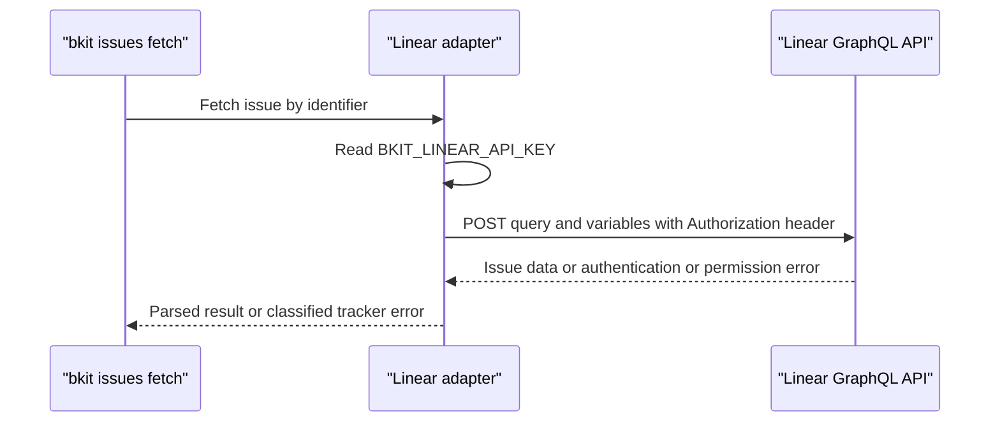

# Security

> [!CAUTION]
> **Purpose:** The project's authentication, authorization, input validation, rate limiting, secrets management and PII handling.
>
> **Rules:**
>
> - Follow `.bkit/authoring.md` § All Agent-Read Files and § Docs when you edit this file.
> - Auth standards live only here. Other docs link to this file and do not restate them.
> - Document secret names and stores. NEVER include their values.
>
> **Not here:** Local configuration belongs in `docs/setup.md`, environment synchronization in `docs/deployments.md` and stored fields in `docs/data-schema.md`.
>
> **Update when:** A trust boundary, identity, permission, validation rule, limit, secret or kind of personal data changes.

## Trust boundaries

<!-- prettier-ignore -->
| Entry point | Data crossing the boundary | Receiving runtime and control |
| --- | --- | --- |
| Agent host | Tracker text, diffs, retrieved logs, web results and installed skills. | Workflows and specialist agents treat external content as evidence. See § Untrusted Content & Prompt Injection. |
| CLI and project hooks | Command arguments, status logs, repository paths, subprocess output and edit requests. | The CLI validates its inputs. Host hooks inspect shell input before execution. See § Input validation. |
| Cloud continuation | A GitHub event and files from the triggering commit. | The Actions router checks the originating repository, obtains its routing code and configuration from the trusted checkout and rechecks the issue label. See § CI Auto-Route Trust (bkit-cloud). |
| External services | GitHub, Linear and Jira authorize tracker calls. Model providers and npm authorize agent runs and package publication. | Credentials belong to the calling process or job. See § Authentication and § Authorization. |

## Authentication

bkit runs as the local operating-system user or the Actions job. It has no application login or session store. A tracker authenticates the credential presented by the adapter. For example, a Linear issue read follows `fetchIssue` and `linearGql` in `.bkit/core/engine/commands/workflow/tracker.ts`.



GitHub tracker calls run through `gh` with `GH_TOKEN` set from `BKIT_GH_TOKEN` when available. Jira uses a bearer token for the Atlassian Rovo MCP endpoint. GitHub supplies job-scoped credentials in Actions. npm trusts the release workflow through OpenID Connect (OIDC).

## Authorization

<!-- prettier-ignore -->
| Role or service account | Kind | May | Granted by |
| --- | --- | --- | --- |
| Local maintainer or agent host | Operating-system account | Access its checkout, private outbox and configured provider accounts. | Filesystem permissions, host tool policy and the operator's provider grants. |
| GitHub tracker / Renovate | Personal access token | Read or write the permitted repository, track issues and PRs, and update configured Projects when granted. Renovate opens dependency PRs. | The GitHub token owner and its scopes. |
| Linear / Jira tracker | Provider account | Read issues, comments and blockers and update allowed comments, labels or states. | The selected account's workspace or site and token permissions. |
| CI / Trivy | GitHub Actions jobs | CI reads repository contents and run state. Unit and integration jobs may post PR coverage. Trivy reads contents. | Job permissions in `bkit-ci.yml` and `bkit-trivy.yml`. |
| Cloud router | GitHub Actions job | Read Actions, PRs and issues, and record a dispatch count on `dev`. | The `context` job in `bkit-cloud.yml`. |
| Claude / OpenCode / Codex | GitHub Actions agent jobs | Write repository contents, PRs and issues and read Actions. Claude may request an OIDC token for its GitHub App and configured Anthropic federation. | The selected job in `bkit-cloud.yml` and its provider credentials. |
| Release publisher | GitHub Actions job | Publish the bound npm package, create its GitHub Release and move its sliding major tag. | `release.yml` grants contents and OIDC writes. The npm trusted publisher binds the repository and workflow. |
| Model providers, Cursor and Tavily | API clients | Run the selected model, call the authorized Cursor endpoint or send a debug search to Tavily. | API keys issued for the operator's provider accounts. |
| Secrets synchronization | Operator's provider CLI or API identity | Reconcile names and values in the stores selected by the project's config. This checkout selects GitHub. | The stored `gh` login for GitHub Actions secrets. Other store adapters require their own provider grants. |

## Input validation

<!-- prettier-ignore -->
| Input | Checked in | How |
| --- | --- | --- |
| CLI invocation and ledger rows | CLI flag parsing and `.bkit/core/engine/ledgers/telemetry.ts` | The command validates the flags and ledger row kind, writer and required fields before append. |
| Paths and identities for a comment update | `.bkit/core/engine/commands/workflow/tracker.ts` | Resolve the owning session or run and check provider evidence against private progress state (§ Workflow comment ownership). |
| Cloud event and feature identifier | `.github/workflows/bkit-cloud.yml` | Check event provenance, parse the identifier with the engine and validate it before constructing a path. |
| Shell input and Actions expressions | Project commands and host guardrails | Pass variable arguments as argv. Route untrusted Actions values through the step environment. See § Shell Injection and § Shell-Edit Inspection (GateGuard hooks). |

## Rate limiting

bkit exposes no public HTTP route. Providers enforce their own request quotas.

<!-- prettier-ignore -->
| Route or action | Limit | Keyed by |
| --- | --- | --- |
| Tracker progress publication | At most 10 history pages, 3 writes and 60 seconds for a delivery. Provider rate limits surface as a classified failure. | One delivery in `.bkit/core/engine/commands/workflow/tracker.ts`. |
| Automatic debug dispatch after failed CI on `dev` | The sum of the fix and soak `maxAttempts` settings (four with this checkout's configuration). | Distinct failed commit SHAs per feature, counted from its status log. See § CI Auto-Route Trust (bkit-cloud). |

## Supply-Chain (GitHub Actions)

> **bkit practice:** Keep this heading. CI templates, advisories and audits cite it.

Action SHA-pinning and the dependency-update pipeline (Renovate / Dependabot, Trivy scan, CVE handling) are described in `deployments.md` § Dependency updaters. This section holds the security invariants only.

**Token isolation:**

- Renovate PRs get a restricted `GITHUB_TOKEN`.
- They have no access to the cloud lane's model-auth secrets (`secrets.BKIT_ANTHROPIC_API_KEY` / the provider `BKIT_` keys / `secrets.BKIT_OPENAI_API_KEY`).
- They have no access to federated Claude tokens either. Only a `bkit-cloud.yml` job that matches the federation rule mints those.
- `bkit-cloud.yml` does not dispatch on Renovate PRs.
- As a result, a compromised dependency PR cannot reach agent API credentials.

**Scanner isolation:** The CI vulnerability scanner (e.g. `bkit-trivy.yml`) runs with `contents: read`, `persist-credentials: false` and no secret. Its image or action is pinned by digest, never by a floating tag. Setup is in `.bkit/templates.md` § Trivy.

The shared untrusted-content contract lives in `.bkit/prompts.md` § Untrusted Content & Prompt Injection.

### This project

Self-hosted Renovate runs with `BKIT_GH_TOKEN`. Its job token has read-only contents permission. The update classes eligible for automatic merge and the major updates that require review are defined in `.github/renovate.json5`. The Trivy workflow uses a digest-pinned scanner. Dependency checks and the advisory register are described in `docs/deployments.md` § Dependency updaters.

**Accepted risk (audit reports and `[skip ci]`):** `docs/audits/**` sits in the files bkit writes (`minPushPathspecs`), so the pre-push hook lets an audit report reach `dev` or `main` under a `[skip ci]` head. No workflow runs on that push, the secret scan included. Audit reports are written from untrusted logs and CI evidence, so a report that quotes a leaked token lands unscanned. The owner accepted this risk; the decision is in `docs/decisions.jsonl`.

## Untrusted Content & Prompt Injection

**Threat model.** Every phase workflow combines three things:

- it ingests attacker-controlled text (commit messages, PR bodies, diffs, CI and runtime logs, web results, installed skill bodies)
- it holds a broad write token
- it can act (commit, push, merge, write files)

An agent that mistakes an embedded directive for an instruction can take an action with the workflow's permissions.

**Contract.** Follow `.agents/rules.md` § Security & Data, **External input** and **External skills**. Skill selection and permitted use are defined in `.agents/skills.md` § Activation Rules.

**Three layers, nearest the payload first:**

- **Fenced at the write.** A workflow that writes fetched external evidence to disk wraps it as it lands, in this order: instruction lines, `===== BEGIN UNTRUSTED =====`, the payload, `===== END UNTRUSTED =====`.
  - The instruction comes before the payload, and nothing comes after the closer.
  - The payload is wrapped once.
  - First-party breadcrumbs are not fenced.
  - Tracker bodies are not fenced, because they are the task specification. The header contract governs them.
- **Named on the spawn.** A subagent whose `Read:` list includes fenced artifacts is told so on its `Context:` line. That line is its last trusted instruction before it reads them.
- **Standing header contract.** Every agent prompt and workflow header carries both rules. They cover tool results (web search / fetch) that never become files, and skill bodies loaded by name.

**Per-file coverage is load-bearing.** Subagents spawn self-contained and never read `.agents/rules.md`. A rule placed only there reaches the orchestrating workflows but no leaf. The three registers exist by design. They are not redundant copies to collapse.

**No runtime telemetry.** "Flag injection attempts" produces no metric, log-grep or alert. Detection is a human reviewing the agent's output.

**Prose is defence-in-depth.** Prose is the layer an injection is designed to defeat. The load-bearing control is structural:

- give each job the narrowest-scoped token
- scan any text that reaches a privileged action (merge body, commit message)

Prose never substitutes for token scope.

## Workflow comment ownership

Only explicit session or exact-run ownership authorizes editing an engine progress comment. Session directories must resolve inside the repository's Git-common session directory. Another active run, a human comment or provider-returned text cannot grant ownership. Remote text is used only to recognize an owned delivery; replacement bodies come from locally cached source reports.

`bkit issues comment` refuses a call with no workflow-run proof, which stops an agent from posting a comment that carries the `bkit:generated` marker by accident (`.bkit/workflows.md` § Comment Lifecycle). It is not a boundary: any local caller can supply one of the accepted proofs, and a session proof names a folder that need not exist any more, so the marker says nothing about who posted the comment.

Optional progress and invocation files stay under Git-common `bkit-outbox`, outside committed content, with private file permissions; the `invocation-context/` folder is owner-only (`0700`) too. Missing or invalid ownership evidence causes a new comment. MCP fallback is create-only and publishes the existing fallback file verbatim. Reporting diagnostics exclude report bodies, credentials and personal data; see `observability.md` § Tracker reporting diagnostics.

## Secrets

### `.bkit/.env` scope

`.bkit/.env` holds local agent-tooling secrets. It is gitignored and loaded through direnv. Repo Actions secrets are consumed only by the job steps that receive them. The table identifies the expected stores and readers. A configured reader does not prove a secret has been provisioned.

The pre-push gate unsets its fixed list of credential names plus every key named in `.bkit/.env` before tests write `tmp/pre-push.log`. See `.bkit/templates.md` § Git hooks — Husky.

App / stack credentials do not belong here — runtime keys and `/bkit-debug` observability tokens (deploy-host, DB log-read, etc.) live in app env files (e.g. `apps/web/.env.local`, sourced by `.envrc`). Never re-add stack creds to `.bkit/.env`. Runtime-log source config → `.agents/context.md` (see `docs/observability.md`).

`LINEAR_ISSUE_ID` — per-session cloud injection; never in `.bkit/.env`.

### Credential surfaces

<!-- prettier-ignore -->
| Secret name | Store | Who can read it | Rotation |
| --- | --- | --- | --- |
| `BKIT_GH_TOKEN` | Local tooling env, configured host or repository Actions secret | GitHub MCP, engine tracker adapter and self-hosted Renovate. | Renew the PAT at GitHub before its expiry (project maximum 30 days). Update the local, host and Actions copies. |
| `BKIT_LINEAR_API_KEY` | Local tooling env or selected cloud host / Actions secret | Linear tracker adapter, MCP, importer and selected agent. | Replace at Linear and update enabled stores. |
| `BKIT_JIRA_API_KEY` | Local tooling env or selected cloud host / Actions secret | Jira adapter, Rovo MCP and selected agent. | Replace the Atlassian MCP V2 scoped token and update enabled stores. |
| `BKIT_ANTHROPIC_API_KEY` | Local tooling env or Actions secret | Cloud router credential checks and Claude job when using API-key authentication. | Replace at Anthropic and update enabled stores. |
| `BKIT_OPENAI_API_KEY` | Local tooling env or Actions secret | Router credential checks and Codex job. Excluded from generated cloud dashboard blocks. | Replace at OpenAI and update enabled stores. |
| `BKIT_CURSOR_API_KEY` | Local tooling env or configured host | Cursor cloud tooling and the optional Cursor sync adapter. | Replace at Cursor and update enabled stores. |
| `BKIT_OPENCODE_API_KEY` | Local tooling env or Actions secret | OpenCode Zen / Go provider and router credential checks. | Replace at OpenCode and update enabled stores. |
| `BKIT_OPENROUTER_API_KEY` | Local tooling env or Actions secret | OpenRouter through OpenCode and router credential checks. | Replace at OpenRouter and update enabled stores. |
| `BKIT_OLLAMA_API_KEY` | Local tooling env or Actions secret | Ollama through OpenCode and router credential checks. | Replace at Ollama and update enabled stores. |
| `BKIT_TAVILY_API_KEY` | Local tooling env or debug host | The Tavily web-evidence block in `.agents/context.md`. | Replace at Tavily and update configured hosts. |
| `GITHUB_TOKEN` | GitHub Actions runtime | Only the current job, with its declared permissions. Also exposed as `github.token`. | GitHub issues a token for each job. |
| `GH_TOKEN` | Process environment | `gh` receives the selected tracker PAT locally or the GitHub job token in Actions. | Follows the source token. |
| `GH_PROJECT_TOKEN` | Operator environment | Optional override for the maintainer's Linear importer. Otherwise the importer reads the stored `gh` login. | Replace the GitHub credential or renew its CLI login. |
| `ANTHROPIC_API_KEY` | The GitHub store mapping in `scripts/secrets/bkit-secrets.config.mjs` | Sync derives it from the prefixed local key. The current router expects the prefixed Actions name. | Follows the source Anthropic key. Resolve the mapping in § Open questions. |
| `CURSOR_API_KEY` | Operator environment or env file | Optional Cursor sync adapter. It also accepts the prefixed key. | Replace at Cursor. |
| `VERCEL_TOKEN` | Operator environment, app env file or stored Vercel CLI login | Optional Vercel sync adapter when that store is enabled. | Replace at Vercel or renew the CLI login. |
| `SUPABASE_ACCESS_TOKEN` | Operator environment or app env file | Optional Supabase sync adapter when that store is enabled. | Replace at Supabase. |
| `EXPO_TOKEN` | Operator environment or app env file | Optional EAS sync adapter when that store is enabled. | Replace at Expo. |

Token scopes for GitHub, including Projects and Renovate authorship, are listed in `.bkit/.env.example`. Choose a fine-grained PAT for one owner. The operator guide covers classic tokens for cross-owner use. For Claude federation the repository variables `ANTHROPIC_FEDERATION_RULE_ID` and `ANTHROPIC_ORGANIZATION_ID` identify the rule and organization. GitHub issues short-lived OIDC credentials for eligible jobs. npm publication also uses OIDC. The package's publishing access requires two-factor authentication and disallows tokens.

### `.claude/bkit-cloud.md` + `.cursor/bkit-cloud.md` + `.codex/bkit-cloud.md` — generated, hold live secrets

`bkit install` / `upgrade` generate `.claude/bkit-cloud.md` (Claude on the web), `.cursor/bkit-cloud.md` (Cursor Cloud Agents) and `.codex/bkit-cloud.md` (Codex Cloud) with the dashboard env / secret block resolved to real secret values. All three share one resolver (`.bkit/core/engine/install/cloud-env.ts`) and render the same block for every tracker. Rules:

- **Gitignored + `chmod 600`. NEVER commit.** Deliberately untracked — absent from WriteSet / manifest / `canonicalHashes` — so no `bkit check` drift or upgrade template walk (machine-local values expected to differ). `bkit uninstall` deletes them when the respective host is removed.
- **Resolution follows consumer `.envrc`** — bkit reads sourced dotenv files, honours `unset` lines. No hardcoded stack-specific key list; knowledge stays in consumer `.envrc` (stack-agnostic shipped surface).
- **Session-hijack keys always dropped** from the block: `ANTHROPIC_API_KEY`, `BKIT_ANTHROPIC_API_KEY`, `ANTHROPIC_AUTH_TOKEN`, because exporting them redirects the agent's own model calls to API-key billing vs subscription.
- **Router-only keys always dropped** from the block: `BKIT_OPENAI_API_KEY`. Only the `codex` router job reads it, as a repo Actions secret; no cloud agent session needs it, and every session reads untrusted issue / PR text.
- Empty-valued keys skipped; absent baseline tokens (`BKIT_GH_TOKEN`) → placeholder, never fabricated.
- **Codex secret type:** the `.codex/bkit-cloud.md` doc directs every token to **Environment variables**; **Network secrets** (placeholder in-process, real value substituted by the proxy for allowed domains) are optional hardening for HTTP-only tokens and break any token a program reads directly (`gh auth login --with-token`).
- **Cursor secret type:** the `.cursor/bkit-cloud.md` doc directs you to add each as a **Runtime Secret** (loaded as an env var but redacted from the agent's transcript) in the Cloud Agents dashboard → Secrets tab, so tools read the value while the agent transcript never sees it.

## Release & Distribution

Disclosure policy (supported versions, reporting channel, response targets) → `.github/SECURITY.md`. Compromised release / leaked credential → `docs/deployments.md` § Security incident runbook.

### Release path

`v*` tag push → `.github/workflows/release.yml` → tagged commit on `origin/main` check → `dist/` freshness → `npm publish --provenance` (OIDC) → GitHub Release → sliding `v{N}` tag re-pointed → consumers `pnpm add -D @cbartens/bkit` + `pnpm exec bkit install`.

<!-- prettier-ignore -->
| Gate | State |
| --- | --- |
| Tag on `main` | Step "Require the tagged commit on main": commit not an ancestor of `origin/main` → run fails, nothing publishes. Mechanics → `docs/deployments.md` § GitHub Release. |
| `main` merges | PR only, `bkit-tests-check` required (`bkit setup protect-main`); 0 required approving reviews. |
| Tags | No tag ruleset: any write collaborator can push a `v*` tag. |
| `environment:` approval | None on the `release` job. Second write collaborator → add `environment: production` with a required reviewer. |
| npm auth | Trusted publisher bound to `cbartens/bkit` + `release.yml`; `id-token: write`; no npm token (§ Credential surfaces). |
| Provenance | `--provenance` attaches a SLSA v1 attestation naming repo, workflow path and tag ref. |
| Sliding `v{N}` tag | `release.yml` force-pushes it with `GITHUB_TOKEN`; prerelease tags (containing `-`) never move it. |

### Verify a published version

```bash
npm view @cbartens/bkit@<version> dist.attestations.provenance   # predicateType https://slsa.dev/provenance/v1
npm audit signatures --json --include-attestations \
  | jq -r '.verified[] | select(.name=="@cbartens/bkit") | .attestationBundles[] | select(.predicateType|test("slsa")) | .bundle.dsseEnvelope.payload' \
  | base64 -d | jq -c '.predicate.buildDefinition.externalParameters.workflow'
```

Run `npm audit signatures` in a directory with the package installed (`node_modules/`; pnpm layout works). Expected workflow: `"repository":"https://github.com/cbartens/bkit"`, `"path":".github/workflows/release.yml"`, `"ref":"refs/tags/v<version>"`. Missing attestation, different repository or path, or a `ref` not matching the version → treat as compromised (`docs/deployments.md` § Security incident runbook).

### Repository controls (`cbartens/bkit`)

<!-- prettier-ignore -->
| Control | State |
| --- | --- |
| Access | Owner is the sole collaborator (admin). Write access = publish rights: merge to `main` + push a `v*` tag (§ Release path). New collaborator → re-check every row in this table and § Release path. |
| `main` | `bkit setup protect-main`: PR only, `bkit-tests-check` required + up to date, applies to admins, linear history, no force-push / deletion. |
| `dev` | Its effective ruleset prevents deletion. Classic branch protection is absent. The current branch rules are in `docs/deployments.md`. |
| Publishing | Tag publishes ONLY when its commit is on `main` → `docs/deployments.md` § GitHub Release. |
| Secret scanning | Push protection on: a push containing a recognised secret is rejected. |
| Private vulnerability reporting | On; advertised in `.github/SECURITY.md`. |
| Consumer data | `harvest/` (store + `consumers.md`) gitignored; never name consumers → `.agents/rules.md` § Repo Authoring. Pre-redaction copies remain in git history. |

### Public repo content

Everything committed is public, including history. NEVER commit:

- Secrets: `.bkit/.env`, `.claude/bkit-cloud.md`, `.cursor/bkit-cloud.md`, `.codex/bkit-cloud.md`, any token or key (§ Secrets).
- Consumer names or consumer data (`harvest/`).
- Details of an exploitable, unfixed vulnerability in a published version: triage and fix inside a draft GitHub Security Advisory (private fork), not an issue, PR or commit.

Secret already pushed → revoke it first (`docs/deployments.md` § Security incident runbook); rewriting history does not un-publish it.

## Shell Injection

Any subprocess call that interpolates a variable MUST use `execFileSync` (not `execSync`) to bypass shell metacharacter interpretation. Pattern:

```ts
execFileSync("vercel", ["env", "ls", env]); // correct
execSync(`vercel env ls ${env}`); // PROHIBITED
```

`execSync` permitted ONLY with constant, fully-literal command string. Prefer non-throwing `spawnSync` when non-zero exit is expected, because try/catch-default-return reads as error-obscuring catch to `bkit:slop:delta`.

Runtime type-guards on subprocess args, even TypeScript-typed (type erasure at runtime). See `docs/knowledge.jsonl`.

GHA-injection: user-controlled text (commit message, PR title, dispatch inputs) → `run:` body ONLY via `env:` (runtime expansion), never inlined into `${{ }}` — see `docs/deployments.md` § `bkit-cloud.yml`.

## Shell-Edit Inspection (GateGuard hooks)

The shell hooks read a command, an inline script, a patch or a directly named script before it runs, to find the files it writes. Treat all of that text as untrusted data.

- **Never run what is inspected.** The detector parses syntax only. It does not execute, import or fetch source, follow imports, walk directories or wait on a FIFO or device.
- **Bounded reads.** Source files are opened only when directly named and regular (type checked on the descriptor), and read at most 64 KiB plus one byte. A symlink, race, missing or special file reports uncertainty instead.
- **Fixed bounds.** 256 KiB of command text, depth 3, 64 exact targets and a 200 ms cooperative deadline. At the first limit the hook keeps the targets already found and reports `analysis-limit`.
- **No source in output or state.** Output carries safe reason codes, counts and display paths only: no command, inline source or environment value. GateGuard state in `os.tmpdir()/bkit-gateguard-<uid>` holds normalized edited paths.
- **Advisory, fail-open.** An analysis failure never blocks the command and never downgrades a stronger deny, ask, secret or fetch decision.
- **Known limit.** The state folder is not yet created owner-only (`0o700`) and checked before use, so on a shared `/tmp` another local user can plant a symlink there. `docs/deferrals.jsonl` records the limit.

## CI Auto-Route Trust (bkit-cloud)

**Engine-owned FID parse:** the router never matches a FID with its own regex. `bkit fids parse` (the consumer's own bkit, installed from its `dev` lockfile) returns the FID and issue id, and `bkit_dev_dispatch_guard` asserts the FID charset again before the counter write. The `dev` subject goes through `fids parse --prompt-file`, never an argument.

**Kill switch on every tracker:** the `bkit:auto` label is read through `bkit issues fetch` on GitHub, Linear and Jira alike. An unreadable label (missing key, service down, issue not found, bkit not installable, unparseable output) starts no agent and exits green, with the reason in the log and job summary. Tracker keys (`BKIT_LINEAR_API_KEY`, `BKIT_JIRA_API_KEY`) are set at step scope, never job-wide.

**Same-repo PR steering its own routing:** a same-repo PR's head `status.jsonl` and `.bkit/issues.jsonl` are DATA the routing run reads from a `pr-head` checkout. The routing config (`bkit.cloud.agent`, `bkit.tracker.default`) is read from the `dev` checkout (workspace root), so a branch cannot change which agent starts. The code that decides the kill switch never comes from that branch: bkit is installed from the `dev` checkout (workspace root) and run against `pr-head`, because an agent session writing the branch with `GITHUB_TOKEN` cannot edit `.github/workflows/*` but can edit `package.json` and the lockfile. The `pr-head` checkout keeps no credential in its git config. The author of the data is collaborator-trusted (write access).

**Same-repo trigger gate:** every CI-driven dispatch job additionally requires `workflow_run.head_repository.full_name == github.repository`, so a fork PR's CI completion never boots one. `workflow_run` runs in the base repo with the workflow's own `permissions:`, and the `dev` arm performs a privileged `git push origin dev` (the dispatch-counter row) before any agent boots — without the guard, a fork-triggered run reaches that write with `contents: write`. The guard gates the trigger only; outbound lookups made inside the job filter their own results (see the `dev` arm exception below).

**PR-body marker trust:** `bkit-cloud.yml` SHARED-DERIV parses `bkit:issue=#N` / `bkit:fid=X` from PR body to resolve which issue's `bkit:auto` label to re-check (kill switch). PR body is collaborator-trusted (triage / write), not commit-signed, so editing it to point at another issue could defeat the kill switch for the original (if replacement still carries `bkit:auto`). Mitigation: `bkit [auto route]` commit marker (free tier) must be on HEAD; PR body cannot forge commit markers. Gap is collaborator-vs-collaborator only; branch-derived FID fallback when body markers absent. **Exception — the `dev` arm:** the `dev` arm's fallback resolves the PR body via `GET /repos/{o}/{r}/commits/{sha}/pulls`, which returns PRs merely associated with the commit — for a non-default-branch commit that includes OPEN **fork** PRs branched at that SHA, which are not collaborator-trusted, and which the job-level `head_repository` guard does not cover (it gates the trigger, not this outbound lookup). That lookup therefore filters to same-repo `merged_at != null` PRs before reading a body. Future hardening: cross-check `bkit:issue` vs `gh pr view --json closingIssuesReferences`.

**FID slug allowlist:** the marker-derived `{FID}` (`bkit-auto` Step 1, marker-primary) flows into filesystem paths (`docs/plans/{YYYYMM}/logs/{FID}/…`, `.worktrees/{FID}`) and downstream `/bkit-*` dispatch. Because the PR body is collaborator-trusted, every FID resolution site MUST assert a strict slug allowlist before path construction — `^[0-9]+-[a-z0-9-]+$` (github) / `^[a-z]+-[0-9]+-[a-z0-9-]+$` (linear) / `^[a-z0-9][a-z0-9-]*$` (no-tracker + branch-derive) — rejecting `/`, `.`, `..`, and shell metacharacters so a marker like `bkit:fid=../../elsewhere` cannot redirect writes. Marker failing the assertion falls through to the branch-derive fallback; branch-derive failing it is a Failure Path. The fallback then derives `{ISSUE_ID}` from the validated slug behind its own allowlist — `^[0-9]+$` (github) / `^[A-Z]+-[0-9]+$` (linear), because `{ISSUE_ID}` reaches the tracker MCP calls and the branch name is collaborator-controlled just as the PR body is.

**`dev` push trigger:** the post-merge `dev` surface has no open PR and no PR body, so it cannot use the marker-trust path above at all, but the trust surface is instead the **squash-merge commit scope** (`feat({FID}): …`, threaded by `/bkit-ship` verbatim from the PR title). The derived `{FID}` is asserted against the same tracker-agnostic slug allowlist (`^([0-9]+|[a-z]+-[0-9]+)-[a-z0-9-]+$`) before it reaches any filesystem path or dispatch call; a malformed or missing scope fails safe to a no-op (no dispatch, no crash, no information leak) rather than falling through to a weaker fallback. Dynamic values (`head_commit.message`, `head_sha`) are passed through the ctx step's `env:` block, never interpolated inline into `${{ }}` — the same injection-safe pattern the `feat/**` path already uses. The kill switch (live `bkit:auto` re-check on the issue) applies identically to `dev`-triggered runs, and the dev dispatch cap (distinct failed-CI SHAs per FID, at most `bkit.workflows.debug.fix.maxAttempts` + `bkit.workflows.debug.soak.maxAttempts`, 2 + 2 by default) is itself a cost / security control. It matters most on this surface precisely because `/bkit-debug` creates no branch of its own: it remediates on `dev` in place, so its push re-reds `dev` CI and re-enters this router. Without the cap, that feedback loop could dispatch unbounded paid agent sessions against the repo. That bound is **advisory, not tamper-proof**: the count is derived from `dev-dispatch` rows in `docs/plans/{YYYYMM}/logs/{FID}/status.jsonl` on `origin/dev`, a file the dispatched `/bkit-debug` session itself writes on every run with `contents: write`, so any principal with `dev` write (including a session steered into rewriting it) can reset the budget, and the documented operator reset is literally to delete those rows. Treat it as a guard against runaway loops among cooperating agents, not as a control against a hostile one; see `docs/deferrals.jsonl` for the recorded limitation. `main` is excluded from this trigger entirely (see `docs/deployments.md` § Post-merge `dev` CI auto-routing), because no trust surface is defined for it.

## PII

bkit has no customer account table. Its developer tools handle contributor identities and records that can be linked to a person. Keep consumer names and paths out of tracked records and use an opaque ID or redacted value in diagnostics. `docs/data-schema.md` identifies the fields below.

<!-- prettier-ignore -->
| Personal data | Why it is held | Protection | Where stored |
| --- | --- | --- | --- |
| Contributor name and email | Git attributes a commit. Renovate can use the configured git author. | Use a bot or noreply identity for automation. A real author address in public Git history is public. | Git author and committer headers. |
| Tracker author ID, comment source, and optional import attribution | The CLI recognizes its own progress updates. The maintainer importer transfers issues and comments with attribution. | Progress cache files are created with mode `0600`. The destination tracker's permissions govern posted text. The importer can publish an email when both author names are missing. | Private progress `comment.evidence.authorId` and `source`, tracker issue and comment bodies, and the source Linear CSV and comment fields. |
| Chat session ID, timings, usage and owner waits | Join a workflow to a chat and measure activity on the maintainer's machine. | A committed run log uses a session fingerprint. The harvest metrics stay in the gitignored local store. Prompt text stays out of its chat metrics. | Status event `session`, harvest chat `key`, `session.id`, `time`, `usage` and harvest run `owner`. |
| Repository owner, work item and local checkout path | Locate a run, attribute a ledger row and resolve a report on the maintainer's machine. | Published invocation rows use relative paths and a worktree fingerprint. Private receipts retain the absolute paths. Only scanned harvest chat and run rows fingerprint project identifiers. Copied ledgers and the local report can contain names. | Ledger `repo` and `references`, invocation `worktree`, `bookRoot` and `statusPath`, harvest `repo`, `issue`, `run.fid`, the consumer path list and local report. |

## RLS

Not applicable, because bkit has no database.

## Open questions

- Which router secrets should this repository provision and protect during sync? The owner can reconcile the selected cloud jobs with `scripts/secrets/bkit-secrets.config.mjs`. Its only mapped GitHub names are `BKIT_GH_TOKEN` and `ANTHROPIC_API_KEY`. Sync can remove unlisted, unprotected secrets.
- Which published release lines currently receive fixes? The maintainer's disclosure policy in `.github/SECURITY.md` names 5.x, while `package.json` names 6.2.0.
- What rotation interval applies to each optional provider key, and what retention period applies to the private outbox and harvest? The provider account and checkout owners control these settings.
