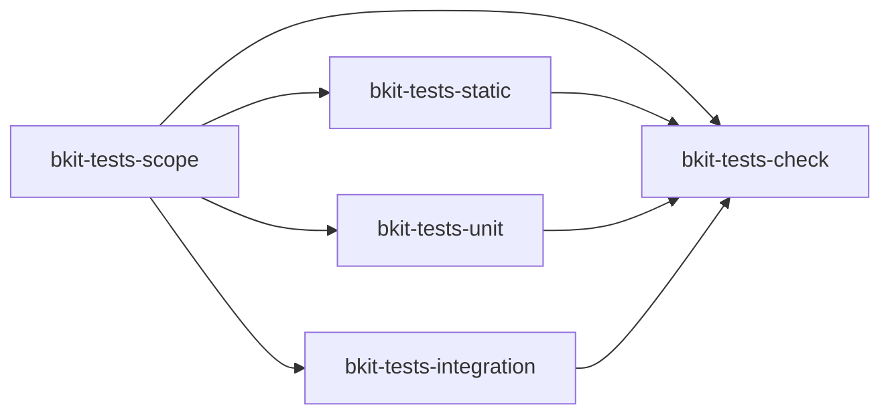
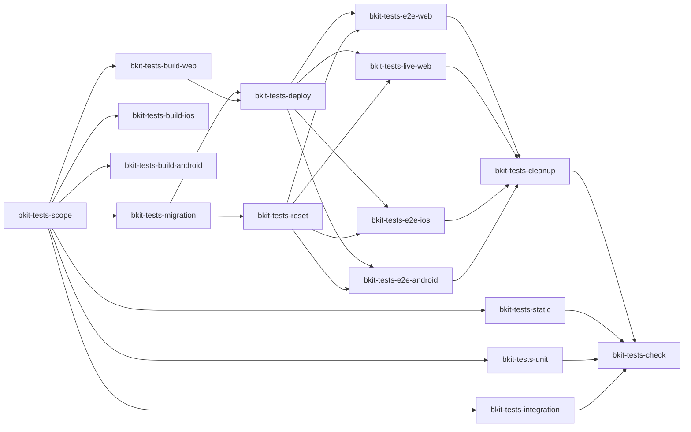

# Testing

> [!CAUTION]
> **Purpose:** The testing strategy: tier boundaries, framework choices, naming conventions and CI execution.
>
> **Rules:**
>
> - Follow `.bkit/authoring.md` § All Agent-Read Files and § Docs when you edit this file.
> - Keep the tiers strictly separate: Static · Unit · Integration · E2E · @live · Smoke.
> - Pre-push runs `bkit check`, then selects one gate script in this order:
>   - **If** `bkit ci min-push` accepts every outgoing ref → pre-push runs `pnpm bkit:gate:min`.
>   - **If** the branch or commit is a revert → pre-push runs `pnpm bkit:gate:static`.
>   - **If** `pnpm bkit:gate:static-unit-integration` is declared → pre-push runs it.
>   - **Else** → pre-push runs `pnpm bkit:gate:static-unit`.
> - The package scripts own the gate chain. Use `test:coverage:unit` to run only this repository's Vitest unit tests.
> - A gate runs its tiers one after another, never two at once. A push gate stops at the first red tier. The E2E gate runs every tier after a red one, reports each, and runs the whole E2E suite. Keep parallel work inside a tier. A cached task replay reports the earlier run's result, not a fresh run.
> - Integration runs at pre-push once its gate is declared. Local services, such as a Docker database, are fine there.
> - E2E, @live and tests against a deployed service are excluded from pre-push. Consumer projects with those tiers run them in CI.
> - Never bypass the hooks with `--no-verify`.
>
> **Not here:** Live signals go in `docs/observability.md`, runner contracts in `.bkit/workflows.md` and branch protection in `docs/deployments.md`.
>
> **Update when:** A tier, runner, test folder, shared helper, CI lane or test command changes.

## Stack

> **Project slot:** Test runners and checks used by bkit.

<!-- prettier-ignore -->
| Tier | Runner | Framework or tool |
| --- | --- | --- |
| Static | `pnpm bkit:gate:static` | TypeScript, Oxlint, Prettier, table checks, Vale and slop-scan. CI also checks workflow syntax, dist freshness, capability maps and installation drift. |
| Unit | `pnpm test:coverage:unit` | Vitest with V8 coverage and the branch floor in `vitest.unit.config.ts`. |
| Unit, shell and script checks | `pnpm bkit:test:bats`, `pnpm bkit:test:awake`, `pnpm test:harvest` | Bats exercises shell behavior. Node's test runner exercises command wrappers and maintainer tooling. |
| Integration | `pnpm test:integration` | Vitest with temporary checkouts, local subprocesses and the source CLI via tsx. |

## Tiers this project has

> **Project slot:** The tier names below match the planning rubric in § Which tier does a behaviour need?

<!-- prettier-ignore -->
| Tier | Has it | Covers |
| --- | --- | --- |
| Static | Yes | Source, test types, lint, generated output, authored text and config drift. |
| Unit | Yes | One module or script. A Git wrapper can exercise a real Git process inside an isolated temporary checkout. |
| Integration | Yes | Several modules or a complete CLI invocation against a real temporary consumer filesystem. |
| @live (golden) | Not applicable | The CI plan disables live service runs. External-command fixtures keep automated checks offline. |
| E2E | Not applicable | This CLI has no automated browser, mobile or authenticated host lane. Manual host checks are described below. |
| fresh-DB replay | Not applicable | The package stores shared state in Git and JSONL files. |
| Smoke | Not applicable | The release publishes an npm package with no deployed service to probe. |

## Where tests live

> **Project slot:** File discovery and shared helpers.

<!-- prettier-ignore -->
| Tier | Folder | File naming | Shared helpers |
| --- | --- | --- | --- |
| Static | Repository root, `scripts/` and `.github/workflows/` | Tool configs, named package scripts and CI checks. | `tsconfig.test.json`, `.oxlintrc.json` and `.prettierrc.json`. |
| Unit | `.bkit/core/engine/` and `scripts/harvest/` | Colocated `*.test.ts`. Repository and payload checks live under `.bkit/core/engine/audits/`. | `vitest.setup.ts`, `vitest.test-lock.ts` and `vitest.timeout-budget.ts`. |
| Unit, shell and script checks | `tests/shell/`, `scripts/ci/`, `scripts/gate/` and `scripts/harvest/` | `*.bats` and `*.test.mjs`. Manual hook experiments also use `*.test.mjs` under `tests/experiments/hooks/`. | `tests/shell/setup_suite.bash`, `tests/fixtures/gh/` and `scripts/ci/bkit-test-file.mjs`. |
| Integration | `.bkit/core/engine/` and `scripts/harvest/` | `*.integration.test.ts`. | `vitest.tsx-bin.ts`, `vitest.gate-fixture.ts`, `vitest.process-group.ts` and `tests/fixtures/`. |

## Test data

> **Project slot:** Fixtures, isolation and seed state.

<!-- prettier-ignore -->
| Tier or boundary | Initial state | Fixture or helper |
| --- | --- | --- |
| Unit | Construct module inputs in memory. A test that calls Git starts its own temporary repository. | `vitest.setup.ts` strips inherited Git environment variables. |
| CLI integration | Create a fresh temporary consumer with a manifest and the files the scenario needs. Exercise installation, upgrade or uninstall against that tree. | `tests/fixtures/heavy-customised-consumer/` seeds user-owned edits. `vitest.gate-fixture.ts` supplies a minimal gate manifest and offline package runner. |
| Ledger and harvest | Start with the scenario's JSONL rows and temporary repository or home. Assert the resulting rows and the bytes of files that should survive. | `.bkit/core/engine/ledgers/` tests and `scripts/harvest/ledgers.integration.test.ts`. |
| Shell and external commands | Give each case an isolated work directory and a test-specific command search path. | `tests/fixtures/gh/` and `tests/shell/`. |
| Shared UI login or database seed | Not applicable. bkit has no application login, database migration or seed job. | The persistent-file formats are documented in `docs/data-schema.md`. |

## CI lanes

> **Project slot:** Test jobs in `.github/workflows/bkit-ci.yml`.

Each arrow joins a prerequisite job to the job that waits for it.



<!-- prettier-ignore -->
| Lane | Needs | Runs when |
| --- | --- | --- |
| `bkit-tests-scope` | None. | On each configured push, pull request or manual dispatch. Computes the run plan. |
| `bkit-tests-static` | `bkit-tests-scope` | The plan's `run_level` differs from `none`. |
| `bkit-tests-unit` | `bkit-tests-scope` | The plan's `run_level` differs from `none`. Runs Vitest unit coverage and Bats. |
| `bkit-tests-integration` | `bkit-tests-scope` | The plan's `run_level` differs from `none`. Runs the integration suite and reports its coverage separately. |
| `bkit-tests-check` | The planner and all three test lanes. | The run has not been cancelled. Validates the plan and lane outcomes or mirrors the eligible push run. |

### CI execution

The required check verifies that the planner succeeded and that planned unit and integration jobs each executed tests. A plan that skips testing must account for the skipped jobs. Branch protection, release mirroring and the separate scan, dependency, cloud and publishing workflows are described in [Deployments](deployments.md).

## Test reports

> **Project slot:** Evidence from gate runs, individual files and CI.

<!-- prettier-ignore -->
| Tier | Report format | Path |
| --- | --- | --- |
| Static | Tool output and exit status. | The gate log or GitHub Actions job log. |
| Unit and integration gates | JUnit XML when the gate receives a report directory. | `$BKIT_TEST_REPORT_DIR/vitest-<pid>.xml` for each Vitest process. |
| Shell gate | JUnit XML when the gate receives a report directory. | `$BKIT_TEST_REPORT_DIR/report.xml` from Bats. |
| Individual Vitest, Bats or Node files | JUnit XML when the caller requests it. | `pnpm bkit:test:file <repo-relative-file>` writes to `$BKIT_TEST_REPORT`. A call can name several files handled by the same runner. |
| CI unit and integration | Vitest execution counts and V8 coverage JSON. | `$RUNNER_TEMP/unit-result.json`, `$RUNNER_TEMP/int-result.json`, `coverage/unit/` and `coverage/integration/`. |

## Running locally

> **Project slot:** Commands from `package.json`. Run checks from the repository root.

<!-- prettier-ignore -->
| Tier | Command |
| --- | --- |
| Static | `pnpm bkit:gate:static` |
| Unit | `pnpm test:coverage:unit` |
| Unit, shell and script checks | `pnpm bkit:test:bats`, `pnpm bkit:test:awake` or `pnpm test:harvest` |
| Integration | `pnpm test:integration` |
| One named file | `pnpm bkit:test:file .bkit/core/engine/cli.test.ts` |
| All configured Vitest files | `pnpm test` |
| Complete local test gate | `pnpm bkit:gate:static-unit-integration` |

## CI test tiers (the bkit scaffold)

> **bkit practice:** Shared guidance for projects adopting the CI scaffold.

CI runs the tiers through the bkit scaffold as one parallel lane (job) per tier, not as steps in one job. The step-by-step shape is in `.github/workflows/bkit-ci.yml` § "full CI scaffold reference", and the run-level shape is in `deployments.md` § Run-level decision matrix.

The graph is flat and wide for static / unit / build / integration: scope fans out, and the capstone joins. **One exception:** when `bkit-tests-migration` owns the shared-remote migration apply, e2e / live `needs:` that lane for ordering. Never gate live behind static / unit / build / e2e.

Each arrow joins a prerequisite to a lane that waits for it. This scaffold includes consumer lanes beyond this repository's five jobs.



Each lane's `needs:` and `if:` are in this table.

<!-- prettier-ignore -->
| Lane | `needs:` | `if:` |
| --- | --- | --- |
| `bkit-tests-scope` | none | always on; never skips (~15s) |
| `bkit-tests-static` / `-unit` / `-integration` / `-build-*` | `bkit-tests-scope` | `run_level != 'none'` |
| `bkit-tests-migration` | `bkit-tests-scope` | no job-level `if:` (always on) |
| `bkit-tests-deploy` | `bkit-tests-migration`, `bkit-tests-build-web` | default-branch push only |
| `bkit-tests-reset` | scope, migration | `tenant_target != ''` |
| `-e2e-web` / `-live-web` / `-e2e-ios` / `-e2e-android` | scope, migration, deploy, reset, the lane's build | `!cancelled() && scope == success && <own gate> && migration != 'failure' && deploy != 'failure' && reset != 'failure'` |
| `bkit-tests-cleanup` | the lanes that use the lease | `always()`; releases the lease |
| `bkit-tests-check` | scope and every lane you have, deploy included | always |

Adopt only lanes your repo has. Add a lane the moment its tier exists, because a tier with no lane is a tier nothing gates. The jobs above the reference in `bkit-ci.yml` are the starter: `bkit-tests-static` and `bkit-tests-unit`, joined by the `bkit-tests-check` capstone `/bkit-ship` merges on. Every lane you add joins the capstone's `needs:` and its assert. The reference is the target. A starter stub that still sits inside `bkit-tests-unit` is the pre-split shape.

Adopt in this order, and stop at the first tier this repo does not have. You write the step bodies. These files name the job, the `needs`, the `if`, and the rule.

1. Keep `bkit-tests-static` and `bkit-tests-unit`.
2. Add `bkit-tests-scope`. Every later `if:` reads `plan`, and the markers are parsed once. The push base is the last green run (`deployments.md` § One run).
3. Move integration out of unit into `bkit-tests-integration`.
4. Add `bkit-tests-build-web`. It compiles, or it creates this SHA's deployment and publishes `deployment_url` + `deployment_id`, leaving the deployment un-promoted on the default branch. Do not also enable `bkit-stub:vercel-await`.
5. Add `bkit-tests-migration` when you have migrations. The remote apply of new migrations (for example, `supabase db push --linked --include-all`) lives here, after the from-empty replay. On the default branch it waits for static / unit / integration / `build-web` before touching production's database. Immutability and slop-delta use the planner base on every event.
6. Add `bkit-tests-reset` / `-cleanup` only when two or more lanes share one long-lived resource. Otherwise provision fresh and drop both.
7. Add `bkit-tests-e2e-web`. It runs the full suite on a PR and on a push. A feature → `dev` PR hits a local stack. The target comes from `TEST_URL` only. A pass on retry is a failure.
8. Add device build and device E2E only for a platform you ship. Same rule on a PR, a push, and a dispatch. `bkit-tests-e2e-ios` needs `build-ios` and `build-web`. Android is the same, with its own build lane in place of `build-ios`.
9. Add `bkit-tests-live-web` for a push to `dev` or the default branch when `web_affected`. It never runs on a PR or on a dispatch. Do not `needs:` static, unit, integration, or e2e.
10. `bkit-tests-check` `needs:` every lane you kept. It is the sole required check, and its assert is a script (§ Validated means executed).
11. Run `bkit-tests-deploy` on a default-branch push, before the E2E / `@live` lanes. It promotes that exact `deployment_id`, and each tenant lane `needs:` it and refuses unless production serves this run's build. Not a required check (`deployments.md` § Promote before the lanes).
12. Health is `bkit-health.yml`, which runs as `workflow_run` after every finished CI run on the default branch. A logging probe is a step inside each runtime lane, not a job.

These files do not ship some scripts, so the plan names them and you write them: the marker parser, and lease acquire and release. The last-green push base and the capstone assert ship as templates (`.bkit/templates/scripts/ci/lanes/bkit-resolve-push-base.mjs`, copied to `scripts/ci/lanes/`; `.bkit/templates/scripts/ci/bkit-check-capstone.mjs`, copied to `scripts/ci/`).

- **`bkit-tests-scope`** (always-on) computes `run_level` (plus the optional `run_migration`) and emits the `bkit-test-plan` contract, which says what should run.
- **`bkit-tests-static` / `-unit` / `-integration` / `-e2e-web`:** one lane per tier, as separate parallel jobs.
  - A platform suffix (`-web` / `-ios` / `-android`) is required when that tier exists for more than one platform. `static` / `unit` / `integration` / `migration` stay bare.
  - Integration and web E2E gate on `web_affected` / `run_e2e`.
  - Each lane emits its executed count for the capstone, and each coverage tier posts its own coverage comment.
  - Start with `-static` + `-unit`, then add one lane for each tier (`deployments.md` § Parallel test lanes).
  - Do not put the remote migration apply in E2E, because it lives in `-migration`.
  - Web E2E on a feature → `dev` PR hits a local stack with this PR's migrations. Every other event hits the deployment.
  - The outcome rules (retries, traces, flake handling) are the same everywhere. A pass on retry is a failure. The target comes from `TEST_URL` alone. No spec is filtered by tag.
- **`bkit-tests-migration`** (optional; DB repos) is an always-on ordering and provisioning lane. It does two things:
  1. A fresh-DB replay and a seed assert, each step gated on the plan or the changed paths.
  2. On every push to `dev`/`main`, the remote apply of new migrations (for example, `supabase db push --linked --include-all`). This step is not gated by `run_migration`, so it self-heals a remote left behind.

  The lane has no job-level `if:`, because e2e / live `needs:` it, and a skip would cascade. The capstone asserts `success` whenever scope succeeded. See § Provision backing services fresh.

- **`bkit-tests-build-web`** compiles the web app, or acts as the host deployment gate (for example, on Vercel: create this SHA's deployment, publish `deployment_url` + `deployment_id`, and leave it un-promoted on the default branch). It emits no `*_ran`.
- **`bkit-tests-build-ios` / `-e2e-ios` / `bkit-tests-build-android` / `-e2e-android`** (optional) run the device build and the device flows. Same rule on a PR, a push, and a dispatch: these lanes are not a post-merge canary. `bkit-tests-e2e-ios` `needs:` scope, migration, reset, `bkit-tests-build-ios`, and `bkit-tests-build-web`. Android matches, with `bkit-tests-build-android`. A planned red reds the capstone. Drop any platform you do not ship. One example setup is a hosted build service plus a device-flow runner.
- **`bkit-tests-live-web`** runs `@live` against the deployed URL (`run_live`). Drop the job when there is no deploy. It runs on a push to `dev` or the default branch only, when `web_affected`, and never on a pull request or a dispatch. It `needs:` the planner, migration, reset and `bkit-tests-build-web`. Do not gate it behind static / unit / integration / e2e. A planned failure reds the capstone. `/bkit-ship` still filters a job named `bkit-tests-live`. This lane's name does not match it, so the capstone is the gate.
- **`bkit-tests-reset` / `bkit-tests-cleanup`** (optional; one shared long-lived resource): reset takes the lease and puts the resource in its known state before any lane uses it; cleanup runs last, `if: always()`, and releases the lease. Planner names at most one target. Empty target skips both. Capstone reds if a planned reset skipped or either job failed. Drop both when the resource is provisioned fresh per run (§ Provision backing services fresh — the preferred answer).
- **Logging probe** (an optional step, not a lane): inside each runtime lane, emit one marked event and ask the error tracker (for example, Sentry) whether it arrived. Skip when that lane did not run the probe.
- **`bkit-tests-deploy`** (optional) runs on a push to the default branch only, before the E2E / `@live` lanes. It promotes the exact `deployment_id` that `bkit-tests-build-web` published. Each tenant lane `needs:` it, and its first step proves (by deployment id) that production serves this run's build. The job carries its own `concurrency:` group (`cancel-in-progress: false`) and is not a required check. A red job means the previous deployment stays live.
- **Health** (optional, separate workflow) runs as `workflow_run` after every finished CI run on the default branch, green or red, because the deploy promotes before the tenant lanes. It probes only when production serves that run's commit. Not a required check. Copy `.bkit/templates/.github/workflows/bkit-health.yml` to `.github/workflows/bkit-health.yml` (`.bkit/templates.md` § Health check).
- **`bkit-tests-check`** (the capstone) `needs:` all lanes. It fails when any expected tier skipped or executed zero tests, so a green required check means the run was validated, not merely that nothing failed. It is the sole branch-protection required check.

### Accepted divergences

CI branches on the event in a few places. Each one is a deliberate, recorded divergence from "one script runs everywhere", not an accident. Every such site is registered, so a new one is caught.

**The guard.** A workflow step, or the workflow-level `concurrency:` block (keyed `file#(workflow)#concurrency#field`), that reads an event field (`github.event_name`, `github.ref`, `github.ref_name`, `github.base_ref`, `github.head_ref`, `github.event.head_commit.message`, `github.event.pull_request.title`) must be listed in the registry (`scripts/ci/bkit-accepted-divergences.json`) with its decision and reason. The guard (`scripts/ci/bkit-check-accepted-divergences.mjs`) reds on an unregistered site, on a registered site that no longer exists, and on a decision missing from the table below. A new comparison inside an already-registered step is a new site. The guard scans `.github/workflows/*.yml` only; scripts, hooks and tests that read `CI` / `GITHUB_*` are outside it.

<!-- prettier-ignore -->
| Decision | Rule |
| --- | --- |
| `one-run-per-branch` | Concurrency key is the PR number, else the ref; the default branch queues, every other event cancels the older run. |
| `diff-base` | A PR plans against its base. A push plans against the branch's last green run. |
| `pr-affected-only` | A PR runs lint, typecheck, format, unit, and integration for affected packages. A push runs everything. |
| `b1-local-e2e-on-pr` | A feature → `dev` PR's web E2E hits a local stack with this PR's migrations. Every other event hits the deployment. |
| `b3-live-push-only` | `@live` runs on `dev` / default-branch pushes and on dispatch only. |
| `b4-remote-db-push` | Only `dev` / default-branch pushes apply migrations to a shared remote database. A PR never does. |
| `main-basic-lanes-before-production-migration` | On a default-branch push, `bkit-tests-migration` waits for static / unit / integration / `build-web` before it pushes production's migrations. |
| `release-promotes-first` | On a default-branch push the release promotes production before the E2E / `@live` lanes run; each refuses unless production serves this run's build. |
| `promotion-lag` | A `dev` push notes when the default branch lags. It tests nothing. |
| `ci-fresh-stack` | The local integration runner resets its database. CI's volume is already empty. Both start from the same state. |
| `local-runner-stands-down` | The laptop E2E entrypoints are no-ops under `CI`. |
| `human-confirmation` | A laptop reset of a remote tenant needs an explicit yes. The CI run is the approval. |
| `revert-recovery` | A revert push skips the pre-push unit and integration tiers. CI still runs every tier. |
| `output-channel` | CI prints annotations and job summaries. A terminal prints lines. |
| `ci-strict-time-limits` | Time limits stay strict under `CI`; locally they are a fixed multiple of the CI limit that only catches a hang, with no load reading. |
| `playwright-outcomes` | Same retries, traces, and flake handling on every machine. A pass on retry is a failure. The target comes from `TEST_URL` alone. No spec is filtered by tag. |

### Which resources may each lane touch?

Every lane must declare what it may reach, and the lane's env enforces the declaration, not a comment. A lane that can reach a shared remote instance eventually will, and the result is cross-run interference, not a failure.

<!-- prettier-ignore -->
| Lane | Real external APIs | Stateful backing service (DB / cache / queue) | Deployed app |
| --- | --- | --- | --- |
| `bkit-tests-static` | none | none | none |
| `bkit-tests-unit` | none — **mocked** | none | none |
| `bkit-tests-build-web` | none | none | creates this SHA's deployment; does not promote it |
| `bkit-tests-build-ios` / `-android` | the build host (e.g. a device-build service) | none | none |
| `bkit-tests-integration` | none — **mocked** | **ephemeral, CI-local, fresh each run** | none |
| `bkit-tests-migration` | none | **ephemeral, replayed from empty** (plan- / path-gated) + **shared remote push** on every `dev`/`main` push | none |
| `bkit-tests-reset` / `-cleanup` | none | the **one** shared long-lived resource this run named | none |
| `bkit-tests-e2e-web` | none — **mocked** | ephemeral **local** (feature → `dev` PR) / the leased shared one (other events) | this SHA's deployment |
| `bkit-tests-e2e-ios` / `-android` | the device host | the leased shared resource | the deployed backend |
| `bkit-tests-live-web` | **real** | the deployed environment's **real** instance | **real** deployed URL |
| `bkit-tests-deploy` | the host API | none | promotes the deployment the tenant lanes then test |

Read the table as a rule. `bkit-tests-live-web` and the device E2E lanes are the only lanes that may spend real external quota. Only those lanes, plus push-side `-e2e-web`, may touch the shared long-lived resource, and only between reset and cleanup. Every other lane provisions its own (§ Provision backing services fresh).

> [!IMPORTANT]
> **"Real external API" and "real remote backing service" are two independent axes — never one flag.**
> This is the most expensive mistake in this doc. A single overloaded gate (`LIVE_API`, `TEST_REAL`, …) that means both "hit real third-party APIs" and "hit the real remote database" collapses unrelated needs. Suites that need only the real DB (no external API) then sit in the serial, push-only `@live` lane, where they are invisible on PRs and inflate the gating lane. Moving them to `-integration` (ephemeral local DB) shrinks `@live` and gives them PR coverage. Gate each axis on what it needs: an external-boundary test on an API credential, and a DB test on a DB URL. Prefer an ephemeral DB, which needs no gate.

**Moving a suite between lanes takes three edits, and the third is the one that bites.** Retag the file, move it to the new lane, and delete the old gate. A suite with `skipIf(!LIVE_API)` in a lane that does not set `LIVE_API` silently skips forever: the lane is green, the count looks plausible, and the coverage is gone (a hollow green through the back door, § Validated means executed). After a lane move, assert that the destination's executed count went up by the moved test count.

**A missing gate variable must give an honest, detectable skip, never a silent pass.** A tier that needs a URL or credential the run lacks must report itself skipped, not exit 0 having run nothing. **If** that tier was planned → it must also fail the capstone. Where it matters, add a per-file assert, for example (Vitest JSON) `numPassedTests >= 1 && numPendingTests === 0`. It catches both a ghost-green no-op and a quiet skip.

**A missing tool that a test needs (binary, CLI, interpreter) must fail loudly, never `return` early.** Resolve the tool through one shared test helper that throws when it is absent (for example, `requireTsx()`), with no per-file check. An early `return` is a pass that asserted nothing. A self-skip on an absent tool (`skipIf(!hasTool)`) must not skip on CI. Install the tool on that lane, or fail when `CI` is set. Otherwise the lane skips the same tests on every run and stays green.

### Validated means executed, not "didn't fail"

A green capstone means the planned tiers ran tests and passed, not merely that nothing visibly failed. Each tier is in one of three states, and each state is gated independently:

- **Absent:** no declared entrypoint (for example, a `test:integration` / `test:live` script, or an enabled E2E step). The capstone asserts nothing. A repo with no integration / E2E / `@live` tier is fully valid.
- **Declared + planned to run:** assert that the tier ran and executed > 0 tests. This closes the green-with-zero hole, where everything exits 0 and looks green: `--passWithNoTests` matching nothing, a `@live`-tagged suite whose owning package declares no live entrypoint (for example, no `test:live` script, so `turbo run test:live` runs nothing), or every test gated off by `skipIf`.
- **Declared + correctly skipped** (a `partial` run, or not `web_affected`): assert that it was skipped, not vacuously passed.

A declared tier therefore emits an **executed count**, taken from the runner's machine summary (for example, vitest `numPassedTests + numFailedTests`). The capstone asserts `count > 0` for every declared-and-planned tier. At install time, the same rule reads "every tagged suite has a CI home": each `@live`-tagged test must live in a package whose declared entrypoint (for example, a `test:live` script) the tier actually invokes. Otherwise the tag is dead code.

**The assert is a script, not a heredoc in the workflow.** It is the only required check, and a shell heredoc inside YAML cannot be unit-tested. Move the decision into a script that the normal test command already runs, with the environment as an argument. Four cases must red:

- a lane that failed
- a gated lane that ran when its gate said skip
- a tier that reports success with zero tests
- a plan that will not parse

The checkout that fetches that script is ungated and not `continue-on-error`. A checkout gated on `run_level == 'full'` leaves every other run with no script, and the required check then exits on "cannot find module" without reading the plan. bkit ships the script as `.bkit/templates/scripts/ci/bkit-check-capstone.mjs` with its test `bkit-check-capstone.test.mjs`. The script takes the environment in, and puts `::error::` / `::warning::` lines and an exit code out. A consumer copies both files with `bkit-ci.yml`. When the script is missing, the capstone step reds with a copy-the-script message, and never skips.

**Namespace.** `bkit-tests-scope` is the planner. A loop over every `bkit-tests-*` job skips it, and a scope failure then leaves the capstone green. Exempt `bkit-tests-scope`, `bkit-tests-reset`, and `bkit-tests-cleanup` by name from any guard that treats every `bkit-tests-*` job as a counting lane. Point branch protection at `bkit-tests-check`.

**A per-tier count will not catch a file that stops running everywhere.** `count > 0` proves each tier ran tests, but it does not prove every test file ran in some lane. A file renamed out of its glob, moved to a lane whose filter excludes it, or left carrying a stale `skipIf` (the lane-move trap above) can quietly stop executing in every lane, while each lane stays green and each count still looks plausible. The capstone is the only job that `needs:` every lane, so it is the only place to answer this, on the union: reconcile the on-disk test-file inventory against the set of files that executed across all lanes. A file skipped in one lane but run in another is fine. Only a file that is dead in every lane is the bug.

- Its checkout stays `continue-on-error`, and must not be the script checkout above.
- Keep it a non-blocking diagnostic. It must never red the required check.
- Run it on full runs only. A PR's unit lane is affected-scoped and `bkit-tests-live-web` is absent, so the PR delta is expected and large, and a guard that cries wolf gets turned off.
- Start it report-only. Flip it to an assert once the allowlist of files that legitimately never run is seeded from a real inventory.

**Executed is not the same as exercised.** `count > 0` proves a test ran, but it does not prove the test reached the behaviour it claims to cover. A **hollow boundary test** is non-mock, owns a CI home, executes and passes, and can still cover nothing when it short-circuits before the boundary. A worked example: a golden test for an external OCR lane called the extractor with the wrong argument shape. The input field was `undefined`, the extractor returned `{ text: "", extractor: "none" }` in ~2ms, no API call was ever made, and the assertion (on a field that did not exist) was never reached. The test was green in CI and covered nothing.

A boundary test must therefore assert a ground-truth signal that only the real boundary can produce: a specific returned value, shape, identity or latency floor (for example, `extractor === "mistral-ocr"` and `text.length > 50`). Never assert "did not throw", or a value that a degenerate or short-circuit path could also return. Two corollaries:

1. When a deploy / `@live` tier exists, route external and deployed-boundary behaviours (3rd-party API, model, payment, deployed schema, RLS / tenancy) to `@live`, because a passing local fixture is not evidence that prod is correct (§ Schema-invariant DB checks).
2. Type-system escapes at a boundary call-site are forbidden. Examples are TS `as unknown as` / `as any` casts, the `@ts-ignore` / `@ts-nocheck` / `@ts-expect-error` directives, and Python `# type: ignore`. They suppress the contract drift (a renamed SDK field, a changed signature) that the boundary test exists to catch, so the bug ships while the test passes against the wrong shape.

**Never manufacture a vacuous green.** A pass-with-no-tests option (for example, `passWithNoTests: true` / `--passWithNoTests`) makes a runner report PASS with zero tests run. That is the exact hole the executed-count gate exists to close, so it is a **banned override** in any bkit-managed test config. Two adjacent guards:

- Emit the executed count as a build output, not a log line, so a build-cache replay (for example, from a task runner like turbo) restores the real number. Let a cache short-circuit report a `cached` sentinel (validated on cache), not a hollow 0.
- Assert unit / integration counts only on non-PR full runs, because a PR run is affected-scoped and can legitimately resolve to 0 affected tests.

### Step names say whether a red is real

One verb scheme across every step in `bkit-ci.yml`, so a red run can be triaged from the step name alone before opening a log:

<!-- prettier-ignore -->
| Verb | Means |
| --- | --- |
| `Assert` | a red here is a real failure |
| `Check` | looks and reports, cannot red the lane |
| `Run` | invokes a named tool or suite |
| `Report` / `Upload` / `Count` / `Merge` / `Fetch` | move or publish results |

`Guard`, `Validate`, `Verify` and `Audit` are not in the scheme: each means "fail the job if this isn't true", which is `Assert`. `Check` is the load-bearing half: it is reserved for a step that genuinely cannot red the lane, either because it carries `continue-on-error: true` or because its body only ever warns. A step named `Check` that can fail the build is the one naming error this scheme exists to prevent, because it trains you to skim past a real failure.

Two smaller rules that follow from the same idea:

- **Name the tool the way the tool is named.** `Run actionlint`, not `Run Actionlint`; `Run bkit Check`, not `Run Bkit Check`. A step name that misspells its own tool is a step name you cannot grep for.
- **Drop a qualifier the job name already carries.** Inside `bkit-tests-unit`, `Run Unit Tests` beats `Run Vitest Unit Tests`, because the lane already said which tier, and the runner is visible in the command. Keep a bracket only when it disambiguates two steps that would otherwise share a name and mirrors a literal flag or tool: `Run Slop Scan (full)` / `(delta)`, `Run Shell Tests (bats)`.

### A guard asserts the rule, not the sentence that explains it

A shape guard over a config file reads that file as text, so it is easy to anchor it on whatever string happens to be nearby. Anchor it on the rule. A guard pinned to the prose around the rule fails the moment someone improves the comment, and passes for years after the rule itself is deleted.

For example, a guard asserting `expect(content).toMatch(/bootstrap paradox/)` to protect a real invariant (a lane checks the repo out before it calls a local composite) goes red when someone tidies the phrase out of the comment, while the invariant still holds. Assert the thing that must hold (`must already be checked out`, a step id, a flag, an `if:` shape), not the words chosen to describe it.

Three practical rules:

- **Pin the mechanism, not the wording.** `expect(step).not.toMatch(/exit [1-9]/)` proves a step is non-blocking; matching a comment that says "this only warns" proves nothing about the code.
- **Derive the list, never hand-write it.** A guard that enumerates lanes goes stale the day a lane is added. Derive the set from the file under test (count the `VERBOSE_CI` declarations, or read the `needs:` array), so a new lane is covered without editing the guard.
- **Prove it can fail.** Put the bug back and watch the guard red before you trust it. A guard that has never failed is indistinguishable from a guard that cannot.

**The exception, stated so it is not mistaken for the rule.** When the shipped artefact is prose (a rules file an agent reads, a CLI help string, an advisory message), the wording is the behaviour, and asserting on it is correct. The distinction is whether the text is the deliverable or a description of one.

### Composite actions: two rules that fail silently

A composite action (`uses: ./.github/actions/setup`) is the right way to stop copy-pasting a setup block across lanes. Two of its rules are not obvious and neither fails loudly:

- **A composite cannot own the checkout that fetches it.** A local `uses: ./…` path is resolved from the runner's own filesystem, so the repo must already be checked out before the runner can read the composite's `action.yml` at all. Putting `actions/checkout` inside the composite and making the composite each lane's first step is a bootstrap paradox, so the lane reds with "can't find action.yml". Every adopting lane runs `actions/checkout` as its own first step, with its own explicit `fetch-depth`, before it calls the composite.
- **Job-level `env:` reaches a composite step's process, but not its `env` expression context.** The `env` context inside a composite reflects only what the composite itself declares. `if: env.VERBOSE_CI == '1'` on a composite step is therefore always false: the step silently never runs, and nothing reds. Gate in the shell instead (`if [ "${VERBOSE_CI:-}" != "1" ]; then exit 0; fi`), and say so in a comment, or the next person tidies it back into an `if:`.

The same expression-context trap has a neighbour outside composites. The `env` context is not available to a job-level `env:` value either, so `NODE_OPTIONS: ${{ env.VERBOSE_CI && '…' || '' }}` resolves empty on every run. Spell the marker test out (see § CI verbosity).

### E2E on PRs: run the full suite, watch which DB it hits

PR-time E2E has two concerns. Both are gated on real preconditions (event, head ref), never on a kill-switch flag:

- **Parity — PR and push run the full suite.** `pull_request` runs the same E2E spec set as the `dev`/`main` push. Scale a slow suite by sharding (parallel lanes, more workers). PR and push runs differ only in their DB target (below) and in push-only tiers (for example, `@live`).
- **Correctness — migration-coupled PRs.** When preview deploys share one `dev` database, that database does not yet carry a PR's unmerged migration, because the migration applies only on the post-merge push. A PR that adds or renames a column and also uses it therefore fails with a 500 every time before the merge. A force-all-E2E marker does not help, because it hits the same migration-less DB.
  - On feature→`dev` PRs, run E2E against a local DB that has applied this PR's migrations: reset local → prod build → run against `localhost`.
  - Keep preview-backed E2E for `dev`/`main` pushes, for deploy fidelity.
  - The `dev`→`main` release PR (head ref `dev`) already targets the migrated `dev` DB, so it stays on the remote.
  - A repo with more than one migration system must apply all of them locally.

### Concurrent invocations collide on disk, not just in the database

Per-shard data isolation (§ Optional hardening) is necessary, but not sufficient. When one job launches several runner processes at once, anything keyed on the runner's own worker index collides, because that index restarts at 0 in every process.

For example, when one E2E step fans out over several concurrent Playwright invocations and each writes its minted session into one shared auth dir as `user-w<N>.json` (`<N>` = `workerInfo.parallelIndex`), every invocation has a worker 0, so several of them write `user-w0.json`. The later write wins, and browsers load sessions their own worker never built, which surfaces as `Cannot read properties of undefined` errors and sign-in redirects. DB rows with random owners do not collide, so the collision is purely on disk. A cross-tenant bleed tripwire cannot see it, because a clobbered file still holds a valid identity.

- **Make the index global.** Give each invocation a distinct lane index, and use `laneIndex * workersPerLane + parallelIndex`. When the lane index is unset, the offset is 0, so local runs stay byte-identical.
- **Throw on a bad value, never clamp.** An index that silently reads as 0 is the defect being prevented.
- **Assert distinctness, not presence.** A guard that checks each invocation has an index still passes when two lanes share 0, which restores the bug.
- **Keep bands unique, never dense.** A `--workers=1` lane leaves most of its band unused, and that waste is the point. Tightening the spacing to real worker counts is how bands overlap again.
- **Test the loop by running it.** A static scan cannot see loop-generated invocations. Execute the real `run:` body in the guard: a control run, plus mutations (a pinned lane index, a stripped cache-dir suffix) that must red.

The same rule applies to every per-worker artefact keyed that way: transform caches, blob report dirs, JSON output names and artifact dirs. The fix also removes the reason to serialise the lanes at all.

Two further axes share the same root cause:

- **Shared identity vs per-principal rate limits.** Several lanes driving one fixture owner create more records in a minute than the product allows one user, so the lanes past the per-user limit get a 429. The limiter is working, and the fixture is pretending several lanes are one person. Give each lane its own fixture identity under a suffix, make teardown delete by id, and guard the fixture build separately from the lanes.
- **Shared service load.** A per-navigation auth call under a wide fan-out turns into thousands of `GET /auth/v1/user` requests in minutes, which stalls the provider and reddens lanes on other machines that share it. Before fanning out, audit per-request calls to shared external services. Do the local check first (JWKS). Call the service only for the cases that check cannot decide. This is a different lever from the phase-split one (`deployments.md` § Parallel test lanes): it cuts per-request cost, not peak concurrency.

## Which tier does a behaviour need?

> **bkit practice:** Shared guidance for projects adopting the CI scaffold.

Assign every behaviour its **lowest sufficient tier(s)**: the lowest tier that actually exercises it. A behaviour may need more than one. Never substitute a lower or mocked tier for a boundary that a higher tier validates. **Under-tiering** is a defect, not a shortcut. It means using a lower or mocked tier where the rubric demands a higher or `@live` one, for example a user-visible flow with no E2E row, an external-API behaviour tested only against a local fixture, or a migration with no fresh-DB replay.

<!-- prettier-ignore -->
| Behaviour | Required tier |
| --- | --- |
| Any change (every commit) | **Static** — type / lint / format / prose / drift; pre-push + CI fail-fast |
| Pure function / single module, no I/O | **Unit** |
| Crosses a LOCAL stateful boundary (own DB / own API, no 3rd party) | **Integration** vs a freshly-provisioned instance, no mocks at the boundary |
| Crosses an external / deployed boundary (3rd-party API, model / LLM, payment, deployed schema, RLS / tenancy) | **@live (golden)** — reaches the real boundary, asserts a boundary-only signal |
| User-visible UI flow / DOM state | **E2E** |
| Design token value / reference-doc parity | **Unit** — reference doc vs each implementation, asserted independently (§ Design assertions) |
| Rendered geometry, contrast, touch-target size | **E2E** — computed style + a11y scan in the existing browser project (§ Design assertions) |
| New / changed migration or seed | **fresh-DB replay** (`bkit-tests-migration`) — replays from empty + the seed loads |
| Post-deploy health of a deployed surface | **Smoke** (post-CI or post-deploy — see `deployments.md`) |

A plan's `Derived Test Matrix` (`docs/templates/bkit-plan.md`) applies this rubric to one feature: one row per behaviour, each mapped to a build + verify task. Boundary rows carry the rigor above: reach the boundary, assert a signal only it can produce, and use no `as unknown as` at the call-site.

## What each tier must do

> **bkit practice:** Shared guidance for projects adopting the CI scaffold.

Each tier lists the rule to follow, then a **Not:** line naming the failure the rule prevents. Stack tools (Vitest / Playwright / a Supabase-style local stack / a Vercel-style preview) appear only as worked examples, because the rule is the principle. Implement it for your stack.

### Static

- Run the whole non-test gate set: typecheck · format check · lint · prose lint · code-slop scan (full, plus a PR delta gate that fails only on net-new findings) · drift check · workflow linter. Locally this set is one script, `bkit:gate:static`, and `bkit:gate:static-unit` chains the unit tier on top. Pre-push, the build loop and the remediate agents all run these same scripts, so a green push and a green agent gate mean the same thing. CI runs the rest fail-fast, before any env pull or heavy tier.
- Lint covers test files too, with rules that catch tests that cannot fail: no assertion, a conditional inside a test, a conditional `expect`, an unawaited promise. The linter is consumer-owned (for example, Vitest `expect-expect`, `no-conditional-in-test`, `no-conditional-expect`, `valid-expect`, and type-aware `no-floating-promises`). An optional JS / TS starting point is `.bkit/templates/.oxlintrc.json`.
- Scan a clean tree. Run static before the test tiers write coverage or result artifacts, or the scan flags the artifacts instead of your code.
- On PRs, scope to the affected graph (for example, a monorepo task runner's `--filter=...[base]`) over a non-shallow checkout (full history). Never use a shallow clone, because its affected-selection fails open to "everything".
- **Not:** a green CI that never ran the slop / drift / prose gates, because they sat behind a test step that exited early.

### Unit

- Test pure functions and single-module logic, in-process, with no I/O. Mock or inject the slow or side-effecting collaborators.
- **Not:** a "unit" test that opens a DB connection or hits the network. That is an integration or @live behaviour wearing a unit suffix, and it will flake.

### Integration

- Cross a local stateful boundary (your own DB / API) against a freshly-provisioned instance, with no mocks at the boundary (§ Provision backing services fresh).
- Self-seed each test's own fixtures (for example, in `beforeAll`). Do not assert on rows the seed file plants. Coupling to the shared seed makes the tier brittle to seed edits and lets seed regressions hide, because the seed has its own gate (§ Migration-replay + seed).
- Design for **unique-ID independence**: each case creates uniquely-keyed data and never assumes a clean shared store, so the suite parallelises. Transaction-rollback isolation is a pgTAP-style fast path that application-level tests cannot use, so pin file-level serialism where files must share one local instance.
- The DB boundary stays hermetic and local, but a read-only external API may legitimately be exercised here behind an opt-in flag. Anything with spend, side effects, a deployed schema, or tenancy / RLS belongs in @live, not here.
- When the runner does not auto-load `.env`, source real credentials explicitly. Then override the backing-service vars to point at the local instance, so a stray remote URL cannot redirect the tier at production data.
- **Not:** an "integration" test that is green against a long-lived shared dev DB carrying another run's rows. Its reproducibility is unproven.

### Deploy-reachability (between integration and E2E)

- Before any tier runs against a freshly-deployed URL, assert that it is actually serving, because **ready != serving**. A platform can report a deployment ready while it returns 404 / 500, and a bare "did the deploy finish" check passes anyway.
- Make a missing target an honest failure, not a silent skip. Assert that >=1 reachability test actually ran (per-file executed count), so an unreachable target reds the build instead of passing as a green no-op.
- **Not:** an E2E suite that "passes" because every spec silently skipped against a target that was never serving.

### E2E

- Drive the real UI against the specific commit's preview, after confirming it is ready and serving. Resolve the deploy by commit SHA, never by a static branch alias that may point at a stale build.
- Locally, run against a production build, not a dev server, because a dev file-watcher remounts components mid-test and breaks stateful UI (dialogs, wizards).
- Use stable selectors (test-ids) and condition-based waits. Never use a fixed-time or network-idle wait.
- Do not gate a response-wait on status. Match URL + method, then assert success explicitly, or a non-2xx response silently spins until the timeout.
- Clean up what you create (`afterAll`), and warn on accumulated `test_` / `e2e_` rows, so leaked fixtures cannot slowly corrupt a shared environment.
- On a pull request and on a push, run the same spec set (§ "E2E on PRs"). Scale a slow suite by sharding, not by dropping specs.
- **Not:** clicking by visible text and waiting on `networkidle`, which are the two classic causes of flaky E2E.

### @live (golden)

- Cross the real external or deployed boundary, and assert a ground-truth signal that only it can produce (§ Validated means executed). Two shapes exist: **in-process** (the test calls the real SDK / model / API directly) and **deployed-endpoint** (the test fetches the running app). Use whichever one observes the boundary you are validating.
- It runs on a push to `dev` or the default branch only, when `web_affected` (`run_live`). A planned failure reds the capstone. It does not run on a pull request or a dispatch. A newer run on the same ref cancels the older one (`deployments.md` § One run per branch or pull request).
- **Honest skip vs hollow:**
  - **If** there is genuinely nothing deployed to validate → skip with a recorded reason. The capstone then asserts nothing about the count. This is different from a tier that ran 0 tests.
  - **If** a credential is missing while the tier is enabled → fail loudly at connect, never skip, because a vacuous skip hides infra rot.
- Never blast a production system with test traffic. Use a synthetic-identity namespace, plus a guarded teardown that refuses to delete anything outside it.
- **Not:** a non-mock @live test that short-circuits before the boundary (the hollow case), or one that asserts only "did not throw".

### Migration-replay + seed (the fresh-DB gate)

- Prove that every migration replays from an empty database on a fresh ephemeral instance, and that the seed then loads. This is the always-on sibling gate `bkit-tests-migration` (§ Provision backing services fresh). It is different from the deploy-time step that applies only new migrations onto the already-migrated remote (`deployments.md` § Applying migrations at deploy time). That remote push lives in the same always-on lane too. It comes after the replay, which keeps a from-empty failure away from the shared remote.
- Assert that the seed actually loaded by checking that a known row exists. A reset or replay can exit 0 while a conditional insert silently does nothing or the seed aborts mid-file. A green replay is not proof that the fixture is present (this is the seed version of the hollow-boundary rule).
- Generate the seed from a single deterministic source, and regenerate the checked-in seed file from it. The source is a pure data definition with no wall-clock `now()`, no random values, and explicit IDs / enums so triggers do not randomise it. Two hand-maintained copies drift.
- **Replay-from-empty, not reused-volume.** A bare "start the local stack" can reuse a stale data volume and silently skip newer migrations, so it is not a freshness proof. Only a reset or replay from empty is.
- Trigger the gate on every migration and seed source, including the seed generator and its data definition, not just the emitted seed file. Replay every migration chain, because a second ORM / CMS chain that this gate never replays is an unverified hole.
- **Not:** treating a reset or replay command's exit 0 as "seed loaded", or proving freshness with a start command that reuses the volume.

### Smoke

- After the deploy, run a fast, dependency-light probe of the live surface (a handful of health / route / contract checks, or a tiny tagged browser subset). It checks breadth ("is the app fundamentally up?"), not depth.
- It is an observability gate, not a merge gate. It has its own workflow and is never in branch protection. When `bkit-tests-deploy` promotes inside CI, this probe is the health workflow, not a second file (`deployments.md` § Smoke trigger plumbing, § Promote before the lanes).
- **Not:** a smoke suite wired into branch protection, or one so heavy that it cannot run on every deploy.

## Test first

> **bkit practice:** Shared guidance for projects adopting the CI scaffold.

`/bkit-build` writes each group's tests before its code and proves them: one subagent writes the planned tests and may touch nothing else, the engine records each one failing (red), and only then does another subagent write the code, which may touch no planned test, until each passes (green). This covers the unit and integration tiers only. E2E and `@live` rows run in CI and stay planned in the `Derived Test Matrix`. Each plan task names its tests on a `**TEST FIRST:**` field, one sub-bullet per test, or `n/a — {reason}`.

- **Declare `bkit:test:file`:** it runs the one test file bkit appends as its argument (a repo-relative path), and writes a JUnit XML report to the path in `$BKIT_TEST_REPORT`. Vitest: `vitest run --reporter=default --reporter=junit --outputFile.junit="$BKIT_TEST_REPORT"`. pytest: `pytest --junitxml="$BKIT_TEST_REPORT"`. jest: `jest --runTestsByPath` with the `jest-junit` reporter and `JEST_JUNIT_OUTPUT_FILE="$BKIT_TEST_REPORT"`. Node: `node --test --test-reporter=spec --test-reporter-destination=stdout --test-reporter=junit --test-reporter-destination="$BKIT_TEST_REPORT"`; write Node tests with `node:test` (`test` / `describe` + `it`).
  - **Node case names:** a `node:test` file reports one case per `test()` call, named by the leaf `test` / `it` name only (the junit reporter drops the enclosing `describe` names, so the plan names the leaf, never `suite > test`). A file that does not use `node:test` (a plain script) reports one case named after the file path as passed to the command, so the plan names that test by the same path.
  - **If** jest gets the path without `--runTestsByPath` → it reads the path as a regex, so a folder such as `(tabs)` matches no file and no report is written.
  - **If** it is undeclared → the build reports test-first as not enforced.
  - **If** the test files belong to more than one runner (for example, `.bats` and `node:test`) → point it at a script that picks the runner by file type.
  - **If** `$BKIT_TEST_REPORT` is unset → pass no report flag. An empty `--outputFile.junit=` takes the next argument, the test file, as the report path, and overwrites it.
- **Declare `bkit:lint:file`:** it lints the one test file bkit appends (a repo-relative path) with the static gate's linter config, and exits 0 when clean. ESLint: `eslint --max-warnings=0`. Ruff: `ruff check`.
  - **If** the linter does not cover the test file (for example, `.bats`) → exit 0 (Oxlint: `--no-error-on-unmatched-pattern`).
  - The build lints each planned test file before running it for its red. **If** `bkit:lint:file` is undeclared → the red is recorded unlinted, and a lint rewrite after it changes a frozen test file, which the code step's finish refuses.
- **Call the runner directly:** a task runner that caches results, or runs dependent packages' suites first, breaks the one-file contract. A monorepo routes the path to the package and config that own it. An integration file gets the same environment setup that the integration suite gets.
- **Judged by the report, never the exit code:** a misspelled path, a syntax error and an import of unwritten code all exit non-zero, just like a real failure. A red counts when the named test ran and failed, or when its file failed to load: no case carries the planned name, and the report holds no case, or only non-passing cases whose name contains the file's stem (the tests step writes no source, so an import of unwritten code is the expected shape of a red); a green only when it ran and passed.
- **Test name:** use the name as the runner reports it, or its last segment (`clamp > keeps a value inside the range` → `keeps a value inside the range`).
- **The red test stays:** after the red, the test may gain tests or formatting. A weakened, removed or rewritten assertion fails the build's verify. A code step that must change a planned test (for example new setup lines a correct code change forces) keeps the edit and logs a `BLOCKED` line naming the test and why; `steps finish` lets it through only when the change adds lines and removes none (a removed or rewritten line is refused even under a `BLOCKED` line), verify reads the added lines of that change and raises `test-loosened` for one that disables or loosens the test (an early `return`, a skip, a reassignment), and the owner answers the change, shown as a diff, at the end of the build.
- **A later task can take a test over:** when a later task changes what an earlier task's planned test asserts, its `TEST FIRST` names that same test, and the tests step rewrites it to fail until the later task's code exists. The red records it with the earlier task as `from`; one that passes after the rewrite is `taken-over`, listed under `takenOver`, never a gap. When a code step finds the contradiction mid-build, its `steps finish` adds the takeover task itself, and the build records the task's test before the next verify, with no owner pause.

## Design assertions are a dimension, not a lane

> **bkit practice:** Shared guidance for projects adopting the CI scaffold.

**Never add a design lane.** The lane axis is **resource profile** (a millisecond file read vs a booted app + browser), not subject matter, because design assertions span both. A `bkit-tests-design` job (or a design-only browser project) splits one concern across two profiles and buys nothing that the existing lanes do not already provide. Fold each assertion into the tier that already fits it. The CI topology, the capstone's `needs:` and the browser-project partition all stay unchanged. A real consumer's full design-system rollout landed with `bkit-ci.yml` byte-unchanged.

<!-- prettier-ignore -->
| Design assertion | Lane |
| --- | --- |
| Token parity — reference doc vs each implementation (stylesheet variables, theme object) | `bkit-tests-unit` |
| Static guards — no raw hex, no arbitrary-value utility classes (utility-CSS repos, e.g. Tailwind) | `bkit-tests-static` (lint rule, anchored on the **class boundary** so e.g. Tailwind `p-[3px]` reds but a legitimate substring does not) |
| Repo-wide raw-hex contract (scans the source tree off disk, no I/O beyond the filesystem) | `bkit-tests-unit` |
| Contract depth — component-level token / test-id / behaviour assertions | `bkit-tests-unit` |
| Computed style + measured geometry (resolved pixels, touch-target size) | `bkit-tests-e2e-web` — ordinary specs in the **existing** browser project, selected by path |
| Accessibility scan (contrast, target size) | `bkit-tests-e2e-web` — the scanner is an imported helper, not a project fixture |
| Design-source parity (a rendered style guide vs the reference doc) | `bkit-tests-unit` |
| Visual regression (screenshot baselines) | **opt-in, not baseline** (§ Optional hardening) — highest maintenance cost of the set |

- **One reference, asserted independently.** The reference doc owns the token contract and its parsing rules (`design.md` § Machine-checked reference). What the lanes care about is that each implementation is its own test, so one red names its culprit.
- **Merge-gated from day one, never an advisory window.** The assertions live inside lanes that the capstone already gates, so a design red blocks the merge on the first PR that adds one. No promotion step needs scheduling, so no deferral row can be forgotten.
- **A group tag carries zero routing power.**
  - Tag design tests in the test title, never by a filename convention, and add a `test:design` script for local iteration only.
  - The tag must never appear in an execution gate or an inverse-grep filter, because a test without it still runs in its normal lane.
  - Keep the standard filename, in a location that the package's include glob already matches. A bespoke `*.design.test.ts` or an unreached dir runs in zero lanes, so it is green everywhere and covers nothing (§ Validated means executed).
  - Pass-with-no-tests is mandatory on every `test:design` fan-out, and only there. The lane configs keep the ban (§ Validated means executed). Each runner spells that flag differently, and a browser runner hard-errors on a path or project name that matches nothing.
- **Cache footgun: design tests read files outside their own package.** A token-parity test reads the reference doc, and a raw-hex contract scans the source tree. Under a per-package-hash runner, editing the reference doc changes no package hash, so a warm cache replays a PASS against a reference that the code now contradicts. Put the reference doc (and any rendered style guide) in the runner's global dependencies, and mark the design-selection task uncached. A design run that overwrites the machine-readable results file the executed-count gate consumes is the same kind of trap, so re-run the full suite before trusting either.
- **Keep the first honest reds.** A first real geometry or a11y sweep surfaces genuine defects (undersized controls, failing contrast).
  - File them as issues, allowlist them behind a **named constant**, and ship the allowlist's **stale-entry check** in the same change, because an allowlist that never rejects a fixed entry decays into a silent exemption.
  - Enumerate the sweep scope by role and tag, never by test-id presence, because library-generated markup escapes that gate by construction.
  - Measure every theme before asserting any, or a light-theme red hides the dark-theme offenders.

## Schema-invariant DB checks (e.g. RLS coverage)

> **bkit practice:** Shared guidance for projects adopting the CI scaffold.

Access-policy coverage is stack-specific. bkit ships the pattern (the two routes below), not a drop-in test. Supabase / PostgREST is the worked example. Implement it for your backing store by swapping the catalog source and the anon probe for your stack's equivalent.

Assert DB-level invariants (for example, "every public table has RLS enabled", with no hardcoded list) in one of two co-equal ways. Pick by deploy topology, not by whether you can run a local DB-test runner (for example, pgTAP):

- **pgTAP** (the hermetic-fixture route): for example, `supabase/tests/*.sql` run by `supabase db test` in the `bkit-stub:test-db` step, against a CI-local fixture built from `supabase/migrations`. It is fast, hermetic and offline, and it keeps the invariant out of app code. Caveat: the fixture can differ from prod, so a migration that does not reproduce the live schema leaves this green while the prod access policies are actually broken. It is best when there is no deploy / `@live` tier, or for pure-logic DB unit tests.
- **@live catalog-RPC:** a privileged, server-only catalog query called from the `@live` tier (for example, Supabase: a `SECURITY DEFINER`, service_role-only RPC `public.rls_coverage_gaps()` over REST). It validates the real deployed schema in `bkit-tests-live-web`, and it needs a deploy and the RPC. It is the recommended default once you have a deploy / `@live` tier, because for access-policy and tenancy invariants especially, a passing local-fixture check is not evidence that prod is locked down. For example, on Supabase a direct port-5432 connection from CI runners is IPv4-flaky, so use the REST path that the tier already has.
- **PostgREST gotcha:** `GET /rest/v1/` (OpenAPI) is service_role-only by default. Fetch the exposed surface with the service-role key, then probe each table with the ANON key. Only the leak assertion must use anon.

An auto-discovering access-policy suite belongs in `bkit-tests-live-web`. For RLS it checks RLS-enabled, anon-reads-`[]` and cross-tenant-denial with no hardcoded table list, so it catches the next table too.

## Provision backing services fresh

> **bkit practice:** Shared guidance for projects adopting the CI scaffold.

A tier that needs a stateful backing service (database, cache, queue, search index) must run against a freshly-provisioned instance, not a long-lived shared one. Green against a shared environment carrying accumulated state is not evidence of reproducibility. A migration that never re-applies cleanly, a seed that aborts on an empty store, or a row another run left behind all stay invisible until the service is rebuilt from scratch. Prove that a fresh provision + seed succeeds in CI: for example, an ephemeral per-PR database started fresh each run (Supabase: `supabase db reset` + seed). Reserve the shared remote / dev instance for the `@live` tier and push-side E2E, because they validate the real deployed schema. It is never the integration tier's source of truth.

bkit's `bkit-tests-migration` lane (`bkit-stub:bkit-tests-migration`) is the ready-made home.

- It is always-on. It has no job-level `if:`, because the e2e and live lanes `needs:` it for remote-push ordering, and a skip would cascade.
- The replay and the seed assert stay plan-gated and path-gated per step.
- On every push to `dev`/`main`, the same lane owns the remote apply of new migrations (for example, `supabase db push --linked --include-all`). That apply has no `run_migration` gate, so the lane self-heals. Because the apply comes after the replay, a from-empty failure never gets to the remote.
- The capstone asserts `result == success` whenever the scope succeeded. Fold the lane into `bkit-tests-check`'s `needs:`.

**Local integration freshness.** A bare start of a local stack that reuses a warm data volume (for example, Docker + `supabase start`) can leave migrations unapplied (the stale-volume footgun).

- Prefer a reset-by-default runner over a bare integration run (for example, `turbo run test:integration`). Mirror local E2E: reset unless `--no-reset`.
- Shape: `pnpm test:integration:local` → a script that starts the local stack, exports its URL + keys, resets from empty (for example, `supabase db reset --local`), then runs integration. In CI it passes straight through, because CI boots its own hermetic stack.

**Local runners never touch env files** (for example, `.env.local` or `.env.production`, which may be the only copy of live credentials):

- Target the local stack by exporting its values before the config loads. Loaders (Next, dotenv `override: false`) never override a key that is already set.
- Blank a hosted key with `export KEY=""`, never with `unset`, because the loader refills unset keys from the file.
- NEVER delete, move or hide-and-restore the file, because a killed run loses it.
- NEVER `vercel env pull` onto it, because that replaces it with the host's keys only. Pull to a scratch file, then copy the keys across.
- A guard test fails any tracked script that deletes, moves or overwrites an env file.

**"Fresh" means replay-from-empty, not a reused volume.** A bare "start the local stack" command often reuses an existing data volume and applies only what is missing, so a "fresh" start can silently run a months-old schema while reporting success. Only a reset or replay from an empty store is a freshness proof. A green replay is also not a green seed. Assert that the seed actually loaded (a known row exists), because the reset can exit 0 while a conditional insert does nothing or the seed aborts mid-file. § Migration-replay + seed carries the full seed-determinism rules.

**Multiple migration systems:** a repo that runs more than one migration chain (for example, a SQL chain for the public schema and an ORM / CMS chain such as Payload or Prisma) must fresh-apply every chain here, and trigger on every migration source dir. A chain that this gate never replays is an unverified hole, so a broken migration in it lands green.

## Optional hardening (adopt when the cost is justified)

> **bkit practice:** Shared guidance for projects adopting the CI scaffold.

Beyond the gates above, three practices raise confidence further. They are opt-in, not baseline.

- **Mutation testing** (for example, StrykerJS over a Vitest suite) automates the "executed != exercised" intent. It injects bugs into production code and fails when no test catches them.
  - Run it locally, on demand. It is not a CI lane and not a nightly workflow.
  - Gate a local run on a survival-score threshold, never 100%, because equivalent mutants make perfection unreachable.
  - The capstone asks "did tests run?". Mutation asks "do they catch injected bugs?".
- **E2E sharding** (a `--shard` matrix + report merge) cuts wall-clock time on a large browser suite, but it is gated on per-shard data isolation (the unique-ID independence above). A single shared seed pins `workers: 1` and blocks sharding until the data is isolated. Isolated data is still not enough once several invocations share one job (§ Concurrent invocations collide on disk, not just in the database).
- **Bounded flaky-retry with tracking.** A capped retry on the flake-prone E2E tier is low-risk only when it is paired with explicit flake tracking. An auto-retry that silently passes hides a real regression, which is the inverse of "validated != didn't fail".

## Coverage on PRs

> **bkit practice:** Shared guidance for projects adopting the CI scaffold.

Shipped stubs target Vitest (`bkit-stub:coverage`) and Playwright (`bkit-stub:e2e-coverage`). On another runner, keep the rules (per-tier, report-only, ratchet from current) and swap the tooling.

Report coverage on each PR without a paid product or a third-party service. For example, the `bkit-stub:coverage` block in `.github/workflows/bkit-ci.yml` runs `davelosert/vitest-coverage-report-action` entirely inside Actions with `GITHUB_TOKEN`, and posts sticky per-PR comments. That is safe for private repos, because no coverage data leaves the runner. It replaces GitHub Code Quality's coverage-on-PR value (`deployments.md` § Disable GitHub Code Quality billing). It does not replace CodeQL security scanning, which is a separate product.

**Per-tier, not merged.** Unit and integration are measured and commented separately: two runs into `coverage/unit` and `coverage/integration`, and two comments keyed by a distinct `name:`. A single merged number is the weakest option. Coverage is a union, so a line covered only by an integration test reads as covered and hides a missing unit test. A merged gate therefore lets integration mask a hollow unit suite. The two numbers also have different denominators, so they cannot be honestly combined into one.

- **Report-only by default.** The block sets no `thresholds`, so coverage never reds the lane, and enabling the block on an existing repo cannot break it.
- **Reporters are load-bearing.** The action reads `coverage-summary.json` (from the `json-summary` reporter, which is mandatory) and `coverage-final.json` (from `json`, which `file-coverage-mode: changes` requires). Enable both in `coverage.reporter`, or the step does nothing.
- **Two runs, separate dirs.** Run `vitest run --coverage --coverage.reportsDirectory=coverage/unit --exclude '**/*.integration.test.ts'` for unit, and a second run into `coverage/integration` for the integration tier. Separate dirs also avoid the last-writer-wins clobber that a second `--coverage` run into the same dir would cause.
- **Thresholds are opt-in and per tier:**
  - **Unit = the gate.**
    - Put `coverage.thresholds.branches: <current>` in a `vitest.unit.config.ts` (`mergeConfig` over `vitest.config`) that only the unit run loads via `-c`. Branches is the meaningful floor, because line / statement % overstates confidence. Set it to your current coverage and ratchet up.
    - vitest coverage is per run (root config), not per project. `projects` does not scope it, and a `thresholds` block in `vitest.config` would red both runs. The `-c` file is what keeps the gate off integration.
    - A `--coverage.thresholds.branches=<n>` CLI flag also gates, but the report step cannot read it.
    - 80% is convention, not best practice, because a fetishised high bar breeds assertion-free line-touching tests. The executed-!=-exercised rule (§ Validated means executed) matters far more than the number.
  - **Floor beside the figure.** The unit report step runs on every event, a red run too (via `!cancelled()` plus a `hashFiles` guard). It passes `vite-config-path: vitest.unit.config.ts`, and comments only on same-repo PRs (`comment-on: pr`, else `none`), so every job summary, pushes included, shows the measured % against its 🎯 floor. The action regex-matches `<metric>: <number>` in that file's raw text. Keep the floor on one unquoted line, with no other metric name + colon + number in the file, because a broken match drops the target silently while the gate keeps passing.
  - **Integration = report-only.** Gate integration on execution (the capstone's `integration_ran > 0`), not on a %. A whole-repo integration % is denominator noise. Integration covers boundaries and flows, not pure logic, and rarely drives every branch, so a hard threshold on it punishes the correct pyramid shape.
    - **If** you want a real integration % → add `--coverage.include='src/server/**'` on the integration run (the same CLI-flag idiom as `--exclude`) to scope it to the integration surface. Then set a floor, or ratchet from current. Never use a number picked from thin air.
- **Share the unit gate with the build workflow.**
  - Put the unit run (`vitest run -c vitest.unit.config.ts --coverage …`) in a `test:coverage:unit` script, and chain it into `bkit:gate:static-unit` in place of `pnpm test`. Never put it beside `pnpm test`, because both run every unit test, so each test runs twice.
  - The CI unit lane calls the script, and `/bkit-build` Run Tests calls the gate, so the floor has one source, and a regression fails in the worktree, not only on the PR.
  - Never duplicate the command and sync it by comment, because that drifts.
  - The build runs only the deepest declared `bkit:gate:*`, never the script by name. Left out of the chain, the script never gates the build. bkit's own repo does exactly this.
- **Permissions.**
  - The report steps need `pull-requests: write`. Declare it at job level on the lane that posts.
  - A job-level `permissions:` block replaces the workflow-level block rather than adding to it, so re-include `contents: read` too, or the checkout breaks.
  - **Separate lanes:** with a lane per tier (recommended, see `deployments.md` § Parallel test lanes), each coverage comment posts from its own lane (unit-cov → `bkit-tests-unit`, integration-cov → `bkit-tests-integration`). Put the block on each lane that reports. With the combined starter, both live on `bkit-tests-unit`.
- **Fork PRs.** `GITHUB_TOKEN` is read-only for PRs from a fork, so commenting fails.
  - The shipped unit step sets `comment-on: none` there, and its job summary still lands.
  - The integration step's `head.repo == repo` guard skips it.
  - **If** you must comment on fork PRs → adopt the action's `workflow_run` two-workflow pattern.
  - The integration step is also guarded on `hashFiles(...)`, so a repo with no integration tier skips it cleanly.
- **Base-branch delta** (▲▼ vs the default branch) is not shipped by default, because it needs the base's `coverage-summary.json` (from a second run or a stored artifact). **If** you want it → wire the action's `json-summary-compare-path`.

### E2E coverage on PRs

The E2E tier (`bkit-stub:e2e-coverage`) reports Playwright coverage in the same free, in-Actions, private-repo-safe way. It posts a third sticky comment keyed `name: e2e`, and it is never merged into the unit / integration numbers. Unlike vitest, there is no `--coverage` flag. Playwright is black-box and does not instrument your source, so this is a 3-part pipeline.

- **Collect during the run.** Use either an **Istanbul instrumented build** (`vite-plugin-istanbul` exposes `window.__coverage__`, which a Playwright fixture scrapes; it works on every browser) or the **V8 API** (`page.coverage`, which is Chromium-only and needs source maps). Istanbul is the cross-browser default.
- **Report with Monocart.** `monocart-coverage-reports` (wired via the `monocart-reporter` Playwright reporter) ingests either V8 or Istanbul input. It emits Istanbul-format `coverage/e2e/coverage-summary.json` + `coverage-final.json`, the same two files the vitest action reads (`reports: ['json-summary', 'json', 'lcov']`), so no new commenter is needed.
- **Comment by reuse.** Point `davelosert/vitest-coverage-report-action@v2` at `coverage/e2e` with `name: e2e`. **If** `file-coverage-mode: changes` does not accept Monocart's `coverage-final.json` → drop to `file-coverage-mode: all`, or comment via a cobertura action (`irongut/CodeCoverageSummary`) on Monocart's `cobertura` report.
- **Report-only, no threshold by default.** A whole-app E2E % is denominator noise, because E2E exercises user flows, not every branch, so gate the tier on the E2E step succeeding, not on a number. For a real E2E %, scope Monocart's `entryFilter`/`sourceFilter` to the surface E2E is meant to cover, then ratchet from current. Never use a picked number.
- **Permissions / forks.** The E2E coverage report runs in the `bkit-tests-e2e-web` lane (or, with the combined starter, in `bkit-tests-unit`). It needs that lane's job-level `pull-requests: write` + `contents: read` block, or the comment cannot post. The `head.repo == repo` guard skips fork PRs. A `hashFiles('coverage/e2e/coverage-summary.json')` guard skips repos with no E2E coverage.

## CI verbosity (`[verbose ci]`)

> **bkit practice:** Shared guidance for projects adopting the CI scaffold.

See `.bkit/workflows.md` § Test and release mechanics (Commit-message force tags) for the marker mechanics. That covers where to put it: the PR title for feature-branch pushes, and the commit message for a direct push to `dev` / `main`. This section covers the testing-specific knobs.

**Knobs flipped under the marker.** The shipped stub flips turbo / Node / Vercel / Supabase / Playwright knobs. Add your stack's equivalents.

- `TURBO_LOG_LEVEL=full` surfaces Vitest / build output across all turbo steps. Without it, that output is compressed to errors only.
- `NODE_OPTIONS=--trace-warnings --trace-deprecation` prints stacks on deprecations and transitive-dep regressions.
  - Set it as a job-level `env:` key in static YAML, never by writing it to `$GITHUB_ENV`. The runner blocklists `NODE_OPTIONS` for that command: it rejects the write with an `::error::` and still concludes the step `success`. The flag then reaches nothing while the run goes green.
  - Spell the `contains()` marker test out rather than reusing `env.VERBOSE_CI`, because the `env` context is not available to a job-level `env:` value.
  - A step with its own `env:` block replaces the job-level value rather than merging with it, so that step must restate the flags.
- `DEBUG=vercel:*,supabase:*` shows the Vercel deploy and Supabase migration internal chain. It leaves out `pw:*`, because that duplicates the Playwright trace.
- Playwright (when `bkit-stub:e2e` is enabled) appends `--trace=on` only. `--video` and `--screenshot` are `playwright.config.ts use:` keys, not CLI flags, and Playwright errors on unknown CLI options. The trace.zip captures snapshots / network / console / source, which covers the main diagnose use case. Never pass `--reporter=line`. Let the `playwright.config.ts` chain run.

**Use when:** debug returns thin evidence (no `file:line`, only "tests failed", or an e2e failure without a trace). `bkit-debug` / `failure-diagnose` recommends it automatically. Never use it on a first attempt, and never on `bkit-ship`, because verbose output on a green run is pure cost in artifact storage and run time.

**Hostile gap: Playwright `--reporter=line` override.** **If** your `playwright test` invocation passes `--reporter=line` → drop it. With the marker on, traces are written but no reporter surfaces them, so the artifact upload is wasted. `bkit install` flags this as an advisory.

**Artifact paths** (already in `.gitignore` via the bkit template): `test-results/`, `playwright-report/`, `blob-report/`, `playwright/.auth/`. Never commit these, because traces alone run 1-50MB each.

## Repository test patterns

> **Project slot:** Runner behavior, fixture contracts and checks for existing subsystems.

### Local test sleep prevention

`bkit tests run`, `bkit tests changed` and the individual-file runs in `bkit tests red` / `bkit tests green` hold a macOS sleep assertion while the command runs. They use `caffeinate -is`: idle sleep is prevented on battery and AC power, and system-sleep prevention applies on AC power. The assertion ends when the command finishes or is cancelled. Other platforms run the original command.

Direct test commands and package scripts use `scripts/ci/bkit-test-awake.mjs` as described in `.bkit/templates.md` § Local test sleep prevention. Wrap every test entry point and the complete gate chain. CI calls those same scripts. A raw runner command outside these entry points needs the wrapper too.

Keep the existing test timeouts. Keep the Mac's lid open; the assertion does not guarantee protection against lid closure or an explicit sleep request. The display may sleep normally.

### Tests lock

Wrap each test-running `bkit:gate:*` script with the adopted machine lock (`.bkit/templates.md` § Machine lock). The wrapped script holds the `tests` lock for the whole gate, across repositories, up to the hold limit (`LOCAL_STACK_LOCK_HOLD_S`, default 3600 seconds), where the script stops the gate and exits 124. An unwired repository takes no lock.

- `bkit tests run` and `bkit tests changed` pass `--lock-wait-s` as `LOCAL_STACK_LOCK_WAIT_S`, their run name as `LOCAL_STACK_LOCK_WHO` and a fresh temp file as `LOCAL_STACK_LOCK_STATUS_FILE`; they run the declared gate without executing the lock script itself.
- `bkit branches push` passes the same wait budget, its run name and its own status file to Git, and the pre-push hook inherits them. Git collapses a failing hook's exit status, so the file alone decides. A file that says the hook's gate gave up on the tests lock → exit 81 with `lockHolder`, nothing pushed, and the workflow ends the turn and re-runs the block. A file that says the lock was refused or the hold limit stopped the gate → exit 4. An empty file → a push failure.
- The lock script's `run` writes the status file when it exits 75 (the wait gave up), 73 (the lock could not be taken) or 124 (the hold limit stopped the gate): `lock=<name>`, `outcome=gave-up`, `outcome=refused` or `outcome=held-too-long`, and `holder=<who and checkout>`. A nested wrapper never writes it. The outcome comes from the exit code and this file, never from the lines the script prints, so rewording a printed line changes no result.
- Exit 75 with `lock=tests` and `outcome=gave-up` becomes exit 81 with `lockHolder` from `holder=`. Exit 73 with `lock=tests` and `outcome=refused`, or exit 124 with `lock=tests` and `outcome=held-too-long`, becomes exit 4: a `test-run` row with a null verdict, never `FAIL`. A lock wait writes no `test-run` status row. Any other result is a gate failure (exit 1): exit 75, 73 or 124 with no file, an empty file or a file for another lock. A raw gate caller sees exit 75 and the printed holder line. A consumer copy of the script that never writes the file therefore reads a give-up as a gate failure.
- Agents' own runs, before a commit and while working, name each test file (`Local pre-commit` in `.agents/rules.md`); a `/bkit-*` step's named command is the only wider run, so only those commands queue for the lock.
- Light runs (`bkit tests red`, `green` and `bkit:test:file`) take no tests lock. Nested wraps reuse the live parent's tests lock. `CI=true` / `CI=1` bypasses locking.
- `BKIT_TEST_SLOTS` sets the number of tests slots. The default is 2 slots on 8 or more cores for a local run, else 1; every other runtime defaults to 1 slot. A run is not local when `BKIT_RUNTIME` is set to anything but `LOCAL`; with it unset, when `.bkit/.runtime-cursor` exists in the main checkout or `CLAUDE_CODE_REMOTE` is truthy. An invalid value falls back to that default. Set it per machine, never per repo. The value is per process: set it in every place runs start from (the shell profile and each host's user-level settings) or nowhere, because runs that read different values can hold `tests` slots at once. The lock exports `BKIT_TEST_WORKERS`, which follows the chosen slot count, for the consumer to pass to its runner. Live load never decides the count.
- `bash scripts/ci/bkit-machine-lock.sh slots` prints `slots=N workers=N` from that same rule without taking a lock, so anything that must size itself before it takes the lock asks the script.
- The CLI wait defaults to `BKIT_LOCK_WAIT_S`, else 60 seconds; `--lock-wait-s=0` tries once. Claude Code ships `BKIT_LOCK_WAIT_S=1200`; other hosts use the shorter wait and re-run on exit 81 (`.bkit/providers.md` § Long-running shell commands); a re-run within 120 seconds keeps its place in line.
- The human can move a waiting gate to the front of the line with `bkit tests jump <run>`; every use needs their approval. The verb asks the template's copy of the script (`jump --lock tests`), so a consumer's older copy cannot break it: exit 0 moved, 1 no single run matched (it lists the queue), 3 the script could not read the queue or write the marker.
- The script's `queue [--lock <name>]` prints one `<who> — <checkout>` line per waiting run and held place in queue order, and nothing when nobody waits. `jump [--lock <name>] <who> [<checkout>]` writes the marker that moves that run to the front: exit 0 printing its line, 1 none matches, 3 several match (printing them), 73 the marker cannot be written. Both default to the `tests` lock.
- The script defaults to 60 seconds without a TTY when no wait is set. Waiting runs take the lock in arrival order, and waiting notes name the holders, their checkouts' earlier run times and the run's place in line.
- Each ticket in the queue records the slots its run asks for. A waiter may take slot `k` only while no live ticket ahead of it asks for `k` or more slots, so waiters with the same ask keep arrival order, a 1-slot waiter at the head never blocks a 2-slot waiter while slot 2 is free, and a ticket with no slot count asks for every slot.

### JUnit reports for bkit

`bkit tests run` counts a gate's failures from JUnit XML, not from its log. It empties a report folder before each run and passes its absolute path to the gate as `$BKIT_TEST_REPORT_DIR`.

- **Every runner in a gate writes JUnit there** when the variable is set: one file per runner or per run, `*.xml`, with any name. Two runs in one gate never write the same file name.
- **Counted:** failing plus erroring test cases across every file. Skipped cases do not count.
- **No reports:** `failures` is `null` (count unknown), and a hint says to turn the reporters on. The verdict still comes from the gate's exit code.
- **Unset variable:** the runner behaves as it always does, so a gate run by hand writes nothing extra.
- **CI rounds:** a `source: ci` round has no reports. Its count is the selected run's failed CI jobs, the capstone left out.

### Runner configuration

Manual host-hook compatibility experiments live in [`tests/experiments/hooks/`](../tests/experiments/hooks/bkit-hook-probe.md), alongside the compression experiments in `tests/experiments/compression/`. The [2026-11-03 report](../tests/experiments/hooks/reports/bkit-hook-probe-report-2026-11-03.md) links the preserved results. Run the collector's local integration checks with `node --test tests/experiments/hooks/bkit-hook-probe.test.mjs`. Live host runs require normal project trust and authenticated sessions, so they remain outside normal CI.

- **Raw Vitest:** `vitest.test-lock.ts` makes heavy root runs queue for the machine-wide `tests` lock in global setup; runs filtered entirely to existing files, watch mode, CI and nested runs with a live owner bypass acquisition. The lock script keeps its 60-second default wait without a TTY and honours an inherited wait budget. When the config loads, `testWorkers` sets `maxWorkers` from an inherited `BKIT_TEST_WORKERS`, else no limit under `CI=true` / `CI=1`, else the `workers` value of `bash scripts/ci/bkit-machine-lock.sh slots`, so the script is the only place that holds the slot rule (for example 4 workers on 10 local cores). The global setup then asks the lock for the same slot count and takes whichever slot is free, so a raw run and a gate hold both slots at once; it waits only while every slot is held. `BKIT_TEST_SLOTS=1` gives one slot at full width.
- **Time limits:** under `CI` the Vitest per-test and per-hook budgets (`vitest.timeout-budget.ts`) are strict (5s / 10s unit, 30s integration); off CI each is a fixed 6 times that (30s / 60s / 180s), a hang limit with no load reading. A limit a test file sets itself goes through `localLimit(ms)`, including one held in a named constant, so it stays as written under `CI` and is 6 times that off CI; `vitest.setup.ts` records the factor in `BKIT_LIMIT_FACTOR` before it clears `CI`, so a test file still reads the CI factor. The budgets also cap synchronous child calls (`vitest.child-deadline.ts`): a call with no `timeout` gets, from a test body, the test's timeout counted from when the body starts (`beforeEach` time is not taken off it; time the body spent before the call is), and, from a file's own `beforeEach` / `afterEach` hook (read from the hook state Vitest records on the running test, so it holds across an `await`), the test's remaining time but never less than the hook timeout so cleanup is not cut short, and is ended with SIGKILL (unless the caller sets `killSignal`) so a child that ignores SIGTERM cannot outlast it. From a `beforeAll` / `afterAll` hook, the call gets the hook timeout. No child limit reads a hook's own timeout, so a hook given a longer limit of its own, such as `beforeAll(fn, localLimit(120_000))`, passes `timeout` to the child processes it starts. `node --test` runs get `--test-timeout` and `--test-force-exit` from `scripts/ci/bkit-test-limits.mjs`, derived from the integration budget (30s under CI); `pnpm bkit:test:awake` runs its test file through `scripts/ci/bkit-test-file.mjs`, so it gets them too. Bats gets `BATS_TEST_TIMEOUT` from the same source, or from `tests/shell/setup_suite.bash` for `pnpm bkit:test:bats`. A limit kills only the direct child, so a grandchild it started can outlive the run. `patches/bats@1.13.0.patch` fixes two bats 1.13.0 defects: `bats-exec-test` declared the watchdog pid with `declare -r` inside a function, so a failing test could not stop its watchdog and waited out the whole limit; `bin/bats` ran `env` on a path that pnpm's patched-package directory name makes look like an assignment.
- **Changed files:** `pnpm bkit:gate:changed {file}...` holds the `tests` lock through `scripts/ci/bkit-machine-lock.sh` and passes the file arguments to `scripts/gate/bkit-gate-changed.mjs`, which `bkit tests changed` calls for build and debug agents (its default `--base` is the commit holding the active run's last `step-done` row, so a subagent's own commit and an uncommitted edit list the same files and the previous step's commit is never listed) and `bkit tests run --changed-since=<sha>` calls for the build group gate: `vitest related --run` on the changed files, every test file that names a changed path (Vitest, `node --test` or bats by file type) plus the text ceiling test when a changed path is under `.bkit/core/workflows/` or `.bkit/core/prompts/` or is `scripts/gate/bkit-text-ceiling.json`, Oxlint on changed engine `.ts`, Prettier on every changed file, and `pnpm typecheck` when a `.ts` file changed. Runs every stage, and exits 1 when any fails.
- **Test gates:** `bkit:gate:static-unit`, `bkit:gate:static-unit-integration` and `bkit:gate:install-static-unit-build` hold the same `tests` lock for their whole run. A nested gate inherits its parent's live lock owner and runs unlocked.
- **Text ceiling:** the unit tier and the changed-file gate (`bkit:gate:changed`) run its test, which fails when the word total of `.bkit/core/workflows/*.md` or `.bkit/core/prompts/*.md` differs from `scripts/gate/bkit-text-ceiling.json`. `pnpm bkit:text:ceiling lower` shrinks the record and needs no reason; `pnpm bkit:text:ceiling raise --reason "<why>"` is run by the owner only and is never called by a workflow, hook or agent: it refuses unless stdin and stdout are a terminal, shows each folder's old and new ceiling, and writes the record only after the owner types the confirmation it asks for. A record that the git index holds unmerged is a conflict, whatever the file holds; `check` and `raise` refuse it and name `lower`. `lower` refuses a record outside `--root`, and reads the record's three index stages; it refuses when one is missing or lacks a whole-number ceiling, or while a counted workflow or prompt file is unmerged. Each folder may hold the smaller of ours + theirs - base and the higher of ours and theirs only when git is in a merge or a rebase (no `REVERT_HEAD` or `CHERRY_PICK_HEAD`) and the conflict's incoming side is that operation's own commit: the record's stage 3 has the object id of the record in `MERGE_HEAD` or `REBASE_HEAD`. Every other conflict (revert, cherry-pick with or without `-n`, `git am`, `git apply -3`, `git stash pop`, `git merge --squash`, `git checkout -m`, any of these while a rebase is paused unless it replays the commit the rebase stopped on, which counts as the rebase's own, or one git does not mark) may hold ours' ceiling less any lowering theirs carries: the smaller of ours and ours + theirs - base. A total at most that number becomes the ceiling; above it, `lower` refuses and leaves the record unchanged. `lower` never stages the record. An owner-approved raise on one side carries through a merge; raises on both sides do not add up, and the owner raises again. Merging a branch whose owner raise already landed through a squash merge, or picking again the commit a paused rebase stopped on, counts that raise again, up to its size, because the three index stages cannot show that one side already landed.
- **Test files** sit next to the file they test under `.bkit/core/engine/`; tests that read shipped text (workflows, templates, hooks, this repo's own docs and ledgers) sit in `.bkit/core/engine/audits/{workflows,templates,hooks,repo}/`. `tests/` holds automated shell tests in `shell/`, reusable inputs in `fixtures/` and manual research in `experiments/{compression,hooks}/`. Experiments keep reports in `reports/`, illustrations in `assets/` and preserved observations in dated `results/` folders.
- **Shell names and runner:** Authored shell tests use `bkit-<subject>-<behaviour>.bats`. Keep the runner-required `setup_suite.bash` name and fixture names required by the software they imitate, such as `gh` and `package.json`. Local gates and CI both call `pnpm bkit:test:bats`, which selects `tests/shell/*.bats` and loads the adjacent suite setup. Manual experiments remain outside that selection.
- **Real-repo guard:** both tiers run from `.husky/pre-push`, whose git exports `GIT_DIR` (from a linked worktree `<main>/.git/worktrees/<name>`, which beats a child's cwd and `-C`). `vitest.setup.ts` and `tests/shell/setup_suite.bash` clear every `GIT_*` variable before any test runs, then read `user.name` / `user.email` / `core.bare` / `core.worktree` of the repo the run starts from; a change fails the test (vitest, after each test, `vitest.repo-config-guard.ts`) or the run (bats `teardown_suite`) and puts the old values back. Pinned by `.bkit/core/engine/audits/repo/vitest-repo-config-guard.test.ts` and `.bkit/core/engine/audits/repo/bats-setup-suite.integration.test.ts`.
- **Hook-suite temp folder:** GateGuard keeps per-session state in `os.tmpdir()/bkit-gateguard-<uid>` and scans that whole folder on every call. `vitest.setup.ts` gives each suite under `audits/hooks/` a private `TMPDIR` (`bkit-hooks-tmp-*`), restores it and removes the folder after the file, so a hook call scans only the files that suite wrote and a many-call test does not time out under load.
- **Test lint:** Oxlint (`.oxlintrc.json`, the adopted copy of the `.bkit/templates/.oxlintrc.json` template; `pnpm lint`, inside `bkit:gate:static`) lints `**/*.test.ts` with only these rules, all `error`: `vitest/expect-expect`, `vitest/no-conditional-in-test`, `vitest/no-conditional-expect`, `vitest/valid-expect` (`maxArgs: 2` — `expect(value, message)` is legal), `typescript/no-floating-promises` (type-aware against `tsconfig.test.json`). A hit is fixed in the test: no baseline, no ignore list, no disable comment. Branch on state by splitting into one `it` per case (`it.each` for tables); never `if (…) return;`.
- **No mocking framework.** Real filesystem (`os.tmpdir()`) over mocked `fs`. `vi.spyOn(process, "exit", ...)` only for `process.exit(1)` paths. Narrow exception: `.bkit/core/engine/checks/after/index.test.ts` mocks `node:child_process` via `vi.hoisted` — extend mock when boundary grows.
- **Executable fixtures:** Reuse `tests/fixtures/gh/bin/gh` through a temporary tool-name symlink and set `BKIT_FAKE_TOOL_SCRIPT` to a per-test shell body. The dispatcher interprets that body, preserves arguments and exit status, and clears the selector before a nested fixture call. This keeps the real subprocess boundary while avoiding repeated cold starts of newly created executables. Restore the selector with the test's other environment changes.
- **Package-runner fixtures:** Use `useGateRunner` from `vitest.gate-fixture.ts` for landing and gate tests. It links the stable `tests/fixtures/gates/pnpm.cjs` executable into the test's PATH, executes consumer scripts and local file dependencies, and keeps Corepack and registry downloads outside the test. The runner sets `BKIT_TEST_GATE_RUNNER=1` in child scripts so a fixture can assert that boundary.
- **Long-running children:** Start a child that outlives a test body, such as a lock holder or a background CLI run, with `spawnGroup` from `vitest.process-group.ts`, and end it in `afterEach` with `stopGroup` before removing the test's temp folder. `stopGroup` kills the child's whole process group and waits until the group is gone. A plain `child.kill` ends only the direct child: a machine-lock holder's background perl process then writes `{lock}.last` into the cache folder while `fs.rmSync` removes it, and the cleanup fails with `ENOTEMPTY`.

### Live-test gates in the agent workflows

`/bkit-debug` gates on declared live tier (`test:live` / `test:integration:live` / `test:e2e:live`) when consumer declares one — appended to Run-Tests (`[live=off]` opt-out); recorded in `TEST_SCOPE`. **`/bkit-build` does not run live tier**, because @live needs deployed URL; validated post-merge by push-only `bkit-tests-live` + reproduced via `/bkit-debug` (never purely local).

- **Build** — local tiers only (`test`); never `test:live`; @live = push-only canary.
- **Debug** — selected CI evidence is the first round when available; otherwise discover failures through declared local gates. Run local gates after a current-generation fix and require the pushed-head CI proof before closing a CI-only failure.
- **Soak** (`DEBUG_MODE = SOAK` at start when fix attempts across the feature's debug runs reach `debug.fix.maxAttempts` or `[soak]`, mid-run `Mode: SOAK`, or fix attempts used up) — one instrument-or-fix step / iteration on live boundary, bounded by `debug.soak.maxAttempts` across the feature's debug runs.

No live tier (or `[live=off]`) → Debug degrades to CONCERNS + `testsLiveSkipped` in status.jsonl / close comment — green != "works." bkit has no deploy → CONCERNS by design. Build records no `testsLiveSkipped` — @live out of scope, not skipped.

### Debug CI evidence verification

CI evidence, reproduction and local verification have separate purposes:

1. A validated selected red run supplies the first failure round. Its failure count is the run's failed jobs, the capstone left out, or unknown when the jobs were not read. Its artifact identifies the exact repository, workflow, run, attempt, commit and generation, and records that no local gate ran. Unavailable reads, missing logs and wrong-branch evidence block diagnosis; they do not establish a clean result.
2. `[repro]` asks for a failing regression test before remediation, even when CI is already red. The successful reproduction is stored for its generation. A CI reproduction result of NO blocks resolution; an explicit `[local]` clears saved CI selection and restores local discovery.
3. A DONE remediation or soak result for the active generation enables declared local gates. Known failed tiers guide their order, while `[live=off]` retains its live opt-out. The existing live-skipped warning and CONCERNS behavior still apply.
4. After the final push, the configured gate and the selected workflow must both pass at the exact pushed head. Original failure and verifying run links remain distinct. Local success alone does not resolve a CI-only failure.

`.bkit/core/engine/audits/workflows/debug-ci-evidence.integration.test.ts` runs real built CLI commands taken from the Debug workflow against fresh temporary consumers. It exercises selection, durable metadata and resume, exact-attempt context scripts, explicit local and reproduction overrides, generation-specific fixes, conditional local-gate execution, the CI round's failed-job count (the capstone left out) followed by an `unknown` Loop Question trend after an uncounted local round, and green or red pushed-head verification. The fixture replaces remote CI reads and agent-produced reports; it uses the actual selection, context validation, status fold and gate evaluation.

Run the focused integration file with `pnpm bkit:test:file .bkit/core/engine/audits/workflows/debug-ci-evidence.integration.test.ts`, then the complete `pnpm bkit:gate:static-unit-integration` and `pnpm bkit check`. Release dogfood also installs the built package into a scratch consumer under `tmp/` and inspects its metadata, artifacts and host files. Historical run replay is reported separately as available or unavailable; missing history or expired logs are never a passing smoke result.

### Consumer-runtime parity rule

CI must catch every consumer `pnpm bkit install` hard-fail. Same `.bkit/core/engine/**` code in repo + consumers, so release must not ship untested install paths.

**Required coverage per consumer-runtime hard-fail** (`process.exit(1)` from `bkit install` / `bkit check`):

1. **Unit test** — failure branch (bad input → exit).
2. **Smoke spawn** — `bkit install --claude --cursor` on scratch consumer (`os.tmpdir()`, exit 0). `.bkit/core/engine/commands/install/install.integration.test.ts` § Scenario 5.
3. **Stale-state spawn** — pre-seeded upgrade-skew consumer. Same file § Scenario 5.
4. **Phase 3 blocker** — Scenario 6 (exit 1 + recovery) + 7 (`--auto-revert` → `runUninstall`).
5. **Mid-failure rollback** — Scenario 9: post-first-module failure → `discardAllStaging`, byte-identical consumer.

### Heavy-customised consumer fixture

`tests/fixtures/heavy-customised-consumer/` is committed and consumed by:

- `.bkit/core/engine/commands/install/uninstall.integration.test.ts` — round-trip uninstall preserves consumer content byte-identically.
- `.bkit/core/engine/commands/install/upgrade.integration.test.ts` — drift detection against `canonicalHashes`; `bkit upgrade --auto-apply` exits non-zero on conflicts.

When adding bkit-managed file types or scope keys, extend fixture — single source of truth for real consumer surface; do not mock.

### Pre-release consumer shapes

`utility-pre-release-check` dogfoods the packed tarball in each consumer shape bkit ships to. bkit's own repo (single-package, marker-free `bkit-ci.yml`) is not one of them.

<!-- prettier-ignore -->
| Shape | Proves |
| --- | --- |
| Single-package repo | Every verb, drift gate, option matrix, uninstall symmetry; `bkit upgrade --to=<v>` self-bump runs `pnpm add -D` without `-w` |
| pnpm workspace root, bkit as root devDependency | `bkit upgrade --to=<v>` self-bump runs `pnpm add -D -w` and succeeds against the real registry |

### Counter derivation test coverage

`*_ATTEMPT` counters **derived** from `status.jsonl` at use — never carried across Bash calls (§ Attempt counters, `.bkit/workflows.md`). Shell state does not persist between fenced blocks → value crosses only via `status.jsonl`, read by `bkit counters` / `bkit status`.

<!-- prettier-ignore -->
| File | Tier | Scope |
| --- | --- | --- |
| `commands/workflow/counters.test.ts` | Unit | Row counting at the three positions (`current` refuses 0); fold dedup (retries survive / replays collapse); active-run scoping; group isolation; `--all-runs`; run numbering incl. resume + interleave; fail-closed value / max; `loopProgress` same-scope trend, `unknown` trend with `recommend` null, `trendLine` (a scope with a line break quoted on one line), the holistic gate's failing tests added to each holistic round (a clean verify with a red gate stays a round), `nextStrategy` equal to `status route`'s; `--point` (limit and `ask` from `package.json`, `ask` false when headless); `--of` + `--rows` summed |
| `commands/workflow/status.test.ts` | Unit | `debugMode`/`pushMode` meta (run-level over step); last verdict / failures; all-runs strategy; `nextStrategy` and `repeatTests` from failing tests that repeat across distinct earlier attempts of every run (per group gate, a row without `failedTests` counting as none; a gate row from an older attempt or run than the round the fix follows gives `STANDARD`); `--require` failures |
| `commands/workflow/summary.test.ts` | Unit | `bkit workflows summary` verdict from status rows: unticked build task / last test FAIL / a build with no plan file (`No plan file`) → FAIL; a FAIL a later step answers, a CONCERNS row, a Decision Pause accept or a new deferral → CONCERNS; a verify pause's `Fix now` group resolved by its verified fix tasks, an `Accept`-only pause's group resolved by the pause, an all-`Accept` holistic pause (its `Holistic verify` loop item answered `Decide`) settling the last holistic verify / remediate FAIL before it while a `Fix now` item or a `Try again` loop answer settles nothing, an all-`Accept` pause whose `Source changed` header is present and not `false` settling nothing, a red `build-holistic-gate` resolved by a later passing Step 12 run, a test-fix FAIL resolved by a later same-scope passing run, and a build diagnose FAIL answered by one reported as a concern (a different or missing scope still counts, and a `debug-failure-diagnose` or `debug-failure-soak` FAIL is never cleared); next step per workflow and verdict; issue ref per tracker; the `## Challenge` line naming a skipped challenge-1 from the latest `challenge-gate` row; `Publish: held` and `Docs: not synced` lines on a held build (`Publish: pr` otherwise), with the verdict and next step unchanged by `publish`; a documentation warning whose fields hold line breaks, tabs or a backtick in the path rendered as one capped line per field |
| `.bkit/core/engine/audits/workflows/counter-prose-audit.test.ts` | Unit (markdown-invariant) | No prose `Init` / `Increment`, no bare `*_ATTEMPT` comparison outside fenced blocks; counters derived in the block that routes on them, or by the routing / writing command itself (`steps finish --attempt=next` / `--attempt-of`, `counters route --of`); each derived counter maps to the right step; counted steps commit in-block or are exempted |

### Deterministic bookkeeping test coverage

<!-- prettier-ignore -->
| File | Tier | Scope |
| --- | --- | --- |
| `ledgers/status.test.ts` | Unit | Status rows: `validateCiSelection` takes `failedJobs` as job names outside the identity; `testRunProblem` refuses a `tested` that is not a full commit sha, a `tested` on a CI row, and a `failedTests` that is not an array of non-empty strings. |
| `ledgers/journal.integration.test.ts` | Integration | Real ledger files and a local bare remote: lost-response replay, torn writes, corrected substeps, exhausted and uncertain effects, CI re-trigger resume without a second commit or push |
| `commands/workflow/runs.test.ts` | Unit | `runs handoff` decisions from persisted observations and target identity; the gate and `runs handoff` reaching the same verdict on the same polls, phase by phase |
| `commands/workflow/counters.test.ts` | Unit | Shared correction budget and command-specific limits |
| `tools/instructions.test.ts` | Unit | One recovery precedence contract across hosts and tracker adapters |
| `install/modules/core.integration.test.ts` | Integration | Fresh install and upgrade of consumers with the bookkeeping contracts; the `bkit.workflows.build.holistic` seed (an existing block kept as written); the one-time lowering of `build.verify.maxAttempts` above 2 to 2 (2 or less, and a value set after that upgrade, kept); the machine-lock copy migration (an unedited shipped copy replaced, an edited copy without `LOCAL_STACK_LOCK_STATUS_FILE` left with a warning, one that names it left without that warning, an edited copy without `LOCAL_STACK_LOCK_HOLD_S` left with one hold-limit warning, a missing `bkit-test-awake.mjs` written beside the lock copy in a dry run and a real run, a shipped 6.1.1 copy replaced in a dry run and a real run, and an edited one without `--hold-s` left with one warning that tests-lock runs are refused with exit 73) |

### Worktree-copy commit exclusion test coverage

A `bkit.workflows.worktree.copy` entry copied into a worktree is never committed, gitignored or not (`addAllButCopied`, `commands/workflow/worktrees.ts`). The helper excludes each entry by `:(exclude)`, except one git already ignores: naming an ignored file in a pathspec trips git's ignored-paths guard and fails the whole `add`, so an ignored entry is left out of the exclude list (`git add -A` skips it anyway, `isIgnoredPath` in `commands/lib.ts`). `commands/workflow/worktrees.test.ts` pins the helper (a gitignored entry plus a non-ignored one commits the tracked change and neither copied file); `commands/workflow/steps.test.ts` runs `bkit steps finish --commit=auto` in a worktree whose copy list names a gitignored entry and asserts exit 0, the source committed, the ignored entry not; `commands/workflow/branches.test.ts` asserts `bkit branches push --commit` leaves a copied `.env` out of the marker commit and the pushed branch; `commands/workflow/ledgers.test.ts` asserts `bkit ledgers commit --path` and `commitOwnSet` name a gitignored path in the error instead of leaking git's guard message.

### Runtime detection + gh-preflight test coverage

`bkit runtime detect` maps detection primitives (`BKIT_RUNTIME` override, `.bkit/.runtime-cursor` marker, `CLAUDE_CODE_REMOTE`, `GITHUB_ACTIONS`/`CI`) to `runtime` in `LOCAL|GITHUB_ACTION|CLOUD_CLAUDE|CLOUD_CURSOR|UNKNOWN` and a capability table (`runtimeWorktrees` / `runtimeDevPushes` / `runtimeGithubCli`, plus `runtimeHeadless` derived from `runtime` and never stored on the row), so workflow headers branch on the `RUNTIME_*` values instead of re-deriving runtime logic per call site. `runtimeGithubCli` is the one live probe (`gh auth status`, once, loud); `runtimeDevPushes` is deliberately never probed, because a `--dry-run` push probe fails dangerously. No `CAN_SLEEP` / `RUNTIME_SLEEPS` row exists, because sleeping is measured inside `bkit runs wait` / `bkit runs dispatch` (`blocked`, exit 81 → the agent turn loop). `commands/workflow/runtime.test.ts` runs each scenario against a fake `gh` on `PATH` — covers the table mapping (incl. `UNKNOWN` → least-capable, never LOCAL; `runtimeHeadless` per runtime), explicit-falsy vs unset primitives, `worktreePath` mint-vs-adopt, re-derivation per call (no state leaks between calls), `runtimeGithubCli` round-tripping through the `runtime-resolved` row, `runtime assert` re-deriving `runtimeHeadless` from the row's `runtime`, and `runtime assert` on a missing / malformed row.

Each of the five phase workflows' Step 2 (Worktree Setup) emits the durable `runtime-resolved` row via `bkit runtime row --file=` and reads it back with `bkit runtime assert` in the same block. Without the row, `bkit prs cross-check` could never see a real `runtimeGithubCli` value and its `false` branch would be vacuous in every live run. `.bkit/core/engine/audits/workflows/runtime-prose-audit.test.ts` asserts the reader / writer chain is present in the workflows — presence, not behaviour; the behaviour guarantee rests on a live run.

`bkit runs dispatch` is the shared CI-Dispatch Gate poll at all 4 call sites (build close-workflow; debug PR-mode close-workflow; debug LOCAL-mode create-pr; debug in place on `dev`, by pushed `--sha`, no PR). `commands/workflow/runs.test.ts` covers its verdicts (`dispatched` / `self-healed` / `no-ci` / `unresolved` and every sub-reason), the one-re-trigger cap, the blocked-sleep hand-off and the re-entry that resumes from the turn loop's `runs handoff` rows, the refusal without a run's `--invocation`, a failed re-trigger push resumed with the same commit, and the `--file` / `--step` verdict row plus the close-transport row; it also covers `bkit runs revalidate` (ship Step 9's presence-only duplicate-dispatch probe outside the gate — `--head --dispatch-if-absent`, not the PR rollup: the PR head is ship's `[skip ci]` bookkeeping commit) and `bkit runs context` (auto Step 1). `.bkit/core/engine/audits/workflows/ci-dispatch-gate-alignment.test.ts` asserts the workflow side — one dispatch block per site taking the re-read labels, the held PR, the run's invocation, the status file and step; nothing pushed after it; ship's Step 9 going through `runs revalidate` and its bounded gate-refusal re-entry. For debug Step 11 on `dev` it asserts `branches push --mode=dev` holding no `locks release`, exactly one `runs dispatch --sha` with no `--pr`, `runs wait --until=completed` then `runs gate --capstone-only` at the pushed `sha` (never a local `git rev-parse HEAD`), one `locks release` after the wait, the close recorded against the pushed sha, and a red run, a refused push or a replay conflict routed to the Failure Path:

- **Probe:** one dispatch site; bounded `VALIDATED_HEAD` presence probe before it; `ship-revalidate-dispatch` row; head-anchored completion poll.
- **Gate-refusal re-entry:** `REVALIDATE_REASON=gate-refusal` second trigger; lands at Step 9, after the sweep and bookkeeping commit; bounded by `ship.merge.maxAttempts` (`bkit counters route --point=ship.merge`, gate refusals plus failed merges).

Validated-head carry-forward = Tier 1: `commands/workflow/runs.test.ts` (`--validated`, code 17), `commands/workflow/ledgers.test.ts` (`only-bookkeeping`, `--scope=pr`, `bkit.testing.ciSkipPaths`), `commands/ci/ci.test.ts` (`bookkeeping-push`); the hook's matching exception runs in `audits/templates/husky-pre-push.integration.test.ts` against the built CLI.

`tests/shell/bkit-cloud-bootstrap-preflight.bats` isolates the gh-preflight block inside `.claude/hooks/bkit-cloud-bootstrap.sh` (a tmp git `CLAUDE_PROJECT_DIR` with no `pnpm-lock.yaml`/`.vale.ini`/`.agents/context.md` self-skips the rest of the hook; its `node_modules/.bin/bkit` shims the built `dist/cli.js`, which the hook's `bkit runtime detect` probe and `bkit context list-blocks` provisioning call) — covers: the loud skip without bkit; provision recipes from below `bkit:end` only; sanctioned `GH_TOKEN`/`GITHUB_TOKEN` env preferred over `gh auth login --with-token`; `RUNTIME_GITHUBCLI` recorded loudly every run; the dual-lane WARNING (non-blocking, because SessionStart hooks cannot hard-stop a session) firing only when `BKIT_GH_TOKEN`/`GH_TOKEN`/`GITHUB_TOKEN` are ALL unset.

The same file's `fingerprint:` cases cover the allowlist-fingerprint compare: a warning with the refresh steps when `BKIT_CLOUD_ALLOWLIST_FINGERPRINT` is unset; a warning naming both fingerprints when they differ; a match reported as operator-asserted with the deployed allowlist unverified; a warning when `.bkit/allowlist.json` has no fingerprint or `jq` is absent; a value that is not 8 hex characters rejected without being echoed; invalid `.bkit/allowlist.json` JSON. Every case warns and continues (exit 0).

`BKIT_CLOUD_BOOTSTRAP_SH` overrides the template-relative default script path.

<!-- prettier-ignore -->
| File | Tier | Scope |
| --- | --- | --- |
| `commands/workflow/runtime.test.ts` | Unit (fake `gh` on `PATH`) | `runtime`/capability table mapping incl. `UNKNOWN` + `CLOUD_CURSOR` (marker read from the main checkout inside a worktree), `runtimeHeadless` per runtime and re-derived by `assert`; explicit-falsy vs unset; `gh` probe and exit 127; `worktreePath` mint-vs-adopt; `runtime row` round-trip and NDJSON append; `runtime assert` exits |
| `tests/shell/bkit-cloud-bootstrap-preflight.bats` | Shell (cross-process, fake `gh`, built `bkit`) | `GH_TOKEN`/`GITHUB_TOKEN` precedence over `--with-token`; loud `RUNTIME_GITHUBCLI` record; non-blocking dual-lane WARNING gating; loud skip without bkit; provision recipes via `bkit context provision`, a failed one on stdout and in `.bkit/.unavailable`; the allowlist fingerprint compare (unset, malformed, mismatched, unavailable, match), every warning also on stdout with stderr discarded, and a malformed value never printed |
| `.bkit/core/engine/audits/templates/mcp-toolsets.test.ts` | Unit | `.mcp.json`/template `X-MCP-Toolsets` include `actions`; live == real `buildMcpJson("github")` render of the template |
| `.bkit/core/engine/audits/templates/template-no-userpath.test.ts` | Unit | No leaked `/Users/<name>`\|`/home/<name>` absolute path in the shipped plan and audit templates or their repo copies. bkit's own `bkit:gate:min` runs it, because a min push can edit an audit template's `Project Instructions` section. |
| `.bkit/core/engine/audits/workflows/runtime-prose-audit.test.ts` | Unit | Every runtime capability key a workflow acts on (`runtimeWorktrees` / `runtimeGithubCli` / `runtimeHeadless`; `runtimeDevPushes` is read by `bkit branches land`, not prose) has >=1 reader in `.bkit/core/workflows/`; `CAN_SLEEP` absent; one identical `gh MCP fallback` header line whose `transport-row` passes `--file`; no raw call-site CI-wait `sleep` — presence, not behaviour |

### Ship merge-gate + bookkeeping test coverage

The ship gate + bookkeeping is a **tiered carrier**: the rule whose failure is unrecoverable is an executable command, `bkit runs gate` (Tier 1, vitest against a stubbed `gh`); the prose invariants are enforced by a vitest markdown-invariant test (Tier 2); the status.jsonl step-set hole detector is a fail-open advisory (Tier 3). The three tiers trade confidence for cost: the merge gate is a gate (a wrong merge is unrecoverable); the prose invariants are a hard CI gate (a regression is a one-line fix); the hole detector is advisory (a noisy day-one gate on a 25-65% holey corpus is muted within a week — decision `384-tier3-promotion`).

#### Reusable external-command stub harness (`tests/fixtures/gh/` + `PATH` shim)

The merge gate shells out to `gh api` against the GitHub Actions REST surface. Tests cannot call the real GitHub from CI. The reusable pattern (lift it for any command that shells out to a network CLI):

1. **Stub tree under `tests/fixtures/gh/`** — canned JSON payloads per named behaviour under `runs/`, `jobs/`, `ratelimit/`, dispatched by `tests/fixtures/gh/bin/gh` on `$1/$2` (`api` + the path tail) with the CLI's real exit code. Env knobs (`BKIT_FAKE_GH_API_ERROR`, `BKIT_FAKE_RATELIMITED`, `BKIT_FAKE_RATELIMIT_STATE`) select failure shapes; an unmocked argv exits non-zero, and a `../`-laden SHA is refused.
2. **`PATH` shim per test** — the test prepends `tests/fixtures/gh/bin` to `PATH`, so the command resolves `gh` to the stub with no source edit. The shipped command runs unchanged, so the test exercises the real dispatch, exit-code mapping, and `[bkit-runs]` stderr, not a re-implementation. `tests/shell/bkit-gh-stub.bats` pins the stub itself.

`commands/workflow/runs.test.ts` covers every gate exit code (0/2/10/11/12/13/14/15/16/17/20/80), the `--validated` carry-forward (bookkeeping-only commits on a green head → pass; source change past it → code 17; validated SHA's own CI must be green; non-ancestor → 17), the `--event` filter (a `pull_request` run at the head never counts toward `--event push`, and a newer green PR run cannot mask a red push run), the `BKIT_SHIP_GATE_OVERRIDE=<refused-head>` honoured-vs-ignored split (audit row to `--file`, else stderr), and the `bkit.testing.ciCapstone` / `bkit.testing.ciWorkflow` / `bkit.testing.ciRequired` package.json config resolution. Code 16's opt-in contract has its own block: a skipped lane alone exits 0, the skip is still reported on stderr (never silent), a lane named in `bkit.testing.ciRequired` exits 16, an unrelated declaration does not refuse, and an absent or malformed `bkit.testing.ciRequired` degrades to the empty list. `commands/workflow/ledgers.test.ts` covers the bookkeeping staging (allow-list per scope, empty-pathspec refusal, `--squash-of`, `union` never carrying `.bkit/issues.jsonl`, `only-bookkeeping`) and `append` (minted `ts`, all-or-nothing refusal, writer check); `commands/workflow/worktrees.test.ts` + `worktrees.integration.test.ts` cover the worktree-ownership marker in the outbox; `commands/workflow/workflows.test.ts` covers ship's run opening in the shipped worktree with its lock in the main checkout, the Failure Path state (lock release, sentinel clearing in the run's worktree, `handoverNeeded`, labels, failure comment, nothing changed without `--token`), the handover push / ship flush (one throwaway-checkout commit on `dev`; `--push` on `dev` lands only the record and hands it back), the ship close landing then removing the worktree, the close's commit / outbox / comment, `promote` and `links`; `--pr` / `--squash-of` / `--snapshot` / `--record` and `prs merge` are in `runs.test.ts` / `prs.test.ts`. The prose contract (no `git add -A`, staging only through `bkit ledgers`, `{STATUS}` status writes, the merge pinned to the gate's head, canonical 12 step keys, pre-merge pushes confined to Steps 2, 3, 4, Commit + Push Bookkeeping and 10, none forced, no fence checks out, commits to or pushes `dev` by hand — `branches sync-dev`, the close and the flush do) is asserted by `.bkit/core/engine/audits/workflows/ship-invariants.test.ts` — Tier 2, a regression is a one-line fix.

#### Tier-3 fail-open advisory channel

The run-completeness check (`.bkit/core/engine/checks/status-holes.ts`) is **advisory, fail-open**: its CLI MUST exit 0 with a delta report on stdout (never non-zero), even on a known-holey fixture. A day-one blocking gate on a corpus that is 25-65% holey is noise that gets disabled, and once disabled it stays disabled (decision `384-tier3-promotion`). Promotion to a blocking gate is gated on one release of fail-open signal without muting — recorded in `docs/decisions.jsonl`, cross-linked from deferral `384-promote-status-hole-detector-from-advisory-to-gate`. The check covers all five workflows (design, plan, build, debug, ship): it derives each workflow's expected steps and `"{BKIT}"` commands from `.bkit/core/workflows/bkit-{workflow}.md` at runtime, never a hand-maintained table. The contract also names the step rows a workflow writes outside its numbered steps by design, so a run's rows for them are never `unexpected`: `pauseRows` (the Decision Pause row of `DECISION_ROUTES`, `build-decision`) and `subRows` (rows an engine verb a step calls writes itself, `tests red` → `build-tests-red`, which stays inside the calling step's visit). Any other row key written outside a numbered step is an `orphanSteps` entry. A row key belongs to the first step that writes it; a later step that also writes it (build Step 9 rewrites `build-plan-tests`) charges the row to whichever of the two has the visit open, else to the one that also writes the next row. A call is optional, never required, when it sits under a `- **If**` / `- **Else**` bullet or a `N. **If**` sub-step, in a sub-step an **If** line names as its target, in a `**Name:**` block an **If** line routes to, or written in the same sentence after an inline `**If** … →`. A call in the block below an inline **If** line stays required, because there the condition may only change the call (build Step 11 sub-step 5 drops one `--report` when `CHALLENGE_SIZE` = small). A call written below a step's last `steps finish` / `steps done --step=` line outside any arm counts after the step's row. `anywhereCalls` holds the calls the workflow's `**Contract:**` block lets the orchestrator run at any point (`bkit ledgers append`, named in the **Friction** bullet); like a workflow-level call, a journaled one is never `unexpected` and never required. The CI sweep and `bkit completeness check` both check each run on its own (each `workflow-started` row to the next of that workflow), and `bkit completeness check` renders the contract for the tracker of the repo holding the `--file`. Fixtures: a per-workflow corpus in `checks/status-holes.test.ts`, plus `tests/fixtures/status-holes/status.jsonl` (a closed design run with step holes) for the sweep-liveness bats case.

Replay a stored verdict: each `completeness` row carries `sourceSha` (the sha256 of the workflow markdown text that produced it) and `parentSha` (the commit the run closed on). `bkit completeness check` takes no markdown path; it always reads the current `.bkit/core/workflows/bkit-{workflow}.md`. To replay against the markdown the verdict was made from, check out the row's `parentSha` in a scratch worktree (`git worktree add {tmp} {parentSha}`), build there, and run `pnpm bkit completeness check --workflow={workflow} --file={status.jsonl}`; a changed `sourceSha` on the current markdown means the current check no longer reads the same contract, so diff the verdicts with that in mind.

<!-- prettier-ignore -->
| File | Tier | Scope |
| --- | --- | --- |
| `commands/workflow/runs.test.ts` | Unit (`tests/fixtures/gh/` stub + `PATH` shim) | `bkit runs gate`: every exit code (0/2/10/11/12/13/14/15/16/17/19/20/80); `--fresh-base` ancestry before overrides and bookkeeping carry-forward; repository/PR/head/base-scoped MCP facts; `--validated` carry-forward; `--capstone-only` (red run with green capstone passes, capstone still running polls); full mode refuses a green run whose capstone concluded `cancelled` / `skipped` / `timed_out` / `neutral` / `action_required` / `stale` / `startup_failure` (12); override honoured-vs-ignored; config resolution; code 16 opt-in via `bkit.testing.ciRequired`; code 12's `failedSteps` (`{job}/{step}` outside the capstone, `{job}/` for a failed, timed-out or cancelled job with no failed step) and `regenerable` (true only when every failed step is on the floor or `bkit.testing.ciGenerated`, a step name matched in its own job only); `--event` filter. `gate --squash-of --wait`: a run still going at the squash commit is waited for, then judged and recorded; a wait that runs out exits 11 with no `ship-merge-ci` row; an unreadable squash commit exits 20 before any wait; `--wait` without `--squash-of` exits 2. Also `runs mirror`, `runs wait`, `runs dispatch`, `runs declared` |
| `.bkit/core/engine/audits/workflows/ship-invariants.test.ts` | Unit (markdown-invariant) | No `git add -A`; staging only through `bkit ledgers`; every status write targets `{STATUS}`; the merge pinned to the gate's head (`runs gate --pr` before `prs merge --match-head`); canonical 12 step keys; Step 2 runs `status path` after the `cd` into the worktree; pre-merge pushes confined to Steps 2, 3, 4, Commit + Push Bookkeeping and 10, none forced; no fence checks out or pushes `dev` by hand, `branches sync-dev` brings it level; Failure Path = one `workflows fail` + one `workflows handover --flush`; issue-less runs and the main guard — a ship of `dev` / `main` prints the engine refusal, releases the lock and stops, the naming warning fires when the branch lacks `{FID}` and `ISSUE_ID` is empty, the Step 10 label re-read and Step 12 label calls skip when `ISSUE_ID` is empty, and the MCP merge asserts base `dev`; Step 2's exit-80 (MCP) arm reads check-run conclusions (`get_check_runs` or `actions_list`, never `get_status`), stops on a cancelled, action-required or stale check, sends a failed, timed-out, startup-failure or error check to `/bkit-debug`, and continues only when every check passed |
| `.bkit/core/engine/commands/workflow/branches.test.ts` | Unit with real Git repositories | Local/remote feature reconciliation, inherited `dev` guards, unrelated staged/unstaged work preservation, and a pinned public merge target checked against the actual pending merge. |
| `.bkit/core/engine/commands/workflow/prs.test.ts` | Unit (`gh` process stub) | Merged-on-entry coverage and `--ship-retry` classification: moved head revalidates, a new conflict reintegrates, and other merge refusals remain terminal. Scoped MCP facts follow the same routes. `prs checks` counts a cancelled, action-required or stale check as `cancelled`, apart from `failed`, and never green. |
| `.bkit/core/engine/commands/workflow/worktrees.integration.test.ts` | Integration with real remote refs and worktrees | Landed-work proof for squash merges, independent index and working-tree content, modes, types and deletions; expected-tip deletion of the local ref, lease-guarded deletion of the remote ref at its proved tip (kept and reported when origin refuses), and preservation when evidence is missing or a ref moves. |
| `.bkit/core/engine/checks/status-holes.test.ts` | Unit | Expected steps and commands derived from each of the five workflow mds (no parallel table); step / evidence / unexercised / unexpected classification; no orphan rows in any workflow, build's pause and sub-rows named by the contract; a fix agent's gate label `{key}-fix` left out of the step universe when a step names `{key}`, and kept when none does; verdict metadata; advisory exit 0 on holey fixture; sweep summary line counting holey runs |

### Project documentation lifecycle coverage

- `install/project-docs.test.ts` and the install and upgrade integration tests cover template refresh, the ownership migration, index registration and uninstall preserving adopted documents.
- `checks/after/tools.test.ts` and `checks/after/index.test.ts` cover `detectProjectDocs` states, equivalents, unsafe paths, suppression and the advisory-only severity.
- `install/project-docs.test.ts` (starter shape, `adoptedProjectDocPath`, equivalence), `checks/tips/catalogue.test.ts` (the `project-docs` tip), `checks/after/tools.test.ts` (advisory text and equivalence), `install/template-copies.integration.test.ts` and `commands/install/upgrade.integration.test.ts` (the adopted-starter marker in the upgrade report) cover the adoption pointers.
- `commands/workflow/summary.test.ts` and `commands/workflow/workflows.integration.test.ts` cover warning aggregation for the active run through the real `workflows summary` command.
- `audits/repo/shipped-docs-refs.test.ts` covers the responsibility inventory in the workflow and prompt catalogs, the named references and the warning contracts. It also fails when the shipped `authoring.md` names a command that exists only in the bkit repo.

### Key test files

Workflow progress has focused Unit coverage for position math and command output, Integration coverage for real saved status/plan files and completion producers, and renderer coverage for each supported host. The external Claude app's 375px layout is an owner-run check: `docs/plans/202611/logs/825-show-progress-bar/phone-verification.md` records its procedure, screenshots and explicit outcome. A character-count assertion does not verify app typography.

The machine-lock integration tests in `audits/templates/machine-lock.integration.test.ts` run real Bash and Perl holders against isolated cache folders. `tests/fixtures/machine-lock/stack-lock-6.0.0.sh` freezes the older stack-lock script for compatibility checks, and `tests/fixtures/machine-lock/machine-lock-6.1.1.sh` freezes the 6.1.1 script, which has no waiting queue, for the mixed-version order test. `tests/fixtures/machine-lock/bkit-test-awake-6.1.1.mjs` freezes the 6.1.1 `bkit-test-awake.mjs`, which has no `--hold-s`, for the refusal test and the awake migration test. The same file covers the status file (a give-up, a refusal, a hold-limit stop and a nested run), the runtime-dependent slot default, the `slots`, `queue` and `jump` subcommands, the queue rule for mixed slot counts, and the hold limit (the stop at `LOCAL_STACK_LOCK_HOLD_S` with exit 124 on the tests lock only, KILL after the grace period, grandchildren and a re-parented grandchild stopped while the caller is not signalled, one note and a stop of the command alone when the first `ps` on `PATH` cannot print `lstart`, no timer for another lock, a nested run or under CI, the default and invalid values, a waiter starting after the stop, TERM passed on to the command, stdin reaching the command, and a command's own exit 124 kept with no status file while a slowed supervisor has not reached its limit), and exit 73 with `outcome=refused` when `bkit-test-awake.mjs` is not beside the script or has no `--hold-s`. `scripts/ci/bkit-test-awake.test.mjs` covers `--hold-s` on its own: a command that outlives the limit is stopped with the processes under it and the wrapper exits 124, a command that finishes first keeps its exit status and output, `--stopped-file` is created by a stop and not by a command's own 124, `--pass-fds` hands the command the listed descriptors above 2 and a closed one is a usage error, and invalid `--hold-s`, `--grace-s` or `--pass-fds` values exit 2. It also covers a terminal Ctrl-C (the foreground answer injected): INT is not sent again and a `--shell` chain still waits for a worker its runner left cleaning up.

Tests that compare against text an older bkit shipped read it from `tests/fixtures/shipped-text/<revision>/`, laid out by its path under `.bkit/shared/`, never through `git show <revision>:…`. CI checks out one commit with no history or tags, so a `git show` of an older revision fails there. `checks/after/tools.test.ts` and `install/project-docs.test.ts` read the `45f4254bd` and `v6.1.1` starters, and `install/modules/core.integration.test.ts` reads the `da97be38` hook registrations.

<!-- prettier-ignore -->
| File | Tier | Scope |
| --- | --- | --- |
| `.bkit/core/engine/commands/workflow/step-table.test.ts` | Unit | Exact progress strings across all five workflow tables, build groups and sparse markers, changing group totals, loop backtracking, retry suffixes, ten-cell width and final-only 100%; `status resume` after a `route=continue` decision row (Build Challenge after a holistic round, Plan Execute after a group verify); a holistic verify row of any verdict with no gate row after it, and a `build-holistic-gate` row, resuming at Plan Verify Holistic, a done holistic fix row resuming at Plan Execute (no group), with `retry` to the holistic fix round and `continue` to Build Challenge. |
| `.bkit/core/engine/commands/workflow/progress.integration.test.ts` | Integration | Fresh plan reads, saved-run isolation and frozen allowances, cross-run soak attempts/grants, specialized completion producers, numeric gates preserving validation and command journaling, invalid inputs and refused commits without false completion. |
| `.bkit/core/engine/render/hosts.test.ts` | Unit | Progress narration and explicit gate numbers survive Claude, Codex, Antigravity, Cursor and OpenCode rendering; sole completion output remains observable. |
| `.bkit/core/engine/commands/workflow/tests-lock.integration.test.ts` | Integration | Real consumer gate wrapping, wait budgets and exit mapping, lock lifetime, CI and light-run bypass, inherited workers and nested wrappers; a file blocking the queue folder (exit 4 naming it); `bkit tests jump` moving a real waiting run to the front, and refusing a name no waiting run carries or two waiting runs share; a real lock wait through `bkit tests run` exiting 81 with the holder read from the status file. |
| `.bkit/core/engine/commands/workflow/planned-test-lock.integration.test.ts` | Integration | The planned-test lock through the real `bkit` CLI in a temp git repo: a cross-group change logged `BLOCKED` passes its own step and every later one, and `tests green` lists it as `changed`. |
| `.bkit/core/engine/commands/workflow/tests-jump.test.ts` | Unit | `bkit tests jump` through the template's copy of the script: it reads the queue and jumps, no match and several matches report in the `EXIT.NO` style (several ask for `--checkout`), and a marker the script cannot write exits 3 with the script's reason. |
| `.bkit/core/engine/audits/repo/vitest-child-deadline.test.ts` | Unit | Remaining-time `timeout` given to `spawnSync`, `execSync` and `execFileSync` when the caller passes none; an explicit `timeout` is kept. |
| `.bkit/core/engine/audits/repo/vitest-child-deadline.integration.test.ts` | Integration | A test that waits on a never-exiting child fails inside its Vitest limit in a real worker. |
| `scripts/ci/bkit-test-limits.test.mjs` | Unit | `node --test` flags and bats seconds derived from the integration budget: 30s under `CI=true`, exactly 180s (`--test-timeout=180000`, 180 seconds) off CI. |
| `.bkit/core/engine/audits/repo/vitest-timeout-budget.test.ts` | Unit | `limitFactor` (1 under `CI=true` / `CI=1`, else `LOCAL_HANG_FACTOR` 6), `tierTimeouts` and `localLimit` values, the budget source reading no load, `vitest.config.ts` and `vitest.setup.ts` wiring, the bats local default equal to the integration hang limit; a guard that no test file sets a bare numeric test or hook limit, or one through a named numeric constant, each with a CONTROL. |
| `.bkit/core/engine/audits/repo/vitest-timeout-budget.integration.test.ts` | Integration | A nested Vitest run with `CI=1` and `vitest.setup.ts`: a file-level `localLimit(60_000)` and `tierTimeouts(true)` read the CI values (60000, 30000), because the setup records `BKIT_LIMIT_FACTOR` before it clears `CI`. |
| `.bkit/core/engine/audits/repo/vitest-test-lock.test.ts` | Unit | Raw Vitest heavy/light decisions, live nested owners, CI and watch; `testWorkers` reads the script's `slots` output (4 workers on 10 local cores, cores - 1 with `BKIT_TEST_SLOTS=1` or a cloud runtime, no limit under CI), an inherited `BKIT_TEST_WORKERS` wins, and a script that prints no worker count throws. |
| `.bkit/core/engine/audits/repo/vitest-test-lock.integration.test.ts` | Integration | Real holder contention, readiness diagnostics, lock lifetime, teardown and nested setup; with slots unset on 10 cores, the global setup takes `tests.2.lock` beside a `tests.lock` holder, waits only while both slots are held, and a gate and a raw run started together both hold a slot with four workers each; `testWorkers` finds the lock script when the process starts in a subfolder; a raw run whose lock holder exits before teardown (here at the hold limit) fails at once naming the tests lock. |
| `.bkit/core/engine/commands/install/doctor.integration.test.ts` | Integration | `bkit doctor` exit 0 and Phase 1 and Phase 3 advisory replay. |
| `.bkit/core/engine/audits/workflows/close-squash.integration.test.ts` | Integration | design / plan close `branches land` line run verbatim (local runtime) against a real remote + worktree: a conflict-dropped doc keeps `feat/{FID}` and leaves `dev` unmoved; another session's uncommitted edit, staged doc, local-only `dev` commit or other checked-out branch never blocks the close and is left as it was (local `dev` fast-forwards only when it can); clean close lands the branch copy, then deletes the branch. The `bkit-build.md` held close, run verbatim: origin refs unchanged, branch and worktree kept, lock released; the rows, summary and worktree-only roadmap row recorded. |
| `.bkit/core/engine/commands/install/uninstall.test.ts` | Unit | `runUninstall` orchestrator — format-aware decision matrix (fully-managed / markered-text / byte-equal-text), dry-run, idempotency, `--nuke`; `docs/*.md` block strip (managed marker included, consumer content kept) and `docs/templates/bkit-*.md` deletion on a full uninstall only; a managed `.bkit/lite.md` block stripped with the consumer section kept. |
| `.bkit/core/engine/commands/install/uninstall.integration.test.ts` | Integration | Round-trip byte-identity vs `tests/fixtures/heavy-customised-consumer/`; OpenCode uninstall zero-footprint (P4.T7); a real install, reinstall and uninstall keep a hand-added grant equal to a derived one and remove the grants bkit added. |
| `.bkit/core/engine/install/manifest.test.ts` | Unit | Per-module install-write manifest assertions. |
| `.bkit/core/engine/install/write.integration.test.ts` | Integration | Consumer key survival through `writeTier2JsonContained` (inline consumer settings, cursor v1 schema); OpenCode reconverge. |
| `.bkit/core/engine/install/write.test.ts` (`mergeManagedJson`) | Unit | List merge in a drifted managed JSON file: plain-value lists keep the template's entries in template order then consumer-only entries; hook-group lists replace a consumer group that holds a hook `command` the template group holds and keep every other consumer group; a consumer hook inside a bkit group survives; a second merge is a no-op. |
| `.bkit/core/engine/commands/install/upgrade.test.ts` and `.bkit/core/engine/commands/install/upgrade.integration.test.ts` | Unit and Integration | Diff engine, drift detection, `--auto-apply` semantics. Managed-version marker guard: every non-JSON, non-template file a real full install writes carries the marker and equals `listStampedFiles`; a version bump restamps every marker with no conflict and `bkit check` is then clean. A 5.1.0 Antigravity `hooks.json` (fixture `tests/fixtures/antigravity-5.1.0/hooks.json`) upgrades onto the shipped matchers (guardrails on `view_file\|run_command`). The self-bump starts `PACKAGE_RUNNER` (stub on `PATH`) for `add -D` and the re-exec. An upgrade from a 5.2.4 `.bkit/lite.md` retires the managed block and keeps the consumer section. |
| `.bkit/core/engine/install/network-allowlist.test.ts` | Unit | `writeNetworkAllowlist`: writes `.bkit/allowlist.json` from the egress registry plus consumer `allowed-domains`, idempotent, dry-run records the same writeset, regenerates a hand edit whole; removes a `.cursor/allowlist.json` only when `.bkit/version` records it. |
| `.bkit/core/engine/install/template-notes.test.ts` | Unit | `migrateTemplateNotes`: removes bkit's old `<!-- Note: … -->` line above `<!-- bkit:start -->` in installed `docs/templates/bkit-*.md` only when its text matches one of the 7 shipped wordings, table-driven over the exact wordings from history, and the hash set must equal `RETIRED_TEMPLATE_NOTE_HASHES`. Also covers CRLF on the lines above the block only, a leading byte-order mark kept, and a file with CRLF throughout, two start markers, or the note below the block left unchanged. Keeps the consumer's own lines and own note silently; keeps an edited bkit note and prints one line naming the file, once across a dry run and a real run, with `…` only when the line is cut. Skips a symlinked template, leaves a migrated file and the consumer's own templates untouched, ignores a missing folder, idempotent, dry-run records the same writeset. |
| `.bkit/core/engine/install/context-ci-workflow.test.ts` | Unit | `scopeCiRunLookups`: scopes the shipped `context=ci` and `context=e2e` CI-run lookups below `<!-- bkit:end -->` to the configured workflow file, keeps CR line endings, idempotent. Leaves a lookup inside the managed block, one that already names a workflow and a file without `bkit:end` unchanged; leaves an edited lookup, or every lookup when the workflow name is not a plain file name, and lists it as unscoped. |
| `.bkit/core/engine/install/version-file.test.ts` (extended) | Unit | `.bkit/version` JSON parse (non-JSON reads as absent), `canonicalHashes` / `claudeAllowDerived` defaults, serialize round-trip, `mergeCanonicalHashes` (fresh entries overwrite; entries for paths no longer on disk are pruned and counted; ledger paths (`isSchemaLedger`) never hashed: existing pruned, fresh dropped). The install and upgrade writers of the same merge are pinned in `install/modules/core.integration.test.ts` (a seeded stale entry is dropped by a core run) and `install/version-file.integration.test.ts` (a prune-only upgrade run is persisted; nothing is written when nothing changed). |
| `.bkit/core/engine/audits/hooks/gateguard-claude.integration.test.ts` | Integration | Claude GateGuard hook (`.claude/hooks/bkit-gateguard.cjs`, spawned as a real process): advisory / deny modes, dedup, docs/\*.md density advisory (path-scoped, segment match), `NotebookEdit` (`notebook_path`) payloads, and shell-edit targets sharing the edit tools' once-per-file warning record. |
| `.bkit/core/engine/audits/hooks/gateguard-opencode.test.ts` | Unit | OpenCode GateGuard plugin: subagents included, advisory / deny modes, dedup, docs/\*.md density advisory, managed-block boundary (no `export` inside the marker region), twin parity vs the Claude hook; preparing advice leaves warning state unchanged, absolute and relative spellings of a path share one identity per session and agent, `off` writes no state, shell advice stays advisory under `deny`, and unavailable state falls back to the in-process set. |
| `.bkit/core/engine/audits/hooks/gateguard-cursor.integration.test.ts` | Integration | Cursor GateGuard hook (`.cursor/hooks/bkit-gateguard.cjs`, spawned): advisory via `additional_context` on an allow, deny via `agent_message`, workspace-relative path resolution, `Delete` payloads, managed-block parity with the Claude twin; a shell target stays eligible after an edit reminder the host cannot confirm. |
| `.bkit/core/engine/audits/hooks/gateguard-parity.integration.test.ts` | Integration | One GateGuard behaviour table asserted on all five hosts' generated hooks (template + `hooks/`, as install writes them) through per-host adapters — advisory content, docs density, dedup, modes, fail-open — plus the documented deviations; every host's block carries `gateguard-engine.js` verbatim. The shell corpus (exact targets, unknown-target notice, shared acknowledgement) runs through every shell adapter, a fetch-plus-edit command that must carry the per-file checklist when it fits the host budget and otherwise the omission notice with the target left unacknowledged, and a serial cold-start case checks a maximum-input command (80 long multi-byte targets), the same command with a missing state folder (`unavailable-state`) and an edit run from a deleted working directory (`unavailable-cwd`) against min(1 second, a quarter of the host timeout) and the host's response budget. Fixture output proves emission only; whether a live model receives the advice before the pending edit stays unverified on every host. |
| `.bkit/core/engine/audits/hooks/guardrails-antigravity.integration.test.ts` | Integration | Antigravity guardrails hook on the host's live-verified `{ toolCall, conversationId }` / `{ decision, reason }` contract: deny tier every time, ask tier → Antigravity `ask`, advisory tiers deny once then allow the identical retry, other tools allowed, fail-open; `.bkit/allowlist.json` found from the plugin dir (payload `workspacePaths`, or the walk up to `.git`). `view_file` secret reads: `*.pem` / `*.p12` / `id_rsa` deny every time, `.env` / `.bkit/.env` / `.env.*` ask, ordinary files and `.env.example` allow; shipped `hooks.json` registers guardrails on `view_file\|run_command`. Shell edits: `node dist/cli.js --version` and `python3 tools/gen.py` are not held, a stronger deny or ask decision is never downgraded by edit advice, an allowed fetch plus an edit emits both notices, multi-replace targets get the shared advice, and a target stays eligible when the retry transport cannot deliver it. |
| `.bkit/core/engine/audits/hooks/antigravity-hook-commands.integration.test.ts` | Integration | Real `bkit install --antigravity` into a temp repo; runs the three shell commands from the installed `.agents/plugins/bkit/hooks.json` (GateGuard, guardrails, ReadGuard) via `sh -c` from the plugin folder and from the workspace root, and asserts each prints its hook's JSON `deny` (every command ends `\|\| true`, so only stdout proves the script ran); control with the hook scripts deleted prints nothing. |
| `.bkit/core/engine/audits/hooks/readguard-parity.integration.test.ts` | Integration | One ReadGuard behaviour table asserted on all five hosts' generated hooks through per-host adapters — repeat / sub-range / wider / changed-file reads, shell-read forms and untracked shapes, sessions, `BKIT_READGUARD=off`, compaction reset — plus host registrations, documented deviations (subagent key, Antigravity envelope, OpenCode whole-file read, fail-open) and managed-block structure. |
| `.bkit/core/engine/audits/hooks/gateguard-dogfood.integration.test.ts` | Integration | bkit-repo-only authoring advisories in all four installed hooks: each agent-read file (workflows, prompts, doc templates, docs, other `.bkit/**` and `docs/**` markdown, `AGENTS.md` / `CLAUDE.md` / `GEMINI.md`) gets the rule lines of exactly the `.bkit/core/.bkit/authoring.md` sections whose scope names it, rules with a `Checked by:` test left out; every `Checked by:` test exists; a missing doc names each section to read; placement after `bkit:end`, byte-identical regions, never present in a template; every section the Repo Authoring rules name exists. |
| `.bkit/core/engine/audits/repo/json-parse-owner.test.ts` | Unit | No non-test `.ts` under `.bkit/core/engine/` except `shared/json.ts` has a `JSON.parse` inside a `try` statement (block, `catch` or `finally`); a failed parse goes through `parseJson` / `readJsonFile`. Lists `file:line` per finding. Parses with prettier's bundled TypeScript parser (TypeScript 7 has no JS compiler API). Unguarded `JSON.parse` (deep clones, bkit-owned templates, fail-closed teardown) is allowed. |
| `.bkit/core/engine/audits/templates/branding.test.ts` | Unit | Branding guard: template script names that run bkit code start `bkit:`, template file names, workflow and job display names and the shipped Vale style start `bkit-` / `Bkit`; each rule runs on a seeded negative. |
| `.bkit/core/engine/audits/repo/dogfood-templates.test.ts` | Unit | Every template has an entry; each repo-root copy equals the template after its listed edits (placeholder / adapt / bkit-only), else the test fails. Change a copy → list the edit there. |
| `.bkit/core/engine/audits/repo/test-file-script.integration.test.ts` | Integration | bkit's own `bkit:test:file` (`scripts/ci/bkit-test-file.mjs`) on a `.bats`, a `node:test` `.mjs` and a Vitest file: the JUnit report at `$BKIT_TEST_REPORT` holds the named test passed (read with the audit's `parseJunit` / `judgeGreen`); unset report path leaves the test file untouched; files of two runners → exit 2; a `node:test` file whose test awaits a never-exiting child exits 1 within the limit, reported as a failure. `bkit:lint:file` exits 0 on each kind. |
| `.bkit/core/engine/audits/repo/check-dist.integration.test.ts` | Integration | `scripts/gate/bkit-check-dist.mjs` in a scratch git repo: a staged edit with a matching staged `dist/` passes beside an unstaged engine edit; a stale staged `dist/` exits 1 with `[bkit] dist/ is stale`; the working tree's `dist/` bytes and `tmp/` stay untouched; a staged `dist/` file shadowed by a tab-named twin exits 1 as stale; a staged `dist/` that matches the build only through a `.gitattributes` filter exits 1 as stale; a staged `tsconfig.json` with `noEmit` and no staged `dist/` exits 1 with `[bkit] the staged tree compiles to no file under dist/`. |
| `.bkit/core/engine/audits/repo/bats-setup-suite.integration.test.ts` | Integration | `tests/shell/setup_suite.bash` under a linked worktree's `GIT_DIR`: clears every `GIT_*` variable, fails and undoes a test's identity or `core.bare` write; a hanging bats test fails with `timeout after` under `CI=true`. |
| `.bkit/core/engine/audits/hooks/guardrails-cursor.integration.test.ts` | Integration | Cursor destructive-op / secret-exposure hook (`.cursor/hooks/bkit-guardrails.cjs`, spawned): the tiers judge the commands that run, not quoted text (a quoted commit message, `echo`, `grep` and `gh` body allowed; a force push inside `$(…)`, `bash -c` (also `bash -c -- '…'`), `eval`, `env -S`, `find -exec`, `function f { …; }`, a heredoc fed to `bash`, literal `echo` / `printf` / `cat <<` text piped into a shell, an `echo` in `<(…)` given to `bash` or `source`, or behind `timeout` / `env -u` / `nice` / `setsid` refused; `echo … \| grep` and `echo … \| cat` allowed; a command over 256 KiB cut on a character boundary); `rm -rf` of a root or home (also `//`, `/.`, behind `doas` or `busybox`) refused and of a project path allowed, a world-writable `chmod -R` of `/` (`777`, `0777`, `a+rwx`), `sudo` and `doas` as program or wrapper, `bkit tests jump` (refused on Codex only), `cat .env` and `cat < .env`; the deny part spliced once into the Claude, Codex, Cursor and Antigravity hooks; curl-wget host allowlist read from the parsed curl / wget words only (a URL in a quoted `echo` is not a fetch; one after `--` or behind `timeout` / `env -u` is), private-key and `.env` reads, managed-block boundary. Shell-edit advice from the known-writers table: each writer names its target (`perl -lpi` and `-0777pi` too), a variable target (also `find -exec sed -i … {} +`) warns without a name, `git -C sub apply` warns, `node` / `python3` script runs, `prettier --check` and `git checkout -b` are silent; the analysis bounds and the output budget; `guardrails-shell.js` is at most 1433 lines; live visibility on any host stays unverified. |
| `.bkit/core/engine/audits/hooks/guardrails-parity.integration.test.ts` | Integration | The five hosts' guardrails hooks as install renders them: `composeAdvice` gives Codex, Cursor and Antigravity one advice text for deny, ask, secret, fetch and edit apart from the host name, and a long fetch command is cut inside the 2000-byte budget; the Claude hook prints a deny JSON and exits 0 for an `env -u FOO` force push and no deny for a quoted one; the OpenCode plugin, run in process on 1.x and 2.0 payloads, throws for that force push, returns for `git status` and returns when it errors; one command table gets the same refuse-or-allow verdict on all five hosts, with ask only on Cursor and Antigravity and the Codex-only `bkit tests jump` deny; private-key shell commands: Codex denies each command that prints a key's content or sends it off the machine (`git show`, `dd`, `openssl` encoders, `@file` uploads, `scp` to a host, globs that can match a key) and does not deny one that uses, writes, edits in place or names a key file, Cursor and Antigravity ask on every command that names a key file (`id_ed25519`, `*.key` and key globs included), and Claude Code and OpenCode allow; `classifyShell`, loaded from the rendered Cursor block, gives `deny` for `codex` and `secret` for `cursor` and `antigravity` from the host argument alone; an argv-array command (`["bash", "-lc", "git push -f origin dev"]`) is refused on Claude, Codex and Antigravity and a quoted array element is not. No test starts a host session. |
| `.bkit/core/engine/install/modules/core.test.ts` (authoring pointers) | Unit | The shipped rules and every audit and plan template keep their authoring pointer in the editor note, apart from the filling-agent rules; no retired `lite.md` pointer remains. |
| `.bkit/core/engine/install/modules/core.integration.test.ts` (shell advice) | Integration | Fresh install and upgrade of the shared hook behavior in a real temporary consumer: managed shell advice arrives, customised outer driver bytes and a custom Claude registration group are preserved, and `authoring.md` resolves locally. Upgrade from the shipped registrations (Claude, Cursor and Antigravity) is covered: the old shipped gateguard entries are replaced, not duplicated. |
| `.bkit/core/engine/audits/hooks/preflight-sh.integration.test.ts` | Integration | Claude and Cursor `bkit-preflight.sh` as generated (spawned under bash): the rules-read advisory on an IDE session and merged with the tracker guard result in the one session-start document on a cloud session, missing key / issue hard-stops in each host's output shape, the shared `preflight-tracker.sh` guard carried verbatim (GitHub, Linear by state category, Jira through `bkit issues fetch`, no-id sessions unguarded, a `GITHUB_ISSUE_ID` that is not digits stopped before any API call, an unknown `bkit.tracker.default` stopped naming the value and the valid names). |
| `.bkit/core/engine/audits/templates/cloud-ctx-step.integration.test.ts` | Integration | The real `bkit-cloud.yml` `context` job step bash, extracted from the template and run against a git fixture, a stubbed `gh` and recorded `bkit` replies: runner credential gate and agent selection, FID recovery, the gate outcomes (pass, label-absent, no-issue, unreadable reasons) and the dev-arm cap. |
| `.bkit/core/engine/audits/templates/workflow-templates.integration.test.ts` | Integration | The shipped `bkit-cloud.yml` and `bkit-ci.yml` templates: job shape, `BKIT_` secret names, step-scoped tracker keys, the codex and opencode jobs. |
| `.bkit/core/engine/audits/templates/husky-pre-push.integration.test.ts` (`.husky/pre-push PR conflict`) | Integration (real git repos, stub `gh`, both hook copies) | The PR conflict check: a conflicting base blocks before `bkit check` (also on a min push) and names the files; a clean merge, no open PR, a `dev` push, a fork PR with the same head name, a missing `gh`, a failed fetch, a shallow clone and a full `gh` page run the gates, warning where the answer is unknown; a union-ledger-only conflict blocks; a single-branch fetch refspec does not false-block; `BKIT_PR_CONFLICT_CHECK=false` skips the check with one line. |
| `.bkit/core/engine/audits/templates/husky-pre-push.integration.test.ts` (`.husky/pre-push direnv`) | Integration (stub `direnv` and `pnpm`, both hook copies) | The inner run goes through `direnv exec .` and the gate sees the `.envrc` variables; an untrusted `.envrc` blocks before `bkit check` with direnv's message and the `direnv allow .` fix; a trusted `.envrc` that fails to load blocks with direnv's own output and no `direnv allow .` advice; no `.envrc`, no `direnv` on `PATH` or `CI` set skip direnv. |
| `.bkit/core/engine/checks/tips/catalogue.test.ts` | Unit | The `pre-push-pr-conflict` tip fires for a `.husky/pre-push` without `merge-tree` or `PUSH_BRANCH_SHA=`, and not for one with both or for no hook. The `project-goals` tip fires for a rules file with no `## Project Goals` heading or only commented examples, and stays quiet for one goal bullet (`-`, `*` or numbered), a goal in a second section, or no rules file; its ask says to fill an existing section instead of adding a second. |
| `.bkit/core/engine/audits/repo/rules-sync.test.ts` (`Project Goals`) | Unit | The shipped `.bkit/core/.agents/rules.md` holds `## Project Rules`, `## Project Goals` and `## Project Settings` in that order below `bkit:end`, with no goal bullet and no project rule outside an HTML comment. |
| `.bkit/core/engine/audits/repo/agent-text-ceiling.test.ts` | Unit | `scripts/gate/bkit-text-ceiling.mjs check` fails above the ceiling (naming total, ceiling, grown files and the raise command), passes at it, fails below it (naming `lower`); `raise` without a reason, `raise` from a non-terminal caller (no flag or variable skips this) and `lower` when above refuse and leave the record unchanged; `raise` at a terminal shows old and new ceilings and writes only after the typed confirmation; a missing or empty folder and an invalid-JSON record outside a merge fail with one line naming the record path read; in real temp git repos, `lower` settles a merge or rebase record conflict to the current total with the higher side's reason (ours on a tie) and leaves the record unstaged, applies the merge rule to a rebase that carries a raise above ours' ceiling, refuses (record bytes unchanged) a total above the merge rule, above the higher side when both sides raised, or above the smaller of ours and ours + theirs - base in a revert, cherry-pick, `git apply -3` or `git am -3`, and in a revert or `cherry-pick -n` while a rebase is paused, and refuses while a prompt file is unmerged; a record checked out from one side but still unmerged counts as a conflict; `check` and `raise` on a conflicted record name `lower`; growth names only files that grew since the record's last commit; bkit's own folders sit at the committed ceilings. |
| `.bkit/core/engine/audits/hooks/session-rules-advisory.integration.test.ts` | Integration | The rules-read advisory on the hosts with no session-start event: the OpenCode plugin driven through both the 1.x `server()` and 2.0 `setup()` shapes, and the rendered Codex and Antigravity `bkit-rules.cjs` hooks spawned as their host runs them — advisory once per session (also when the state dir cannot be written: per-user state dir, in-process memory for OpenCode), fail-open, no `AGENTS.md`; the shell and JS parts hold the byte-identical advisory string. |
| `.bkit/core/engine/render/parts.test.ts` | Unit | `renderParts` part-line splicing (JS and shell markers, no nesting, missing part throws); the host hook templates splice parts only inside the managed block, every part is used by two or more hosts, and every generated hook passes `node --check` / `bash -n`. |
| `.bkit/core/engine/install/modules/index.integration.test.ts` | Integration | One canonical permission-gate table asserted across Claude `settings.json`, OpenCode `opencode.json`, Cursor `bkit-guardrails.cjs` and Codex `bkit-guardrails.cjs` — same verdict for every destructive command on all four hosts; secret reads asserted on Antigravity, Cursor and OpenCode `bkit-guardrails.cjs` (Codex has no file-read tool, so its reads are shell commands); Codex denies a shell command that prints or sends a private key's content (`it.each` over the exposing and the use-write-or-name commands) and keeps `.env` reads advisory. Plus shell-as-edit-channel advisories, curl / wget host matching, every hook finding `.bkit/allowlist.json` from payload dirs whatever its cwd, every reader host's install writing it (and moving a recorded `.cursor/allowlist.json`), and the documented per-host divergences. |
| `.bkit/core/engine/commands/workflow/context.test.ts` | Unit | Untrusted-content fence: identical at every workflow write site, no second fence from shipped fetch blocks, `Context:` names untrusted `Read:` paths. |
| `.bkit/core/engine/commands/conventions.test.ts` | Unit | `bkit <noun> <verb>` conventions over `commands/registry.ts`: kebab nouns / verbs / flags, camelCase output keys, own exit codes in 3-79, every exit code a source can return (its `EXIT_*` constants and exit-code maps) listed in some verb's `--help` table, every exported command present in `COMMANDS`, every source in `commands/{workflow,ci,setup}/` tested and writing only via `ctx.log` / `ctx.emit`, every `shared/*.ts` tested; checker negative controls (including a help check that fails). |
| `commands/lib.test.ts` | Unit (boundary: real temp git repo + linked worktree) | Flag parsing and usage errors (a literal `{UPPER}` placeholder in any flag or positional value refused, exit 2), dispatch and classic-verb collision (`bkit status`), help rendering, exit-code mapping, UTC month, skip-CI tokens, repo root from a worktree, `status.jsonl` location per workflow kind, the active run a call is journaled under (`--fid` never matches another feature's run, and finds its own run from an earlier month); the tests-lock status file (`readLockStatus`, `classifyLockOutcome`): a give-up or refusal is read from the file and the exit code alone, a reworded script sentence changes nothing, and an absent, empty or other-lock file reads as a gate result. |
| `commands/workflow/status.test.ts` | Unit | `bkit status path / route / meta / resume` (debug's resume prints Step 3's test round as `counters derive` and `status route` read it, exit 4 past Step 3 with none): location per workflow kind, active-run verdict / failures, the step's last `parentSha` and `source` per group, all-runs strategy, `nextStrategy` / `repeatTests` from repeated failing tests on the fix step's test step, run-level mode over step mode, `--require` failures, `route --expect=field=value` (exit 4 when it differs or is missing), meta append + validation; the fold skips a row it does not model, a line that is not JSON exits 3; `route --workflow=build` publish: the `publish=true\|false` token over `publish.local`, `local` read on LOCAL, `false` coerced to `true` on any other runtime, an unknown token value falling through to config, and `publishSource` (`token` / `local` / `remote` / `coerced`); `route --step` prints no `cleanBase` field; `status resume` `gateRerun` true (with `rerunFrom` the `From` header, `holistic` included) only for the active run's `OPEN` `Gate: FAIL` pause whose loop question is its only undecided question, false when another question is undecided, the pause is closed or no run is active. |
| `commands/workflow/counters.test.ts` | Unit | `bkit counters derive / run / route / max`: the three positions, `current` refusing 0, active-run scoping, group isolation (empty `--group` rejected), `--all-runs`, de-dupe, metacharacter step names, run numbering incl. resume + interleave (a resumed build after an interleaved debug run keeps its run and budget), fail-closed value / max (max 0: value 0 continues, value 1 routes to `exceeded`), `--point` (limit and `ask`, `max --point`), `route --of=<step>:<pos>` deriving the value (group scoped, `current` with no own row → exit 4), `route --of=<step>,<step>:count` summing several steps (off `:count`, repeated or empty entry → exit 2), `--of` plus `--rows` summed; holistic fix rounds counted within the run with no reset after a clean check (`build.holistic`, falling back to the current `package.json` setting when the run's frozen limits lack it); `--since-clean` refused on `route` and `grant` as an unknown flag (exit 2). |
| `commands/workflow/steps.test.ts` | Unit (boundary: real temp git repo + failing pre-commit hook) | `bkit steps done / verdict / gate`: `parentSha` captured before the commit, `--attempt=next`, `--attempt=0` written, `--commit=none`, extra fields, artifact / verdict / failures / strategy validation, a complexity `verdict` from the agent's own set, a PR URL in `artifacts`, `timeout_s` kept, commit failure exit (8: row rolled back and the index restored byte-for-byte — a pre-staged status.jsonl, a partly staged file, a caller-staged path a bracketed new path glob-matches, a status.jsonl the hook removed; 82: another writer's row appended during the commit stays), header parse + PENDING / missing / invalid exits, allowed values from the prompt's `Verdict:` line, gate pass + each failing check, gate failing a row missing its `attempt` / `strategy` / `scope` (a `build-holistic-gate` row without `scope` refused), `ROW_FIELDS` held to every workflow `steps done` / `steps finish` call (an `--agent` whose prompt declares `Strategy` counts). `bkit steps finish`: header read, attempt derived and `<attempt>` filled, row + commit + comment; PENDING (5) / missing declared field (6) re-ask with nothing written; a row missing a gate field refused before writing; worst verdict + summed failures across agents, a `true \| false` field true when any agent sets it; header `Strategy` on the row; `--count-field`; `<done>` + fallback; `--docs-only` (9). `bkit steps stub` (`--strip-header`, missing source 4). Gate `--placeholder` without a status file, `--fid` shape, `--attempt-of`, `--ref` reading the file as committed on a ref (3 when the ref lacks it). `steps finish` locks a recorded red test only while a `TEST FIRST` line in the run's plan (beside its status file, `runPlanPath`) still names it; a name the plan dropped locks nothing. `steps finish --step=build-decision --field=route=continue` refuses (exit 1, no row) a decision file `decisions skip` would refuse. |
| `commands/workflow/runtime.test.ts` | Unit (fake `gh` on `PATH`) | `bkit runtime detect / row / assert` — see § Runtime detection. |
| `commands/workflow/repo.test.ts` | Unit (boundary: real temp git repo) | `bkit repo info`: owner / repo from `gh`, else the origin remote; neither → exit 3; detached HEAD → exit 4 unless `--allow-detached`; `behindDev` / `divergedAgo`, null (never a false 0) when `origin/dev` is unknown; `--fetch` failure logged, not fatal; `repoRoot` / `bkit` / `outboxRoot` name the main checkout from a worktree too; `sessionDir` is a new empty `sessions/<utc-time>-<random>/` folder per call, with name-stamped folders older than 7 days pruned; `bkitVersion` / `bkitLatest` / `bkitOutdated` / `bkitAdvisory` from a seeded cache: advisory printed when the pin is older, quiet when current or ahead, null (never an error) on a remembered registry failure or an unpinned repo; `buildPublishRemote` / `buildPublishLocal` printed, with the defaults when `package.json` omits them. |
| `shared/bkit-latest.test.ts` | Unit (boundary: temp dirs, fake `pnpm` on PATH) | Outdated-bkit check: `compareSemver` numeric order (5.10.0 > 5.9.0) and prerelease order; unpinned and `BKIT_NO_UPDATE_CHECK` skip the registry (`0` does not); one lookup per day, a failed lookup remembered for an hour, corrupt / future-dated cache rewritten, no git dir → no cache; `lookupLatestPublished` null on a pnpm failure, non-version output, or no pnpm. |
| `commands/workflow/fids.test.ts` | Unit | `bkit fids check / parse`: per-tracker shapes, `any` for CI_DEV, linear / jira lowercased, tracker from the main checkout's `package.json`; marker beats branch, malformed or foreign marker falls through, neither → exit 3; `bkit fids check --issue`: an issue given → the FID must embed that same id (`123-foo` with `--issue=456` fails), empty → any lowercase slug; `parse --branch` takes the suffix verbatim and links an embedded issue only when `.bkit/issues.jsonl` has a feature row for it (else `issueId` null, `upgrade-react-19` accepted, a non-slug exits 3); `featureIssueIds`; `parse --prompt-file`: per-tracker issue forms in prompt order, `ref`, a named FID, a missing file exits 7; `slugWords` / `mintFid`; `bkit fids resolve`: prompt, branch, logged (working tree and `dev`, several → exit 4), minted, then the first free `-b`, `-c`, … suffix, an IN_PROGRESS run continued, exit 5 when every name is used, exit 1 on a bad format; `bkit fids plans`: single / none (numbered files beside the plan are not plans); `bkit fids design --description-file --prompt-file`: link, own design, audit paths, exit 7 for a missing file. `bkit fids find --issue`: one (0) / none (1) / several (4), never a longer issue number, Linear case-insensitive; auto's FID entry points go through `runs context`. |
| `commands/workflow/tests-base.test.ts` | Unit | `bkit tests base` classification: each failing gate case is `base-red` or `branch-red` against the base run's cases; the verdict is `all`, `some`, `none` or `unknown` with a reason. |
| `commands/workflow/tests-changed.test.ts` | Unit (boundary: real temp git repos) | `snapshotTree` holds uncommitted and untracked files and leaves the index, worktree, refs, HEAD and stash unchanged; `changedBetween` splits changed and deleted files, null when the snapshot is gone; `deletedFiles`; `importersOf` lists the files that mention each deleted file, null when the search cannot read a blob; a gate whose status file says `held-too-long` (exit 124) exits 4 with no verdict; with no `--base`, a file the subagent committed after the last `step-done` commit is listed, the same file left uncommitted is listed, and a file only the previous step's own commit touched is left out; on a `feat/{FID}` branch with another feature's run also in progress, that FID's run is picked and the subagent's committed file is listed; on a branch that is not `feat/{FID}` with another feature's run also in progress, the run whose `status.jsonl` this branch changed is picked and the subagent's committed file is listed; on an in-place shared-branch run the base stays `HEAD`, so a file another agent committed after the last `step-done` commit is left out; run `status.jsonl` files are never listed as changed. |
| `commands/workflow/junit.test.ts` | Unit | `reportFailures`: the failing cases of a JUnit report, `[]` for a clean report, null with no report. |
| `commands/workflow/tests-base.integration.test.ts` | Integration (real git, real subprocess) | `bkit tests base`: the local run at the base commit in a worktree, CI evidence at the base sha, the run's mode and install setting. |
| `commands/workflow/tests.test.ts` | Unit (boundary: real subprocess) | `bkit tests run`: deepest declared gate wins, an empty script is not declared; PASS / FAIL with the log always saved; no gate declared → exit 3; runner could not run → exit 4 (never FAIL); runs at the checkout top; `--tail`; `--changed-since=<sha>` runs `bkit:gate:changed` on the files changed since that commit (the resolved gate whole when it is undeclared; no changed file → PASS row, nothing run; a sha naming no commit → exit 2; a lock wait read from the status file → exit 81, no row; exit 75 with no status file → a gate failure; a deleted file runs the gate on the files that mention it, a failed search runs it whole; `--changed-since=feature-base`; `--since-pass-of` measures from the newest passing run's `tested` snapshot, falling back to `--changed-since`). A `--file` row records its `tested` snapshot; a FAIL row records `failedTests` (at most 100, `failedTestsTruncated` when cut); a CI evidence row lists each failed job as `job:{name}`. A passing run of the exact required push gate records a push-gate receipt for HEAD (uncommitted changes inside the min-push paths are tolerated, any other uncommitted change records none), a failing run leaves the `.failed` marker, a lock wait or a gate other than the required push gate records none. `bkit tests plan-check`: the group and task blocks, `DONE WHEN` / `TEST FIRST`, `DEPENDS ON` order, a `Reuse Inventory` `NEW` row per `CREATE` file, a `Supersession Inventory` row per `DELETE`, the matrix header exactly `Test description \| Type \| Target file \| Task` and a row per test-bearing task (a header with a missing, extra or reordered column or no closing pipe, a row without exactly 4 cells or with anything but task numbers in its `Task` cell, an unmapped row, two tasks, an undefined task and a test-bearing task with no row each refused), the caps from `bkit.workflows.tasks`, symbol existence skipped on a ticked task, the change-issue form example accepted. `bkit tests red` / `green`: the named test decides, never the exit code alone; one red row per group run with a state and blob per planned test, a test an earlier row proved red skipped while its file is unchanged; green merges the group's rows per test, prints `verdict` and a `fixable` per gap, an empty `gaps` on a clean plan, and folds a multi-line failure message onto its gap line so a `## ` line never ends the `## Gaps` section. Takeovers: `plan-check` lists `takeovers` (a later task naming an earlier task's test, a suite-path name matched on its last segment); the red records `from` and `taken-over`; green lists `takenOver` with its diff, never a gap or `unproven`. `plan-check --ledger-rows`: a key on the `**Ledger rows:**` line with no row on disk is refused and named, a missing or unfilled line is refused, a plan whose keys all have a decision or deferral row passes, and the line stays unchecked without the flag. |
| `commands/workflow/tasks.test.ts` | Unit (boundary: real temp git repo for `currency`) | `bkit tasks tick / open / currency`: `tick` marks only the named group tasks, refuses another group's task, a plan with no task blocks, a non-number and a missing file, narrows the group by `--tasks`, reads `--green` gaps only from the report's `## Gaps` section (a task listed only under `## Updated tests` or `## Already landed` is ticked; an empty section ticks every named task; a report with no `## Gaps` heading, or fewer gap lines than its `Gaps: N` header, exits 2 and ticks nothing), treats `--tasks=none` (the verify header's empty form) as nothing to tick, `--decision` ticks only the task each `Accept` / `Accept (assumed)` item names at the start of its title (`Task {N}`, any case; a title that only mentions a task and a `Fix now` item's task stay open), still refuses an unknown or other-group `--tasks` number, refuses a file with no or another `From`, a `Gate: FAIL` header, or a verify `Group` that is missing or not `--group`, and ticks a `From: holistic` file's accepted tasks in their own groups without `--group` (twice ticks nothing new), leaves every other plan line byte-identical, idempotent on a ticked task; `open` lists each task holding neither a `DONE` nor a `BLOCKED` line and sets `handover` only when one is open; `currency` matches a task on a moved symbol, emits no hunk outside the matched set, judges `{base}...{against}`, exits 0 with no match, refuses a plan with no task blocks. |
| `commands/workflow/decisions.test.ts` | Unit (boundary: real temp git repo) | `bkit decisions compose / apply / skip / pending`: `skip` exits 0 with `route: continue` only for a `From: verify` / `holistic` pause whose items are all `Accept` / `Accept (assumed)`, whose loop question is `Decide`, with no `Gate: FAIL` header and `Source changed: false`; exit 1 names the first failing fact (`From`, an item not `Accept`, the loop question, `Gate: FAIL`, a missing `Source changed`), exit 2 for a missing file; a holistic limit pause given `--attempt` above `--max` prints the rounds run (`attempt 2 of 2`), never above max. |
| `commands/workflow/open-decision.test.ts` | Unit | The decision-file readers: `decisionHeader` reads the header block only, `parseDecisionItems` each item's number, title and answer, `optionAnswer` a letter reply; `gateRerun` true only for an open red-gate pause whose one undecided question is the loop question; `skipProblem` null when all five conditions hold, else the first failing fact |
| `commands/workflow/loops.test.ts` | Unit | The build fix loops: `loopGateStep` per group for a grouped loop, `fixTestStep` for each fix step (the gate, else the check; debug's diagnose gives `debug-run-tests`), `gatedCheckStep` only for a loop with a gate |
| `commands/workflow/plan-blocks.test.ts` | Unit (no file-system access) | `parsePlanBlocks`: group and task order, one `TEST FIRST` test per sub-bullet, `DEPENDS ON` bare numbers, CRLF plans read like LF, markers inside a fence ignored, a fence line with an info string, an unclosed fence, the file-only form, a repeated field keeping the first, task-like text outside a block, TASK 0 and GROUP 0, duplicate task numbers, mismatched markers; `reuseInventory`, `outOfScope` and `derivedTestMatrix` read the table under their own heading, never a later section's. |
| `commands/workflow/challenge.test.ts` | Unit (boundary: real temp git repo) | `bkit challenge merge`: findings appended as task blocks in new last groups within the caps (7 findings → groups of 3, 3 and 1), one `Derived Test Matrix` row per appended task, dedupe by `path:line`, an open earlier task reopened vs a done one getting a new task, `LOW` → a `low-severity` deferral row (a failed append leaves the plan unchanged), overflow → `pause` writing nothing, exit 23 for a block that fails `plan-check`; a structured finding whose `title`, `cls`, `doneWhen` or a `tests` entry holds a line break refused naming the finding and field. `bkit challenge gate`: sizes the diff, fetches `origin/dev` first, writes a `challenge-gate` row. |
| `commands/workflow/locks.test.ts` | Unit (boundary: real temp git repo + linked worktree) | `bkit locks acquire / release`: month bucket (existing, UTC new, split refused); live vs reclaimable holder (a step in the last 30 minutes is live and refused with exit 8 and `heldBy`, a taken lock prints `heldBy` null; an idle, finished or log-less holder is reclaimed whatever the lock file's age; worktree copy first); ship's lock in the main checkout from its worktree; only the workflow kind; release by token, never another owner's; `acquire` prints `route` `go` with an empty `message` when it takes the lock, `route` `stop` with a `message` naming the holder on a live one, and nothing on stdout when the month bucket is split. |
| `commands/workflow/workflows.test.ts` | Unit (boundary: real temp git repos + bare remote) | `bkit workflows start / fail / handover / close / promote / links`: run opened vs resumed (a run still resumes after another workflow's run), `--lock-held`, `lastDoneStep` and, as `openDecision` with its `status` and `sourceChanged` (the `Source changed` header) on a resume, the run's own `OPEN` decision or a `DECIDED` / `ASSUMED` one that no `build-decision` row names; failed row, own-lock release, rebase or merge abort only when in progress, sentinel clearing, `handoverNeeded` (incl. debug `SOAK`), nothing changed without `--token` (empty values count as absent), labels, failure comment from `--error-file`; handover `--push` (the record committed and pushed on the feature branch with or without a handover, open PR → 9 with no link, pushed → linked comment, the named worktree committed in, and from `dev` only the logs and ledgers landed through a throwaway checkout with the checkout's code untouched, then the landed copies handed back so local `dev` fast-forwards onto them while a staged ledger stays and is named, a refusal → 10 with the record kept) and ship `--flush` (one FAILED commit landed on `dev` from a throwaway checkout with the main checkout untouched, nothing-to-commit, the named worktree's logs carried, a refused flush published through a `ship-failed/{FID}` PR, exit 10 only when the PR path fails too); ship `close --flush` (one DONE commit on `dev` carrying the book, then the owned worktree and branch removed; an unowned worktree and its branch left in place); compliance rows before counter + outcome rows, one `run.parentSha` on all three, a `build-plan-convert` row → `plan.source` `converted` with groups, plan tasks counted from task headings, unwritable stats never failing the close, ship size + coverage, artifact links, `--message` commit with the exact-match auto-route marker and `--verbose-ci-local`, `--record-step`, `--outbox` + `--number` comment; promote (`--resolve`, exit 12, archive of a changed canonical, anchor from the base commit, bkit release and outdated warning in the anchor, the plan copied alone, a stray `{FID}-plan-N.md` neither copied nor archived); links (comment, branch name in URLs); `close --ending=held --publish=false` writing `ending: held` and `publish: false` on the `workflow-done` row (default `done`, an unknown ending refused) and passing `publish` into the summary; `handover` prints `route` `stop` on every exit it reaches (0, 9 with ship's push skipped on an open PR, 10, 11, `--ref`) and the not-pushed line as `message` on each non-zero one. |
| `commands/workflow/worktrees.test.ts`, `worktrees.integration.test.ts` | Unit and Integration (real git remote) | `bkit worktrees setup / remove`: adopt in place, adopt the linked worktree a host already made on `feat/{FID}` for every workflow (no second `git worktree add`; `worktreePath` and `logDir` point into it; a session on another branch still mints; design / plan / build run in place in the main checkout on `feat/{FID}` under `--worktrees` exit 7 with no log directory), debug / ship branch rules, mint off a freshly fetched `origin/dev` — always for design / plan, and off local `dev` when it is ahead for build / debug (diverged → `origin/dev`, narrated) —, a resumed design / plan branch carrying unpushed `dev` commits refused (7) while the same worktree resumes for build, resume rebase onto the same base + sentinel, a failed ship's uncommitted leftovers committed before that rebase (logs dev already holds dropped, copied entries never committed; a refused commit → exit 9), `direnv allow` only for a `.envrc` identical to the main checkout's (direnv stubbed on PATH), `bkit.workflows.worktree.copy` list with missing entries narrated, install in every workflow (design / plan included), install failure vs could-not-run exits, `--detect` taking mint vs adopt from the runtime (exclusive with `--worktrees`), ownership marker, removal only of a marked worktree, `--branch` deleting the local and remote branch unless another worktree holds it (`branchBlockedBy`); debug in place on `dev` writes the shared-checkout record (`startSha`, `aheadAtStart`) and exits 13 when another feature's live run holds the checkout; a ship of `dev` / `main` and `main` for design / plan / build exit 7. |
| `commands/workflow/shared-checkout.integration.test.ts` | Integration (real git, real bare `origin`) | A debug run in place on `dev` with foreign work in flight (a modified file, an untracked one, a staged one, a pre-existing ledger row, a local commit): the push sends only the run's commits (replayed as copies onto `origin/dev` when local `dev` is ahead or `origin/dev` moved, a plain push when level, a foreign commit never; with the run's record gone, or another run's newer record present, the push refuses with exit 20 or selects its own `--fid` record), and the run's commits, close commit and roadmap mirror row carry only its own paths and rows, leaving foreign staged, untracked and `.bkit/issues.jsonl` changes behind. |
| `commands/workflow/branches.test.ts` | Unit (boundary: real temp git repos) | `bkit branches rebase / anchor-stamp / anchor-read / push / sync / sync-dev`: ledger union byte-identical to `merge=union`, lockfile from the rebase target then regenerated, refuse-before-mutate; idempotent anchor stamp, `--base-ref` override, `bkitVersion` / `bkitLatest` stamped and the visible outdated line written then dropped after an upgrade, the outdated stamp prettier-clean and stable on re-stamp, empty `bkitLatest` when unknown; `--against` skip exits; one `git push`, lease only off `dev`/`main`, `--require-ci`, abort guard + `--open-pr`; a `--require-ci` feature push merging `origin/dev`'s ledger rows first (`mergedDev: true`), pushing as-is when `dev` has not moved or without `--require-ci`, and exiting 11 with nothing pushed on a code conflict; docs-from-dev merge committed as `chore({FID}): merge dev` with no skip token, also when only a ledger outside `docs/` moved, a declared `bkit:generate` run and committed after it (25 when it fails); `sync --merge` (ship Step 4) merging `origin/dev` into the checked-out branch: a clean merge committed with the branch as first parent, `current` when `dev` has not moved with a stale sentinel cleared, uncommitted work carried in its own commit first, a conflicted lockfile taken from `dev`, conflicts outside the ledgers and lockfile left in progress with exit 24 until `git add` and a re-run complete the merge, a failed ledger resolution aborting the merge with the sentinel written (11), `bkit:generate` committed after the merge, `--file` writing one `engine-action` merge row, usage (2) and detached (5) refusals; `regenerate` (ship Steps 3 and 10) committing only the paths `bkit:generate` changed while the run's own uncommitted files stay uncommitted, a rewrite and a delete committed, `--attempt` giving the `fix({FID}): regenerate attempt {N}` subject, `--file` writing one `engine-action` regenerate row, `unchanged` when nothing changed, `undeclared` with no or an empty script, 25 when `bkit:generate` fails or rewrites a file that was already uncommitted, usage (2) for `--attempt=0` and on `dev`; `rebase --file` writing one `engine-action` rebase row for a completed rebase and none for a refused one; `sync-dev` fast-forwarding local `dev` without a checkout, moving the checkout and installing only when on `dev` and `dev` moved (16 on a failed install), listing local-only `dev` commits with the publish command and pushing none (10 on a failed fetch); a refused rebase whose `--abort` fails reports `aborted: false` and `ABORT FAILED`. `bkit branches land`: workflow refusal, stray main-checkout artifacts (17), squash off `origin/dev` → `design DONE` commit pushed + audited + local `dev` fast-forwarded, staged files in the main checkout left staged, local-only `dev` commits left unpushed (`localDev: skipped`), another checked-out branch kept with only the `dev` pointer moved, `dev` moving under the push rebuilt and retried (`pushAttempts: 2`) or exhausted (8, branch kept, throwaway worktree gone), non-doc files refused (17) — a branch carrying unpushed `dev` commits additionally named as such, with the unpushed count and `git push origin dev` —, refused `dev` push → PR shape handing the PR to MCP (80, stage `open`) after pushing the roadmap commit (cloud, and on a laptop from the worktree holding the branch), refused PR merge → `origin/dev` merged into the branch locally and pushed (no server-side update-branch) then merged, a CLOSED PR stopping at once (17), uncommitted files in the feature worktree keeping the worktree and branch (`worktree.reason: uncommitted`), branch work missing from `origin/dev` stopping (18) with branch and worktree kept; `landBackoffMs` schedule (2s doubling, 30s cap, jitter, 3min total); the full local close is also run from the workflow in `close-squash.integration.test.ts`. `scan-diff --since-step=<step> --file --code`: exit 0 whether the subagent committed its fix before `steps finish` or left it for the finish commit, exit 1 when the step changed only logs, and skipping a `build-takeover` row a refused finish wrote after the subagent committed. `scan-diff --disabled-tests`: added disabling markers exit 1 with each hit's `file:line` and test name; no unmatched candidates exits 0 with an empty `disabled`. Exact assertion moves consume each added occurrence once and require unchanged test context across files; rewrites pair only within the same file and test. Unchanged duplicates and unrelated additions cannot conceal removals. Removed assertions retain their original test names; deleted files use old line numbers. Comments, non-assertion deletions and quoted markers in docs or source files are excluded. |
| `commands/land.test.ts` | Unit (boundary: real temp git repos + bare remote) | `pushToDev`, the one routine every `dev` write goes through: commit built in a throwaway `origin/dev` checkout and pushed as `dev`, the main checkout untouched, local-only `dev` commits never pushed, `dev` moving under the push rebuilt and retried or exhausted, any other refusal handed to the caller's `refused` hook with the throwaway checkout still there, fetch failure, a throwing build; the throwaway checkout gone on every path; `landBackoffMs` schedule. |
| `commands/workflow/skills.test.ts` | Unit (stub skills CLI) | `bkit skills prune`: union of folders and lock keys, never `bkit-*`, whole-name and literal matching, skips with a warning (exit 0) without `.agents/skills.md`, CLI failure and could-not-run warned and listed in `failed` (exit 0). |
| `commands/workflow/prs.test.ts` | Unit (stub `gh`) | `bkit prs open / probe / merge / verbose-ci / scan-body / cross-check / transport-row`: marker first in every body, open-PR refusal vs reuse, one retry, base read-back, 80 with the printed title / body; probe states; merge (empty body, `--match-head`, `--delete-branch`, exact-match auto-route subject, already-merged skip, `--expect-merged` 7, 80; `--base=refs/heads/main` spellings refused; a base retarget after the merge fails loudly); verbose-ci on / off / no-op / 5 / 80; body-only token scan; fallback-row cross-check; `transport-row --scan` (clean, token recorded then exit 1, unreadable 8, `--cross-check` refusal unrecorded). |
| `commands/workflow/issues.test.ts` | Unit | `bkit issues text / labels / comment`: generated drop before the last-marker cut, oldest-first sort; phase vs additive label arithmetic, `merged` clears `bkit:failed`, board payloads from `bkit.tracker.github.project`; comment bodies, defused cut marker, fenced stderr, `--error-file`. Never shells out, because tracker writes stay on MCP. |
| `commands/workflow/runs.test.ts` | Unit (`tests/fixtures/gh/` stub, stub `gh`) | `bkit runs gate / mirror / wait / dispatch / revalidate / context / declared` — see § Ship merge-gate. Locate: a CI selection keeps the failed job names in `failedJobs`, capstone left out. Gate `--pr` / `--squash-of` heads, title skip token (18), `--snapshot` written before deciding, `--record` refusal / `ship-merge-ci` rows (none while CI is missing or still running), unreadable PR (20); revalidate with no head move, unreadable PR (1), 80, bad `--reason`; auto context BRIEF / CI_DEV (slug refused, 9) / CI (marker, branch fallback, not open 7, no run 8, unknown phase 3, 80); dispatch `--file` / `--step` row + close transport. |
| `commands/workflow/ledgers.test.ts` | Unit (boundary: real temp git repo) | `bkit ledgers commit / union / only-bookkeeping`: allow-list per scope, unmatched glob never aborts, empty pathspec refused (exit 6), staging failure no false success, `--squash-of`, `--only-if-dirty-tracked`; union append-only, never `.bkit/issues.jsonl`; carry-forward range check; `append` mints a non-round `ts` and fills `schema` / `repo` / `bkit.version`, fills `firstTs` / `updates` from the entry's earlier rows (across calls, within one batch, after compaction; supplied values replaced; none on other kinds), keeps a row's own `repo`, writes `status: "OPEN"` on a friction, deferral or failure row that gives none and keeps a given `status`, `query --status=OPEN` returns a friction, deferral or failure winner that has no `status` as stored, takes `compliance` / `counter` / `outcome` with `--ledger=stats`, refuses a supplied `ts` / `schema` / `bkit`, a flat top-level field `by` holds, a wrong kind, an invalid row, an empty rows file, an unlisted writer and the `issues` ledger, writing nothing on refusal; `check` passes when every `**Ledger rows:**` key has a `decision` / `deferral` row or the line reads `None`, and exits 11 naming keys with no row (a `knowledge` row does not count), on a missing line or an unfilled one. `triage --fid= --plan=`: a `low-severity` deferral stays `Exempt`, another feature's rows and a FID with no row print and write nothing, an unjustified row prints its `bucket` and appends one same-`key` `unjustified` / `TRIAGED` row with a minted `ts`, a row whose only declaration is itself stays `Lazy`, a `CLOSED` row stays `Exempt` with no test result and no write, an already-adjudicated `unjustified` row reports `Lazy` (never `Exempt`) and writes nothing on a re-run; a plan with no task blocks exits 1 with the no-markers reason, and a plan whose task blocks do not parse exits 2 naming the line, both writing nothing. `compact`: every keyed ledger by default with per-ledger counts, `--ledger` narrows, `--dry-run` writes nothing, a second run changes nothing, an unknown `--ledger` exits 2. |
| `commands/workflow/context.test.ts` | Unit (boundary: real `bash` for blocks, real temp git repos for `diff`) | `bkit context clamp / clamp-log / ledger-scan / diff / brief / list-blocks / run-block / finalise` (`fetch` in `context-fetch.test.ts`): both profiles read against the clamped file, in-place loss markers, ceiling; ranked ledger scan; `diff` writes `{base}...HEAD` without `docs/plans/**` with `--numstat` totals, `--base` narrows to a group's start sha (a `build-group-start` row's `parentSha` via `status route`), unknown base exits 5 and writes nothing, empty range writes a one-line note, past the 10000-line guard a `partial diff coverage` first line + `--stat` + the largest files first cut to 500 lines each, `topFiles` / `totalLines` ceiling, record in the clamp log; `brief` `--next` picks the first group with an open task (none open: nothing written, `group: null`), leaves out a task with a `DONE — TASK N` log line, carries one-line summaries of earlier `DEPENDS ON` tasks, the note file under Deviations, the reds already recorded, the Reuse Inventory rows and Architecture entries naming the open tasks' files (past the 8 KB work cap left out and counted), prints only path / size / group / tasks / `workBytes` / `workCap`, an unknown group exits 2; block parsing by ordinal; fence written byte-for-byte, clamp inside the fence; finalise verdict / contexts / records; `finalise --record` writes + commits the `context-fetch` row and prints the comment (`--file` required). |
| `commands/workflow/roadmap.test.ts` | Unit (real fixture ledgers, real git remote for `mirror`) | `bkit roadmap fold`: ledger projection, deterministic regenerate, `ABANDONED` hidden, fail-open on malformed / absent ledger and unwritable board, consumer text preserved, notes blocks, `## Shipped` cap, marker self-heal. `feature --strict` (exit 1 when not appended); `feature` fills `firstTs` / `updates` from the same-identity rows. `mirror`: worktree row then the same row committed in a throwaway `origin/dev` checkout and pushed as `dev`, skipped only on `dev`, a refused push never fails the close. |
| `.bkit/core/engine/ledgers/migrate.test.ts` | Unit | Ledger rows without `schema` rewritten through `normalize` (idempotent; malformed, non-object, blank and schema lines kept byte-for-byte; CRLF and missing final newline kept; an old line whose rewrite the file holds dropped, repeated old lines with none kept); `migrateLedgers` rewrites in place via temp file, dry run counts only, missing ledgers skipped; `isSchemaLedger` covers every ledger. |
| `.bkit/core/engine/ledgers/compact.test.ts` | Unit | Keyed-ledger compaction: superseded rows dropped, winner kept in place (equal `ts` → later line); fold unchanged apart from `firstTs` / `updates`; winners stamped `firstTs` / `updates` right after `ts`, stale values corrected; idempotent; malformed, non-object, blank, keyless and other-kind lines kept byte-for-byte; CRLF and missing final newline kept; union-resurrected rows dropped again with the count kept; parallel same-key updates both counted; same-`ts` copies counted once; old-shape rows folded by identity; `compactLedgers` writes via temp file, dry run counts only, an already-compact or missing ledger untouched. |
| `.bkit/core/engine/ledgers/clamp-log.test.ts` | Unit | Clamp record log path (checkout `tmp/`, attempt suffix, non-git fallback) and reading (never drained, malformed line reported, missing log empty). |
| `commands/workflow/plans.test.ts` | Unit | `bkit plans parse / comment`: `WS-N` and `P-N` blocks with `Covers` and `Requires`, one implicit plan per workstream when no `## Suggested Plans`, none → exit 3, comment body lists each plan with its covered workstreams. |
| `commands/ci/ci.test.ts` | Unit + real `slop-scan` | `bkit ci slop`: net-finding / net-score gate, net-new / worsened findings named (line-shift pairs dropped), base resolution (`--base`, bare argument, `$SLOP_BASE_REF`, merge-base fallbacks, skip when absent or HEAD), slop-scan could-not-run vs failed, base worktree removed on SIGTERM. `bkit ci prose` (fake vale): glob selection, vale exit mapping, fail when Vale/styles are unavailable; skip a valid empty file selection, write-good restore from the main worktree else `vale sync`. `bkit ci skip-token`: token in subject or body, `--ref`, unreadable commit. `bkit ci min-push`: the floor (`docs/plans/**`, `docs/audits/**`, `minPushPaths`, `ciSkipPaths`), every `--ref` checked, and the audit-template exception: accepted only when the text through `<!-- bkit:end -->` is unchanged; a new, deleted or renamed template, a second marker, `bkit-plan.md` or a nested template is refused; `--update` logs an accepted template once. |
| `commands/setup/setup.test.ts` | Unit (stub `gh`) | `bkit setup protect-main`: policy payload requiring `bkit.testing.ciCapstone`, pre-flight on the CI workflow and job name, `--dry-run`, `--print`, unauthenticated vs missing `gh`. |
| `.bkit/core/engine/shared/settings.test.ts`, `json.test.ts`, `package-json.test.ts`, `package-manager.test.ts`, `timeouts.test.ts`, `egress.test.ts`, `branches.test.ts` | Unit | `package.json` `bkit` settings with per-key defaults (`testing.ciWorkflow`, `testing.ciCapstone`, `testing.ciGenerated` and `ciGeneratedSteps` = `CI_GENERATED_FLOOR` plus the key, `workflows.worktree.copy` / `install`, ask points (`ask` and limit per point, bad values falling back), tracker, board, required lanes, OpenCode providers, cloud variant, dependency-updater opt-out, which of tracker / cloud variant were explicitly set, an unknown tracker value kept as written); `package.json` edits; `parseJson` / `readJsonFile` (not JSON, a missing file and a directory all give `{ ok: false }`, never a throw); the installing-version reader (`readInstallingVersion`: the package's own version, and a throw naming the file when `package.json` is missing, not a JSON object, or lacks a non-empty string `version`); package-manager commands and could-not-run codes; the `TIMEOUTS` table; egress registry shape (bare lowercase hostnames, no duplicates, provider key placeholders); shared-branch rule (`isSharedBranch` true for `dev` / `main` only, false for look-alikes and the empty string); `workflows.build.publish` (default `true`, an explicit `local: false`, `remote: false` coerced to `true`, every invalid key listed, a non-object block reported). |
| `.bkit/core/engine/audits/workflows/workflow-shape.test.ts` | Unit (markdown-invariant) | Shapes commands and routes depend on: one bkit lookup per workflow held as `{BKIT}`, Step 1 prompt file + `fids parse --prompt-file` + `fids resolve` + gated FID / lock in every phase workflow, `status resume` Resume and build's `openDecision` (a red gate re-run taken from `gateRerun` and `rerunFrom`, with no `GATE_RERUN` in `bkit-build.md`), build Decision Pause `Fix now` (a challenge task rewritten in place to the owner's direction, a hard blocker with no direction asked again, each item's `Fix task:` line written before `tests plan-check`, no second acceptance on a reopened `DECIDED` / `ASSUMED` pause, a verify or holistic pause routed `continue` ahead of the re-runs only through `decisions skip` (holistic through `tasks tick --decision` without `--group` before the decision row, then Step 11; verify through `tasks tick --decision` before the decision row, a non-zero exit to the Failure Path, then Step 7; both `VERIFY_GAPS` lists titling items `Task {N}`), the **Owner decisions** contract naming the task block), ship `fids plans`, plan `fids design` with files, pre-worktree commit `--root`, one `workflows fail` per Failure Path (error via `--error-file`, no heredoc), design / plan / build / debug keep the record through one `handover --push --worktree="{WORKTREE_PATH}"` skipped without a worktree, and ship `--flush`, build and debug gate logs written by `tests run --artifact` with failures from the engine's count, the committed test log and Step 13 reading it, challenge attempt via `--attempt-of`, PR URL in `artifacts`, the exit 5 / 6 re-ask Finish line and no `steps verdict`, the four `status route --require=strategy` sites, each holding `repeatTests` and passing `Repeat tests` to its agent, with the gaps-remediate and failure-diagnose prompts applying `PIVOT` and `FINAL` to `Repeat tests` only, auto's single `runs context`, a fresh `context diff` file written right before each agent that reads the diff, debug Step 1 decided by one `status route --prompt-file`, ship `runs gate --squash-of` / `branches sync-dev` / skill prune / `runs revalidate` / `prs merge` / `workflows close --flush` removing the worktree then returning to `{REPO_ROOT}`, design / plan close through `promote` → `land` → `links`, Locks lines without a lock-age wait, issue-less runs (no Step 1 STOP on a missing issue, the true-block `fids parse` Route with its exit 3 STOP for a non-slug branch, the `base.ref` = `dev` assert on every MCP merge fallback, every issue-tied call behind `**Skip if** ISSUE_ID empty`, `fids resolve` / `steps gate` carrying `--issue`, kill-switch checks skipped) and debug on `dev` (`{BASE_FLAG}` on every `context diff` and non-marker `branches scan-diff` line, `--base={startSha}` in place on dev and empty otherwise, the no-leak scan taking `{NOLEAK_BASE}` (`--base={startSha}` in place on dev, else `--base=origin/dev`), the build migration scan and the ship `context diff` lines passing `--base=origin/dev`, no push in Steps 9 / 10, the `EXIT_FOREIGN_PATH` stop-and-ask); plan's single review round (two reviewers + scope check), `tests plan-check --existence=refuse` after every plan-writing step, no workflow naming a removed plan flag; build Branch Sync merging its docs, Plan Convert checking the plan, converting one with no task markers and checking again, Step 7 taking the next group's brief, Step 8 verifying the group's own diff; build Step 10 routing a red holistic gate to the holistic fix round with a `Holistic gate` Context line, a holistic pause with a red gate asking the loop question and never routing `continue`, the Decision Pause reading the holistic gate log for the base check, and no `cleanBase` or `HOLISTIC_BASE`; build Step 11 running `challenge gate` before the reviewers; build publish ending (`publish` resolved through `status route`, re-derived on resume, the non-LOCAL coercion warning, a held close skipping push / PR / CI and appending the held roadmap row, the `publish=true` close path kept, Gate 15 conditional, only the close gate on the held path, no push on a held or pre-publish Failure Path and Decision Pause). |
| `.bkit/core/engine/audits/workflows/local-gate-audit.test.ts` | Unit (markdown-invariant) | Local gates in workflows and prompts: a build close push retry that repeats no `workflows close`, no toolchain command inlined, every call site dispatching through a gate install seeds, workflows running gates only through `bkit tests run`, every `tests run`, `bkit tests changed` and `branches push` site (a Context command included) re-run on exit 81, the deepest declared gate tried first; only the migration scan names `origin/dev`; Step 8's group gate and the remediate `Group gate` command testing from `GROUP_BASE` (re-derived first) and `--since-pass-of` the group gate and its fix run, the fix command writing `build-group-gate-{GROUP}-fix` rows; Step 10's holistic gate on every round from `--since-pass-of=build-holistic-gate,build-holistic-gate-fix` with `--changed-since=feature-base`, the `Holistic gate` command writing `build-holistic-gate-fix` rows, the holistic verifier running no tests and taking no `Test base`, the holistic remediate prompt running the `Holistic gate` command until exit 0 and again on exit 81; the soak prompt running the changed-files gate. |
| `.bkit/core/engine/audits/workflows/workflow-fence-syntax.test.ts` | Unit (real `bash` / `zsh`) | Every fenced shell block in `.bkit/core/workflows/*.md`, placeholders replaced, parses under `bash -n` and `zsh -n` (zsh half skipped when zsh is absent). |
| `.bkit/core/engine/audits/templates/template-ci-yml.test.ts` | Unit (YAML via the `yaml` devDependency; `tests/fixtures/gh/` stub) | The template `bkit-ci.yml`, placeholders filled, parses as YAML with the capstone needing every other job, passes actionlint (skipped when absent); `bkit runs gate` finds the capstone among the template's job names and refuses when it fails; in both the repo and the template workflow, `Check Capability Register` runs on `pull_request` (no event filter on its step or job `if:`, `pull_request` in `on:`). |
| `.bkit/templates/scripts/ci/bkit-check-capstone.test.mjs` | Standalone `node` (also `scripts/ci/`) | The capstone verdict, one environment per case: a lane that failed / skipped / was cancelled, a lane that ran under `run_level=none`, a lane that succeeded with 0 tests or a non-numeric count (`0`, `00`, `abc`, `-3`), a plan that is not JSON / not an object / has no `run_level`, a failed scope job, no `LANES`; exemptions (`EMPTY_COUNT=warn`, `run_level=none` with every lane skipped); exit code and `::error::` lines through the command line. |
| `.bkit/core/engine/audits/templates/ci-scripts.test.ts` | Unit | Runs each copy-and-own `.test.mjs` (`bkit-check-capstone`, `bkit-check-dependency-audit`, `bkit-check-accepted-divergences`, `lanes/bkit-resolve-push-base`) as a child process; dependency-audit gate unit cases; both workflows' capstone steps call `bkit-check-capstone.mjs` with every lane in `needs` wired in, behind an ungated `actions/checkout`; the template step run in a temp dir reds with no script, passes with it, reds on a 0-test lane. |
| `.bkit/core/engine/audits/templates/templates-content.test.ts` | Unit | Template `bkit-ci.yml` content guards (no private-repo auth, `[verbose ci]` knob, promotion-lag step, injection-safe PR title) and the parsed capstone `if: ${{ !cancelled() }}` and the concurrency group / default-branch queueing. No whole-file snapshot. |
| `.bkit/core/engine/audits/templates/template-path-refs.test.ts` | Unit | No workflow, prompt or `.bkit/instructions.md` clause text names a template path. The forbidden names come from `.bkit/templates/` itself (its CI workflow files, `scripts/` folders) plus `.husky/`, `.vale*`, `lintstagedrc.example.json`, `prettierignore.example`, `slop-scan.config.json` and `.envrc`, so a new template is covered without editing the test. |
| `.bkit/core/engine/audits/templates/template-shape.test.ts` | Unit | Every doc template opens with `<!-- bkit:start -->`, the managed marker, then its `<!-- Note: … -->`; the plan template holds no agent instruction (no `CRITICAL`, `**Agent:**`, `**Rules:**` or standing `NEVER` / `ALWAYS` / `MUST` / `ONLY` outside that note) and keeps its headings in order plus the lines `ledgers.ts` and `tests.ts` parse; no audit template keeps a rule `bkit-audit-generate` now carries, and each keeps `Step 1 — Previous Run` with its `Done when`; only `bkit-build-plan-tasks` says not to stop for permission at gates; no plan prompt defers a rule to the template. |
| `.bkit/core/engine/tools/cli-doc.test.ts` | Unit | `.bkit/core/.bkit/cli.md` generated region equal to a fresh render of `CLASSIC_VERB_HELP` and `commands/registry.ts` (run `pnpm cli:sync`); every `CLASSIC_VERBS` verb listed once; a row with its `use` per command verb; `—` in empty cells; pipes escaped in cells; only line-anchored markers bound the region; missing markers throw. |
| `.bkit/core/engine/tools/grammar-density.test.ts` | Unit | `pnpm grammar:density` counting (`a` / `an` / `the` per 1,000 words, fence marker lines dropped, `text` block lines per section, added lines of a zero-context diff) and the floor on canonical shared text: `clauses` >= 20, `rules` >= 16. |
| `.bkit/core/engine/tools/instructions.test.ts` | Unit | `.bkit/instructions.md` § Clauses against run-time enumeration of `.bkit/core/prompts/`, `.bkit/core/workflows/`, the `.agents/rules.md` managed block, and the managed block of every `.bkit/core/docs/templates/bkit-audit-*.md` plus its adopted copy in `docs/templates/`, and the managed block of every shipped doc master (`.bkit/core/.agents/`, `.bkit/core/.bkit/`, `.bkit/shared/`, `.bkit/shared/.cursor/rules/*.mdc`; pooled with the plan template and `AGENTS.md`): per-surface mode (required / where-used / repeatable / forbidden / if-verdict / if-bash / if-search; `repo-agent` modes for the utility agents), near-copies (checkbox stripped; a line carrying a sibling clause verbatim is not one; a prompt's `**Rules:**` block is never a clause carrier, except for a `block: rules` clause), retired wordings, anchored templates, header blocks (`**Protocol:**`, `**Contract:**`, `**Rules:**` once each and in order in every prompt, workflow and utility agent; no `> [!CAUTION]` box; each `block:` clause inside its block, in store order, `position: first` as the block's first bullet; no bkit rule copied into Protocol or Contract), unlisted sentences per surface cut-off (2+ prompts, 2+ workflows, 5+ audit templates, 2+ docs, text below `bkit:end` never counted; split at `.` and `;`, near-copies counted, adopted copies counted once, headings / HTML comments / table rows skipped), every clause reaching one surface's cut-off, store parsing (`## Clauses` up to the next section, `rule` / `carriers` keys), generated `- carriers:` lines, sync idempotence (template and adopted copy rewritten alike, a near-copy continued with `;` keeps the `;`, store carriers current), `.agents/rules.md` group headings, external-input legs, the `.bkit/core/.bkit/prompts.md` untrusted-input doctrine row (universal policy named, retired scoped policy not restated — the catalog sits outside the corpus, so nothing else would red on a silent reversion), checker negative controls; the `local-pre-commit` rule (text covers runs made while working, names each test file, the same bullet in the store entry and `.bkit/core/.agents/rules.md`, the old text retired; every build and debug prompt that runs tests by file or name filter carries it; `bkit-debug-failure-reproduce` runs its tests by naming each test file) and `local-tests-first` (no full-suite request, old text retired, the same wording in the four carrying prompts); `rules-leaf` reads below `bkit:end`, breaks ties by `Project Goals`, says goals never lower a severity or soften a verdict, and skips `Orchestrator Rules`. |
| `.bkit/core/engine/tools/instructions-coverage.test.ts` | Unit | `.bkit/instructions.md` covers the corpus both ways: every standing line of a prompt, workflow, utility agent, audit template, the plan template and `AGENTS.md` matches a clause, a rule text (one sentence for a `partial` carrier) or a `## Local Instructions` entry, and the failure prints the entry to add; every local entry and shared-line carrier is still in its file; every `verbatim` / `partial` carrier holds the rule text or its clause; every `condensed` / `specialised` / `applies` / `cites` carrier has a local line tagged with the rule; every drift item's `file:line` holds its quoted excerpt, and sync renumbers moved lines; sync rewrites a local entry whose line was reworded in place, keeping its tags, and leaves a deleted line, an unrelated new line or a line outside the same unchanged neighbours as findings; rules and clauses 0.8 or more alike carry a `- distinct-from:` line; every prompt holds, word for word and in `.agents/rules.md` order, each rule its `- carry:` line names, no prompt holds a bkit rule no carry line names, every prompt carries at least one, and sync rewrites a copy still in a retired wording; every `fit` tag and drift item is resolved or carries a reason. |
| `.bkit/core/engine/tools/instructions-sources.test.ts` | Unit | The store's copy sections equal their masters: `## Rules` / `## Project Rules` text and order against the `.agents/rules.md` bullets (a reworded bullet fails until sync retires the old text; every `refs` path and § exists); `## Hook Text` against every message the GateGuard, ReadGuard and Guardrails hook sources emit, both ways; `## Permissions` groups against the shipped Claude `deny` / `ask` / `allow` and OpenCode `permission` sets; `## Special Behaviors` / `## Authoring Rules` against `.bkit/core/.bkit/prompts.md` and `workflows.md`; no shipped rule, prompt or clause instructs a `next:*:lite` label. |

### Routine tracker reporting coverage

`commands/workflow/tracker.integration.test.ts` runs the real CLI against real Git repositories, linked worktrees and persistent provider stand-ins. It covers session-to-run ownership, independent and resumed invocations, routine append, terminal summaries, source loss and nonfatal transport failures. Tracker unit tests cover bounded provider reads, local-source reconstruction, capacity rollover and redacted friction. Rendered workflow audits check all five hosts and all four tracker settings for explicit association, create-only verbatim fallback and attempted-report gates.

Live provider probes are opt-in and use disposable issues or tickets under an explicitly authorized account. Verify newest-created pagination, update semantics, provider body counting and capacity rejection, and cleanup before recording a verified ceiling. Local stand-ins establish application behavior, not a live provider limit. Keep unresolved provider limits conservative and record unverified assumptions with the probe evidence.

### Roadmap fold test coverage

`docs/roadmap.md` is a generated artifact over one input: the canonical `.bkit/issues.jsonl` feature ledger. `bkit roadmap fold` rewrites the whole generated region and runs at every phase close. `commands/workflow/roadmap.test.ts` exercises it over fixture ledgers in a temp checkout (no mocks at the boundary); a real workflow close is the runtime ground-truth.

<!-- prettier-ignore -->
| File | Tier | Scope |
| --- | --- | --- |
| `commands/workflow/roadmap.test.ts` | Unit (real fixture ledgers) | Ledger projection under `tracker: none`; deterministic / idempotent regenerate; status projection incl. `ABANDONED` hidden; fail-open exit 0 (malformed line skips only its row; absent ledger bootstraps; unwritable board left as-is); consumer text byte-unchanged; duplicate-line collapse; `## Shipped` capped at 10; marker repair; no tracker block rendered. |
| `.bkit/core/engine/audits/workflows/ship-verdict.integration.test.ts` | Integration | Ship Step 6 `roadmap feature --strict` line run verbatim: the `SHIPPED` row lands in the worktree ledger; an unwritable ledger or a crashed command stops the step. Deferred landing of a held build: the no-PR push and `prs open` against `dev`, then the CI gate and the head-pinned merge. |

### Compliance grader test coverage

**Boundary: git diff** — `.bkit/core/engine/commands/comply.integration.test.ts` uses temp git repo + real `git diff parentSha..HEAD`; no mocks at boundary. Canonical pattern for git-diff validation.

**Pattern:**

```typescript
gitInit(tmpDir);
// Parent commit
const parentSha = commit(tmpDir, "init");
// Introduce the change to flag
fs.writeFileSync(path.join(tmpDir, ".claude/agents/x.md"), "# edited\n");
commit(tmpDir, "feat: mirror edit");
// Run with realGitAdapter (the production git adapter — no mocks)
const violations = runGrader({ parentSha, phase: "ship", gitAdapter: realGitAdapter, cwd: tmpDir });
```

**Gate-wiring audit** — `.bkit/core/engine/audits/workflows/comply-gate-wiring.test.ts`: every phase workflow closes through exactly one `workflows close` that commits what it graded and writes `close-telemetry.md` for the close comment; no workflow calls `bkit comply` itself (`workflows close` grades first — `commands/workflow/workflows.test.ts`, `commands/comply.test.ts` `gradeCompliance`).

<!-- prettier-ignore -->
| File | Tier | Scope |
| --- | --- | --- |
| `.bkit/core/engine/shared/protected-paths.test.ts` | Unit | `isMirrorPath` / `MIRROR_PATH_PREFIXES` correctness. Gate-config matching is asserted against the generated hooks in `audits/hooks/gateguard-parity.integration.test.ts`. |
| `.bkit/core/engine/commands/comply.test.ts` | Unit | `ruleNoMirrorEdit`, `ruleSkipCiNotHead`, `runGrader`, `buildComplianceRows`, `formatComplianceSummary` — determinism, pass / fail, row shape (`by.workflow` / `by.step`; `schema` / `ts` / `repo` / `bkit` unset until `ledgers append` fills them; HEAD as `run.parentSha`, `close-gate` as default `by.step`); `gradeCompliance` (the pass `workflows close` runs first): one row per rule, violations returned, a `--squash-sha` grade starting at the squash's parent so earlier feature commits count, fail-open with no commits or an unwritable stats file. |
| `.bkit/core/engine/commands/comply.integration.test.ts` | Integration (boundary: git diff) | Temp git repo and `realGitAdapter`; asserts `no-mirror-edit` flagged on actual diff output; with `GIT_DIR` / `GIT_WORK_TREE` / `GIT_INDEX_FILE` pointed at another repo, `headSubject` and `diffPaths` still read the target repo. |
| `.bkit/core/engine/checks/after/managed.integration.test.ts` | Integration (boundary: real git) | `isOnProtectedBranch` reads the target repo's branch while git hook variables point at another repo. |
| `.bkit/core/engine/audits/workflows/comply-gate-wiring.test.ts` | Integration (boundary: workflow files) | Grep-based audit: one committing `workflows close` per phase, `--outbox` telemetry embedded in the close comment, no direct `bkit comply`. |

### OpenCode host test coverage

<!-- prettier-ignore -->
| Matrix row | Test location | Signal |
| --- | --- | --- |
| install-flag CLI selection | `.bkit/core/engine/cli.test.ts` (plan-v4-2 Task 2.3) | `--opencode=<provider>` sets provider correctly |
| install-flag selection and `bkit doctor` / `bkit status` | `.bkit/core/engine/cli.test.ts` (plan-v4-3 Task 4.1) | additive install; doctor / status verbs |
| OpenCode manifest round-trip | `.bkit/core/engine/commands/install/uninstall.integration.test.ts` | install → zero drift → uninstall → zero `.opencode/` footprint |
| OpenCode reconverge on upgrade | `.bkit/core/engine/install/write.integration.test.ts` | consumer keys in `opencode.json` survive; bkit keys reconverged |
| GateGuard OpenCode plugin | `.bkit/core/engine/audits/hooks/gateguard-opencode.test.ts` | advisory fires, subagents included, dedup, docs density advisory, managed-block boundary |
| Guardrails OpenCode plugin | `.bkit/core/engine/audits/hooks/guardrails-parity.integration.test.ts`, `.bkit/core/engine/install/modules/opencode.integration.test.ts` | throws for a deny-tier command, returns for a safe one and on its own error; install writes, lists and removes `bkit-guardrails.js` |
| GateGuard markered-text | `.bkit/core/engine/install/modules/claude.integration.test.ts`, `.bkit/core/engine/commands/install/upgrade.test.ts`, `.bkit/core/engine/commands/install/upgrade.integration.test.ts` | install and upgrade engines: fresh install writes the slash-comment block, a marker-less consumer file gets the block appended, upgrade round-trip refreshes the block while preserving consumer content outside it |
| no generated shell fetch allows | `.bkit/core/engine/install/modules/opencode.integration.test.ts` | install writes no `curl *{domain}*` / `wget *{domain}*` allows; consumer `allowed-domains` reach only the fetch tool (`webfetch`, decision 551) |
| legacy substring fetch grants detector | `.bkit/core/engine/checks/before/files.test.ts` | `opencode-substring-fetch-grants` lists each substring `curl` / `wget` allow with its removal action; grants are reported, never rewritten |
| end-to-end (manual) | `e2e-verdict.md` (Task 5.1) | § Manual recipe — OpenCode E2E |

### Manual recipe — OpenCode E2E (Task 5.1)

Run once a live provider (OpenRouter or an OpenCode gateway) is available:

1. `bkit install --opencode=openrouter` (or `--opencode=opencode-go`) in a clean consumer repo.
2. Confirm `.opencode/` tree: agents, commands, `opencode.json`, `plugin/bkit-gateguard.js`. Seeded agents carry the curated per-agent pins for the chosen provider; consumer tunes per-agent.
3. Confirm `bkit check --opencode` exits 0, `bkit status` shows OpenCode host and provider, and `bkit doctor` reports the provider's API key as PRESENT.
4. Launch OpenCode; run `/bkit-plan #<issue>`; confirm subagents dispatch and verdicts collected.
5. Confirm provider served the subagents (OpenCode logs / provider dashboard — not model identity self-report).
6. Edit a `tsconfig.json` in the OpenCode session; confirm GateGuard plugin injects advisory.
7. Record outcome in `docs/plans/202606/logs/245-opencode-provider-host/e2e-verdict.md`.

Smoke test is load-bearing — catches `Missing model lookup for {agent}` before publish. Add Scenario per new consumer input shape. **If consumer can hit it, CI must hit it first.**

### Manual recipe — Codex key-read deny

Run on a machine with an authenticated `codex` CLI. Layout and rule follow `tests/experiments/hooks/bkit-hook-probe.md`: do not infer support from a generated hook response alone.

1. `pnpm build`.
2. In a new scratch consumer outside the checkout (with a `package.json`), run `node {checkout}/dist/cli.js install --codex --tracker=none`.
3. Trust the `.codex/` layer through Codex's normal flow, in an interactive session.
4. Write a synthetic `id_rsa` containing no real key.
5. Ask Codex to run `cat ./id_rsa`. Also ask it to run a command the same hook denies (`git clean -fd` in a throwaway tree, or `bkit tests jump`) as a control. If the control is not denied, the hook did not run and the result is not `denied`.
6. Record `codex --version` and the outcome (`denied`, `not-shown` or `not-run`) in `tests/experiments/hooks/results/{YYYY-MM-DD}/bkit-codex-key-deny.json`, with a report in `tests/experiments/hooks/reports/`.

The status phrase in the `codex-setup` advisory, `providers.md` and `prompts.md` follows the recorded outcome. Only `denied` allows "denied (verified on codex-cli {version}, {date})".

### Spawning `bkit` from tests

Use project-local `tsx` binary through `requireTsx()` (`vitest.tsx-bin.ts`): it throws when `node_modules/.bin/tsx` is missing, so the test fails. NEVER check for `tsx` per file or `return` without it. Do not `node --import tsx/register`, because `ERR_MODULE_NOT_FOUND` exit 1 passes vacuous exit-code checks. Pattern:

```ts
import { requireTsx } from "../../../../vitest.tsx-bin"; // path relative to the test file
const result = spawnSync(requireTsx(), [bkitInstallPath, "install", "--claude", "--cursor"], {
  cwd: tmpDir,
  encoding: "utf-8",
  timeout: 60_000,
});
expect(result.status, `install crashed:\n${result.stdout}\n${result.stderr}`).toBe(0);
```

`install` requires >=1 module flag, because bare / dropped flags exit 1. Spawn explicit module set under test.

Assert >=1 positive signal (`[bkit-install]` prefix, exit 0 with reason, or file exists), else binary-not-found exit 1 passes vacuously.

### Filesystem consumer-repo boundary pattern

Harvest boundary tests: real `os.tmpdir()`, `fs.stat`/`fs.readFileSync` ground truth — no mocks.

1. `fs.mkdtempSync` → temp consumer tree.
2. Write fixture to `consumerPath/.bkit/stats.jsonl`.
3. `snapshotFile` before harvest.
4. `runHarvest(bkitRoot)`.
5. `snapshotFile` after harvest.
6. `fileUnchanged(before, after)` — content + size byte-identical.
7. `harvest/stats.jsonl` gained expected rows.

**Per-file invariant.** `stats.jsonl` with no `chat` / `run` rows → step 6 must pass; with them, only those rows go and every other line stays byte-identical. `friction.jsonl` move → prune after store; `fileUnchanged` false by design.

Pruning makes store sole copy until commit — property-test destructive half: store accumulates, malformed never pruned, absent rows left. See `scripts/harvest/ledgers.integration.test.ts`.

Any read-only filesystem invariant: step 6 = `fileUnchanged` (not mtime). `afterEach(() => fs.rmSync(tmpDir, { recursive: true }))`.

### What not to test

- `.claude/` / `.cursor/` mirror contents — generated at install; test transforms (`applyT1`/`applyT2`/`applyT3`) + `dispatchModules`, not snapshot regen.
- Real `gh`/`vercel` CLIs — stub via `process.env`.
- Network — isolate `.bkit/core/engine/install/placeholders.ts` behind injectable resolvers.

## Open questions

> **Project slot:** Unresolved testing facts.

None.
