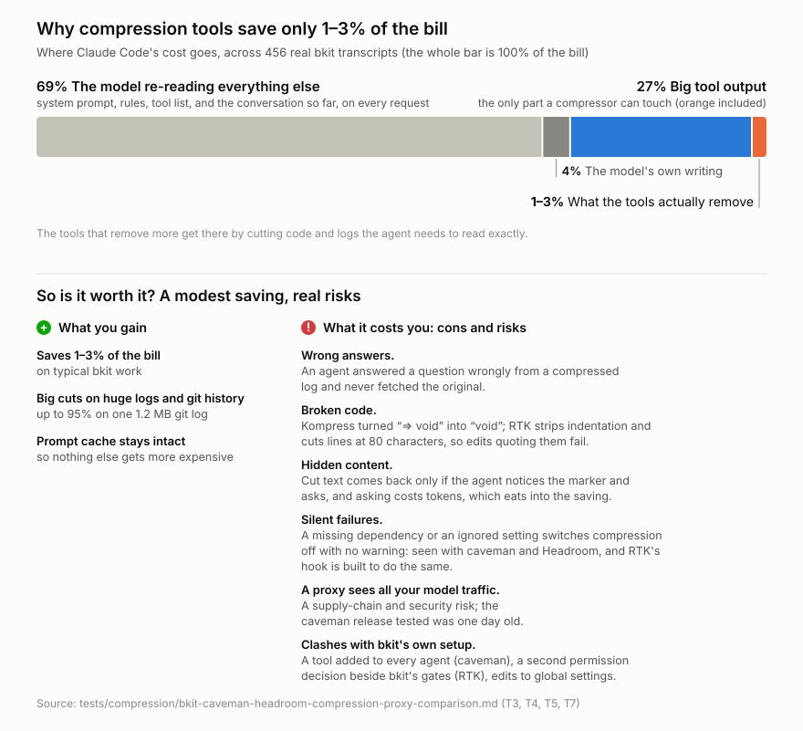

# Context-compression tools for bkit: caveman vs Headroom vs RTK

Investigation for #545 (caveman) and #538 (Headroom), run 2026-10-14, and #585 (RTK), run 2026-10-18. It answers one question: **would shrinking tool output before the model reads it save meaningful tokens, and which tool does it best?** Numbers have changed since the first version; see [Corrections](#corrections).

## Answer

- **No tool saves much on real bkit work.** On 456 real Claude Code transcripts from a bkit user repo, the two proxies save about **1–3%** of total token cost:
  - caveman 1.8% (95% range 1.0–2.6%);
  - Headroom with Kompress off 0.8% (0.4–1.4%);
  - Headroom with Kompress on 2.7% (2.2–3.2%), and it gets there by corrupting source code.
- **RTK works differently but lands in the same place: 0.7–2.1% (95% range 0.2–2.8%).** It isn't a proxy: a Claude Code hook rewrites Bash commands before they run (`grep` becomes `rtk grep`) and the agent sees the shorter output. It never touches `sed` or Claude Code's `Read` tool and passes `cat` through unchanged, so 59% of big Bash output is out of its reach. Where it does act, its `grep` strips indentation, cuts lines at 80 characters and hides matches past 25 per file. See [T7](#t7-rtk-and-all-four-re-measured-on-the-same-sample).
- **The ceiling is low.** Both proxies protect Claude's prompt cache: each compresses a tool result once, as it enters the conversation, and sends that same compressed version on every later request, so its re-reads shrink too. Nothing else in the conversation is rewritten while the cache is warm. Tool results big enough to compress, re-reads included, are **26.9%** of cost; the other 73% (the agent's own messages, system prompt, rules, tool definitions) is out of reach.
- **Headroom's own numbers agree.** Its logs, quoted in its source (`proxy/conversation_savings.py`), show Claude requests saving 4.18M tokens against 43.3M of new input, before counting cache re-reads.
- **Lossless de-duplication can't add much.** Tool results that exactly repeat an earlier one in the same conversation are 2.1% of cost: the most whole-result de-duplication (Headroom's opt-in `HEADROOM_DEDUPE`) could remove.
- **Not tested:** Headroom's default `--mode token` (also cache-safe, but compresses more freely and adds features), its opt-in rewrite of old history once the cache has expired, and caveman features outside the proxy. See [Limits](#limits).
- **Output compression is irrelevant.** Agent output is **3.8%** of cost, so caveman's terse voice can't move the total.
- **Both compressors are lossy in ways that hurt bkit.**
  - caveman's log compressor made an agent answer a factual question wrongly.
  - Headroom's text model, Kompress, rewrote code: `(preset) => void` came back as `(preset) void`.
  - caveman's code compressor replaces function bodies with a visible `/* caveman: body elided */` marker.
- **If a proxy is used at all, Headroom with Kompress off is the better fit for Claude Code.** It saves less than caveman, but keeps file reads verbatim and skips the text model that rewrote code, needs no agent changes, and handles the Claude Code proxy gotchas. Details in [Recommendation](#recommendation).
- **The larger, lossless savings are in bkit itself:**
  - #549: re-reading long contexts. The median request carries 228k tokens; subagents are 62.8% of cost.
  - #550: reading code. `sed`/`grep`/`cat` reads are about 60% of Bash cost, and 41% of file reads are repeats.

## Why the savings are so small

<picture>
  <source media="(prefers-color-scheme: dark)" srcset="bkit-compression-why-dark.svg">
  
</picture>

**Most of the bill is the model re-reading the same context, not tool output.** On every step, Claude Code sends the model the whole conversation again: the system prompt, bkit's rules, the tool list, everything said so far and every tool output so far. Most of it comes from the prompt cache at a tenth of the normal price. But it is sent on every request, and that repetition is most of the cost.

**A compression tool can only shrink one slice: big tool output.** That means file reads, searches, logs and test runs, and it is 27% of the bill. The rest is out of reach:

- **69% is the model re-reading things that aren't tool output.** Rewriting those would change the cached part of the conversation, so every later request would pay full price for it again. None of the tools touch it.
- **4% is the model's own writing.** Making the model write tersely (caveman's "voice") can only trim this 4%.

**Most of the 27% can't be shrunk safely either.** About 60% of big Bash output is code the agent reads so it can edit it (`sed -n`, `cat`, `grep`). The agent needs that text character for character: an edit fails if the text it quotes doesn't match the file. So the tools either leave code alone or damage it:

- Headroom keeps `Read` output verbatim.
- RTK passes `cat` through unchanged and skips `sed`.
- Kompress turned `=> void` into `void`.
- RTK's `grep` strips indentation and cuts lines at 80 characters.

What's left is logs, test output, git history and long search results. The tools do well there (Headroom cut a 1.2 MB `git log` by 95%), but it is a small part of the bill.

**So the arithmetic is 27% they can touch × the 5–10% they manage to remove ≈ 1–3% of the total.** The bigger lever is making agents re-read less in the first place (#549, #550).

### Is it worth it?

A modest saving, with real risks.

**What you gain:**

- **Saves 1–3% of the bill** on typical bkit work.
- **Big cuts on huge logs and git history:** up to 95% on one 1.2 MB `git log` (T2).
- **The prompt cache stays intact,** so nothing else gets more expensive (T6).

**What it costs you, the cons and risks:**

- **Wrong answers.** An agent answered a question wrongly from a compressed log and never fetched the original (T3).
- **Broken code.** Kompress turned `=> void` into `void`. RTK strips indentation and cuts lines at 80 characters, so edits that quote those lines fail (T5, T7).
- **Hidden content.** Cut text comes back only if the agent notices the marker and asks for it. Asking costs tokens, which eats into the saving.
- **Silent failures.** A missing dependency or an ignored setting switches compression off with no warning. This happened with caveman and Headroom in testing, and RTK's hook is built to fail the same way ([What went wrong](#what-went-wrong-and-how-it-was-handled), T7).
- **A proxy sees all your model traffic.** That's a supply-chain and security risk; the caveman release tested was one day old.
- **Clashes with bkit's own setup.** caveman needs a tool added to every bkit agent (T6). RTK makes a second permission decision beside bkit's gates and edits global settings (T7).

## Corrections

The numbers above differ from the first version of this report, which a LinkedIn post of 2026-10-15 quotes. Every version stays readable at its commit.

<!-- prettier-ignore -->
| Figure | [First version](https://github.com/cbartens/bkit/blob/07db7d6b/tests/compression/bkit-caveman-headroom-compression-proxy-comparison.md) (14 Oct) | LinkedIn post (15 Oct) | [Ranges added](https://github.com/cbartens/bkit/blob/7349ecd1/tests/compression/bkit-caveman-headroom-compression-proxy-comparison.md) (15 Oct) | Now (15 Oct) |
| --- | --- | --- | --- | --- |
| Headline | 1.4–1.6% | 1–2% | 1–2% | **1–3%** |
| caveman | ≈1.6% | 1.6% (1.1–2.3%) | 1.6% (1.1–2.2%) | **1.8% (1.0–2.6%)** |
| Headroom, Kompress off | ≈1.4% | 1.4% (0.8–2.1%) | 1.4% (0.8–2.1%) | **0.8% (0.4–1.4%)** |
| Headroom, Kompress on | ≈3.8% | 3.8% (3.4–4.3%) | 3.8% (3.4–4.3%) | **2.7% (2.2–3.2%)** |
| Bash: caveman / Headroom / Kompress off | 4.9% / 14.1% / 5.2% | same | same | 5.7% / 11.4% / 3.4% |
| Read: caveman / Headroom / Kompress off | 15.4% / 17.0% / 4.9% | same | same | 14.6% / 0% / 0% |
| Samples replayed | 250 Bash, 218 Read | same | same | 250 Bash, 250 Read |
| Headroom's default `--mode token` | not mentioned | "gives up the prompt cache" (wrong; first wording of the post) | "gives up prompt-cache stability" (wrong) | protects the cache too; not tested |

1. **Ranges added.** The first version gave single numbers. The 95% ranges come from resampling the replayed samples 2,000 times (`bkit-compression-summary.py --project`). The post's caveman range (1.1–2.3%) came from a one-off run with a different random seed; the script gives 1.1–2.2%.
2. **Token mode corrected.** Headroom's source shows both of its modes leave the cached part of the conversation alone and resend each compressed result unchanged on later requests (T6). The "gives up the prompt cache" claim was wrong.
3. **Replay re-run with the real tool calls.** The first replay sent every sample to Headroom as a `Bash` call with a dummy command and "Continue." as the user message, so Headroom's per-tool rules never applied: it compressed Claude Code `Read` output that it keeps verbatim in real use. The re-run passes each result's real tool call and latest user message, on the same 456 transcripts. Headroom's numbers fell; caveman's rose slightly because the new sample differs (its compressor takes text only). The conclusion is unchanged: low single-digit savings.

## Setup

<!-- prettier-ignore -->
| Item | Version / detail |
| --- | --- |
| Machine | macOS arm64, Node 24.16.0, uv 0.12.6 |
| caveman | CLI `@caveman-ai/cli` 4.0.1, runtime binaries `bin-v4.0.1` (signature-checked by `caveman setup --install`) |
| Headroom | `headroom-ai[all]` 0.40.0, Python 3.13 via `uv tool` |
| RTK | 0.51.0, prebuilt `rtk-aarch64-apple-darwin.tar.gz` from the GitHub release, checked against its `checksums.txt` |
| Agents | Claude Code (primary host in the bkit user repo), opencode 2.0.26 |
| Live model | `deepseek/deepseek-v4.1-flash` on OpenRouter |

Install commands used. The cooldown dates are the repo's 7-day minimum release age; caveman 4.0.1 was one day old and was used by explicit choice.

```bash
uv tool install --python 3.13 --exclude-newer 2026-10-07T00:00:00Z "headroom-ai[all]==0.40.0"
DO_NOT_TRACK=1 npm i -g --ignore-scripts @caveman-ai/cli@4.0.1   # no dependencies, no install scripts
caveman setup --install                                            # downloads + verifies runtime into ~/.caveman/bin only
caveman telemetry off                                              # Headroom: HEADROOM_BEACON=off at run time
gh release download v0.51.0 -R rtk-ai/rtk -p rtk-aarch64-apple-darwin.tar.gz -p checksums.txt
grep rtk-aarch64-apple-darwin.tar.gz checksums.txt | shasum -a 256 -c && tar xzf rtk-aarch64-apple-darwin.tar.gz   # no `rtk init`
```

RTK 0.51.0 (2 Oct) is the newest release at least 7 days old; 1.0.0 and 1.0.1 (13 and 14 Oct) were too new. RTK's telemetry is off by default.

**Isolation check.** Hashes of `~/.claude/settings.json`, `~/.claude.json`, `~/.claude/CLAUDE.md`, `~/.codex/config.toml` and the global opencode config were taken before and after `caveman setup --install`: identical. Neither tool was "enabled" for any agent. All wiring was per checkout and temporary (`bkit-compression-opencode-arm.sh`). RTK was never set up as a hook (`rtk init` not run), and its tracking and recall stores went to a temp dir (`RTK_DB_PATH`, `RTK_RECALL_DB`).

## Tests run

<!-- prettier-ignore -->
| # | Test | Script | What it shows |
| --- | --- | --- | --- |
| T1 | Tiny live request through each proxy | `bkit-compression-probe.py` (tiny payload) | Proxies reach OpenRouter; per-request overhead |
| T2 | Large real payloads through each proxy, live | `bkit-compression-probe.py` | Compression per content type, provider-reported tokens |
| T3 | End-to-end opencode session through each proxy | `bkit-compression-opencode-arm.sh`, `bkit-compression-opencode-tokens.py` | Real agent wiring, recovery, answer quality |
| T4 | Where Claude Code cost goes, from real transcripts | `bkit-compression-usage.py` | Ceiling for any proxy; which tool output matters |
| T5 | Offline replay of real tool results through both compressors | `bkit-compression-replay.py`, `bkit-compression-summary.py` | Expected savings on real bkit work, safety of the rewrites |
| T6 | Claude Code integration review (source reading) | none | Recovery, tool search, 1M context behind a proxy |
| T7 | RTK's hook on the same samples, plus caveman and Headroom re-run on them | `bkit-compression-rtk-replay.py`, `bkit-compression-summary.py --rtk` | RTK's expected savings, what it does to content, all four tools on identical data |

### T1: tiny request (direct vs proxies)

One-line prompt, `deepseek/deepseek-v4.1-flash`:

<!-- prettier-ignore -->
| Route | Non-streaming prompt tokens | Streaming prompt tokens |
| --- | --- | --- |
| Direct OpenRouter | 38 | 38 |
| caveman | **389** | 38 |
| Headroom | 38 | 38 |

caveman adds its server-side retrieve tool (about 350 tokens) to **non-streaming** API-key requests only. Claude Code and opencode stream, so they don't pay it.

### T2: large real payloads, live

Same streamed request, with the payload as the latest tool result, pinned to one OpenRouter host (`--host deepinfra`):

<!-- prettier-ignore -->
| Payload (real bkit data) | Direct | caveman | Headroom |
| --- | --- | --- | --- |
| opencode log, 150 KB | 55,588 | **17,254 (−69%)** | 46,078 (−17%) |
| `gh issue list --json` array, 53 KB | 18,813 | **16,595 (−12%)** | 17,987 (−4%) |
| `git log -n 40 --stat`, 125 KB | 37,183 | 37,241 (0%) | **32,241 (−13%)** |
| `git log -n 300 --stat`, 1.2 MB | 333,794 | 333,852 (0%) | **17,762 (−95%)** |
| issue thread JSON (prose), 38 KB | 10,764 | 10,822 (0%) | 10,764 (0%) |

caveman's +58 on rows it didn't compress is its retrieve tool's definition. Which tool wins depends on the content: caveman on logs and JSON, Headroom on large git output.

### T3: opencode end to end

Prompt: have the agent `cat` the 150 KB log, then answer "how many distinct log levels appear?" (correct answer: 3).

<!-- prettier-ignore -->
| Arm | Tokens in the request carrying the log | Answer |
| --- | --- | --- |
| Direct | 26.8k (opencode had already cut the log down) | 3 (correct) |
| Headroom | about 6% saved (3,592 tokens) | 3 (correct) |
| caveman | tool result 18,415 → 5,737; request 26.8k → **13.4k** | **"1 — only INFO" (wrong)** |

The agent answered from the compressed log and never fetched the original. This is the "lossy exact content" risk from #538 and #545, showing up on the first real try. It is one run, with a small model (`deepseek-v4.1-flash`) on opencode, not Claude: it shows the risk exists, not how often it happens.

### T4: where Claude Code cost goes (bkit user repo)

456 transcripts (86 sessions plus 370 subagent transcripts), 56,141 requests, 21 Aug to 14 Oct 2026. Cost is in input-price units: cache read 0.1, 1h cache write 2, 5m write 1.25, output 5. A tool result is costed as written once and then re-read by every later request in its transcript.

<!-- prettier-ignore -->
| Measure | Value |
| --- | --- |
| Cache-read tokens | 14.58 billion (writes 0.19 billion, output 0.014 billion) |
| Output share of cost | **3.8%** |
| All tool results | 34.2% of cost |
| Tool results ≥ 2 KB (what a proxy can compress) | **26.9%** of cost: Bash 23.5%, Read 3.0%, everything else below 0.2% |
| Bash output | 29.8% of cost: `sed` 29.9% of Bash cost, `grep` 16.9%, `cat` 12.8%, `gh issue view` 3.2%, `npx vitest` 0.8% |
| Context per request | median 228,040, p90 486,136, max 963,213 tokens |
| Subagents | 62.8% of cost, 84.4% of it cache re-reads |
| Repeat file reads | 41% (8,262 of 20,169) |
| Serena results | 40 in total, vs 9,848 `sed` reads |

### T5: offline replay of real tool results

Random, seeded sample of real tool results ≥ 2 KB: 250 Bash, 250 Read, from the same 456 transcripts (`--before 2026-10-14T10:00`; compressible share 27.0%: Bash 23.6%, Read 3.0%). Each was compressed as the latest tool result of a turn (what a proxy sees), after the real tool call and the latest user message, and weighted by how many later requests re-read it. Headroom ran a second time with Kompress off, on the same files.

**Validation against the live proxies (T2)**, from the first replay run:

<!-- prettier-ignore -->
| Payload | caveman offline / live | Headroom offline / live |
| --- | --- | --- |
| opencode log | −72% / −69% | −16% / −17% |
| `gh issue list` JSON | −12% / −12% | −6% / −4% |
| `git log -n 300 --stat` | 0% / 0% | −94% / −95% |
| `git log -n 40 --stat` | 0% / 0% | 0% / −13% (offline understates Headroom here) |

**Results** (share of cache-weighted tokens removed; "hit" = samples changed):

<!-- prettier-ignore -->
| Tool | Samples | caveman | Headroom (full) | Headroom, Kompress off |
| --- | --- | --- | --- | --- |
| Bash | 250 | 5.7% (31 hit) | 11.4% (161 hit) | 3.4% (47 hit) |
| Read | 250 | 14.6% (56 hit) | 0% (0 hit) | 0% (0 hit) |

Headroom keeps Claude Code's `Read` output verbatim by design (`Read` is in `DEFAULT_EXCLUDE_TOOLS`), so the agent can edit against the exact lines. caveman's command-line compressor sees only the text; whether its proxy treats `Read` differently was not checked.

**Bash by content type** (caveman's classifier label):

<!-- prettier-ignore -->
| Content | Share of Bash ≥ 2 KB | caveman | Headroom | Headroom, Kompress off |
| --- | --- | --- | --- | --- |
| code | 59% | 1.7% | 12.0% | 0.5% |
| text | 19% | 3.0% | 11.3% | 6.9% |
| terminal | 7% | 22.1% | 15.4% | 15.4% |
| html | 5% | 11.8% | 7.3% | 0% |
| diff | 4% | 35.2% | 0.6% | 0.6% |
| search result | 3% | 1.4% | 5.3% | 5.3% |
| tabular / log / config | 3% | 0–36% | 1–22% | 1–22% |

Headroom's lossless grep fold changed 14 of the 42 `grep` samples but removed only 1.7% of their weighted tokens.

**Projected share of total cost saved:** pool share × savings rate, for Bash (23.6%) and Read (3.0%):

<!-- prettier-ignore -->
|  | caveman | Headroom (full) | Headroom, Kompress off |
| --- | --- | --- | --- |
| Total cost saved | **≈1.8%** | **≈2.7%** | **≈0.8%** |
| 95% range | 1.0–2.6% | 2.2–3.2% | 0.4–1.4% |

The range comes from resampling each tool's samples 2,000 times (`bkit-compression-summary.py --project`). No handful of samples drives the result: the five heaviest samples hold 14% (Bash) and 16% (Read) of each tool's weight.

**What the rewrites do to code:**

- **Headroom with Kompress** on a real `cat` of a `.tsx` store file (−27%):
  - stripped all indentation and blank lines;
  - deleted words inside comments;
  - **changed syntax**: `setFilterPreset: (preset: CalendarFilterPreset) => void;` became `setFilterPreset: (preset: CalendarFilterPreset) void;`.

  The only signal is a footer: `[819 words compressed to 575 ... Retrieve more: hash=…]`. This is one example found while reading samples; how often Kompress changes syntax was not counted.

- **caveman** on a real test file (−91%): every `describe(...)` body became `{ /* caveman: body elided */ }`. Lossy, but visible to the agent.

### T6: Claude Code integration (from source)

<!-- prettier-ignore -->
| Concern | caveman 4.0.1 | Headroom 0.40.0 |
| --- | --- | --- |
| Getting the original back | The agent must call the MCP tool `mcp__caveman__caveman_retrieve`. On Pro/Max (subscription) traffic it compresses only if that tool is installed for the agent (`liveZoneCompressionAllowed`), and then compresses every request in the session, including subagents. bkit agents have explicit `tools:` lists, so all of them would need the tool added. | The proxy adds `headroom_retrieve` to each request and **answers the call itself**, streaming included (`ccr/response_handler.py`). Works for every subagent with no `tools:` changes. |
| Claude Code tool deferral behind `ANTHROPIC_BASE_URL` | Sets `ENABLE_TOOL_SEARCH` | Sets `ENABLE_TOOL_SEARCH` (`--tool-search`, on by default) |
| 1M context behind a proxy | No general handling found (only for its own Auto model) | `--1m` adds the `[1m]` model suffix so Claude Code keeps sending the 1M beta header |
| Which part of the request is rewritten | Anthropic: Claude Code's own `cache_control` breakpoints; nothing already cached is rewritten. Records the cached prefix and every cache break (`cache_bust`, `cache_bust_cause`) and forwards the original request when a rewritten one is rejected (from strings in the binary; not traced further) | Both modes leave the provider-cached prefix alone and send each compressed turn again byte for byte on later requests ("The compressed delta is replayed verbatim next turn", `proxy/handlers/anthropic.py`). `--mode cache` (used here) is strictly byte-identical and skips extras that would change the next request. Default `--mode token` compresses anything not yet cached and adds memory injection, extra context and image compression; not tested. Old history is rewritten only once the cache has already expired, and only with opt-in settings (`HEADROOM_COLD_RECOMPACT`, `HEADROOM_NET_COST_POLICY`) |
| Defaults to switch off | voice (`output`), `scripts`, `waste-fixes` (sends extra cache-warming requests), `browse`, telemetry | Kompress (`--disable-kompress`), beacon |

### T7: RTK, and all four re-measured on the same sample

RTK has two parts:

- **A Claude Code `PreToolUse` hook.** It rewrites a Bash command before it runs (`git status` becomes `rtk git status`), and the agent sees the rewritten command's shorter output. Output is shortened once, before it enters the conversation, so the prompt cache can't be affected.
- **An optional API proxy (`rtk-proxy`).** It works like Headroom: only cache-safe changes, and a `rtk_retrieve` tool that the daemon answers itself. It was not tested; Headroom already covers that design.

**Method.** A stored tool result can't be put back through the hook, because the hook changes the command, not the output. So `rtk rewrite <command>` classifies each Bash sample by printing what the hook would run:

- **Untouched:** RTK declines the command, so it saves 0%.
- **Rewritten and re-run:** every part of the command chain is on a read-only allowlist (no file writes, no `$(...)`, no scripts). The original and the rewritten command both run now in the app repo, and the ratio of their output sizes is applied to the stored result.
- **Rewritten but not re-run:** the chain also writes files or runs scripts, or the re-run original is now under 2 KB. These are reported two ways: as 0% saved, or at the rate the re-run samples achieved.
- **Read:** RTK's hook sees Bash only, so `Read` results save 0%.

The caveman and Headroom replays were run again on the same dump. RTK uses exactly their samples, joined by file, so all columns below come from identical data.

**Data.** The period is the same as T4 and T5 (`--before 2026-10-14T10:00`), but only 314 of the 456 transcripts are still on disk. Why the other 142 are gone was not checked. Compressible share: Bash 24.3%, Read 2.9% (T4: 23.6%, 3.0%).

**Where RTK acts** (cache-weighted share of the 250 Bash samples):

<!-- prettier-ignore -->
| Class | Samples | Share |
| --- | --- | --- |
| Untouched | 147 | **59.3%** |
| Rewritten and re-run | 28 | 13.7% |
| Rewritten, not re-run: chain also writes files or runs scripts | 63 | 22.0% |
| Rewritten, not re-run: original now under 2 KB | 12 | 4.9% |

The untouched 59% is `sed` reads (25.3 points, alone or after a `cd`), `git` commands RTK doesn't filter, such as `git grep` (6.5), `grep` inside loops and scripts (4.2), `cat` inside loops (3.9), `gh api` and `gh ... --json` (3.6), and shell loops and inline scripts.

**Results** (share of cache-weighted tokens removed; "hit" = samples changed):

<!-- prettier-ignore -->
|  | caveman | Headroom (full) | Headroom, Kompress off | RTK, not re-run = 0% | RTK, not re-run = measured rate |
| --- | --- | --- | --- | --- | --- |
| Bash (250) | 3.6% (31 hit) | 11.6% (153 hit) | 3.2% (44 hit) | 2.9% (16 hit) | 8.7% |
| Read (250) | 16.0% (61 hit) | 0% | 0% | 0% | 0% |
| **Total cost saved** | **1.3%** | **2.8%** | **0.8%** | **0.7%** | **2.1%** |
| 95% range | 0.9–1.9% | 2.2–3.7% | 0.3–1.5% | 0.2–1.4% | 1.5–2.8% |

- RTK removed 21% of the weighted tokens on the samples that were re-run, changing 13 of 28.
- The 2.1% figure is generous. Most of the chains that weren't re-run mix a command RTK rewrites with commands it leaves alone, so the 21% rate overstates them.
- The re-run of caveman and Headroom agrees with T5: caveman 1.3% vs 1.8%, Headroom 2.8% vs 2.7%, Kompress off 0.8% vs 0.8%.

**What RTK's rewrites do to content.** RTK's output was read for every re-run sample that saved more than 30%:

- **`rtk grep` changes the matching lines.** It strips leading whitespace, so `    it("applies type filter…` comes back as `it("applies type filter…`. It cuts each line at 80 characters (`--max-len`, default 80). It shows at most 25 matches per file, then a line like `+86 more in docs/testing.md [+86 hidden: rtk recall af5ded9daab7]`.
- **A code read became a search summary.** One sample read a file with `grep -v '^\s*$' file | head -80`. RTK printed `100 matches in 1 files`, with every line trimmed and cut at 80 characters.
- **Hidden matches can be fetched back with `rtk recall <hash>`,** but only if the agent notices and asks. A trimmed or cut line can't be quoted as the `old_string` of an edit.
- **`cat`, `head` and `tail` become `rtk read`.** At its default `--level none` it prints the file unchanged, so it saved 0% on every sample.

**Integration (from source, RTK 0.51.0):**

- **The hook needs `jq`.** If `jq` is missing, or `rtk` is missing or older than 0.23.0, it silently does nothing (`hooks/claude/README.md`).
- **It makes its own permission decisions.** It re-implements Claude Code's allow/deny/ask matching and answers `allow` when an allow rule matches (`src/hooks/permissions.rs`). How that combines with bkit's own `PreToolUse` gates was not checked.
- **`rtk init -g` edits global files:** `~/.claude/settings.json`, plus an RTK instructions file added to CLAUDE.md.
- **Licence.** The CLI is Apache-2.0, but the default build links a BUSL-1.1 engine. The `rtk-oss` edition is Apache-2.0 only.

## What went wrong, and how it was handled

<!-- prettier-ignore -->
| Problem | Effect | Handling |
| --- | --- | --- |
| caveman 4.0.1 was 1 day old; bkit's rule is a 7-day release age | Supply-chain risk on a tool that sees all LLM traffic | Explicit human choice to use it; Headroom's whole dependency tree capped with `uv --exclude-newer` |
| OpenRouter hosts report `prompt_tokens` inconsistently | Identical requests read 333,794 vs 667,787 tokens | Probe pins one host (`provider.only`, `--host`, default `deepinfra`) |
| caveman's opencode integration only reroutes the built-in `openai` / `anthropic` / `opencode-go` providers | bkit's agents use the custom `openrouter` provider, so nothing was compressed | compat mount `openrouter` (`bkit-compression-caveman.yaml`) plus a per-checkout `baseURL` edit |
| opencode 2.0.26 doesn't read `OPENCODE_CONFIG_CONTENT` or `OPENCODE_CONFIG` | `headroom wrap opencode` relies on it, so its routing is silently ignored | Same per-checkout config edit for Headroom |
| opencode 2 sends MCP tools behind one `execute` tool | caveman never sees its retrieve tool, so streamed requests stay raw (`compression_eligible = 0`) | Run `caveman-proxy` with `CAVEMAN_RECOVERY=mcp`; `caveman start` hard-codes no recovery (`startMcpRecoveryAvailable()` returns `false`) |
| caveman "raw pinning" | A conversation that once streamed raw stays raw | Fresh conversation per probe |
| Headroom's library protects the last 4 messages by default | The library compresses nothing the proxy would | `protect_recent=0` in the replay |
| The first replay sent every sample as a `Bash` call with a dummy command and "Continue." as the user message | Headroom's per-tool rules never applied: it compressed Claude Code `Read` output it keeps verbatim, its lossless grep fold never ran, and its relevance scoring had no question to score against | The dump stores each result's real tool call and the latest user message, and the replay passes them on. All T5 numbers are from the corrected run |
| Headroom's Kompress loads in the background | First replay run passed text through uncompressed, understating Headroom | `warm_kompress_model()` before replay |
| Kompress takes seconds per sample on CPU | Full replay was too slow | Stopped at 500 of 891 samples: Bash and Read are measured and are 26.6 of the 27.0 points of compressible cost |
| opencode truncates long tool output itself | Caps what either proxy can save on huge dumps | Noted; Claude Code also saves oversized output to a file instead of the context |
| `caveman setup --install --non-interactive` | Rejected (usage error) | Use `caveman setup --install` |
| 142 of the 456 T4 transcripts were no longer on disk on 18 Oct | T5's exact sample couldn't be rebuilt for RTK | Re-ran caveman and Headroom on the new dump, so T7 compares all four on identical data |
| `rtk pipe --filter grep` runs different code from the hook's `rtk grep` (no 80-character cut, no 25-per-file cap) | Replaying stored output through `rtk pipe` would have measured the wrong filter | Re-ran each read-only command and its RTK rewrite live, and applied the size ratio |
| RTK's hook only acts on commands it recognises, and many bkit commands are chains | Running every chain again could change files | Re-ran only chains whose every part is on a read-only allowlist; reported the rest both as 0% and at the measured rate |

## Recommendation

1. **Don't make a compression proxy a priority.** About 1–3% saving doesn't justify the extra moving part in every Claude Code session.
2. **Do #549 and #550 first.** They act on the 73% no proxy can reach, and they lose nothing.
3. **If a proxy is still wanted, use Headroom with `--disable-kompress`, not caveman.**
   - Saves less than caveman (0.8% vs 1.8%), but keeps file reads verbatim and skips the text model that rewrote code.
   - Retrieval works for every bkit subagent with no `tools:` changes.
   - Explicit fixes for Claude Code's tool deferral and 1M window.
   - No code corruption.
4. **Turn off caveman's voice everywhere in bkit if caveman is used for anything.** Output is 3.8% of cost, and the voice harms bkit's written artifacts.
5. **Don't adopt RTK either.** It saves 0.7–2.1%, never reaches `sed` or `Read`, and its `grep` output can't be quoted back into an edit. Its permission handling would also need checking against bkit's gates first. The one idea worth keeping is that shortening output at the source never touches the cache. That is #550's territory, done losslessly inside bkit.

## How to replicate on your own sessions

Measure first (T4). It is free, offline, and tells you the ceiling for your workload.

### 1. Where your Claude Code cost goes

Claude Code keeps every session as JSONL under `~/.claude/projects/<slug>/`. The slug is the project path with `/` replaced by `-`. Subagent transcripts are in `<slug>/<session>/subagents/`.

```bash
python3 tests/compression/bkit-compression-usage.py "$HOME/.claude/projects/-Users-me-src-my-app*" --by-command --context
```

If "results ≥ 2 KB" is a small share of cost, no proxy can help you much; stop here.

### 2. Replay your own tool results (offline, no model calls)

Install the tools as in [Setup](#setup), then:

```bash
mkdir -p tmp/compression
python3 tests/compression/bkit-compression-usage.py "$HOME/.claude/projects/<slug>*" --dump tmp/compression/dump
HR=~/.local/share/uv/tools/headroom-ai/bin/python
$HR tests/compression/bkit-compression-replay.py tmp/compression/dump 250 tmp/compression/replay.jsonl
$HR tests/compression/bkit-compression-replay.py tmp/compression/dump 250 tmp/compression/replay-no-kompress.jsonl --no-kompress
python3 tests/compression/bkit-compression-summary.py tmp/compression/replay.jsonl --no-kompress tmp/compression/replay-no-kompress.jsonl
python3 tests/compression/bkit-compression-summary.py tmp/compression/replay.jsonl --no-kompress tmp/compression/replay-no-kompress.jsonl --by-type
python3 tests/compression/bkit-compression-summary.py tmp/compression/replay.jsonl --rows   # one line per sample
python3 tests/compression/bkit-compression-summary.py tmp/compression/replay.jsonl --no-kompress tmp/compression/replay-no-kompress.jsonl --project Bash=0.236,Read=0.030
```

Projected saving = each tool's "≥2KB share" (step 1) × its saving rate (this step), summed. `--project` does the sum and prints a 95% range; replace `0.236` and `0.030` with your own Bash and Read "≥2KB share" from step 1. `--before YYYY-MM-DD` on the usage script repeats a measurement on the same period later.

- **The dump holds raw tool output.** Keep it under the gitignored `tmp/` and delete it when done; it can contain secrets that agents read.
- **Allow time.** The Kompress pass takes a few seconds per sample (about an hour for 500 samples on CPU). Use a smaller sample size to get a first number.

### 3. Live probe (optional; costs cents on OpenRouter)

```bash
DO_NOT_TRACK=1 CAVEMAN_RECOVERY=mcp CAVEMAN_MODE=compress CAVEMAN_LISTEN=127.0.0.1:8787 \
  CAVEMAN_CONFIG=tests/compression/bkit-compression-caveman.yaml ~/.caveman/bin/caveman-proxy &
HEADROOM_BEACON=off OPENAI_TARGET_API_URL=https://openrouter.ai/api/v1 headroom proxy --port 8788 --mode cache &
python3 tests/compression/bkit-compression-probe.py <payload-file>    # needs BKIT_OPENROUTER_API_KEY
```

### 4. Real workflow A/B on opencode (optional)

Three worktrees from the same commit, one per arm, each running the same `/bkit-design` or `/bkit-plan`:

```bash
git worktree add ../bkit-test-caveman HEAD && cd ../bkit-test-caveman
../bkit/tests/compression/bkit-compression-opencode-arm.sh caveman    # or baseline / headroom; starts the proxy
opencode --standalone                                                  # must be a new opencode process
python3 ../bkit/tests/compression/bkit-compression-opencode-tokens.py --latest .
../bkit/tests/compression/bkit-compression-opencode-arm.sh baseline   # restore config; `stop` ends both proxies
```

**Read before trusting the numbers:**

- **Compare output quality, not just tokens.** T3 got a wrong answer at −50% tokens.
- **One run per arm is noisy.** Run the baseline twice to see the run-to-run spread.
- **Each arm is a real workflow run.** Tracker writes and commits happen once per arm.

### 5. RTK on the same samples (offline classification, read-only re-runs)

Needs the dump and `replay-no-kompress.jsonl` from step 2, and the checkout the transcripts came from:

```bash
python3 tests/compression/bkit-compression-rtk-replay.py tmp/compression/dump tmp/compression/replay-no-kompress.jsonl \
  tmp/compression/rtk-plan.jsonl --repo ../my-app --rtk /path/to/rtk --plan   # classify only, runs nothing
python3 tests/compression/bkit-compression-rtk-replay.py tmp/compression/dump tmp/compression/replay-no-kompress.jsonl \
  tmp/compression/rtk.jsonl --repo ../my-app --rtk /path/to/rtk
python3 tests/compression/bkit-compression-summary.py tmp/compression/replay.jsonl --no-kompress tmp/compression/replay-no-kompress.jsonl \
  --rtk tmp/compression/rtk.jsonl --project Bash=0.243,Read=0.029
```

- **Read the `--plan` output first.** The second command really runs every sample whose chain passes the read-only allowlist, including `gh issue view` and `gh pr view` calls.
- **The re-run is today's repo, not the one the transcript saw.** Commands whose `cd` target is gone fall through to the repo root or come back under 2 KB and are counted as not re-run.

## Files

<!-- prettier-ignore -->
| File | Purpose |
| --- | --- |
| `bkit-caveman-headroom-compression-proxy-comparison.md` | This report |
| `bkit-compression-usage.py` | T4: cost attribution from Claude Code transcripts; `--dump` feeds T5 |
| `bkit-compression-replay.py` | T5: offline replay through caveman and Headroom (run with Headroom's Python) |
| `bkit-compression-summary.py` | T5: per-tool and per-content-type savings; `--project` for the projected total with a 95% range; `--rtk` adds T7's RTK columns |
| `bkit-compression-rtk-replay.py` | T7: classify samples with `rtk rewrite`, re-run the read-only ones raw and through RTK |
| `bkit-compression-why-light.svg`, `bkit-compression-why-dark.svg` | The chart in [Why the savings are so small](#why-the-savings-are-so-small) |
| `bkit-compression-probe.py` | T1/T2: live direct vs caveman vs Headroom through OpenRouter |
| `bkit-compression-caveman.yaml` | caveman proxy config: compress mode plus an `openrouter` compat mount |
| `bkit-compression-opencode-arm.sh` | T3: switch a checkout between baseline / caveman / Headroom for opencode |
| `bkit-compression-opencode-tokens.py` | T3: tokens and cost for an opencode session tree |

## Limits

- **Not tested.** Headroom's default `--mode token`: it also leaves the cached prefix alone, but compresses anything not yet cached and adds memory injection, extra context and image compression. Headroom's opt-in rewrites: `HEADROOM_DEDUPE` (can't be replayed one result at a time; exact repeats bound it at 2.1% of cost) and `HEADROOM_COLD_RECOMPACT` (rewrites old history only once the cache has expired, so it depends on how often sessions sit idle past the cache lifetime). caveman features outside the proxy (memory, setup advice).
- **One project.** The data comes from a single bkit user repo (an app monorepo), on the Claude subscription. Savings show up as quota and context headroom, not money. Most sessions were driven by hand, not by bkit workflows (#549). A workload heavy in logs, where caveman does well, would save more.
- **API price ratios.** Cost uses API list-price ratios (cache read 0.1, writes 1.25 / 2, output 5). How Anthropic counts cache reads against subscription quota isn't published, so the 27% / 73% split is in API-price terms.
- **Sampling error.** T5 uses 500 of 891 samples; the 95% ranges in T5 show the effect. Headroom's first offline replay understated the live proxy on one payload (`git log -n 40`: 0% vs −13%).
- **caveman sees text only.** Its command-line compressor gets no tool name or command, so its figure assumes the proxy compresses every tool's output alike. If its proxy kept `Read` output verbatim, as Headroom does, caveman would save about 1.3% instead of 1.8%.
- **Single examples of harm.** The wrong answer (T3) is one run with a small model; the Kompress syntax change (T5) is one example. Neither has a measured rate.
- **Estimated tool-result tokens.** These are characters / 4 in T4. Request totals and the T1–T3 numbers are provider-reported.
- **Approximate re-read weighting.** The model assumes a tool result stays in context until its transcript ends; compaction can drop it earlier.
- **Costs not counted.** Fetching originals back, caveman's retrieve-tool definition and any cache disruption are left out. Each would lower the proxies' savings.
- **RTK is bracketed, not pinned down.** 27% of the Bash weight was rewritten by RTK but not re-run, hence the 0.7–2.1% span. The re-run ratio comes from today's repo, applied to the stored result. RTK 1.0.x and `rtk-proxy` were not tested.
- **Projected savings, not live ones.** T5 projects savings from replay. The only full agent sessions run through a proxy were the T3 smoke tests, not a full bkit workflow.
